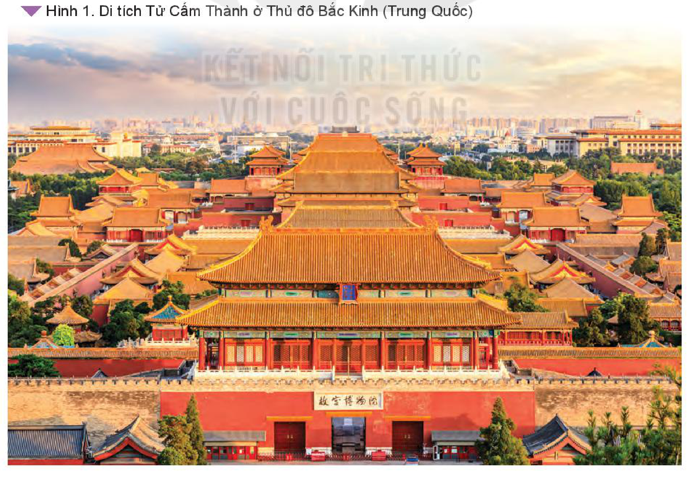
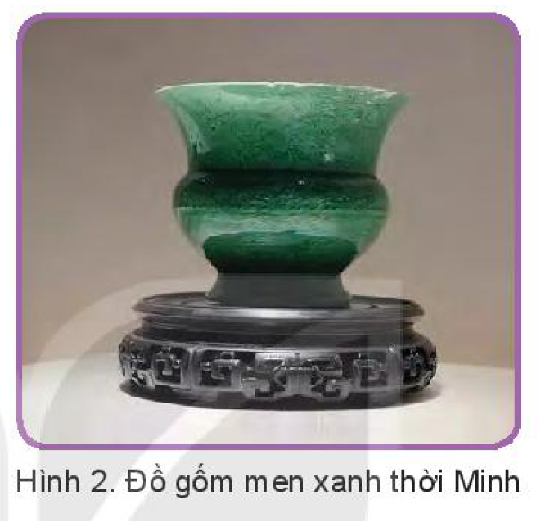
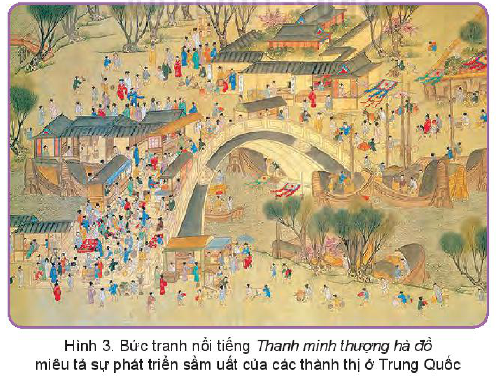
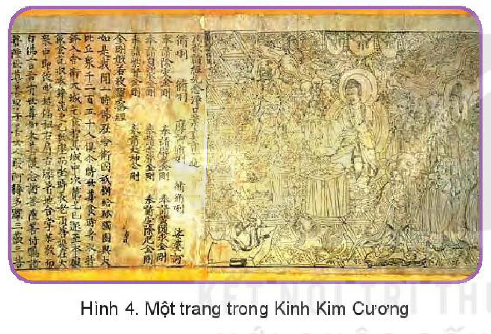
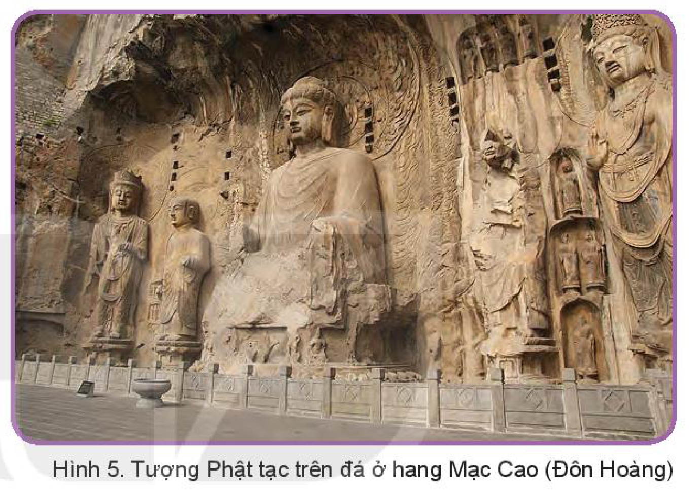

<!-- pdf:25 -->

# BÀI 4: TRUNG QUỐC TỪ THẾ KỈ VII ĐẾN GIỮA THẾ KỈ XIX

## 🎯 Học xong bài này, em sẽ:

- Lập được sơ đồ tiến trình phát triển của Trung Quốc từ thế kỉ VII đến giữa thế kỉ XIX (các thời Đường, Tống, Nguyên, Minh, Thanh).
- Nêu được những nét chính về sự thịnh vượng của Trung Quốc dưới thời Đường.
- Mô tả được sự phát triển kinh tế dưới thời Minh – Thanh.
- Giới thiệu và nhận xét được những thành tựu chủ yếu của văn hoá Trung Quốc từ thế kỉ VII đến giữa thế kỉ XIX (Nho giáo, Sử học, kiến trúc,...).

## 🔴 Mở đầu

Hình dưới đây là di tích Tử Cấm Thành – một cung điện lớn và là một trong những biểu tượng của Trung Quốc thời phong kiến. Từ thế kỉ VII đến giữa thế kỉ XIX, chế độ phong kiến Trung Quốc tiếp tục phát triển như thế nào trên các lĩnh vực chính trị, kinh tế, văn hoá, xã hội?

*Hình 1. Di tích Tử Cấm Thành ở Thủ đô Bắc Kinh (Trung Quốc)*

<!-- pdf:26 -->

## 1. Tiến trình phát triển của lịch sử Trung Quốc từ thế kỉ VII đến giữa thế kỉ XIX

Sau khi nhà Tuỳ sụp đổ, lịch sử Trung Quốc tiếp tục trải qua các triều đại: Đường (618 – 907), thời kì Ngũ đại (907 – 960), Tống (960 – 1279), Nguyên (1271 – 1368), Minh (1368 – 1644) và nhà Thanh (1644 – 1911) – triều đại phong kiến cuối cùng của Trung Quốc.

> ❓ Từ thế kỉ VII đến giữa thế kỉ XIX, lịch sử Trung Quốc trải qua các triều đại phong kiến nào? Hãy thể hiện tiến trình lịch sử đó trên trục thời gian theo ý tưởng của em.

## 2. Trung Quốc dưới thời Đường

- *Về chính trị:*

Thời Đường, đặc biệt là giai đoạn trị vì của Đường Thái Tông, bộ máy nhà nước được hoàn chỉnh. Các hoàng đế cử người thân tín cai quản các địa phương, đặt các khoa thi để tuyển chọn người đỗ đạt ra làm quan,...

Các hoàng đế thời Đường tiếp tục chính sách xâm lược, mở rộng lãnh thổ như: lấn chiếm vùng Nội Mông, chinh phục Tây Vực, xâm lược Triều Tiên, củng cố chế độ cai trị ở An Nam đô hộ phủ (lãnh thổ Việt Nam thời bấy giờ),...

> 💡 **Em có biết?**
>
> Đường Thái Tông là vị vua có những nhận thức tiến bộ. Ví dụ: “Thuyền ví như vua, nước ví như dân, nước có thể chở thuyền, cũng có thể lật thuyền”.

- *Về kinh tế:*

<!-- term: Chế độ quân điền -->
Nhà nước thực hiện chính sách giảm thuế, lấy ruộng công và ruộng bỏ hoang chia cho nông dân, gọi là chế độ quân điền. Nhiều kĩ thuật canh tác mới như chọn giống, xác định thời vụ,... được áp dụng. Nhờ vậy, nông nghiệp có bước phát triển.

> *Dưới thời Đường Thái Tông, cổng ngoài mấy tháng không đóng, ngựa bò đầy đồng, khách đi đường mấy nghìn dặm không cần mang theo lương thực”.*
>
> (Theo Nguyễn Gia Phu, Nguyễn Huy Quý, *Lịch sử Trung Quốc*, NXB Giáo dục, 2003, tr.177)

Nhiều xưởng thủ công luyện sắt, đóng thuyền,... với hàng chục người làm việc xuất hiện. Nhiều thành thị ngày càng phồn thịnh như Trường An, Lạc Dương,... Nhà Đường có quan hệ buôn bán với hầu hết các nước châu Á.

<!-- term: Con đường tơ lụa -->
Từ những tuyến đường giao thông truyền thống nối các châu lục được hình thành từ các thế kỉ trước, đến thời Đường trở thành “con đường tơ lụa” nổi tiếng trong lịch sử.

<!-- term: Con đường tơ lụa -->
> 🔗 **Kết nối với ngày nay**
>
> “Con đường tơ lụa” là những tuyến đường giao thương kết nối phương Đông và phương Tây trong nhiều thế kỉ. Tơ lụa Trung Quốc là mặt hàng giao thương chính và đầu tiên trên con đường này. Con đường này còn là một hành trình văn hoá, tôn giáo, kết nối Á – Âu, để lại nhiều di sản quý cho đến ngày nay.

> ❓ Hãy trình bày những biểu hiện chính về sự thịnh vượng của Trung Quốc dưới thời Đường.

<!-- pdf:27 -->

## 3. Sự phát triển kinh tế thời Minh – Thanh

Thời Minh – Thanh, *nông nghiệp* có những bước tiến về kĩ thuật gieo trồng, diện tích trồng trọt vượt xa thời kì trước, sản lượng lương thực tăng nhiều,...

*Về thủ công nghiệp*, đã hình thành những xưởng thủ công tương đối lớn, thuê nhiều nhân công và sản phẩm rất đa dạng.

Nghề làm đồ sứ đạt đến độ tinh xảo, với những sản phẩm nổi tiếng (đồ sứ Giang Tây,...). Nhiều xưởng dệt lớn, chuyên môn hoá cao xuất hiện ở Tô Châu, Tùng Giang,... Các xưởng đóng tàu đã đóng được những loại thuyền lớn.

> 💡 **Em có biết?**
>
> Thời Minh, trấn Cảnh Đức được mệnh danh là kinh đô đồ sứ của Trung Quốc. Trong đó, nổi tiếng nhất là đồ sứ trắng với khoảng hơn 3 000 loại sản phẩm khác nhau, được miêu tả là "trắng như ngọc, sáng như gương, mỏng như giấy và vang như chuông".

*Hình 2. Đồ gốm men xanh thời Minh*

*Về thương nghiệp*, nhiều thành thị trở nên phồn thịnh như Bắc Kinh, Nam Kinh,...

Nhiều thương cảng lớn như Quảng Châu, Phúc Kiến,... đã trở thành những trung tâm buôn bán sầm uất – nơi giao thương với các nước Đông Nam Á, Ấn Độ, Ba Tư,...

Như thế, đến thời Minh – Thanh, mầm mống kinh tế tư bản chủ nghĩa đã xuất hiện nhưng còn nhỏ bé, chưa đủ sức chi phối mạnh mẽ đối với nền kinh tế – xã hội Trung Quốc.

*Hình 3. Bức tranh nổi tiếng Thanh minh thượng hà đồ miêu tả sự phát triển sầm uất của các thành thị ở Trung Quốc*

<!-- pdf:28 -->

> ❓ 1. Nêu những biểu hiện nổi bật về sự phát triển kinh tế thời Minh – Thanh.
>
> 2. Theo em, thành tựu nào là nổi bật nhất? Vì sao?

## 4. Những thành tựu chủ yếu của văn hoá Trung Quốc từ thế kỉ VII đến giữa thế kỉ XIX

### a) Tư tưởng – tôn giáo

<!-- term: Nho giáo -->
Nho giáo trở thành hệ tư tưởng chính thống của chế độ phong kiến Trung Quốc.

Phật giáo tiếp tục phát triển, thịnh hành nhất dưới thời Đường. Nhiều vị vua tôn sùng Phật giáo, cho xây chùa, đúc tượng, in kinh,...

*Hình 4. Một trang trong Kinh Kim Cương*

<!-- term: Kinh Kim Cương -->
> 💡 **Em có biết?**
>
> *Kinh Kim Cương* là một văn bản của Phật giáo ghi chép lại những lời giảng, giáo lí tôn giáo của Đức Phật. Một bản sao của nó được tìm thấy trong hang Mạc Cao ở Trung Quốc. Đây là cuốn sách in hoàn chỉnh lâu đời nhất thế giới (năm 868).

### b) Sử học, văn học

Từ thời Đường, cơ quan ghi chép sử được thành lập. Nhiều bộ sử lớn được biên soạn như *Minh sử*, *Thanh thực lục*, *Tứ khố toàn thư*,...

Thời Đường xuất hiện nhiều nhà thơ nổi tiếng như: Lý Bạch, Đỗ Phủ, Bạch Cư Dị.

<!-- term: Tứ đại danh tác -->
Từ thời Nguyên đến thời Thanh, xuất hiện nhiều tiểu thuyết đồ sộ, có ảnh hưởng sâu sắc đến văn học các nước khác như: *Thuỷ hử* (Thi Nại Am), *Tam quốc diễn nghĩa* (La Quán Trung), *Tây du kí* (Ngô Thừa Ân), *Hồng lâu mộng* (Tào Tuyết Cần),...

<!-- term: Tứ đại danh tác -->
> 🔗 **Kết nối với văn hoá**
>
> Bốn tiểu thuyết kể bên được xếp vào *Tứ đại danh tác* của văn học Trung Quốc, là nguồn cảm hứng vô tận cho nền điện ảnh Trung Quốc ngày nay.

<!-- pdf:29 -->

### c) Kiến trúc, điêu khắc

<!-- term: Tử Cấm Thành -->
Các triều đại phong kiến đã xây dựng nhiều cung điện cổ kính, nổi tiếng với phong cách đặc sắc như: Cố Cung, Viên Minh Viên, Tử Cấm Thành.

Những bức hoạ đạt tới đỉnh cao, những bức tượng Phật tinh xảo, sinh động,... đã chứng tỏ sự tài hoa và sáng tạo của nghệ nhân Trung Quốc.

<!-- term: Tử Cấm Thành -->
> 💡 **Em có biết?**
>
> Tử Cấm Thành – một công trình biểu tượng của Trung Quốc nhưng lại gắn với tên tuổi của một người Việt là Nguyễn An (quê ở Hà Nội). Vốn là người có tài năng, ông đã từng tham gia xây dựng nhiều công trình kiến trúc trong cung của nhà Trần. Năm 1407, ông bị nhà Minh bắt đưa về Trung Quốc. Bấy giờ, vua Minh thấy thành Bắc Kinh quá nhỏ hẹp nên giao cho quan Thái giám Nguyễn An làm tổng đốc công (được ví như tổng công trình sư) xây dựng lại thành.

*Hình 5. Tượng Phật tạc trên đá ở hang Mạc Cao (Đôn Hoàng)*

> ❓ 1. Hãy giới thiệu những thành tựu văn hoá tiêu biểu của Trung Quốc từ thế kỉ VII đến thế kỉ XIX.
>
> 2. Em hãy nêu nhận xét về những thành tựu văn hoá của Trung Quốc.

## ✏️ Luyện tập – Vận dụng

1. Tại sao nói thời Đường là thời kì thịnh vượng của chế độ phong kiến Trung Quốc?

2. Kinh tế dưới thời Minh – Thanh có điểm gì mới so với thời Đường?

3. Trong những thành tựu văn hoá tiêu biểu của Trung Quốc từ thế kỉ VII đến thế kỉ XIX, em ấn tượng với thành tựu nào nhất? Vì sao?

4. Liên hệ với lịch sử Việt Nam, em hãy tìm hiểu thêm và chia sẻ: Từ thế kỉ VII đến thế kỉ XIX, triều đại phong kiến Trung Quốc nào đã xâm lược nước ta?

## 📷 Danh sách hình trong bài

| Mã hình | Trang PDF | Trang sách | Chú thích |
| --- | --- | --- | --- |
| H7-lich_su_va_dia_ly-ls-b04-01 | 25 | 24 | Hình 1. Di tích Tử Cấm Thành ở Thủ đô Bắc Kinh (Trung Quốc) |
| H7-lich_su_va_dia_ly-ls-b04-02 | 27 | 26 | Hình 2. Đồ gốm men xanh thời Minh |
| H7-lich_su_va_dia_ly-ls-b04-03 | 27 | 26 | Hình 3. Bức tranh nổi tiếng Thanh minh thượng hà đồ miêu tả sự phát triển sầm uất của các thành thị ở Trung Quốc |
| H7-lich_su_va_dia_ly-ls-b04-04 | 28 | 27 | Hình 4. Một trang trong Kinh Kim Cương |
| H7-lich_su_va_dia_ly-ls-b04-05 | 29 | 28 | Hình 5. Tượng Phật tạc trên đá ở hang Mạc Cao (Đôn Hoàng) |
