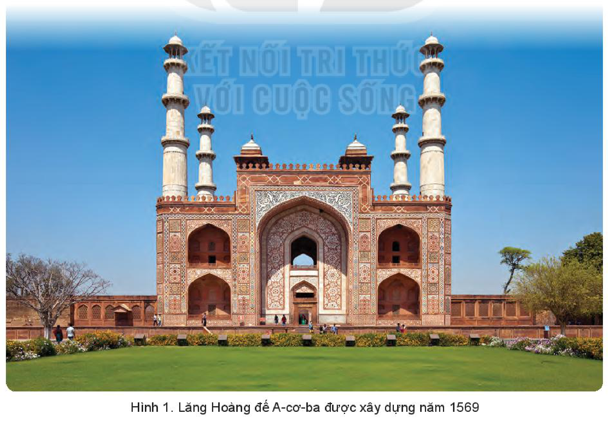
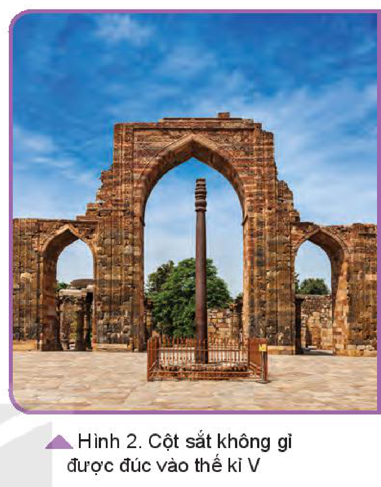
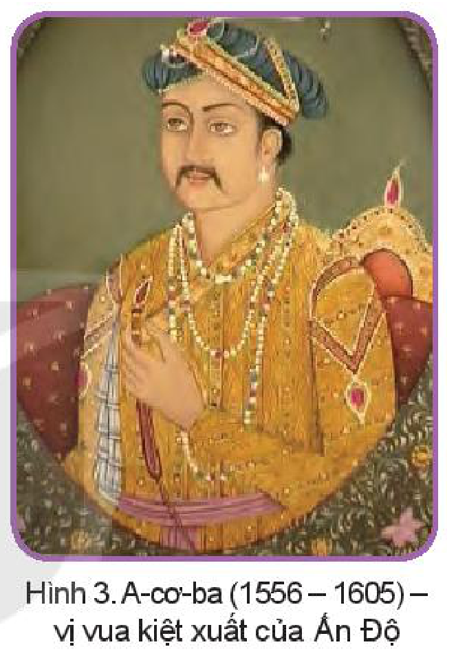
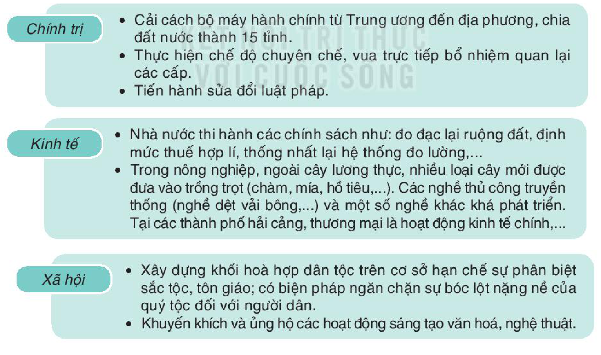
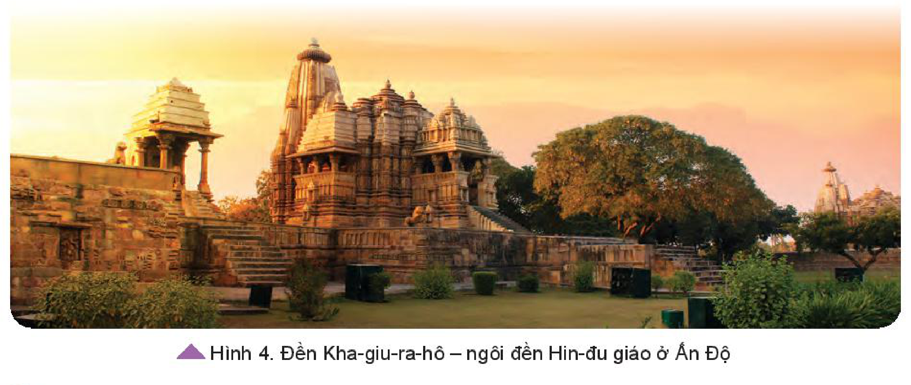
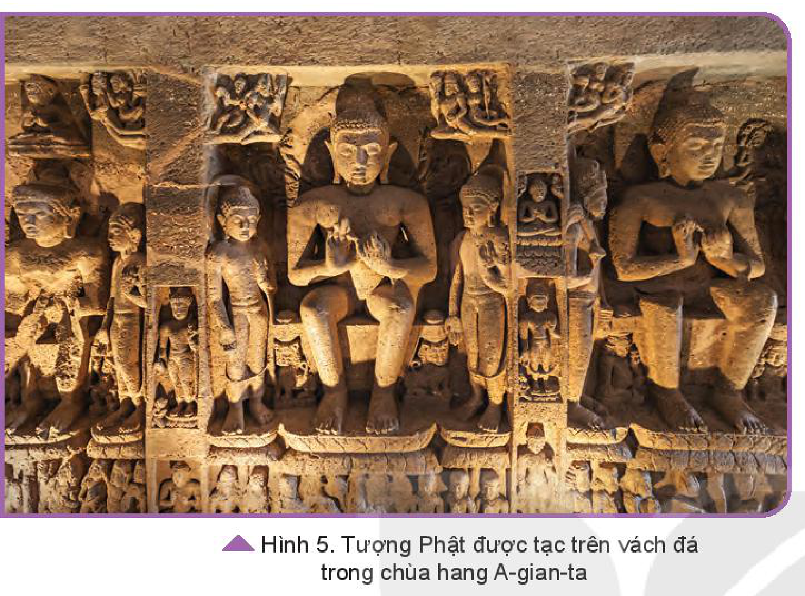

<!-- pdf:30 -->

# BÀI 5: ẤN ĐỘ TỪ THẾ KỈ IV ĐẾN GIỮA THẾ KỈ XIX

## 🎯 Học xong bài này, em sẽ:

- Nêu được nét chính về điều kiện tự nhiên của Ấn Độ.
- Trình bày khái quát được sự ra đời và tình hình chính trị, kinh tế, xã hội của Ấn Độ dưới thời các vương triều Gúp-ta, Đê-li và Mô-gôn.
- Giới thiệu và nhận xét được về một số thành tựu văn hoá tiêu biểu của Ấn Độ từ thế kỉ IV đến giữa thế kỉ XIX.

## 🔴 Mở đầu

Nền văn hoá của Ấn Độ được ví như một dòng sông dài bắt nguồn từ dãy núi Hi-ma-lay-a, vượt qua những dải rừng, vùng đất hoang vu, làng xóm và thành phố, tiếp nhận thêm nhiều chi lưu,... Do vậy, trong dòng chảy văn hoá Ấn Độ có sự thống nhất trong đa dạng, có cả sự tiếp nối lẫn sự thay đổi. Từ thế kỉ IV đến giữa thế kỉ XIX, lịch sử Ấn Độ trải qua nhiều vương triều, đã hoà nhập nhiều yếu tố văn hoá từ các nguồn gốc khác nhau, nhưng không đứt đoạn và vẫn giữ được bản sắc Ấn Độ. Em biết gì về đất nước Ấn Độ thời phong kiến? Hãy chia sẻ một vài thành tựu văn hoá tiêu biểu của Ấn Độ thời kì này mà em biết.

*Hình 1. Lăng Hoàng đế A-cơ-ba được xây dựng năm 1569*

<!-- pdf:31 -->

## 1. Ấn Độ dưới thời các triều đại phong kiến

Ấn Độ là một bán đảo lớn ở Nam Á. Phía bắc bị ngăn cách với bên ngoài bởi dãy Hi-ma-lay-a hùng vĩ, ba mặt còn lại giáp biển khiến Ấn Độ được ví như một "tiểu lục địa". Địa hình chủ yếu là đồng bằng Ấn – Hằng ở miền Bắc, cao nguyên Đê-can rộng lớn ở miền Tây Nam,... Khí hậu Ấn Độ rất đa dạng. Đó là những điều kiện tự nhiên nổi bật tác động tới sự phát triển kinh tế của Ấn Độ thời phong kiến.

### a) Vương triều Gúp-ta

<!-- term: Vương triều Gúp-ta -->
Đầu thế kỉ IV, San-đra Gúp-ta I lên ngôi, thống nhất được đất nước, lập ra Vương triều Gúp-ta. Lãnh thổ Ấn Độ được mở rộng hầu khắp lưu vực sông Hằng, và đến đầu thế kỉ V, đã thống nhất được phần lớn bán đảo Ấn Độ.

<!-- term: Vương triều Gúp-ta -->
Thời kì này, kinh tế Ấn Độ có những tiến bộ vượt bậc. Trong nông nghiệp, công cụ bằng sắt được sử dụng rộng rãi, nhiều công trình thuỷ lợi lớn được xây dựng. Buôn bán trong nước được đẩy mạnh. Ấn Độ đã có quan hệ thương mại với nhiều nước Ả Rập và Đông Nam Á.

*Hình 2. Cột sắt không gỉ được đúc vào thế kỉ V*

<!-- term: Vương triều Gúp-ta -->
Đời sống người dân được ổn định, sung túc hơn tất cả các thời trước đó, vì vậy thời kì này được gọi là thời hoàng kim.

> 1. *Cuốn sách "Phật quốc kí” của nhà sư Pháp Hiển (Trung Quốc) đã ghi chép về Ấn Độ thế kỉ V, ca ngợi sự khoan hoà của pháp luật, đời sống sung túc và tự do của dân chúng, ca tụng vẻ nguy nga, tráng lệ của thành phố và các lâu đài, sự quan tâm của nhà vua đối với dân chúng qua việc lập các nhà an dưỡng, bệnh xá,...*
>
> (Theo Vũ Dương Ninh (Chủ biên), *Lịch sử Ấn Độ*, NXB Giáo dục, 1995, tr.47)

> ❓ Hãy trình bày khái quát sự ra đời và tình hình chính trị, kinh tế, xã hội của Ấn Độ thời Vương triều Gúp-ta.

### b) Vương triều Hồi giáo Đê-li

<!-- term: Vương triều Hồi giáo Đê-li -->
Từ cuối thế kỉ XII, người Hồi giáo gốc Thổ Nhĩ Kỳ đã xâm nhập, chiếm miền Bắc Ấn Độ và lập nên Vương triều Hồi giáo Đê-li (1206).

<!-- term: Vương triều Hồi giáo Đê-li -->
Nhà vua có quyền lực cao nhất. Ấn Độ được chia thành nhiều khu vực hành chính do các tướng lĩnh Hồi giáo cai quản, còn các tín đồ Hin-đu giáo chỉ được giữ các chức vụ không quan trọng. Nhà vua Hồi giáo tiến hành xâm chiếm các tiểu quốc ở Nam Ấn với hi vọng thành lập đế quốc Hồi giáo.

Trong nông nghiệp, nghề nông trồng lúa vẫn giữ vai trò quan trọng và được nhà nước khuyến khích phát triển.

> 2. *Ba-ran – một người dân Ấn Độ thời kì đó đã nhận xét: "Các vùng trở nên phồn thịnh. Ruộng đồng nối với ruộng đồng, vườn tược nối với vườn tược, làng ấp nối liền với làng ấp”.*
>
> (Theo *Lịch sử thế giới trung đại*, Sđd, tr.354)
<!-- ocr-ok: đã đối chiếu p031.png, hộp tư liệu 2 in chữ nghiêng trên nền xanh nhạt nên OCR nhầm dấu ("phồôn", "FRuộng", "nỗi", "thê gió") -->

<!-- pdf:32 -->

Thủ công nghiệp và thương nghiệp tiếp tục phát triển. Nhiều thành thị mới xuất hiện, một số hải cảng được xây dựng để đẩy mạnh buôn bán với Trung Quốc và các nước Đông Nam Á, phương Tây và Ả Rập.

Mặc dù các ông vua đã cố gắng thực thi nhiều chính sách mềm mỏng để giữ yên và phát triển đất nước, nhưng sự phân biệt sắc tộc và tôn giáo không thể làm tan đi nỗi bất bình trong nhân dân. Mâu thuẫn dân tộc gay gắt làm bùng nổ các cuộc đấu tranh của nhân dân chống lại triều đình.

> ❓ Hãy trình bày những nét chính về sự ra đời, tình hình chính trị, kinh tế, xã hội Ấn Độ thời Vương triều Đê-li.

### c) Vương triều Mô-gôn

<!-- term: Vương triều Mô-gôn -->
Đầu thế kỉ XVI, người Hồi giáo tự nhận là dòng dõi Mông Cổ ở Ấn Độ đã lật đổ Vương triều Đê-li, lập ra Vương triều Mô-gôn.

<!-- term: Vương triều Mô-gôn -->
Các vị vua đã ra sức củng cố vương triều theo hướng không phân biệt nguồn gốc và xây dựng đất nước. Ấn Độ đạt được bước phát triển mới dưới sự trị vì của vua A-cơ-ba. Ông đã thi hành nhiều chính sách tích cực làm cho xã hội ổn định, đất nước thịnh vượng, kinh tế và văn hoá đạt nhiều thành tựu mới.

*Hình 3. A-cơ-ba (1556 – 1605) – vị vua kiệt xuất của Ấn Độ*

> - **Chính trị:**
>   - Cải cách bộ máy hành chính từ Trung ương đến địa phương, chia đất nước thành 15 tỉnh.
>   - Thực hiện chế độ chuyên chế, vua trực tiếp bổ nhiệm quan lại các cấp.
>   - Tiến hành sửa đổi luật pháp.
> - **Kinh tế:**
>   - Nhà nước thi hành các chính sách như: đo đạc lại ruộng đất, định mức thuế hợp lí, thống nhất lại hệ thống đo lường,...
>   - Trong nông nghiệp, ngoài cây lương thực, nhiều loại cây mới được đưa vào trồng trọt (chàm, mía, hồ tiêu,...). Các nghề thủ công truyền thống (nghề dệt vải bông,...) và một số nghề khác khá phát triển. Tại các thành phố hải cảng, thương mại là hoạt động kinh tế chính,...
> - **Xã hội:**
>   - Xây dựng khối hoà hợp dân tộc trên cơ sở hạn chế sự phân biệt sắc tộc, tôn giáo; có biện pháp ngăn chặn sự bóc lột nặng nề của quý tộc đối với người dân.
>   - Khuyến khích và ủng hộ các hoạt động sáng tạo văn hoá, nghệ thuật.

<!-- pdf:33 -->

<!-- term: Vương triều Mô-gôn -->
Từ sau thời kì trị vì của A-cơ-ba, tình trạng chia rẽ và khủng hoảng ở Ấn Độ xuất hiện trở lại. Vương triều Mô-gôn tồn tại đến giữa thế kỉ XIX, khi thực dân Anh xâm lược Ấn Độ.

> ❓ Trình bày khái quát sự ra đời và tình hình chính trị, kinh tế, xã hội Ấn Độ thời Vương triều Mô-gôn.

## 2. Thành tựu văn hoá tiêu biểu của Ấn Độ từ thế kỉ IV đến giữa thế kỉ XIX

### a) Tôn giáo

Dưới thời Vương triều Gúp-ta, đạo Bà La Môn phát triển thành đạo Hin-đu – tôn giáo thịnh hành ở Ấn Độ cho đến ngày nay. Đạo Phật có sự phân hoá thành hai giáo phái và tiếp tục được phát triển mạnh trong thời Gúp-ta. Đạo Hồi cũng được du nhập và phát triển thành một tôn giáo lớn từ thời Vương triều Đê-li.

### b) Chữ viết – văn học

<!-- term: Chữ Phạn -->
Chữ Phạn đạt đến mức hoàn chỉnh, trở thành ngôn ngữ – văn tự để sáng tác các tác phẩm văn học, thơ ca, đồng thời là nguồn gốc của chữ viết Hin-đi ngày nay.

Văn học Ấn Độ hết sức phong phú, đa dạng (thơ ca lịch sử, kịch thơ, truyện thần thoại,...) với nội dung thể hiện chủ nghĩa nhân đạo, đề cao tư tưởng tự do, ca ngợi tình yêu lứa đôi và trong chừng mực nhất định đã chống lại quan niệm về sự phân biệt đẳng cấp. Nổi tiếng nhất là Ka-li-đa-sa – tác giả của nhiều tác phẩm văn học và sân khấu, trong đó có vở kịch *Sơ-kun-tơ-la*.

> 🔗 **Kết nối với văn học**
>
> Đại văn hào Đức Giô-han Gớt đã ca ngợi về tác phẩm *Sơ-kun-tơ-la*:
>
> *Nếu muốn có một tiếng ôm ấp được cả hoa mùa xuân và quả mùa thu*
> *Một tiếng làm đắm say, nuôi dưỡng và thoả mãn được tâm hồn*
> *Nếu muốn có một tiếng bao gồm được cả trời đất*
> *Thì tôi gọi Sơ-kun-tơ-la*
> *Tiếng đó nói lên tất cả!*

### c) Kiến trúc, điêu khắc

Kiến trúc Ấn Độ chịu ảnh hưởng sâu sắc của ba tôn giáo lớn: Phật giáo, Hin-đu giáo và Hồi giáo.

*Hình 4. Đền Kha-giu-ra-hô – ngôi đền Hin-đu giáo ở Ấn Độ*

<!-- pdf:34 -->

*Hình 5. Tượng Phật được tạc trên vách đá trong chùa hang A-gian-ta*

<!-- term: Chùa hang A-gian-ta -->
> 💡 **Em có biết?**
>
> Chùa hang A-gian-ta có 31 hang động, chủ yếu được xây dựng từ thế kỉ IV đến thế kỉ VIII. Từ một dải núi đá khổng lồ, người Ấn Độ đã tạo nên những công trình kiến trúc kì vĩ nhưng tỉ mỉ, tinh tế trong từng chi tiết. Năm 1983, quần thể này đã được UNESCO công nhận là Di sản văn hoá thế giới.

Thời kì này, các thành tựu văn hoá Ấn Độ tiếp tục ảnh hưởng, được truyền bá ra bên ngoài, nhất là khu vực Đông Nam Á.

> ❓ Em hãy giới thiệu và nêu nhận xét về một số thành tựu văn hoá tiêu biểu của Ấn Độ thời phong kiến.

## ✏️ Luyện tập – Vận dụng

1. Em hãy lập và hoàn thành bảng theo mẫu dưới đây.

| | Vương triều Gúp-ta | Vương triều Đê-li | Vương triều Mô-gôn |
| --- | --- | --- | --- |
| Thời gian thành lập | ? | ? | ? |
| Tình hình chính trị | ? | ? | ? |
| Tình hình kinh tế | ? | ? | ? |
| Tình hình xã hội | ? | ? | ? |

2. Hãy tìm hiểu thêm và kể tên một số thành tựu văn hoá của các quốc gia Đông Nam Á chịu ảnh hưởng của văn hoá Ấn Độ thời phong kiến.

3. Tìm kiếm thông tin và hình ảnh từ sách, báo và internet, hãy viết đoạn văn ngắn giới thiệu về một công trình kiến trúc của Ấn Độ thời phong kiến mà em ấn tượng nhất.

## 📷 Danh sách hình trong bài

| Mã hình | Trang PDF | Trang sách | Chú thích |
| --- | --- | --- | --- |
| H7-lich_su_va_dia_ly-ls-b05-01 | 30 | 29 | Hình 1. Lăng Hoàng đế A-cơ-ba được xây dựng năm 1569 |
| H7-lich_su_va_dia_ly-ls-b05-02 | 31 | 30 | Hình 2. Cột sắt không gỉ được đúc vào thế kỉ V |
| H7-lich_su_va_dia_ly-ls-b05-03 | 32 | 31 | Hình 3. A-cơ-ba (1556 – 1605) – vị vua kiệt xuất của Ấn Độ |
| H7-lich_su_va_dia_ly-ls-b05-04 | 32 | 31 | [Sơ đồ chính sách của vua A-cơ-ba trên các lĩnh vực chính trị, kinh tế, xã hội] |
| H7-lich_su_va_dia_ly-ls-b05-05 | 33 | 32 | Hình 4. Đền Kha-giu-ra-hô – ngôi đền Hin-đu giáo ở Ấn Độ |
| H7-lich_su_va_dia_ly-ls-b05-06 | 34 | 33 | Hình 5. Tượng Phật được tạc trên vách đá trong chùa hang A-gian-ta |
