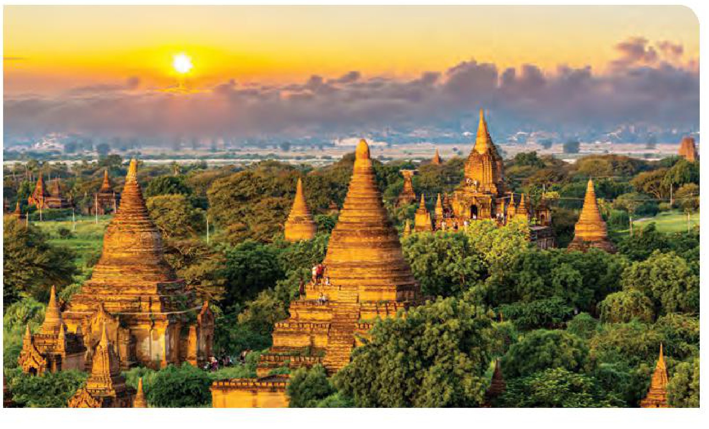
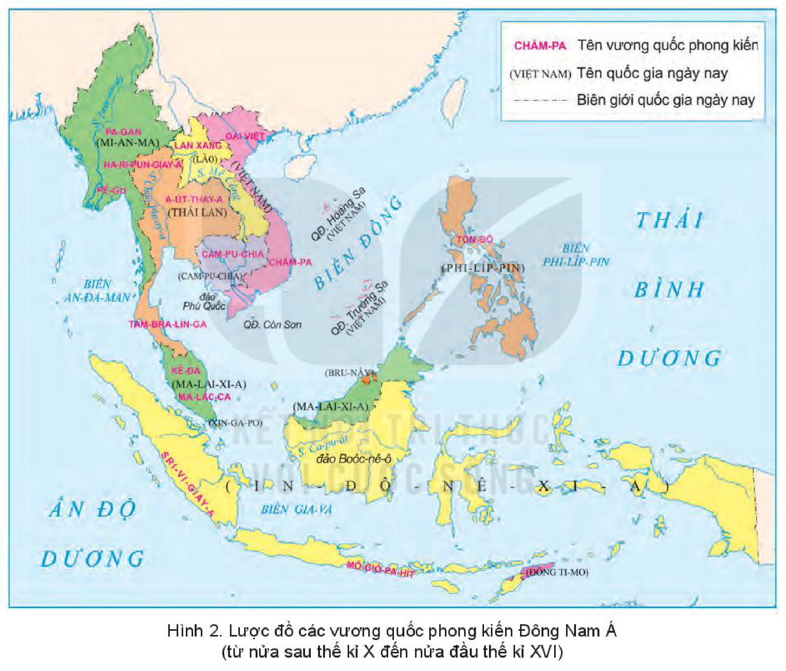
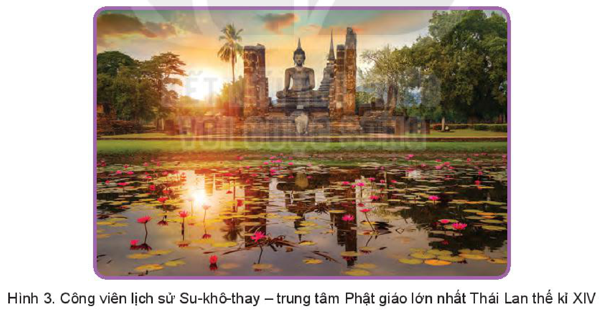
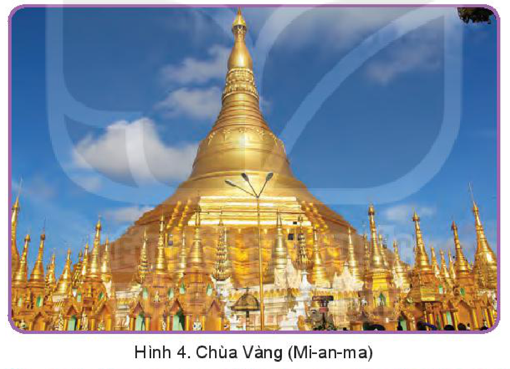

<!-- pdf:36 -->

# BÀI 6: CÁC VƯƠNG QUỐC PHONG KIẾN ĐÔNG NAM Á TỪ NỬA SAU THẾ KỈ X ĐẾN NỬA ĐẦU THẾ KỈ XVI

## 🎯 Học xong bài này, em sẽ:

- Mô tả được quá trình hình thành, phát triển của các quốc gia Đông Nam Á từ nửa sau thế kỉ X đến nửa đầu thế kỉ XVI.
- Giới thiệu và nhận xét được những thành tựu văn hoá tiêu biểu của Đông Nam Á từ nửa sau thế kỉ X đến nửa đầu thế kỉ XVI.

## 🔴 Mở đầu

Em đã tìm hiểu về các quốc gia sơ kì và phong kiến ở Đông Nam Á từ thế kỉ VII TCN đến thế kỉ X với một nền văn hoá bản địa sâu đậm, đa sắc màu. Trên nền tảng đó, từ thế kỉ X đến thế kỉ XVI, các vương quốc phong kiến trong khu vực tiếp tục có bước phát triển về kinh tế, chính trị và văn hoá. Diện mạo của các vương quốc này như thế nào? Những thành tựu văn hoá tiêu biểu đạt được là gì?

## 1. Sự hình thành và phát triển của các vương quốc phong kiến từ nửa sau thế kỉ X đến nửa đầu thế kỉ XVI

Trên cơ sở các vương quốc phong kiến đã được hình thành ở giai đoạn trước, từ khoảng nửa sau thế kỉ X đến thế kỉ XIII, các vương quốc này tiếp tục phát triển.

<!-- term: Vương quốc Pa-gan -->
<!-- term: Vương quốc Sri Vi-giay-a -->
Trên lưu vực sông I-ra-oa-đi, Vương quốc Pa-gan đã mạnh lên và thống nhất lãnh thổ, mở đầu cho quá trình hình thành, phát triển của Vương quốc Mi-an-ma. Ở lưu vực sông Chao Phray-a là sự hiện diện của Vương quốc Ha-ri-pun-giay-a. Trên bán đảo Đông Dương, ngoài Đại Việt và Chăm-pa, Vương quốc Cam-pu-chia của người Khơ-me trở nên cường thịnh. Sri Vi-giay-a trở thành một quốc gia hùng mạnh trên đảo Xu-ma-tra.

*Hình 1. Toàn cảnh đô thị cổ Pa-gan (thuộc Mi-an-ma ngày nay)*

<!-- pdf:37 -->

Vào thế kỉ XIII, quân Mông – Nguyên mở rộng xâm lược xuống Đông Nam Á. Nhu cầu liên kết giữa các quốc gia nhỏ và các tộc người trong kháng chiến chống ngoại xâm đã dẫn đến sự ra đời một số vương quốc phong kiến mới và sự thống nhất, hình thành một số vương quốc phong kiến lớn hơn.

<!-- term: Vương quốc Su-khô-thay và A-út-thay-a -->
<!-- term: Vương triều Mô-giô-pa-hít -->
<!-- term: Vương quốc Ma-lắc-ca -->
Người Thái lập ra các vương quốc Su-khô-thay và A-út-thay-a. Sau đó A-út-thay-a chinh phục Su-khô-thay, thành lập quốc gia thống nhất (Thái Lan ngày nay). Vương quốc Lan Xang được thành lập (Lào ngày nay). Nhiều nước nhỏ trên hai đảo Xu-ma-tra và Gia-va (In-đô-nê-xi-a) đã được thống nhất dưới thời Vương triều Mô-giô-pa-hít. Vương quốc Ma-lắc-ca được thành lập và ngày càng hưng thịnh.

*Hình 2. Lược đồ các vương quốc phong kiến Đông Nam Á (từ nửa sau thế kỉ X đến nửa đầu thế kỉ XVI)*

Ở các vương quốc, bộ máy nhà nước dần được củng cố với sự tăng cường quyền lực của nhà vua và hoàn chỉnh hệ thống quan lại các cấp. Luật pháp cũng ngày càng được hoàn thiện với sự xuất hiện nhiều bộ luật như *Si-va-sa-xa-na* (In-đô-nê-xi-a), *Hình thư* (Đại Việt),...

Nhờ sự phát triển của nền nông nghiệp lúa nước cùng với hoạt động giao lưu buôn bán bằng đường biển, kinh tế ở các vương quốc trong những thế kỉ này phát triển khá thịnh đạt.

<!-- pdf:38 -->

<!-- term: Vương quốc Ma-lắc-ca -->
> *Vào thế kỉ XV, Ma-lắc-ca có lẽ là nơi duy nhất trên thế giới mà người ta mua rất dễ dàng hàng hoá Trung Quốc (đồ sứ, tơ lụa, gương), Ấn Độ (ngọc trai, vải bông mịn), Gia-va và Xu-ma-tra (thóc lúa, gia vị, vàng, trâu bò,...), Tây Á và châu Âu (hàng len), Đông Nam Á lục địa (gỗ trầm, gỗ đàn hương, đá quý, hồ tiêu, hương liệu),...*
>
> (Theo Lương Ninh (Chủ biên), *Lịch sử Đông Nam Á*, NXB Giáo dục, 2008, tr.145)

> 🔗 **Kết nối với ngày nay**
>
> Eo biển Ma-lắc-ca nằm giữa In-đô-nê-xi-a, Ma-lai-xi-a và Xin-ga-po, nối Ấn Độ Dương và Thái Bình Dương. Ngày nay, đây là eo biển nhộn nhịp, chiếm khoảng 30% giao dịch thương mại thế giới hằng năm. Nhiều nền kinh tế lớn như Nhật Bản, Trung Quốc, Hàn Quốc,... phụ thuộc rất lớn vào hoạt động thương mại thông qua eo biển này.

> ❓ 1. Khai thác hình 2 và thông tin trong mục, trình bày sơ lược sự hình thành và phát triển của các vương quốc phong kiến ở Đông Nam Á từ nửa sau thế kỉ X đến nửa đầu thế kỉ XVI.
>
> 2. Từ tư liệu trên, em có nhận xét gì về hoạt động kinh tế của Vương quốc Ma-lắc-ca?

## 2. Những thành tựu văn hoá tiêu biểu

### a) Tín ngưỡng – tôn giáo
<!-- ocr-ok: đã đối chiếu p038.png, tiêu đề tiểu mục in nghiêng màu tím nên OCR nhầm dấu "Tín" thành "Tin" -->

<!-- term: Phật giáo tiểu thừa -->
Từ thế kỉ XIII, dòng Phật giáo tiểu thừa được truyền bá và phổ biến ở Đông Nam Á như ở Lan Xang, Cam-pu-chia, các vương quốc của người Thái, người Miến Điện thuộc Thái Lan, Mi-an-ma ngày nay,... Nhiều ngôi chùa mới được xây dựng, không chỉ là nơi thờ phụng mà còn trở thành những trung tâm văn hoá thời bấy giờ.

*Hình 3. Công viên lịch sử Su-khô-thay – trung tâm Phật giáo lớn nhất Thái Lan thế kỉ XIV*

Hồi giáo cũng theo chân các thương nhân Ả Rập, Ấn Độ du nhập vào Đông Nam Á vào thế kỉ XII – XIII. Đến những thế kỉ sau đó, hàng loạt tiểu quốc Hồi giáo ra đời và Hồi giáo trở thành quốc giáo.

### b) Chữ viết – văn học

Đầu thế kỉ XIII, chữ Thái được hình thành dựa trên hệ thống chữ Phạn của người Ấn; khoảng thế kỉ XIV, chữ Lào ra đời. Trên cơ sở cải tiến chữ Hán (Trung Quốc), người Việt đã tạo ra chữ Nôm,...

<!-- pdf:39 -->

Bên cạnh văn học dân gian, dòng văn học viết xuất hiện và phát triển nhanh với nhiều tác phẩm nổi tiếng.

Ở In-đô-nê-xi-a có những tác phẩm nổi tiếng phản ánh sự hưng thịnh của vương quốc như cuốn *Sách của các ông vua*, trường ca *Ne-ga-rắc Re-ta-ga-ma*.

Ở Ma-lai-xi-a, sự hưng thịnh của Vương quốc Ma-lắc-ca được phản ánh qua tác phẩm khuyết danh *Truyện sử Mã Lai*.

### c) Kiến trúc, điêu khắc

Nhiều công trình kiến trúc như đền, chùa, tháp,... được xây dựng đã trở thành các di tích lịch sử, văn hoá nổi tiếng thế giới như khu đền Ăng-co (Cam-pu-chia), chùa Vàng (Mi-an-ma), chùa Vàng (Thái Lan),...

Nghệ thuật điêu khắc và tạc tượng thần, Phật, phù điêu,... thể hiện sự ảnh hưởng mạnh mẽ của văn hoá Ấn Độ, Trung Quốc và sự sáng tạo của các nghệ nhân Đông Nam Á.

> 🔗 **Kết nối với văn hoá**
>
> Chùa Vàng là ngôi chùa nổi tiếng nhất ở Mi-an-ma hiện nay. Trong chùa, người ta dùng tới 5 448 viên kim cương, 9 300 lá vàng để trang trí. Có đến 1 065 chuông vàng và 421 chuông bạc được treo ở mọi nơi trong chùa.

*Hình 4. Chùa Vàng (Mi-an-ma)*

> ❓ 1. Hãy nêu thành tựu văn hoá tiêu biểu của các quốc gia ở Đông Nam Á và rút ra nhận xét.
>
> 2. Nhiều quốc gia Đông Nam Á sáng tạo ra chữ viết riêng có ý nghĩa như thế nào?

## ✏️ Luyện tập – Vận dụng

1. Hãy thể hiện trên trục thời gian các sự kiện tiêu biểu về quá trình hình thành và phát triển của các vương quốc phong kiến ở Đông Nam Á từ nửa sau thế kỉ X đến nửa đầu thế kỉ XVI.

2. Tìm hiểu thêm từ sách, báo và internet về một thành tựu văn hoá tiêu biểu của các nước Đông Nam Á thời kì này mà em ấn tượng nhất và viết bài (hoặc làm bài thiết kế đồ hoạ – inforgraphic) giới thiệu về thành tựu đó.

## 📷 Danh sách hình trong bài

| Mã hình | Trang PDF | Trang sách | Chú thích |
| --- | --- | --- | --- |
| H7-lich_su_va_dia_ly-ls-b06-01 | 36 | 35 | Hình 1. Toàn cảnh đô thị cổ Pa-gan (thuộc Mi-an-ma ngày nay) |
| H7-lich_su_va_dia_ly-ls-b06-02 | 37 | 36 | Hình 2. Lược đồ các vương quốc phong kiến Đông Nam Á (từ nửa sau thế kỉ X đến nửa đầu thế kỉ XVI) |
| H7-lich_su_va_dia_ly-ls-b06-03 | 38 | 37 | Hình 3. Công viên lịch sử Su-khô-thay – trung tâm Phật giáo lớn nhất Thái Lan thế kỉ XIV |
| H7-lich_su_va_dia_ly-ls-b06-04 | 39 | 38 | Hình 4. Chùa Vàng (Mi-an-ma) |
