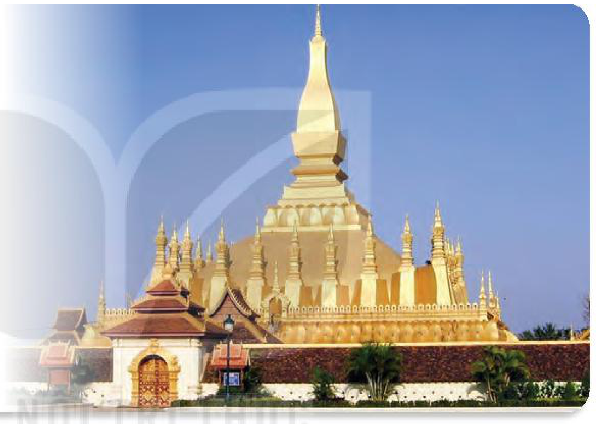
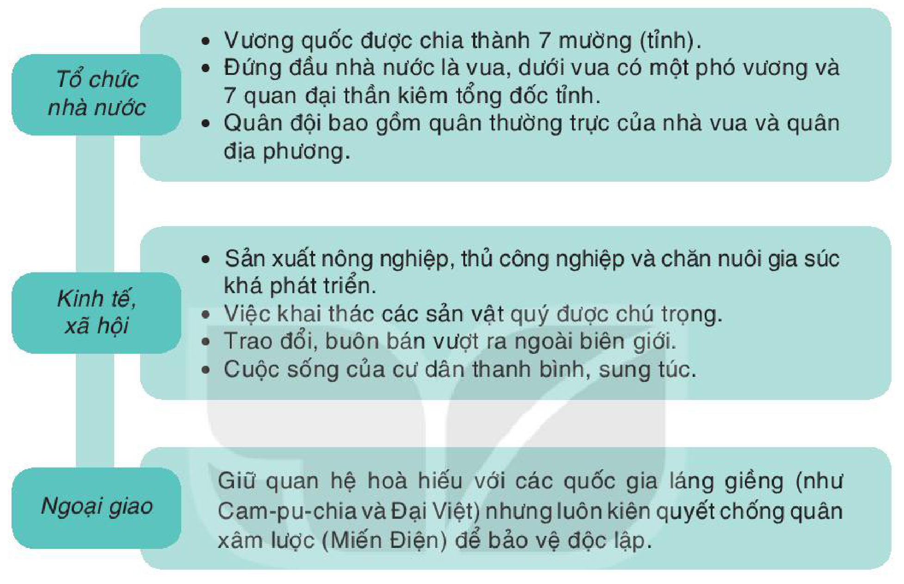
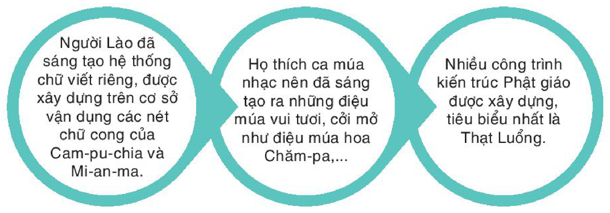
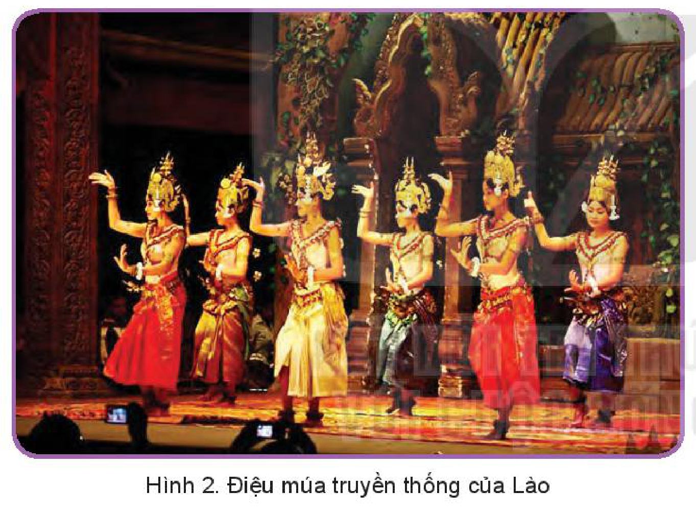

<!-- pdf:40 -->

# BÀI 7: VƯƠNG QUỐC LÀO

## 🎯 Học xong bài này, em sẽ:

- Mô tả được quá trình hình thành và phát triển của Vương quốc Lào.
- Nhận biết và đánh giá được sự phát triển của Vương quốc Lào thời Lan Xang.
- Nêu được một số nét tiêu biểu về văn hoá của Vương quốc Lào.

## 🔴 Mở đầu

Hình bên là một công trình văn hoá tiêu biểu cho khả năng sáng tạo của người Lào, được chọn làm hình ảnh trung tâm trên Quốc huy của nước Lào ngày nay. Theo em, công trình này được xây dựng vào thời kì nào? Hãy chia sẻ một số hiểu biết của em về đất nước Lào thời kì đó.

*Hình 1. Thạt Luổng*

## 1. Quá trình hình thành, phát triển của Vương quốc

<!-- term: Người Lào Thơng và người Lào Lùm -->
Đất nước Lào gắn liền với dòng sông Mê Công. Nơi đây từ xa xưa đã có người sinh sống, gọi là người Lào Thơng. Đến thế kỉ XIII, một nhóm người nói tiếng Thái di cư đến đất Lào, gọi là người Lào Lùm. Họ sinh sống hoà hợp với người Lào Thơng, hợp chung là người Lào. Tổ chức xã hội sơ khai của người Lào là các mường cổ.

<!-- term: Vương quốc Lan Xang -->
Năm 1353, một tộc trưởng người Lào là Pha Ngừm đã tập hợp và thống nhất các mường Lào, lên ngôi vua, đặt tên nước là Lan Xang (nghĩa là Triệu Voi). Từ đó, Vương quốc Lào từng bước phát triển và đạt tới sự thịnh vượng trong các thế kỉ XV – XVII.

> 🔗 **Kết nối với văn hoá**
>
> Theo truyền thuyết, Pha Ngừm được nuôi dạy và lớn lên trong triều đình Cam-pu-chia. Pha Ngừm được vua Cam-pu-chia gả con gái cho, sau đó ông đem quân về chinh phục các mường Lào và lên ngôi vua.

> ❓ Hãy trình bày quá trình hình thành, phát triển của Vương quốc Lào.

<!-- pdf:41 -->

## 2. Vương quốc Lào thời Lan Xang

Được thành lập từ giữa thế kỉ XIV, Vương quốc Lan Xang bước vào giai đoạn phát triển thịnh vượng trong các thế kỉ XV – XVII, biểu hiện như sau:

<!-- term: Vương quốc Lan Xang -->
> - **Tổ chức nhà nước:**
>   - Vương quốc được chia thành 7 mường (tỉnh).
>   - Đứng đầu nhà nước là vua, dưới vua có một phó vương và 7 quan đại thần kiêm tổng đốc tỉnh.
>   - Quân đội bao gồm quân thường trực của nhà vua và quân địa phương.
> - **Kinh tế, xã hội:**
>   - Sản xuất nông nghiệp, thủ công nghiệp và chăn nuôi gia súc khá phát triển.
>   - Việc khai thác các sản vật quý được chú trọng.
>   - Trao đổi, buôn bán vượt ra ngoài biên giới.
>   - Cuộc sống của cư dân thanh bình, sung túc.
> - **Ngoại giao:**
>   - Giữ quan hệ hoà hiếu với các quốc gia láng giềng (như Cam-pu-chia và Đại Việt) nhưng luôn kiên quyết chống quân xâm lược (Miến Điện) để bảo vệ độc lập.

> 💡 **Em có biết?**
>
> Vào nửa sau thế kỉ XVI, quân Miến Điện đã ba lần xâm lược Lan Xang. Triều đình và nhân dân Lan Xang đã dũng cảm chiến đấu để bảo vệ lãnh thổ và nền độc lập của mình.

> - *Nguyễn Trãi đã viết: “Nước này [Lan Xang] có tê, voi, sáp trắng, vải bông, chiêng đồng”.*
> - *Lê Quý Đôn cho biết: Lúc bấy giờ, người Việt mang các sản vật của mình như muối, mắm, cá khô, đồ sắt, nồi đồng, thoi bạc,... sang Lào bán đổi lấy thóc gạo, gà, trâu, sáp,...*
>
> (Theo Lương Ninh, *Đất nước Lào: Lịch sử và văn hoá*, NXB Chính trị quốc gia, 1996, tr.92, 93)

> ❓ 1. Khai thác tư liệu trên cho em biết điều gì về kinh tế của Vương quốc Lan Xang.
>
> 2. Hãy nêu và đánh giá về sự phát triển của Vương quốc Lan Xang.

<!-- pdf:42 -->

## 3. Một số nét tiêu biểu về văn hoá

Dưới thời phong kiến, người Lào đã xây dựng được một nền văn hoá riêng của mình.

> - Người Lào đã sáng tạo hệ thống chữ viết riêng, được xây dựng trên cơ sở vận dụng các nét chữ cong của Cam-pu-chia và Mi-an-ma.
> - Họ thích ca múa nhạc nên đã sáng tạo ra những điệu múa vui tươi, cởi mở như điệu múa hoa Chăm-pa,...
> - Nhiều công trình kiến trúc Phật giáo được xây dựng, tiêu biểu nhất là Thạt Luổng.

*Hình 2. Điệu múa truyền thống của Lào*

<!-- term: Thạt Luổng -->
> 🔗 **Kết nối với văn hoá**
>
> Thạt Luổng là một công trình kiến trúc đồ sộ, gồm một tháp lớn hình nậm rượu, đặt trên đế hình hoa sen, dưới là một cái bệ khổng lồ hình bán cầu nhưng lại tạo thành bốn múi có đáy vuông. Xung quanh bệ tháp là một dãy tháp thu nhỏ. Hình ảnh quả bầu trên đỉnh Thạt Luổng thể hiện nét rất riêng của kiến trúc Lào. Di tích này đã được công nhận Di sản văn hoá thế giới năm 1992.

> ❓ Hãy nêu một số nét tiêu biểu về văn hoá của Vương quốc Lào.

## ✏️ Luyện tập – Vận dụng

1. Lập trục thời gian và điền các thông tin về sự hình thành, phát triển của Vương quốc Lào.

2. Tìm hiểu thêm từ sách, báo và internet về những thành tựu văn hoá tiêu biểu của đất nước Lào. Em ấn tượng nhất về thành tựu nào? Vì sao?

## 📷 Danh sách hình trong bài

| Mã hình | Trang PDF | Trang sách | Chú thích |
| --- | --- | --- | --- |
| H7-lich_su_va_dia_ly-ls-b07-01 | 40 | 39 | Hình 1. Thạt Luổng |
| H7-lich_su_va_dia_ly-ls-b07-02 | 41 | 40 | [Sơ đồ biểu hiện sự phát triển của Vương quốc Lan Xang (thế kỉ XV – XVII)] |
| H7-lich_su_va_dia_ly-ls-b07-03 | 42 | 41 | [Sơ đồ một số nét tiêu biểu về văn hoá của Vương quốc Lào] |
| H7-lich_su_va_dia_ly-ls-b07-04 | 42 | 41 | Hình 2. Điệu múa truyền thống của Lào |
