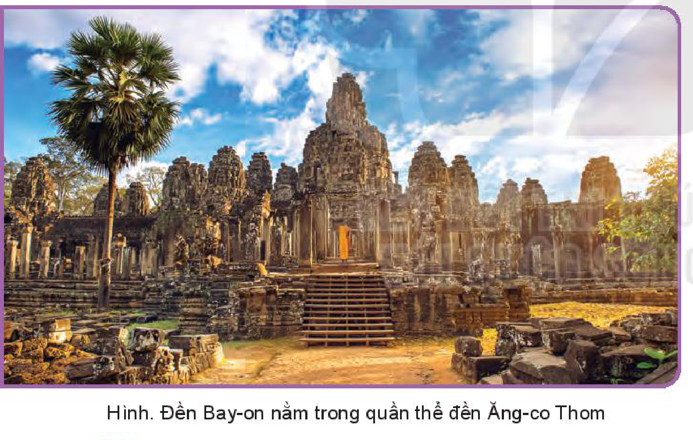

<!-- pdf:43 -->

# BÀI 8: VƯƠNG QUỐC CAM-PU-CHIA

## 🎯 Học xong bài này, em sẽ:

- Mô tả được quá trình hình thành và phát triển của Vương quốc Cam-pu-chia.
- Nhận biết và đánh giá được sự phát triển của Vương quốc Cam-pu-chia thời Ăng-co.
- Nêu được một số nét tiêu biểu về văn hoá của Vương quốc Cam-pu-chia.

## 🔴 Mở đầu

<!-- term: Chân Lạp -->
Từ thế kỉ VI, vương quốc của người Khơ-me hình thành với tên gọi là Chân Lạp (sau đó gọi là Cam-pu-chia). Cư dân nơi đây đã xây dựng được nền văn hoá đặc sắc trên cơ sở tiếp thu văn hoá Ấn Độ. Trong thời kì tiếp theo, Vương quốc Cam-pu-chia phát triển như thế nào? Hãy chia sẻ những hiểu biết của em vương quốc này.

## 1. Quá trình hình thành và phát triển của Vương quốc

<!-- term: Thời kì Ăng-co -->
Năm 802, vua Giay-a-vác-man II thống nhất lãnh thổ, đổi tên nước là Cam-pu-chia, mở ra thời kì Ăng-co – thời kì phát triển rực rỡ nhất của Vương quốc Cam-pu-chia kéo dài từ thế kỉ IX đến thế kỉ XV.

Đến thế kỉ XV, do sự tranh giành quyền lực giữa các phe phái và sự tấn công của người Thái đã khiến cho Vương quốc Cam-pu-chia suy yếu. Người Khơ-me phải chuyển kinh đô từ Ăng-co về phía nam Biển Hồ (Phnôm Pênh ngày nay).

> ❓ Hãy vẽ trục thời gian thể hiện những nét chính về quá trình hình thành, phát triển của Vương quốc Cam-pu-chia.

## 2. Sự phát triển của Vương quốc Cam-pu-chia thời Ăng-co

Thời Ăng-co, đất nước thống nhất, ổn định. Các nhà vua của vương triều ra sức củng cố quyền lực, đồng thời quan tâm đến đời sống nhân dân.

Vua Giay-a-vác-man VII thực hiện nhiều hoạt động công ích như: mở rộng đường giao thông, lập nhà nghỉ chân cho lữ khách, lập các cơ sở khám, chữa bệnh trên khắp lãnh thổ.

<!-- term: Hồ Ba-ray -->
Kinh tế có bước phát triển, nhất là nông nghiệp. Người ta đào nhiều hồ, kênh mương để trữ và điều phối nước tưới như: hồ Ba-ray Tây, Ba-ray Đông. Cư dân đánh bắt cá ở Biển Hồ, khai thác lâm thổ sản,... Nhiều thợ thủ công Cam-pu-chia biết làm đồ trang sức, chạm khắc trên các bức phù điêu bằng đá của đền, tháp rất khéo léo.

<!-- term: Thời kì Ăng-co -->
> 💡 **Em có biết?**
>
> Ăng-co là tên kinh đô, được xây dựng ở vùng Tây Bắc Biển Hồ (nay thuộc tỉnh Xiêm Riệp). Sau này, người ta lấy Ăng-co đặt tên cho thời kì dài nhất và phát triển rực rỡ nhất của Vương quốc Cam-pu-chia phong kiến.

<!-- pdf:44 -->

Các vị vua thời kì Ăng-co không ngừng mở rộng quyền lực ra bên ngoài thông qua những cuộc tấn công quân sự, biến vương quốc này trở thành một cường quốc trong khu vực.

Lãnh thổ của vương quốc đã mở rộng sang vùng hạ lưu sông Chao Phray-a (Thái Lan ngày nay) và vùng trung lưu sông Mê Công (Lào ngày nay). Đặc biệt, năm 1190, quân Cam-pu-chia tiến đánh và biến Chăm-pa thành một tỉnh của vương quốc này.

> ❓ Hãy nêu và đánh giá về sự phát triển của Vương quốc Cam-pu-chia thời kì Ăng-co.

## 3. Một số nét tiêu biểu về văn hoá

Người Khơ-me có nhiều tín ngưỡng dân gian như: tín ngưỡng phồn thực, tục cầu mưa,... Thời kì này, bên cạnh Hin-đu giáo thì Phật giáo cũng được đề cao với nhiều công trình kiến trúc lớn mang dấu ấn Phật giáo được xây dựng.

Trên cơ sở hệ thống chữ viết được sáng tạo ra vào thế kỉ VII, chữ viết của người Khơ-me ngày càng được hoàn chỉnh hơn. Dòng văn học dân gian và văn học viết với các truyện thần thoại, truyện cười, truyện thơ,... rất phong phú.

<!-- term: Quần thể đền Ăng-co -->
Nghệ thuật kiến trúc, điêu khắc thời kì này rất phát triển, tiêu biểu là quần thể đền tháp đồ sộ và độc đáo Ăng-co Vát, Ăng-co Thom,...

*Hình. Đền Bay-on nằm trong quần thể đền Ăng-co Thom*

<!-- term: Quần thể đền Ăng-co -->
> 💡 **Em có biết?**
>
> Quần thể đền Ăng-co là di tích nổi tiếng của Cam-pu-chia. Kiến trúc khu đền mô phỏng ngọn núi Mê-ru vĩ đại của Ấn Độ, với ngọn tháp trung tâm cao nhất tới 65m và 5 ngọn tháp xung quanh tương ứng với 5 đỉnh núi. Toàn bộ kiến trúc được xây bằng đá sa thạch và đá tổ ong. Tất cả những khối đá lớn đó được xếp chồng lên nhau mà không cần chất kết dính hay bê tông cốt thép.

> ❓ Trình bày những nét tiêu biểu về văn hoá của Vương quốc Cam-pu-chia.

## ✏️ Luyện tập – Vận dụng

1. Lập bảng hệ thống (hoặc sơ đồ tư duy) thể hiện sự phát triển của Vương quốc Cam-pu-chia thời kì Ăng-co.

2. Hãy đóng vai một hướng dẫn viên du lịch và giới thiệu về một di sản văn hoá tiêu biểu của Cam-pu-chia mà em ấn tượng nhất.

## 📷 Danh sách hình trong bài

| Mã hình | Trang PDF | Trang sách | Chú thích |
| --- | --- | --- | --- |
| H7-lich_su_va_dia_ly-ls-b08-01 | 44 | 43 | Hình. Đền Bay-on nằm trong quần thể đền Ăng-co Thom |
