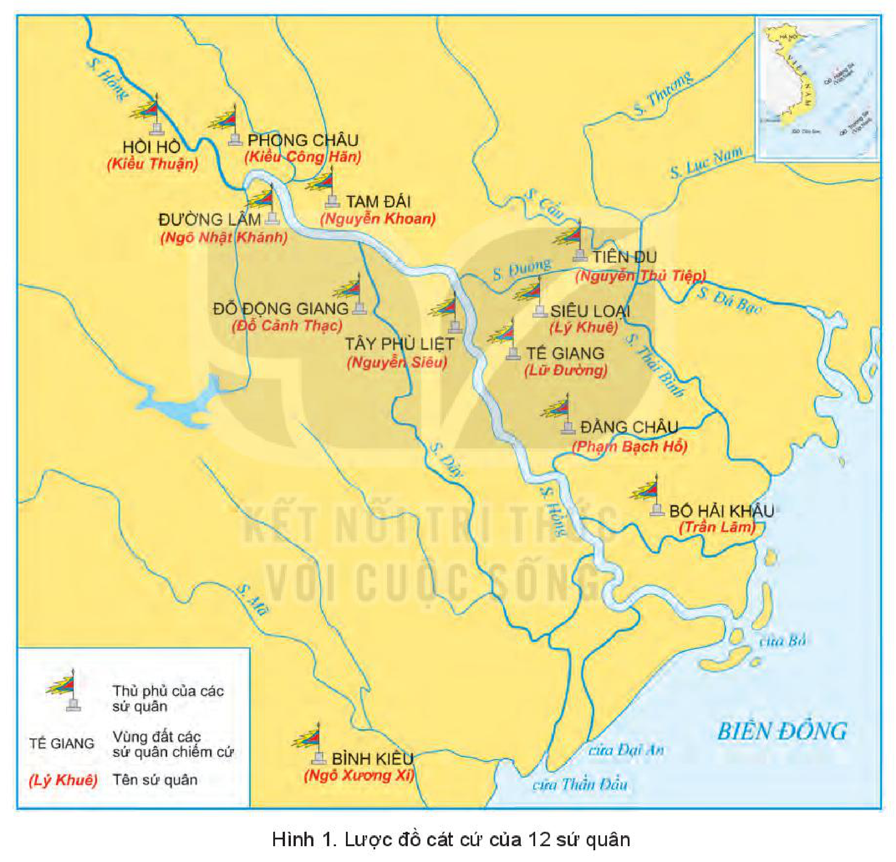
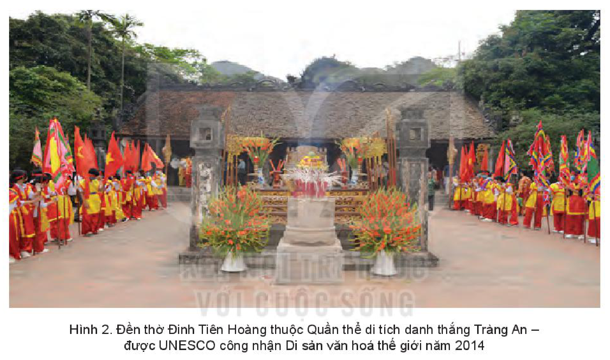

<!-- pdf:46 -->

# BÀI 9: ĐẤT NƯỚC BUỔI ĐẦU ĐỘC LẬP (939 – 967)

## 🎯 Học xong bài này, em sẽ:

- Nêu được những nét chính về tổ chức chính quyền, đời sống xã hội và văn hoá dưới thời Ngô.
- Trình bày được công cuộc thống nhất đất nước của Đinh Bộ Lĩnh và sự thành lập nhà Đinh.

## 🔴 Mở đầu

Chiến thắng Bạch Đằng năm 938 đã chấm dứt hoàn toàn ách đô hộ của phong kiến phương Bắc hơn một nghìn năm, mở ra kỉ nguyên mới trong lịch sử dân tộc. Ngô Quyền đã làm gì để xây dựng chính quyền độc lập mà sau này nhà sử học Lê Văn Hưu (thời Trần) đã nhận xét: “Chính thống của nước Việt ta, ngõ hầu đã được nối lại”?

## 1. Ngô Quyền dựng nền độc lập
<!-- ocr-ok: đã đối chiếu p046.png, kí hiệu đầu mục trang trí làm OCR nhầm chữ "dựng nền" thành "dụng nên" -->

<!-- term: Ngô Quyền dựng nền độc lập -->
Năm 939, sau chiến thắng Bạch Đằng, Ngô Quyền bỏ chức tiết độ sứ, xưng vương và đóng đô ở Cổ Loa (Hà Nội).

<!-- term: Ngô Quyền dựng nền độc lập -->
Chính quyền mới được thiết lập do vua là người đứng đầu, có quyền quyết định mọi việc, dưới có các quan văn, võ phụ trách từng công việc. Ở địa phương, vua giao các tướng lĩnh trấn giữ các châu quan trọng.

Đất nước được yên bình, văn hoá dân tộc được chú ý khôi phục.

> 💡 **Em có biết?**
>
> Ngô Quyền cử Ngô Xương Ngập cai quản vùng Đông Bắc, Đinh Công Trứ cai quản châu Hoan (Nghệ An – Hà Tĩnh), Kiều Công Hãn cai quản châu Phong (Phú Thọ),...
<!-- ocr-ok: đã đối chiếu p046.png, hộp Em có biết? đặt ở cột phải sát văn bản chính khiến OCR trộn dòng -->

<!-- term: Ngô Quyền dựng nền độc lập -->
Từ đây, nền độc lập dân tộc được khẳng định, tạo ra nền tảng căn bản cho công cuộc phát triển đất nước sau này.

> 1. “Tiền Ngô [Vương] nổi lên không chỉ có công chiến thắng mà thôi, việc đặt trăm quan, chế định triều nghi phẩm phục, có thể thấy được quy mô của bậc đế vương.”
>
> (Theo Ngô Sỹ Liên, *Đại Việt sử ký toàn thư*, Tập I, NXB Khoa học xã hội, 1993, tr.205)

> ❓ 1. Em hãy trình bày những nét chính về tổ chức chính quyền, đời sống xã hội và văn hoá thời Ngô.
>
> 2. Quyết định bỏ chức tiết độ sứ, thiết lập chính quyền độc lập của Ngô Quyền có ý nghĩa như thế nào?

<!-- pdf:47 -->

## 2. Công cuộc thống nhất đất nước của Đinh Bộ Lĩnh và sự thành lập nhà Đinh

<!-- term: Loạn 12 sứ quân -->
Năm 944, Ngô Quyền mất, chính quyền nhà Ngô suy yếu nhanh chóng. Nhân cơ hội đó, các thế lực hào trưởng địa phương nổi lên, mỗi người chiếm cứ một vùng. Đến năm 965, chính quyền nhà Ngô tan rã, đất nước lâm vào tình trạng cát cứ của 12 sứ quân.

*Hình 1. Lược đồ cát cứ của 12 sứ quân*

<!-- term: Đinh Bộ Lĩnh thống nhất đất nước -->
Trong hoàn cảnh đó, tại đất Hoa Lư (Ninh Bình) xuất hiện nhân vật Đinh Bộ Lĩnh.

<!-- term: Đinh Bộ Lĩnh thống nhất đất nước -->
Với tài năng của mình, lại được nhân dân ủng hộ, Đinh Bộ Lĩnh đánh đâu thắng đó, được tôn là Vạn Thắng Vương. Trong 2 năm (966 – 967), bằng các biện pháp vừa mềm dẻo vừa cứng rắn, ông đã lần lượt dẹp yên các sứ quân, chấm dứt tình trạng cát cứ, thống nhất đất nước và sau đó lập ra nhà Đinh.

<!-- pdf:48 -->

> 💡 **Em có biết?**
>
> Đinh Bộ Lĩnh là người động Hoa Lư (Gia Viễn, Ninh Bình), con trai Đinh Công Trứ (Thứ sử Hoan Châu). Hồi nhỏ, ông thường cùng trẻ con trong vùng chăn trâu, chơi trò tập trận, khiêng kiệu, lấy bông lau làm cờ.

> 2. Nhà sử học Lê Văn Hưu nhận xét: “Tiên Hoàng nhờ có tài năng sáng suốt hơn người, dũng cảm mưu lược nhất đời, đương lúc nước Việt ta không có chủ, các hùng trưởng cát cứ, một phen cất quân mà mười hai sứ quân phục hết”.
>
> (Theo Ngô Sỹ Liên, *Đại Việt sử ký toàn thư*, Tập I, Sđd, tr.211)

*Hình 2. Đền thờ Đinh Tiên Hoàng thuộc Quần thể di tích danh thắng Tràng An – được UNESCO công nhận Di sản văn hoá thế giới năm 2014*

> ❓ 1. Em hãy nêu tình hình nước ta sau khi Ngô Quyền mất.
>
> 2. Hãy trình bày công cuộc thống nhất đất nước và thành lập nhà Đinh của Đinh Bộ Lĩnh.

## ✏️ Luyện tập và Vận dụng

1. Em hãy đánh giá công lao của Ngô Quyền trong buổi đầu độc lập.

2. Những việc làm của Đinh Bộ Lĩnh có ý nghĩa như thế nào đối với dân tộc?

3. Có ý kiến cho rằng: Ngô Quyền quyết định về đóng đô ở Cổ Loa là để tiếp nối truyền thống cha ông. Em có đồng ý với ý kiến đó không? Vì sao?

## 📷 Danh sách hình trong bài

| Mã hình | Trang PDF | Trang sách | Chú thích |
| --- | --- | --- | --- |
| H7-lich_su_va_dia_ly-ls-b09-01 | 47 | 46 | Hình 1. Lược đồ cát cứ của 12 sứ quân |
| H7-lich_su_va_dia_ly-ls-b09-02 | 48 | 47 | Hình 2. Đền thờ Đinh Tiên Hoàng thuộc Quần thể di tích danh thắng Tràng An – được UNESCO công nhận Di sản văn hoá thế giới năm 2014 |
