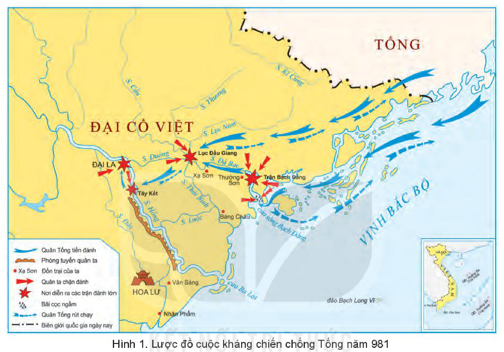
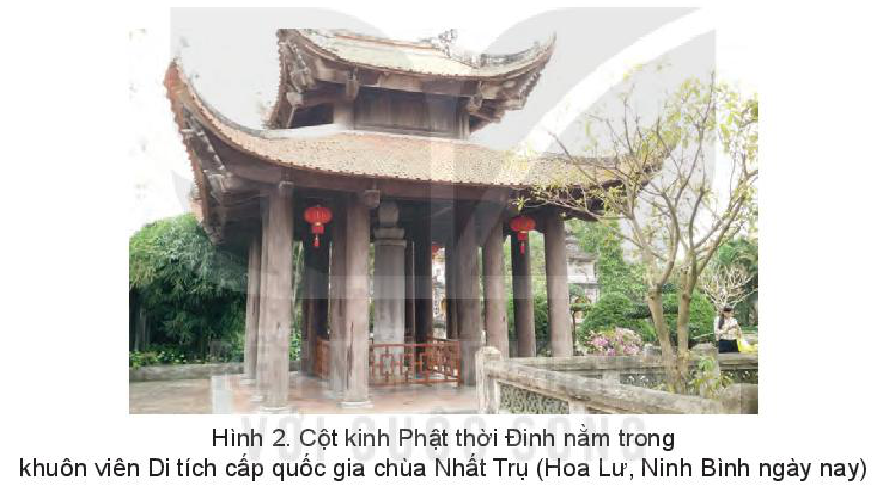

<!-- pdf:49 -->

# BÀI 10: ĐẠI CỔ VIỆT THỜI ĐINH VÀ TIỀN LÊ (968 – 1009)

## 🎯 Học xong bài này, em sẽ:

- Giới thiệu được những nét chính về tổ chức chính quyền thời Đinh – Tiền Lê.
- Mô tả được cuộc kháng chiến chống Tống của Lê Hoàn năm 981.
- Nhận biết được đời sống xã hội, văn hoá thời Đinh – Tiền Lê.

## 🔴 Mở đầu

Ngô Quyền với chiến thắng Bạch Đằng lịch sử đã khôi phục hoàn toàn nền độc lập dân tộc sau hơn một nghìn năm Bắc thuộc, vậy hai triều Đinh và Tiền Lê đã củng cố và bảo vệ nền độc lập đó như thế nào?

## 1. Công cuộc xây dựng chính quyền và bảo vệ đất nước thời Đinh – Tiền Lê

### a) Chính quyền thời Đinh

<!-- term: Chính quyền thời Đinh -->
Sau khi thống nhất đất nước, Đinh Bộ Lĩnh lên ngôi hoàng đế (Đinh Tiên Hoàng), đặt tên nước là Đại Cồ Việt, đặt niên hiệu là Thái Bình, đóng đô ở Hoa Lư (Ninh Bình).

<!-- term: Kinh đô Hoa Lư -->
> 🔗 **Kết nối với địa lí**
>
> Hoa Lư là một vùng đất hẹp, xung quanh có nhiều núi. Nhà Đinh cho xây dựng các bức tường để nối các dãy núi, hình thành hai khu vực: thành Nội và thành Ngoại. Trong thành có cung điện, có chùa Nhất Trụ, tháp Báo Thiên. Bên ngoài thành là nơi nhân dân sinh sống.

<!-- term: Chính quyền thời Đinh -->
Chính quyền thời Đinh được kiện toàn thêm một bước. Ở Trung ương đứng đầu là hoàng đế có quyền lực cao nhất, giúp việc có Ban Văn, Ban Võ và cao tăng. Chính quyền địa phương gồm các cấp: đạo (châu), giáp, xã.

<!-- term: Chính quyền thời Đinh -->
Nhà vua phong vương cho các hoàng tử, cử tướng lĩnh thân cận nắm giữ chức vụ chủ chốt, cho đúc tiền để lưu hành trong nước. Những người phạm tội nặng bị xử phạt rất nghiêm khắc. Nhà Đinh tổ chức quân đội gồm 10 đạo, sai sứ sang giao hảo với nhà Tống.

Những việc làm của Đinh Tiên Hoàng là sự khẳng định ở mức độ cao hơn vị thế độc lập của Đại Cồ Việt.

> ❓ Dựa vào thông tin trong mục, em hãy vẽ sơ đồ tổ chức chính quyền thời Đinh và rút ra nhận xét.

### b) Cuộc kháng chiến chống Tống (năm 981)

<!-- term: Lê Hoàn -->
> 💡 **Em có biết?**
>
> Lê Hoàn (941 – 1005) quê ở Ái Châu (Thanh Hoá). Bố mẹ mất sớm, ông được một viên quan họ Lê nhận làm con nuôi. Lớn lên, ông giúp Đinh Bộ Lĩnh đánh dẹp 12 sứ quân. Là người tài giỏi, mưu lược, ông được triều Đinh phong làm Thập đạo tướng quân.

<!-- term: Cuộc kháng chiến chống Tống năm 981 -->
Cuối năm 979, Đinh Tiên Hoàng và con trai trưởng là Đinh Liễn bị ám sát. Con thứ là Đinh Toàn mới 6 tuổi nối ngôi. Lê Hoàn được cử làm phụ chính. Nhân cơ hội đó, nhà Tống âm mưu xâm lược Đại Cồ Việt. Triều thần đồng lòng suy tôn Lê Hoàn lên làm vua để lãnh đạo kháng chiến.

<!-- pdf:50 -->

<!-- term: Cuộc kháng chiến chống Tống năm 981 -->
Đầu năm 981, quân Tống do Hầu Nhân Bảo làm tổng chỉ huy, theo hai đường thuỷ, bộ tiến đánh Đại Cồ Việt.

<!-- term: Cuộc kháng chiến chống Tống năm 981 -->
Lê Hoàn trực tiếp tổ chức, lãnh đạo kháng chiến. Nhiều trận chiến ác liệt đã diễn ra ở Đại La, Lục Đầu Giang, Bạch Đằng, Tây Kết,... khiến quân giặc bị tổn thất nặng nề. Tướng Hầu Nhân Bảo tử trận. Quân Tống đại bại, buộc phải rút về nước.

*Hình 1. Lược đồ cuộc kháng chiến chống Tống năm 981*

<!-- term: Cuộc kháng chiến chống Tống năm 981 -->
Cuộc kháng chiến chống Tống thắng lợi vẻ vang đã bảo vệ vững chắc nền độc lập dân tộc, chứng tỏ bước phát triển mới của quốc gia Đại Cồ Việt.

> ❓ Hãy trình bày những nét chính về cuộc kháng chiến chống Tống năm 981 trên lược đồ.

### c) Chính quyền thời Tiền Lê

<!-- term: Chính quyền thời Tiền Lê -->
Lê Hoàn lập nên nhà Tiền Lê, đổi niên hiệu là Thiên Phúc, tiếp tục công cuộc xây dựng quốc gia độc lập.

<!-- term: Chính quyền thời Tiền Lê -->
Chính quyền Trung ương do vua đứng đầu, nắm mọi quyền hành. Giúp vua bàn việc nước có thái sư (quan đứng đầu triều) và đại sư (nhà sư có danh tiếng). Dưới vua là các quan văn, quan võ. Các con vua được phong vương và trấn giữ các vùng hiểm yếu.

<!-- term: Chính quyền thời Tiền Lê -->
Ở địa phương, cả nước được chia thành 10 *đạo*. Đến năm 1002, vua cho đổi đạo thành *lộ*, *phủ*, *châu* rồi đến *giáp*. Đơn vị cấp cơ sở là *xã*. Các quan lại địa phương chưa được sắp xếp đầy đủ.

<!-- term: Cấm quân -->
Quân đội được xây dựng gồm hai bộ phận: cấm quân (bảo vệ vua và kinh thành) và quân đóng tại các địa phương.

<!-- pdf:51 -->

<!-- term: Chính quyền thời Tiền Lê -->
Triều đình chú trọng xây dựng pháp luật như định ra luật lệnh (năm 1002) và tăng cường quan hệ ngoại giao với nhà Tống.

> ❓ Nêu những nét chính về tổ chức chính quyền thời Tiền Lê.

## 2. Đời sống xã hội và văn hoá thời Đinh – Tiền Lê

### a) Tình hình xã hội

Xã hội phân chia thành hai bộ phận là thống trị và bị trị. Bộ phận thống trị gồm vua, quan; bị trị chủ yếu là người dân lao động (nông dân, thợ thủ công, thương nhân, nô tì). Nông dân có số lượng đông đảo nhất, cày cấy ruộng đất công làng xã. Nô tì có địa vị thấp kém nhất, số lượng không nhiều.

### b) Đời sống văn hoá

<!-- term: Đời sống văn hoá thời Đinh – Tiền Lê -->
Thời Đinh – Tiền Lê, giáo dục chưa phát triển. Nho giáo chưa có ảnh hưởng sâu rộng. Phật giáo được truyền bá rộng rãi, chùa được xây dựng ở nhiều nơi, các nhà sư thường là người có học, giỏi chữ Hán, được triều đình đề cao và nhân dân quý trọng.

*Hình 2. Cột kinh Phật thời Đinh nằm trong khuôn viên Di tích cấp quốc gia chùa Nhất Trụ (Hoa Lư, Ninh Bình ngày nay)*

<!-- term: Đời sống văn hoá thời Đinh – Tiền Lê -->
Xu hướng khôi phục và phát triển văn hoá dân tộc bước đầu đạt được một số thành tựu. Nhiều loại hình văn hoá dân gian tiếp tục được giữ gìn trong đời sống như ca hát, nhảy múa, đua thuyền, đấu võ, đấu vật,...

> ❓ 1. Trình bày những nét chính về tình hình xã hội thời Đinh – Tiền Lê.
>
> 2. Đời sống văn hoá thời Đinh – Tiền Lê có điểm gì nổi bật?

## ✏️ Luyện tập và Vận dụng

1. Em hãy so sánh tổ chức chính quyền thời Đinh và Tiền Lê với thời Ngô.

2. Em có nhận xét gì về vai trò của Lê Hoàn trong cuộc kháng chiến chống Tống năm 981?
<!-- ocr-ok: đã đối chiếu p051.png, OCR dính chữ "Emcó nhận xétgì" và nhầm dấu "Tống" thành "Tổng" -->

3. Giả sử em là Đinh Tiên Hoàng, em có chọn đặt kinh đô ở Hoa Lư không? Vì sao?

## 📷 Danh sách hình trong bài

| Mã hình | Trang PDF | Trang sách | Chú thích |
| --- | --- | --- | --- |
| H7-lich_su_va_dia_ly-ls-b10-01 | 50 | 49 | Hình 1. Lược đồ cuộc kháng chiến chống Tống năm 981 |
| H7-lich_su_va_dia_ly-ls-b10-02 | 51 | 50 | Hình 2. Cột kinh Phật thời Đinh nằm trong khuôn viên Di tích cấp quốc gia chùa Nhất Trụ (Hoa Lư, Ninh Bình ngày nay) |
