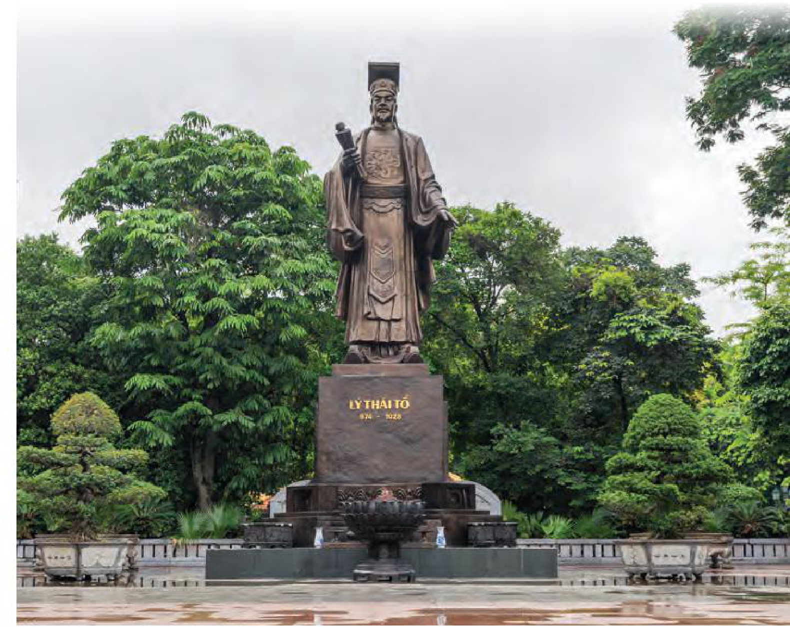
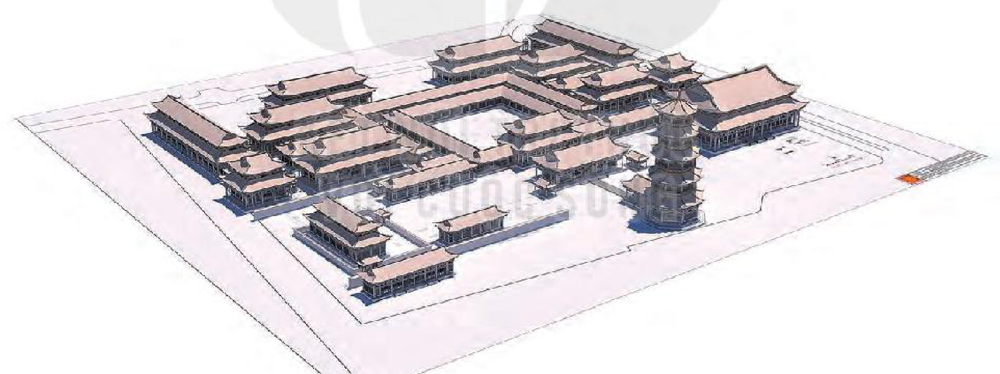
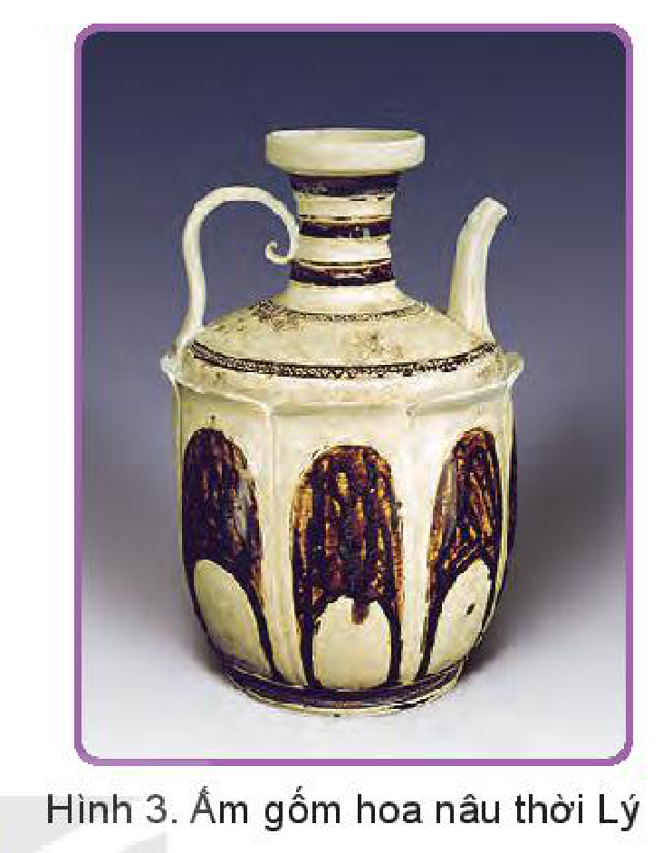
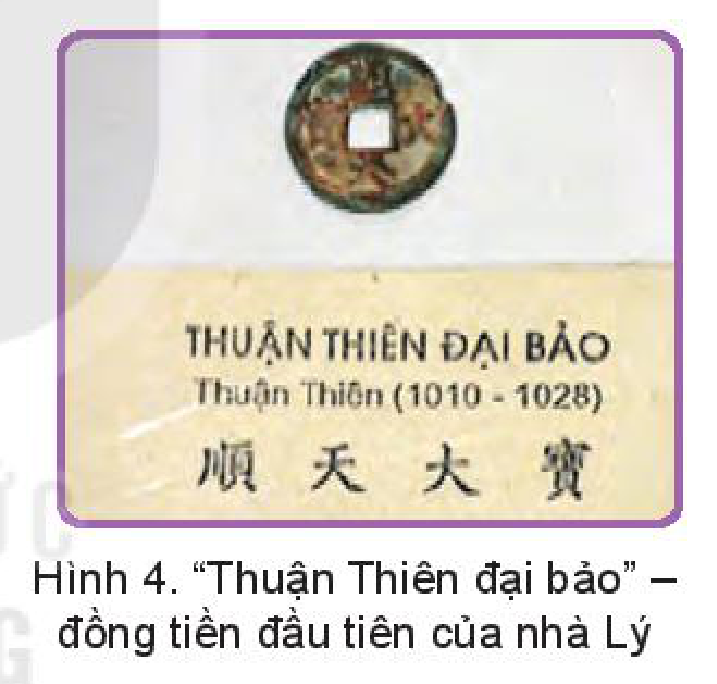
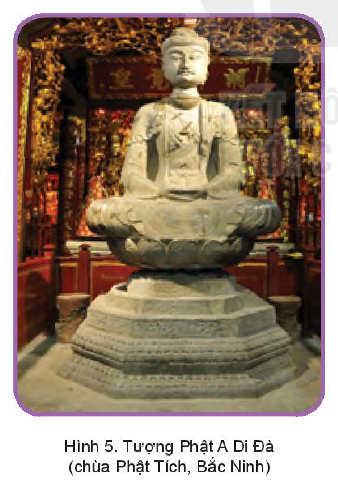
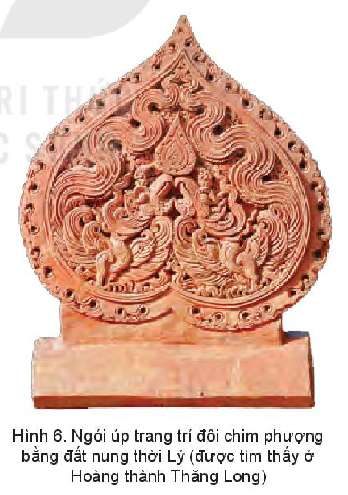
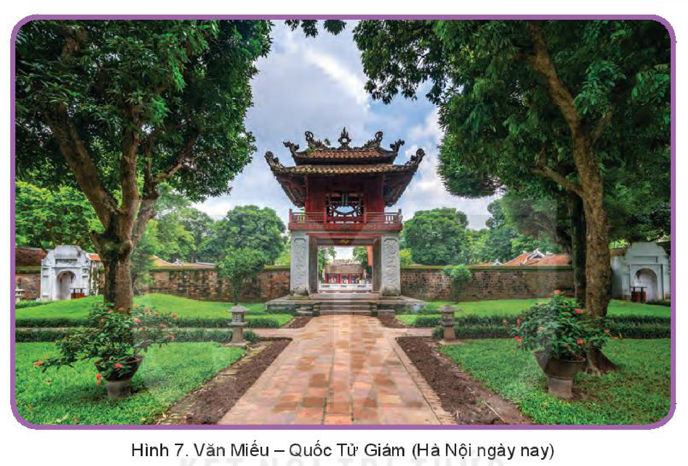

<!-- pdf:53 -->

# BÀI 11: NHÀ LÝ XÂY DỰNG VÀ PHÁT TRIỂN ĐẤT NƯỚC (1009 – 1225)

## 🎯 Học xong bài này, em sẽ:

- Trình bày được những nét chính về sự thành lập nhà Lý.
- Đánh giá ý nghĩa của sự kiện dời đô ra Đại La của Lý Công Uẩn.
- Mô tả được những nét chính về chính trị, kinh tế, xã hội, văn hoá, tôn giáo thời Lý.
- Giới thiệu được những thành tựu tiêu biểu về văn hoá, giáo dục.

## 🔴 Mở đầu

Năm 1009, nhà Lý được thành lập. Không lâu sau khi lên ngôi, Lý Công Uẩn quyết định dời đô từ Hoa Lư về Đại La. Sự kiện này có ý nghĩa như thế nào đối với lịch sử dân tộc? Nhà Lý đã làm những gì để xây dựng và phát triển đất nước?

## 1. Nhà Lý thành lập và định đô ở Thăng Long

<!-- term: Lý Công Uẩn -->
Năm 1005, Lê Hoàn mất. Lê Long Đĩnh nối ngôi, đã thi hành nhiều chính sách tàn bạo. Năm 1009, sau khi Lê Long Đĩnh mất, giới sư sãi và đại thần đã tôn Lý Công Uẩn lên ngôi vua. Nhà Lý được thành lập.

<!-- term: Lý Công Uẩn -->
> 💡 **Em có biết?**
>
> Lý Công Uẩn quê ở châu Cổ Pháp (Từ Sơn – Bắc Ninh). Thuở nhỏ, ông theo học sư Vạn Hạnh. Khi Vạn Hạnh vào Kinh đô Hoa Lư đã đưa ông đi theo. Sau này, Lý Công Uẩn làm quan trong triều Tiền Lê, đến chức Điện tiền Chỉ huy sứ, chỉ huy cấm quân. Là người có tài đức nên ông được triều thần rất quý trọng.

*Hình 1. Tượng đài vua Lý Thái Tổ (Hà Nội)*

<!-- pdf:54 -->

<!-- term: Chiếu dời đô -->
Năm 1010, vua Lý Công Uẩn đặt niên hiệu là Thuận Thiên, quyết định dời đô từ Hoa Lư về thành Đại La (Hà Nội ngày nay) và đổi tên là Thăng Long.

<!-- term: Chiếu dời đô -->
> *Trong Chiếu dời đô có đoạn:*
>
> 1. “... thành Đại La... ở giữa khu vực trời đất, được thế rồng cuộn hổ ngồi, chính giữa nam bắc đông tây, tiện nghi núi sông sau trước. Vùng này mặt đất rộng mà bằng phẳng, thế đất cao mà sáng sủa, dân cư không khổ vì ngập lụt, muôn vật hết sức tươi tốt, phồn thịnh.
>
> Xem khắp nước Việt, đó là thắng địa, thực là chỗ tụ hội quan yếu của bốn phương, đúng là nơi thượng đô kinh sư mãi muôn đời”.
>
> (Theo Ngô Sỹ Liên, *Đại Việt sử ký toàn thư*, Tập I, Sđd, tr.241)

<!-- term: Chiếu dời đô -->
> 💡 **Em có biết?**
>
> Sử chép, khi thuyền nhà vua tạm đỗ dưới thành Đại La, có rồng vàng hiện lên, nhân đó đổi tên thành là Thăng Long (có nghĩa là *Rồng bay lên*).

<!-- term: Đại Việt -->
<!-- term: Kinh thành Thăng Long -->
Ở khu vực trung tâm, nhà Lý đã xây dựng nhiều cung điện làm nơi làm việc của vua và triều đình, nơi ở của hoàng gia. Bên ngoài là khu vực buôn bán, làm ăn của dân chúng. Năm 1054, nhà Lý đổi tên nước là Đại Việt.

*Hình 2. Sơ đồ phục dựng Cấm thành trong Hoàng thành Thăng Long*

<!-- term: Kinh thành Thăng Long -->
> 💡 **Em có biết?**
>
> Kinh thành Thăng Long được xây dựng gồm ba vòng thành. Cấm thành và Hoàng thành được bảo vệ nghiêm ngặt, là nơi ở của vua và hoàng tộc, làm việc của triều đình. Vòng thành thứ ba là La thành.

> ❓ 1. Nhà Lý được thành lập như thế nào?
>
> 2. Khai thác tư liệu 1, tìm những từ, cụm từ miêu tả về thành Đại La. Những thông tin đó chứng tỏ điều gì về vùng đất này? Từ đó, hãy cho biết ý nghĩa của sự kiện dời đô của Lý Công Uẩn.

<!-- pdf:55 -->

## 2. Tình hình chính trị

### a) Tổ chức chính quyền
<!-- ocr-ok: đã đối chiếu p055.png, OCR nhầm dấu "Tổ chức" thành "Tô chức" -->

<!-- term: Đại Việt -->
Nhà Lý xây dựng hệ thống chính quyền từ trung ương đến địa phương. Đứng đầu là vua, dưới có các quan đại thần (quan văn, quan võ) giúp việc. Vua ở ngôi theo chế độ cha truyền con nối. Những người thân tín được cất nhắc lên nắm các chức vụ cao trong triều đình.

Nhà Lý chia cả nước thành 24 *lộ*, *phủ*, ở miền núi gọi là *châu*. Dưới lộ (phủ, châu) là *hương*, *huyện*. Đơn vị cấp cơ sở là *xã*.

### b) Xây dựng luật pháp và quân đội

<!-- term: Hình thư -->
Bộ *Hình thư* được ban hành năm 1042, là bộ luật thành văn đầu tiên của nước ta.

<!-- term: Ngụ binh ư nông -->
Quân đội nhà Lý được huấn luyện chu đáo, chia thành hai bộ phận: cấm quân (được tuyển chọn chặt chẽ có nhiệm vụ bảo vệ nhà vua và kinh thành) và quân địa phương (được tuyển chọn từ các làng xã có nhiệm vụ bảo vệ các lộ, phủ và được huy động khi đất nước có chiến tranh). Nhà Lý thi hành chính sách “ngụ binh ư nông”.

<!-- term: Ngụ binh ư nông -->
> 💡 **Em có biết?**
>
> “Ngụ binh ư nông” là chính sách “gửi lính ở nhà nông”, cho quân sĩ luân phiên về cày ruộng và thanh niên đăng kí tên vào sổ nhưng vẫn ở nhà sản xuất, khi cần triều đình sẽ huy động tham gia quân đội.
<!-- ocr-ok: đã đối chiếu p055.png, hộp Em có biết? đặt ở cột trái sát văn bản chính khiến OCR trộn dòng -->

### c) Chính sách đối nội, đối ngoại
<!-- ocr-ok: đã đối chiếu p055.png, OCR nhầm dấu "đối nội, đối ngoại" thành "đôi nội, đôi ngoại" -->

Để củng cố khối đoàn kết toàn dân tộc, nhà Lý thực hiện chính sách mềm dẻo, khôn khéo; song cũng kiên quyết trấn áp những thế lực có mưu đồ tách khỏi Đại Việt.

> 2. Vua Lý Công Uẩn đã gả con gái cho tù trưởng động giáp ở Lạng Châu là Giáp Thừa Quý... Thái Tông gả công chúa Kim Thành cho châu mục Phong Châu, Thái Tông lại lấy con gái của Đào Đại Di ở châu Chân Đăng làm phi...
>
> (Theo Phan Huy Lê (Chủ biên), *Lịch sử Việt Nam*, Tập I, NXB Giáo dục Việt Nam, 2012, tr.556)

Nhà Lý giữ mối quan hệ hoà hiếu với nhà Tống, dẹp tan cuộc tấn công của Chăm-pa, đưa quan hệ Đại Việt – Chăm-pa trở lại bình thường.

> ❓ 1. Tư liệu 2 cho em biết điều gì về chính sách của nhà Lý đối với các tù trưởng miền núi?
>
> 2. Hãy cho biết những nét chính về tình hình chính trị thời Lý.

## 3. Tình hình kinh tế, xã hội

### a) Tình hình kinh tế

<!-- term: Lễ cày tịch điền -->
*Nông nghiệp:* Nhà Lý thực hiện nhiều biện pháp thúc đẩy sản xuất nông nghiệp như: thi hành chính sách “ngụ binh ư nông”, cày ruộng tịch điền, bảo vệ trâu bò, khai khẩn đất hoang, đào kênh mương, đắp đê phòng lụt,... Nhờ vậy nhiều năm mùa màng bội thu.

<!-- pdf:56 -->

<!-- term: Lễ cày tịch điền -->
> Mùa xuân năm 1038, vua Lý Thái Tông ra Bố Hải Khẩu (Thái Bình) cày tịch điền. Vua đích thân tế Thần Nông rồi tự cày những đường đầu tiên. Có người can rằng: “Đó là công việc của nông phu, bệ hạ việc gì làm thế”. Vua nói: “Trẫm không tự mình cày cấy thì lấy gì làm xôi cúng, lấy gì cho thiên hạ noi theo”.

*Thủ công nghiệp:* Thủ công nghiệp thời kì này khá phát triển, bao gồm hai bộ phận: thủ công nghiệp nhà nước (đúc tiền, chế tạo binh khí, dệt lụa, làm phẩm phục của triều đình,...) và thủ công nghiệp nhân dân (làm đồ trang sức, làm giấy, đúc đồng, ươm tơ, dệt lụa, làm đồ gốm, xây dựng đền đài, cung điện,...).

Chuông Quy Điền, tháp Báo Thiên là những di vật, công trình nổi tiếng do thợ thủ công thời Lý tạo nên.

*Hình 3. Ấm gốm hoa nâu thời Lý*

> 3. Năm 1040, vua đã dạy cung nữ dệt được gấm vóc. Sau đó vua xuống chiếu phát hết gấm vóc của nước Tống ở trong kho để may áo ban cho các quan... để tỏ ra vua không dùng gấm vóc nước Tống nữa.
>
> (Theo *Đại Việt sử ký toàn thư*, Tập I, Sđd, tr.261)

*Thương nghiệp:* Ở các địa phương, hình thành các chợ và một số trung tâm trao đổi hàng hoá.

<!-- term: Cảng biển Vân Đồn -->
Quan hệ buôn bán giữa Đại Việt với Trung Quốc khá phát triển, nhiều chợ ở vùng biên giới được hình thành. Cảng biển Vân Đồn (Quảng Ninh ngày nay) trở thành nơi buôn bán với nước ngoài rất sầm uất.

*Hình 4. “Thuận Thiên đại bảo” – đồng tiền đầu tiên của nhà Lý*

### b) Tình hình xã hội

Xã hội có xu hướng phân hoá hơn.

Tầng lớp quý tộc (vua, quan) có nhiều đặc quyền. Một số ít dân thường có nhiều ruộng đất trở thành địa chủ. Nông dân chiếm đa số trong dân cư, nhận ruộng đất công làng xã để cày cấy và nộp thuế, thực hiện nghĩa vụ với nhà nước; một số phải lĩnh canh ruộng đất và nộp tô cho địa chủ. Thợ thủ công và thương nhân khá đông đảo. Nô tì có địa vị thấp kém nhất, phục vụ trong triều đình và gia đình quan lại.

> ❓ 1. Em có nhận xét gì về các chính sách của nhà Lý trong phát triển kinh tế? Theo em, những chính sách đó có tác dụng gì?
>
> 2. Trình bày nét chính về tình hình kinh tế, xã hội Đại Việt thời Lý.

<!-- pdf:57 -->

## 4. Tình hình văn hoá, giáo dục

### a) Tôn giáo

Phật giáo được các vua Lý tôn sùng và truyền bá rộng rãi trong nhân dân. Nho giáo bắt đầu được mở rộng và ngày càng có vai trò trong xã hội. Đạo giáo cũng khá thịnh hành, được kết hợp với các tín ngưỡng dân gian.

<!-- term: Chùa Một Cột -->
> 🔗 **Kết nối với văn hoá**
>
> Trong một giấc chiêm bao, vua Lý Thái Tông mơ thấy được Phật Bà Quan Âm ngồi trên toà sen dắt vua lên toà. Vua kể chuyện đó với quần thần và được khuyên dựng chùa. Năm 1049, nhà vua cho xây chùa Diên Hựu (Một Cột). Chùa được đặt trên một cột đá cao tượng trưng cho một bông sen nở trên mặt nước.

### b) Văn học, nghệ thuật

Thời Lý, văn học chữ Hán bước đầu phát triển, xuất hiện một số tác phẩm văn học có giá trị như *Chiếu dời đô*, *Nam quốc sơn hà*,...

Hát chèo, múa rối nước đều phát triển. Các trò chơi dân gian như đá cầu, đấu vật, đua thuyền,... rất được ưa chuộng.

<!-- term: Chùa Một Cột -->
Thời kì này, một số công trình kiến trúc có quy mô tương đối lớn và độc đáo được xây dựng như Cấm thành, chùa Một Cột,... Trình độ điêu khắc tinh vi, thanh thoát, được thể hiện trên các tượng Phật, ở hình trang trí rồng, phượng và các bệ đá hình hoa sen,...

*Hình 5. Tượng Phật A Di Đà (chùa Phật Tích, Bắc Ninh)*

*Hình 6. Ngói úp trang trí đôi chim phượng bằng đất nung thời Lý (được tìm thấy ở Hoàng thành Thăng Long)*

<!-- pdf:58 -->

### c) Giáo dục

<!-- term: Văn Miếu – Quốc Tử Giám -->
Nhà Lý đã chú ý đến việc học tập, thi cử để tuyển chọn những người tài bổ sung vào bộ máy chính quyền. Năm 1070, nhà Lý cho dựng Văn Miếu; năm 1075, cho mở khoa thi đầu tiên để tuyển chọn quan lại. Năm 1076, Quốc Tử Giám được thành lập, là nơi học tập của con em quý tộc; sau đó, mở rộng đến con quan lại và những người giỏi trong nước.

> 💡 **Em có biết?**
>
> Người đỗ đầu kì thi năm 1075 là Lê Văn Thịnh (quê ở Gia Bình, Bắc Ninh) được vào cung dạy Thái tử và làm quan đến chức Thái sư.

*Hình 7. Văn Miếu – Quốc Tử Giám (Hà Nội ngày nay)*

> ❓ 1. Giới thiệu những thành tựu tiêu biểu về văn hoá, giáo dục thời Lý.
>
> 2. Việc xây dựng Văn Miếu – Quốc Tử Giám và mở khoa thi đầu tiên có ý nghĩa như thế nào?

## ✏️ Luyện tập và Vận dụng

1. Lập bảng hệ thống (hoặc sơ đồ tư duy) thể hiện những nét chính về tình hình chính trị, kinh tế, xã hội, văn hoá thời Lý.

2. So sánh và cho biết tổ chức nhà nước thời Lý có điểm gì khác so với thời Đinh – Tiền Lê. Qua đó chứng tỏ điều gì về tổ chức nhà nước thời Lý?

3. Hãy sưu tầm từ sách, báo và internet về một thành tựu văn hoá, giáo dục tiêu biểu thời Lý. Viết một đoạn văn ngắn (7 – 10 câu) giới thiệu về thành tựu đó.

## 📷 Danh sách hình trong bài

| Mã hình | Trang PDF | Trang sách | Chú thích |
| --- | --- | --- | --- |
| H7-lich_su_va_dia_ly-ls-b11-01 | 53 | 52 | Hình 1. Tượng đài vua Lý Thái Tổ (Hà Nội) |
| H7-lich_su_va_dia_ly-ls-b11-02 | 54 | 53 | Hình 2. Sơ đồ phục dựng Cấm thành trong Hoàng thành Thăng Long |
| H7-lich_su_va_dia_ly-ls-b11-03 | 56 | 55 | Hình 3. Ấm gốm hoa nâu thời Lý |
| H7-lich_su_va_dia_ly-ls-b11-04 | 56 | 55 | Hình 4. “Thuận Thiên đại bảo” – đồng tiền đầu tiên của nhà Lý |
| H7-lich_su_va_dia_ly-ls-b11-05 | 57 | 56 | Hình 5. Tượng Phật A Di Đà (chùa Phật Tích, Bắc Ninh) |
| H7-lich_su_va_dia_ly-ls-b11-06 | 57 | 56 | Hình 6. Ngói úp trang trí đôi chim phượng bằng đất nung thời Lý (được tìm thấy ở Hoàng thành Thăng Long) |
| H7-lich_su_va_dia_ly-ls-b11-07 | 58 | 57 | Hình 7. Văn Miếu – Quốc Tử Giám (Hà Nội ngày nay) |
