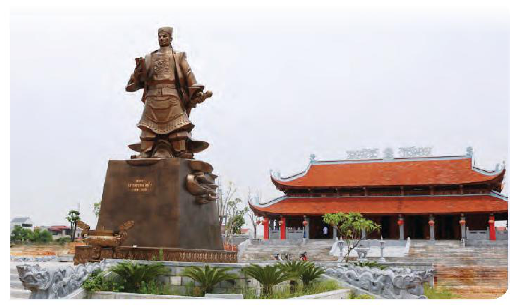
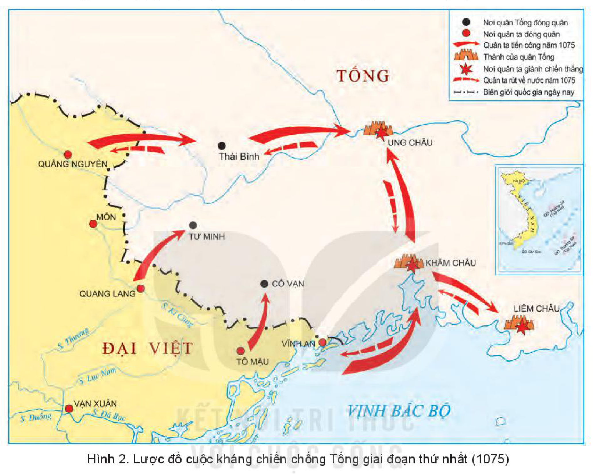
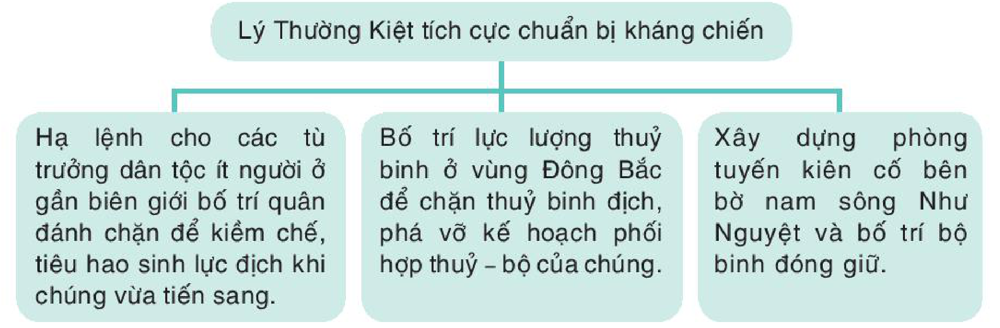
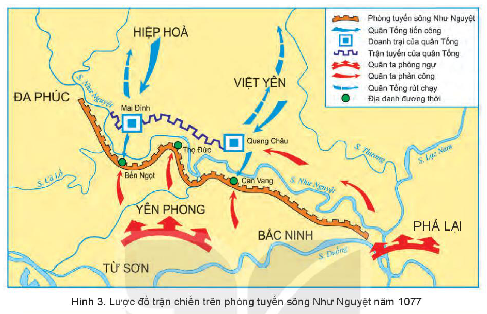

<!-- pdf:59 -->

# BÀI 12: CUỘC KHÁNG CHIẾN CHỐNG QUÂN XÂM LƯỢC TỐNG (1075 – 1077)

## 🎯 Học xong bài này, em sẽ:

- Đánh giá được những nét độc đáo của cuộc kháng chiến chống quân Tống (trong kế hoạch đánh giặc, tổ chức cuộc chiến đấu, cách kết thúc cuộc chiến).
- Đánh giá được vai trò của Lý Thường Kiệt trong cuộc kháng chiến chống quân Tống (1075 – 1077).

## 🔴 Mở đầu

Em đã được tìm hiểu về cuộc kháng chiến chống Tống của quân dân Đại Cồ Việt (năm 981). Trong trận chiến đó, mặc dù đã bị thất bại thảm hại và phải rút quân về nước nhưng nhà Tống vẫn chưa bao giờ từ bỏ ý đồ xâm lược nước ta. Vua Tống nuôi tham vọng gì khi tiếp tục đề ra kế hoạch đánh chiếm nước Đại Việt? Dưới sự lãnh đạo của triều đình nhà Lý, quân dân Đại Việt đã tổ chức kháng chiến, bảo vệ đất nước như thế nào?

## 1. Cuộc kháng chiến chống Tống giai đoạn thứ nhất (năm 1075)

<!-- term: Lý Thường Kiệt -->
Giữa thế kỉ XI, vua Tống lại âm mưu đưa quân xâm lược Đại Việt. Trước tình hình đó, triều đình nhà Lý đã cử Lý Thường Kiệt làm tổng chỉ huy lãnh đạo cuộc kháng chiến; chủ động tiến hành các biện pháp đối phó như làm thất bại ý đồ tiến công phối hợp của nhà Tống với Chăm-pa,...

<!-- term: Lý Thường Kiệt -->
> 💡 **Em có biết?**
>
> Lý Thường Kiệt (1019 – 1105) tên thật là Ngô Tuấn, quê ở phường Thái Hoà (kinh thành Thăng Long). Ông là người sớm có chí hướng, ham đọc binh thư, luyện tập võ nghệ, được Lý Thánh Tông phong làm Phụ quốc Thái uý, đổi thành họ vua, gọi là Lý Thường Kiệt.

*Hình 1. Khu di tích Lý Thường Kiệt (Bắc Ninh)*

<!-- pdf:60 -->

<!-- term: Chủ trương “tiến công trước để tự vệ” -->
Sau khi ổn định được biên giới phía Nam, Lý Thường Kiệt đã nhận định: “Ngồi yên đợi giặc không bằng đem quân đánh trước để chặn thế mạnh của giặc”. Tháng 10 – 1075, ông đích thân chỉ huy hơn 10 vạn quân thuỷ, bộ, chia làm hai đạo tiến vào đất Tống, chủ động thực hiện chủ trương “tiến công trước để tự vệ”.

*Hình 2. Lược đồ cuộc kháng chiến chống Tống giai đoạn thứ nhất (1075)*

<!-- term: Chủ trương “tiến công trước để tự vệ” -->
Sau 42 ngày chiến đấu, quân Lý đã hạ được thành Ung Châu – căn cứ mạnh nhất của quân Tống, tiêu huỷ hết kho lương dự trữ rồi nhanh chóng rút quân về chuẩn bị phòng tuyến chặn giặc.

> 1. Bằng cuộc tiến công táo bạo đó, Lý Thường Kiệt đã đẩy kẻ thù vào thế bị động và tạo ra nhiều điều kiện có lợi để đánh bại khi chúng kéo sang xâm lược nước ta.
>
> (Theo Đinh Xuân Lâm (Chủ biên), *Đại cương lịch sử Việt Nam*, Tập II, NXB Giáo dục, 1998, tr.152)

> ❓ Em hãy chỉ ra nét độc đáo trong cuộc kháng chiến chống Tống giai đoạn thứ nhất (năm 1075).

## 2. Cuộc kháng chiến chống Tống giai đoạn thứ hai (năm 1077)

### a) Chuẩn bị kháng chiến

<!-- pdf:61 -->

> **Lý Thường Kiệt tích cực chuẩn bị kháng chiến**
> - Hạ lệnh cho các tù trưởng dân tộc ít người ở gần biên giới bố trí quân đánh chặn để kiềm chế, tiêu hao sinh lực địch khi chúng vừa tiến sang.
> - Bố trí lực lượng thuỷ binh ở vùng Đông Bắc để chặn thuỷ binh địch, phá vỡ kế hoạch phối hợp thuỷ – bộ của chúng.
> - Xây dựng phòng tuyến kiên cố bên bờ nam sông Như Nguyệt và bố trí bộ binh đóng giữ.
<!-- ocr-ok: đã đối chiếu p061.png, sơ đồ ba nhánh song song làm OCR ghép ngang dòng -->

<!-- term: Phòng tuyến sông Như Nguyệt -->
> 🔗 **Kết nối với địa lí**
>
> Sông Như Nguyệt là một đoạn của sông Cầu (từ ngã ba sông Cà Lồ và sông Cầu trở xuống đến Phả Lại – lúc đó là Vạn Xuân). Dòng sông chặn ngang con đường bộ mà quân Tống có thể vượt qua để tiến vào Thăng Long.

<!-- term: Phòng tuyến sông Như Nguyệt -->
> 2. Lý Thường Kiệt cho đắp đê cao như bức tường thành ở mặt nam sông Cầu, bên trên đóng tre làm dậu dày mấy tầng. Bức tường thành kiên cố chạy dài gần 10 km, từ chân dãy núi Tam Đảo trở xuống, bao bọc che đỡ cho cả hai vùng đồng bằng rộng lớn. Thành hào kiên cố như thế chắc chắn giúp quân Lý dễ dàng phòng thủ hơn...
>
> (Theo Viện Sử học, *Lịch sử Việt Nam*, Tập 2, NXB Khoa học xã hội, tr.284)

> ❓ Vì sao Lý Thường Kiệt quyết định xây dựng phòng tuyến chống quân Tống ở sông Như Nguyệt? Việc xây dựng phòng tuyến như vậy đã thể hiện điều gì?

### b) Cuộc chiến đấu trên phòng tuyến sông Như Nguyệt

<!-- term: Phòng tuyến sông Như Nguyệt -->
Năm 1077, quân Tống chia làm hai đạo tiến vào xâm lược Đại Việt. Quân bộ do Quách Quỳ chỉ huy vượt qua biên giới vùng Đông Bắc nước ta. Trên đường tiến vào Thăng Long, chúng đã bị chặn đứng trước phòng tuyến sông Như Nguyệt. Quân thuỷ do Hoà Mâu chỉ huy tiến vào vùng ven biển Đông Bắc, nhưng bị chặn đánh liên tiếp nên không thể tiến sâu vào nội địa để hỗ trợ cho quân bộ. Quách Quỳ nhiều lần cho quân tìm cách vượt sông Như Nguyệt nhưng đều bị đẩy lùi về phía bờ bắc.

<!-- term: Nam quốc sơn hà -->
> 🔗 **Kết nối với văn học**
>
> Trong lúc quân giặc ngày càng chán nản, mệt mỏi, tương truyền, đêm đêm, Lý Thường Kiệt cho người vào ngôi đền bên bờ sông, ngâm vang bài thơ *Nam quốc sơn hà* để làm nhụt ý chí xâm lược của quân Tống và khích lệ tinh thần chiến đấu của binh sĩ.

<!-- term: Phòng tuyến sông Như Nguyệt -->
Cuối Xuân năm 1077, Lý Thường Kiệt quyết định mở cuộc tấn công lớn. Đang đêm, quân ta lặng lẽ vượt sông Như Nguyệt, đánh thẳng vào doanh trại quân Tống. Quân giặc thua to, “mười phần chết đến năm, sáu” và lâm vào tình thế hết sức khó khăn, tuyệt vọng. Giữa lúc ấy, Lý Thường Kiệt đã chủ động đề nghị “giảng hoà” thực chất là cho quân Tống một lối thoát. Quách Quỳ chấp nhận ngay và vội vã rút quân về nước.

<!-- pdf:62 -->

*Hình 3. Lược đồ trận chiến trên phòng tuyến sông Như Nguyệt năm 1077*

> 3. “Làm như thế không nhọc tướng tá, khỏi tốn máu mủ, mà bảo toàn được tông miếu”.
>
> (Theo Viện Sử học, *Lịch sử Việt Nam*, Tập 2, Sđd, tr.294)

<!-- term: Phòng tuyến sông Như Nguyệt -->
Trận quyết chiến chiến lược trên phòng tuyến Như Nguyệt đã đánh tan cuộc xâm lược của nhà Tống, bảo vệ vững chắc nền độc lập dân tộc; thể hiện tinh thần đoàn kết, quyết tâm chống ngoại xâm của nhân dân Đại Việt và sự lãnh đạo sáng suốt, tài ba của Lý Thường Kiệt.

> ❓ 1. Khai thác tư liệu 3, nêu nhận xét của em về cách kết thúc cuộc kháng chiến của Lý Thường Kiệt.
>
> 2. Trình bày ý nghĩa của chiến thắng trên sông Như Nguyệt.

## ✏️ Luyện tập và Vận dụng

1. Hãy chỉ ra những nét độc đáo trong cuộc kháng chiến chống Tống của nhà Lý (1075 – 1077).

2. Vai trò của Lý Thường Kiệt trong cuộc kháng chiến được thể hiện như thế nào?

3. Cuộc kháng chiến chống Tống của nhà Lý đã để lại những bài học gì cho công cuộc bảo vệ Tổ quốc hiện nay?

## 📷 Danh sách hình trong bài

| Mã hình | Trang PDF | Trang sách | Chú thích |
| --- | --- | --- | --- |
| H7-lich_su_va_dia_ly-ls-b12-01 | 59 | 58 | Hình 1. Khu di tích Lý Thường Kiệt (Bắc Ninh) |
| H7-lich_su_va_dia_ly-ls-b12-02 | 60 | 59 | Hình 2. Lược đồ cuộc kháng chiến chống Tống giai đoạn thứ nhất (1075) |
| H7-lich_su_va_dia_ly-ls-b12-03 | 61 | 60 | [Sơ đồ Lý Thường Kiệt tích cực chuẩn bị kháng chiến] |
| H7-lich_su_va_dia_ly-ls-b12-04 | 62 | 61 | Hình 3. Lược đồ trận chiến trên phòng tuyến sông Như Nguyệt năm 1077 |
