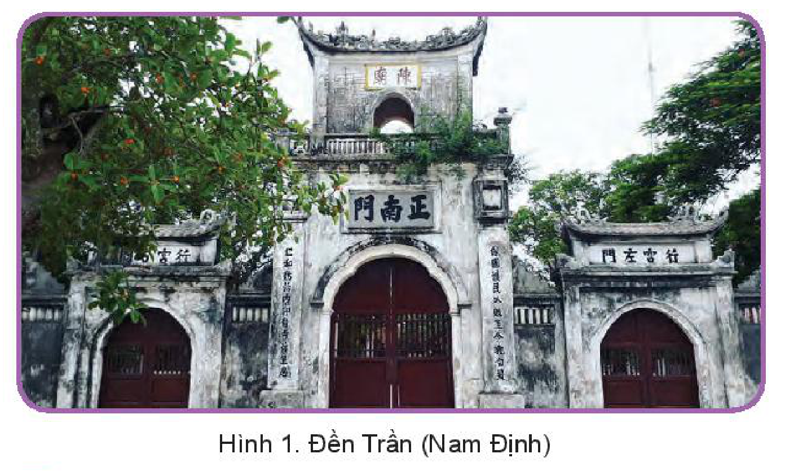
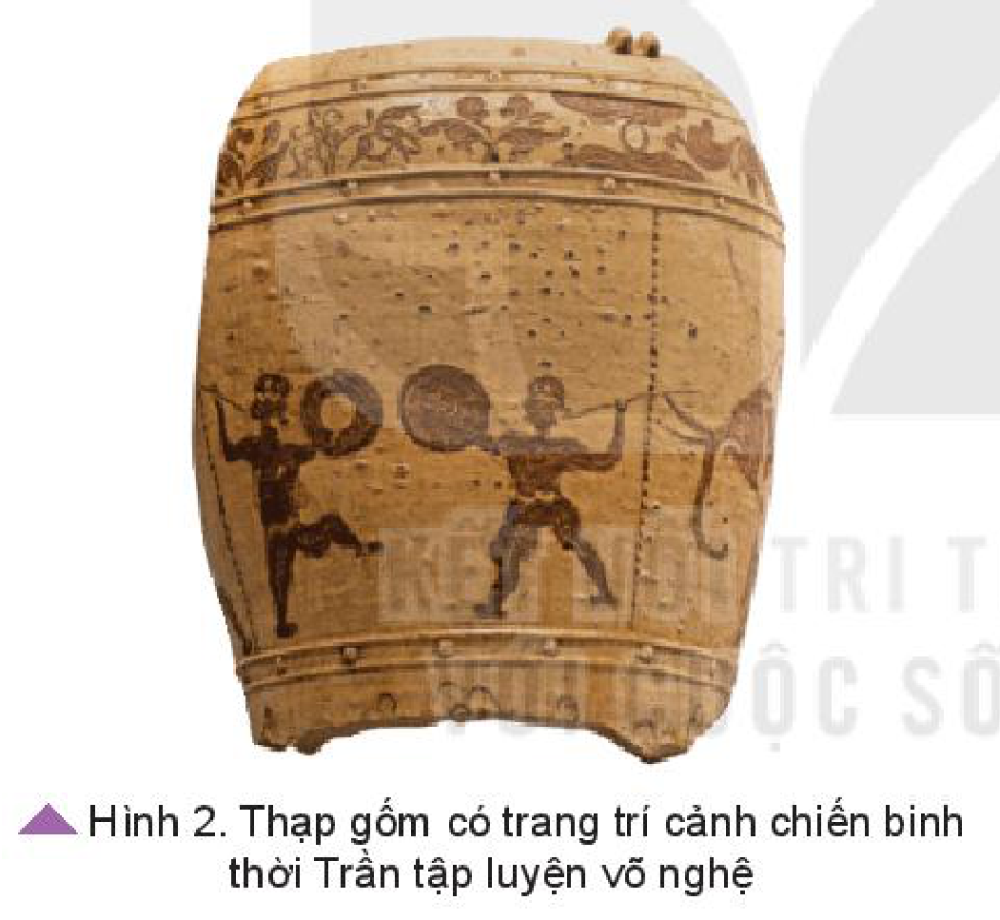
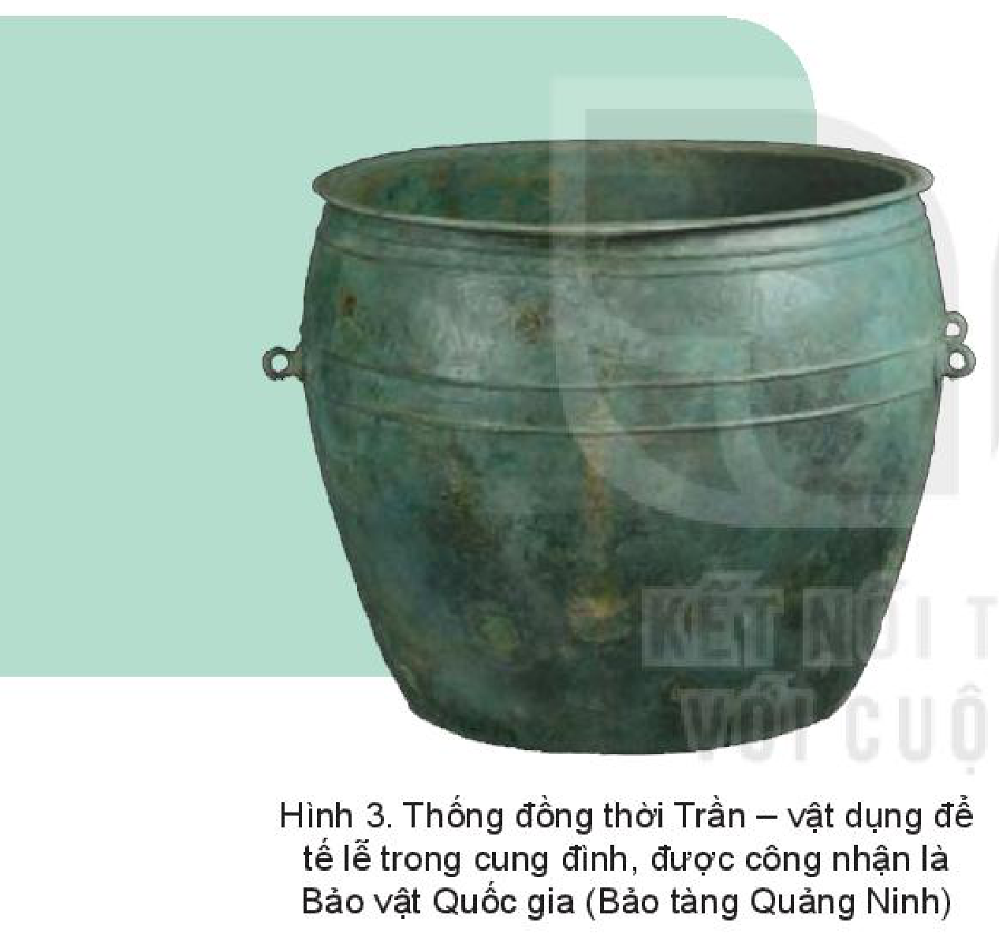
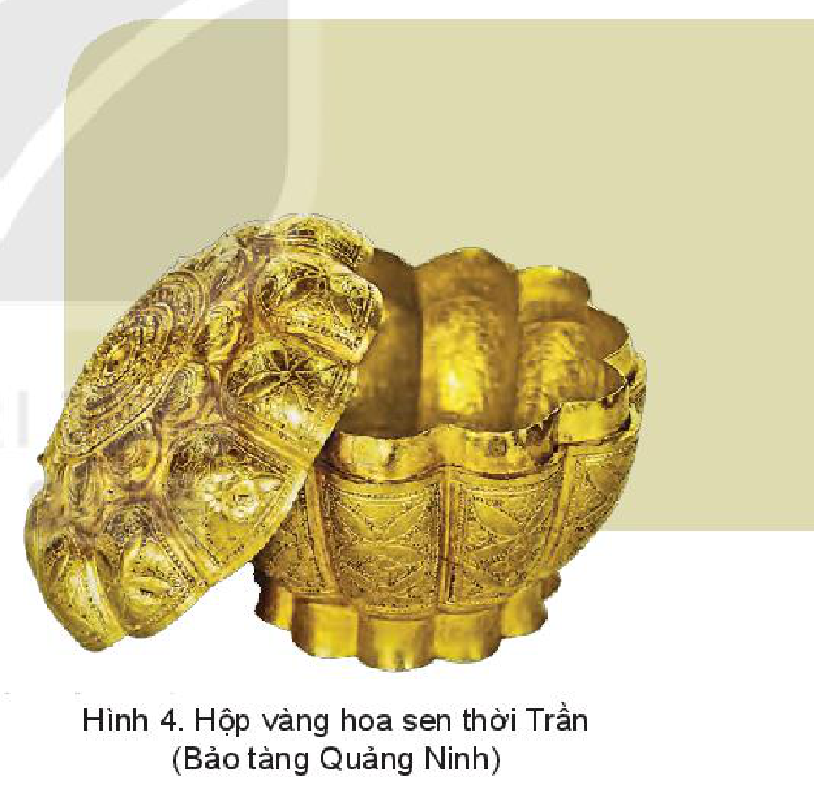
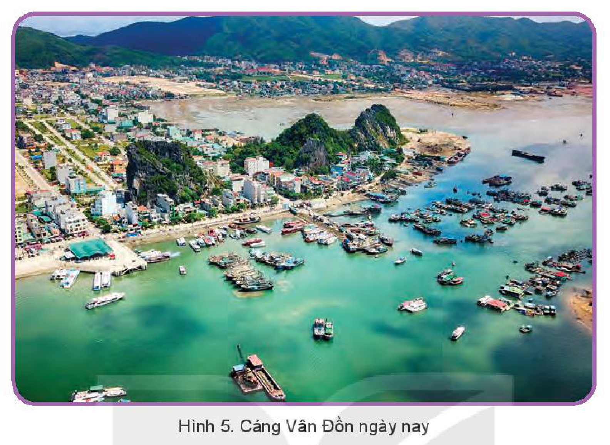
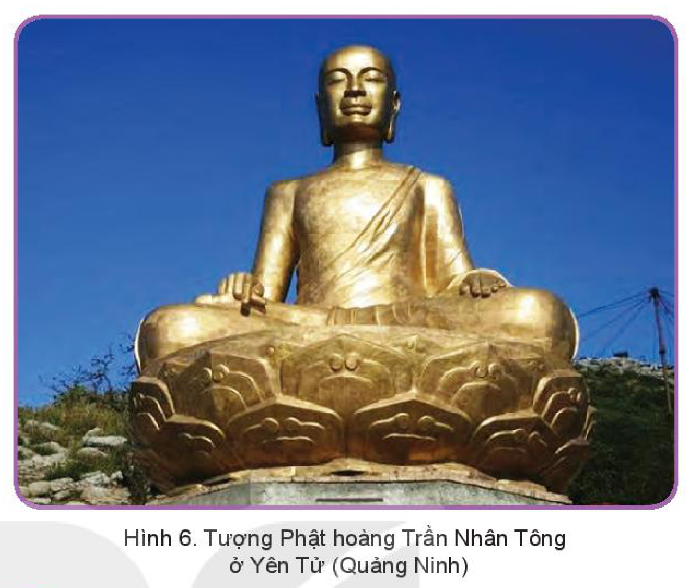
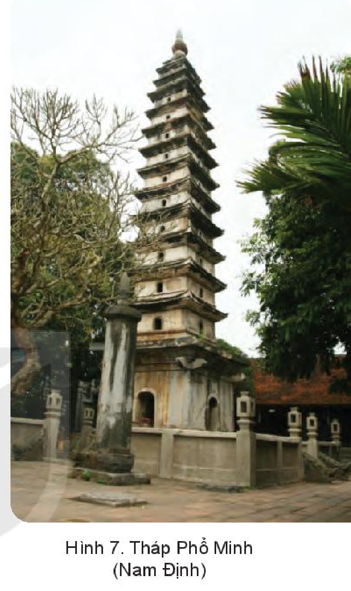

<!-- pdf:63 -->

# BÀI 13: ĐẠI VIỆT THỜI TRẦN (1226 – 1400)

## 🎯 Học xong bài này, em sẽ:

- Mô tả được sự thành lập nhà Trần.
- Trình bày được những nét chính về tình hình chính trị, kinh tế, xã hội, văn hoá, tôn giáo thời Trần.
- Nêu được những thành tựu chủ yếu về văn hoá của Đại Việt dưới thời Trần.

## 🔴 Mở đầu

Nhà Trần tiếp nối nhà Lý, đưa nền văn minh Đại Việt phát triển lên một tầm cao mới. Lê Quý Đôn – nhà bác học ở thế kỉ XVIII đã đánh giá: “Nhà Trần... làm cho quang vinh cả sử sách, không thẹn với trời đất”. Theo em, vì sao Lê Quý Đôn có những đánh giá cao về nhà Trần như vậy? Hãy chia sẻ những điều em biết về thời đại nhà Trần trong lịch sử.

## 1. Sự thành lập nhà Trần

<!-- term: Sự thành lập nhà Trần -->
Từ cuối thế kỉ XII, nhà Lý ngày càng suy yếu, phải dựa vào họ Trần để đánh dẹp các thế lực chống đối. Nhờ đó, họ Trần đã từng bước thâu tóm quyền hành. Tháng 1 – 1226, Lý Chiêu Hoàng (vị vua cuối cùng của nhà Lý) buộc phải nhường ngôi cho chồng là Trần Cảnh, nhà Trần được thành lập.

<!-- term: Sự thành lập nhà Trần -->
> 💡 **Em có biết?**
>
> Dòng họ Trần vốn xuất thân làm nghề đánh cá tại vùng hạ lưu sông Hồng (Thái Bình và Nam Định ngày nay), sau trở nên giàu có và là một thế lực mạnh. Những người có công lao lớn trong việc thành lập triều Trần là Trần Lý, Trần Thừa, Trần Tự Khánh, Trần Thủ Độ,...
<!-- ocr-ok: đã đối chiếu p063.png, hộp thông tin nằm sát cột phải làm OCR gộp dòng -->

*Hình 1. Đền Trần (Nam Định)*

> ❓ Hãy cho biết nhà Trần được thành lập như thế nào.

<!-- pdf:64 -->

## 2. Tình hình chính trị

Nhà Trần tiếp tục củng cố chế độ trung ương tập quyền, thi hành chính sách cai trị khoan hoà, gần gũi với dân chúng. Cả nước được chia thành 12 lộ, phủ. Đơn vị hành chính ở địa phương phổ biến là xã, do xã quan đứng đầu.

Bộ máy chính quyền từ trung ương đến địa phương được tổ chức quy củ và hoàn thiện hơn so với thời Lý. Quan lại được hưởng nhiều bổng lộc. Nhiều tôn thất họ Trần nắm giữ các vị trí trọng yếu trong triều, ở các địa phương và được phép lập thái ấp.

> 💡 **Em có biết?**
>
> Các vua Trần thường chỉ ở ngôi một thời gian rồi nhường ngai vàng cho con, xưng là Thái Thượng hoàng, cùng quản lí đất nước. Nhà Trần còn thi hành chế độ hôn nhân nội tộc nhằm tạo dựng một tập đoàn dòng họ vững mạnh.

Quân đội tiếp tục được hoàn thiện, bao gồm: quân triều đình, quân các lộ, phủ, quân vương hầu và dân binh các làng xã. Nhà Trần tiếp tục thi hành chính sách “ngụ binh ư nông”.

*Hình 2. Thạp gốm có trang trí cảnh chiến binh thời Trần tập luyện võ nghệ*

<!-- term: Quốc triều hình luật -->
Năm 1341, nhà Trần ban hành bộ *Quốc triều hình luật*. Các cơ quan pháp luật được tăng cường và hoàn thiện hơn.

<!-- term: Quốc sử viện -->
> 💡 **Em có biết?**
>
> Nhà Trần đặt thêm một số cơ quan như: Quốc sử viện (đảm nhiệm việc chép sử), Thái y viện (chữa bệnh trong cung vua),... và một số chức quan như Hà đê sứ, Khuyến nông sứ, Đồn điền sứ,...

Nhà Trần tăng cường quản lí các địa phương, nhất là các khu vực miền núi và biên viễn.

Nhà Trần thi hành chính sách ngoại giao hoà hiếu với các vương triều phương Bắc. Chăm-pa, Chân Lạp, Ai Lao,... đều đến tiến cống, thiết lập quan hệ bang giao và buôn bán với Đại Việt.

> ❓ Hãy trình bày những nét chính về tình hình chính trị của Đại Việt thời Trần.

<!-- pdf:65 -->

## 3. Tình hình kinh tế, xã hội

### a) Tình hình kinh tế

Nhà Trần thi hành nhiều chính sách tích cực nhằm phục hồi và phát triển nông nghiệp như: khai hoang, đắp đê phòng lụt, xây dựng các công trình thuỷ lợi, miễn giảm tô thuế,... Triều đình cũng cho phép các tôn thất lập điền trang.

Các xưởng thủ công của nhà nước chuyên việc đúc tiền, chế tạo vũ khí, đóng thuyền chiến,... Ngoài ra, triều đình còn trưng dụng những người thợ giỏi để xây dựng các công trình lớn.

Tại các làng xã và kinh đô hình thành thêm nhiều làng nghề, phường nghề. Sản phẩm thủ công làm ra rất đa dạng, được trao đổi, buôn bán ở các chợ và kinh thành Thăng Long.

*Hình 3. Thống đồng thời Trần – vật dụng để tế lễ trong cung đình, được công nhận là Bảo vật Quốc gia (Bảo tàng Quảng Ninh)*

*Hình 4. Hộp vàng hoa sen thời Trần (Bảo tàng Quảng Ninh)*

> 🔗 **Kết nối với ngày nay**
>
> Vân Đồn là một thương cảng sầm uất thời Trần. Ngày nay, Vân Đồn trở thành khu kinh tế ven biển quan trọng, thúc đẩy và gắn kết quan hệ thương mại giữa Việt Nam với quốc tế.

Hoạt động buôn bán diễn ra ở khắp nơi. Kinh đô Thăng Long hình thành nhiều phường nghề và buôn bán. Các cửa khẩu dọc biên giới và các cửa biển như Vân Đồn (Quảng Ninh), Hội Thống (Nghệ An),... trở thành những nơi buôn bán tấp nập, thu hút nhiều thuyền buôn và thương nhân các nước đến trao đổi hàng hoá.

<!-- pdf:66 -->

*Hình 5. Cảng Vân Đồn ngày nay*

> ❓ 1. Em hãy nêu những dẫn chứng chứng tỏ nhà Trần chú trọng và khuyến khích phát triển nông nghiệp.
>
> 2. Mô tả những nét chính về tình hình thủ công nghiệp và thương nghiệp thời Trần.

### b) Tình hình xã hội

Xã hội tiếp tục có sự phân hoá.

Tầng lớp quý tộc (vua, quan lại) có nhiều đặc quyền, nắm giữ các chức vụ chủ chốt của bộ máy chính quyền, là chủ các thái ấp, điền trang. Nhân dân lao động (chủ yếu là nông dân) cày cấy ruộng đất công làng xã, nhưng do chế độ tư hữu mở rộng nên ngày càng có nhiều người phải lĩnh canh ruộng đất của địa chủ. Kinh tế công thương khá phát triển nên số lượng thợ thủ công và thương nhân tăng nhanh. Tầng lớp nông nô, nô tì có số lượng khá đông đảo, chuyên cày cấy trong các điền trang hoặc phục dịch trong các gia đình quý tộc.

> ❓ Xã hội thời Trần bao gồm những tầng lớp nào? Nêu đặc điểm của mỗi tầng lớp.

## 4. Tình hình văn hoá

### a) Tư tưởng – tôn giáo

Thời Trần, cả Nho giáo, Phật giáo và Đạo giáo đều được coi trọng.

Nho giáo ngày càng được nâng cao vị thế. Nhiều nhà nho được cử giữ các chức vụ quan trọng trong triều như Chu Văn An, Trương Hán Siêu, Phạm Sư Mạnh,...

<!-- term: Thiền phái Trúc Lâm Yên Tử -->
Phật giáo được cả vua, quý tộc và nhân dân tôn sùng. Đặc biệt, thời kì này, Thiền phái Trúc Lâm Yên Tử ra đời do Trần Nhân Tông sáng lập.

<!-- pdf:67 -->

<!-- term: Thiền phái Trúc Lâm Yên Tử -->
> 💡 **Em có biết?**
>
> Thượng hoàng Trần Nhân Tông là vị tổ thứ nhất của Thiền phái Trúc Lâm. Sau khi ông qua đời, hai vị thiền sư là Pháp Loa và Huyền Quang tiếp tục sự nghiệp (gọi là Trúc Lâm Tam Tổ).

*Hình 6. Tượng Phật hoàng Trần Nhân Tông ở Yên Tử (Quảng Ninh)*

> ❓ Trình bày những nét chính về tư tưởng – tôn giáo thời Trần.

### b) Giáo dục

<!-- term: Thái học sinh -->
> 💡 **Em có biết?**
>
> Thái học sinh là kì đại khoa dưới thời Trần, được tổ chức đầu tiên vào năm 1232, định lệ cứ 7 năm một lần, chọn ba người đỗ cao nhất, gọi là Tam khôi (gồm Trạng nguyên, Bảng nhãn, Thám hoa).

Quốc Tử Giám được mở rộng, là nơi dạy học cho các hoàng tử và con em quý tộc, quan lại cấp cao. Các trường học (trường công, trường tư) xuất hiện ở nhiều địa phương, trong đó nổi tiếng là trường Huỳnh Cung (Hoàng Mai, Hà Nội) của Chu Văn An. Các kì thi Nho học thời Trần được tổ chức thường xuyên và quy củ hơn.

> ❓ Hãy trình bày những nét chính về tình hình giáo dục thời Trần.

### c) Khoa học – kĩ thuật

<!-- term: Đại Việt sử ký -->
Về sử học, Lê Văn Hưu biên soạn bộ *Đại Việt sử ký* – bộ sử đầu tiên của nước ta. Ngoài ra còn một số bộ sử khác như: *Việt sử lược* (khuyết danh), *Việt sử cương mục* và *Việt Nam thế chí* của Hồ Tông Thốc,...

<!-- term: Binh thư yếu lược -->
Về quân sự, có các tác phẩm *Binh thư yếu lược* và *Vạn Kiếp tông bí truyền thư* của Trần Quốc Tuấn.

Trong y học, Tuệ Tĩnh là thầy thuốc nổi tiếng, nghiên cứu và viết sách về cây thuốc nam.

> ❓ Nêu một số thành tựu chính về khoa học – kĩ thuật thời Trần. Em ấn tượng về thành tựu nào nhất? Vì sao?

<!-- pdf:68 -->

### d) Văn học, nghệ thuật

Văn học chữ Hán và văn học chữ Nôm rất phát triển.

Chữ Hán được sử dụng để sáng tác thơ, phú, hịch, truyện kí,... phản ánh âm hưởng hào hùng của cuộc kháng chiến chống ngoại xâm, lòng yêu nước và tự hào dân tộc, ngợi ca cảnh thái bình thịnh trị. Văn học chữ Nôm phản ánh cuộc sống bình dân với những tác giả nổi tiếng như Nguyễn Thuyên (Hàn Thuyên), Trần Nhân Tông, Chu Văn An,...

Nghệ thuật kiến trúc và điêu khắc thể hiện rõ nét trong các công trình xây dựng như kinh đô Thăng Long (Hà Nội), thành Tây Đô (Thanh Hoá), các lăng mộ vua Trần ở Đông Triều (Quảng Ninh), tháp Phổ Minh (Nam Định),...

Nghệ thuật diễn xướng phát triển nhiều loại hình như: chèo, tuồng, hát xẩm, múa rối,...

*Hình 7. Tháp Phổ Minh (Nam Định)*

> ❓ 1. Nêu những nét nổi bật về văn học thời Trần. Sự phát triển của dòng văn học chữ Nôm thời Trần có ý nghĩa như thế nào?
>
> 2. Hãy nêu những thành tựu tiêu biểu về kiến trúc, điêu khắc thời Trần.

## ✏️ Luyện tập và Vận dụng

1. Lập và hoàn thành bảng thống kê về một số thành tựu chính trên các lĩnh vực theo mẫu dưới đây.

| Lĩnh vực | Thành tựu | Ý nghĩa |
| --- | --- | --- |
|  |  |  |

2. Dựa vào kiến thức đã học, em hãy cho biết sự thành lập triều Trần thay cho triều Lý vào đầu thế kỉ XIII có phù hợp với yêu cầu lịch sử không? Vì sao?

3. Tìm hiểu thêm từ sách, báo và internet, hãy viết bài giới thiệu (khoảng 7 – 10 câu) về một thành tựu văn hoá Đại Việt thời Trần còn được bảo tồn và phát huy giá trị đến ngày nay.
<!-- ocr-ok: đã đối chiếu p068.png, dòng đầu câu 3 bị khuất biểu tượng đầu mục trong OCR -->

## 📷 Danh sách hình trong bài

| Mã hình | Trang PDF | Trang sách | Chú thích |
| --- | --- | --- | --- |
| H7-lich_su_va_dia_ly-ls-b13-01 | 63 | 62 | Hình 1. Đền Trần (Nam Định) |
| H7-lich_su_va_dia_ly-ls-b13-02 | 64 | 63 | Hình 2. Thạp gốm có trang trí cảnh chiến binh thời Trần tập luyện võ nghệ |
| H7-lich_su_va_dia_ly-ls-b13-03 | 65 | 64 | Hình 3. Thống đồng thời Trần – vật dụng để tế lễ trong cung đình, được công nhận là Bảo vật Quốc gia (Bảo tàng Quảng Ninh) |
| H7-lich_su_va_dia_ly-ls-b13-04 | 65 | 64 | Hình 4. Hộp vàng hoa sen thời Trần (Bảo tàng Quảng Ninh) |
| H7-lich_su_va_dia_ly-ls-b13-05 | 66 | 65 | Hình 5. Cảng Vân Đồn ngày nay |
| H7-lich_su_va_dia_ly-ls-b13-06 | 67 | 66 | Hình 6. Tượng Phật hoàng Trần Nhân Tông ở Yên Tử (Quảng Ninh) |
| H7-lich_su_va_dia_ly-ls-b13-07 | 68 | 67 | Hình 7. Tháp Phổ Minh (Nam Định) |
