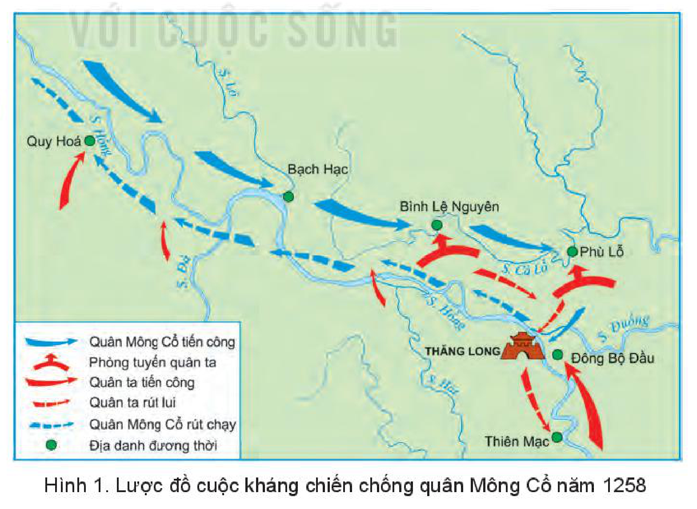
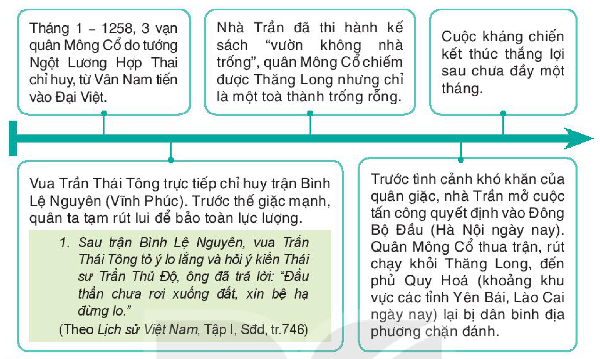
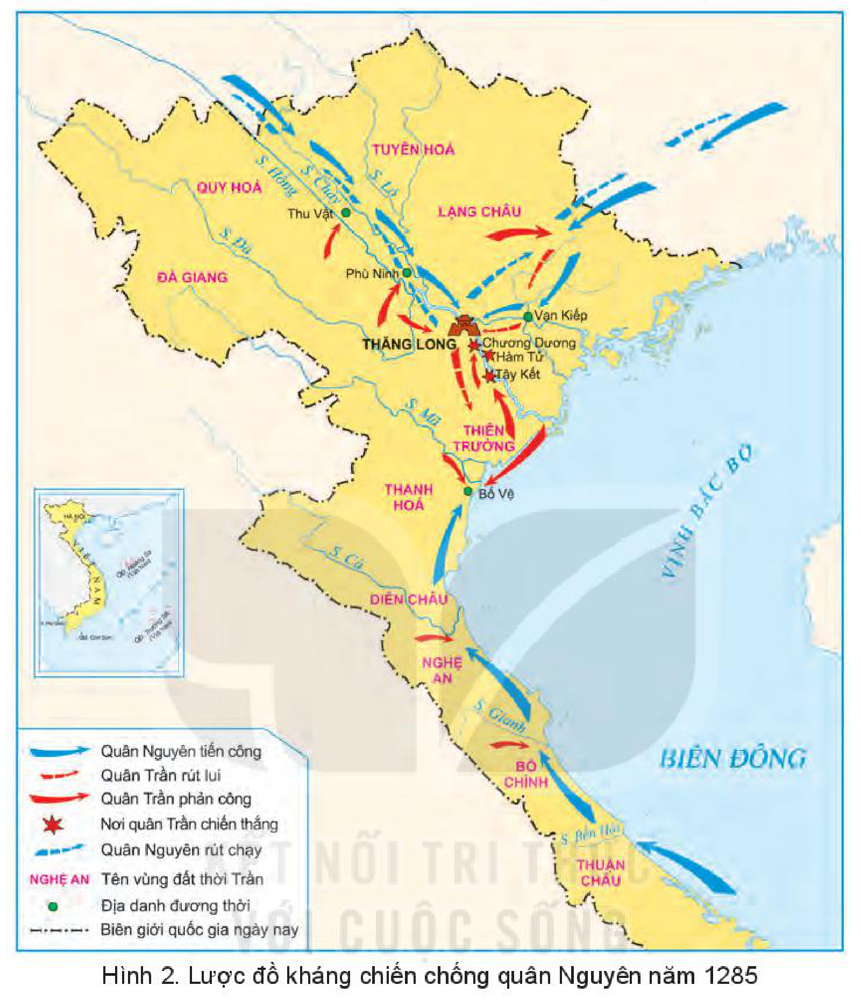
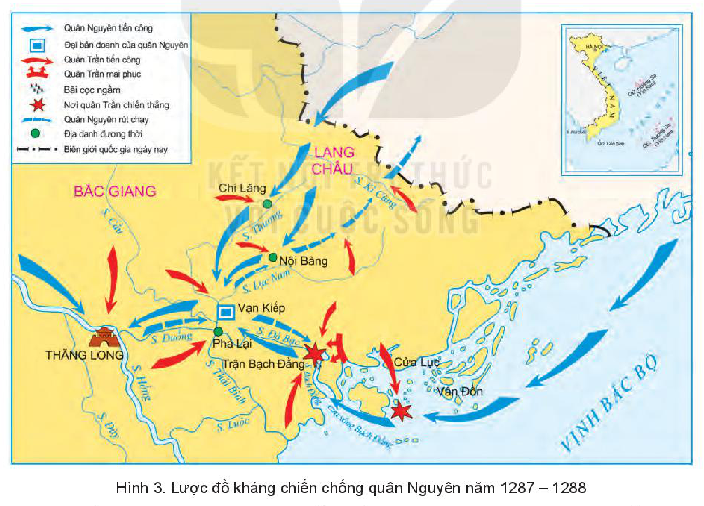
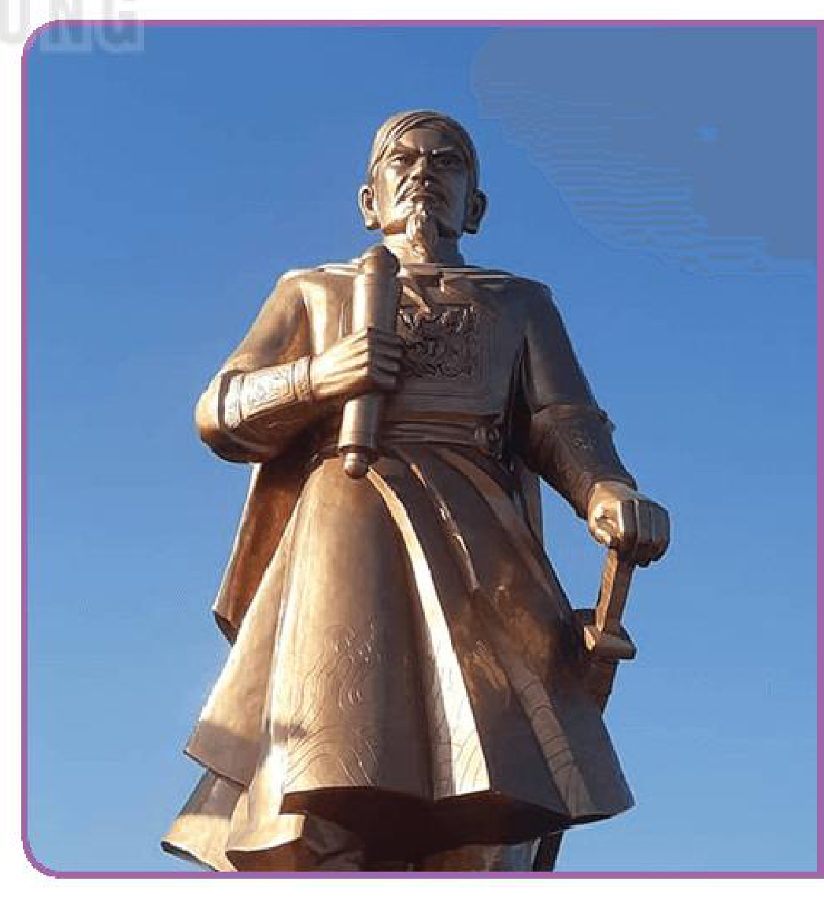
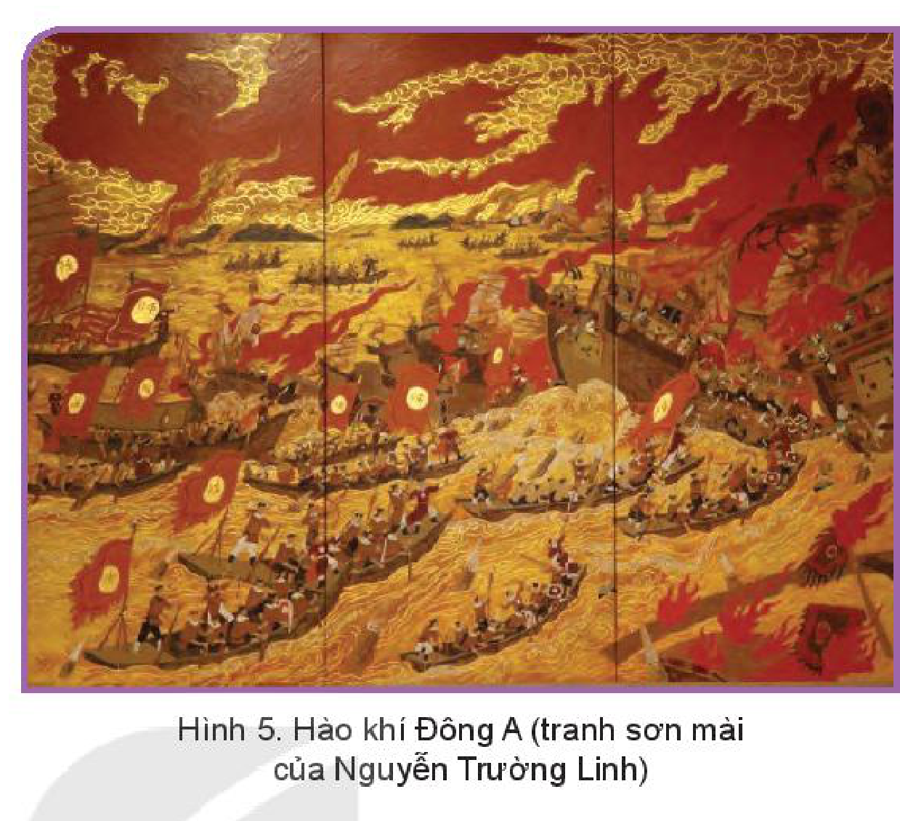

<!-- pdf:69 -->

# BÀI 14: BA LẦN KHÁNG CHIẾN CHỐNG QUÂN XÂM LƯỢC MÔNG – NGUYÊN

## 🎯 Học xong bài này, em sẽ:

- Lập được sơ đồ diễn biến chính của ba lần kháng chiến chống quân xâm lược Mông – Nguyên.
- Phân tích được nguyên nhân thắng lợi, nêu được ý nghĩa lịch sử của ba lần kháng chiến chống quân xâm lược Mông – Nguyên, nhận thức được sâu sắc tinh thần đoàn kết và quyết tâm chống giặc ngoại xâm của quân và dân Đại Việt.
- Đánh giá được vai trò của các nhân vật lịch sử tiêu biểu thời Trần: Trần Thủ Độ, Trần Quốc Tuấn, Trần Nhân Tông,...

## 🔴 Mở đầu

Vào thế kỉ XIII, đế chế Mông Cổ liên tiếp tiến hành các cuộc chiến tranh xâm lược và thống trị nhiều nước ở khắp lục địa Á – Âu. Quốc gia Đại Việt cũng không nằm ngoài con đường chinh phạt của đế chế này. Quân dân Đại Việt đã chuẩn bị và tổ chức đánh giặc như thế nào? Vì sao Đại Việt lại ba lần giành thắng lợi trước một đế chế lớn như thế?

## 1. Cuộc kháng chiến chống quân Mông Cổ năm 1258

<!-- term: Cuộc kháng chiến chống quân Mông Cổ năm 1258 -->
Từ cuối năm 1257, quân Mông Cổ chuẩn bị xâm lược Đại Việt. Nhà Trần đã chủ động đề ra kế hoạch đối phó: tăng cường phòng thủ ở biên giới, chuẩn bị lực lượng, vũ khí,...

> 💡 **Em có biết?**
>
> Chiến thuật quen thuộc của quân Mông Cổ là cho quân áp sát biên giới để uy hiếp rồi cử sứ giả đến dụ hàng. Trước khi tiến vào Đại Việt, quân Mông Cổ đã ba lần cử sứ giả đến Thăng Long. Tuy nhiên, cả ba lần cử sứ giả đi thì đều không thấy trở về.

*Hình 1. Lược đồ cuộc kháng chiến chống quân Mông Cổ năm 1258*

<!-- pdf:70 -->

<!-- term: Cuộc kháng chiến chống quân Mông Cổ năm 1258 -->
<!-- term: Vườn không nhà trống -->
> - Tháng 1 – 1258, 3 vạn quân Mông Cổ do tướng Ngột Lương Hợp Thai chỉ huy, từ Vân Nam tiến vào Đại Việt.
> - Vua Trần Thái Tông trực tiếp chỉ huy trận Bình Lệ Nguyên (Vĩnh Phúc). Trước thế giặc mạnh, quân ta tạm rút lui để bảo toàn lực lượng.
>   - 1. Sau trận Bình Lệ Nguyên, vua Trần Thái Tông tỏ ý lo lắng và hỏi ý kiến Thái sư Trần Thủ Độ, ông đã trả lời: “Đầu thần chưa rơi xuống đất, xin bệ hạ đừng lo.” (Theo *Lịch sử Việt Nam*, Tập I, Sđd, tr.746)
> - Nhà Trần đã thi hành kế sách “vườn không nhà trống”, quân Mông Cổ chiếm được Thăng Long nhưng chỉ là một toà thành trống rỗng.
> - Trước tình cảnh khó khăn của quân giặc, nhà Trần mở cuộc tấn công quyết định vào Đông Bộ Đầu (Hà Nội ngày nay). Quân Mông Cổ thua trận, rút chạy khỏi Thăng Long, đến phủ Quy Hoá (khoảng khu vực các tỉnh Yên Bái, Lào Cai ngày nay) lại bị dân binh địa phương chặn đánh.
> - Cuộc kháng chiến kết thúc thắng lợi sau chưa đầy một tháng.
<!-- ocr-ok: đã đối chiếu p070.png, sơ đồ trục thời gian gồm 5 hộp song song hai hàng làm OCR ngắt dòng -->

> ❓ 1. Dựa vào thông tin trong mục và lược đồ hình 1, hãy trình bày những nét chính của cuộc kháng chiến chống quân Mông Cổ năm 1258.
>
> 2. Câu nói của Trần Thủ Độ trong tư liệu 1 thể hiện điều gì về tinh thần đánh giặc của quân dân nhà Trần?

## 2. Cuộc kháng chiến chống quân Nguyên năm 1285

Sau khi chiếm được phần lớn lãnh thổ Trung Quốc, vua Mông Cổ là Hốt Tất Liệt lập ra nhà Nguyên (1271). Năm 1279, nhà Nguyên ráo riết chuẩn bị xâm lược Chăm-pa và Đại Việt.

<!-- term: Hội nghị Bình Than -->
<!-- term: Hội nghị Diên Hồng -->
<!-- term: Trần Quốc Tuấn -->
Trước tình hình đó, vua Trần đã triệu tập Hội nghị Bình Than (Bắc Ninh), mở Hội nghị Diên Hồng (Thăng Long) bàn kế sách và khẳng định quyết tâm chống giặc, cử Trần Quốc Tuấn làm Quốc công tiết chế – tổng chỉ huy các lực lượng kháng chiến.

<!-- term: Hội nghị Bình Than -->
> 💡 **Em có biết?**
>
> Ở Hội nghị Bình Than, vua thấy Trần Quốc Toản còn nhỏ tuổi, không cho dự bàn. Quốc Toản trong lòng hổ thẹn, phấn khích, tay cầm quả cam mà bóp nát lúc nào không biết. Sau đó, Trần Quốc Toản huy động hơn nghìn gia nô và người nhà, sắm vũ khí, đóng chiến thuyền, viết lên cờ sáu chữ *Phá cường địch, báo hoàng ân* (Phá giặc mạnh, báo ơn vua).

<!-- term: Trần Quốc Tuấn -->
Trần Quốc Tuấn đã soạn *Hịch tướng sĩ* để khích lệ tinh thần chiến đấu của quân dân Đại Việt.

<!-- term: Hội nghị Diên Hồng -->
> 2. Khắp nơi quân ta tự động thích vào cánh tay của mình hai chữ “Sát Thát”... Tại điện Diên Hồng, khi được hỏi về kế đánh giặc, tất cả các bô lão đều đồng thanh hô lớn: “Đánh!”.
>
> (Theo *Lịch sử Việt Nam*, Tập I, Sđd, tr.764)

Nhà Trần tổ chức cuộc tập trận lớn và duyệt binh ở Đông Bộ Đầu, chia quân đóng giữ những nơi trọng yếu. Cả nước sẵn sàng chiến đấu.

<!-- pdf:71 -->

<!-- term: Cuộc kháng chiến chống quân Nguyên năm 1285 -->
Tháng 1 – 1285, hơn 50 vạn quân Nguyên do Thoát Hoan chỉ huy tràn vào xâm lược Đại Việt. Trần Quốc Tuấn cho lui quân về đóng ở Vạn Kiếp (Chí Linh, Hải Dương).

*Hình 2. Lược đồ kháng chiến chống quân Nguyên năm 1285*

<!-- term: Vườn không nhà trống -->
<!-- term: Cuộc kháng chiến chống quân Nguyên năm 1285 -->
Nhà Trần tiếp tục thực hiện kế sách “vườn không nhà trống”, rút từ Thăng Long về Thiên Trường (Nam Định).

<!-- term: Cuộc kháng chiến chống quân Nguyên năm 1285 -->
Quân dân nhà Trần kiên cường chiến đấu, bảo vệ được bộ chỉ huy kháng chiến, phá vỡ kế hoạch hội quân của Toa Đô (từ Chăm-pa đánh ra) và Thoát Hoan tại vùng Thiên Trường, từng bước làm tiêu hao lực lượng địch.

<!-- term: Trần Quốc Tuấn -->
> 3. Thượng hoàng Trần Thánh Tông đến gặp Trần Quốc Tuấn và có ý dò hỏi: “Thế giặc như thế, ta phải hàng thôi”. Trần Quốc Tuấn trả lời: “Xin bệ hạ chém đầu thần rồi hãy hàng”.
>
> (Theo *Lịch sử Việt Nam*, Tập I, Sđd, tr.767)

Quân Nguyên rút về Thăng Long chờ tiếp viện trong tình cảnh thiếu lương thực và bị động đối phó trước các cuộc tập kích của quân dân nhà Trần.

> 💡 **Em có biết?**
>
> Năm 1285, danh tướng Trần Bình Trọng chỉ huy quân đánh chặn địch để vua Trần và triều đình rút về Thiên Trường. Nhưng do tương quan lực lượng quá chênh lệch, ông bị bắt. Quân giặc dùng mọi thủ đoạn để mua chuộc nhưng ông khẳng khái đáp trả: “Ta thà làm quỷ nước Nam, chứ không thèm làm vương đất Bắc”.

<!-- pdf:72 -->

<!-- term: Cuộc kháng chiến chống quân Nguyên năm 1285 -->
Tháng 5 – 1285, quân Trần tổ chức phản công, đánh bại quân giặc ở nhiều nơi như Tây Kết (Hà Nội), Hàm Tử (Hưng Yên), Chương Dương (Hà Nội) rồi tiến vào giải phóng Thăng Long. Quân giặc phải rút chạy về nước. Cuộc kháng chiến kết thúc thắng lợi.

> ❓ 1. Khai thác tư liệu 2, 3, em hãy rút ra điểm chung về tinh thần chiến đấu của vua tôi nhà Trần.
>
> 2. Trình bày tóm tắt những nét chính về diễn biến cuộc kháng chiến chống quân Nguyên năm 1285 trên lược đồ.

## 3. Cuộc kháng chiến chống quân Nguyên năm 1287 – 1288

Sau hai lần thất bại thảm hại, vua Nguyên tức tối cử Thoát Hoan tiếp tục chỉ huy 50 vạn quân theo hai đường thuỷ, bộ tấn công Đại Việt lần thứ ba.

Đoán được dã tâm và ý đồ xâm lược của kẻ thù, nhà Trần lại tích cực chuẩn bị kháng chiến.

> 4. Vua Trần Nhân Tông hỏi: “Giặc tới, liệu tình hình thế nào?”. Trần Quốc Tuấn trả lời: “Năm nay đánh giặc nhàn”.
>
> (Theo *Đại Việt sử ký toàn thư*, Tập II, Sđd, tr.59)

*Hình 3. Lược đồ kháng chiến chống quân Nguyên năm 1287 – 1288*

Cuối năm 1287, quân Nguyên ồ ạt tiến vào nước ta. Quân dân nhà Trần chặn đường tiến quân của giặc đến Thăng Long.

<!-- pdf:73 -->

<!-- term: Vườn không nhà trống -->
Trần Khánh Dư chỉ huy quân phục kích đoàn thuyền lương của quân Nguyên, giành thắng lợi tại Vân Đồn – Cửa Lục (Quảng Ninh). Đầu năm 1288, quân Nguyên chiếm Thăng Long, nhưng vẫn trúng kế “vườn không nhà trống” của nhà Trần.

Ngày càng lâm vào tình cảnh khó khăn, Thoát Hoan quyết định kéo quân sang Vạn Kiếp rồi cùng theo hai đường thuỷ, bộ để về nước.

<!-- term: Chiến thắng Bạch Đằng năm 1288 -->
<!-- term: Trần Quốc Tuấn -->
Nhà Trần quyết định tổ chức phản công, bố trí trận địa mai phục tại vùng cửa sông Bạch Đằng dưới sự chỉ huy trực tiếp của Trần Quốc Tuấn.

<!-- term: Chiến thắng Bạch Đằng năm 1288 -->
Đầu tháng 4 – 1288, đoàn thuyền do Ô Mã Nhi chỉ huy tiến gần đến khu vực sông Bạch Đằng. Quân Trần bất ngờ tấn công, buộc chúng phải rút theo đường dẫn đến bãi cọc. Quân địch lọt vào trận địa mai phục đúng lúc nước triều rút nhanh. Chiến thuyền của quân Trần đổ ra đánh quyết liệt. Thuyền địch tháo chạy, lớp trước lớp sau dồn vào bãi cọc, bị vỡ, đắm hoặc bị mắc kẹt không tiến tiếp được. Lúc này, các thuyền của quân Trần chứa đầy chất dễ cháy được đốt và thả trôi theo dòng nước, thực hiện kế hoả công,... Quân Nguyên bị tiêu diệt không biết bao nhiêu mà kể. Những tên sống sót tháo chạy lên bờ lại bị quân mai phục đánh cho tơi tả. Ô Mã Nhi bị bắt sống.

<!-- term: Chiến thắng Bạch Đằng năm 1288 -->
Trận Bạch Đằng đại thắng. Cánh quân bộ trên đường rút lui cũng bị quân dân nhà Trần đánh cho tan tác. Cuộc kháng chiến chống quân Nguyên năm 1287 – 1288 kết thúc thắng lợi.

> ❓ Trình bày tóm tắt diễn biến chính của cuộc kháng chiến chống quân Nguyên năm 1287 – 1288 trên sơ đồ trục thời gian/lược đồ.

## 4. Nguyên nhân thắng lợi và ý nghĩa lịch sử của ba lần kháng chiến chống quân Mông – Nguyên

### a) Nguyên nhân thắng lợi

Thắng lợi của ba lần kháng chiến chống quân Mông – Nguyên là kết quả của lòng yêu nước, tinh thần đoàn kết, ý chí độc lập tự chủ và quyết tâm đánh giặc của quân dân Đại Việt.

> 5. Trần Quốc Tuấn đã tổng kết nguyên nhân thắng lợi: “vua tôi đồng lòng, anh em hoà thuận, cả nước góp sức”.
>
> (Theo *Đại Việt sử ký toàn thư*, Tập II, Sđd, tr.210)

Nhà Trần đã đề ra kế sách đánh giặc đúng đắn và sáng tạo: chủ động chuẩn bị kháng chiến, tránh chỗ mạnh, đánh chỗ yếu,...

Các cuộc kháng chiến của quân dân nhà Trần được đặt dưới sự lãnh đạo, chỉ huy tài ba của vua Trần Thái Tông, Thượng hoàng Trần Thánh Tông, vua Trần Nhân Tông và các danh tướng như Trần Thủ Độ, Trần Quốc Tuấn, Trần Quang Khải,...

*Hình 4. Tượng Quốc công tiết chế Trần Hưng Đạo (Khu di tích Bạch Đằng Giang, Hải Phòng)*

<!-- pdf:74 -->

### b) Ý nghĩa lịch sử

Thắng lợi của quân dân Đại Việt thời Trần đã đập tan tham vọng và ý chí xâm lược của quân Mông – Nguyên, bảo vệ vững chắc nền độc lập dân tộc.

Đánh bại đế chế hùng mạnh nhất thế giới thời bấy giờ, quân dân nhà Trần đã viết tiếp trang sử chống ngoại xâm hào hùng của dân tộc, đóng góp vào truyền thống và nghệ thuật quân sự Việt Nam.

Thắng lợi đó để lại những bài học lịch sử quý giá: chăm lo sức dân, củng cố khối đoàn kết toàn dân tộc, phát huy sức mạnh của toàn dân trong công cuộc xây dựng và bảo vệ Tổ quốc.

*Hình 5. Hào khí Đông A (tranh sơn mài của Nguyễn Trường Linh)*
<!-- ocr-ok: đã đối chiếu p074.png, OCR nhầm dấu "Hào khí" thành "Hảo khí" và "Nguyễn" thành "Nguyên" -->

Hơn thế, chiến thắng này của quân dân Đại Việt đã ngăn chặn cuộc xâm lược của quân Nguyên đối với Nhật Bản và các nước ở Đông Nam Á, góp phần làm suy yếu đế chế Mông – Nguyên.

> ❓ 1. Phân tích nguyên nhân thắng lợi của ba lần kháng chiến chống quân xâm lược Mông – Nguyên.
>
> 2. Nêu ý nghĩa lịch sử của ba lần chiến thắng quân xâm lược Mông – Nguyên.

## ✏️ Luyện tập và Vận dụng

1. Hãy lập và hoàn thành bảng theo mẫu dưới đây về ba lần kháng chiến chống quân xâm lược Mông – Nguyên.

| Cuộc kháng chiến | Kế hoạch kháng chiến của nhà Trần | Những chiến thắng tiêu biểu | Kết quả |
| --- | --- | --- | --- |
|  |  |  |  |
<!-- ocr-ok: đã đối chiếu p074.png, tiêu đề cột bảng ngắt dòng làm OCR đọc thiếu chữ -->

2. Từ kiến thức đã học ở bài 13 và bài 14, em hãy đánh giá ngắn gọn về vai trò của các nhân vật lịch sử: Trần Thủ Độ, Trần Quốc Tuấn, Trần Nhân Tông đối với nhà Trần và kháng chiến chống quân Mông – Nguyên.

3. Chiến thắng của ba lần chống quân xâm lược Mông – Nguyên đã để lại cho chúng ta bài học gì đối với công cuộc bảo vệ Tổ quốc hiện nay?

## 📷 Danh sách hình trong bài

| Mã hình | Trang PDF | Trang sách | Chú thích |
| --- | --- | --- | --- |
| H7-lich_su_va_dia_ly-ls-b14-01 | 69 | 68 | Hình 1. Lược đồ cuộc kháng chiến chống quân Mông Cổ năm 1258 |
| H7-lich_su_va_dia_ly-ls-b14-02 | 70 | 69 | [Sơ đồ diễn biến cuộc kháng chiến chống quân Mông Cổ năm 1258] |
| H7-lich_su_va_dia_ly-ls-b14-03 | 71 | 70 | Hình 2. Lược đồ kháng chiến chống quân Nguyên năm 1285 |
| H7-lich_su_va_dia_ly-ls-b14-04 | 72 | 71 | Hình 3. Lược đồ kháng chiến chống quân Nguyên năm 1287 – 1288 |
| H7-lich_su_va_dia_ly-ls-b14-05 | 73 | 72 | Hình 4. Tượng Quốc công tiết chế Trần Hưng Đạo (Khu di tích Bạch Đằng Giang, Hải Phòng) |
| H7-lich_su_va_dia_ly-ls-b14-06 | 74 | 73 | Hình 5. Hào khí Đông A (tranh sơn mài của Nguyễn Trường Linh) |
