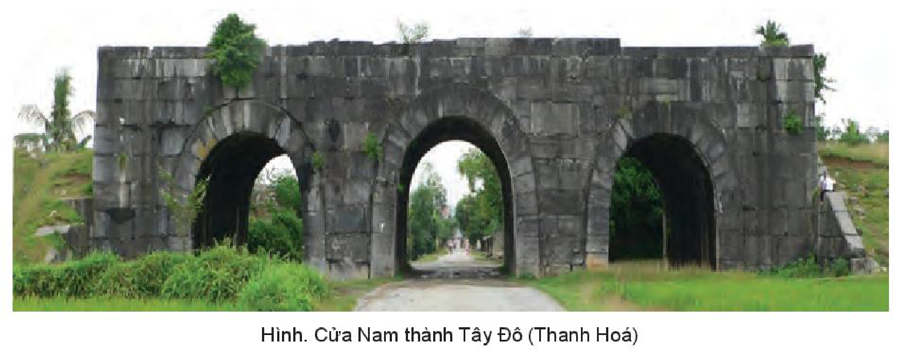

<!-- pdf:75 -->

# BÀI 15: NƯỚC ĐẠI NGU THỜI HỒ (1400 – 1407)

## 🎯 Học xong bài này, em sẽ:

- Trình bày được sự ra đời của nhà Hồ.
- Giới thiệu được một số nội dung chủ yếu và tác động của những cải cách của Hồ Quý Ly đối với xã hội thời nhà Hồ.
- Mô tả được những nét chính của cuộc kháng chiến chống quân Minh của nhà Hồ và giải thích được nguyên nhân thất bại.

## 🔴 Mở đầu

Nhà Trần với “Hào khí Đông A” đã ba lần đánh tan quân xâm lược Mông – Nguyên, xây dựng quốc gia Đại Việt hùng mạnh. Nhưng đến cuối thời Trần, xã hội xảy ra nhiều biến động, giặc ngoại xâm lại lăm le xâm phạm bờ cõi, đất nước đứng trước nhiều thử thách cam go. Nhà Hồ được thành lập thay thế nhà Trần. Nhà Hồ đã làm gì để củng cố chính quyền trung ương cũng như tăng cường tiềm lực đất nước và kháng chiến chống ngoại xâm?

## 1. Sự thành lập nhà Hồ
<!-- ocr-ok: đã đối chiếu p075.png, kí hiệu đầu mục làm OCR mất dấu chữ "Sự" -->

Nửa sau thế kỉ XIV, nhà Trần ngày càng suy yếu, tầng lớp quý tộc có xu hướng ăn chơi hưởng lạc, khiến nhân dân bất bình.

> 💡 **Em có biết?**
>
> Dưới triều vua Trần Dụ Tông, Chu Văn An – vị quan thanh liêm, cương trực từng dâng sớ chém bảy gian thần nhưng không được chấp nhận. Ông liền từ quan về ở ẩn và dạy học ở Chí Linh (Hải Dương).
<!-- ocr-ok: đã đối chiếu p075.png, hộp Em có biết? đặt ở cột trái sát văn bản chính khiến OCR trộn dòng -->

Khởi nghĩa của nông dân và nô tì nổ ra ở nhiều nơi, tiêu biểu nhất là khởi nghĩa của nhà sư Phạm Sư Ôn ở Hà Nội.

Những cuộc tấn công của Chăm-pa ra Thăng Long càng làm cho triều Trần thêm rệu rã.
<!-- ocr-ok: đã đối chiếu p075.png, chữ chìm nền làm OCR nhầm dấu ("tần công cửa", "cảng", "triêu Trân") -->

<!-- term: Nước Đại Ngu -->
<!-- term: Thành Tây Đô -->
Trong bối cảnh đó, Hồ Quý Ly dần thâu tóm quyền lực. Năm 1397, ông ép vua Trần dời đô vào Thanh Hoá.

*Hình. Cửa Nam thành Tây Đô (Thanh Hoá)*

<!-- pdf:76 -->

<!-- term: Nước Đại Ngu -->
Năm 1400, Hồ Quý Ly buộc vua Trần nhường ngôi, lập ra triều Hồ, đặt tên nước là Đại Ngu (niềm vui lớn).

<!-- term: Nước Đại Ngu -->
Triều Hồ chỉ tồn tại trong 7 năm với hai đời vua là Hồ Quý Ly (1400) và Hồ Hán Thương (1400 – 1407).

> ❓ Hãy cho biết nhà Hồ được thành lập như thế nào.

## 2. Một số nội dung và tác động của những cải cách của Hồ Quý Ly

### a) Nội dung

- *Về chính trị, quân sự*

Hồ Quý Ly tiến hành các biện pháp để củng cố chế độ quân chủ tập quyền: cải tổ quy chế quan lại, lập lại kỉ cương,...

<!-- term: Thành Tây Đô -->
<!-- term: Súng thần cơ -->
Nhà Hồ tăng cường lực lượng quân đội chính quy, xây dựng nhiều thành luỹ như Tây Đô, Đa Bang (Ba Vì, Hà Nội),... chế tạo súng thần cơ, đóng thuyền chiến,...

<!-- term: Thành Tây Đô -->
<!-- term: Súng thần cơ -->
> 💡 **Em có biết?**
>
> - Thành Tây Đô chỉ xây dựng trong ba tháng đã xong, là toà thành đá lớn nhất ở Việt Nam và Đông Nam Á, được UNESCO công nhận là Di sản Văn hoá thế giới năm 2011.
> - Súng thần cơ do Hồ Nguyên Trừng sáng chế. Loại lớn phải kéo bằng xe ngựa do nhiều người bắn, còn loại nhỏ một người có thể cầm bắn.

- *Về kinh tế, xã hội*
<!-- ocr-ok: đã đối chiếu p076.png, OCR nhầm dấu "kinh tế" thành "kinh té" -->

<!-- term: Hạn nô -->
Nhằm hạn chế quyền lực của quý tộc Trần, Hồ Quý Ly thực hiện các chính sách hạn điền, hạn nô. Theo đó, mỗi người chỉ được sở hữu một số lượng ruộng đất và gia nô nhất định.

<!-- term: Tiền giấy Thông bảo hội sao -->
Ông còn cho phát hành tiền giấy *Thông bảo hội sao*, cải cách chế độ thuế khoá, thống nhất đơn vị đo lường trong cả nước,...

- *Về văn hoá, giáo dục*

Nhà Hồ thực hiện cải cách chế độ học tập và thi cử để tuyển chọn nhân tài. Kì thi Thái học sinh đầu tiên (năm 1400) của nhà Hồ tuyển được nhiều người giỏi.

> 💡 **Em có biết?**
>
> Nguyễn Trãi, Lý Tử Tấn, Vũ Mộng Nguyên là những nhân tài đỗ Tiến sĩ trong kì thi Thái học sinh đầu tiên của nhà Hồ, về sau đều là những vị quan có nhiều đóng góp cho đất nước.

Văn hoá dân tộc được đề cao với việc khuyến khích sử dụng chữ Nôm để dịch sách chữ Hán, dạy học và sáng tác văn chương,...

### b) Tác động

Cải cách toàn diện của Hồ Quý Ly có nhiều điểm tiến bộ, góp phần củng cố quyền lực của chính quyền trung ương, giảm bớt thế lực tầng lớp quý tộc, tăng cường tiềm lực kinh tế đất nước và phát triển văn hoá dân tộc.

<!-- term: Hạn nô -->
Tuy nhiên, những cải cách đó vẫn còn chưa triệt để (như chính sách hạn nô) và kết quả trong thực tế còn hạn chế.

> ❓ Trình bày những nét chính về cải cách của Hồ Quý Ly trên các lĩnh vực và tác động của những cải cách đó đối với xã hội.

<!-- pdf:77 -->

## 3. Kháng chiến chống quân Minh của nhà Hồ

<!-- term: Cuộc kháng chiến chống quân Minh của nhà Hồ -->
Lấy cớ Hồ Quý Ly cướp ngôi nhà Trần, cuối năm 1406 nhà Minh huy động lực lượng lớn do Trương Phụ và Mộc Thạnh chỉ huy tiến sang xâm lược Đại Ngu.

<!-- term: Cuộc kháng chiến chống quân Minh của nhà Hồ -->
Cuối tháng 1 – 1407, quân Minh chiếm được thành Đa Bang và Đông Đô, nhà Hồ phải rút quân về cố thủ ở Tây Đô. Đến tháng 6 – 1407, cuộc kháng chiến của nhà Hồ thất bại.

> 1. Khi họp bàn về kế sách chống giặc Minh, Hồ Nguyên Trừng nói: “Thần không sợ đánh, chỉ sợ lòng dân không theo mà thôi”.
>
> (Theo *Đại Việt sử ký toàn thư*, Tập II, Sđd, tr.211)
>
> 2. Nguyễn Trãi đã từng nhận xét:
>
> *Cọc gỗ lớp lớp trồng trước sóng biển;*
> *Xích sắt ngầm dưới sông cũng vậy thôi.*
> *Thuyền bị lật mới tin rằng dân là như nước.*
>
> (Viện Sử học, *Nguyễn Trãi toàn tập*, *Quan hải tùng thư* (dịch nghĩa), NXB Khoa học xã hội, 2020, tr.222)

<!-- term: Cuộc kháng chiến chống quân Minh của nhà Hồ -->
Nhà Hồ quá chú trọng vào việc xây dựng các phòng tuyến quân sự và lực lượng quân đội chính quy nên tự “giam mình” trong thế trận phòng ngự bị động.

> ❓ 1. Mô tả những nét chính của cuộc kháng chiến chống quân Minh.
>
> 2. Khai thác tư liệu 1, 2 và thông tin trong mục, hãy giải thích vì sao cuộc kháng chiến chống Minh của nhà Hồ thất bại nhanh chóng.

## ✏️ Luyện tập và Vận dụng

1. Lập bảng hệ thống (hoặc sơ đồ tư duy) về nội dung chủ yếu trong cải cách của Hồ Quý Ly. Từ đó, hãy chỉ ra những mặt tích cực và hạn chế của những cải cách đó.

2. Theo em, đường lối kháng chiến của nhà Hồ chống quân Minh có gì khác so với đường lối kháng chiến của nhà Trần trong ba lần chống quân Mông – Nguyên?

3. Từ sự thất bại của cuộc kháng chiến chống Minh của nhà Hồ đã để lại bài học kinh nghiệm gì cho công cuộc đấu tranh chống ngoại xâm bảo vệ Tổ quốc?

## 📷 Danh sách hình trong bài

| Mã hình | Trang PDF | Trang sách | Chú thích |
| --- | --- | --- | --- |
| H7-lich_su_va_dia_ly-ls-b15-01 | 75 | 74 | Hình. Cửa Nam thành Tây Đô (Thanh Hoá) |
