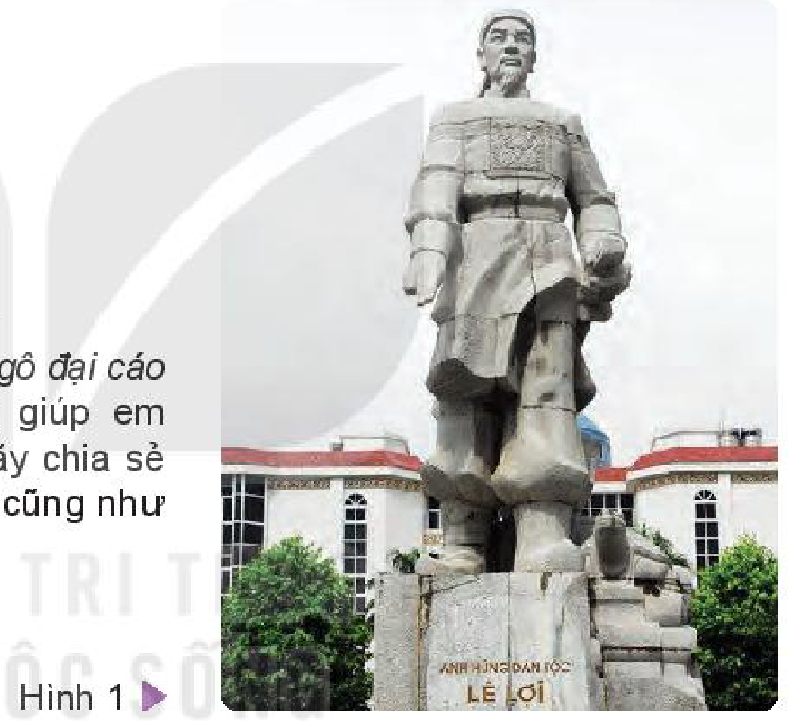
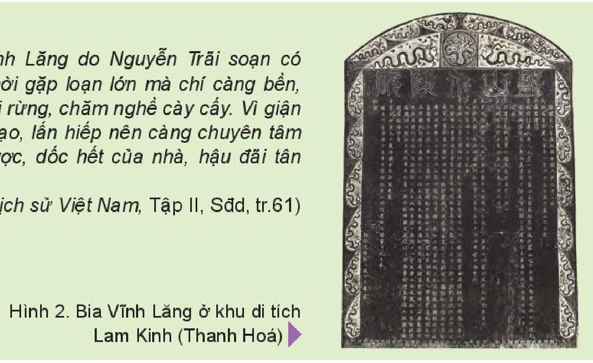
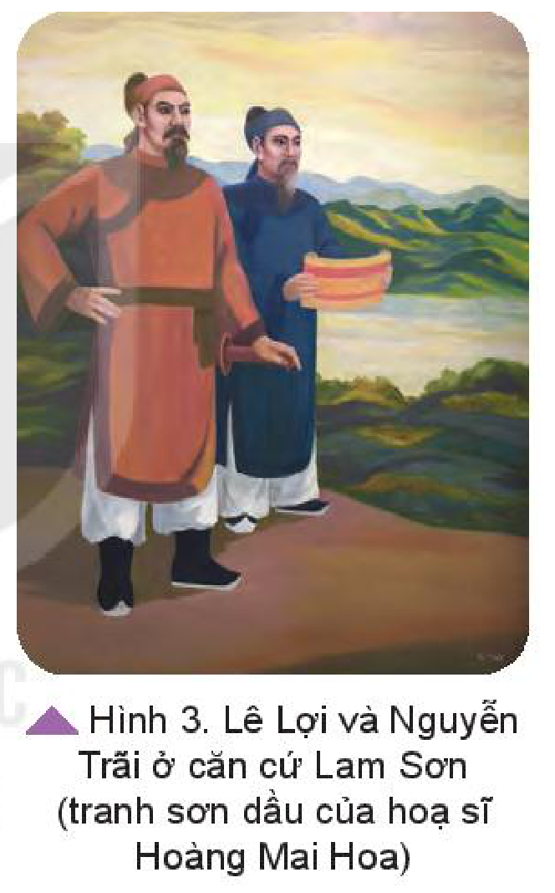
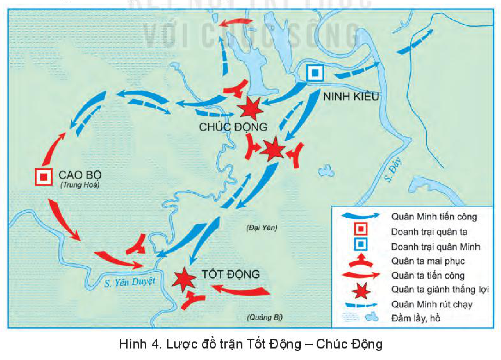
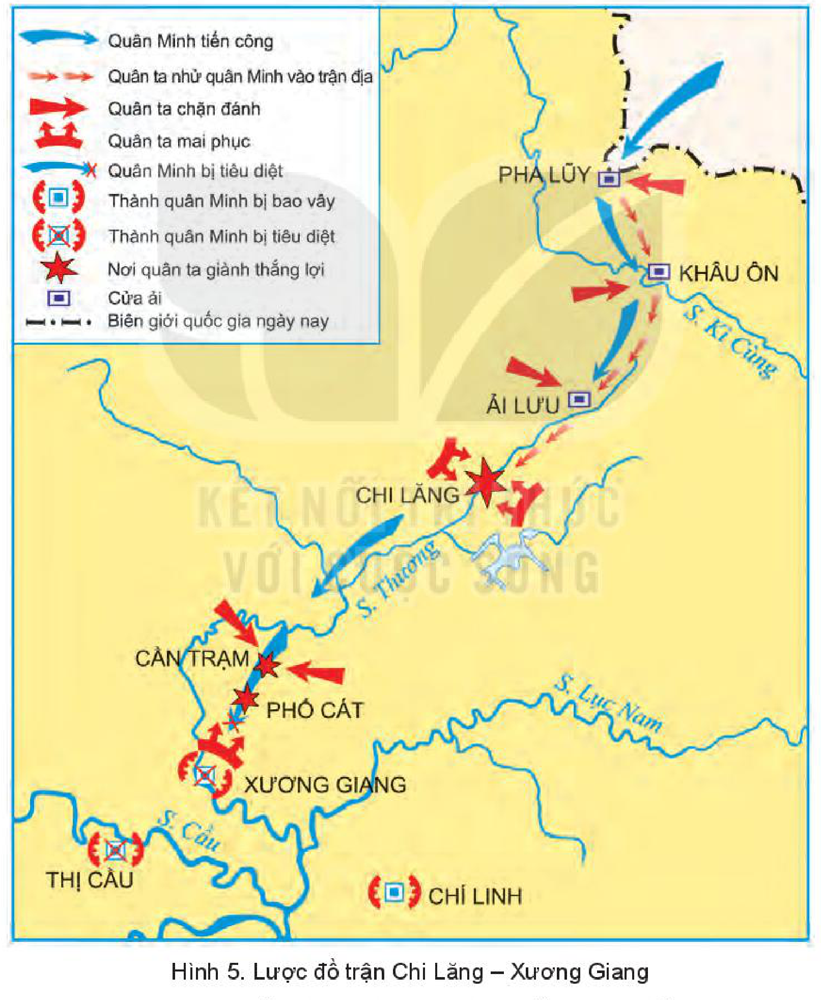

<!-- pdf:79 -->

# BÀI 16: KHỞI NGHĨA LAM SƠN (1418 – 1427)

## 🎯 Học xong bài này, em sẽ:

- Trình bày được một số sự kiện tiêu biểu của cuộc khởi nghĩa Lam Sơn.
- Giải thích được nguyên nhân chính dẫn đến thắng lợi của cuộc khởi nghĩa Lam Sơn.
- Nêu được ý nghĩa của cuộc khởi nghĩa Lam Sơn.
- Đánh giá được vai trò của các nhân vật lịch sử tiêu biểu trong cuộc khởi nghĩa Lam Sơn như Lê Lợi, Nguyễn Trãi, Nguyễn Chích,...

## 🔴 Mở đầu

*Ta đây:*
*Núi Lam Sơn dấy nghĩa,*
*Chốn hoang dã nương mình,*
*Ngẫm thù lớn há đội trời chung,*
*Căm giặc nước thề không cùng sống.*

Những câu thơ trong tác phẩm *Bình Ngô đại cáo* của Nguyễn Trãi và bức hình bên giúp em liên hệ đến nhân vật lịch sử nào? Hãy chia sẻ những hiểu biết của em về nhân vật cũng như sự kiện liên quan đến nhân vật đó.

*Hình 1*

## 1. Một số sự kiện tiêu biểu của khởi nghĩa Lam Sơn

### a) Lê Lợi dựng cờ khởi nghĩa

> 🔗 **Kết nối với địa lí**
>
> Lam Sơn là vùng đồi núi phía tây Thanh Hoá, nằm bên tả ngạn sông Chu, có địa thế hiểm trở; đồng thời nằm trên con đường huyết mạch nối miền núi và miền biển, Nghệ An với Đông Quan (thuộc Hà Nội ngày nay).

Năm 1407, nhà Minh đặt Đại Ngu thành quận Giao Chỉ, chia thành các phủ, huyện để cai trị. Chúng thực hiện chính sách dùng người Việt trị người Việt, bóc lột và đàn áp nhân dân tàn bạo, đặt ra nhiều thứ thuế nặng nề, bắt dân ta phải đổi theo phong tục người Minh,...

Nhân dân ta đã nổi dậy chống quân Minh ở nhiều nơi, tiêu biểu là các cuộc khởi nghĩa của Trần Ngỗi (1407 – 1409), Trần Quý Khoáng (1409 – 1414),... song đều thất bại.

<!-- term: Lê Lợi -->
Lê Lợi – một hào trưởng có uy tín ở vùng đất Lam Sơn (Thanh Hoá) đã tích cực xây dựng lực lượng, dựng cờ khởi nghĩa chống quân Minh.

<!-- pdf:80 -->

<!-- term: Lê Lợi -->
> 1. *Bài Văn bia Vĩnh Lăng do Nguyễn Trãi soạn có đoạn: “... Tuy thời gặp loạn lớn mà chí càng bền, ẩn náu trong núi rừng, chăm nghề cày cấy. Vì giận quân giặc tàn bạo, lấn hiếp nên càng chuyên tâm về sách thao lược, dốc hết của nhà, hậu đãi tân khách...”.*
>
> (Theo *Lịch sử Việt Nam*, Tập II, Sđd, tr.61)

*Hình 2. Bia Vĩnh Lăng ở khu di tích Lam Kinh (Thanh Hoá)*

Nghe tin Lê Lợi chuẩn bị khởi nghĩa, nhiều người yêu nước từ các nơi về hội tụ, trong đó có Nguyễn Trãi.

<!-- term: Hội thề Lũng Nhai -->
<!-- term: Lê Lợi -->
Năm 1416, Lê Lợi cùng 18 hào kiệt đã tổ chức Hội thề ở Lũng Nhai (Thanh Hoá), quyết tâm đánh đuổi giặc Minh. Đầu năm 1418, Lê Lợi tự xưng là Bình Định Vương, truyền hịch kêu gọi nhân dân đứng lên đánh giặc cứu nước.

> ❓ 1. Nêu những hiểu biết của em về chủ tướng Lê Lợi.
>
> 2. Khởi nghĩa Lam Sơn bùng nổ như thế nào?

### b) Những năm đầu của cuộc khởi nghĩa (1418 – 1423)

Trong những ngày đầu khởi nghĩa, căn cứ nhiều lần bị bao vây. Nghĩa quân gặp rất nhiều khó khăn, phải ba lần rút lên vùng núi Chí Linh (huyện Lang Chánh, Thanh Hoá), có lúc chỉ còn hơn 100 người.

*Hình 3. Lê Lợi và Nguyễn Trãi ở căn cứ Lam Sơn (tranh sơn dầu của hoạ sĩ Hoàng Mai Hoa)*

Để khắc phục khó khăn, Lê Lợi và Nguyễn Trãi chủ trương tạm hoà với quân Minh, tranh thủ thời gian tìm phương hướng mới, củng cố lực lượng,... Việc ngoại giao với quân Minh do Nguyễn Trãi đảm trách.

<!-- term: Nguyễn Trãi -->
Nguyễn Trãi (1380 – 1442) hiệu Ức Trai, quê ở Thường Tín (Hà Nội), đỗ Thái học sinh và làm quan dưới triều Hồ. Ông học rộng, tài cao, yêu nước, thương dân sâu sắc. Sau khi cuộc kháng chiến chống Minh của nhà Hồ thất bại, ông vào Thanh Hoá tham gia khởi nghĩa Lam Sơn, trở thành quân sư của Lê Lợi.

> 💡 **Em có biết?**
>
> Năm 1418, quân Minh liên tiếp vây đánh liên tiếp căn cứ Chí Linh. Lê Lai đã đóng giả Lê Lợi để nhử địch, cứu chủ tướng khỏi sự truy sát và đã hi sinh. Năm 1421, trong một đợt vây quét của giặc Minh, nghĩa quân lâm vào cảnh thiếu lương thực trầm trọng, đói và rét,... Lê Lợi phải cho giết cả voi, ngựa để nuôi quân.
<!-- ocr-ok: đã đối chiếu p080.png, hộp Em có biết? cột phải hẹp nên OCR ghép lẫn chữ cột trái -->

> ❓ 1. Trình bày những khó khăn của nghĩa quân Lam Sơn trong những năm tháng đầu của cuộc khởi nghĩa.
>
> 2. Em có nhận xét gì về đề nghị tạm hoà với quân Minh của nghĩa quân Lam Sơn?

<!-- pdf:81 -->

### c) Giai đoạn mở rộng hoạt động và giành những thắng lợi đầu tiên (1424 – 1425)

<!-- term: Nguyễn Chích -->
> 💡 **Em có biết?**
>
> Nguyễn Chích (1382 – 1448) quê ở Đông Sơn (Thanh Hoá). Kế sách của ông trong cuộc kháng chiến chống quân Minh thể hiện phương châm “tránh chỗ mạnh, đánh chỗ yếu” – nét đặc sắc của nghệ thuật quân sự Việt Nam.

<!-- term: Nguyễn Chích -->
Để gỡ thế bị bao vây, Nguyễn Chích hiến kế tiến vào đánh chiếm Nghệ An làm căn cứ, từ đó mở rộng giải phóng Tây Đô (Thanh Hoá) và Đông Quan.

> 2. *“Nghệ An là nơi hiểm yếu, đất rộng, người đông... Nay trước tiên hãy đánh lấy Trà Long, bình định cho được Nghệ An. Rồi dựa vào nhân lực, tài lực đất ấy mà quay ra Đông Đô [Đông Quan] thì có thể tính xong việc dẹp yên thiên hạ...”.*
>
> (Viện Sử học, *Khâm định Việt sử thông giám cương mục*, Tập một, NXB Giáo dục, 2008, tr.362)

Cuối năm 1424, nghĩa quân giải phóng Nghệ An, sau đó giải phóng một vùng rộng lớn từ Thanh Hoá đến đèo Hải Vân. Những thắng lợi này đã làm thay đổi căn bản cục diện cuộc chiến và so sánh lực lượng giữa hai bên theo hướng có lợi cho nghĩa quân.

> ❓ Khai thác tư liệu 2, hãy cho biết vì sao Nguyễn Chích đề xuất kế hoạch đánh chiếm Nghệ An. Kế hoạch đó đem lại những kết quả như thế nào?

### d) Khởi nghĩa toàn thắng (1426 – 1427)

- *Tiến quân ra Bắc*

Tháng 9 – 1426, Lê Lợi và bộ chỉ huy quyết định tiến quân ra Bắc. Nghĩa quân đi đến đâu cũng được nhân dân ủng hộ, thắng nhiều trận lớn. Quân Minh phải rút vào thành Đông Quan cố thủ.

- *Chiến thắng Tốt Động – Chúc Động*

*Hình 4. Lược đồ trận Tốt Động – Chúc Động*

<!-- pdf:82 -->

<!-- term: Chiến thắng Tốt Động – Chúc Động -->
Tháng 10 – 1426, Vương Thông dẫn viện binh đến thành Đông Quan và mở cuộc tấn công vào quân chủ lực của nghĩa quân ở quanh thành.

<!-- term: Chiến thắng Tốt Động – Chúc Động -->
Ngày 7 – 11 – 1426, quân ta mai phục và chặn đánh địch ở Tốt Động – Chúc Động (Chương Mỹ, Hà Nội ngày nay). Quân Minh thất bại nặng nề, nghĩa quân giải phóng nhiều đất đai và siết chặt vây hãm thành Đông Quan.

- *Chiến thắng Chi Lăng – Xương Giang*

<!-- term: Chiến thắng Chi Lăng – Xương Giang -->
Tháng 10 – 1427, Liễu Thăng và Mộc Thạnh chỉ huy 15 vạn viện binh theo hai đường Quảng Tây, Vân Nam tiến vào nước ta. Nghĩa quân tổ chức phục kích tại ải Chi Lăng (Lạng Sơn), Liễu Thăng bị giết tại trận.

<!-- term: Chiến thắng Chi Lăng – Xương Giang -->
Sau đó, nghĩa quân liên tiếp giành thắng lợi tại Cần Trạm, Phố Cát và Xương Giang (Bắc Giang).

*Hình 5. Lược đồ trận Chi Lăng – Xương Giang*

<!-- term: Chiến thắng Chi Lăng – Xương Giang -->
Lê Lợi sai người mang ấn tín và thư báo tin Liễu Thăng tử trận cho Mộc Thạnh (đang đóng ở vùng biên giới tỉnh Lào Cai ngày nay). Quân giặc vô cùng khiếp sợ, vội vàng rút về nước.

<!-- pdf:83 -->

<!-- term: Bình Ngô đại cáo -->
> 🔗 **Kết nối với văn học**
>
> *Bình Ngô đại cáo* của Nguyễn Trãi được viết bằng chữ Hán, khẳng định nền độc lập, chủ quyền lãnh thổ và văn hoá Đại Việt; vạch trần tội ác quân Minh; mô tả quá trình chiến đấu gian khổ và những chiến thắng oanh liệt, tinh thần nhân đạo của nghĩa quân Lam Sơn. Đây được coi là bản Tuyên ngôn Độc lập của nước Đại Việt đầu thế kỉ XV.

- *Hội thề Đông Quan*

<!-- term: Hội thề Đông Quan -->
Nghĩa quân vừa tăng cường xiết chặt vòng vây các thành còn lại (Đông Quan, Tây Đô,...) vừa khéo léo dụ hàng Vương Thông và các tướng lĩnh quân Minh.

<!-- term: Hội thề Đông Quan -->
Ngày 10 – 12 – 1427, bên bờ sông Hồng, Lê Lợi và Vương Thông dẫn đầu hai phái đoàn tham gia Hội thề Đông Quan, chấm dứt chiến tranh. Đầu tháng 1 – 1428, quân Minh rút hết về nước, đất nước hoàn toàn giải phóng.

<!-- term: Bình Ngô đại cáo -->
Lê Lợi giao Nguyễn Trãi soạn *Bình Ngô đại cáo*, chính thức tuyên bố chấm dứt chiến tranh, mở nền hoà bình và dựng xây đất nước.

> ❓ 1. Trình bày những sự kiện tiêu biểu của cuộc khởi nghĩa Lam Sơn giai đoạn 1426 – 1427.
>
> 2. Việc dụ hàng quân Minh và tổ chức Hội thề Đông Quan thể hiện điều gì trong kế sách đánh giặc của Lê Lợi và Nguyễn Trãi?

## 2. Nguyên nhân thắng lợi và ý nghĩa lịch sử

<!-- term: Khởi nghĩa Lam Sơn -->
Khởi nghĩa Lam Sơn thắng lợi là do nhân dân ta luôn nêu cao tinh thần yêu nước nồng nàn, ý chí và quyết tâm giành lại độc lập cho dân tộc. Toàn dân đã đồng lòng đoàn kết chiến đấu, đóng góp của cải, lương thực, vũ khí, chịu nhiều gian khổ hi sinh để giành thắng lợi cuối cùng.

<!-- term: Khởi nghĩa Lam Sơn -->
Thắng lợi của cuộc khởi nghĩa còn do đường lối lãnh đạo đúng đắn, sáng tạo của bộ chỉ huy nghĩa quân, đứng đầu là những lãnh tụ kiệt xuất như Lê Lợi và Nguyễn Trãi, cùng những vị tướng tài như Nguyễn Chích, Nguyễn Xí, Nguyễn Biểu,...

<!-- term: Khởi nghĩa Lam Sơn -->
Khởi nghĩa Lam Sơn là một cuộc chiến tranh giải phóng dân tộc có tính chất nhân dân rộng rãi, chấm dứt hơn hai mươi năm đô hộ của nhà Minh, khôi phục nền độc lập, mở ra thời kì phát triển mới của đất nước.

> ❓ 1. Giải thích nguyên nhân thắng lợi của cuộc khởi nghĩa Lam Sơn.
>
> 2. Hãy trình bày ý nghĩa lịch sử của cuộc khởi nghĩa Lam Sơn.

## ✏️ Luyện tập – Vận dụng

1. Hãy lập bảng hệ thống những sự kiện tiêu biểu của cuộc khởi nghĩa Lam Sơn (thời gian, sự kiện tiêu biểu, kết quả, ý nghĩa).

2. Hãy đánh giá vai trò của các vị anh hùng dân tộc như: Lê Lợi, Nguyễn Trãi, Nguyễn Chích,... đối với cuộc khởi nghĩa Lam Sơn.

3. Từ khởi nghĩa Lam Sơn, chúng ta rút ra được bài học kinh nghiệm gì đối với công cuộc xây dựng và bảo vệ Tổ quốc hiện nay?

## 📷 Danh sách hình trong bài

| Mã hình | Trang PDF | Trang sách | Chú thích |
| --- | --- | --- | --- |
| H7-lich_su_va_dia_ly-ls-b16-01 | 79 | 78 | Hình 1 [Tượng đài Anh hùng dân tộc Lê Lợi] |
| H7-lich_su_va_dia_ly-ls-b16-02 | 80 | 79 | Hình 2. Bia Vĩnh Lăng ở khu di tích Lam Kinh (Thanh Hoá) |
| H7-lich_su_va_dia_ly-ls-b16-03 | 80 | 79 | Hình 3. Lê Lợi và Nguyễn Trãi ở căn cứ Lam Sơn (tranh sơn dầu của hoạ sĩ Hoàng Mai Hoa) |
| H7-lich_su_va_dia_ly-ls-b16-04 | 81 | 80 | Hình 4. Lược đồ trận Tốt Động – Chúc Động |
| H7-lich_su_va_dia_ly-ls-b16-05 | 82 | 81 | Hình 5. Lược đồ trận Chi Lăng – Xương Giang |
