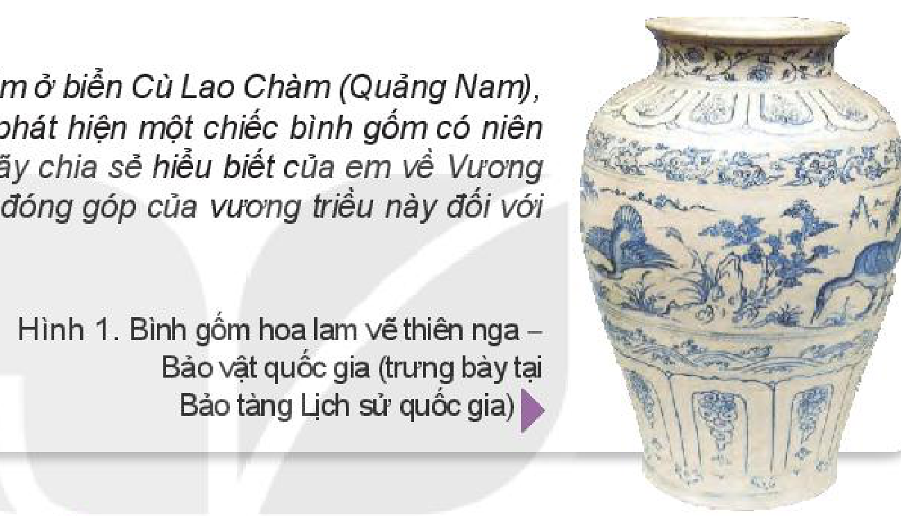
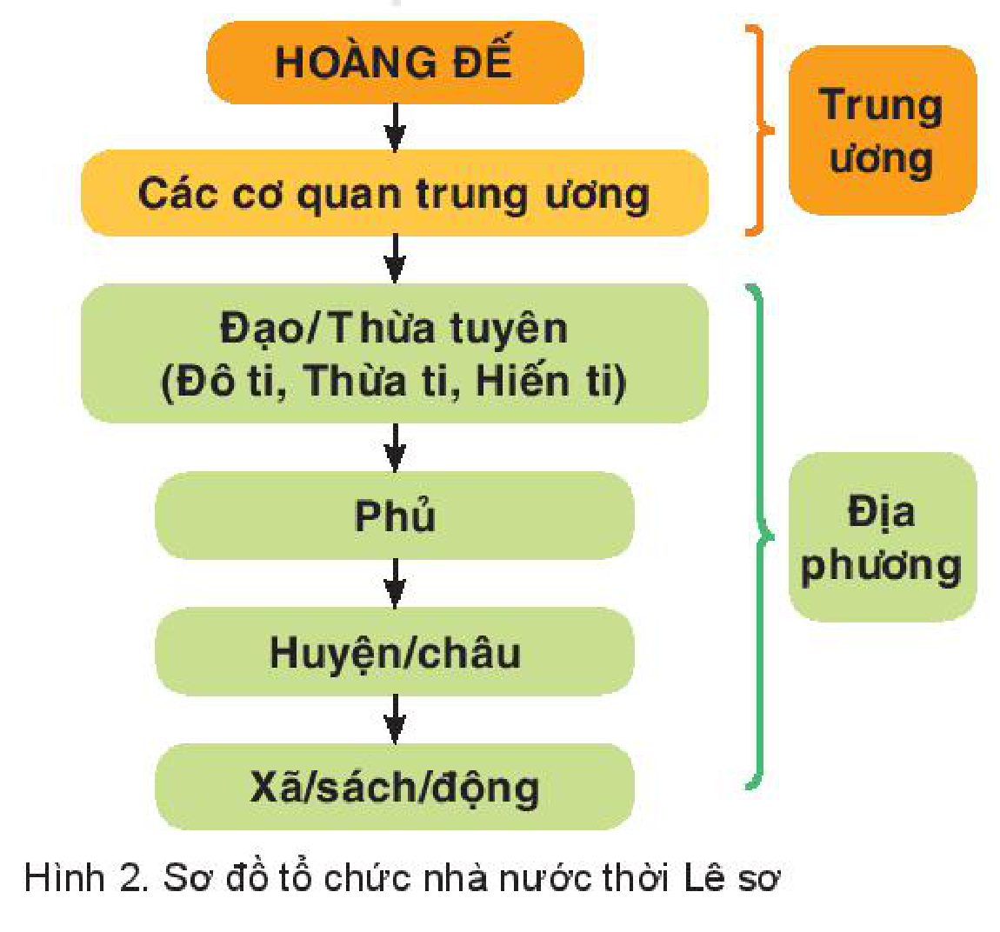
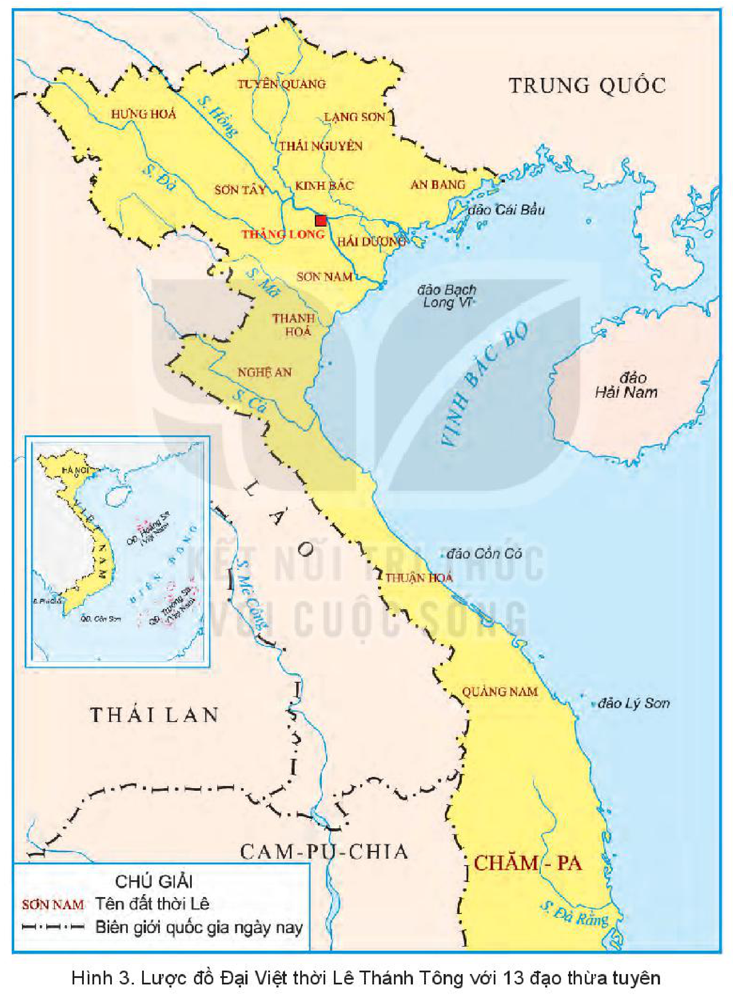
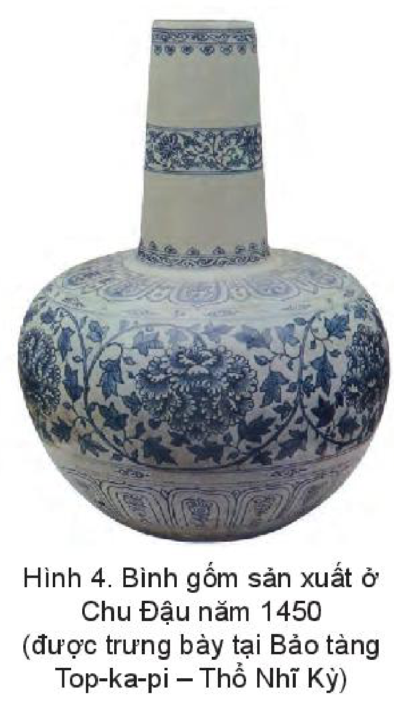
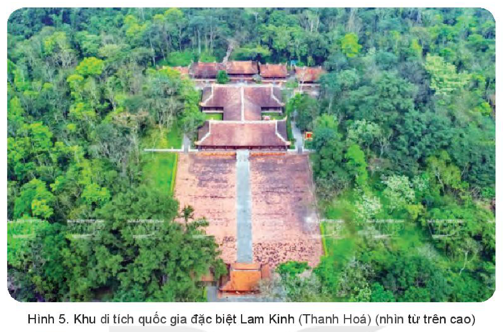
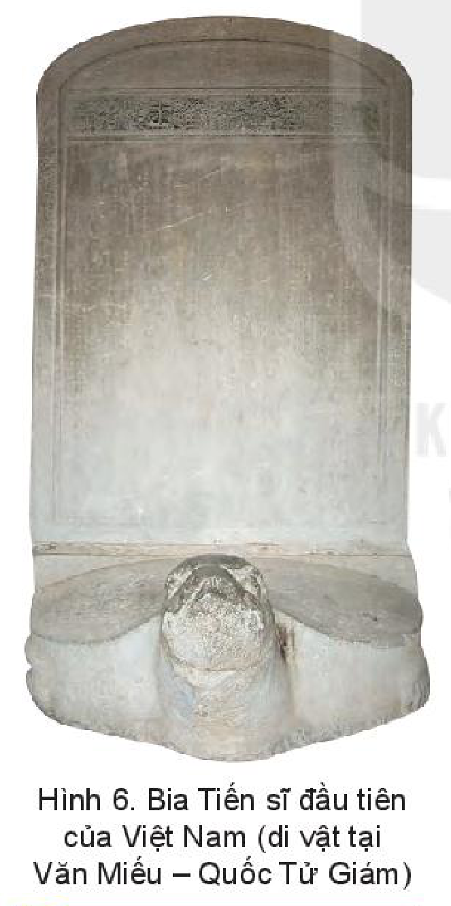

<!-- pdf:84 -->

# BÀI 17: ĐẠI VIỆT THỜI LÊ SƠ (1428 – 1527)

## 🎯 Học xong bài này, em sẽ:

- Mô tả được sự thành lập nhà Lê sơ.
- Nhận biết được tình hình kinh tế – xã hội thời Lê sơ.
- Giới thiệu được sự phát triển văn hoá, giáo dục và một số danh nhân văn hoá tiêu biểu thời Lê sơ.

## 🔴 Mở đầu

Khi khai quật chiếc tàu đắm ở biển Cù Lao Chàm (Quảng Nam), các nhà khảo cổ học đã phát hiện một chiếc bình gốm có niên đại thời Lê sơ (hình bên). Hãy chia sẻ hiểu biết của em về Vương triều Lê sơ cũng như những đóng góp của vương triều này đối với văn minh Đại Việt.

*Hình 1. Bình gốm hoa lam vẽ thiên nga – Bảo vật quốc gia (trưng bày tại Bảo tàng Lịch sử quốc gia)*

## 1. Sự thành lập Vương triều Lê sơ

<!-- term: Vương triều Lê sơ -->
Năm 1428, Lê Lợi lên ngôi hoàng đế, thành lập nhà Lê sơ, đặt niên hiệu Thuận Thiên, khôi phục quốc hiệu Đại Việt và đóng đô ở Thăng Long. Bộ máy nhà nước mới được xây dựng và từng bước hoàn chỉnh dưới thời vua Lê Thánh Tông. Hoàng đế trực tiếp nắm mọi quyền hành, kể cả chức tổng chỉ huy quân đội.

<!-- term: Đạo -->
> **Trung ương:** HOÀNG ĐẾ → Các cơ quan trung ương
>
> **Địa phương:** Đạo/Thừa tuyên (Đô ti, Thừa ti, Hiến ti) → Phủ → Huyện/châu → Xã/sách/động
<!-- ocr-ok: nội dung sơ đồ Hình 2 đối chiếu trực tiếp p084.png -->

*Hình 2. Sơ đồ tổ chức nhà nước thời Lê sơ*

<!-- pdf:85 -->

<!-- term: Quốc triều hình luật -->
> 💡 **Em có biết?**
>
> Bộ *Quốc triều hình luật* gồm 722 điều được nhà sử học Phan Huy Chú (thời Nguyễn) đánh giá: “Thật là cái mẫu mực để trị nước...”.

<!-- term: Quốc triều hình luật -->
Triều Lê sơ chú trọng xây dựng quân đội mạnh, tiếp tục thi hành chính sách “ngụ binh ư nông”; hoàn thiện pháp luật với việc ban hành bộ *Quốc triều hình luật* (Luật Hồng Đức) có nhiều điểm tiến bộ.

<!-- term: Đạo -->
*Hình 3. Lược đồ Đại Việt thời Lê Thánh Tông với 13 đạo thừa tuyên*

<!-- term: Vương triều Lê sơ -->
Nhà Lê sơ thực hiện chính sách kiên quyết nhằm giữ vững chủ quyền và toàn vẹn lãnh thổ quốc gia cũng như mở rộng biên giới về phía nam. Năm 1471, biên giới Đại Việt đã mở rộng đến khu vực tỉnh Phú Yên ngày nay.

<!-- pdf:86 -->

> 1. *Năm 1473, vua Lê Thánh Tông căn dặn đại thần khi đàm phán với triều Minh: “Một thước núi, một tấc sông của ta, lẽ nào lại nên vứt bỏ? Ngươi phải kiên quyết tranh biện, chớ cho họ lấn dần... Nếu ngươi dám đem một thước, một tấc đất của Thái Tổ làm mồi cho giặc, thì tội phải tru di”.*
>
> (Theo *Đại Việt sử ký toàn thư*, Tập II, Sđd, tr.462)

> ❓ 1. Hãy cho biết Vương triều Lê sơ được thành lập như thế nào.
>
> 2. Tư liệu 1 thể hiện quyết tâm bảo vệ chủ quyền lãnh thổ của nhà Lê sơ như thế nào?

## 2. Tình hình kinh tế, xã hội

### a) Tình hình kinh tế

- *Nông nghiệp*

Nhà Lê sơ đặc biệt coi trọng và khuyến khích phát triển nông nghiệp.

<!-- term: Phép quân điền -->
- Đặt ra các quan chuyên trách như: Khuyến nông sứ, Hà đê sứ, Đồn điền sứ,...
- Cấm để ruộng hoang, đẩy mạnh khẩn hoang và lập đồn điền.
- Đặt phép quân điền, định kì chia đều ruộng công làng xã.
- Khơi kênh, đào sông, đắp đê ngăn mặn, bảo vệ các công trình thuỷ lợi.

Sản xuất nông nghiệp nhanh chóng được phục hồi và phát triển. Đời sống nhân dân dần ổn định, như lời ca tụng trong dân gian:

> *Đời vua Thái Tổ, Thái Tông*
> *Thóc lúa đầy đồng, trâu chẳng buồn ăn.*

- *Thủ công nghiệp*

Nhiều nghề thủ công truyền thống như dệt lụa, làm gốm,... phát triển nhanh chóng, hình thành những làng nghề chuyên nghiệp. Đặc biệt, nghề sản xuất gốm sứ xuất khẩu theo đơn đặt hàng của các thương nhân nước ngoài phát triển mạnh ở các làng nghề tại Chu Đậu (Hải Dương), Bát Tràng (Hà Nội),...

*Hình 4. Bình gốm sản xuất ở Chu Đậu năm 1450 (được trưng bày tại Bảo tàng Top-ka-pi – Thổ Nhĩ Kỳ)*

<!-- pdf:87 -->

> 💡 **Em có biết?**
>
> Cuộc khai quật tàu đắm ở Cù Lao Chàm (1997 – 1999) đã trục vớt khoảng 240 000 đồ gốm sứ được sản xuất chủ yếu ở Chu Đậu có niên đại thế kỉ XV. Những đồ gốm này đang trên đường đi đến các thị trường quốc tế, nhưng do đắm tàu mà bị chìm dưới đáy biển sâu.

- *Thương nghiệp*

Triều đình khuyến khích lập chợ, thúc đẩy buôn bán giữa các địa phương, giữa các làng nghề thủ công với các đô thị.

Việc buôn bán với nước ngoài được duy trì. Thuyền buôn nhiều nước đã đến buôn bán tại các thương cảng như: Vân Đồn, Hội Thống, Tam Kỳ,... Các sản phẩm như: tơ lụa, gốm sứ, lâm thổ sản,... rất được ưa chuộng.

> ❓ Trình bày những nét chính về tình hình kinh tế thời Lê sơ.

### b) Tình hình xã hội

Xã hội phân hoá thành các tầng lớp có địa vị ngày càng khác biệt.

Tầng lớp quý tộc (vua, quan lại) có nhiều đặc quyền, đặc lợi. Nông dân là bộ phận đông đảo nhất, cày cấy ruộng đất công, nộp thuế và làm các nghĩa vụ với nhà nước hoặc lĩnh canh ruộng đất của địa chủ, quan lại để cày cấy và nộp tô cho họ. Thợ thủ công và thương nhân ngày càng đông đảo nhưng không được coi trọng. Nô tì có xu hướng giảm.

Sự phân biệt giữa quý tộc và bình dân trở nên sâu sắc và được quy định bởi pháp luật.

> ❓ Nêu những nét chính về tình hình xã hội thời Lê sơ.

## 3. Phát triển văn hoá – giáo dục

<!-- term: Hội Tao đàn -->
> 🔗 **Kết nối với văn học**
>
> Hội Tao đàn (Nhị thập bát tú) là hội thơ ca gồm 28 thành viên do vua Lê Thánh Tông sáng lập và làm chủ soái, hai phó soái là Thân Nhân Trung và Đỗ Nhuận.

Thời Lê sơ, Nho giáo được đề cao, chiếm vị trí độc tôn; Phật giáo và Đạo giáo bị hạn chế.

Văn học chữ Hán tiếp tục phát triển và giữ ưu thế, có nhiều tác phẩm nổi tiếng như: *Quân trung từ mệnh tập*, *Bình Ngô đại cáo* (Nguyễn Trãi), *Quỳnh Uyển cửu ca* (Hội Tao đàn),...

Văn học chữ Nôm chiếm vị trí quan trọng với các tác phẩm như: *Quốc âm thi tập* (Nguyễn Trãi), *Hồng Đức quốc âm thi tập* (Lê Thánh Tông),...

Nhà Lê sơ coi trọng việc chép sử, biên soạn các bộ sách về địa lí, bản đồ. Tiêu biểu có các tác phẩm: *Lam Sơn thực lục* (Nguyễn Trãi), *Đại Việt sử ký toàn thư* (Ngô Sỹ Liên), *Dư địa chí* (Nguyễn Trãi), *Hồng Đức bản đồ*,...

Toán học có *Đại thành toán pháp*, *Lập thành toán pháp*; Y học có *Bản thảo thực vật toát yếu*,...

Nhiều công trình kiến trúc tiêu biểu được xây dựng ở kinh đô Thăng Long, Lam Kinh (Thanh Hoá). Nghệ thuật điêu khắc trên đá, gỗ, gốm sứ,... tinh xảo với nhiều tác phẩm còn được lưu truyền đến nay. Nhã nhạc cung đình và nghệ thuật tuồng, chèo,... ngày càng phát triển.

<!-- pdf:88 -->

*Hình 5. Khu di tích quốc gia đặc biệt Lam Kinh (Thanh Hoá) (nhìn từ trên cao)*

*Hình 6. Bia Tiến sĩ đầu tiên của Việt Nam (di vật tại Văn Miếu – Quốc Tử Giám)*

<!-- term: Bia Tiến sĩ -->
Vua Lê Thái Tổ cho dựng lại Quốc Tử Giám ở kinh thành Thăng Long. Nhà Lê tổ chức đều đặn các khoa thi Tiến sĩ để tuyển chọn quan lại và cho lập bia đá ở Văn Miếu – Quốc Tử Giám để tôn vinh những người đỗ đạt.

<!-- term: Bia Tiến sĩ -->
> 2. *Năm 1484, khi soạn bia Tiến sĩ đầu tiên, Thân Nhân Trung viết: “Hiền tài là nguyên khí của quốc gia”.*
>
> (Văn bia đề danh Tiến sĩ khoa Nhâm Tuất (1442, dịch nghĩa) tại Văn Miếu – Quốc Tử Giám, Hà Nội)

> ❓ 1. Hãy trình bày những thành tựu văn hoá – giáo dục tiêu biểu thời Lê sơ.
>
> 2. Khai thác tư liệu 2 và thông tin trong mục, hãy cho biết vì sao nhà Lê sơ chú trọng phát triển giáo dục, khoa cử.

## 4. Một số danh nhân văn hoá tiêu biểu

### a) Nguyễn Trãi

> 🔗 **Kết nối với văn hoá**
>
> Cuộc đời và sự nghiệp của Nguyễn Trãi đã trở thành cảm hứng cho nhiều tác phẩm nghệ thuật như: kịch *Bí mật vườn Lệ Chi*, kịch *Nguyễn Trãi ở Đông Quan*,...

<!-- term: Nguyễn Trãi -->
Nguyễn Trãi là vị anh hùng dân tộc đồng thời là danh nhân văn hoá thế giới. Với tư tưởng nhân nghĩa, yêu nước, thương dân, ông đã để lại nhiều tác phẩm có giá trị lớn về Văn học, Sử học, Địa lí học như *Quân trung từ mệnh tập*, *Bình Ngô đại cáo*, *Chí Linh sơn phú*, *Quốc âm thi tập*, *Dư địa chí*,...

Sự nghiệp, nhân cách và tâm hồn Nguyễn Trãi mãi mãi là vì sao sáng như Lê Thánh Tông truy tặng *Ức Trai tâm thượng quang Khuê tảo* (Lòng Ức Trai sáng tựa sao Khuê). Tư tưởng “chở thuyền cũng là dân, lật thuyền cũng là dân” của ông vẫn là bài học quý báu cho công cuộc xây dựng và bảo vệ đất nước đến muôn đời.

<!-- pdf:89 -->

### b) Lê Thánh Tông

<!-- term: Lê Thánh Tông -->
Lê Thánh Tông là một vị hoàng đế anh minh, tài năng xuất chúng cả về chính trị, kinh tế,... Ông cũng là nhà văn hoá lớn của dân tộc.

<!-- term: Lê Thánh Tông -->
Dưới thời trị vì của ông, giáo dục và đào tạo nhân tài nở rộ, có tới 500 người đỗ tiến sĩ.

<!-- term: Lê Thánh Tông -->
<!-- term: Hội Tao đàn -->
Hội Tao đàn do Lê Thánh Tông sáng lập đã đánh dấu bước phát triển cao của nền văn chương đương thời. Ông để lại di sản thơ văn phong phú, đồ sộ với trên 300 bài thơ chữ Hán và tập *Hồng Đức quốc âm thi tập* bằng chữ Nôm.

### c) Ngô Sỹ Liên

<!-- term: Ngô Sỹ Liên -->
Ngô Sỹ Liên đỗ Tiến sĩ năm 1442, ông là nhà sử học nổi tiếng với bộ *Đại Việt sử ký toàn thư* mà đến nay vẫn còn nguyên giá trị.

### d) Lương Thế Vinh

<!-- term: Lương Thế Vinh -->
Lương Thế Vinh đỗ Trạng nguyên năm 1463. Ông là nhà toán học nổi tiếng với các sách *Đại thành toán pháp*, *Thiền môn giáo khoa*. Nhờ học rộng, tài cao, tính tình khoáng đạt và bình dị, đương thời ông được cả vua và nhân dân quý mến.

> ❓ Hãy kể tên một số danh nhân văn hoá tiêu biểu thời Lê sơ và những đóng góp của họ đối với sự phát triển của văn hoá dân tộc.

## ✏️ Luyện tập – Vận dụng

1. Tình hình kinh tế thời Lê sơ có điểm gì giống và khác thời Trần? Hãy lập và hoàn thành bảng theo mẫu dưới đây:

| So sánh | Nội dung | Thời Lê sơ | Thời Trần |
| --- | --- | --- | --- |
| **Giống nhau** | | | |
| **Khác nhau** | Nông nghiệp | | |
| | Thủ công nghiệp | | |
| | Thương nghiệp | | |

2. Đọc đoạn tư liệu sau và cho biết luật pháp thời Lê sơ có những điểm gì tiến bộ.

<!-- term: Quốc triều hình luật -->
> 3. *Điều 388, trong gia đình, con gái được quyền thừa kế tài sản như con trai. Điều 374 và 375, khi gia đình phải phân chia tài sản thì tài sản do hai vợ chồng làm ra được chia đôi. Điều 308, người chồng ruồng bỏ và không đi lại với người vợ trong năm tháng thì người vợ có quyền bỏ chồng.*
>
> (Luật Hồng Đức, Theo Phan Huy Lê (CB), *Lịch sử Việt Nam*, Tập II, NXB Giáo dục Việt Nam, 2012, tr.141)

3. Chủ trương của các vua thời Lê sơ về vấn đề chủ quyền lãnh thổ có giá trị như thế nào trong công cuộc bảo vệ chủ quyền lãnh thổ quốc gia ngày nay?

## 📷 Danh sách hình trong bài

| Mã hình | Trang PDF | Trang sách | Chú thích |
| --- | --- | --- | --- |
| H7-lich_su_va_dia_ly-ls-b17-01 | 84 | 83 | Hình 1. Bình gốm hoa lam vẽ thiên nga – Bảo vật quốc gia (trưng bày tại Bảo tàng Lịch sử quốc gia) |
| H7-lich_su_va_dia_ly-ls-b17-02 | 84 | 83 | Hình 2. Sơ đồ tổ chức nhà nước thời Lê sơ |
| H7-lich_su_va_dia_ly-ls-b17-03 | 85 | 84 | Hình 3. Lược đồ Đại Việt thời Lê Thánh Tông với 13 đạo thừa tuyên |
| H7-lich_su_va_dia_ly-ls-b17-04 | 86 | 85 | Hình 4. Bình gốm sản xuất ở Chu Đậu năm 1450 (được trưng bày tại Bảo tàng Top-ka-pi – Thổ Nhĩ Kỳ) |
| H7-lich_su_va_dia_ly-ls-b17-05 | 88 | 87 | Hình 5. Khu di tích quốc gia đặc biệt Lam Kinh (Thanh Hoá) (nhìn từ trên cao) |
| H7-lich_su_va_dia_ly-ls-b17-06 | 88 | 87 | Hình 6. Bia Tiến sĩ đầu tiên của Việt Nam (di vật tại Văn Miếu – Quốc Tử Giám) |
