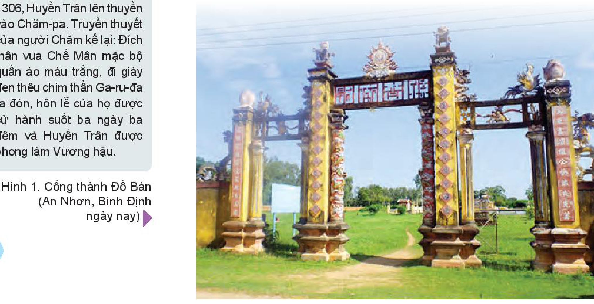
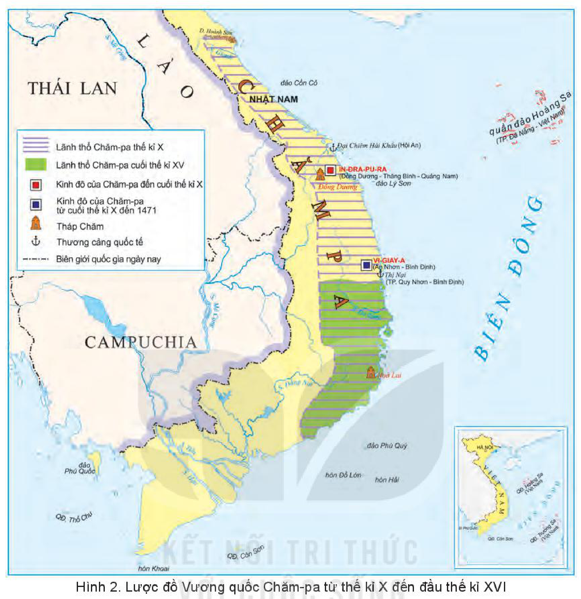
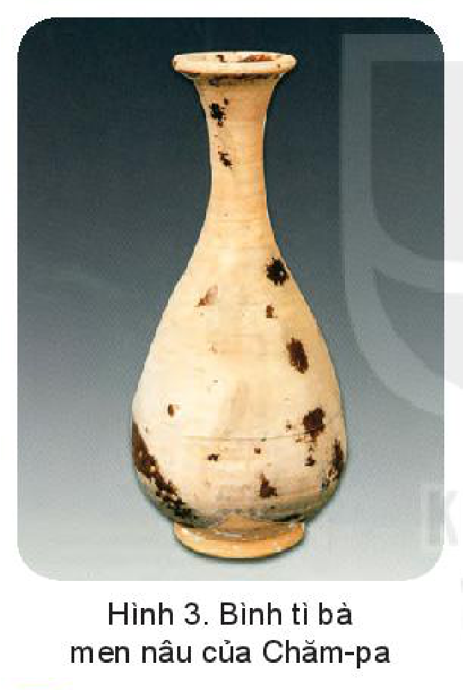
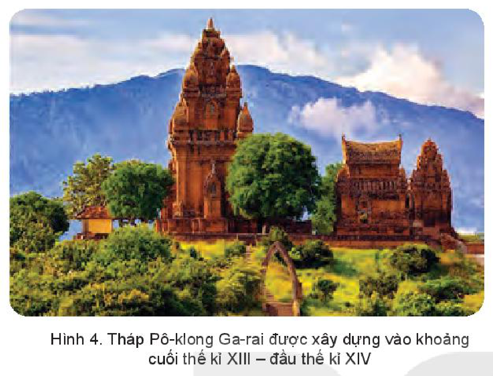
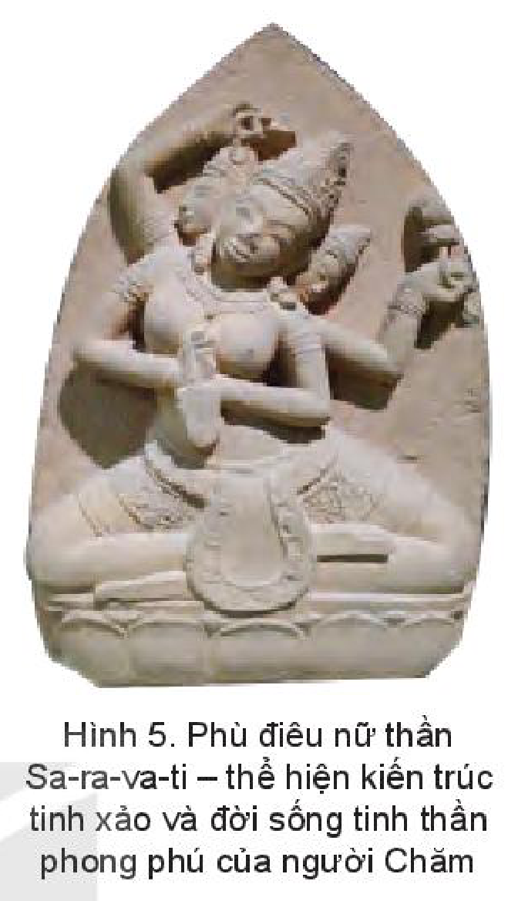

<!-- pdf:91 -->

# BÀI 18: VƯƠNG QUỐC CHĂM-PA VÀ VÙNG ĐẤT NAM BỘ TỪ ĐẦU THẾ KỈ X ĐẾN ĐẦU THẾ KỈ XVI

## 🎯 Học xong bài này, em sẽ:

- Nêu được những diễn biến cơ bản về chính trị của Vương quốc Chăm-pa, vùng đất Nam Bộ từ đầu thế kỉ X đến đầu thế kỉ XVI.
- Trình bày được những nét chính về kinh tế, văn hoá của Vương quốc Chăm-pa, vùng đất Nam Bộ từ đầu thế kỉ X đến đầu thế kỉ XVI.

## 🔴 Mở đầu

Trong giai đoạn từ đầu thế kỉ X đến đầu thế kỉ XVI, vùng đất phía Nam của Đại Việt bao gồm những phần lãnh thổ nào thuộc Việt Nam hiện nay? Vùng đất đó đã phát triển ra sao trước khi sáp nhập vào lãnh thổ Đại Việt? Chúng ta cùng tìm hiểu trong bài học này nhé!

## 1. Vương quốc Chăm-pa từ thế kỉ X đến đầu thế kỉ XVI

### a) Diễn biến cơ bản về chính trị

> 💡 **Em có biết?**
>
> Năm 1305, vua Chăm-pa là Chế Mân sai người mang lễ vật xin cưới Công chúa Huyền Trân – con gái của vua Trần Nhân Tông. Năm 1306, Huyền Trân lên thuyền vào Chăm-pa. Truyền thuyết của người Chăm kể lại: Đích thân vua Chế Mân mặc bộ quần áo màu trắng, đi giày đen thêu chim thần Ga-ru-đa ra đón, hôn lễ của họ được cử hành suốt ba ngày ba đêm và Huyền Trân được phong làm Vương hậu.

<!-- term: Vương triều Vi-giay-a -->
<!-- term: Kinh đô Vi-giay-a -->
Năm 988, một quý tộc người Chăm đã lập ra Vương triều Vi-giay-a, mở ra một thời kì phát triển mới của Vương quốc Chăm-pa. Kinh đô được chuyển về Vi-giay-a (còn gọi là Đồ Bàn hay Chà Bàn, thuộc An Nhơn, Bình Định ngày nay).

*Hình 1. Cổng thành Đồ Bàn (An Nhơn, Bình Định ngày nay)*

<!-- pdf:92 -->

*Hình 2. Lược đồ Vương quốc Chăm-pa từ thế kỉ X đến đầu thế kỉ XVI*

**Bảng khái quát tình hình chính trị của Vương quốc Chăm-pa**

<!-- term: Vương triều Vi-giay-a -->
| Giai đoạn | Tình hình nổi bật |
| --- | --- |
| Từ năm 988 – 1220 | - Tình hình Chăm-pa gặp nhiều khó khăn ở trong nước, phải tiến hành các cuộc chiến tranh với Chân Lạp cũng như giải quyết xung đột với Đại Việt ở phía bắc. - Năm 1069, vua Chăm-pa cắt ba châu là Bố Chính, Địa Lý (Quảng Bình) và Ma Linh (phía bắc tỉnh Quảng Trị) cho Đại Việt. - “Cuộc chiến tranh Một trăm năm” (khoảng 1113 – 1220), khiến Chăm-pa hai lần bị Chân Lạp chiếm đóng. |
| Từ năm 1220 – 1353 | Là thời kì thịnh đạt nhất của Vương triều Vi-giay-a cũng như trong lịch sử Vương quốc Chăm-pa. Chăm-pa thoát khỏi ách đô hộ của Chân Lạp, củng cố chính quyền, mở rộng và thống nhất lãnh thổ,... |
| Từ cuối thế kỉ XIV – năm 1471 | Vương triều Vi-giay-a lâm vào khủng hoảng, suy yếu rồi sụp đổ. |
| Từ năm 1471 – đầu thế kỉ XVI | Lãnh thổ Chăm-pa bị thu hẹp nhiều phần và chia thành nhiều tiểu quốc khác nhau. |

<!-- pdf:93 -->

> ❓ Giới thiệu những diễn biến chính về chính trị của Vương quốc Chăm-pa từ thế kỉ X đến đầu thế kỉ XVI.

### b) Tình hình kinh tế, văn hoá

> 💡 **Em có biết?**
>
> Từ thế kỉ X đến thế kỉ XVI, Chăm-pa là điểm dừng chân của thương nhân và các nhà hàng hải, thám hiểm nổi tiếng thế giới như Mác-cô Pô-lô,... Trong các tập du kí để lại, Chăm-pa được mô tả là một vương quốc xinh đẹp và giàu có.

- *Tình hình kinh tế*

Sản xuất nông nghiệp vẫn giữ vai trò chủ yếu trong hoạt động kinh tế của người Chăm. Họ tiếp tục phát triển các kĩ thuật đào kênh, đắp đập thuỷ lợi,...

Người Chăm khai thác và trao đổi, buôn bán nhiều loại lâm thổ sản quý như: trầm hương, long não, sừng tê giác, ngà voi, hồ tiêu,... Đánh bắt hải sản được phát triển từ trước, đến thời kì này vẫn là một nghề quan trọng của cư dân Chăm-pa.

Thời kì này, thương mại đường biển ở Vương quốc Chăm-pa vẫn được phát triển mạnh mẽ với nhiều hải cảng được mở rộng như Đại Chiêm (Quảng Nam) hoặc xây dựng mới như: Tân Châu (Thị Nại ở Bình Định),...

Các nghề thủ công tiếp tục phát triển, nhất là sản xuất gốm, dệt vải, chế tác đồ trang sức, đóng thuyền,... Thời kì này xuất hiện nhiều lò gốm nổi tiếng như: Gò Sành, Trường Cửu, Gò Cây Me (Bình Định),...

*Hình 3. Bình tì bà men nâu của Chăm-pa*

<!-- term: Đền tháp Chăm-pa -->
> 💡 **Em có biết?**
>
> Người Chăm đã sáng tạo ra cách làm gạch và gắn kết chúng khi xây đền tháp mà không dùng vữa. Trải qua hàng nghìn năm, những đền tháp đó vẫn tồn tại vững chắc. Câu hỏi người Chăm đã sử dụng chất liệu gì để kết dính các viên gạch vẫn còn là một bí ẩn.

- *Tình hình văn hoá*

*Tôn giáo – tín ngưỡng:* Thời kì này, Hin-đu giáo là tôn giáo có vị trí quan trọng nhất ở Chăm-pa, trong đó chủ yếu là thờ thần Si-va; Phật giáo tiếp tục có những bước phát triển. Bên cạnh đó, tín ngưỡng phồn thực được phổ biến rộng rãi trong đời sống văn hoá của cư dân.

*Chữ viết:* Chữ Chăm không ngừng được cải tiến và hoàn thiện.

<!-- term: Đền tháp Chăm-pa -->
*Kiến trúc và điêu khắc:* Nổi tiếng nhất thời kì này là các đền tháp được xây bằng gạch nung và trang trí phù điêu,... như cụm đền tháp Dương Long (Bình Định), Pô-na-ga (Khánh Hoà), Pô-klong Ga-rai (Ninh Thuận),...

<!-- pdf:94 -->

<!-- term: Đền tháp Chăm-pa -->
*Hình 4. Tháp Pô-klong Ga-rai được xây dựng vào khoảng cuối thế kỉ XIII – đầu thế kỉ XIV*

*Hình 5. Phù điêu nữ thần Sa-ra-va-ti – thể hiện kiến trúc tinh xảo và đời sống tinh thần phong phú của người Chăm*

<!-- term: Vũ điệu Áp-sa-ra -->
Trong biểu diễn *ca múa nhạc*, người Chăm sử dụng các bộ nhạc cụ như trống, kèn Sa-ra-na,... Những điệu múa nổi tiếng của các vũ nữ Chăm-pa gồm có múa lụa, múa quạt, đặc biệt là vũ điệu Áp-sa-ra.

> ❓ 1. Nêu những hoạt động kinh tế chủ yếu của Vương quốc Chăm-pa. Hoạt động nào khiến em ấn tượng nhất? Vì sao?
>
> 2. Trình bày những nét chính về văn hoá ở Chăm-pa từ thế kỉ X đến đầu thế kỉ XVI.

## 2. Lược sử vùng đất Nam Bộ từ đầu thế kỉ X đến đầu thế kỉ XVI

### a) Diễn biến cơ bản về chính trị

<!-- term: Vùng đất Nam Bộ từ đầu thế kỉ X đến đầu thế kỉ XVI -->
Sau khi Vương quốc Phù Nam sụp đổ (khoảng đầu thế kỉ VII), vùng đất Nam Bộ trên danh nghĩa bị đặt dưới quyền cai trị của nước Chân Lạp (Cam-pu-chia). Tuy nhiên, trong thực tế, triều đình Ăng-co gặp nhiều khó khăn và hầu như không thể quản lí được vùng đất này. Việc cai trị vùng đất Nam Bộ phải giao cho những người thuộc dòng dõi vua Phù Nam. Từ khoảng cuối thế kỉ XIV, Chân Lạp phải lo đối phó với các cuộc tấn công của quân Xiêm, do đó càng không có khả năng kiểm soát trực tiếp vùng đất Nam Bộ.

<!-- term: Lục Chân Lạp -->
<!-- term: Thuỷ Chân Lạp -->
> 💡 **Em có biết?**
>
> Một số sử sách phân biệt rõ hai vùng đất thuộc Vương quốc Chân Lạp từ sau thế kỉ VII là “Lục Chân Lạp” và “Thuỷ Chân Lạp”. Trong đó, Lục Chân Lạp là vùng đất gốc của người Khơ-me (nay thuộc Cam-pu-chia), có địa hình cao và đặt dưới quyền kiểm soát trực tiếp của triều đình Chân Lạp. Còn Thuỷ Chân Lạp chủ yếu thuộc khu vực Nam Bộ Việt Nam ngày nay.

<!-- pdf:95 -->

Cũng từ sau thế kỉ X, khu vực Nam Bộ chịu ảnh hưởng nặng nề bởi điều kiện tự nhiên. Một phần đất đai bị ngấm mặn, gây khó khăn cho sản xuất nông nghiệp. Suốt giai đoạn thế kỉ X đến đầu thế kỉ XIV, cư dân ở đây rất thưa vắng.

<!-- term: Vùng đất Nam Bộ từ đầu thế kỉ X đến đầu thế kỉ XVI -->
Phải đến vài thế kỉ sau đó mới có những nhóm lưu dân người Việt đến khẩn hoang và lập ra những làng người Việt đầu tiên ở vùng Mô Xoài (Bà Rịa – Vũng Tàu), Đồng Nai,...

> ❓ Hãy cho biết những nét chính về tình hình chính trị vùng đất Nam Bộ từ đầu thế kỉ X đến đầu thế kỉ XVI.

### b) Tình hình kinh tế và văn hoá

<!-- term: Vùng đất Nam Bộ từ đầu thế kỉ X đến đầu thế kỉ XVI -->
Thời kì này, cư dân ở vùng đất Nam Bộ tập trung tại những vùng đất cao về phía tây, tụ cư thành những xóm làng. Kinh tế chủ yếu dựa vào canh tác lúa nước kết hợp với chăn nuôi gia súc, gia cầm, đánh bắt thuỷ hải sản. Bên cạnh đó, họ làm các nghề thủ công và buôn bán nhỏ. Thương nghiệp không còn phát triển như thời kì Vương quốc Phù Nam.

Ảnh hưởng của văn minh Ăng-co ở vùng đất Nam Bộ không đậm nét. Người dân vẫn giữ nhiều truyền thống văn hoá từ thời Phù Nam, đồng thời dần tiếp xúc và chịu ảnh hưởng của văn hoá Trung Quốc. Hin-đu giáo, Phật giáo, các tín ngưỡng dân gian,... tiếp tục được duy trì trong đời sống văn hoá của cư dân. Đời sống vật chất và tinh thần phản ánh một nền văn hoá bình dân của những con người sống ở vùng khí hậu nóng ẩm và môi trường sông nước.

> ❓ Hãy nêu những nét chính về tình hình kinh tế, văn hoá của vùng đất Nam Bộ từ đầu thế kỉ X đến đầu thế kỉ XVI.

## ✏️ Luyện tập – Vận dụng

1. Liên hệ với kiến thức đã học ở lớp 6, hãy so sánh:

   a) Tình hình kinh tế Chăm-pa giai đoạn từ thế kỉ X đến đầu thế kỉ XVI với giai đoạn từ thế kỉ II đến đầu thế kỉ X.

   b) Những nét chính về tình hình chính trị, kinh tế, văn hoá giữa Vương quốc Phù Nam (trước thế kỉ VII) và vùng đất Nam Bộ trong giai đoạn từ đầu thế kỉ X đến đầu thế kỉ XVI.

2. Dựa vào kiến thức đã học, em hãy lí giải về những nguyên nhân khiến trong một thời kì dài, triều đình Chân Lạp không thể quản lí và kiểm soát được vùng đất Nam Bộ.

3. Sưu tầm tư liệu từ sách, báo và internet để viết một đoạn văn giới thiệu về một di tích đền tháp Chăm-pa được xây dựng trong giai đoạn từ thế kỉ X đến đầu thế kỉ XVI. Theo em cần phải làm gì để bảo vệ và phát huy giá trị của di tích đó.

## 📷 Danh sách hình trong bài

| Mã hình | Trang PDF | Trang sách | Chú thích |
| --- | --- | --- | --- |
| H7-lich_su_va_dia_ly-ls-b18-01 | 91 | 90 | Hình 1. Cổng thành Đồ Bàn (An Nhơn, Bình Định ngày nay) |
| H7-lich_su_va_dia_ly-ls-b18-02 | 92 | 91 | Hình 2. Lược đồ Vương quốc Chăm-pa từ thế kỉ X đến đầu thế kỉ XVI |
| H7-lich_su_va_dia_ly-ls-b18-03 | 93 | 92 | Hình 3. Bình tì bà men nâu của Chăm-pa |
| H7-lich_su_va_dia_ly-ls-b18-04 | 94 | 93 | Hình 4. Tháp Pô-klong Ga-rai được xây dựng vào khoảng cuối thế kỉ XIII – đầu thế kỉ XIV |
| H7-lich_su_va_dia_ly-ls-b18-05 | 94 | 93 | Hình 5. Phù điêu nữ thần Sa-ra-va-ti – thể hiện kiến trúc tinh xảo và đời sống tinh thần phong phú của người Chăm |
