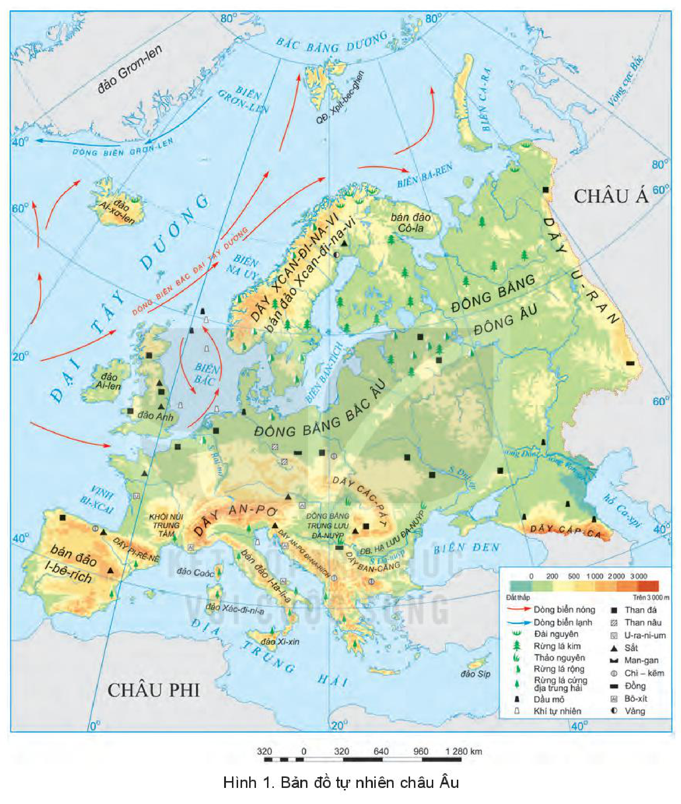
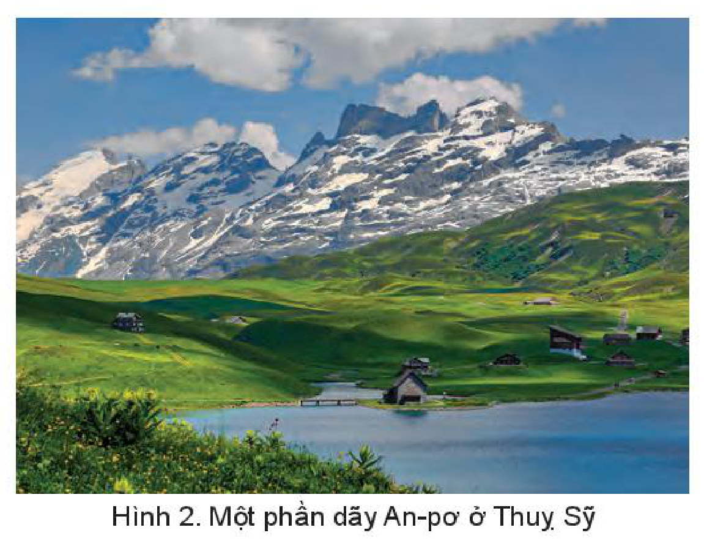
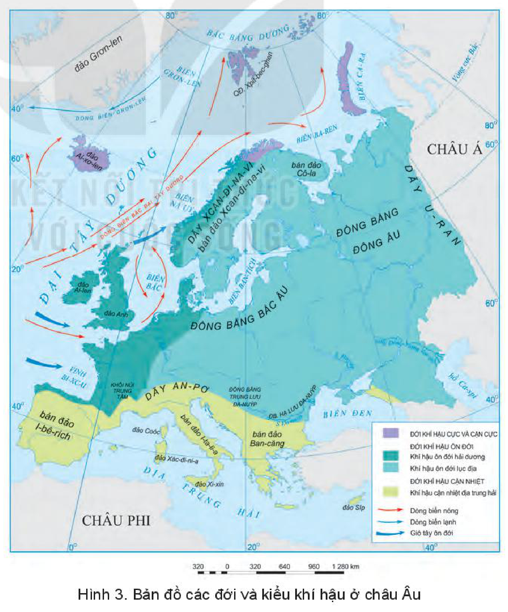
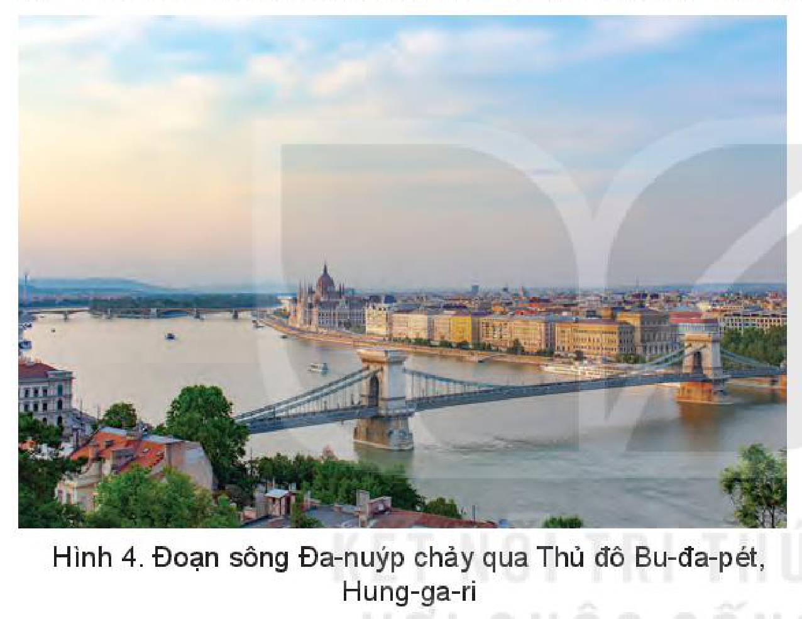
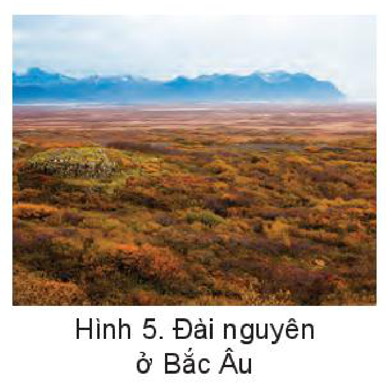
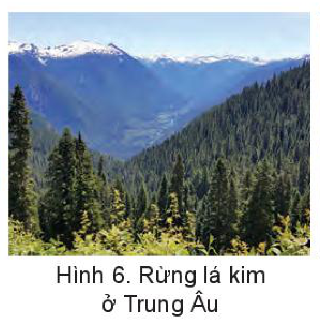
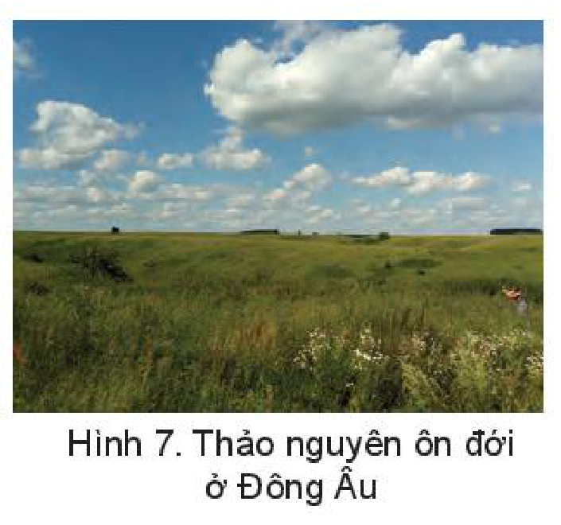
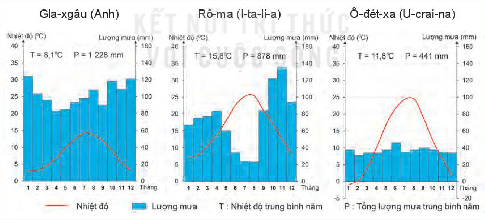

<!-- pdf:97 -->

# BÀI 1: VỊ TRÍ ĐỊA LÍ, ĐẶC ĐIỂM TỰ NHIÊN CHÂU ÂU

## 🎯 Học xong bài này, em sẽ:

- Trình bày được đặc điểm vị trí địa lí, hình dạng và kích thước châu Âu.
- Phân tích được đặc điểm các khu vực địa hình chính của châu Âu; đặc điểm phân hoá khí hậu; xác định được trên bản đồ các sông lớn (Rai-nơ, Đa-nuýp, Von-ga); các đới thiên nhiên ở châu Âu.

## 🔴 Mở đầu

Châu Âu là nơi được biết đến có thiên nhiên phong phú, đa dạng. Bài học này sẽ giúp các em có hiểu biết về đặc điểm tự nhiên của châu Âu.

Em hãy kể một số thông tin mà em biết về châu Âu.

## 1. Vị trí địa lí, hình dạng, kích thước

Châu Âu là bộ phận phía tây của lục địa Á – Âu, ngăn cách với châu Á bởi dãy U-ran. Phần lớn lãnh thổ châu Âu nằm giữa các vĩ tuyến 36°B và 71°B, chủ yếu thuộc đới ôn hoà của bán cầu Bắc.

Diện tích châu Âu trên 10 triệu km²; so với các châu lục khác, chỉ lớn hơn châu Đại Dương. Đường bờ biển bị cắt xẻ mạnh, tạo thành nhiều bán đảo, biển, vũng vịnh ăn sâu vào đất liền.

> ❓ Đọc thông tin trong mục 1 và quan sát hình 1, hãy:
> - Trình bày đặc điểm vị trí địa lí, hình dạng và kích thước châu Âu.
> - Kể tên các biển và đại dương bao quanh châu Âu.

<!-- pdf:98 -->

## 2. Đặc điểm tự nhiên

### a) Địa hình

*Hình 1. Bản đồ tự nhiên châu Âu*

Châu Âu có hai khu vực địa hình: đồng bằng và miền núi.

- Khu vực đồng bằng chiếm 2/3 diện tích châu lục, gồm: đồng bằng Bắc Âu, đồng bằng Đông Âu, các đồng bằng trung lưu và hạ lưu Đa-nuýp,... Các đồng bằng được hình thành do nhiều nguồn gốc khác nhau nên có đặc điểm địa hình khác nhau.

> 💡 **Em có biết?**
>
> Đồng bằng Đông Âu gồm các vùng đất cao, đồi thoải xen với các vùng đất thấp hoặc thung lũng rộng.
>
> Đồng bằng trung lưu Đa-nuýp tương đối thấp và bằng phẳng (trừ phía tây).

<!-- pdf:99 -->

- Khu vực miền núi, bao gồm:
  + Địa hình núi già phân bố ở phía bắc và trung tâm châu lục, gồm các dãy: Xcan-đi-na-vi, U-ran,... Phần lớn là các núi có độ cao trung bình hoặc thấp.
  + Địa hình núi trẻ phân bố chủ yếu ở phía nam, gồm các dãy An-pơ, Các-pát, Ban-căng,... Phần lớn là các núi có độ cao trung bình dưới 2 000 m. Dãy An-pơ cao và đồ sộ nhất châu Âu, có nhiều đỉnh trên 4 000 m.

*Hình 2. Một phần dãy An-pơ ở Thuỵ Sỹ*

> ❓ Đọc thông tin trong mục a và quan sát hình 1, hãy:
> - Phân tích đặc điểm các khu vực địa hình chính ở châu Âu.
> - Xác định vị trí một số dãy núi và đồng bằng lớn ở châu Âu.

### b) Khí hậu

Khí hậu châu Âu có sự phân hoá từ bắc xuống nam và từ tây sang đông, tạo nên các đới và kiểu khí hậu khác nhau.

- Đới khí hậu cực và cận cực quanh năm giá lạnh, lượng mưa trung bình năm dưới 500 mm.

- Đới khí hậu ôn đới có sự phân hoá thành các kiểu khí hậu khác nhau:

<!-- term: Khí hậu ôn đới hải dương -->
  + Khí hậu ôn đới hải dương: ôn hoà, mùa đông tương đối ấm, mùa hạ mát; có mưa quanh năm, lượng mưa trung bình năm từ 800 – 1 000 mm trở lên.
<!-- ocr-ok: đã đối chiếu ảnh trang gốc PDF 99 (trang in 98), cột chữ hẹp bên trái bản đồ Hình 3 bị OCR trộn chữ bản đồ -->

*Hình 3. Bản đồ các đới và kiểu khí hậu ở châu Âu*

<!-- pdf:100 -->

<!-- term: Khí hậu ôn đới lục địa -->
  + Khí hậu ôn đới lục địa: mùa đông lạnh và khô, mùa hạ nóng và ẩm. Lượng mưa nhỏ, trung bình năm chỉ trên dưới 500 mm, mưa chủ yếu vào mùa hạ.

<!-- term: Khí hậu cận nhiệt địa trung hải -->
- Đới khí hậu cận nhiệt ở châu Âu chỉ có một kiểu là cận nhiệt địa trung hải: mùa hạ nóng và khô, thời tiết ổn định; mùa đông ấm và mưa nhiều hơn. Lượng mưa trung bình năm khoảng 500 – 700 mm.

Ngoài ra, khí hậu ở các vùng núi có sự phân hoá theo độ cao.

> ❓ Dựa vào thông tin trong mục b và hình 3, hãy trình bày đặc điểm phân hoá khí hậu ở châu Âu.

### c) Sông ngòi

Sông ngòi châu Âu có lượng nước dồi dào, chế độ nước rất phức tạp do được cung cấp nước từ nhiều nguồn: mưa, tuyết tan, băng hà núi cao,... Hệ thống kênh đào ở châu Âu rất phát triển, nhờ đó giao thông đường sông thuận lợi.

*Hình 4. Đoạn sông Đa-nuýp chảy qua Thủ đô Bu-đa-pét, Hung-ga-ri*

> 💡 **Em có biết?**
>
> Sông Von-ga (3 690 km) là con sông dài nhất và nhiều nước nhất châu Âu, bắt nguồn từ vùng đồi Van-đai và đổ vào hồ Ca-xpi. Sông Đa-nuýp (2 850 km) là con sông dài thứ hai, bắt nguồn từ sườn đông dãy núi Rừng Đen thuộc lãnh thổ Đức và đổ vào Biển Đen. Sông Rai-nơ dài 1 320 km, bắt nguồn từ hồ trên dãy An-pơ thuộc Thuỵ Sỹ và đổ vào Biển Bắc.

> ❓ Hãy xác định vị trí các sông: Von-ga, Đa-nuýp, Rai-nơ trên bản đồ hình 1.

### d) Đới thiên nhiên

<!-- term: Đới lạnh ở châu Âu -->
- Đới lạnh ở châu Âu có khí hậu cực và cận cực; chỉ chiếm một phần nhỏ diện tích lãnh thổ, bao gồm các đảo, quần đảo ở Bắc Băng Dương và một dải hẹp ở phía bắc châu lục. Mặt đất bị tuyết bao phủ gần như quanh năm. Giới sinh vật nghèo nàn: thực vật chủ yếu là rêu, địa y và cây bụi; động vật có một số loài chịu được lạnh.

<!-- term: Đới ôn hoà ở châu Âu -->
- Đới ôn hoà ở châu Âu có khí hậu ôn đới và khí hậu cận nhiệt.

Phần lớn lãnh thổ châu Âu nằm trong đới ôn hoà. Thiên nhiên thay đổi theo sự thay đổi của nhiệt độ và lượng mưa.

Phía bắc có khí hậu lạnh và ẩm ướt. Thực vật chủ yếu là rừng lá kim, nhóm đất điển hình là đất pốt dôn.

Phía tây khí hậu có mùa đông ấm, mùa hạ mát, mưa nhiều nên thảm thực vật chủ yếu là rừng lá rộng. Vào sâu trong lục địa, lượng mưa giảm dần, mùa đông lạnh, mùa hạ nóng, rừng hỗn hợp phát triển. Nhóm đất điển hình là đất rừng nâu xám.

<!-- pdf:101 -->

Phía đông nam, khí hậu mang tính chất lục địa, mưa ít. Thảm thực vật chủ yếu là thảo nguyên ôn đới. Nhóm đất điển hình là đất đen thảo nguyên ôn đới.

Phía nam có khí hậu cận nhiệt địa trung hải. Rừng và cây bụi lá cứng phát triển.

Động vật ở đới ôn hoà đa dạng cả về số loài và số lượng cá thể trong mỗi loài. Ở đây có các loài thú lớn như gấu nâu, chồn, linh miêu, chó sói, sơn dương,...; cùng nhiều loài bò sát và chim.

*Hình 5. Đài nguyên ở Bắc Âu*
<!-- ocr-ok: đã đối chiếu ảnh trang gốc PDF 101 (trang in 100), chú thích 3 ảnh ngang hàng bị OCR ghép dòng và đọc nhầm dấu -->

*Hình 6. Rừng lá kim ở Trung Âu*

*Hình 7. Thảo nguyên ôn đới ở Đông Âu*

> ❓ Đọc thông tin và quan sát các hình ảnh trong mục d, hãy trình bày đặc điểm các đới thiên nhiên ở châu Âu.

## ✏️ Luyện tập – Vận dụng

- Xác định mỗi biểu đồ nhiệt độ và lượng mưa dưới đây thuộc kiểu khí hậu nào ở châu Âu. Giải thích vì sao.

- Sưu tầm những hình ảnh đẹp về thiên nhiên châu Âu (núi, sông, hồ, rừng,...) và viết bài (khoảng 15 dòng) giới thiệu về những cảnh đẹp đó.

## 📷 Danh sách hình trong bài

| Mã hình | Trang PDF | Trang sách | Chú thích |
| --- | :---: | :---: | --- |
| H7-lich_su_va_dia_ly-dl-b01-01 | 98 | 97 | Hình 1. Bản đồ tự nhiên châu Âu |
| H7-lich_su_va_dia_ly-dl-b01-02 | 99 | 98 | Hình 2. Một phần dãy An-pơ ở Thuỵ Sỹ |
| H7-lich_su_va_dia_ly-dl-b01-03 | 99 | 98 | Hình 3. Bản đồ các đới và kiểu khí hậu ở châu Âu |
| H7-lich_su_va_dia_ly-dl-b01-04 | 100 | 99 | Hình 4. Đoạn sông Đa-nuýp chảy qua Thủ đô Bu-đa-pét, Hung-ga-ri |
| H7-lich_su_va_dia_ly-dl-b01-05 | 101 | 100 | Hình 5. Đài nguyên ở Bắc Âu |
| H7-lich_su_va_dia_ly-dl-b01-06 | 101 | 100 | Hình 6. Rừng lá kim ở Trung Âu |
| H7-lich_su_va_dia_ly-dl-b01-07 | 101 | 100 | Hình 7. Thảo nguyên ôn đới ở Đông Âu |
| H7-lich_su_va_dia_ly-dl-b01-08 | 101 | 100 | (sách không đánh số, biểu đồ nhiệt độ và lượng mưa của Gla-xgâu, Rô-ma, Ô-đét-xa) |
