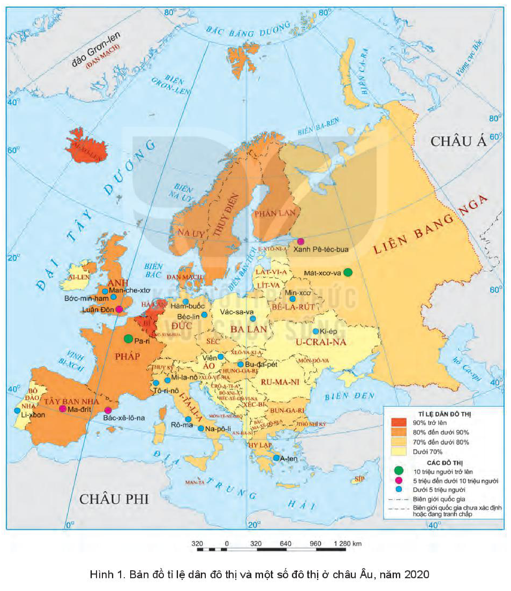

<!-- pdf:102 -->

# BÀI 2: ĐẶC ĐIỂM DÂN CƯ, XÃ HỘI CHÂU ÂU

## 🎯 Học xong bài này, em sẽ:

- Trình bày được đặc điểm của cơ cấu dân cư, di cư và đô thị hoá ở châu Âu.

## 🔴 Mở đầu

Dân cư và xã hội châu Âu có những nét khác biệt so với các châu lục khác. Điều này tác động tới nhiều mặt đời sống của người dân châu Âu.

Hãy nêu một số hiểu biết của em về dân cư, xã hội ở châu Âu.

## 1. Cơ cấu dân cư

Số dân của châu Âu năm 2020 khoảng 747 triệu người (bao gồm cả số dân Liên bang Nga), đứng thứ tư trên thế giới (sau châu Á, châu Phi và châu Mỹ).

<!-- term: Cơ cấu dân số già -->
Châu Âu có cơ cấu dân số già. So với trung bình thế giới, tỉ lệ người dưới 15 tuổi thấp và có xu hướng giảm, trong khi tỉ lệ người từ 65 tuổi trở lên cao và có xu hướng tăng.

Bảng 1. CƠ CẤU DÂN SỐ THEO NHÓM TUỔI Ở CHÂU ÂU NĂM 1990 VÀ NĂM 2020 (%)

| Năm \ Nhóm tuổi | 0 – 14 tuổi | 15 – 64 tuổi | Từ 65 tuổi trở lên |
| :---: | :---: | :---: | :---: |
| 1990 | 20,5 | 66,9 | 12,6 |
| 2020 | 16,1 | 64,8 | 19,1 |

Hậu quả của cơ cấu dân số già là sự thiếu hụt lao động. Để giải quyết vấn đề đó, các nước châu Âu đã tiến hành nhiều biện pháp, như: thu hút lao động từ bên ngoài, khuyến khích sinh đẻ, kéo dài độ tuổi lao động,...

Một số quốc gia ở châu Âu vẫn còn tình trạng mất cân bằng giới tính.

Bảng 2. CƠ CẤU DÂN SỐ THEO GIỚI TÍNH CỦA CHÂU ÂU GIAI ĐOẠN 1990 – 2020 (%)

| Giới tính \ Năm | 1990 | 2000 | 2010 | 2020 |
| --- | :---: | :---: | :---: | :---: |
| Nam | 48,1 | 48,2 | 48,2 | 48,3 |
| Nữ | 51,9 | 51,8 | 51,8 | 51,7 |

<!-- pdf:103 -->

Dân cư châu Âu có trình độ học vấn cao, điều này tác động rõ rệt đến năng suất lao động. Năm 2020, số năm đi học bình quân của người trên 25 tuổi ở châu Âu là 11,8 năm, thuộc hàng cao nhất thế giới.

> ❓ Đọc thông tin và khai thác bảng số liệu 1, 2 trong mục 1, hãy nêu đặc điểm cơ cấu dân cư ở châu Âu.

## 2. Đô thị hoá

*Hình 1. Bản đồ tỉ lệ dân đô thị và một số đô thị ở châu Âu, năm 2020*

<!-- pdf:104 -->

Từ thế kỉ XIX, quá trình công nghiệp hoá khiến số dân đô thị của châu Âu tăng nhanh, cùng với đó là sự xuất hiện các đô thị lớn.

<!-- term: Dải đô thị -->
Ở các vùng công nghiệp lâu đời, nhiều đô thị mở rộng và nối liền với nhau tạo thành các dải đô thị, cụm đô thị xuyên biên giới như dải đô thị kéo dài từ Li-vơ-pun (Anh) đến Côn (Đức).

<!-- term: Đô thị hoá nông thôn -->
Việc phát triển sản xuất công nghiệp ở vùng nông thôn cùng với việc mở rộng ngoại ô của các đô thị đã thúc đẩy nhanh quá trình đô thị hoá nông thôn, tạo nên các đô thị vệ tinh.

Châu Âu là châu lục có mức độ đô thị hoá cao, năm 2020 khoảng 75% số dân châu Âu sống ở khu vực đô thị.

> ❓ 1. Đọc thông tin trong mục 2, cho biết các đặc điểm của đô thị hoá ở châu Âu.
> 2. Dựa vào hình 1, hãy kể tên các đô thị từ 5 triệu người trở lên ở châu Âu.

## 3. Di cư

Người Ơ-rô-pê-ô-it sinh sống trên lãnh thổ châu Âu từ rất sớm. Nhập cư là một trong những nguyên nhân quan trọng khiến châu Âu trở thành một châu lục đông dân từ thời cổ đại.

Từ cuối thế kỉ XX đến đầu thế kỉ XXI, số lượng người từ các châu lục, khu vực khác (châu Phi, Trung Đông,...) nhập cư vào châu Âu ngày càng nhiều. Theo Liên hợp quốc, riêng năm 2019, châu Âu đã tiếp nhận khoảng 82 triệu người di cư quốc tế.

Đồng thời, do nhu cầu về nguồn lao động của các quốc gia cũng như nhu cầu tìm kiếm cơ hội việc làm của người dân nên việc di cư trong nội bộ châu Âu ngày càng gia tăng và có ảnh hưởng đến dân số của các quốc gia.

> ❓ Đọc thông tin trong mục 3, cho biết đặc điểm di cư ở châu Âu.

## ✏️ Luyện tập – Vận dụng

- Dựa vào bảng 1 trang 101, vẽ biểu đồ tròn thể hiện cơ cấu dân số theo nhóm tuổi ở châu Âu năm 1990 và năm 2020. Nêu nhận xét.
- Tìm hiểu về ảnh hưởng của cơ cấu dân số già đến sự phát triển kinh tế – xã hội ở châu Âu.

## 📷 Danh sách hình trong bài

| Mã hình | Trang PDF | Trang sách | Chú thích |
| --- | :---: | :---: | --- |
| H7-lich_su_va_dia_ly-dl-b02-01 | 103 | 102 | Hình 1. Bản đồ tỉ lệ dân đô thị và một số đô thị ở châu Âu, năm 2020 |
