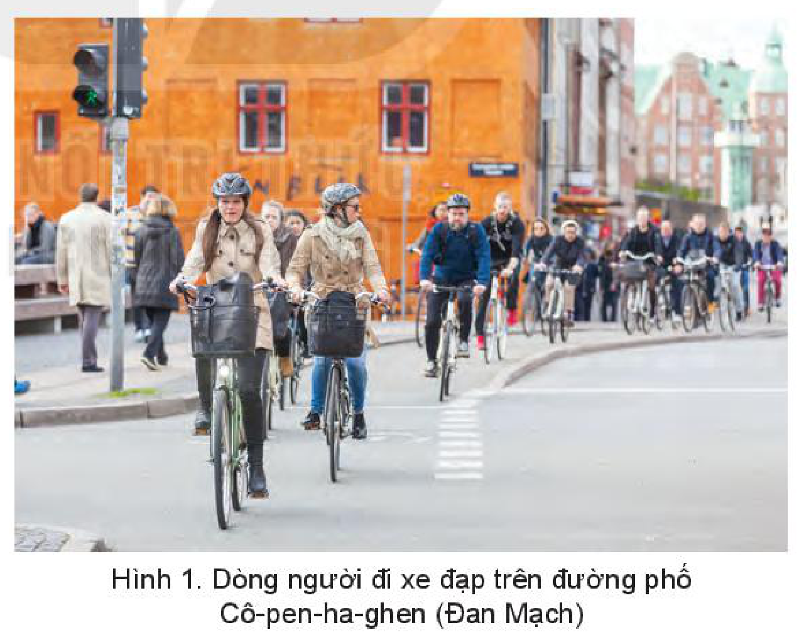
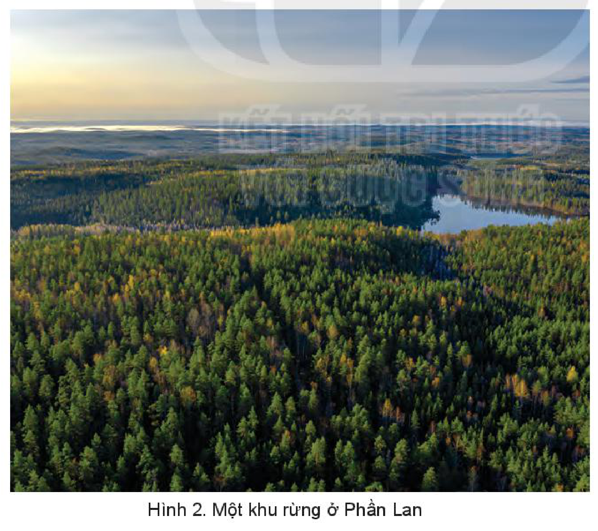
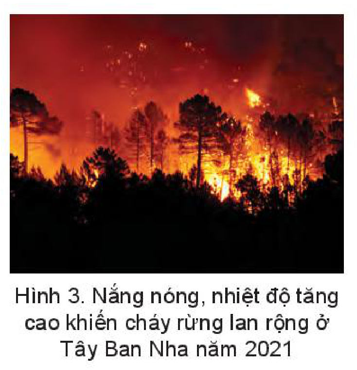

<!-- pdf:105 -->

# BÀI 3: KHAI THÁC, SỬ DỤNG VÀ BẢO VỆ THIÊN NHIÊN Ở CHÂU ÂU

## 🎯 Học xong bài này, em sẽ:

- Lựa chọn và trình bày được một vấn đề bảo vệ môi trường ở châu Âu.

## 🔴 Mở đầu

Trong quá trình khai thác và sử dụng tài nguyên thiên nhiên, các quốc gia châu Âu phải đối mặt với nhiều vấn đề về môi trường.

Dựa vào hiểu biết của bản thân, hãy nêu một số vấn đề về môi trường được các nước châu Âu quan tâm.

## 1. Vấn đề bảo vệ môi trường

### a) Bảo vệ môi trường không khí

Hoạt động sản xuất công nghiệp, tiêu thụ năng lượng, vận tải đường bộ là những nguyên nhân chính gây ô nhiễm không khí ở châu Âu.

<!-- term: Bảo vệ môi trường không khí ở châu Âu -->
Để cải thiện chất lượng không khí, các quốc gia châu Âu đã thực hiện một số giải pháp:
- Kiểm soát lượng khí thải trong khí quyển.
- Đánh thuế các-bon, thuế tiêu thụ đặc biệt đối với các nhiên liệu có hàm lượng các-bon cao như dầu mỏ và khí tự nhiên, góp phần giảm phát thải khí CO₂ vào khí quyển.
- Đầu tư phát triển công nghệ xanh, sử dụng năng lượng tái tạo để dần thay thế năng lượng hoá thạch.
- Đối với thành phố: giảm lượng xe lưu thông trong thành phố, ưu tiên giao thông công cộng, xây dựng cơ sở hạ tầng ưu tiên cho người đi xe đạp và đi bộ.

*Hình 1. Dòng người đi xe đạp trên đường phố Cô-pen-ha-ghen (Đan Mạch)*

<!-- pdf:106 -->

### b) Bảo vệ môi trường nước

<!-- term: Bảo vệ môi trường nước ở châu Âu -->
Trước đây, môi trường nước ở châu Âu bị ô nhiễm do các chất thải từ hoạt động sản xuất và sinh hoạt. Hiện nay, nhờ các biện pháp bảo vệ nên môi trường nước đã được cải thiện rõ rệt:
- Tăng cường kiểm soát đầu ra của nguồn rác thải, hoá chất độc hại từ sản xuất nông nghiệp.
- Đảm bảo việc xử lí rác thải, nước thải từ sinh hoạt và sản xuất công nghiệp trước khi thải ra môi trường.
- Kiểm soát và xử lí các nguồn gây ô nhiễm từ hoạt động kinh tế biển (vận tải, du lịch, đánh bắt hải sản,...).
- Nâng cao ý thức của người dân trong việc bảo vệ môi trường nước,...

> ❓ Dựa vào thông tin và hình ảnh trong mục 1, hãy trình bày vấn đề bảo vệ môi trường ở châu Âu.

## 2. Vấn đề bảo vệ đa dạng sinh học

Các quốc gia châu Âu rất chú trọng bảo vệ sự đa dạng sinh học. Các hệ sinh thái trên cạn và dưới nước ở châu Âu được bảo tồn tương đối tốt.

<!-- term: Bảo vệ đa dạng sinh học ở châu Âu -->
Để giữ gìn đa dạng sinh học, các nước châu Âu đã ban hành nhiều chính sách bảo vệ và phát triển rừng bền vững, giảm thiểu các nguyên nhân gây ô nhiễm môi trường nước và môi trường đất.

*Hình 2. Một khu rừng ở Phần Lan*

> 💡 **Em có biết?**
>
> Các hệ sinh thái và đa dạng sinh học có tầm quan trọng đặc biệt đối với sức khoẻ con người và ổn định kinh tế – xã hội. Tháng 10 năm 2020, các Bộ trưởng môi trường của Liên minh châu Âu đã thông qua chiến lược đa dạng sinh học, nhằm bảo vệ các hệ sinh thái. Theo đó, ít nhất 30% khu vực tiếp giáp biển sẽ được đưa vào diện bảo vệ đặc biệt.

> ❓ Dựa vào thông tin và hình ảnh trong mục 2, hãy trình bày vấn đề bảo vệ đa dạng sinh học ở châu Âu.

<!-- pdf:107 -->

## 3. Vấn đề ứng phó với biến đổi khí hậu

Trong những năm gần đây, châu Âu bị ảnh hưởng liên tiếp bởi các hiện tượng thời tiết cực đoan, như các đợt nắng nóng bất thường xảy ra ở các nước Bắc Âu, nắng nóng cũng đã gây ra những trận cháy rừng tàn khốc ở một số quốc gia Nam Âu; mưa lũ gây hậu quả nghiêm trọng tại một số quốc gia ở Tây và Trung Âu.

*Hình 3. Nắng nóng, nhiệt độ tăng cao khiến cháy rừng lan rộng ở Tây Ban Nha năm 2021*
<!-- ocr-ok: đã đối chiếu ảnh trang gốc PDF 107 (trang in 106), chú thích Hình 3 ở cột trái bị OCR bỏ sót -->

<!-- term: Ứng phó với biến đổi khí hậu ở châu Âu -->
Để ứng phó với biến đổi khí hậu, các nước châu Âu đã có nhiều hành động cụ thể như:
- Trồng rừng và bảo vệ rừng: Rừng đóng vai trò quan trọng trong việc giảm thiểu tác động của biến đổi khí hậu vì rừng hấp thụ khí CO₂ gây hiệu ứng nhà kính. Rừng còn làm giảm nguy cơ lũ lụt và giảm thiểu hạn hán.
- Hạn chế sử dụng nhiên liệu hoá thạch ở mức tối đa và phát triển các nguồn năng lượng tái tạo, thân thiện với môi trường như năng lượng mặt trời, gió, sóng biển, thuỷ triều,...

> 💡 **Em có biết?**
>
> Mục tiêu chung của các nước châu Âu là giảm 55% lượng khí thải gây hiệu ứng nhà kính vào năm 2030. Các quốc gia châu Âu giám sát và bảo vệ nghiêm ngặt các khu rừng nguyên sinh, những khu rừng này có vai trò như lá chắn tự nhiên chống lại biến đổi khí hậu.

> ❓ Đọc thông tin và quan sát hình 3 trong mục 3, hãy trình bày vấn đề ứng phó với biến đổi khí hậu ở châu Âu.

## ✏️ Luyện tập – Vận dụng

- Hoàn thành bảng theo mẫu sau vào vở:

VẤN ĐỀ BẢO VỆ MÔI TRƯỜNG Ở CHÂU ÂU

| Loại môi trường | Biện pháp bảo vệ |
| --- | --- |
| – Môi trường không khí | |
| – Môi trường nước | |

- Tìm hiểu về việc khai thác, sử dụng tài nguyên thiên nhiên và bảo vệ môi trường ở một quốc gia châu Âu.

## 📷 Danh sách hình trong bài

| Mã hình | Trang PDF | Trang sách | Chú thích |
| --- | :---: | :---: | --- |
| H7-lich_su_va_dia_ly-dl-b03-01 | 105 | 104 | Hình 1. Dòng người đi xe đạp trên đường phố Cô-pen-ha-ghen (Đan Mạch) |
| H7-lich_su_va_dia_ly-dl-b03-02 | 106 | 105 | Hình 2. Một khu rừng ở Phần Lan |
| H7-lich_su_va_dia_ly-dl-b03-03 | 107 | 106 | Hình 3. Nắng nóng, nhiệt độ tăng cao khiến cháy rừng lan rộng ở Tây Ban Nha năm 2021 |
