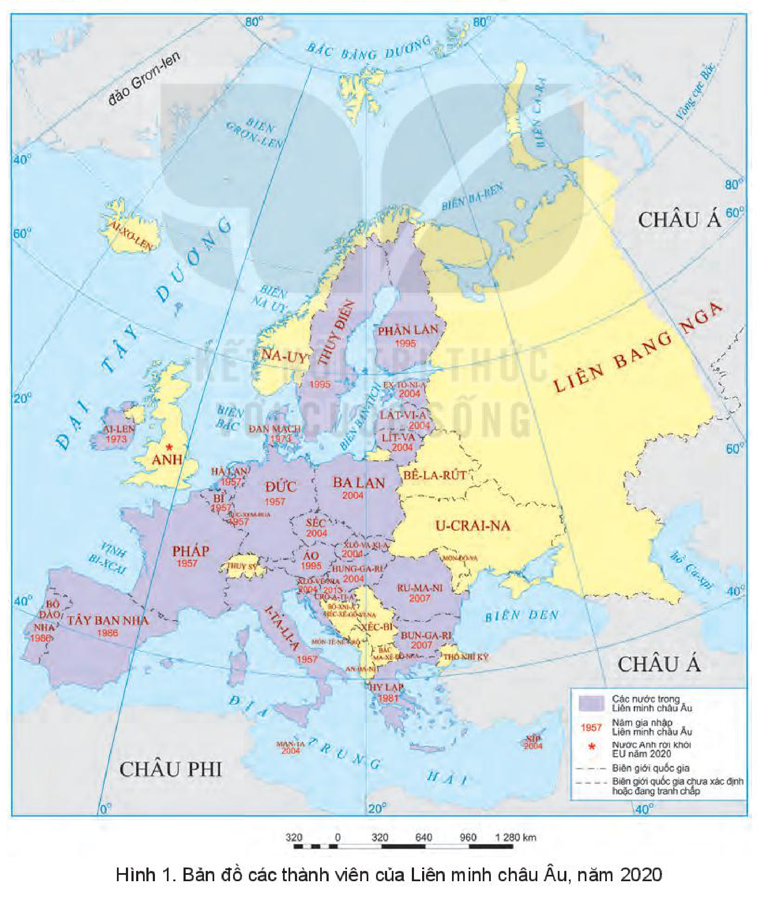

<!-- pdf:108 -->

# BÀI 4: LIÊN MINH CHÂU ÂU

## 🎯 Học xong bài này, em sẽ:

- Nêu được dẫn chứng về Liên minh châu Âu (EU) như một trong bốn trung tâm kinh tế lớn trên thế giới.

## 🔴 Mở đầu

Liên minh châu Âu là tổ chức kinh tế lớn trên thế giới, có tầm ảnh hưởng đối với toàn cầu.

Hãy kể tên một số quốc gia thành viên của Liên minh châu Âu.

## 1. Khái quát về Liên minh châu Âu (EU)

*Hình 1. Bản đồ các thành viên của Liên minh châu Âu, năm 2020*

<!-- pdf:109 -->

*Hình 2. Trụ sở EU ở Brúc-xen (Bỉ)*

<!-- term: Liên minh châu Âu -->
<!-- term: Đồng Ơ-rô -->
Tiền thân của Liên minh châu Âu là Cộng đồng Kinh tế châu Âu (năm 1957). Liên minh châu Âu (gọi tắt là EU) được thành lập chính thức vào ngày 1 tháng 11 năm 1993. Năm 2020, Liên minh châu Âu có 27 quốc gia thành viên với số dân khoảng 447 triệu người. Trụ sở của EU được đặt ở Brúc-xen (Bỉ). EU đã thiết lập một thị trường chung và có hệ thống tiền tệ chung (đồng Ơ-rô).

> ❓ Đọc thông tin trong mục 1 và quan sát hình 1, hãy kể tên các nước thành viên của EU.

> 💡 **Em có biết?**
>
> EU là nơi sản xuất khoảng 1/2 số máy bay trên thế giới; với thương hiệu nổi tiếng là E-bớt.

## 2. Liên minh châu Âu – một trung tâm kinh tế lớn trên thế giới

<!-- term: Thị trường kinh tế duy nhất của EU -->
Ngay từ khi mới thành lập, EU đã đặt ra mục tiêu trọng tâm là thiết lập một thị trường kinh tế duy nhất, bao gồm lãnh thổ của tất cả các quốc gia thành viên. EU có 3/7 nước công nghiệp hàng đầu thế giới (nhóm G7).

Là trung tâm trao đổi hàng hoá và dịch vụ lớn nhất thế giới, EU chiếm hơn 31% trị giá xuất khẩu hàng hoá và dịch vụ của thế giới (năm 2020).

EU là đối tác thương mại hàng đầu của 80 quốc gia, trong đó có Việt Nam.

EU là trung tâm tài chính lớn trên thế giới. Các ngân hàng nổi tiếng, uy tín ở EU có tác động lớn đến hệ thống tài chính và tiền tệ của thế giới.

GDP VÀ GDP/NGƯỜI CỦA CÁC TRUNG TÂM KINH TẾ LỚN TRÊN THẾ GIỚI NĂM 2020

| Chỉ số | EU | Hoa Kỳ | Nhật Bản | Trung Quốc |
| --- | :---: | :---: | :---: | :---: |
| GDP *(tỉ USD)* | 15 276 | 20 937 | 4 975 | 14 723 |
| GDP/người *(USD/năm)* | 34 115 | 63 544 | 39 539 | 10 500 |

> ❓ Dựa vào thông tin và bảng số liệu trong mục 2, nêu dẫn chứng để thấy EU là một trong bốn trung tâm kinh tế lớn trên thế giới.

## ✏️ Luyện tập – Vận dụng

- Cho biết GDP của thế giới năm 2020 là 84 705,4 tỉ USD, hãy vẽ biểu đồ tròn thể hiện tỉ lệ GDP của EU trong tổng GDP của thế giới.
- Thu thập thông tin về mối quan hệ thương mại giữa Việt Nam và EU.

## 📷 Danh sách hình trong bài

| Mã hình | Trang PDF | Trang sách | Chú thích |
| --- | :---: | :---: | --- |
| H7-lich_su_va_dia_ly-dl-b04-01 | 108 | 107 | Hình 1. Bản đồ các thành viên của Liên minh châu Âu, năm 2020 |
| H7-lich_su_va_dia_ly-dl-b04-02 | 109 | 108 | Hình 2. Trụ sở EU ở Brúc-xen (Bỉ) |
