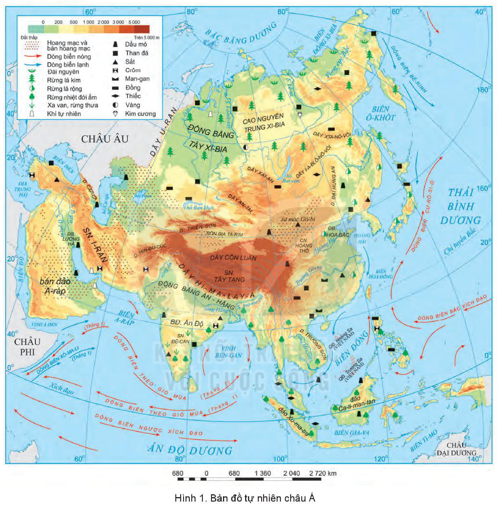
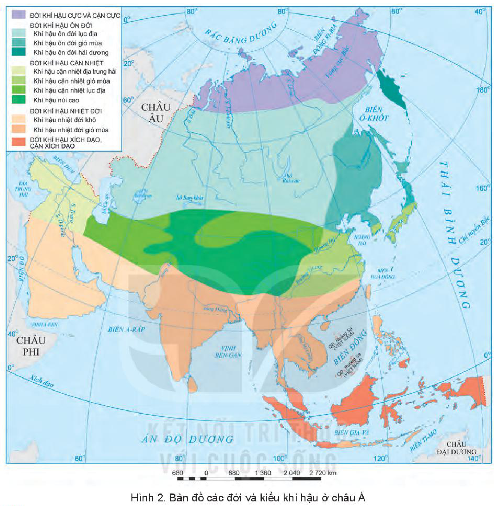
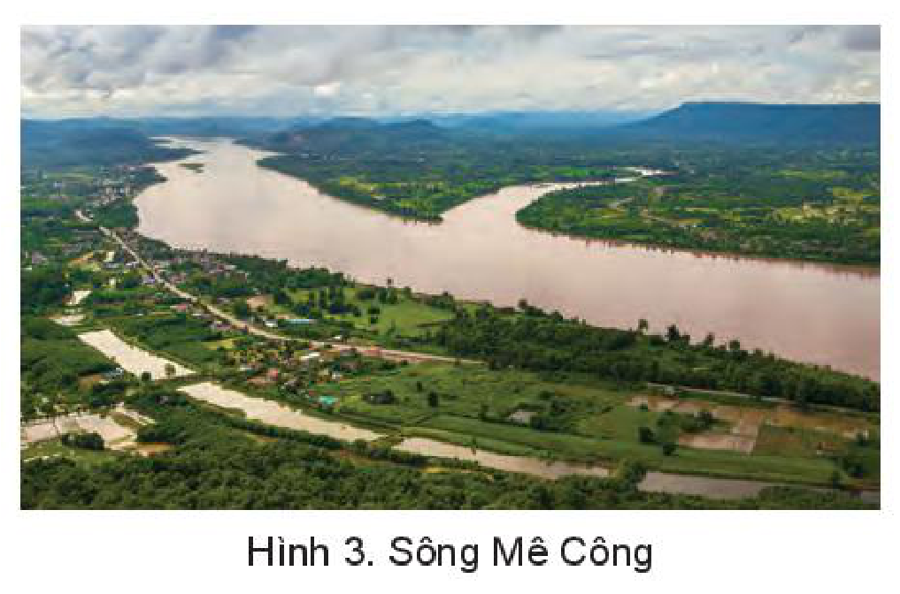
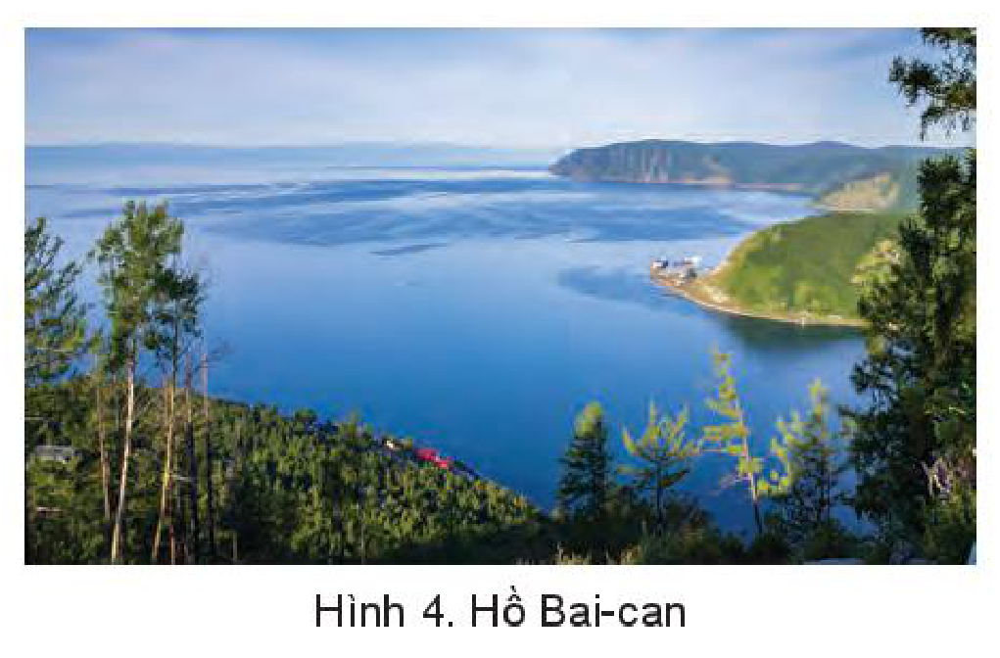
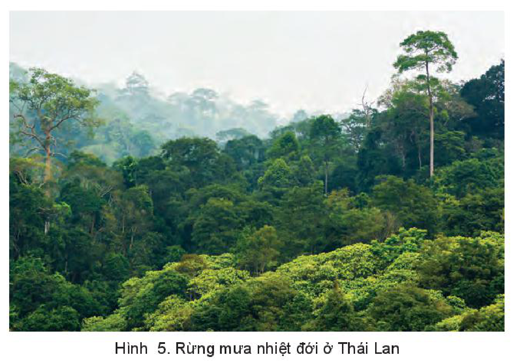

<!-- pdf:110 -->

# BÀI 5: VỊ TRÍ ĐỊA LÍ, ĐẶC ĐIỂM TỰ NHIÊN CHÂU Á

## 🎯 Học xong bài này, em sẽ:

- Trình bày được đặc điểm vị trí địa lí, hình dạng và kích thước châu Á.
- Trình bày được một trong những đặc điểm thiên nhiên châu Á, ý nghĩa của đặc điểm này đối với việc sử dụng và bảo vệ tự nhiên.
- Xác định được trên bản đồ các khu vực địa hình và các khoáng sản chính ở châu Á.

## 🔴 Mở đầu

Châu Á là một bộ phận của lục địa Á – Âu. Châu Á có diện tích rộng lớn, tiếp giáp nhiều châu lục và đại dương, có sự đa dạng về đặc điểm tự nhiên.

Hãy chia sẻ một số thông tin em biết về châu Á.

## 1. Vị trí địa lí, hình dạng và kích thước

Châu Á là châu lục rộng lớn nhất thế giới, diện tích (kể cả các đảo) khoảng 44,4 triệu km², tiếp giáp với hai châu lục và ba đại dương.

Châu Á có dạng hình khối rõ rệt. Theo chiều bắc – nam, châu Á kéo dài từ trên vòng cực Bắc xuống phía nam Xích đạo, khoảng 8 500 km; theo chiều đông – tây, nơi rộng nhất trải từ ven Địa Trung Hải tới ven Thái Bình Dương, khoảng 9 200 km.

> 💡 **Em có biết?**
>
> Ca-li-man-tan là đảo lớn nhất châu Á và lớn thứ ba thế giới, thuộc lãnh thổ các nước In-đô-nê-xi-a, Bru-nây và Ma-lai-xi-a, có diện tích hơn 740 nghìn km².

> ❓ Dựa vào thông tin trong mục 1 và hình 1, hãy:
> - Xác định vị trí châu Á trên bản đồ.
> - Trình bày đặc điểm vị trí địa lí, hình dạng và kích thước châu Á.

<!-- pdf:111 -->

## 2. Đặc điểm tự nhiên

### a) Địa hình

*Hình 1. Bản đồ tự nhiên châu Á*

- Địa hình châu Á rất đa dạng, gồm: núi và sơn nguyên cao, đồ sộ; cao nguyên và đồng bằng rộng lớn,... Bề mặt địa hình bị chia cắt mạnh.

- Địa hình chia thành các khu vực:
  + Ở trung tâm là vùng núi cao, đồ sộ và hiểm trở nhất thế giới. Một số dãy núi điển hình: Thiên Sơn, Côn Luân, Hi-ma-lay-a.
  + Phía bắc là các đồng bằng và cao nguyên thấp, bằng phẳng.

<!-- pdf:112 -->

  + Phía đông thấp dần về phía biển, gồm các núi, cao nguyên và đồng bằng ven biển.
  + Phía nam và tây nam gồm các dãy núi trẻ, các sơn nguyên và đồng bằng nằm xen kẽ.

Địa hình núi cao và hiểm trở chiếm tỉ lệ lớn trong tổng diện tích, gây khó khăn cho giao thông, sản xuất và đời sống. Do địa hình chia cắt mạnh, nên trong quá trình khai thác, sử dụng cần lưu ý vấn đề chống xói mòn, sạt lở đất. Các khu vực cao nguyên, đồng bằng rộng lớn thuận lợi cho sản xuất và định cư.

> ❓ Đọc thông tin trong mục a và quan sát hình 1, hãy:
> - Xác định trên bản đồ các khu vực địa hình của châu Á.
> - Nêu đặc điểm địa hình của châu Á và ý nghĩa của địa hình đối với việc sử dụng và bảo vệ tự nhiên.

### b) Khoáng sản

Châu Á có nguồn khoáng sản rất phong phú với trữ lượng lớn. Các khoáng sản quan trọng nhất là: dầu mỏ, than đá, sắt, crôm và một số kim loại màu như đồng, thiếc,... Khoáng sản của châu Á phân bố rộng khắp trên lãnh thổ.

Tài nguyên khoáng sản phong phú là cơ sở để phát triển các ngành khai thác, chế biến và xuất khẩu khoáng sản; cung cấp nguyên liệu cần thiết cho các ngành công nghiệp như sản xuất ô tô, luyện kim,... Trong quá trình khai thác và sử dụng tài nguyên khoáng sản cần lưu ý sử dụng tiết kiệm, hiệu quả, hạn chế tàn phá môi trường.

> ❓ 1. Xác định trên hình 1, vị trí phân bố của một số loại khoáng sản chính ở châu Á.
> 2. Đọc thông tin mục b, cho biết tài nguyên khoáng sản có ý nghĩa như thế nào đối với các nước châu Á.

### c) Khí hậu

Khí hậu châu Á phân hoá đa dạng thành nhiều đới. Mỗi đới lại gồm nhiều kiểu khí hậu, có sự khác biệt lớn về chế độ nhiệt, gió và mưa.

Khí hậu gió mùa và khí hậu lục địa chiếm diện tích lớn nhất.

<!-- term: Khí hậu gió mùa ở châu Á -->
- Khí hậu gió mùa có ở Đông Á, Nam Á và Đông Nam Á. Vào mùa đông, gió từ lục địa thổi ra, khô, lạnh và ít mưa; vào mùa hạ, gió từ đại dương thổi vào nên nóng, ẩm và mưa nhiều. Khu vực châu Á gió mùa cũng là nơi thường xuyên chịu ảnh hưởng của các cơn bão lớn.

> 💡 **Em có biết?**
>
> Véc-khôi-an (Xi-bia, Nga) được coi là thị trấn lạnh nhất bán cầu Bắc. Nhiệt độ thấp nhất ghi nhận được là -67,8°C. Trong khi nhiệt độ cao nhất ghi nhận được là 38°C. Chênh lệch giữa nhiệt độ cao nhất và thấp nhất là 105,8°C, lớn nhất thế giới.

<!-- term: Khí hậu lục địa ở châu Á -->
- Khí hậu lục địa phân bố chủ yếu trong các vùng nội địa và ở khu vực Tây Á. Những nơi này có mùa đông khô và lạnh, mùa hạ khô và nóng. Lượng mưa rất thấp, trung bình chỉ khoảng 200 – 500 mm/năm.

Khí hậu châu Á phân hoá tạo nên sự đa dạng của các sản phẩm nông nghiệp và hình thức du lịch ở các khu vực khác nhau. Châu Á là nơi chịu nhiều tác động của thiên tai và biến đổi khí hậu. Vì vậy, cần có các biện pháp để phòng chống thiên tai và ứng phó với biến đổi khí hậu.

<!-- pdf:113 -->

*Hình 2. Bản đồ các đới và kiểu khí hậu ở châu Á*

> ❓ Dựa vào thông tin ở mục c và hình 2, hãy:
> - Nêu đặc điểm khí hậu châu Á.
> - Xác định phạm vi của các kiểu khí hậu gió mùa và các kiểu khí hậu lục địa.
> - Nêu ý nghĩa của khí hậu đối với việc sử dụng và bảo vệ tự nhiên.

### d) Sông, hồ

Mạng lưới sông ở châu Á khá phát triển với nhiều hệ thống sông lớn, tuy nhiên sông ngòi ở châu Á phân bố không đều và có chế độ nước phức tạp.

- Khu vực Bắc Á có mạng lưới sông dày. Các sông bị đóng băng vào mùa đông và có lũ vào mùa xuân.

> 💡 **Em có biết?**
>
> Dọc các sông lớn của châu Á như Hoàng Hà, Trường Giang, Hằng, Mê Công có rất đông dân cư sinh sống, do có nguồn nước dồi dào thuận tiện cho canh tác nông nghiệp. Tuy nhiên, hằng năm các sông này gây ra lũ lụt, làm thiệt hại nhiều về người và tài sản.

<!-- pdf:114 -->

- Ở các khu vực Đông Á, Đông Nam Á và Nam Á cũng có mạng lưới sông dày, nhiều sông lớn. Mùa lũ trùng với mùa mưa, mùa cạn trùng với mùa khô.

- Tây Á và Trung Á là những khu vực có khí hậu lục địa khô hạn nên mạng lưới sông ngòi kém phát triển.

Châu Á có nhiều hồ lớn như hồ Ca-xpi, Bai-can, A-ran,... được hình thành từ các đứt gãy hoặc miệng núi lửa đã tắt.

*Hình 3. Sông Mê Công*

*Hình 4. Hồ Bai-can*

> ❓ Dựa vào thông tin trong mục d và các hình 3, 4, hãy:
> - Trình bày đặc điểm sông, hồ của châu Á.
> - Kể tên một số sông lớn ở châu Á và nêu ý nghĩa của chúng đối với đời sống, sản xuất và bảo vệ tự nhiên.

### e) Đới thiên nhiên

Ở châu Á có ba đới thiên nhiên:

<!-- term: Đới lạnh ở châu Á -->
- Đới lạnh có khí hậu cực và cận cực, lạnh giá khắc nghiệt, phân bố ở một dải hẹp phía bắc. Vì vậy, thực vật nghèo thành phần loài, chủ yếu là rêu và địa y, không có cây thân gỗ. Động vật là các loài chịu được lạnh hoặc loài di cư.

<!-- term: Đới ôn hoà ở châu Á -->
- Đới ôn hoà chiếm diện tích rộng lớn, có sự phân hoá từ bắc xuống nam, từ đông sang tây:
  + Vùng Xi-bia rộng lớn ở phía bắc có khí hậu ôn đới lục địa, lạnh, khô về mùa đông; rừng lá kim phát triển mạnh trên nền đất pốt dôn. Hệ động vật tương đối phong phú.
  + Phía đông, đông nam Trung Quốc và quần đảo Nhật Bản có khí hậu cận nhiệt gió mùa, lượng mưa tương đối lớn, thảm rừng lá rộng cận nhiệt là phổ biến. Trong rừng có nhiều loài cây lấy gỗ và dược liệu quý, có chất lượng tốt.
  + Các khu vực nằm sâu trong lục địa có khí hậu khô hạn, khắc nghiệt; hình thành các cảnh quan thảo nguyên, hoang mạc, bán hoang mạc.

<!-- term: Đới nóng ở châu Á -->
- Đới nóng chủ yếu có khí hậu nhiệt đới gió mùa và khí hậu xích đạo. Thảm thực vật điển hình là rừng mưa nhiệt đới và rừng nhiệt đới gió mùa phân bố ở Đông Nam Á, Nam Á. Rừng nhiệt đới ở châu Á có thành phần loài đa dạng, nhiều loại cho gỗ tốt, nhiều loài động vật quý hiếm.

Ngày nay, trừ rừng lá kim còn phần lớn diện tích rừng, thảo nguyên ở châu Á đã bị con người khai phá, chuyển thành đất nông nghiệp, các khu dân cư và khu công nghiệp. Rừng tự nhiên còn lại rất ít, nhiều loài động, thực vật bị suy giảm nghiêm trọng về số lượng. Vì vậy, việc bảo vệ, phục hồi rừng là nhiệm vụ rất quan trọng của các quốc gia ở châu Á.

<!-- pdf:115 -->

> 💡 **Em có biết?**

<!-- term: Rừng mưa nhiệt đới ở châu Á -->
> Rừng mưa nhiệt đới ở châu Á phát triển trong các khu vực có lượng mưa, độ ẩm lớn, phân bố đều trong các tháng. Rừng mưa nhiệt đới châu Á phân bố ở đồng bằng hạ lưu sông Hằng, Mi-an-ma, Việt Nam, quần đảo Mã Lai,... Dưới rừng hình thành đất feralit đỏ vàng.

*Hình 5. Rừng mưa nhiệt đới ở Thái Lan*

> ❓ Dựa vào thông tin và hình ảnh trong mục e, hãy:
> - Trình bày đặc điểm các đới thiên nhiên ở châu Á.
> - Nêu vấn đề cần lưu ý trong sử dụng và bảo vệ tự nhiên ở châu Á.

## ✏️ Luyện tập – Vận dụng

- Trình bày một trong những đặc điểm thiên nhiên châu Á và ý nghĩa của đặc điểm đó với việc sử dụng và bảo vệ tự nhiên.
- Tìm hiểu và trình bày về khí hậu nhiệt đới gió mùa ở nước ta. Khí hậu gió mùa ảnh hưởng như thế nào đến đời sống và sản xuất ở địa phương em?

## 📷 Danh sách hình trong bài

| Mã hình | Trang PDF | Trang sách | Chú thích |
| --- | :---: | :---: | --- |
| H7-lich_su_va_dia_ly-dl-b05-01 | 111 | 110 | Hình 1. Bản đồ tự nhiên châu Á |
| H7-lich_su_va_dia_ly-dl-b05-02 | 113 | 112 | Hình 2. Bản đồ các đới và kiểu khí hậu ở châu Á |
| H7-lich_su_va_dia_ly-dl-b05-03 | 114 | 113 | Hình 3. Sông Mê Công |
| H7-lich_su_va_dia_ly-dl-b05-04 | 114 | 113 | Hình 4. Hồ Bai-can |
| H7-lich_su_va_dia_ly-dl-b05-05 | 115 | 114 | Hình 5. Rừng mưa nhiệt đới ở Thái Lan |
