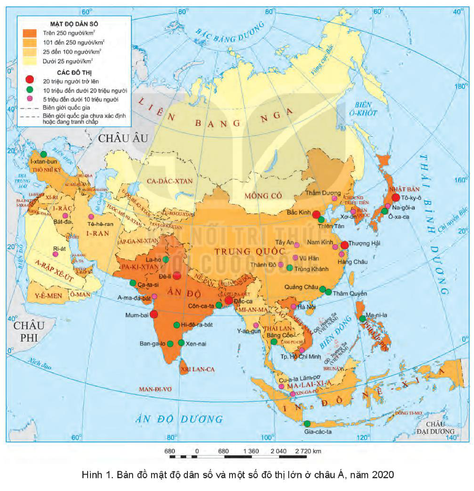

<!-- pdf:116 -->

# BÀI 6: ĐẶC ĐIỂM DÂN CƯ, XÃ HỘI CHÂU Á

## 🎯 Học xong bài này, em sẽ:

- Trình bày được đặc điểm dân cư, tôn giáo; sự phân bố dân cư và các đô thị lớn ở châu Á.

## 🔴 Mở đầu

Châu Á là nơi có con người cư trú từ rất sớm, cũng là nơi có những nền văn minh cổ đại phát triển rực rỡ trong lịch sử. Với quá trình phát triển lâu đời, dân cư, xã hội châu Á ngày nay có những đặc điểm như thế nào?

Nêu một số hiểu biết của em về dân cư, xã hội châu Á.

## 1. Dân cư, tôn giáo

### a) Dân cư

Châu Á có số dân đông nhất trong các châu lục của thế giới. Hơn một nửa số dân thế giới sống ở châu Á.

Bảng 1. SỐ DÂN, MẬT ĐỘ DÂN SỐ CỦA CHÂU Á VÀ THẾ GIỚI NĂM 2020

| Châu lục | Số dân *(triệu người)* | Mật độ dân số *(người/km²)* |
| --- | :---: | :---: |
| Châu Á | 4 641,1(\*) | 150(\*\*) |
| Thế giới | 7 794,8 | 60 |

*(\*) Không tính số dân của Liên bang Nga.*
*(\*\*) Mật độ dân số châu Á không bao gồm phần dân số và diện tích của Liên bang Nga.*

Số dân châu Á tăng nhanh trong nửa cuối thế kỉ XX. Tuy nhiên, trong những thập kỉ gần đây, nhiều nước ở châu Á như Trung Quốc, Thái Lan, Mi-an-ma, Việt Nam,... đã thực hiện chính sách hạn chế gia tăng nhanh dân số. Nhờ đó, mức tăng dân số của châu Á đã giảm đáng kể, thậm chí thấp hơn mức gia tăng trung bình của thế giới (giai đoạn 2015 – 2020, tỉ lệ tăng dân số tự nhiên của thế giới là 1,09%, châu Á là 0,95%).

<!-- term: Cơ cấu dân số trẻ ở châu Á -->
Châu Á là khu vực có cơ cấu dân số trẻ, nhưng đang chuyển biến theo hướng già hoá. Số người trong độ tuổi lao động chiếm tỉ lệ lớn (67,7% năm 2020), cung cấp nguồn lao động dồi dào cho các hoạt động kinh tế, nhưng lại tạo áp lực về giải quyết các vấn đề việc làm, giáo dục và chăm sóc y tế,...

Cư dân châu Á thuộc nhiều chủng tộc: Môn-gô-lô-it, Ơ-rô-pê-ô-it, Ô-xtra-lô-it.

> ❓ Dựa vào thông tin và bảng 1 trong mục a, hãy trình bày đặc điểm dân cư châu Á.

<!-- pdf:117 -->

### b) Tôn giáo

<!-- term: Phật giáo -->
<!-- term: Hồi giáo -->
Châu Á là nơi ra đời của bốn tôn giáo lớn trên thế giới. Ấn Độ giáo ra đời vào khoảng hơn một nghìn năm trước Công nguyên và Phật giáo ra đời vào thế kỉ VI trước Công nguyên tại Ấn Độ. Ki-tô giáo được hình thành từ đầu Công nguyên tại Pa-le-xtin. Hồi giáo ra đời vào thế kỉ VII tại A-rập Xê-út.

Từ châu Á, các tôn giáo này lan truyền khắp thế giới, thu hút số lượng lớn tín đồ.

> ❓ Dựa vào thông tin trong mục b, trình bày đặc điểm tôn giáo ở châu Á.

## 2. Sự phân bố dân cư. Các đô thị lớn

*Hình 1. Bản đồ mật độ dân số và một số đô thị lớn ở châu Á, năm 2020*

<!-- pdf:118 -->

<!-- term: Phân bố dân cư châu Á -->
Châu Á có mật độ dân số cao, 150 người/km² (năm 2020). Tuy nhiên, dân cư châu Á phân bố không đồng đều. Có những vùng dân cư tập trung rất đông như Nam Á, Đông Nam Á, phía đông của Đông Á; ngược lại có những vùng dân cư hết sức thưa thớt như Bắc Á, Trung Á, Tây Á,...

Quá trình phát triển kinh tế đã kéo theo sự phát triển đô thị nhanh chóng ở các nước châu Á. Tỉ lệ dân đô thị của châu Á năm 2020 đạt 51,1%.

Năm 2020, toàn thế giới có 34 đô thị có từ 10 triệu dân trở lên thì riêng châu Á đã có tới 21 đô thị. Các đô thị đông dân nhất thế giới cũng thuộc châu lục này.

Bảng 2. SỐ DÂN CỦA MỘT SỐ ĐÔ THỊ LỚN Ở CHÂU Á NĂM 2020

| TT | Thành phố (Quốc gia) | Số dân *(nghìn người)* | TT | Thành phố (Quốc gia) | Số dân *(nghìn người)* |
| :---: | --- | :---: | :---: | --- | :---: |
| 1 | Tô-ky-ô (Nhật Bản) | 37 393 | 12 | Ma-ni-la (Phi-líp-pin) | 13 923 |
| 2 | Đê-li (Ấn Độ) | 30 291 | 13 | Thiên Tân (Trung Quốc) | 13 589 |
| 3 | Thượng Hải (Trung Quốc) | 27 058 | 14 | Quảng Châu (Trung Quốc) | 13 302 |
| 4 | Đắc-ca (Băng-la-đét) | 21 006 | 15 | La-ho (Pa-ki-xtan) | 12 642 |
| 5 | Bắc Kinh (Trung Quốc) | 20 463 | 16 | Thâm Quyến (Trung Quốc) | 12 357 |
| 6 | Mum-bai (Ấn Độ) | 20 411 | 17 | Ban-ga-lo (Ấn Độ) | 12 327 |
| 7 | Ô-xa-ca (Nhật Bản) | 19 165 | 18 | Xen-nai (Ấn Độ) | 10 971 |
| 8 | Ca-ra-si (Pa-ki-xtan) | 16 094 | 19 | Gia-các-ta (In-đô-nê-xi-a) | 10 770 |
| 9 | Trùng Khánh (Trung Quốc) | 15 872 | 20 | Băng Cốc (Thái Lan) | 10 539 |
| 10 | I-xtan-bun (Thổ Nhĩ Kỳ) | 15 190 | 21 | Hi-đê-ra-bát (Ấn Độ) | 10 004 |
| 11 | Côn-ca-ta (Ấn Độ) | 14 850 | | | |
<!-- ocr-ok: đã đối chiếu ảnh trang gốc PDF 118 (trang in 117), Bảng 2 hai cột có chữ chìm nền bị OCR bỏ sót hàng 3 và đọc lỗi số liệu -->

> ❓ 1. Dựa vào thông tin và hình 1 trong mục 2, cho biết các khu vực đông dân và các khu vực thưa dân ở châu Á.
> 2. Dựa vào hình 1 và bảng 2, hãy:
> - Xác định vị trí của các đô thị từ 20 triệu người trở lên ở châu Á.
> - Cho biết tên các nước ở châu Á có nhiều đô thị trên 10 triệu người.

## ✏️ Luyện tập – Vận dụng

- Dựa vào bảng 1 trang 115, hãy tính tỉ lệ số dân của châu Á trong tổng số dân thế giới. Nêu nhận xét.
- Tìm hiểu và cho biết số dân và mật độ dân số của: Thành phố Hồ Chí Minh, Hà Nội.

## 📷 Danh sách hình trong bài

| Mã hình | Trang PDF | Trang sách | Chú thích |
| --- | :---: | :---: | --- |
| H7-lich_su_va_dia_ly-dl-b06-01 | 117 | 116 | Hình 1. Bản đồ mật độ dân số và một số đô thị lớn ở châu Á, năm 2020 |
