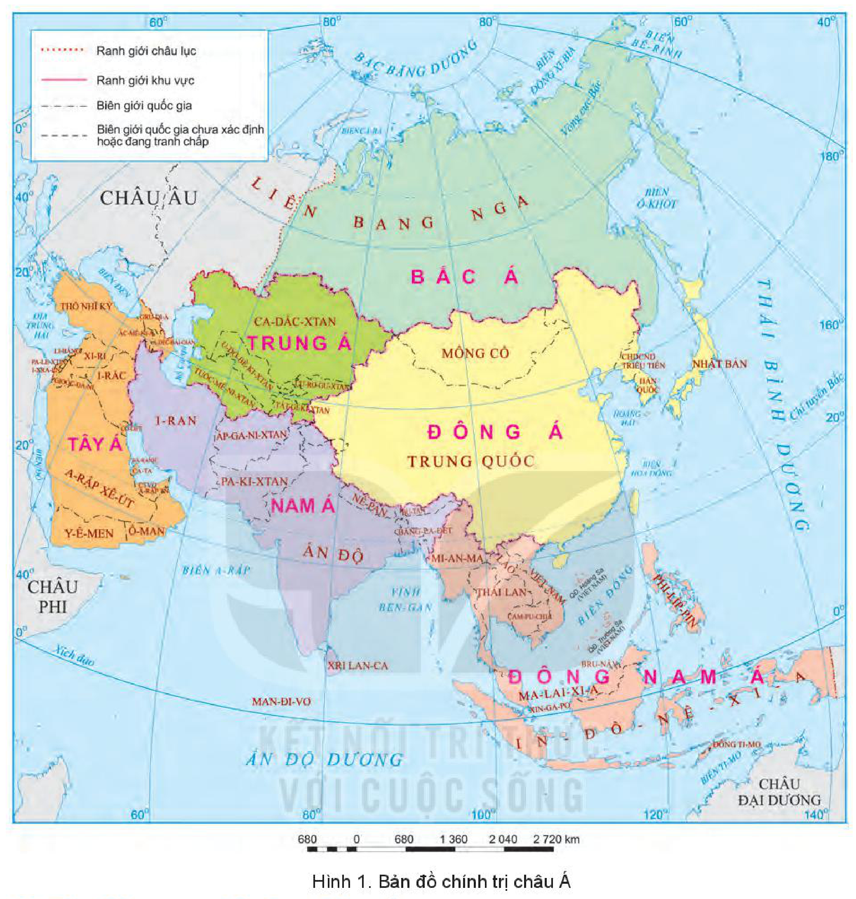
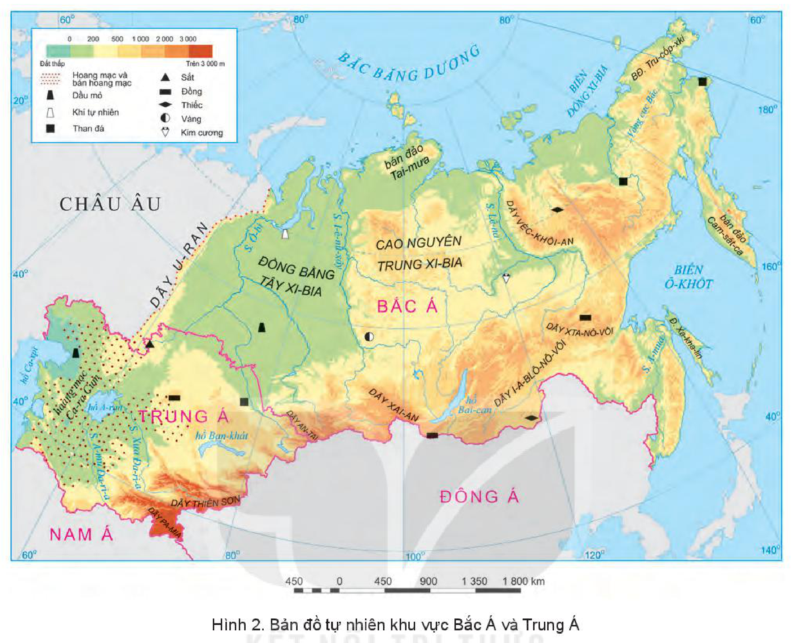
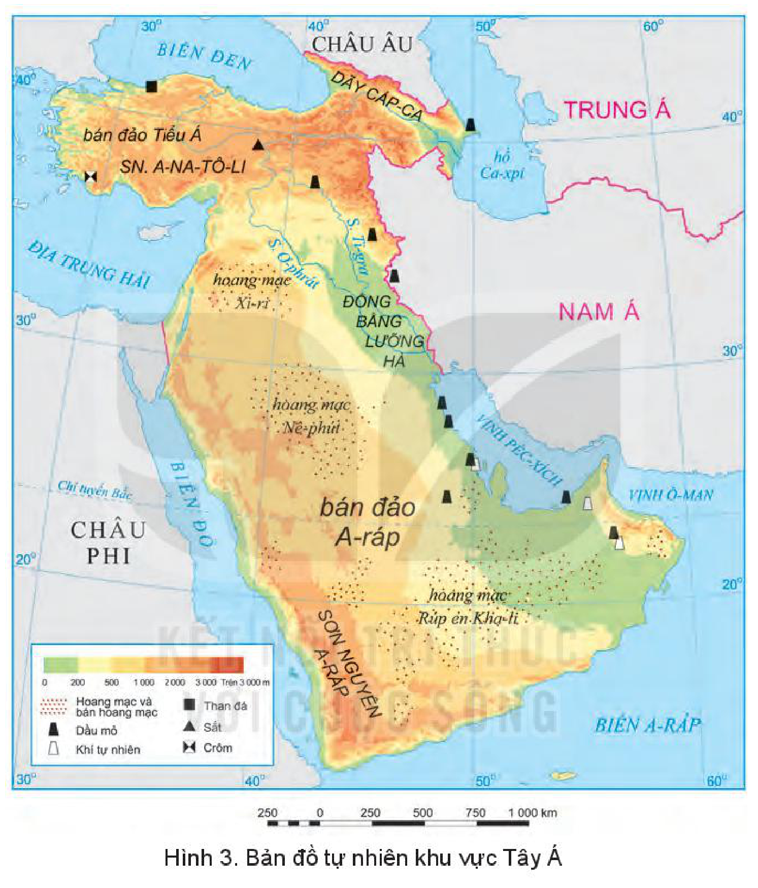
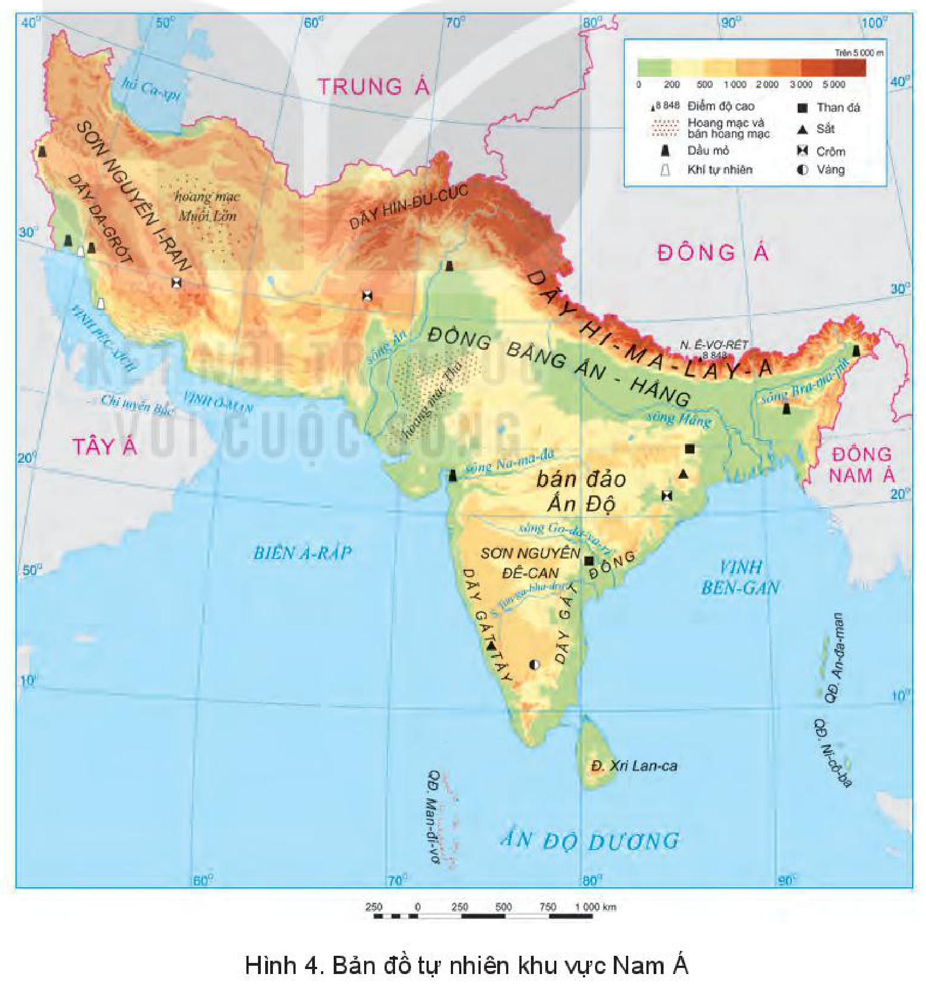
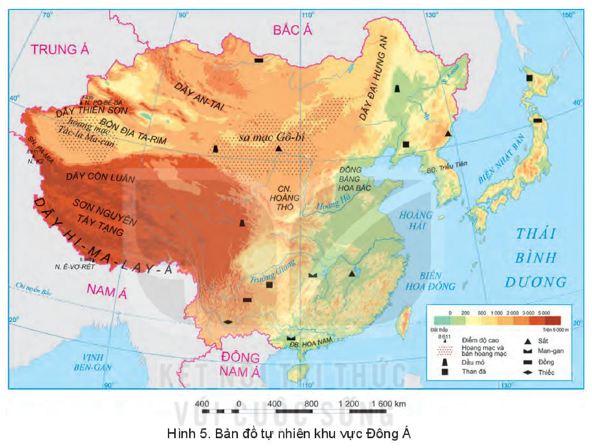
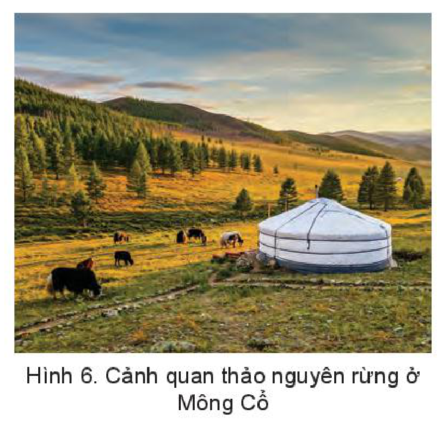
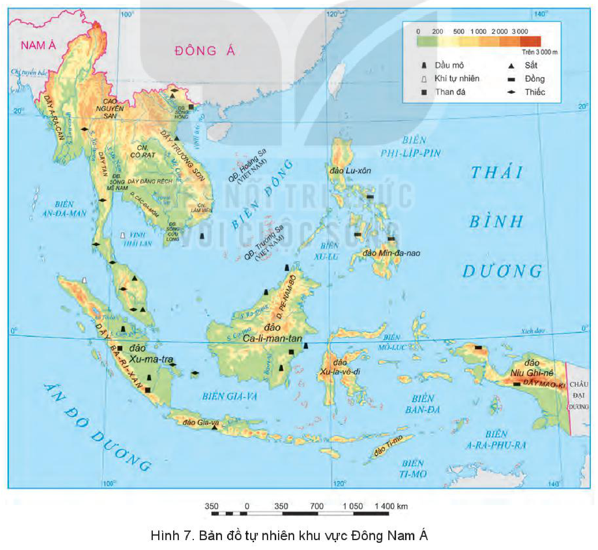

<!-- pdf:119 -->

# BÀI 7: BẢN ĐỒ CHÍNH TRỊ CHÂU Á, CÁC KHU VỰC CỦA CHÂU Á

## 🎯 Học xong bài này, em sẽ:

- Xác định được trên bản đồ chính trị các khu vực của châu Á.
- Trình bày được đặc điểm tự nhiên của một trong các khu vực ở châu Á.

## 🔴 Mở đầu

Thiên nhiên châu Á phân hoá vô cùng đa dạng. Mỗi khu vực của châu Á lại có cảnh sắc thiên nhiên khác nhau, điều đó tạo nên những nét riêng biệt của từng khu vực.

Châu Á có những khu vực nào? Nêu hiểu biết của em về một khu vực ở châu Á.

## 1. Bản đồ chính trị châu Á

<!-- term: Bản đồ chính trị châu Á -->
Hiện nay, châu Á có 49 quốc gia và vùng lãnh thổ với nhiều thể chế chính trị khác nhau.

<!-- term: Bản đồ chính trị châu Á -->
Trên bản đồ chính trị, châu Á được phân chia thành sáu khu vực.

CÁC KHU VỰC CỦA CHÂU Á

| Khu vực | Các quốc gia và vùng lãnh thổ |
| --- | --- |
| Bắc Á | Các vùng Tây Xi-bia, Trung Xi-bia, Đông Xi-bia của Nga |
| Trung Á | Ca-dắc-xtan, U-dơ-bê-ki-xtan, Tát-gi-ki-xtan, Tuốc-mê-ni-xtan, Cư-rơ-gư-xtan |
| Tây Á | A-rập Xê-út, I-rắc, Ca-ta, Các Tiểu vương quốc A-rập Thống nhất (UAE), Ba-ranh, Cô-oét, Ô-man, Y-ê-men, Xi-ri, Li-băng, Gioóc-đa-ni, Pa-le-xtin, I-xra-en, Thổ Nhĩ Kỳ, Ác-mê-ni-a, A-déc-bai-gian, Gru-di-a |
| Nam Á | Ấn Độ, Pa-ki-xtan, Áp-ga-ni-xtan, Nê-pan, Bu-tan, Băng-la-đét, Xri Lan-ca, Man-đi-vơ, I-ran |
| Đông Á | Mông Cổ, Trung Quốc, Đài Loan (Trung Quốc), Triều Tiên, Hàn Quốc, Nhật Bản |
| Đông Nam Á | Việt Nam, Lào, Cam-pu-chia, Thái Lan, Ma-lai-xi-a, Xin-ga-po, Mi-an-ma, In-đô-nê-xi-a, Phi-líp-pin, Bru-nây, Đông Ti-mo |

<!-- term: Bản đồ chính trị châu Á -->
Trình độ phát triển của các nước ở châu Á rất khác nhau, nhưng phần nhiều là các nước đang phát triển. Tình hình phát triển kinh tế – xã hội của châu Á trong những năm qua có nhiều chuyển biến tích cực.

> ❓ Xác định các khu vực của châu Á trên bản đồ hình 1.

<!-- pdf:120 -->

*Hình 1. Bản đồ chính trị châu Á*

## 2. Các khu vực thuộc châu Á

### a) Khu vực Bắc Á

<!-- term: Khu vực Bắc Á -->
Khu vực Bắc Á bao gồm toàn bộ vùng Xi-bia của Nga, với ba bộ phận: đồng bằng Tây Xi-bia, cao nguyên Trung Xi-bia và miền núi Đông Xi-bia. Đây là khu vực có khí hậu lạnh giá khắc nghiệt, mang tính chất lục địa sâu sắc. Tài nguyên khoáng sản tương đối phong phú, một số loại có trữ lượng lớn như dầu mỏ, than đá, kim cương, vàng, đồng, thiếc,...

Mạng lưới sông ở Bắc Á khá dày. Ở đây có nhiều sông lớn như: Ô-bi, I-ê-nít-xây, Lê-na,... Các sông này đều có nguồn thuỷ năng rất lớn.

Rừng bao phủ trên một diện tích rất rộng, chủ yếu là rừng lá kim, được bảo tồn tương đối tốt.

<!-- pdf:121 -->

*Hình 2. Bản đồ tự nhiên khu vực Bắc Á và Trung Á*

> ❓ Dựa vào hình 2 và thông tin trong mục a, hãy nêu một số đặc điểm của tự nhiên Bắc Á.

### b) Khu vực Trung Á

<!-- term: Khu vực Trung Á -->
Trung Á là khu vực duy nhất của châu Á không tiếp giáp với đại dương. Diện tích khu vực rộng hơn 4 triệu km². Nhìn chung, địa hình thấp dần từ đông sang tây: phía đông là miền núi cao Pa-mia, Thiên Sơn và An-tai; phía tây là các cao nguyên và đồng bằng kéo dài tới hồ Ca-xpi; ở trung tâm là hồ A-ran.

Trung Á có nhiều khoáng sản: dầu mỏ, than đá, sắt và nhiều kim loại màu khác.

Trung Á có khí hậu ôn đới lục địa. Lượng mưa rất thấp, chỉ vào khoảng 300 – 400 mm/năm. Nơi mưa nhiều nhất không quá 600 mm/năm. Hai con sông lớn nhất của khu vực là Xưa Đa-ri-a và A-mu Đa-ri-a đều đổ vào hồ A-ran.

Cảnh quan tự nhiên chủ yếu là thảo nguyên, bán hoang mạc và hoang mạc.

> ❓ Dựa vào thông tin trong mục b và hình 2, hãy nêu đặc điểm của tự nhiên khu vực Trung Á.

<!-- pdf:122 -->

### c) Khu vực Tây Á (Tây Nam Á)

Khu vực Tây Á bao gồm bán đảo A-ráp, bán đảo Tiểu Á, đồng bằng Lưỡng Hà, có ranh giới tự nhiên với châu Âu là dãy Cáp-ca. Địa hình có nhiều núi và sơn nguyên.

Tây Á chiếm khoảng hơn một nửa trữ lượng dầu mỏ của thế giới. Dầu mỏ phân bố chủ yếu ở vùng đồng bằng Lưỡng Hà, các đồng bằng của bán đảo A-ráp và vùng vịnh Péc-xích. Những nước có trữ lượng dầu mỏ lớn nhất là: A-rập Xê-út, I-rắc, Cô-oét, Các Tiểu vương quốc A-rập Thống nhất, Ca-ta. Ngoài ra, Tây Á còn có sắt, crôm,...

*Hình 3. Bản đồ tự nhiên khu vực Tây Á*

Tây Á nằm trong miền khí hậu khô hạn và nóng. Lượng mưa nhìn chung rất thấp, chỉ khoảng 200 – 300 mm/năm, một số vùng nằm gần Địa Trung Hải có lượng mưa nhiều hơn.

Sông ngòi kém phát triển, nguồn nước rất hiếm. Nước cho sản xuất và sinh hoạt một phần lấy từ hai con sông Ti-grơ và Ơ-phrát, phần còn lại lấy từ nước ngầm và lọc từ nước biển.

Do điều kiện khí hậu khô, cảnh quan tự nhiên của Tây Á phần lớn là bán hoang mạc và hoang mạc.

> ❓ Dựa vào hình 3 và thông tin trong mục c, hãy nêu đặc điểm tự nhiên của khu vực Tây Á.

<!-- pdf:123 -->

### d) Khu vực Nam Á

<!-- term: Khu vực Nam Á -->
Khu vực Nam Á rộng khoảng 7 triệu km². Địa hình bao gồm hệ thống núi Hi-ma-lay-a đồ sộ chạy theo hướng tây bắc – đông nam ở phía bắc; sơn nguyên I-ran ở phía tây, sơn nguyên Đê-can tương đối thấp và bằng phẳng ở phía nam; đồng bằng Ấn – Hằng được bồi tụ bởi phù sa sông Ấn và sông Hằng ở giữa.

Đại bộ phận Nam Á nằm trong kiểu khí hậu nhiệt đới gió mùa. Mùa đông có gió mùa đông bắc, thời tiết hơi lạnh và khô. Mùa hạ có gió mùa tây nam nóng và ẩm từ Ấn Độ Dương thổi vào gây mưa. Đặc biệt, sườn phía nam của Hi-ma-lay-a mưa rất nhiều, lũ lụt xảy ra hằng năm. Phía tây bắc Ấn Độ và sơn nguyên I-ran có khí hậu khô hạn.

Trên các vùng núi, khí hậu có sự thay đổi theo độ cao. Càng lên cao nhiệt độ càng giảm. Từ độ cao 4 500 m trở lên là băng tuyết vĩnh cửu.

Nam Á có nhiều hệ thống sông lớn như: sông Ấn, sông Hằng, sông Bra-ma-pút. Các con sông này bồi đắp nên vùng đồng bằng màu mỡ, sản xuất nhiều sản phẩm cho sản lượng lớn như bông, chè, lúa gạo, cây ăn quả nhiệt đới,...

Thảm thực vật chủ yếu của Nam Á là rừng nhiệt đới gió mùa và xa van.

> 💡 **Em có biết?**
>
> Nơi mưa nhiều nhất trên thế giới nằm ở sườn đón gió của dãy Hi-ma-lay-a thuộc Ấn Độ, mỗi năm tổng lượng mưa lên đến hơn 11 000 mm.
<!-- ocr-ok: đã đối chiếu ảnh trang gốc PDF 123 (trang in 122), hộp Em có biết? ở cột hẹp bên trái bản đồ Hình 4 bị OCR bỏ sót dòng đầu -->

*Hình 4. Bản đồ tự nhiên khu vực Nam Á*

> ❓ Đọc thông tin trong mục d và quan sát hình 4, hãy trình bày đặc điểm tự nhiên của khu vực Nam Á.

<!-- pdf:124 -->

### e) Khu vực Đông Á

<!-- term: Khu vực Đông Á -->
Khu vực Đông Á rộng khoảng 11,5 triệu km², bao gồm phần đất liền và phần hải đảo.

<!-- term: Khu vực Đông Á -->
Phần đất liền chiếm hơn 96% diện tích, địa hình hết sức đa dạng: phía tây có nhiều hệ thống núi và sơn nguyên cao, các bồn địa rộng lớn; phía đông có nhiều núi trung bình, núi thấp và đồng bằng rộng.

Phần hải đảo có địa hình phần lớn là đồi núi. Đây là nơi có nhiều núi lửa, thường xuyên có động đất, sóng thần.

*Hình 5. Bản đồ tự nhiên khu vực Đông Á*

Các khoáng sản chính là: than đá, dầu mỏ, sắt, thiếc, đồng, man-gan,...

Phần hải đảo và phía đông phần đất liền có khí hậu gió mùa, trong một năm có hai mùa gió khác nhau. Mùa đông có gió tây bắc, khô và lạnh. Mùa hạ có gió đông nam, nóng và ẩm, thường chịu ảnh hưởng của bão. Những nơi rừng bao phủ có hệ động vật đa dạng, nhiều loài đặc hữu.

Phía tây phần đất liền (gồm lãnh thổ Mông Cổ và tây Trung Quốc), do nằm sâu trong nội địa nên quanh năm khô hạn. Ở đây phát triển cảnh quan thảo nguyên, bán hoang mạc và hoang mạc.

*Hình 6. Cảnh quan thảo nguyên rừng ở Mông Cổ*

<!-- pdf:125 -->

Đông Á có một số sông lớn như Trường Giang, Hoàng Hà, có giá trị về nhiều mặt. Tuy nhiên, do nằm trong vùng khí hậu gió mùa nên về mùa mưa sông hay gây ra ngập lụt.

> ❓ Đọc thông tin trong mục e và quan sát hình 5, hãy trình bày đặc điểm tự nhiên của khu vực Đông Á.

### g) Khu vực Đông Nam Á

<!-- term: Khu vực Đông Nam Á -->
<!-- term: Bán đảo Trung Ấn -->
<!-- term: Quần đảo Mã Lai -->
Khu vực Đông Nam Á rộng khoảng 4,5 triệu km², gồm hai phần: phần đất liền mang tên bán đảo Trung Ấn và phần hải đảo được gọi là quần đảo Mã Lai.

- Địa hình: Phần đất liền có các dải núi cao trung bình hướng bắc – nam và tây bắc – đông nam, xen kẽ là các thung lũng sông cắt xẻ sâu, làm cho địa hình bị chia cắt mạnh. Đồng bằng phù sa tập trung ở ven biển và hạ lưu sông.

Phần hải đảo có nhiều đồi núi, ít đồng bằng. Đây là khu vực có nhiều núi lửa, động đất, sóng thần.

- Khí hậu: Phần đất liền có khí hậu nhiệt đới gió mùa. Vào mùa hạ có gió tây nam nóng, ẩm gây mưa nhiều. Vào mùa đông có gió đông bắc khô, lạnh.

*Hình 7. Bản đồ tự nhiên khu vực Đông Nam Á*

<!-- pdf:126 -->

Phần hải đảo có khí hậu xích đạo quanh năm nóng ẩm, mưa nhiều. Đông Nam Á là khu vực chịu nhiều ảnh hưởng của các cơn bão nhiệt đới gây thiệt hại lớn về người và tài sản.

- Mạng lưới sông ở Đông Nam Á tương đối dày. Các sông chính là: Mê Công, Mê Nam, I-ra-oa-đi, sông Hồng,...

- Rừng ở Đông Nam Á chủ yếu là rừng mưa nhiệt đới với thành phần loài hết sức phong phú. Những nước còn nhiều rừng là: Ma-lai-xi-a, In-đô-nê-xi-a, Mi-an-ma, Lào.

- Các khoáng sản quan trọng là: dầu mỏ, khí tự nhiên, than đá, sắt, thiếc, đồng,...

*Hình 8. Voọc chà vá chân nâu ở bán đảo Sơn Trà, Đà Nẵng, Việt Nam*

> 💡 **Em có biết?**

<!-- term: Quần đảo Mã Lai -->
> Khu vực quần đảo Mã Lai chịu nhiều ảnh hưởng từ hoạt động của núi lửa, động đất, sóng thần. Riêng ở In-đô-nê-xi-a có khoảng 150 ngọn núi lửa đang hoạt động. Những đợt phun trào lớn gây thiệt hại nhiều về người và tài sản.

> ❓ Dựa vào thông tin và các hình ảnh trong mục g, hãy trình bày đặc điểm tự nhiên của khu vực Đông Nam Á.

## ✏️ Luyện tập – Vận dụng

1. Kể tên các nước ở khu vực Đông Nam Á.
2. So sánh một đặc điểm tự nhiên của hai khu vực ở châu Á.
- Tìm hiểu thông tin về tự nhiên ở một khu vực của châu Á mà em quan tâm và chia sẻ với các bạn.

## 📷 Danh sách hình trong bài

| Mã hình | Trang PDF | Trang sách | Chú thích |
| --- | :---: | :---: | --- |
| H7-lich_su_va_dia_ly-dl-b07-01 | 120 | 119 | Hình 1. Bản đồ chính trị châu Á |
| H7-lich_su_va_dia_ly-dl-b07-02 | 121 | 120 | Hình 2. Bản đồ tự nhiên khu vực Bắc Á và Trung Á |
| H7-lich_su_va_dia_ly-dl-b07-03 | 122 | 121 | Hình 3. Bản đồ tự nhiên khu vực Tây Á |
| H7-lich_su_va_dia_ly-dl-b07-04 | 123 | 122 | Hình 4. Bản đồ tự nhiên khu vực Nam Á |
| H7-lich_su_va_dia_ly-dl-b07-05 | 124 | 123 | Hình 5. Bản đồ tự nhiên khu vực Đông Á |
| H7-lich_su_va_dia_ly-dl-b07-06 | 124 | 123 | Hình 6. Cảnh quan thảo nguyên rừng ở Mông Cổ |
| H7-lich_su_va_dia_ly-dl-b07-07 | 125 | 124 | Hình 7. Bản đồ tự nhiên khu vực Đông Nam Á |
| H7-lich_su_va_dia_ly-dl-b07-08 | 126 | 125 | Hình 8. Voọc chà vá chân nâu ở bán đảo Sơn Trà, Đà Nẵng, Việt Nam |
