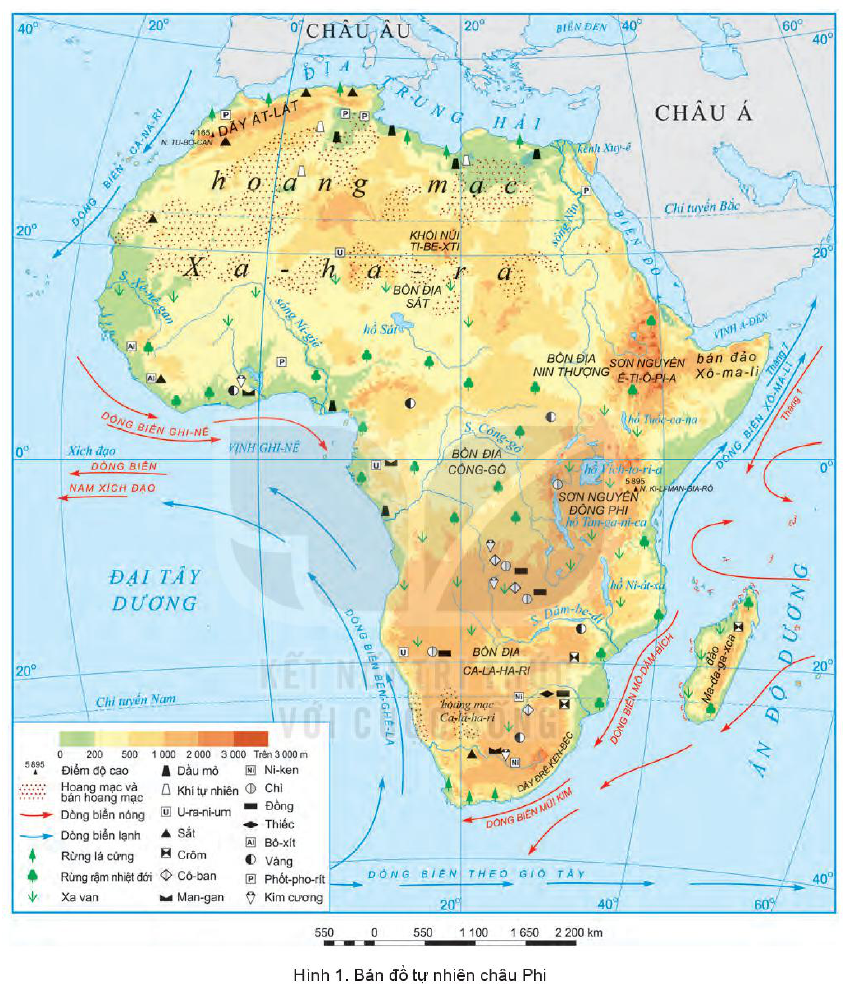
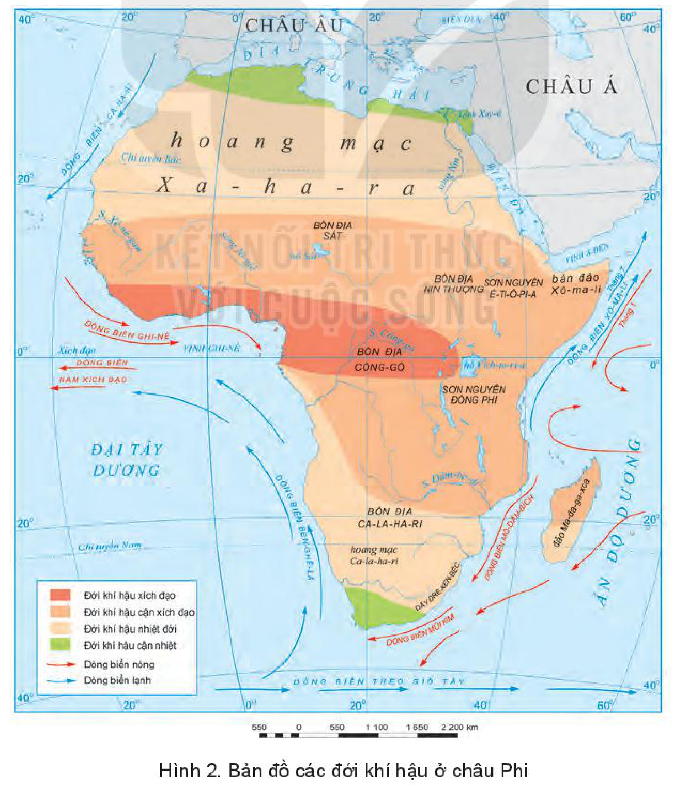
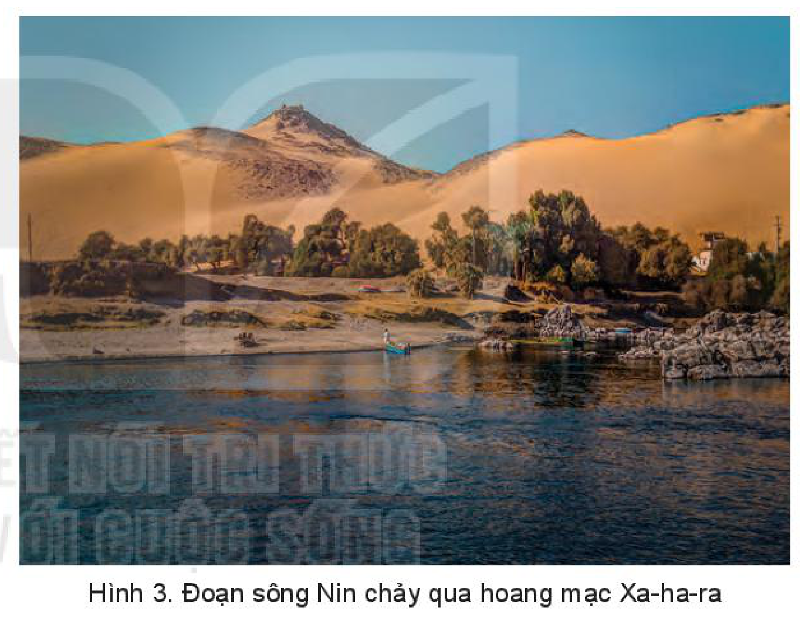
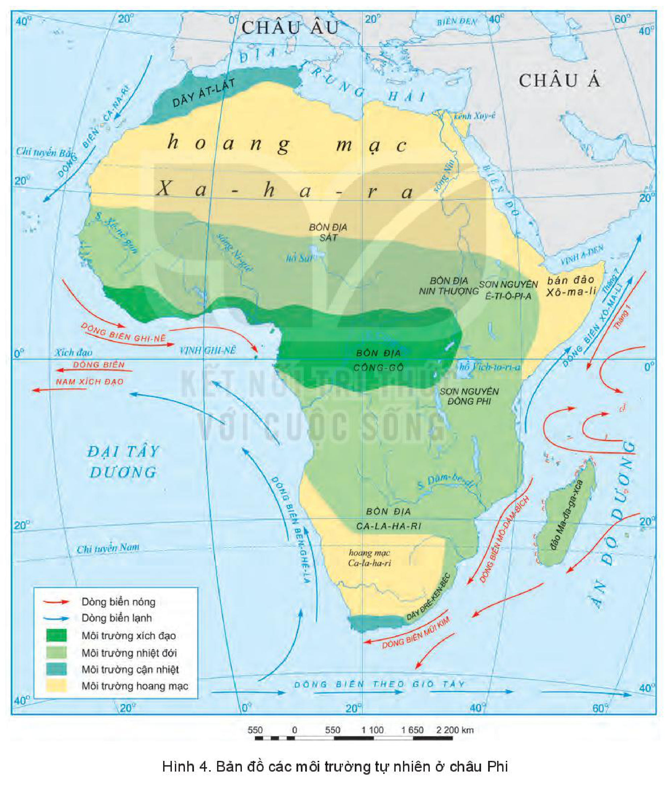
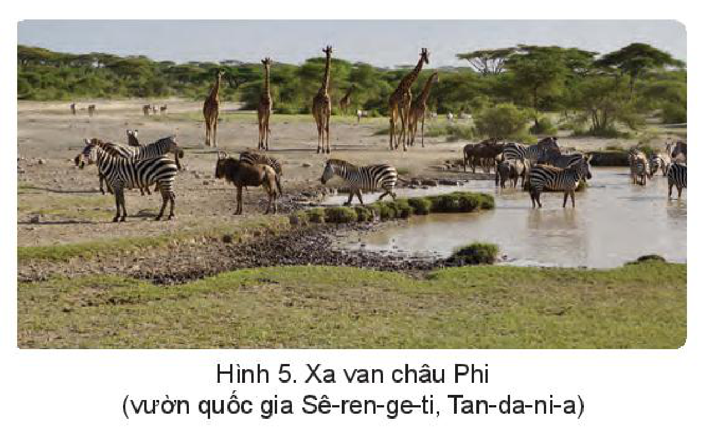
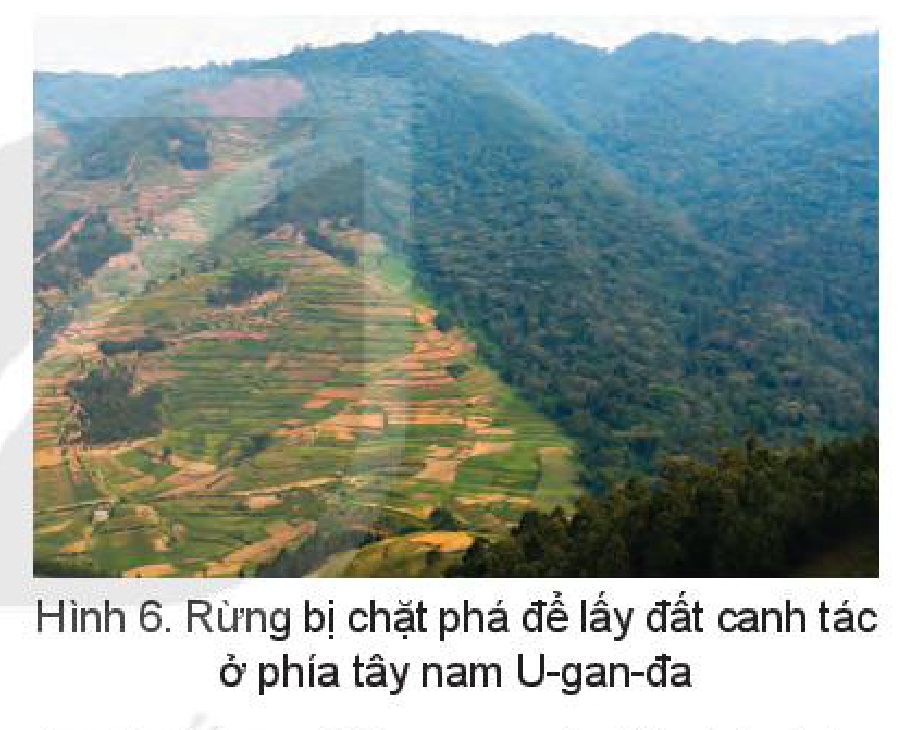

<!-- pdf:128 -->

# BÀI 9: VỊ TRÍ ĐỊA LÍ, ĐẶC ĐIỂM TỰ NHIÊN CHÂU PHI

## 🎯 Học xong bài này, em sẽ:

- Trình bày được đặc điểm vị trí địa lí, hình dạng và kích thước châu Phi.
- Phân tích được một trong những đặc điểm thiên nhiên châu Phi, một trong những vấn đề môi trường trong sử dụng thiên nhiên (ví dụ vấn đề săn bắn và buôn bán động vật hoang dã, lấy ngà voi, sừng tê giác,...).

## 🔴 Mở đầu

Châu Phi là châu lục có hệ sinh thái tự nhiên độc đáo, nơi bảo tồn các loài thực, động vật hoang dã phong phú bậc nhất thế giới và cũng là một trong những nơi phát sinh loài người. Hãy nêu một số thông tin mà em biết về tự nhiên châu Phi.

## 1. Vị trí địa lí, hình dạng và kích thước

Châu Phi là châu lục lớn thứ ba trên thế giới, diện tích khoảng 30,3 triệu km², sau châu Á và châu Mỹ. Phần đất liền kéo dài từ khoảng 37°B đến 35°N. Xích đạo chạy qua gần chính giữa, chia lục địa Phi thành hai phần khá cân xứng.

Đường bờ biển châu Phi ít bị chia cắt, có rất ít các vịnh biển, bán đảo và đảo khiến cho châu lục có dạng hình khối rõ rệt.

> 💡 **Em có biết?**

<!-- term: Đảo Ma-đa-ga-xca -->
> Ma-đa-ga-xca có diện tích gần 590 000 km², là hòn đảo lớn nhất châu Phi và đứng thứ tư thế giới sau các đảo Grơn-len, Niu Ghi-nê, Ca-li-man-tan. Các nhà khoa học cho rằng, Ma-đa-ga-xca là một mảnh nền cổ được tách ra khỏi lục địa Phi từ khoảng 250 triệu năm trước.
<!-- ocr-ok: đã đối chiếu ảnh trang gốc 127 (PDF 128), hộp Em có biết? ở cột trái bị OCR trộn với mục 1 -->

<!-- pdf:129 -->

*Hình 1. Bản đồ tự nhiên châu Phi*

> ❓ Dựa vào thông tin trong mục 1 và hình 1, hãy cho biết:
> - Châu Phi tiếp giáp với các biển, đại dương và châu lục nào.
> - Hình dạng, kích thước châu Phi.

<!-- pdf:130 -->

## 2. Đặc điểm tự nhiên

### a) Địa hình và khoáng sản

Địa hình châu Phi khá đơn giản. Gần như toàn bộ châu lục là một khối cao nguyên khổng lồ với độ cao trung bình khoảng 750 m; trên đó, chủ yếu là các sơn nguyên xen các bồn địa thấp. Phần phía đông được nâng lên mạnh, nền đá bị nứt vỡ và đổ sụp, tạo thành nhiều thung lũng sâu, nhiều hồ dài và hẹp. Châu Phi có rất ít núi cao và đồng bằng thấp.

> 💡 **Em có biết?**

<!-- term: Núi Ki-li-man-gia-rô -->
> Ki-li-man-gia-rô (5 895 m), núi lửa từng hoạt động, là núi cao nhất châu Phi, trên đỉnh núi luôn có băng tuyết bao phủ.
<!-- ocr-ok: đã đối chiếu ảnh trang gốc 129 (PDF 130), hộp Em có biết? ở cột phải bị OCR nhận nhầm dấu -->

Khoáng sản của châu Phi rất phong phú và đa dạng (trong đó một số loại có trữ lượng lớn), phân bố chủ yếu ở phía bắc và phía nam lục địa. Các khoáng sản quan trọng nhất là đồng, vàng, u-ra-ni-um, kim cương, dầu mỏ và phốt-pho-rít,...

> ❓ Dựa vào thông tin trong mục a và hình 1, hãy:
> - Trình bày đặc điểm địa hình châu Phi.
> - Xác định vị trí phân bố một số khoáng sản chính ở châu Phi.

### b) Khí hậu

*Hình 2. Bản đồ các đới khí hậu ở châu Phi*

<!-- pdf:131 -->

<!-- term: Khí hậu châu Phi -->
Châu Phi có khí hậu khô nóng bậc nhất thế giới, nhiệt độ trung bình năm trên 20°C, lượng mưa tương đối thấp. Các đới khí hậu phân bố gần như đối xứng qua Xích đạo, gồm: khí hậu xích đạo, khí hậu cận xích đạo, khí hậu nhiệt đới, khí hậu cận nhiệt. Đặc điểm các đới khí hậu ở châu Phi:

- Khí hậu xích đạo: nóng ẩm, mưa nhiều quanh năm.
- Khí hậu cận xích đạo: chịu tác động của gió mùa, một mùa nóng ẩm, mưa nhiều; một mùa khô, mát.
- Khí hậu nhiệt đới: ở Bắc Phi mang tính lục địa, rất khô và nóng; ở Nam Phi ẩm và đỡ nóng hơn.
- Khí hậu cận nhiệt: mùa đông ấm, ẩm ướt, mưa nhiều; mùa hạ khô, trời trong sáng.

> ❓ Dựa vào thông tin trong mục b và hình 2, hãy cho biết đặc điểm nổi bật của khí hậu châu Phi.

### c) Sông, hồ

Mạng lưới sông ngòi của châu Phi phân bố không đều, tuỳ thuộc vào lượng mưa. Đặc biệt, các sông có nhiều thác ghềnh nên không thuận lợi cho giao thông, nhưng có nguồn trữ năng thuỷ điện lớn.

Châu Phi có nhiều hồ lớn. Trong đó, nhiều hồ được hình thành bởi các đứt gãy như hồ Tan-ga-ni-ca, hồ Tuốc-ca-na,...

*Hình 3. Đoạn sông Nin chảy qua hoang mạc Xa-ha-ra*

> 💡 **Em có biết?**

<!-- term: Sông Nin -->
> Sông Nin (6 695 km) dài nhất thế giới. Đây là dòng sông duy nhất chảy qua hoang mạc Xa-ha-ra. Phần hạ lưu sông Nin bồi đắp phù sa tạo thành đồng bằng châu thổ sông Nin màu mỡ rộng khoảng 24 000 km².

> ❓ Dựa vào thông tin trong mục c và hình 1, hãy:
> - Nêu đặc điểm sông, hồ ở châu Phi.
> - Xác định vị trí các sông và hồ lớn ở châu Phi.

### d) Các môi trường tự nhiên

Các môi trường tự nhiên ở châu Phi phân bố đối xứng qua Xích đạo:

<!-- term: Môi trường xích đạo -->
- Môi trường xích đạo gồm bồn địa Công-gô và duyên hải phía bắc vịnh Ghi-nê. Khí hậu nóng và ẩm điều hoà, với thảm thực vật rừng rậm xanh quanh năm.

<!-- pdf:132 -->

<!-- term: Môi trường nhiệt đới -->
- Hai môi trường nhiệt đới có phạm vi gần như trùng với ranh giới đới khí hậu cận xích đạo, có sự phân hoá ra mùa mưa và mùa khô rõ rệt. Thảm thực vật chủ yếu là rừng thưa và xa van cây bụi. Nhờ nguồn thức ăn phong phú, xa van là nơi tập trung nhiều động vật ăn cỏ (ngựa vằn, sơn dương, hươu cao cổ,...) và động vật ăn thịt (sư tử, báo gấm,...).

<!-- term: Môi trường hoang mạc -->
- Hai môi trường hoang mạc, có khí hậu khắc nghiệt, ít mưa, biên độ nhiệt độ giữa ngày và đêm lớn. Hệ thực, động vật nghèo nàn. Động vật chủ yếu là rắn độc, kì đà và một số loài gặm nhấm,...

<!-- term: Môi trường cận nhiệt -->
- Hai môi trường cận nhiệt ở phần cực bắc và cực nam châu Phi. Mùa đông ấm, ẩm và mưa nhiều; mùa hạ nóng, khô. Thảm thực vật là rừng và cây bụi lá cứng.

*Hình 4. Bản đồ các môi trường tự nhiên ở châu Phi*

<!-- pdf:133 -->

> 💡 **Em có biết?**

> Hệ thực vật rừng mưa nhiệt đới châu Phi rất phong phú, có tới trên 3 000 loài cây, trong đó, khoảng 1 000 loài cây thân gỗ, phổ biến: sung, vả, cọ dầu, bông gòn, cô-la, dừa rượu,...
>
> Giới động vật cũng vô cùng đa dạng, nhiều loài chỉ có ở châu Phi; điển hình là hắc tinh tinh thuộc nhóm “khỉ dạng người” lớn nhất hiện nay.

*Hình 5. Xa van châu Phi (vườn quốc gia Sê-ren-ge-ti, Tan-da-ni-a)*

> ❓ Dựa vào thông tin và hình ảnh trong mục d, hãy trình bày đặc điểm của một trong các môi trường tự nhiên ở châu Phi.

## 3. Vấn đề môi trường trong sử dụng thiên nhiên

Một số vấn đề môi trường trong sử dụng thiên nhiên ở châu Phi hiện nay là:

- Suy giảm tài nguyên rừng: tốc độ khai thác quá nhanh lại không có biện pháp khôi phục diện tích đã khai thác, khiến diện tích rừng giảm. Hậu quả là các loài động vật hoang dã mất đi môi trường sống, tình trạng hoang mạc hoá diễn ra ngày càng nhanh, nguồn nước bị suy giảm.

*Hình 6. Rừng bị chặt phá để lấy đất canh tác ở phía tây nam U-gan-đa*
<!-- ocr-ok: đã đối chiếu ảnh trang gốc 132 (PDF 133), chú thích Hình 6 ở cột phải bị OCR trộn với cột trái -->

- Nạn săn bắt và buôn bán động vật hoang dã, lấy ngà voi, sừng tê giác đã làm giảm số lượng động vật hoang dã, nhiều loài đứng trước nguy cơ tuyệt chủng. Hiện nay, các tổ chức bảo vệ động vật hoang dã trên thế giới và chính quyền các nước châu Phi đã có nhiều biện pháp như kiểm soát, tuyên truyền, ban hành các quy định và xây dựng các khu bảo tồn thiên nhiên để bảo vệ động vật hoang dã cũng như môi trường sống của chúng.

Châu Phi có thiên nhiên phong phú, đa dạng, với nhiều loài động, thực vật đặc hữu. Tuy nhiên, ở một vài nơi thiên nhiên châu Phi đang bị khai thác bất hợp lí khiến môi trường bị huỷ hoại. Vì vậy, cần có những biện pháp bảo vệ và sử dụng hợp lí thiên nhiên.

> ❓ Dựa vào thông tin và hình ảnh trong mục 3, hãy nêu một số vấn đề môi trường trong sử dụng thiên nhiên ở châu Phi.

## ✏️ Luyện tập và Vận dụng

1. Trình bày khái quát đặc điểm tự nhiên châu Phi.
2. Lập bảng so sánh đặc điểm của các môi trường tự nhiên ở châu Phi (về khí hậu, sinh vật).

- Sưu tầm thông tin, tranh ảnh để viết bài giới thiệu về một loài thực vật/động vật địa phương độc đáo của châu Phi.

## 📷 Danh sách hình trong bài

| Mã hình | Trang PDF | Trang sách | Chú thích |
| --- | :---: | :---: | --- |
| H7-lich_su_va_dia_ly-dl-b09-01 | 129 | 128 | Hình 1. Bản đồ tự nhiên châu Phi |
| H7-lich_su_va_dia_ly-dl-b09-02 | 130 | 129 | Hình 2. Bản đồ các đới khí hậu ở châu Phi |
| H7-lich_su_va_dia_ly-dl-b09-03 | 131 | 130 | Hình 3. Đoạn sông Nin chảy qua hoang mạc Xa-ha-ra |
| H7-lich_su_va_dia_ly-dl-b09-04 | 132 | 131 | Hình 4. Bản đồ các môi trường tự nhiên ở châu Phi |
| H7-lich_su_va_dia_ly-dl-b09-05 | 133 | 132 | Hình 5. Xa van châu Phi (vườn quốc gia Sê-ren-ge-ti, Tan-da-ni-a) |
| H7-lich_su_va_dia_ly-dl-b09-06 | 133 | 132 | Hình 6. Rừng bị chặt phá để lấy đất canh tác ở phía tây nam U-gan-đa |
