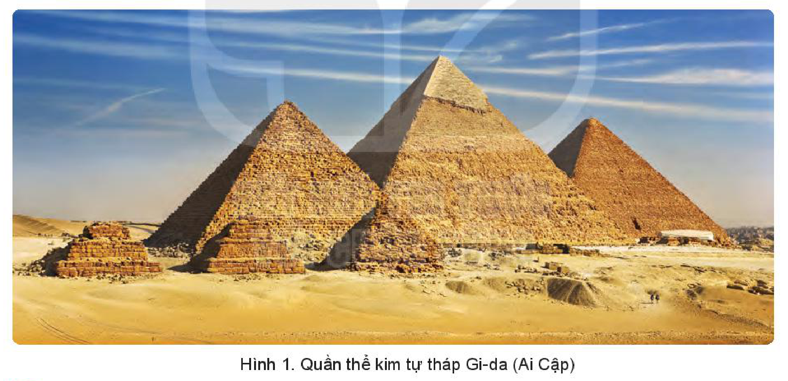

<!-- pdf:134 -->

# BÀI 10: ĐẶC ĐIỂM DÂN CƯ, XÃ HỘI CHÂU PHI

## 🎯 Học xong bài này, em sẽ:

- Trình bày được một trong những vấn đề nổi cộm về dân cư, xã hội và di sản lịch sử châu Phi (ví dụ: vấn đề nạn đói, vấn đề xung đột quân sự,...).

## 🔴 Mở đầu

Châu Phi là châu lục còn tồn tại nhiều vấn đề nổi cộm về dân cư và xã hội.

Bằng hiểu biết của bản thân, em hãy nêu một số thông tin về dân cư, xã hội của châu Phi.

## 1. Một số vấn đề dân cư, xã hội

### a) Tỉ lệ tăng dân số tự nhiên cao

Năm 2020, số dân châu Phi khoảng 1 340 triệu người, chiếm khoảng 17% số dân thế giới.

<!-- term: Tỉ lệ tăng dân số tự nhiên ở châu Phi -->
Số dân châu Phi tăng rất nhanh từ những năm 50 của thế kỉ XX, khi các nước thuộc địa ở châu Phi giành được độc lập, đời sống được cải thiện và những tiến bộ về y tế làm giảm nhanh tỉ suất tử vong, trong khi tỉ suất sinh lại cao. Giai đoạn 2015 – 2020, tuy tốc độ tăng dân số đã giảm nhưng châu Phi vẫn có tỉ lệ tăng dân số tự nhiên cao nhất thế giới, với 2,54%.

Tăng dân số nhanh là một trong những nguyên nhân kìm hãm sự phát triển, dẫn đến đói nghèo, tài nguyên bị khai thác kiệt quệ, suy thoái và ô nhiễm môi trường,... ở châu Phi.

TỈ LỆ TĂNG DÂN SỐ TỰ NHIÊN CỦA THẾ GIỚI VÀ CHÂU PHI GIAI ĐOẠN 1950 – 2020 (%)

| Khu vực | 1950 – 1955 | 1970 – 1975 | 1990 – 1995 | 2015 – 2020 |
| --- | :---: | :---: | :---: | :---: |
| Thế giới | 1,78 | 1,95 | 1,51 | 1,09 |
| Châu Phi | 2,13 | 2,73 | 2,62 | 2,54 |

> ❓ Dựa vào thông tin và bảng trong mục a, hãy trình bày vấn đề tăng dân số tự nhiên ở châu Phi.

### b) Nạn đói

<!-- term: Nạn đói ở châu Phi -->
Mỗi năm, có hàng chục triệu người dân châu Phi bị nạn đói đe doạ; trong đó, vùng nam hoang mạc Xa-ha-ra là nơi chịu ảnh hưởng nặng nề nhất do tình trạng hạn hán, bất ổn chính trị,... Hằng năm, rất nhiều quốc gia châu Phi phải phụ thuộc vào viện trợ lương thực của thế giới.

> ❓ Dựa vào thông tin trong mục b, hãy trình bày vấn đề nạn đói ở châu Phi.

<!-- pdf:135 -->

### c) Xung đột quân sự

<!-- term: Xung đột quân sự -->
Xung đột quân sự (còn gọi là xung đột vũ trang) là một vấn đề nghiêm trọng tại châu Phi. Xung đột xảy ra do mâu thuẫn giữa các bộ tộc, do cạnh tranh về tài nguyên thiên nhiên, đặc biệt là tài nguyên nước,... ở một số khu vực của châu Phi.

Hậu quả của các cuộc xung đột quân sự thường rất nghiêm trọng, dẫn đến thương vong về người, gia tăng nạn đói, bệnh tật, di dân, bất ổn chính trị, ảnh hưởng đến môi trường và tài nguyên thiên nhiên,... đồng thời, tạo cơ hội để nước ngoài can thiệp.

> ❓ Dựa vào thông tin trong mục c, hãy trình bày vấn đề xung đột quân sự ở châu Phi.

## 2. Di sản lịch sử châu Phi

<!-- term: Nền văn minh sông Nin -->
Châu Phi là một trong những cái nôi của loài người. Vào khoảng 3 000 năm trước Công nguyên, người Ai Cập đã xây dựng ở đây nền văn minh sông Nin rực rỡ. Nền văn minh này để lại nhiều di sản lịch sử có giá trị như phát minh ra chữ viết tượng hình, phép tính diện tích các hình, giấy pa-pi-rút và nhiều công trình kiến trúc nổi tiếng còn lưu giữ đến ngày nay, tiêu biểu là các kim tự tháp và tượng nhân sư ở Ai Cập.

> 💡 **Em có biết?**

<!-- term: Giấy pa-pi-rút -->
> Giấy pa-pi-rút là một phát minh của người Ai Cập cổ đại. Pa-pi-rút là tên của một loại lau sậy đặc biệt mọc ở lưu vực sông Nin, có độ dai thích hợp để dùng làm giấy.

*Hình 1. Quần thể kim tự tháp Gi-da (Ai Cập)*

> ❓ Dựa vào thông tin trong mục 2 và hiểu biết của bản thân, hãy kể tên một số di sản lịch sử của châu Phi.

## ✏️ Luyện tập và Vận dụng

- Hãy nêu hậu quả của một trong các vấn đề nổi cộm về dân cư, xã hội đối với sự phát triển của các nước châu Phi.
- Sưu tầm thông tin về một di sản lịch sử nổi tiếng của châu Phi.

## 📷 Danh sách hình trong bài

| Mã hình | Trang PDF | Trang sách | Chú thích |
| --- | :---: | :---: | --- |
| H7-lich_su_va_dia_ly-dl-b10-01 | 135 | 134 | Hình 1. Quần thể kim tự tháp Gi-da (Ai Cập) |
