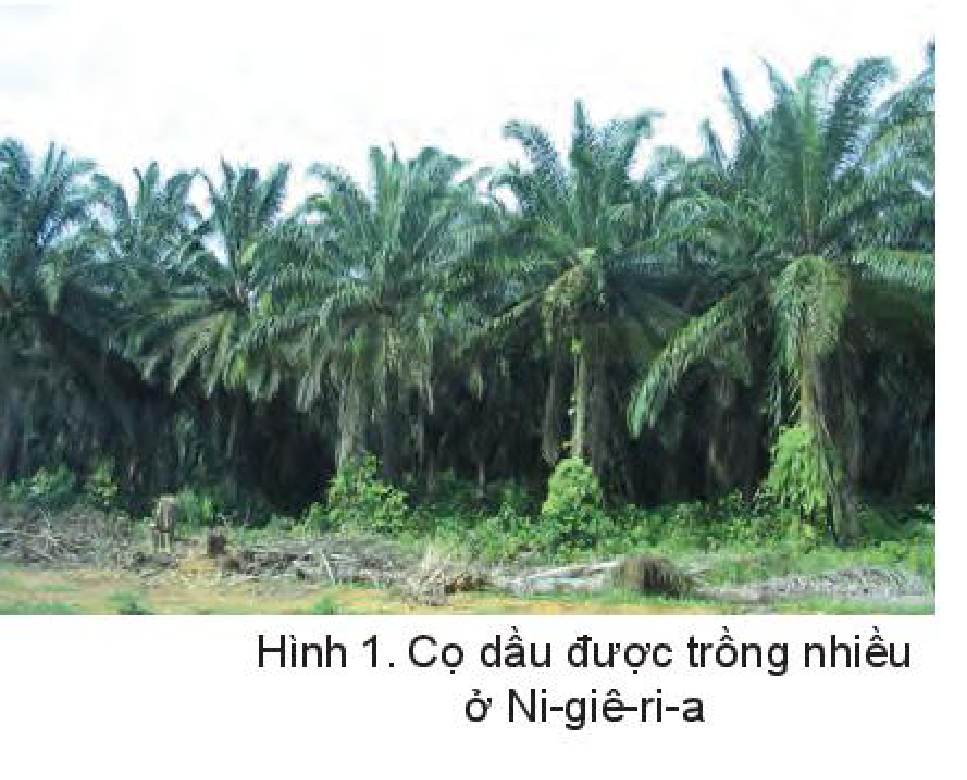
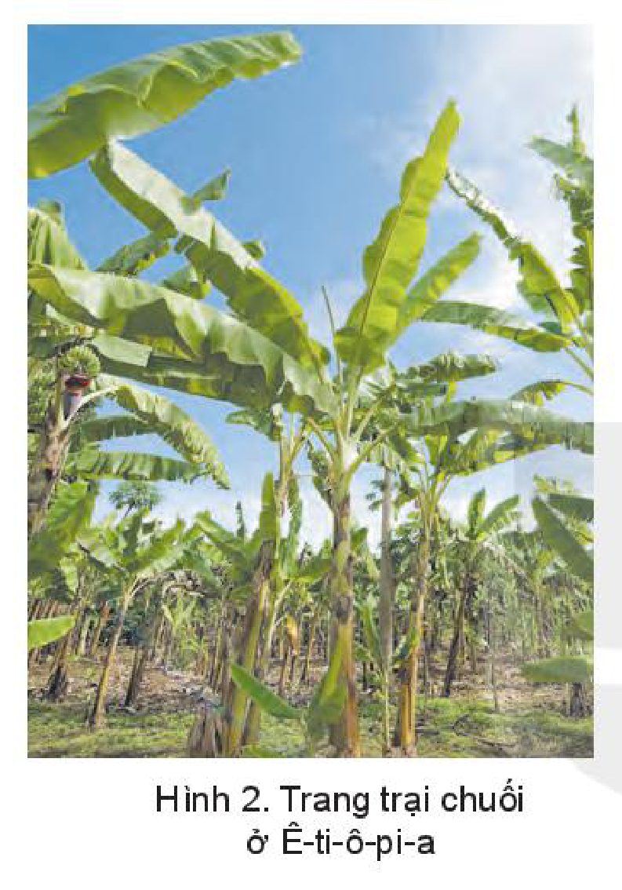
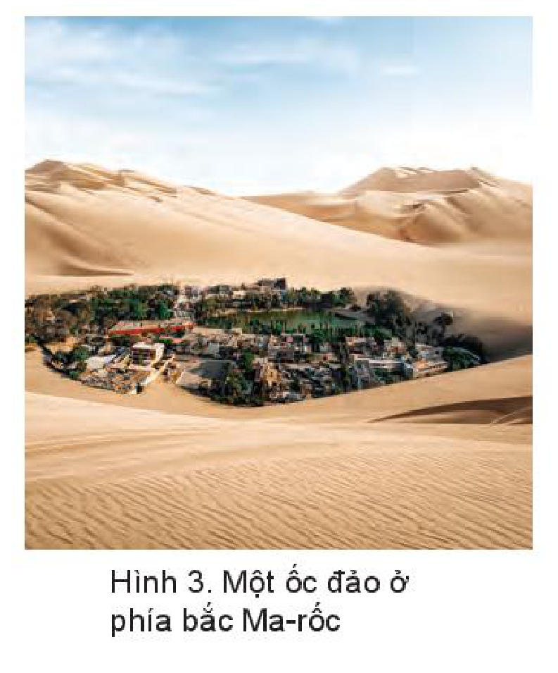
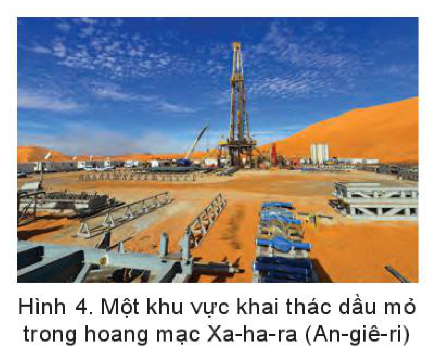
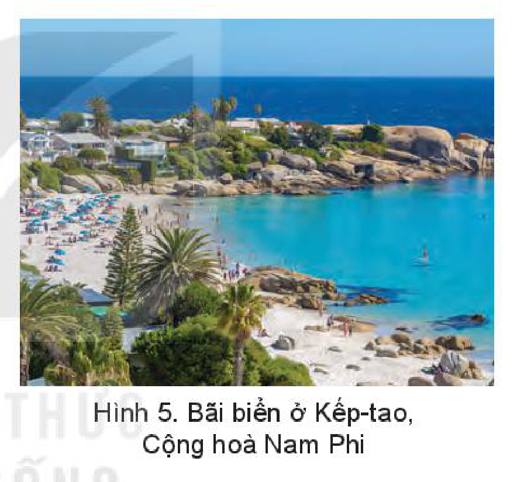

<!-- pdf:136 -->

# BÀI 11: PHƯƠNG THỨC CON NGƯỜI KHAI THÁC, SỬ DỤNG VÀ BẢO VỆ THIÊN NHIÊN Ở CHÂU PHI

## 🎯 Học xong bài này, em sẽ:

- Trình bày được cách thức người dân châu Phi khai thác thiên nhiên ở các môi trường khác nhau.

## 🔴 Mở đầu

Thiên nhiên châu Phi phân hoá thành các môi trường tự nhiên khác nhau. Mỗi môi trường tự nhiên có đặc điểm riêng về khí hậu, đất, nguồn nước, sinh vật,...

Người dân châu Phi sinh sống ở các môi trường đã khai thác, sử dụng và bảo vệ thiên nhiên như thế nào?

## 1. Khai thác, sử dụng và bảo vệ thiên nhiên ở môi trường xích đạo

<!-- term: Chuyên canh cây công nghiệp ở môi trường xích đạo -->
Nhiệt độ và độ ẩm cao ở môi trường xích đạo giúp cho cây trồng phát triển quanh năm, tạo điều kiện trồng gối vụ, xen canh nhiều loại cây. Ở đây đã hình thành các vùng chuyên canh cây công nghiệp (cọ dầu, ca cao,...) theo quy mô lớn nhằm mục đích xuất khẩu hoặc cung cấp nguyên liệu cho các nhà máy chế biến.

Tầng mùn trong đất ở môi trường xích đạo không dày, lớp phủ thực vật lại bị tàn phá nhiều nên mùn dễ bị nước mưa rửa trôi (đặc biệt là ở các sườn dốc của đồi, núi). Vì vậy, việc bảo vệ rừng và trồng rừng là hết sức cần thiết.

> 💡 **Em có biết?**

> Rừng mưa nhiệt đới ở Trung Phi cung cấp các loại gỗ chất lượng tốt (gụ, mun, tếch,...), là sản phẩm xuất khẩu có giá trị. Tuy nhiên, ngành công nghiệp khai thác gỗ lại tàn phá các khu rừng trong khi phải mất rất nhiều năm chúng mới có thể tái sinh. Hầu hết, các công ty khai thác và chế biến gỗ thuộc sở hữu và mang lại lợi nhuận cho nước ngoài.

*Hình 1. Cọ dầu được trồng nhiều ở Ni-giê-ri-a*

> ❓ Đọc thông tin trong mục và quan sát hình 4 (trang 131), hãy:
> - Xác định phạm vi môi trường xích đạo ở châu Phi.
> - Trình bày cách thức con người khai thác, bảo vệ thiên nhiên ở môi trường xích đạo.

<!-- pdf:137 -->

## 2. Khai thác, sử dụng và bảo vệ thiên nhiên ở môi trường nhiệt đới

Tại những khu vực khô hạn như vùng xa van ở Nam Xa-ha-ra, làm nương rẫy vẫn là hình thức canh tác phổ biến, cây trồng chính là lạc, bông, kê,...; chăn nuôi dê, cừu,... theo hình thức chăn thả.

Ở những khu vực có khí hậu nhiệt đới ẩm như Đông Nam Phi, đã hình thành các vùng trồng cây ăn quả (chuối,...) và cây công nghiệp (mía, chè, thuốc lá, bông, cà phê,...) với mục đích xuất khẩu.

> 💡 **Em có biết?**

<!-- term: Cà phê A-ra-bi-ca -->
> Châu Phi là quê hương của cây cà phê. Giống cà phê A-ra-bi-ca của châu Phi nổi tiếng thế giới về hương vị thơm ngon. Châu Phi cũng là thị trường xuất khẩu cà phê A-ra-bi-ca lớn của thế giới.

*Hình 2. Trang trại chuối ở Ê-ti-ô-pi-a*

Hoạt động khai thác và xuất khẩu khoáng sản (vàng, đồng, chì, dầu mỏ, khí tự nhiên,...) có vai trò hết sức quan trọng. Một số nước cũng phát triển công nghiệp chế biến sản phẩm cây nông nghiệp và sản phẩm chăn nuôi.

Ở môi trường nhiệt đới, cần chú ý xây dựng các công trình thuỷ lợi để đảm bảo nguồn nước cho sản xuất nông nghiệp và sinh hoạt của người dân trong mùa khô.

<!-- term: Khu bảo tồn thiên nhiên ở châu Phi -->
Một số quốc gia châu Phi (Kê-ni-a, Tan-da-ni-a,...) đã thành lập các khu bảo tồn thiên nhiên vừa để bảo vệ các hệ sinh thái tự nhiên, vừa phát triển du lịch sinh thái.

> ❓ Đọc thông tin trong mục 2 và quan sát hình 4 (trang 131), hãy:
> - Xác định phạm vi môi trường nhiệt đới ở châu Phi.
> - Trình bày cách thức con người khai thác, bảo vệ thiên nhiên ở môi trường nhiệt đới.

## 3. Khai thác, sử dụng và bảo vệ thiên nhiên ở môi trường hoang mạc

<!-- term: Ốc đảo -->
<!-- term: Chăn nuôi du mục -->
Tại các ốc đảo, nơi có nguồn nước lộ ra, người dân trồng cây ăn quả (cam, chanh và đặc biệt là cây chà là) và một số cây lương thực (lúa mạch,...) trên những mảnh ruộng nhỏ. Do nguồn nước và thức ăn khan hiếm, đàn gia súc (dê, lạc đà,...) được di chuyển từ nơi này đến nơi khác (chăn nuôi du mục). Để vận chuyển hàng hoá và buôn bán xuyên hoang mạc, người ta dùng sức của lạc đà.

Nhờ tiến bộ của kĩ thuật khoan sâu, nhiều mỏ dầu khí lớn, các mỏ khoáng sản và các túi nước ngầm được phát hiện; do đó, nhiều vùng hoang mạc đã thay đổi. Hoạt động du lịch cũng đem lại nguồn thu lớn cho người dân nơi đây.

*Hình 3. Một ốc đảo ở phía bắc Ma-rốc*

<!-- pdf:138 -->

Tuy vậy, biến đổi khí hậu và việc khai thác thiên nhiên không hợp lí của con người đã khiến diện tích hoang mạc ở châu Phi ngày càng mở rộng. Các nước trong khu vực đã có nhiều biện pháp như hợp tác để thành lập “vành đai xanh” chống lại tình trạng hoang mạc hoá,...

*Hình 4. Một khu vực khai thác dầu mỏ trong hoang mạc Xa-ha-ra (An-giê-ri)*

> ❓ Đọc thông tin trong mục 3 và quan sát hình 4 (trang 131), hãy:
> - Xác định phạm vi môi trường hoang mạc ở châu Phi.
> - Trình bày cách thức con người khai thác, bảo vệ thiên nhiên ở môi trường hoang mạc.

## 4. Khai thác, sử dụng và bảo vệ thiên nhiên ở môi trường cận nhiệt

Tận dụng lợi thế khí hậu ở môi trường cận nhiệt, các nước đã trồng các loài cây ăn quả (nho, cam, chanh, ô liu,...) có giá trị xuất khẩu và một số cây lương thực (lúa mì, ngô). Gia súc chính là cừu.

Hoạt động khai thác khoáng sản rất phát triển, khu vực là một trung tâm lớn của thế giới về khai thác dầu (An-giê-ri), đồng thời phát triển công nghiệp khai thác vàng, kim cương (Cộng hoà Nam Phi).

Môi trường cận nhiệt cũng thuận lợi để phát triển các hoạt động du lịch.

*Hình 5. Bãi biển ở Kếp-tao, Cộng hoà Nam Phi*
<!-- ocr-ok: đã đối chiếu ảnh trang gốc 137 (PDF 138), chú thích Hình 5 ở cột phải bị OCR nhận nhầm dấu -->

Vấn đề môi trường được các nước trong khu vực quan tâm là chống khô hạn và hoang mạc hoá.

> ❓ Đọc thông tin trong mục 4 và quan sát hình 4 (trang 131), hãy:
> - Xác định phạm vi môi trường cận nhiệt ở châu Phi.
> - Trình bày cách thức con người khai thác thiên nhiên ở môi trường cận nhiệt.

## ✏️ Luyện tập và Vận dụng

- Hãy lập bảng so sánh cách thức con người khai thác thiên nhiên ở môi trường xích đạo và môi trường nhiệt đới châu Phi.
- Tìm hiểu về hoang mạc Xa-ha-ra.

## 📷 Danh sách hình trong bài

| Mã hình | Trang PDF | Trang sách | Chú thích |
| --- | :---: | :---: | --- |
| H7-lich_su_va_dia_ly-dl-b11-01 | 136 | 135 | Hình 1. Cọ dầu được trồng nhiều ở Ni-giê-ri-a |
| H7-lich_su_va_dia_ly-dl-b11-02 | 137 | 136 | Hình 2. Trang trại chuối ở Ê-ti-ô-pi-a |
| H7-lich_su_va_dia_ly-dl-b11-03 | 137 | 136 | Hình 3. Một ốc đảo ở phía bắc Ma-rốc |
| H7-lich_su_va_dia_ly-dl-b11-04 | 138 | 137 | Hình 4. Một khu vực khai thác dầu mỏ trong hoang mạc Xa-ha-ra (An-giê-ri) |
| H7-lich_su_va_dia_ly-dl-b11-05 | 138 | 137 | Hình 5. Bãi biển ở Kếp-tao, Cộng hoà Nam Phi |
