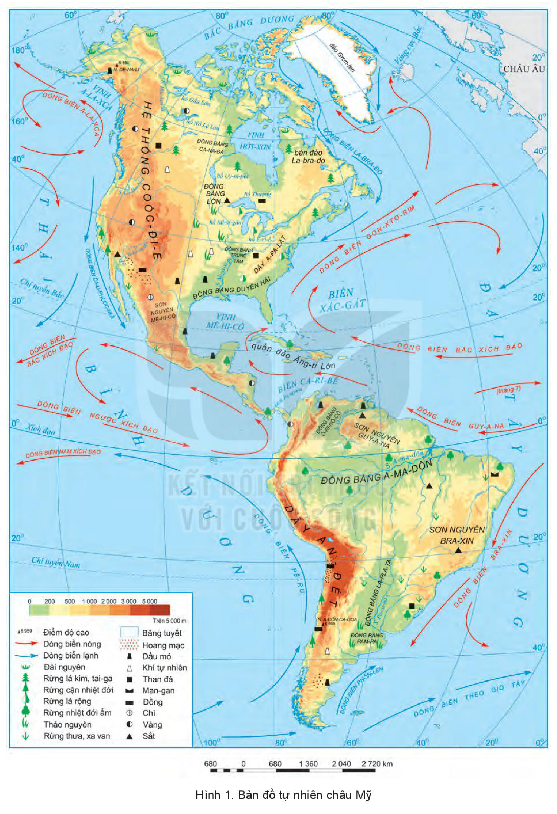

<!-- pdf:140 -->

# BÀI 13: VỊ TRÍ ĐỊA LÍ, PHẠM VI CHÂU MỸ. SỰ PHÁT KIẾN RA CHÂU MỸ

## 🎯 Học xong bài này, em sẽ:

- Trình bày được khái quát về vị trí địa lí, phạm vi châu Mỹ.
- Phân tích được các hệ quả địa lí – lịch sử của việc Cri-xtô-phơ Cô-lôm-bô phát kiến ra châu Mỹ (1492 – 1502).

## 🔴 Mở đầu

Châu Mỹ là vùng đất rộng lớn, có vị trí đặc biệt. Vì thế mãi đến cuối thế kỉ XV, với cuộc thám hiểm của Cri-xtô-phơ Cô-lôm-bô (C. Cô-lôm-bô), châu lục này mới được tìm ra. Vị trí địa lí châu Mỹ có gì đặc biệt? Việc tìm ra châu Mỹ có ý nghĩa như thế nào?

## 1. Vị trí địa lí và phạm vi

<!-- term: Vị trí địa lí châu Mỹ -->
Châu Mỹ rộng khoảng 42 triệu km², lớn thứ hai trên thế giới, sau châu Á. Châu Mỹ nằm tiếp giáp với các đại dương lớn và gần như tách biệt với các châu lục khác. Đây là châu lục duy nhất nằm hoàn toàn ở bán cầu Tây và là châu lục trải dài trên nhiều vĩ độ nhất (phần đất liền khoảng từ 72°B đến 54°N).

<!-- term: Kênh đào Pa-na-ma -->
Châu Mỹ gồm hai lục địa là Bắc Mỹ và Nam Mỹ, được nối với nhau bằng eo đất hẹp Trung Mỹ. Eo đất này hiện đã bị cắt ngang bởi kênh đào Pa-na-ma.

> ❓ Dựa vào thông tin trong mục 1 và hình 1, hãy:
> - Cho biết châu Mỹ tiếp giáp những đại dương nào.
> - Xác định vị trí, phạm vi châu Mỹ.

<!-- pdf:141 -->

*Hình 1. Bản đồ tự nhiên châu Mỹ*

<!-- pdf:142 -->

## 2. Hệ quả địa lí – lịch sử của việc phát kiến ra châu Mỹ

Năm 1492, nhà hàng hải C. Cô-lôm-bô dẫn đầu đoàn thám hiểm rời cảng ở Tây Ban Nha, tiến về phía tây với mục đích tìm đường đi sang châu Á và tình cờ đã phát hiện ra các vùng đất mới.

Chuyến đi của C. Cô-lôm-bô là chuyến đi đầu tiên của người châu Âu vượt Đại Tây Dương, đặt chân đến châu Mỹ và mở ra con đường biển mới đến các châu lục khác.

<!-- term: Hệ quả địa lí – lịch sử của việc phát kiến ra châu Mỹ -->
Cuộc phát kiến của C. Cô-lôm-bô đã tìm ra một châu lục mới (châu Mỹ), mở ra một thời kì khám phá và chinh phục thế giới. Từ sau cuộc phát kiến, người châu Âu bắt đầu xâm chiếm và khai phá châu Mỹ với việc khai thác những nguồn nguyên liệu, khoáng sản quý giá và xây dựng nền văn hoá phương tây trên vùng đất mới này. Cuộc phát kiến cũng đẩy nhanh quá trình di dân từ các châu lục khác đến châu Mỹ.

> 💡 **Em có biết?**

<!-- term: Tân thế giới -->
> C. Cô-lôm-bô là người đầu tiên phát hiện ra châu Mỹ, tuy nhiên ông cho rằng vùng đất này thuộc phía tây Ấn Độ. Sau đó, nhà thám hiểm A-mê-ri-gô Ve-xpu-xi với bốn chuyến hành trình đến châu Mỹ từ năm 1497 đến năm 1503 đã khẳng định đây là một vùng đất mới và gọi vùng đất này là “Tân thế giới”.
<!-- ocr-ok: đã đối chiếu ảnh trang gốc 141 (PDF 142), hộp Em có biết? ở cột phải bị OCR trộn với mục 2 -->

> ❓ Đọc thông tin trong mục 2 và kết hợp hiểu biết của bản thân, hãy phân tích hệ quả địa lí – lịch sử của việc phát kiến ra châu Mỹ.

## ✏️ Luyện tập và Vận dụng

- Dựa vào bản đồ tự nhiên châu Mỹ (trang 140), hãy cho biết lãnh thổ châu Mỹ trải dài khoảng bao nhiêu vĩ độ.
- Tìm hiểu và viết một bài giới thiệu (10 – 15 dòng) về hành trình thám hiểm tìm ra châu Mỹ của C. Cô-lôm-bô.

## 📷 Danh sách hình trong bài

| Mã hình | Trang PDF | Trang sách | Chú thích |
| --- | :---: | :---: | --- |
| H7-lich_su_va_dia_ly-dl-b13-01 | 141 | 140 | Hình 1. Bản đồ tự nhiên châu Mỹ |
