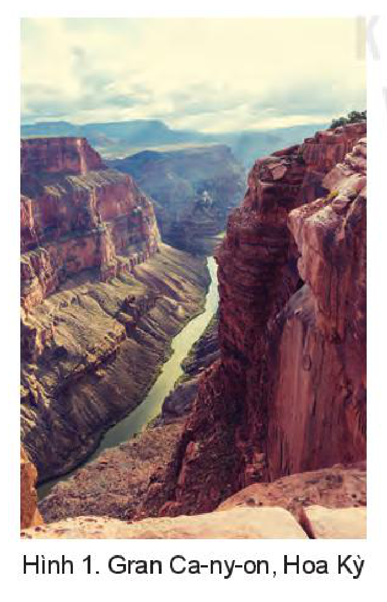
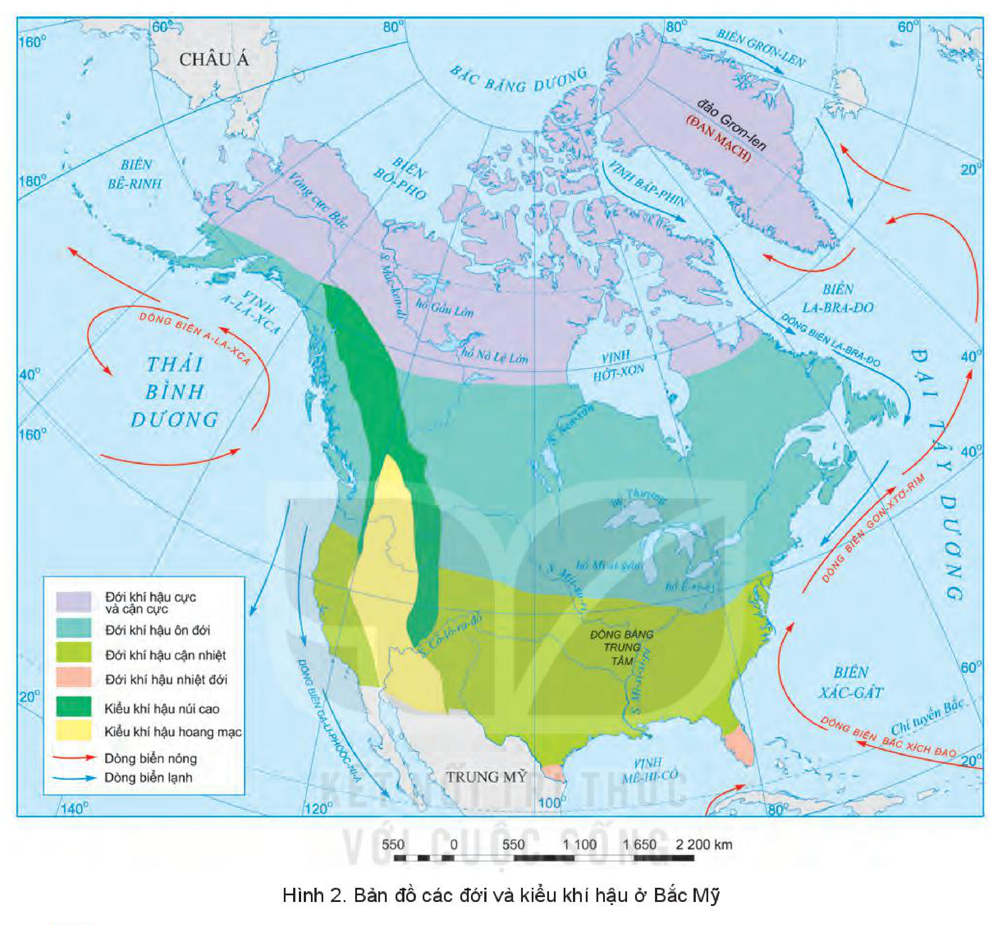
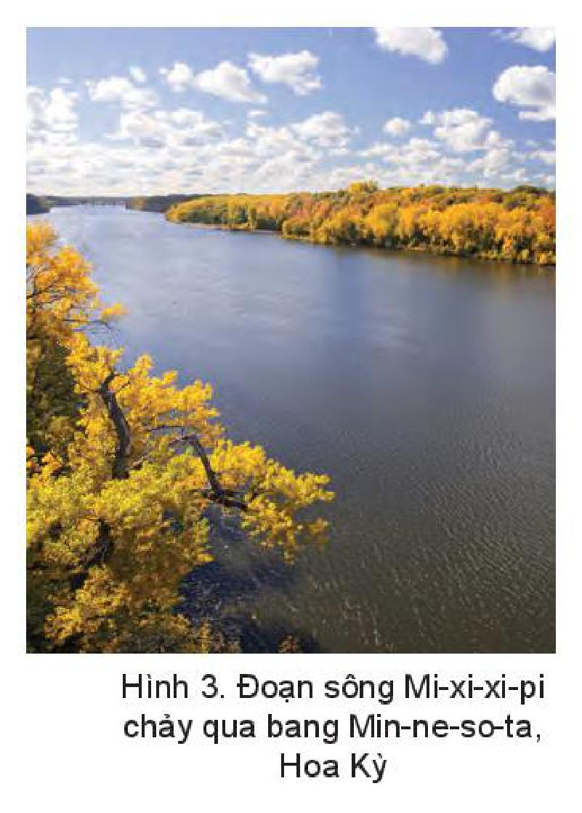

<!-- pdf:143 -->

# BÀI 14: ĐẶC ĐIỂM TỰ NHIÊN BẮC MỸ

## 🎯 Học xong bài này, em sẽ:

- Trình bày được một trong những đặc điểm của tự nhiên: sự phân hoá của địa hình, khí hậu, sông, hồ, các đới thiên nhiên Bắc Mỹ.

## 🔴 Mở đầu

Thiên nhiên Bắc Mỹ phân hoá đa dạng, phức tạp từ bắc xuống nam, từ tây sang đông.

Em hãy nêu một số hiểu biết về thiên nhiên Bắc Mỹ.

## 1. Địa hình

Địa hình Bắc Mỹ gồm ba khu vực rõ rệt:

<!-- term: Miền núi Coóc-đi-e -->
- Miền núi Coóc-đi-e ở phía tây, là một trong những hệ thống núi lớn trên thế giới. Miền núi có độ cao trung bình 3 000 – 4 000 m, kéo dài khoảng 9 000 km theo chiều bắc – nam, gồm nhiều dãy núi chạy song song, xen giữa là các cao nguyên và sơn nguyên.

<!-- term: Miền đồng bằng Bắc Mỹ -->
- Miền đồng bằng ở giữa bao gồm đồng bằng Ca-na-đa, đồng bằng Lớn, đồng bằng Trung Tâm và đồng bằng Duyên Hải, độ cao từ 200 – 500 m, thấp dần từ bắc xuống nam.

<!-- term: Dãy núi A-pa-lát -->
- Sơn nguyên trên bán đảo La-bra-đo và dãy núi A-pa-lát ở phía đông, có hướng đông bắc – tây nam. Dãy A-pa-lát gồm 2 phần: phần bắc có độ cao từ 400 – 500 m; phần nam cao từ 1 000 – 1 500 m.

> 💡 **Em có biết?**

<!-- term: Hẻm vực -->
> Bề mặt các cao nguyên của miền núi Coóc-đi-e bị chia cắt mạnh bởi các thung lũng sông tạo nên các hẻm vực (ca-ny-on). Tiêu biểu nhất là Gran Ca-ny-on dài 446 km, rộng từ 6 – 29 km và sâu 1 600 m.

> ❓ Quan sát hình 1 (trang 140) và đọc thông tin trong mục 1, hãy trình bày sự phân hoá địa hình ở Bắc Mỹ.

## 2. Khí hậu

*Hình 1. Gran Ca-ny-on, Hoa Kỳ*

Do lãnh thổ trải dài từ vùng cực Bắc đến khoảng vĩ tuyến 25°B, khí hậu Bắc Mỹ có sự phân hoá theo chiều bắc – nam, gồm các đới khí hậu cực và cận cực, ôn đới, cận nhiệt và nhiệt đới. Trong đó, đới khí hậu ôn đới có diện tích lớn nhất.

Đồng thời, do ảnh hưởng của địa hình, khí hậu Bắc Mỹ có sự phân hoá theo chiều tây – đông và theo độ cao. Các khu vực ven biển sẽ có khí hậu điều hoà, mưa nhiều; càng vào sâu trong lục địa biên độ nhiệt độ năm càng lớn, mưa ít hơn, khí hậu khô hạn hơn.

<!-- pdf:144 -->

*Hình 2. Bản đồ các đới và kiểu khí hậu ở Bắc Mỹ*

> ❓ Dựa vào thông tin và hình trong mục 2, hãy trình bày sự phân hoá khí hậu của Bắc Mỹ.

## 3. Sông, hồ

Bắc Mỹ có mạng lưới sông khá dày đặc và phân bố khắp lãnh thổ. Sông nhiều nước. Chế độ nước sông khá đa dạng do được cung cấp nước từ nhiều nguồn: mưa, tuyết và băng tan.

Các sông lớn ở Bắc Mỹ gồm: hệ thống sông Mít-xu-ri – Mi-xi-xi-pi, sông Mác-ken-di, sông Cô-lô-ra-đô.

> 💡 **Em có biết?**

<!-- term: Hệ thống sông Mít-xu-ri – Mi-xi-xi-pi -->
> Hệ thống sông Mít-xu-ri – Mi-xi-xi-pi lớn nhất ở Bắc Mỹ (6 400 km) và dài thứ ba thế giới, có vai trò quan trọng đối với khu vực phía nam và đông nam Hoa Kỳ.

<!-- term: Hệ thống Ngũ Hồ -->
> Hệ thống Ngũ Hồ gồm năm hồ: hồ Thượng, hồ Mi-si-gân, hồ Hu-rôn, hồ Ê-ri-ê và hồ Ôn-ta-ri-ô. Hồ Thượng là hồ nước ngọt có diện tích lớn nhất thế giới (hơn 82 000 km²).

<!-- pdf:145 -->

Bắc Mỹ đứng đầu thế giới về số lượng các hồ có diện tích lớn (14 hồ có diện tích trên 5 000 km²). Phần lớn các hồ là hồ nước ngọt. Các hồ lớn như: hệ thống Ngũ Hồ, hồ Uy-ni-pếc, hồ Gấu Lớn, hồ Nô Lệ Lớn,...

*Hình 3. Đoạn sông Mi-xi-xi-pi chảy qua bang Min-ne-so-ta, Hoa Kỳ*

> ❓ Quan sát bản đồ tự nhiên châu Mỹ (trang 140) và đọc thông tin, quan sát hình ảnh trong mục 3, hãy trình bày đặc điểm của sông, hồ ở Bắc Mỹ.

## 4. Đới thiên nhiên

Thiên nhiên Bắc Mỹ chủ yếu nằm trong đới lạnh và đới ôn hoà.

<!-- term: Đới lạnh ở Bắc Mỹ -->
Đới lạnh có khí hậu cực và cận cực, lạnh giá nên nhiều nơi có lớp băng tuyết phủ dày trên diện tích rộng. Ở phía nam khí hậu ấm hơn, có mùa hạ ngắn, thực vật chủ yếu là rêu, địa y, cỏ và cây bụi. Giới động vật nghèo nàn, chỉ có một số loài chịu được lạnh như tuần lộc, cáo Bắc cực,... và một số loài chim di cư.

<!-- term: Đới ôn hoà ở Bắc Mỹ -->
Đới ôn hoà ở Bắc Mỹ chiếm diện tích rộng và có sự phân hoá đa dạng. Phía bắc có khí hậu ôn đới, phát triển rừng lá kim. Phía đông nam, khí hậu cận nhiệt ấm, ẩm hơn phát triển rừng hỗn hợp và rừng lá rộng với thành phần loài rất phong phú. Khu vực ở sâu trong lục địa mưa ít, hình thành thảo nguyên. Trên các cao nguyên của miền núi Coóc-đi-e, khí hậu khô hạn, hình thành hoang mạc và bán hoang mạc. Động vật trong đới ôn hoà phong phú cả về số loài và số lượng mỗi loài, gồm các loài ăn cỏ, ăn thịt, gặm nhấm và bò sát,...; riêng ở vùng hoang mạc và bán hoang mạc, động vật nghèo nàn.

*Hình 4. Rừng lá kim ở Hoa Kỳ*

> ❓ Dựa vào thông tin và hình ảnh trong mục 4, hãy trình bày sự phân hoá thiên nhiên ở Bắc Mỹ.

## ✏️ Luyện tập và Vận dụng

- Xác định vị trí của các thảm thực vật: đài nguyên, rừng lá kim, rừng lá rộng, thảo nguyên trên bản đồ tự nhiên khu vực Bắc Mỹ (trang 140).
- Sưu tầm thông tin, hình ảnh về thiên nhiên Bắc Mỹ.

## 📷 Danh sách hình trong bài

| Mã hình | Trang PDF | Trang sách | Chú thích |
| --- | :---: | :---: | --- |
| H7-lich_su_va_dia_ly-dl-b14-01 | 143 | 142 | Hình 1. Gran Ca-ny-on, Hoa Kỳ |
| H7-lich_su_va_dia_ly-dl-b14-02 | 144 | 143 | Hình 2. Bản đồ các đới và kiểu khí hậu ở Bắc Mỹ |
| H7-lich_su_va_dia_ly-dl-b14-03 | 145 | 144 | Hình 3. Đoạn sông Mi-xi-xi-pi chảy qua bang Min-ne-so-ta, Hoa Kỳ |
| H7-lich_su_va_dia_ly-dl-b14-04 | 145 | 144 | Hình 4. Rừng lá kim ở Hoa Kỳ |
