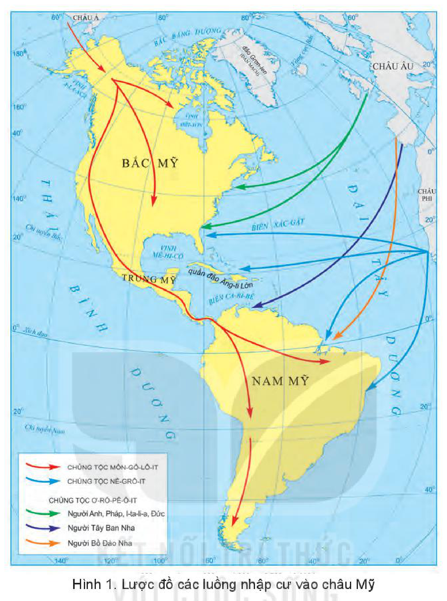
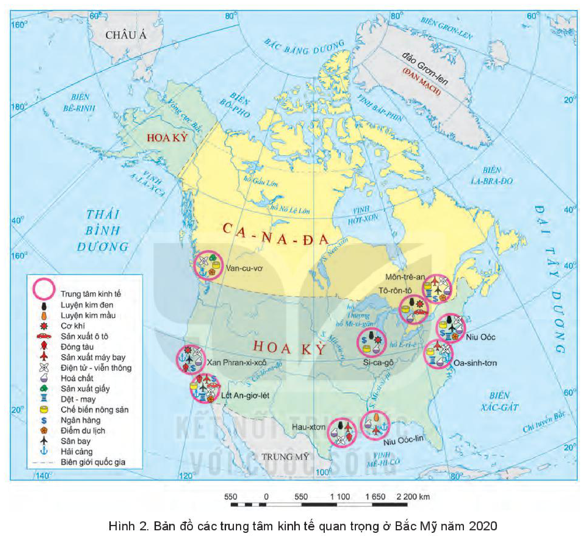

<!-- pdf:146 -->

# BÀI 15: ĐẶC ĐIỂM DÂN CƯ, XÃ HỘI, PHƯƠNG THỨC KHAI THÁC TỰ NHIÊN BỀN VỮNG Ở BẮC MỸ

## 🎯 Học xong bài này, em sẽ:

- Phân tích được một trong những vấn đề dân cư, xã hội ở Bắc Mỹ: vấn đề nhập cư và chủng tộc, vấn đề đô thị hoá.
- Phân tích được phương thức con người khai thác tự nhiên bền vững.
- Xác định được trên bản đồ một số trung tâm kinh tế quan trọng ở Bắc Mỹ.

## 🔴 Mở đầu

Dân cư Bắc Mỹ đa chủng tộc với nhiều nguồn gốc khác nhau. Đây là khu vực phát triển kinh tế nhất thế giới, nhờ vào việc khai thác hiệu quả các nguồn tài nguyên thiên nhiên.

Người dân ở Bắc Mỹ đã khai thác tự nhiên như thế nào để đạt hiệu quả cao?

## 1. Đặc điểm dân cư, xã hội

### a) Vấn đề nhập cư và chủng tộc

<!-- term: Nhập cư và chủng tộc ở Bắc Mỹ -->
Con người cư trú trên lãnh thổ Bắc Mỹ từ cách đây khoảng 20 – 30 nghìn năm. Họ là người Anh-điêng và người E-xki-mô thuộc chủng tộc Môn-gô-lô-it, di cư từ châu Á sang.

<!-- term: Nhập cư và chủng tộc ở Bắc Mỹ -->
Sau cuộc phát kiến ra châu Mỹ năm 1492, người châu Âu thuộc chủng tộc Ơ-rô-pê-ô-it (người Anh, I-ta-li-a, Đức,...) di cư sang Bắc Mỹ ngày càng nhiều. Người da đen thuộc chủng tộc Nê-grô-it từ châu Phi bị bắt sang làm nô lệ, lao động trong các đồn điền trồng bông, thuốc lá,...

<!-- term: Nhập cư và chủng tộc ở Bắc Mỹ -->
Sau Chiến tranh thế giới thứ hai, xuất hiện các đợt di dân từ nhiều khu vực trên thế giới (trong đó có châu Á) vào Bắc Mỹ.

<!-- term: Nhập cư và chủng tộc ở Bắc Mỹ -->
Lịch sử nhập cư đã tạo nên thành phần chủng tộc đa dạng ở Bắc Mỹ. Trong quá trình chung sống, các chủng tộc hoà huyết khiến thành phần dân cư thêm đa dạng.

> ❓ Dựa vào hình 1 và thông tin trong mục a, hãy nêu đặc điểm nhập cư và chủng tộc ở Bắc Mỹ.

<!-- pdf:147 -->

*Hình 1. Lược đồ các luồng nhập cư vào châu Mỹ*

### b) Vấn đề đô thị hoá

<!-- term: Siêu đô thị và dải siêu đô thị ở Bắc Mỹ -->
Sự phát triển mạnh mẽ của công nghiệp đã thúc đẩy quá trình đô thị hoá ở Bắc Mỹ, làm xuất hiện các siêu đô thị và các dải siêu đô thị. Một số đô thị lớn ở Bắc Mỹ năm 2020 là Niu Oóc (18,8 triệu người), Lốt An-giơ-lét (12,4 triệu người), Si-ca-gô (8,9 triệu người), Môn-trê-an (4,2 triệu người),...

TỈ LỆ DÂN ĐÔ THỊ Ở BẮC MỸ VÀ MỘT SỐ CHÂU LỤC TRÊN THẾ GIỚI NĂM 2020

| Khu vực | Bắc Mỹ | Châu Phi | Châu Á | Châu Âu |
| --- | :---: | :---: | :---: | :---: |
| Tỉ lệ dân số đô thị (%) | 82,6 | 43,5 | 51,1 | 74,9 |

<!-- term: Siêu đô thị và dải siêu đô thị ở Bắc Mỹ -->
Các đô thị lớn của Bắc Mỹ chủ yếu tập trung ở phía nam hệ thống Ngũ Hồ và ven Đại Tây Dương, nối tiếp nhau tạo thành hai dải siêu đô thị từ Niu Oóc đến Oa-sinh-tơn và từ Môn-trê-an đến Si-ca-gô. Vào sâu trong nội địa, các đô thị nhỏ hơn và thưa thớt hơn.

> ❓ Dựa vào thông tin và bảng số liệu trong mục b, hãy trình bày đặc điểm đô thị hoá ở Bắc Mỹ.

<!-- pdf:148 -->

## 2. Các trung tâm kinh tế quan trọng

<!-- term: Trung tâm kinh tế ở Bắc Mỹ -->
Kinh tế phát triển mạnh đã hình thành ở Bắc Mỹ nhiều trung tâm kinh tế quan trọng, với cơ cấu ngành đa dạng.

*Hình 2. Bản đồ các trung tâm kinh tế quan trọng ở Bắc Mỹ năm 2020*

> ❓ Quan sát hình 2, hãy:
> - Xác định trên bản đồ các trung tâm kinh tế quan trọng ở Bắc Mỹ.
> - Kể tên các ngành kinh tế ở một số trung tâm.

## 3. Phương thức con người khai thác tự nhiên bền vững ở Bắc Mỹ

<!-- term: Phát triển bền vững -->
Nguồn tài nguyên thiên nhiên ở Bắc Mỹ rất phong phú và đa dạng. Nhờ phương thức khai thác hợp lí và bền vững, Bắc Mỹ phát triển nền kinh tế đa dạng, đời sống cư dân ở mức cao.

<!-- pdf:149 -->

- Phương thức khai thác bền vững tài nguyên đất

<!-- term: Nông nghiệp xanh -->
Bắc Mỹ có nhiều đồng bằng rộng lớn, bằng phẳng, đất đai màu mỡ, đã được khai thác từ rất lâu để trồng trọt và chăn nuôi. Do thời gian dài sử dụng lượng lớn phân bón và thuốc bảo vệ thực vật hoá học, đất đã bị thoái hoá. Hiện nay, các nước Bắc Mỹ đẩy mạnh phát triển nông nghiệp theo hướng “nông nghiệp xanh”, ứng dụng khoa học – công nghệ trong quá trình sản xuất, nhờ đó đem lại năng suất cao, đồng thời bảo vệ tài nguyên đất.

- Phương thức khai thác bền vững tài nguyên nước

<!-- term: Khai thác tổng hợp tài nguyên nước -->
Bắc Mỹ là khu vực có nguồn nước ngọt rất phong phú do có nhiều sông và hồ lớn. Trước đây, nhiều sông hồ ở Bắc Mỹ bị ô nhiễm do chất thải từ hoạt động sản xuất và sinh hoạt. Hiện nay chất lượng nguồn nước được cải thiện nhờ các biện pháp như: quy định xử lí nước thải, ban hành Đạo luật nước sạch,... Bên cạnh đó, tài nguyên nước được khai thác tổng hợp nhằm tăng hiệu quả sử dụng và mang tính bền vững trong khai thác.

- Phương thức khai thác bền vững tài nguyên rừng

Bắc Mỹ sở hữu tài nguyên rừng giàu có, bao gồm: rừng lá kim, rừng hỗn hợp, rừng lá rộng,... Trong thời gian dài, rừng bị khai thác mạnh để lấy gỗ, làm giấy, lấy đất canh tác nên diện tích bị suy giảm nhanh.

<!-- term: Khai thác bền vững tài nguyên rừng -->
Chính phủ Hoa Kỳ và Ca-na-đa đã đưa ra nhiều biện pháp quản lí và khai thác bền vững tài nguyên rừng như: thành lập các vườn quốc gia, khai thác có chọn lọc và để rừng tái sinh tự nhiên, quy định trồng mới sau khi khai thác, phòng chống cháy rừng,...

- Phương thức khai thác bền vững tài nguyên khoáng sản

<!-- term: Năng lượng tái tạo và vật liệu thay thế -->
Bắc Mỹ có nguồn tài nguyên khoáng sản phong phú, dồi dào. Tuy nhiên, việc khai thác với quy mô lớn và sử dụng không hợp lí đã gây ô nhiễm môi trường và một số loại khoáng sản dần trở nên cạn kiệt. Các nước Bắc Mỹ đã có nhiều biện pháp để sử dụng tiết kiệm và hiệu quả tài nguyên khoáng sản, đồng thời đẩy mạnh sử dụng các nguồn năng lượng tái tạo và vật liệu thay thế.

> ❓ Dựa vào thông tin trong mục 3, hãy phân tích phương thức con người khai thác tự nhiên bền vững ở Bắc Mỹ thông qua việc sử dụng tài nguyên rừng, nước, đất, khoáng sản.

## ✏️ Luyện tập và Vận dụng

- Lựa chọn và phân tích một trong những vấn đề dân cư, xã hội ở Bắc Mỹ.
- Tìm hiểu thông tin và chia sẻ với bạn về hoạt động sản xuất nông nghiệp ở khu vực Bắc Mỹ (cách thức canh tác, sản lượng, các trang trại,...).

## 📷 Danh sách hình trong bài

| Mã hình | Trang PDF | Trang sách | Chú thích |
| --- | :---: | :---: | --- |
| H7-lich_su_va_dia_ly-dl-b15-01 | 147 | 146 | Hình 1. Lược đồ các luồng nhập cư vào châu Mỹ |
| H7-lich_su_va_dia_ly-dl-b15-02 | 148 | 147 | Hình 2. Bản đồ các trung tâm kinh tế quan trọng ở Bắc Mỹ năm 2020 |
