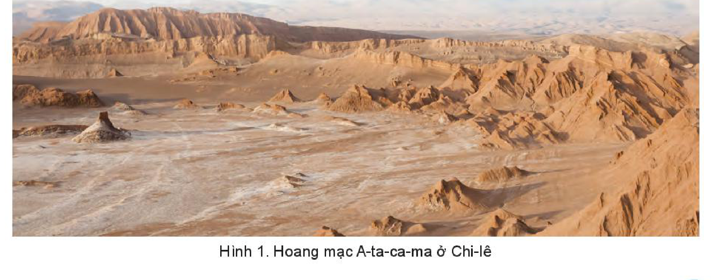
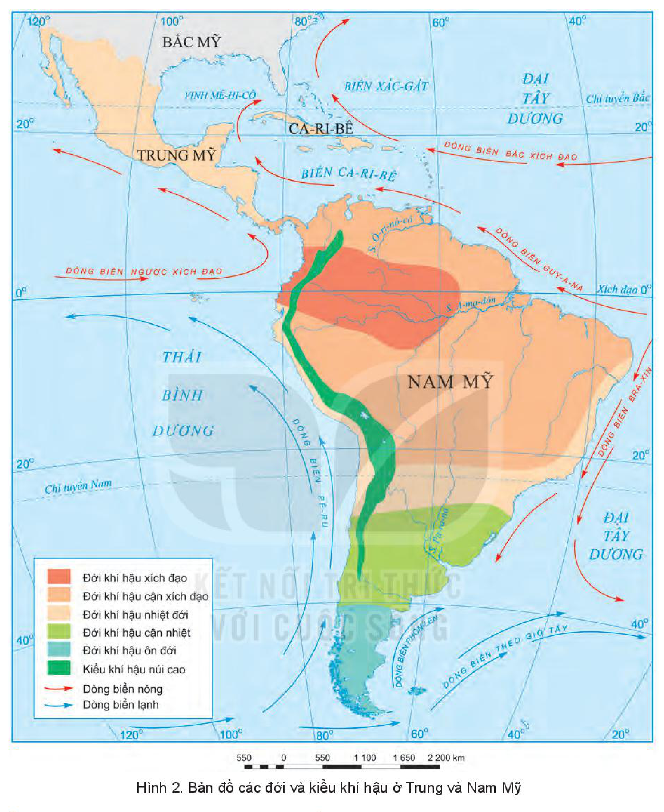
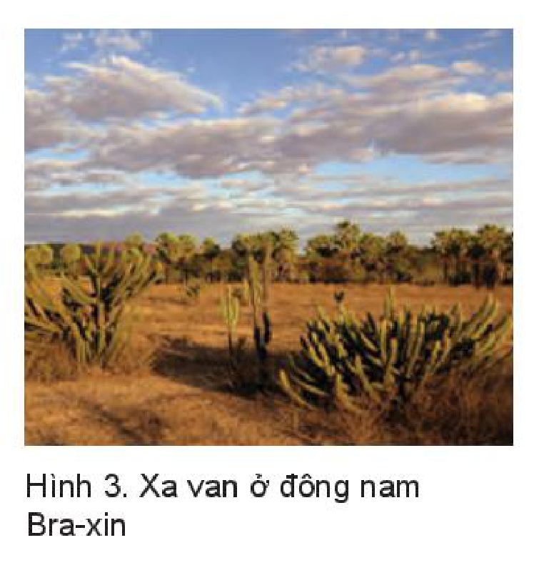
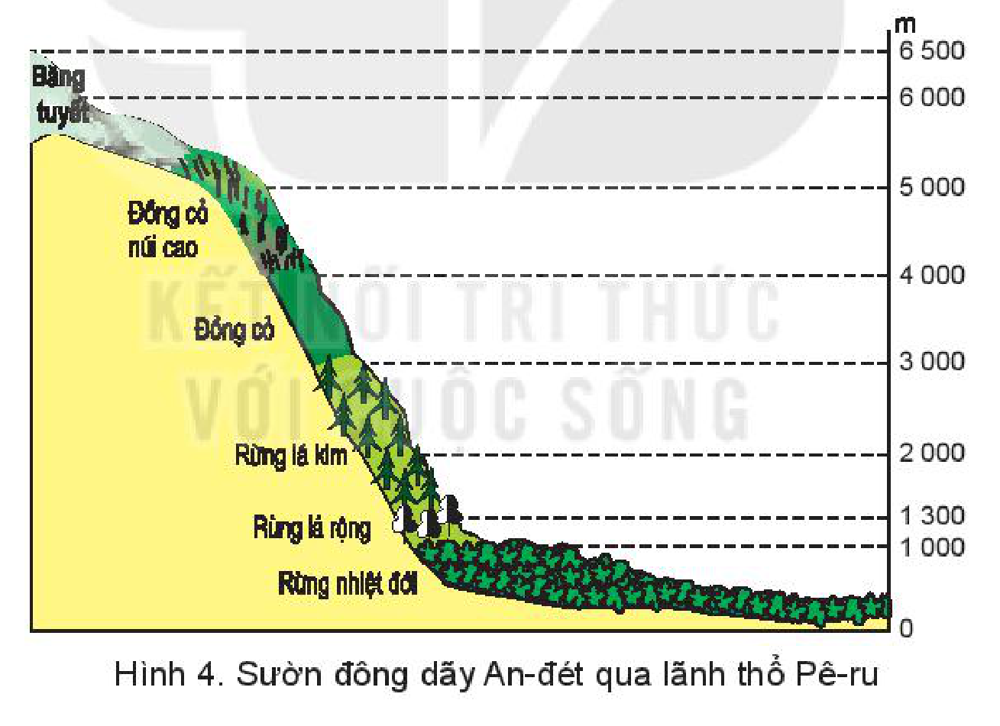

<!-- pdf:150 -->

# BÀI 16: ĐẶC ĐIỂM TỰ NHIÊN TRUNG VÀ NAM MỸ

## 🎯 Học xong bài này, em sẽ:

- Trình bày được sự phân hoá tự nhiên theo chiều đông – tây, theo chiều bắc – nam và theo chiều cao (trên dãy núi An-đét).

## 🔴 Mở đầu

Khu vực Trung và Nam Mỹ gồm Trung Mỹ, các đảo, quần đảo trong vùng biển Ca-ri-bê và toàn bộ lục địa Nam Mỹ. Đây là khu vực có thiên nhiên đa dạng. Hãy nêu một số hiểu biết của em về khu vực Trung và Nam Mỹ.

## 1. Sự phân hoá tự nhiên theo chiều bắc – nam

<!-- term: Sự phân hoá tự nhiên theo chiều bắc – nam ở Trung và Nam Mỹ -->
Thiên nhiên Trung và Nam Mỹ phân hoá theo chiều bắc – nam, thể hiện rõ nét ở sự khác biệt về khí hậu và cảnh quan.

<!-- term: Sự phân hoá tự nhiên theo chiều bắc – nam ở Trung và Nam Mỹ -->
- Đới khí hậu xích đạo: nóng ẩm quanh năm, rừng mưa nhiệt đới phát triển trên diện rộng.
- Đới khí hậu cận xích đạo: một năm có hai mùa (mùa mưa và mùa khô) rõ rệt, thảm thực vật điển hình là rừng thưa nhiệt đới.
- Đới khí hậu nhiệt đới: nóng, lượng mưa giảm dần từ đông sang tây. Cảnh quan cũng thay đổi từ rừng nhiệt đới ẩm đến xa van, cây bụi và hoang mạc.
- Đới khí hậu cận nhiệt: mùa hạ nóng, mùa đông ấm. Nơi mưa nhiều có thảm thực vật điển hình là rừng cận nhiệt và thảo nguyên rừng. Nơi mưa ít có cảnh quan bán hoang mạc và hoang mạc.
- Đới khí hậu ôn đới: mát mẻ quanh năm. Cảnh quan điển hình là rừng hỗn hợp và bán hoang mạc.

> 💡 **Em có biết?**

<!-- term: Hoang mạc A-ta-ca-ma -->
> Hoang mạc A-ta-ca-ma nằm ở phía tây của dãy An-đét, từ 22°N đến 27°N. Lượng mưa ở đây rất thấp, có nơi nhiều năm liền không mưa. A-ta-ca-ma được coi là hoang mạc khô cằn nhất thế giới.
<!-- ocr-ok: đã đối chiếu ảnh trang gốc 149 (PDF 150), hộp Em có biết? ở cột phải bị OCR trộn với câu hỏi cột trái -->

> ❓ Dựa vào thông tin và hình 1, 2 trong mục 1, hãy trình bày sự phân hoá thiên nhiên theo chiều bắc – nam ở Trung và Nam Mỹ.
<!-- ocr-ok: đã đối chiếu ảnh trang gốc 149 (PDF 150), câu hỏi ở cột trái bị OCR trộn với hộp Em có biết? cột phải -->

*Hình 1. Hoang mạc A-ta-ca-ma ở Chi-lê*

<!-- pdf:151 -->

*Hình 2. Bản đồ các đới và kiểu khí hậu ở Trung và Nam Mỹ*

## 2. Sự phân hoá tự nhiên theo chiều đông – tây

- Ở Trung Mỹ, phía đông và các đảo có lượng mưa nhiều hơn phía tây nên thảm rừng mưa nhiệt đới phát triển. Phía tây khô hạn nên chủ yếu là xa van, rừng thưa.
- Ở Nam Mỹ, sự phân hoá tự nhiên theo chiều đông – tây thể hiện rõ nhất ở địa hình:

<!-- term: Sơn nguyên Guy-a-na và sơn nguyên Bra-xin -->
+ Phía đông là các sơn nguyên bị bào mòn mạnh, địa hình chủ yếu là đồi núi thấp. Sơn nguyên Guy-a-na có khí hậu nóng ẩm, rừng rậm rạp; sơn nguyên Bra-xin có khí hậu khô hạn hơn nên cảnh quan rừng thưa và xa van là chủ yếu.

<!-- pdf:152 -->

<!-- term: Đồng bằng A-ma-dôn -->
+ Ở giữa là các đồng bằng rộng và bằng phẳng, bao gồm các đồng bằng: Ô-ri-nô-cô, A-ma-dôn, La Pla-ta và Pam-pa. Đồng bằng A-ma-dôn nằm trong khu vực có khí hậu xích đạo và cận xích đạo nóng ẩm, mưa nhiều nên thảm thực vật rừng mưa nhiệt đới bao phủ, hệ thực – động vật vô cùng phong phú. Các đồng bằng còn lại có mưa ít nên thảm thực vật chủ yếu là xa van, cây bụi.

<!-- term: Miền núi An-đét -->
+ Phía tây là miền núi An-đét cao trung bình 3 000 – 5 000 m, gồm nhiều dãy núi, xen giữa là các thung lũng và cao nguyên. Thiên nhiên có sự khác biệt rõ rệt giữa sườn đông và sườn tây.

*Hình 3. Xa van ở đông nam Bra-xin*
<!-- ocr-ok: đã đối chiếu ảnh trang gốc 151 (PDF 152), chú thích Hình 3 ở cột phải bị OCR nhận thiếu dấu gạch nối -->

> ❓ Dựa vào hình 1 (trang 140) và thông tin trong mục 2, hãy trình bày sự phân hoá tự nhiên theo chiều đông – tây ở Trung và Nam Mỹ.

## 3. Sự phân hoá tự nhiên theo chiều cao

Thiên nhiên miền núi An-đét thay đổi theo chiều cao khá rõ nét.

<!-- term: Sự phân hoá tự nhiên theo chiều cao trên dãy An-đét -->
Ở dưới thấp, vùng Bắc và Trung An-đét thuộc các đới khí hậu nóng và ẩm ướt, có rừng mưa nhiệt đới; vùng Nam An-đét thuộc khí hậu ôn hoà, phát triển rừng cận nhiệt và ôn đới.

<!-- term: Sự phân hoá tự nhiên theo chiều cao trên dãy An-đét -->
Càng lên cao, thiên nhiên càng thay đổi tương ứng với sự thay đổi của nhiệt độ và độ ẩm.

*Hình 4. Sườn đông dãy An-đét qua lãnh thổ Pê-ru*

> ❓ Dựa vào thông tin và quan sát hình 4 trong mục 3, hãy:
> - Kể tên các đai thực vật theo chiều cao của sườn đông dãy An-đét qua lãnh thổ Pê-ru.
> - Cho biết các đai thực vật được phân bố theo độ cao như thế nào.

## ✏️ Luyện tập và Vận dụng

- Trình bày một đặc điểm tự nhiên (địa hình, khí hậu, đới thiên nhiên) ở khu vực Trung và Nam Mỹ.
- Sưu tầm thông tin về kênh đào Pa-na-ma.

## 📷 Danh sách hình trong bài

| Mã hình | Trang PDF | Trang sách | Chú thích |
| --- | :---: | :---: | --- |
| H7-lich_su_va_dia_ly-dl-b16-01 | 150 | 149 | Hình 1. Hoang mạc A-ta-ca-ma ở Chi-lê |
| H7-lich_su_va_dia_ly-dl-b16-02 | 151 | 150 | Hình 2. Bản đồ các đới và kiểu khí hậu ở Trung và Nam Mỹ |
| H7-lich_su_va_dia_ly-dl-b16-03 | 152 | 151 | Hình 3. Xa van ở đông nam Bra-xin |
| H7-lich_su_va_dia_ly-dl-b16-04 | 152 | 151 | Hình 4. Sườn đông dãy An-đét qua lãnh thổ Pê-ru |
