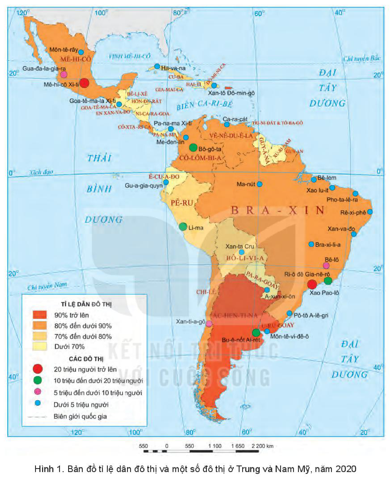
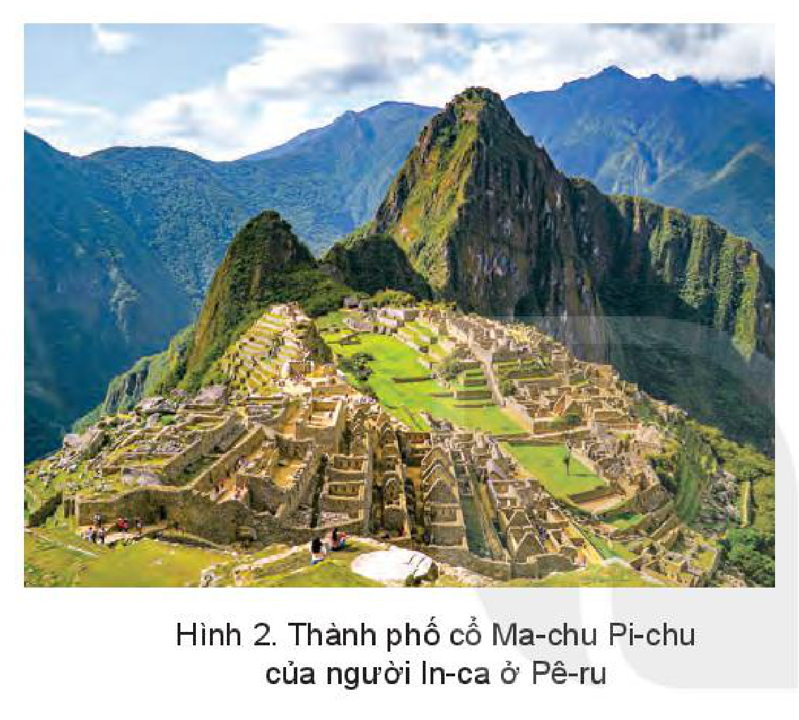
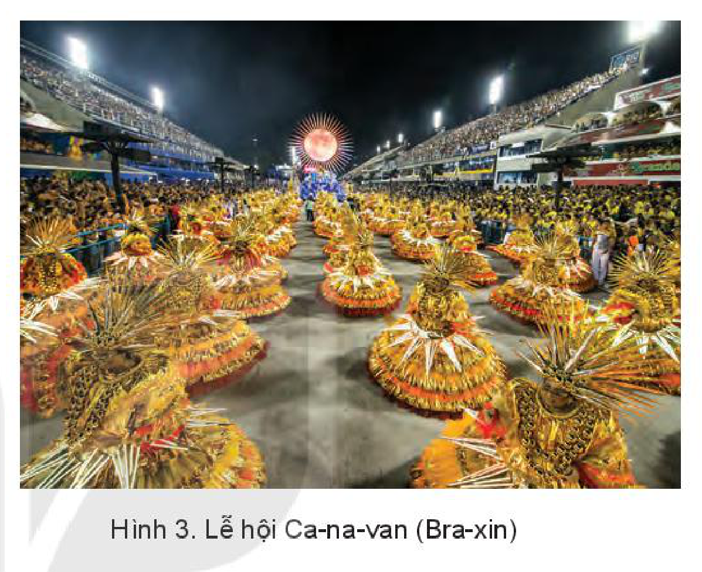
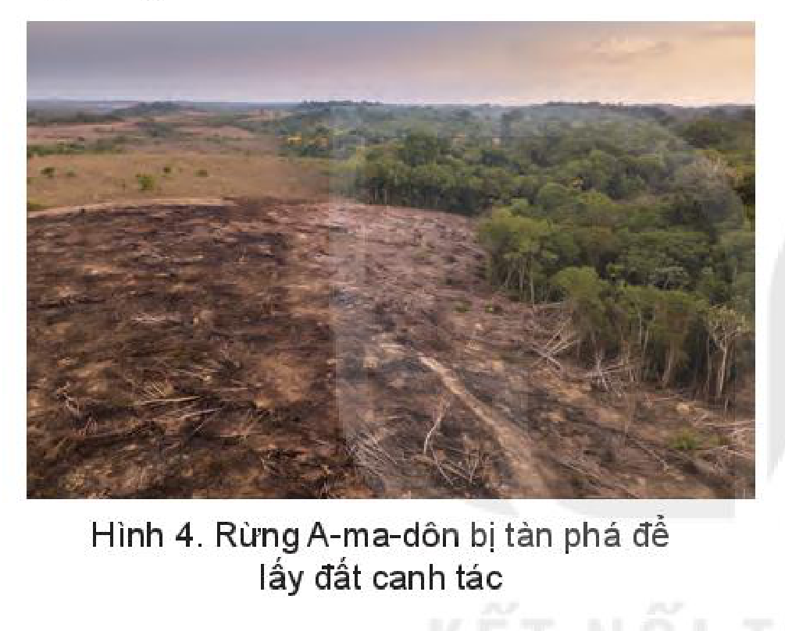
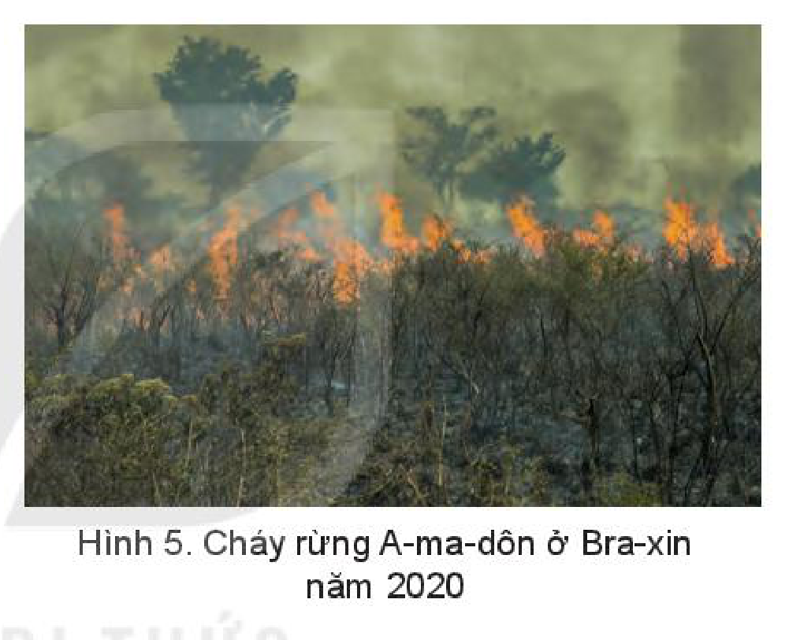

<!-- pdf:153 -->

# BÀI 17: ĐẶC ĐIỂM DÂN CƯ, XÃ HỘI TRUNG VÀ NAM MỸ, KHAI THÁC, SỬ DỤNG VÀ BẢO VỆ RỪNG A-MA-DÔN

## 🎯 Học xong bài này, em sẽ:

- Trình bày được đặc điểm nguồn gốc dân cư Trung và Nam Mỹ, vấn đề đô thị hoá, văn hoá Mỹ La-tinh.
- Trình bày được đặc điểm của rừng nhiệt đới A-ma-dôn. Phân tích được vấn đề khai thác, sử dụng và bảo vệ thiên nhiên thông qua trường hợp rừng A-ma-dôn.

## 🔴 Mở đầu

Khu vực Trung và Nam Mỹ có nền văn hoá Mỹ La-tinh vô cùng đặc sắc. Đây cũng là khu vực có nhiều đô thị đông dân trên thế giới.

Nêu hiểu biết của em về dân cư, xã hội của khu vực Trung và Nam Mỹ.

## 1. Đặc điểm dân cư, xã hội

### a) Nguồn gốc dân cư Trung và Nam Mỹ

Cư dân Trung và Nam Mỹ có nhiều nguồn gốc khác nhau: người Anh-điêng thuộc chủng tộc Môn-gô-lô-it, người Âu thuộc chủng tộc Ơ-rô-pê-ô-it (chủ yếu đến từ Tây Ban Nha và Bồ Đào Nha) và người gốc Phi thuộc chủng tộc Nê-grô-it.

<!-- term: Người lai ở Trung và Nam Mỹ -->
Hiện nay, phần lớn dân cư Trung và Nam Mỹ là người lai do sự hợp huyết giữa người gốc Tây Ban Nha, Bồ Đào Nha với người gốc Phi và người Anh-điêng. Sự hoà trộn này đã tạo nên nền văn hoá Mỹ La-tinh độc đáo, đồng thời là sự tương đồng về dân cư và xã hội giữa các nước Trung và Nam Mỹ.

> ❓ Dựa vào thông tin trong mục a và hình 1 (trang 146), hãy:
> - Xác định các luồng nhập cư vào Trung và Nam Mỹ.
> - Cho biết thành phần chủng tộc của cư dân Trung và Nam Mỹ.

### b) Vấn đề đô thị hoá

Trung và Nam Mỹ là khu vực có tốc độ đô thị hoá nhanh nhất thế giới. Tỉ lệ dân đô thị khoảng 80% số dân (năm 2020). Ở một số nơi của Trung và Nam Mỹ, quá trình đô thị hoá mang tính tự phát đã làm nảy sinh nhiều vấn đề như thất nghiệp, ô nhiễm môi trường, tệ nạn xã hội, tội phạm,...

> ❓ Đọc thông tin và quan sát hình 1 trong mục b, hãy:
> - Trình bày vấn đề đô thị hoá ở Trung và Nam Mỹ.
> - Kể tên và xác định vị trí của các thành phố có từ 10 triệu người trở lên ở Trung và Nam Mỹ.

<!-- pdf:154 -->

*Hình 1. Bản đồ tỉ lệ dân đô thị và một số đô thị ở Trung và Nam Mỹ, năm 2020*

### c) Văn hoá Mỹ La-tinh

Trước khi C. Cô-lôm-bô khám phá ra Tân thế giới, cư dân bản địa ở Trung và Nam Mỹ đã là chủ nhân của nhiều nền văn hoá cổ nổi tiếng: văn hoá May-a, văn hoá In-ca, văn hoá A-dơ-tếch.

<!-- term: Văn hoá Mỹ La-tinh -->
Sau khi người Âu gốc Tây Ban Nha và Bồ Đào Nha sang xâm chiếm, sự pha trộn văn hoá của các tộc người đã hình thành ở Trung và Nam Mỹ một nền văn hoá Mỹ La-tinh độc đáo.

<!-- pdf:155 -->

<!-- term: Văn hoá Mỹ La-tinh -->
Hằng năm, ở đây có rất nhiều lễ hội đặc sắc: Ca-na-van, Ô-ru-rô, La-ti-nô, Pa-rin-tin,... Ngôn ngữ chính là tiếng Tây Ban Nha và Bồ Đào Nha thuộc ngữ hệ La-tinh.

> 💡 **Em có biết?**

> Có khoảng 60% số dân Trung và Nam Mỹ sử dụng tiếng Tây Ban Nha, 34% số dân sử dụng tiếng Bồ Đào Nha, còn lại là các ngôn ngữ khác.
>
> Các điệu nhảy La-tinh có ý nghĩa đặc biệt đối với văn hoá Mỹ La-tinh. Không chỉ đóng vai trò là một hình thức giải trí, nó đã trở thành bản sắc văn hoá của các quốc gia Mỹ La-tinh.

*Hình 2. Thành phố cổ Ma-chu Pi-chu của người In-ca ở Pê-ru*

*Hình 3. Lễ hội Ca-na-van (Bra-xin)*

> ❓ Dựa vào thông tin và hình ảnh trong mục c, hãy nêu những nét đặc sắc của văn hoá Mỹ La-tinh.

## 2. Khai thác, sử dụng và bảo vệ rừng A-ma-dôn

### a) Đặc điểm rừng A-ma-dôn

<!-- term: Rừng A-ma-dôn -->
Khu vực rừng A-ma-dôn ở lục địa Nam Mỹ có diện tích hơn 5 triệu km², là rừng nhiệt đới rộng nhất thế giới, tập trung chủ yếu ở Bra-xin và Cô-lôm-bi-a. Khí hậu nóng ẩm quanh năm nên sinh vật rất phong phú.

<!-- term: Cấu trúc tầng rừng A-ma-dôn -->
Rừng phát triển nhiều tầng. Tầng trên (tầng vượt tán) là các loài cây thân gỗ cao 50 – 60 m. Tầng tán phần lớn là các cây gỗ cao 30 – 45 m. Tầng dưới tán chủ yếu là cây bụi, thảo mộc, cây gỗ nhỏ và các loài dây leo. Tầng thảm tươi là nơi sinh sống của các loài ưa bóng tối.

Trong rừng A-ma-dôn, động vật cũng rất phong phú gồm các loài sống trên cây, leo trèo giỏi, nhiều loài chim, vô số các côn trùng và nhiều loài sống dưới nước.

<!-- term: Rừng A-ma-dôn -->
Rừng A-ma-dôn được xem là “lá phổi xanh” của Trái Đất, là nguồn dự trữ sinh học quý giá, giúp điều hoà khí hậu, cân bằng sinh thái toàn cầu.

> ❓ Đọc thông tin trong mục a, hãy nêu khái quát đặc điểm rừng A-ma-dôn.

<!-- pdf:156 -->

### b) Vấn đề khai thác, sử dụng và bảo vệ rừng A-ma-dôn

Trong nhiều năm qua, con người đã khai phá rừng A-ma-dôn để lấy gỗ, lấy đất canh tác, khai thác khoáng sản và làm đường giao thông khiến diện tích rừng A-ma-dôn bị suy giảm. Bên cạnh đó, các vụ cháy rừng cũng làm diện tích rừng mất đi đáng kể.

DIỆN TÍCH RỪNG A-MA-DÔN Ở BRA-XIN GIAI ĐOẠN 1970 – 2019

| Năm | 1970 | 1990 | 2000 | 2010 | 2019 |
| --- | :---: | :---: | :---: | :---: | :---: |
| Diện tích *(triệu km²)* | 4,0 | 3,79 | 3,6 | 3,43 | 3,39 |

<!-- term: Bảo vệ rừng A-ma-dôn -->
Bảo vệ rừng A-ma-dôn là nhiệm vụ cấp bách và quan trọng trong bối cảnh diện tích rừng bị suy giảm nhanh chóng. Các quốc gia trong khu vực rừng A-ma-dôn đã có nhiều biện pháp bảo vệ rừng: tăng cường giám sát hoạt động khai thác rừng; trồng phục hồi rừng; tuyên truyền và đẩy mạnh vai trò của người dân bản địa trong việc bảo vệ rừng.

*Hình 4. Rừng A-ma-dôn bị tàn phá để lấy đất canh tác*

*Hình 5. Cháy rừng A-ma-dôn ở Bra-xin năm 2020*

> ❓ Dựa vào bảng số liệu và thông tin trong mục b, hãy:
> - Nhận xét sự thay đổi diện tích rừng A-ma-dôn ở Bra-xin giai đoạn 1970 – 2019.
> - Nêu nguyên nhân của việc suy giảm rừng A-ma-dôn.
> - Nêu một số biện pháp bảo vệ rừng A-ma-dôn.

## ✏️ Luyện tập và Vận dụng

- Trình bày một đặc điểm dân cư, xã hội ở khu vực Trung và Nam Mỹ.
- Tìm hiểu một nét văn hoá Mỹ La-tinh và chia sẻ với các bạn.

## 📷 Danh sách hình trong bài

| Mã hình | Trang PDF | Trang sách | Chú thích |
| --- | :---: | :---: | --- |
| H7-lich_su_va_dia_ly-dl-b17-01 | 154 | 153 | Hình 1. Bản đồ tỉ lệ dân đô thị và một số đô thị ở Trung và Nam Mỹ, năm 2020 |
| H7-lich_su_va_dia_ly-dl-b17-02 | 155 | 154 | Hình 2. Thành phố cổ Ma-chu Pi-chu của người In-ca ở Pê-ru |
| H7-lich_su_va_dia_ly-dl-b17-03 | 155 | 154 | Hình 3. Lễ hội Ca-na-van (Bra-xin) |
| H7-lich_su_va_dia_ly-dl-b17-04 | 156 | 155 | Hình 4. Rừng A-ma-dôn bị tàn phá để lấy đất canh tác |
| H7-lich_su_va_dia_ly-dl-b17-05 | 156 | 155 | Hình 5. Cháy rừng A-ma-dôn ở Bra-xin năm 2020 |
