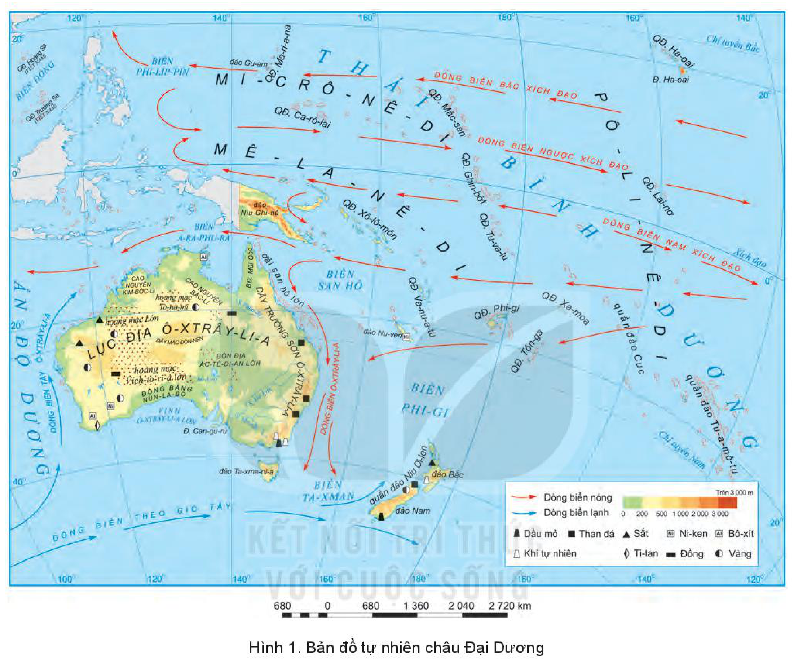
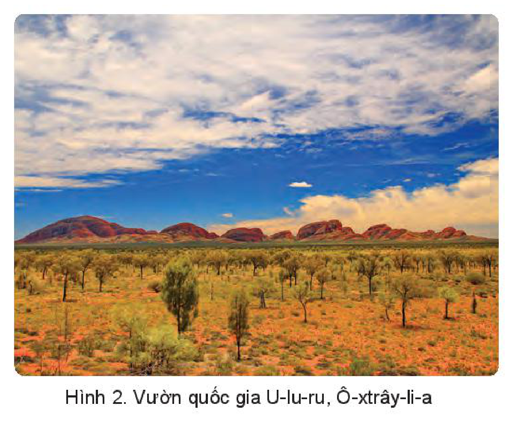
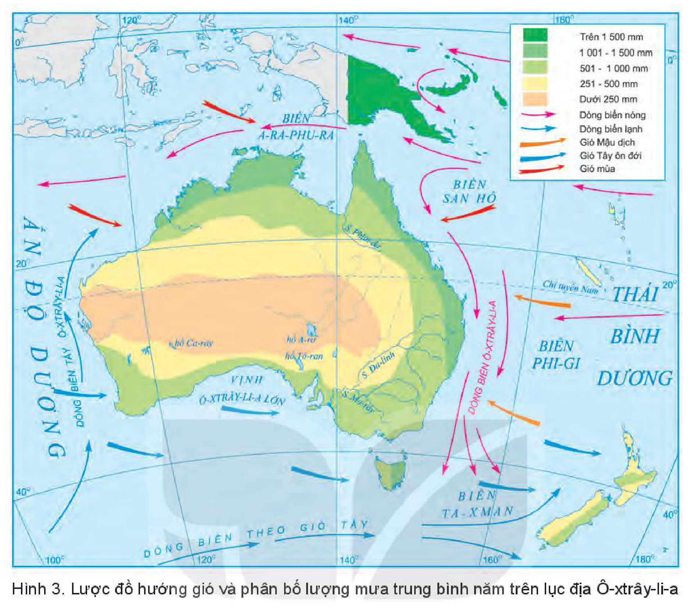
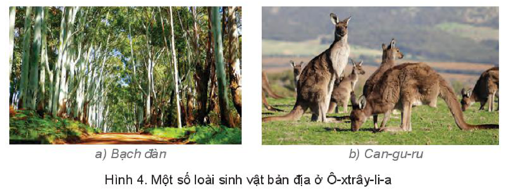
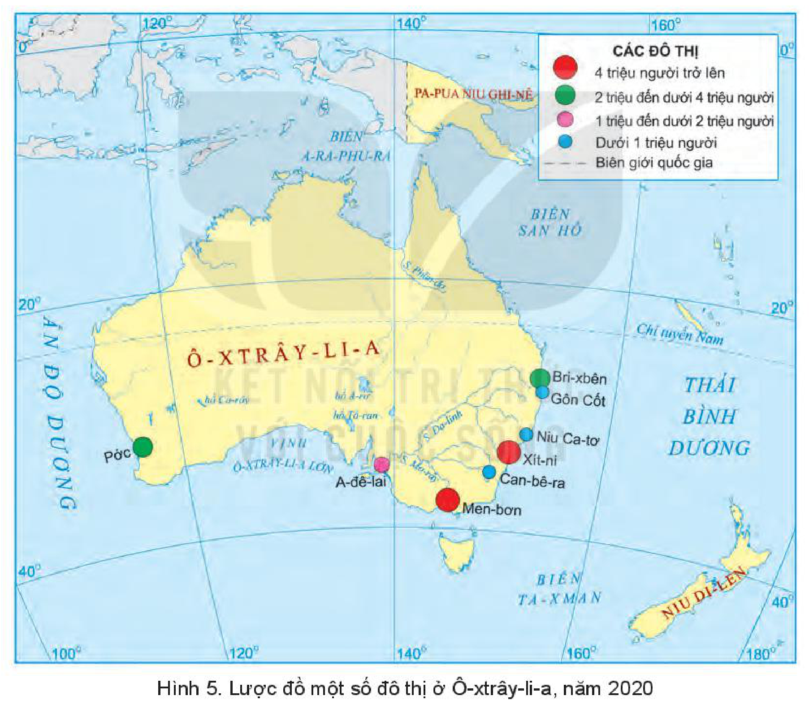
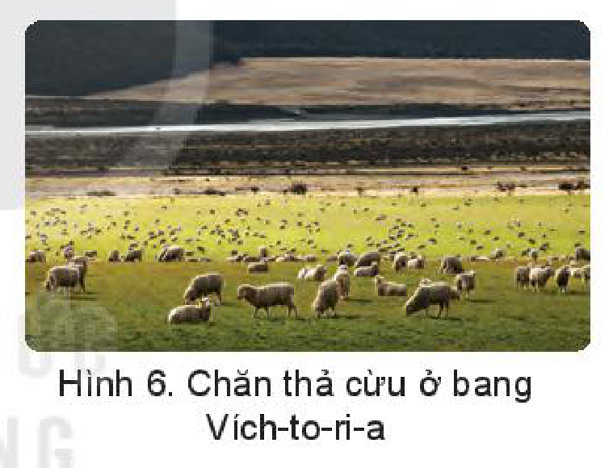

<!-- pdf:157 -->

# BÀI 18: CHÂU ĐẠI DƯƠNG

## 🎯 Học xong bài này, em sẽ:

- Xác định được các bộ phận của châu Đại Dương; vị trí địa lí, hình dạng và kích thước lục địa Ô-xtrây-li-a.
- Xác định được trên bản đồ các khu vực địa hình và khoáng sản của châu Đại Dương. Phân tích được đặc điểm khí hậu Ô-xtrây-li-a, những nét đặc sắc của tài nguyên sinh vật ở Ô-xtrây-li-a.
- Trình bày được đặc điểm dân cư, một số vấn đề về lịch sử và văn hoá độc đáo của Ô-xtrây-li-a.
- Phân tích được phương thức con người khai thác, sử dụng và bảo vệ thiên nhiên ở Ô-xtrây-li-a.

## 🔴 Mở đầu

Từ thế kỉ I, nhà khoa học cổ Hy Lạp Ptô-lê-mê đã dự đoán về sự tồn tại của một lục địa nằm ở phía nam Ấn Độ Dương mà ông gọi là Ô-xtrây-li-a. Tuy nhiên, mãi đến thế kỉ XVIII, cùng với sự phát triển của ngành hàng hải, người châu Âu mới đặt chân lên lục địa này.

Hãy nêu những hiểu biết của em về thiên nhiên và xã hội của châu Đại Dương.

## 1. Vị trí địa lí, phạm vi châu Đại Dương

<!-- term: Châu Đại Dương -->
Châu Đại Dương gồm hai bộ phận:

<!-- term: Châu Đại Dương -->
<!-- term: Lục địa Ô-xtrây-li-a -->
- Lục địa Ô-xtrây-li-a nằm ở phía tây nam Thái Bình Dương, thuộc bán cầu Nam. Tuy có diện tích nhỏ (chỉ gần 7,7 triệu km²) nhưng do bờ biển ít bị chia cắt nên lục địa Ô-xtrây-li-a có dạng hình khối rõ rệt, từ bắc xuống nam dài hơn 3 000 km và từ tây sang đông, nơi rộng nhất khoảng 4 000 km.

<!-- pdf:158 -->

<!-- term: Châu Đại Dương -->
<!-- term: Vùng đảo châu Đại Dương -->
- Vùng đảo châu Đại Dương nằm ở trung tâm Thái Bình Dương, bao gồm bốn khu vực (Mê-la-nê-di, Mi-crô-nê-di, Pô-li-nê-di, Niu Di-len) trải trên một không gian rất rộng trên đại dương và có số lượng đảo rất lớn nhưng hầu hết là các đảo nhỏ. Tổng diện tích các đảo chỉ khoảng 1 triệu km².

*Hình 1. Bản đồ tự nhiên châu Đại Dương*

> ❓ Dựa vào thông tin trong mục 1 và hình 1, hãy:
> - Xác định trên hình 1 vị trí của lục địa Ô-xtrây-li-a và các khu vực của vùng đảo châu Đại Dương.
> - Nêu đặc điểm vị trí địa lí, hình dạng và kích thước của lục địa Ô-xtrây-li-a.

## 2. Đặc điểm tự nhiên

### a) Địa hình và khoáng sản

- Lục địa Ô-xtrây-li-a gồm ba khu vực địa hình và khoáng sản có đặc điểm rất khác nhau:

<!-- term: Vùng sơn nguyên tây Ô-xtrây-li-a -->
+ Phía tây là vùng sơn nguyên tây Ô-xtrây-li-a, độ cao trung bình dưới 500 m. Trên bề mặt là các hoang mạc cát, hoang mạc đá, cao nguyên và núi thấp, như cao nguyên Bác-li, cao nguyên Kim-bơc-li, hoang mạc Vích-to-ri-a lớn,... Đây là nơi tập trung nhiều mỏ kim loại (sắt, đồng, vàng, ni-ken, bô-xít,...).

<!-- pdf:159 -->

<!-- term: Vùng đồng bằng Trung tâm -->
+ Ở giữa có tên gọi là vùng đồng bằng Trung tâm, lớn nhất là bồn địa Ác-tê-di-an lớn. Độ cao trung bình dưới 200 m, rất khô hạn, bề mặt có nhiều bãi đá, đồng bằng cát, đụn cát. Nhiều nơi hoang vắng, không có người sinh sống.

<!-- term: Dãy Trường Sơn Ô-xtrây-li-a -->
+ Phía đông là dãy Trường Sơn Ô-xtrây-li-a, cao trung bình 800 – 1 000 m. Sườn đông dốc, sườn tây thoải dần về phía vùng đồng bằng Trung tâm. Là nơi tập trung nhiều khoáng sản nhiên liệu (than đá, dầu mỏ, khí tự nhiên).

*Hình 2. Vườn quốc gia U-lu-ru, Ô-xtrây-li-a*

<!-- term: Đảo núi cao gần lục địa Ô-xtrây-li-a -->
<!-- term: Đảo núi lửa và đảo san hô xa bờ -->
- Các đảo, quần đảo nằm gần lục địa Ô-xtrây-li-a hầu hết là các đảo núi cao. Trên các đảo có nhiều loại khoáng sản: vàng, sắt, than đá, dầu mỏ,... Các đảo và quần đảo nằm xa bờ đều là các đảo nhỏ, thấp, cấu tạo chủ yếu bởi các đá núi lửa hoặc đá vôi san hô, rất nghèo khoáng sản.

> ❓ Dựa vào thông tin trong mục a và hình 1, hãy:
> - Xác định vị trí và nêu đặc điểm của các khu vực địa hình trên lục địa Ô-xtrây-li-a.
> - Kể tên các loại khoáng sản ở các khu vực địa hình.

### b) Khí hậu

<!-- term: Khí hậu Ô-xtrây-li-a -->
Hầu hết diện tích lục địa Ô-xtrây-li-a thuộc đới nóng. Tuy nhiên, khí hậu có sự thay đổi từ bắc xuống nam và từ đông sang tây.

<!-- term: Khí hậu Ô-xtrây-li-a -->
- Dải bờ biển hẹp phía bắc lục địa có khí hậu cận xích đạo, nhìn chung nóng, ẩm và mưa nhiều. Lượng mưa từ 1 000 – 1 500 mm/năm.

<!-- term: Khí hậu Ô-xtrây-li-a -->
- Khí hậu nhiệt đới chiếm phần lớn diện tích lục địa, nhưng có sự khác biệt từ đông sang tây.

<!-- term: Khí hậu Ô-xtrây-li-a -->
+ Sườn đông dãy Trường Sơn Ô-xtrây-li-a có khí hậu nhiệt đới ẩm, mưa nhiều. Thời tiết mát mẻ. Lượng mưa từ 1 000 – 1 500 mm/năm.

<!-- term: Khí hậu Ô-xtrây-li-a -->
+ Từ sườn tây của dãy Trường Sơn Ô-xtrây-li-a đến bờ tây lục địa là một vùng rộng lớn, có khí hậu nhiệt đới lục địa khắc nghiệt. Độ ẩm rất thấp, ít mưa (ở trung tâm, lượng mưa dưới 250 mm/năm). Mùa hạ nóng, mùa đông tương đối lạnh.

<!-- term: Khí hậu Ô-xtrây-li-a -->
- Dải đất hẹp phía nam lục địa có khí hậu cận nhiệt đới. Nhìn chung, mùa hạ nóng, mùa đông ấm áp. Lượng mưa dưới 1 000 mm/năm.

<!-- term: Khí hậu Ô-xtrây-li-a -->
- Phía nam của đảo Ta-xma-ni-a có khí hậu ôn đới.

> ❓ Dựa vào thông tin và hình 3 trong mục b, hãy phân tích đặc điểm khí hậu của Ô-xtrây-li-a.

<!-- pdf:160 -->

*Hình 3. Lược đồ hướng gió và phân bố lượng mưa trung bình năm trên lục địa Ô-xtrây-li-a*

### c) Sinh vật

<!-- term: Sinh vật bản địa Ô-xtrây-li-a -->
Nằm tách biệt với các lục địa khác từ cách đây hàng chục triệu năm, Ô-xtrây-li-a có giới sinh vật tuy nghèo về thành phần loài nhưng lại có nhiều nét đặc sắc và mang tính địa phương cao. Các loài thực vật bản địa nổi bật là keo và bạch đàn. Riêng bạch đàn có tới 600 loài khác nhau.

<!-- term: Thú có túi -->
Giới động vật vô cùng độc đáo, đặc sắc nhất là hơn 100 loài thú có túi. Các loài động vật mang tính biểu tượng quốc gia là gấu túi, đà điểu Ô-xtrây-li-a, thú mỏ vịt, chuột túi.

*Hình 4. Một số loài sinh vật bản địa ở Ô-xtrây-li-a*

> ❓ Dựa vào thông tin và hình ảnh trong mục c, hãy nêu những nét đặc sắc của sinh vật ở Ô-xtrây-li-a.

<!-- pdf:161 -->

## 3. Dân cư, một số vấn đề về lịch sử và văn hoá của Ô-xtrây-li-a

### a) Dân cư

<!-- term: Đặc điểm dân cư Ô-xtrây-li-a -->
Ô-xtrây-li-a là nơi có ít dân sinh sống (số dân năm 2020 là 25,5 triệu người) và mật độ dân số cũng rất thấp (chỉ khoảng 3 người/km²).

<!-- term: Đặc điểm dân cư Ô-xtrây-li-a -->
Dân cư phân bố rất không đều. Đại bộ phận dân cư tập trung ở các vùng duyên hải phía đông, đông nam và tây nam. Trái lại, nhiều khu vực rộng lớn ở sơn nguyên phía tây Ô-xtrây-li-a và vùng đồng bằng Trung tâm hầu như không có người ở.

<!-- term: Đặc điểm dân cư Ô-xtrây-li-a -->
Mức độ đô thị hoá của Ô-xtrây-li-a rất cao. Tỉ lệ dân thành thị là 86% (năm 2020). Các thành phố lớn là Xít-ni, Men-bơn, Bri-xbên, Pớc, A-đê-lai, Can-bê-ra đều nằm ở ven biển phía đông và phía nam Ô-xtrây-li-a.

<!-- term: Đặc điểm dân cư Ô-xtrây-li-a -->
Ô-xtrây-li-a là đất nước của những người nhập cư. Nơi đây đón nhận người nhập cư (đặc biệt là lao động chất lượng cao) đến từ mọi châu lục.

*Hình 5. Lược đồ một số đô thị ở Ô-xtrây-li-a, năm 2020*

> ❓ 1. Dựa vào thông tin ở mục a, hãy nêu những đặc điểm về dân cư của Ô-xtrây-li-a.
> 2. Quan sát lược đồ hình 5, nêu đặc điểm phân bố các thành phố lớn ở Ô-xtrây-li-a.

### b) Một số vấn đề về lịch sử và văn hoá của Ô-xtrây-li-a

- Người bản địa đã sinh sống trên lục địa Ô-xtrây-li-a từ cách đây khoảng 10 000 năm. Cuối thế kỉ XVIII, thực dân Anh xâm chiếm Ô-xtrây-li-a. Từ năm 1901, Ô-xtrây-li-a trở thành nhà nước liên bang, độc lập trong khối Liên hiệp Anh.

<!-- pdf:162 -->

<!-- term: Văn hoá đa sắc tộc ở Ô-xtrây-li-a -->
- Ô-xtrây-li-a là quốc gia đa dân tộc, đa tôn giáo, đa văn hoá. Đây là đất nước có nền văn hoá độc đáo, đa dạng nhờ tồn tại cộng đồng dân cư đa sắc tộc (hơn 150 sắc tộc cùng sinh sống). Ở đây có sự dung hoà giữa nhiều nét văn hoá khác nhau trên thế giới với văn hoá bản địa. Bên cạnh tiếng Anh là ngôn ngữ chính thức, còn có hơn 300 loại ngôn ngữ khác được sử dụng trong giao tiếp (tiêu biểu là tiếng Hoa, tiếng I-ta-li-a, tiếng A-rập, tiếng Hy Lạp, các ngôn ngữ bản địa,...).

> ❓ Đọc thông tin trong mục b, hãy trình bày một số nét độc đáo về lịch sử và văn hoá của Ô-xtrây-li-a.

## 4. Phương thức con người khai thác, sử dụng và bảo vệ thiên nhiên ở Ô-xtrây-li-a

<!-- term: Phương thức khai thác, sử dụng và bảo vệ thiên nhiên ở Ô-xtrây-li-a -->
Để phù hợp với điều kiện khí hậu khô hạn, đồng cỏ thưa,... ngành chăn nuôi gia súc (đặc biệt là cừu) được chú trọng phát triển. Chăn nuôi gia súc theo hình thức chăn thả là phổ biến, ngoài ra còn chăn nuôi trong các trang trại hiện đại, sử dụng công nghệ cao. Các loại cây ưa khô, có khả năng chịu hạn được trồng theo hình thức quảng canh. Ở những nơi đất tốt, khí hậu thuận lợi, được sự hỗ trợ của hệ thống thuỷ lợi đã hình thành các nông trại trồng lúa mì, nho, cam,... Các cơ sở chế biến sản phẩm nông nghiệp (sản xuất len, chế biến thịt, sữa, rượu vang,...) nằm gần các cảng biển để phục vụ xuất khẩu. Một số vấn đề trong sản xuất nông nghiệp đang rất được quan tâm là bảo vệ nguồn nước, chống hạn hán, chống nhiễm mặn.

> 💡 **Em có biết?**

> Việc sử dụng và khai thác tài nguyên thiên nhiên vào mục đích kinh tế ở Ô-xtrây-li-a diễn ra muộn nhất so với các châu lục có dân khác. Phải từ khi người châu Âu đặt chân đến thì các ngành trồng trọt, chăn nuôi, khai thác khoáng sản,... mới được tiến hành.
<!-- ocr-ok: đã đối chiếu ảnh trang gốc 161 (PDF 162), hộp Em có biết? ở cột phải bị OCR trộn dòng với cột trái -->

*Hình 6. Chăn thả cừu ở bang Vích-to-ri-a*

<!-- term: Phương thức khai thác, sử dụng và bảo vệ thiên nhiên ở Ô-xtrây-li-a -->
Việc khai thác khoáng sản được tiến hành từ lâu ở Ô-xtrây-li-a. Hiện nay, Ô-xtrây-li-a vẫn là nước xuất khẩu nhiều khoáng sản (sắt, chì, thiếc, vàng, than đá, khí tự nhiên,...). Tuy nhiên, những năm gần đây tốc độ khai thác khoáng sản đã giảm, đồng thời phát triển các ngành công nghiệp chế tạo để nâng cao giá trị xuất khẩu.

<!-- term: Phương thức khai thác, sử dụng và bảo vệ thiên nhiên ở Ô-xtrây-li-a -->
Đất nước Ô-xtrây-li-a cũng rất phát triển du lịch để khai thác tiềm năng thiên nhiên độc đáo của mình. Đây là một trong những quốc gia phát triển du lịch bậc nhất thế giới.

> ❓ Đọc thông tin và quan sát hình ảnh trong mục 4, hãy phân tích phương thức con người khai thác, sử dụng và bảo vệ thiên nhiên ở Ô-xtrây-li-a.

## ✏️ Luyện tập và Vận dụng

1. Dựa vào bản đồ hình 1, hãy xác định vị trí các khu vực địa hình, khoáng sản của Ô-xtrây-li-a.
2. Nguyên nhân nào dẫn đến sự độc đáo về dân cư, xã hội ở Ô-xtrây-li-a?
- Tìm hiểu và nêu một số nét về mối quan hệ (kinh tế, xã hội,...) giữa hai nước Việt Nam và Ô-xtrây-li-a.

## 📷 Danh sách hình trong bài

| Mã hình | Trang PDF | Trang sách | Chú thích |
| --- | :---: | :---: | --- |
| H7-lich_su_va_dia_ly-dl-b18-01 | 158 | 157 | Hình 1. Bản đồ tự nhiên châu Đại Dương |
| H7-lich_su_va_dia_ly-dl-b18-02 | 159 | 158 | Hình 2. Vườn quốc gia U-lu-ru, Ô-xtrây-li-a |
| H7-lich_su_va_dia_ly-dl-b18-03 | 160 | 159 | Hình 3. Lược đồ hướng gió và phân bố lượng mưa trung bình năm trên lục địa Ô-xtrây-li-a |
| H7-lich_su_va_dia_ly-dl-b18-04 | 160 | 159 | Hình 4. Một số loài sinh vật bản địa ở Ô-xtrây-li-a |
| H7-lich_su_va_dia_ly-dl-b18-05 | 161 | 160 | Hình 5. Lược đồ một số đô thị ở Ô-xtrây-li-a, năm 2020 |
| H7-lich_su_va_dia_ly-dl-b18-06 | 162 | 161 | Hình 6. Chăn thả cừu ở bang Vích-to-ri-a |
