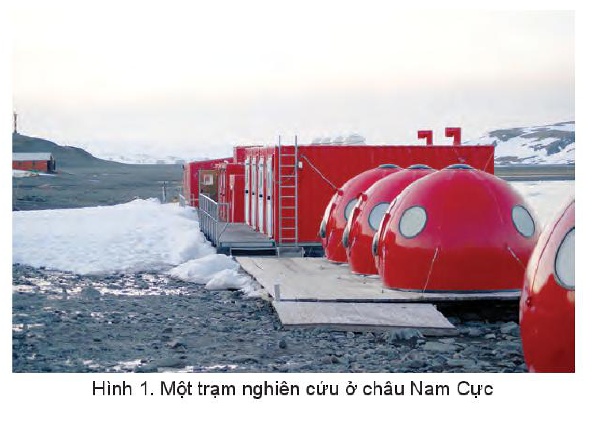
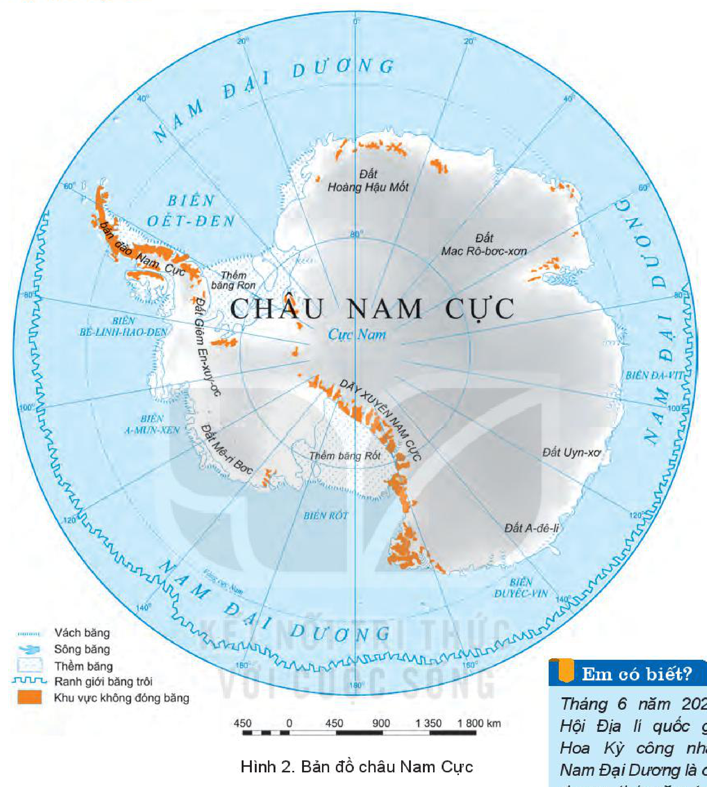
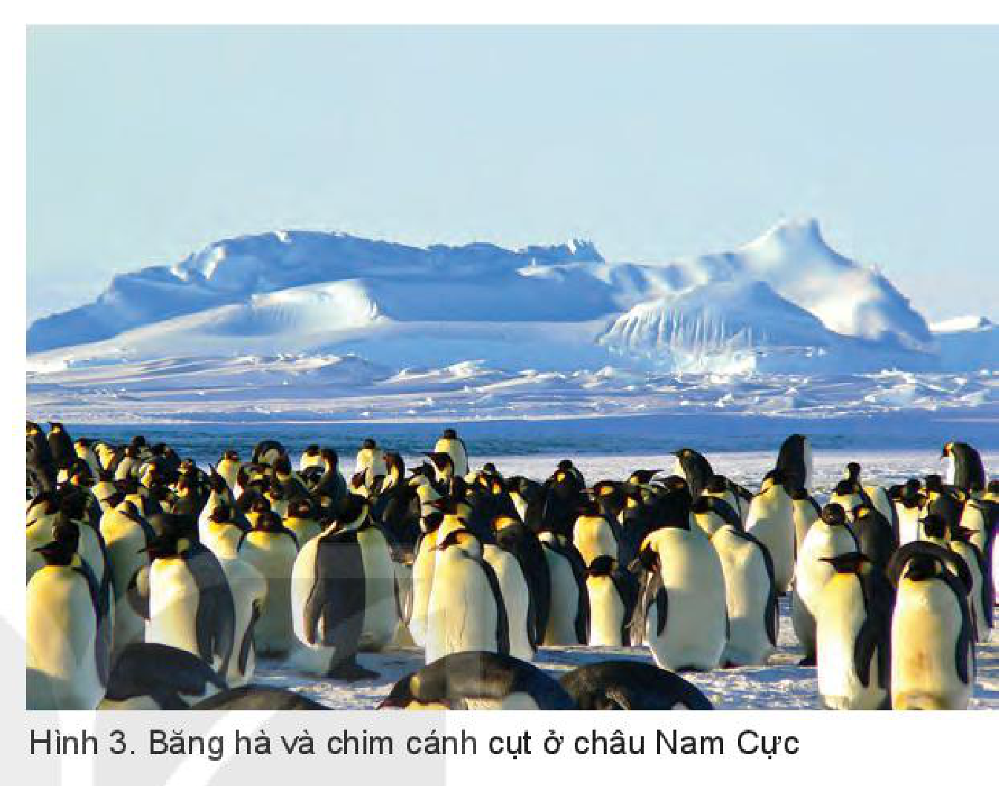
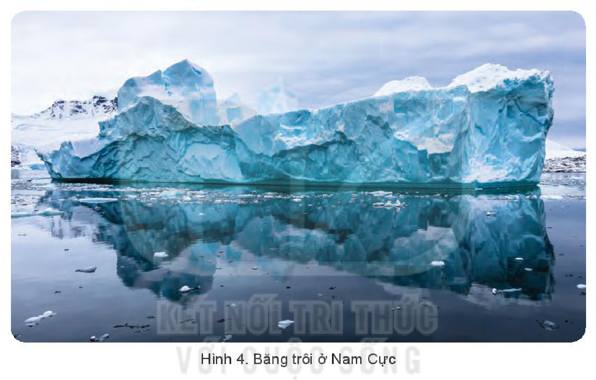

<!-- pdf:163 -->

# BÀI 19: CHÂU NAM CỰC

## 🎯 Học xong bài này, em sẽ:

- Trình bày được lịch sử khám phá và nghiên cứu châu Nam Cực.
- Trình bày được đặc điểm vị trí địa lí của châu Nam Cực.
- Trình bày được đặc điểm thiên nhiên nổi bật của châu Nam Cực.
- Mô tả được kịch bản về sự thay đổi của thiên nhiên châu Nam Cực khi có biến đổi khí hậu toàn cầu.

## 🔴 Mở đầu

<!-- term: Châu Nam Cực -->
Trong các châu lục trên thế giới, cho đến nay chỉ có một châu lục duy nhất chưa có dân cư sinh sống thường xuyên, đó là châu Nam Cực.

Hoàn cảnh nào khiến cho cả một châu lục rộng tới hơn 14 triệu km² mà hầu như vắng bóng con người?

## 1. Lịch sử khám phá và nghiên cứu châu Nam Cực

<!-- term: Lịch sử khám phá và nghiên cứu châu Nam Cực -->
Năm 1820, hai nhà hàng hải người Nga là Bê-linh-hao-den và La-da-rép đã phát hiện ra lục địa Nam Cực. Đến năm 1900, nhà thám hiểm người Na Uy là Boóc-rơ-grê-vim đã đặt chân tới lục địa Nam Cực.

<!-- term: Lịch sử khám phá và nghiên cứu châu Nam Cực -->
Người đầu tiên tới được điểm cực Nam của Trái Đất là nhà thám hiểm A-mun-sen người Na Uy (cùng các đồng đội) vào ngày 14-12-1911.

<!-- term: Lịch sử khám phá và nghiên cứu châu Nam Cực -->
Từ năm 1957, việc nghiên cứu châu Nam Cực mới được xúc tiến mạnh mẽ và toàn diện. Hằng năm, có khoảng 1 000 – 5 000 người thuộc nhiều quốc gia luân phiên tới sinh sống và làm việc tại các trạm nghiên cứu phân bố rải rác khắp châu lục.

> 💡 **Em có biết?**

<!-- term: Hiệp ước châu Nam Cực -->
> Ngày 1-12-1959, có 12 quốc gia kí “Hiệp ước châu Nam Cực” quy định việc khảo sát châu Nam Cực chỉ giới hạn trong mục đích vì hoà bình, không công nhận những đòi hỏi phân chia lãnh thổ, tài nguyên ở châu Nam Cực.

*Hình 1. Một trạm nghiên cứu ở châu Nam Cực*

> ❓ Đọc thông tin trong mục 1, hãy nêu các mốc lớn trong lịch sử khám phá, nghiên cứu châu Nam Cực.

<!-- pdf:164 -->

## 2. Vị trí địa lí

*Hình 2. Bản đồ châu Nam Cực*

> 💡 **Em có biết?**

<!-- term: Nam Đại Dương -->
> Tháng 6 năm 2021, Hội Địa lí quốc gia Hoa Kỳ công nhận Nam Đại Dương là đại dương thứ năm trên thế giới.

<!-- term: Châu Nam Cực -->
Châu Nam Cực gồm lục địa Nam Cực và các đảo ven lục địa, tổng diện tích hơn 14 triệu km² (đứng thứ tư trong các châu lục trên thế giới).

<!-- term: Châu Nam Cực -->
Đại bộ phận diện tích của lục địa Nam Cực nằm trong phạm vi phía nam của vòng cực Nam. Châu Nam Cực được bao bọc bởi đại dương và nằm cách xa với các châu lục khác.

> ❓ Dựa vào thông tin trong mục 2 và bản đồ hình 2, hãy:
> - Xác định trên bản đồ vị trí của châu Nam Cực.
> - Cho biết vị trí địa lí ảnh hưởng như thế nào tới khí hậu của châu Nam Cực.

<!-- pdf:165 -->

## 3. Đặc điểm tự nhiên và tài nguyên thiên nhiên

### a) Đặc điểm tự nhiên

<!-- term: Cao nguyên băng khổng lồ -->
- Về địa hình: Toàn châu Nam Cực được coi là một cao nguyên băng khổng lồ, 98% bề mặt bị phủ bởi lớp băng dày trung bình trên 1 720 m, khiến cho độ cao trung bình lên tới hơn 2 040 m, cao nhất trong các châu lục. Lớp phủ băng làm cho bề mặt châu lục tương đối bằng phẳng.

<!-- term: Hoang mạc lạnh -->
- Về khí hậu: Nam Cực là châu lục lạnh và khô nhất thế giới. Nhiệt độ trên lục địa Nam Cực không bao giờ vượt quá 0°C. Nhiệt độ thấp nhất đo được trong năm 1967 là -94,5°C. Lượng mưa, tuyết rơi rất thấp, ở vùng ven biển chỉ dưới 200 mm/năm; vào sâu trong lục địa, lượng mưa, tuyết rơi còn thấp hơn nhiều.

<!-- term: Hoang mạc lạnh -->
Nam Cực là vùng khí áp cao, gió từ trung tâm lục địa thổi ra với vận tốc thường trên 60 km/giờ; đây là nơi có gió bão nhiều nhất thế giới.

*Hình 3. Băng hà và chim cánh cụt ở châu Nam Cực*

<!-- term: Hoang mạc lạnh -->
- Về sinh vật: Do điều kiện sống khắc nghiệt nên giới sinh vật ở châu Nam Cực hết sức nghèo nàn. Gần như toàn bộ lục địa Nam Cực là một hoang mạc lạnh, hoàn toàn không có thực vật và động vật sinh sống; chỉ ở ven lục địa mới có một số loài thực vật bậc thấp (rêu, địa y, tảo, nấm) và một vài loài động vật chịu được lạnh (chim cánh cụt, chim biển, hải cẩu,...). Giới động vật ở vùng biển phong phú hơn trên lục địa do khí hậu ấm áp hơn và nguồn thức ăn cũng phong phú hơn. Động vật biển nổi bật là cá voi xanh.

> ❓ Dựa vào thông tin và hình ảnh trong mục a, nêu đặc điểm tự nhiên của châu Nam Cực.

### b) Tài nguyên thiên nhiên

<!-- term: Tài nguyên thiên nhiên châu Nam Cực -->
Châu Nam Cực là nơi dự trữ nước ngọt lớn nhất Trái Đất, chiếm khoảng 60% lượng nước ngọt trên Trái Đất.

<!-- term: Tài nguyên thiên nhiên châu Nam Cực -->
Những nghiên cứu sơ bộ cho thấy lục địa Nam Cực giàu các loại khoáng sản như than đá, sắt, đồng. Vùng thềm lục địa có tiềm năng về dầu mỏ, khí tự nhiên.

> ❓ Dựa vào thông tin trong mục b, hãy kể tên các tài nguyên thiên nhiên ở châu Nam Cực.

<!-- pdf:166 -->

## 4. Kịch bản về sự thay đổi thiên nhiên châu Nam Cực khi có biến đổi khí hậu toàn cầu

<!-- term: Kịch bản thay đổi thiên nhiên châu Nam Cực khi có biến đổi khí hậu -->
Do có tính nhạy cảm cao, thiên nhiên châu Nam Cực dễ thay đổi khi có biến đổi khí hậu. Theo tính toán của các nhà khoa học, đến cuối thế kỉ XXI, nhiệt độ ở châu Nam Cực sẽ tăng 0,5°C, lượng mưa cũng tăng lên, mực nước biển sẽ dâng thêm 0,05 – 0,32 m. Nhiều hệ sinh thái sẽ mất đi nhưng lại xuất hiện các đồng cỏ ở vùng ven biển. Lớp băng phủ ở vùng trung tâm sẽ dày thêm do có nước mưa cung cấp.

> 💡 **Em có biết?**

<!-- term: Núi băng trôi -->
> Lớp băng phủ trên lục địa Nam Cực thường xuyên di chuyển từ vùng trung tâm ra biển; băng bị vỡ ra, tạo thành các núi băng trôi trên biển, rất nguy hiểm cho tàu thuyền qua lại.
<!-- ocr-ok: đã đối chiếu ảnh trang gốc 165 (PDF 166), hộp Em có biết? ở cột phải bị OCR trộn dòng với cột trái -->

*Hình 4. Băng trôi ở Nam Cực*

> ❓ Đọc thông tin trong mục 4, cho biết kịch bản về sự thay đổi thiên nhiên châu Nam Cực khi có biến đổi khí hậu toàn cầu.

## ✏️ Luyện tập và Vận dụng

- Trình bày một trong các đặc điểm tự nhiên: địa hình, khí hậu, sinh vật ở châu Nam Cực.
- Tìm hiểu về tác động của việc tan băng ở châu Nam Cực do biến đổi khí hậu toàn cầu đối với thiên nhiên hoặc con người trên Trái Đất.

## 📷 Danh sách hình trong bài

| Mã hình | Trang PDF | Trang sách | Chú thích |
| --- | :---: | :---: | --- |
| H7-lich_su_va_dia_ly-dl-b19-01 | 163 | 162 | Hình 1. Một trạm nghiên cứu ở châu Nam Cực |
| H7-lich_su_va_dia_ly-dl-b19-02 | 164 | 163 | Hình 2. Bản đồ châu Nam Cực |
| H7-lich_su_va_dia_ly-dl-b19-03 | 165 | 164 | Hình 3. Băng hà và chim cánh cụt ở châu Nam Cực |
| H7-lich_su_va_dia_ly-dl-b19-04 | 166 | 165 | Hình 4. Băng trôi ở Nam Cực |
