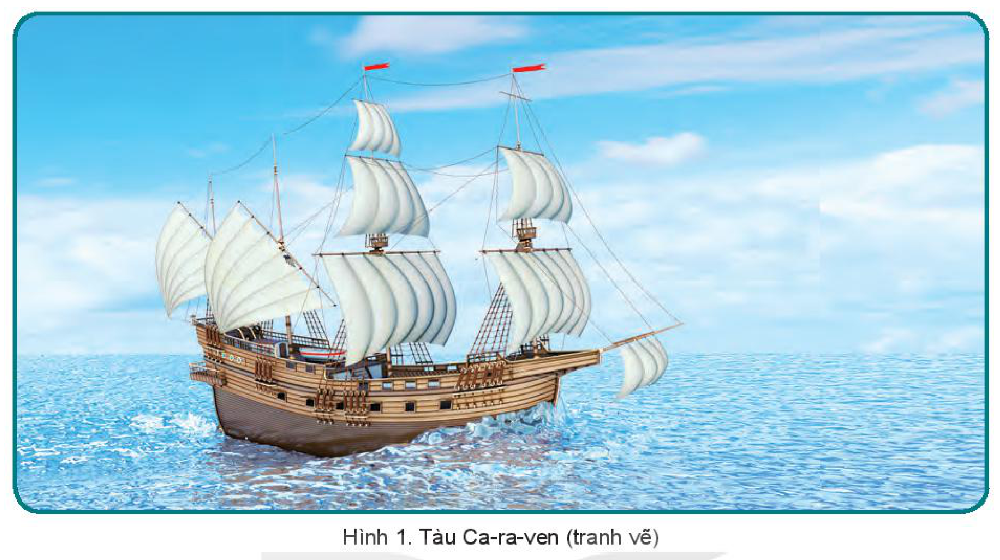
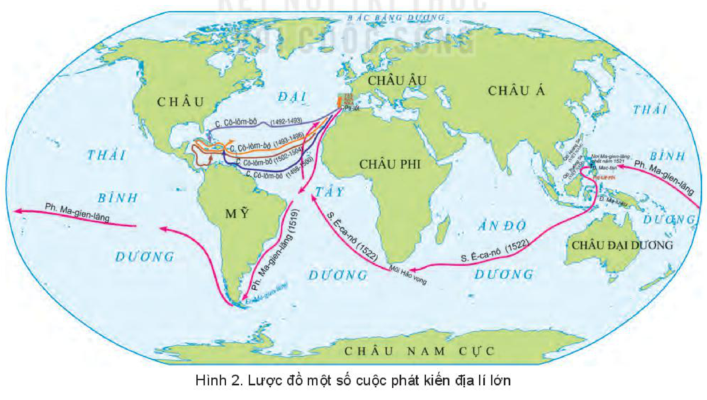
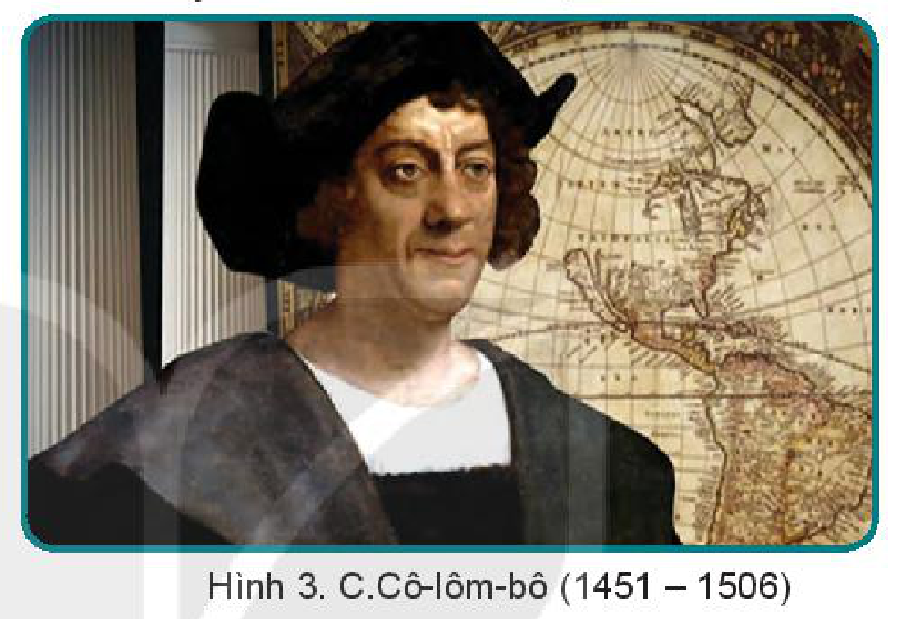
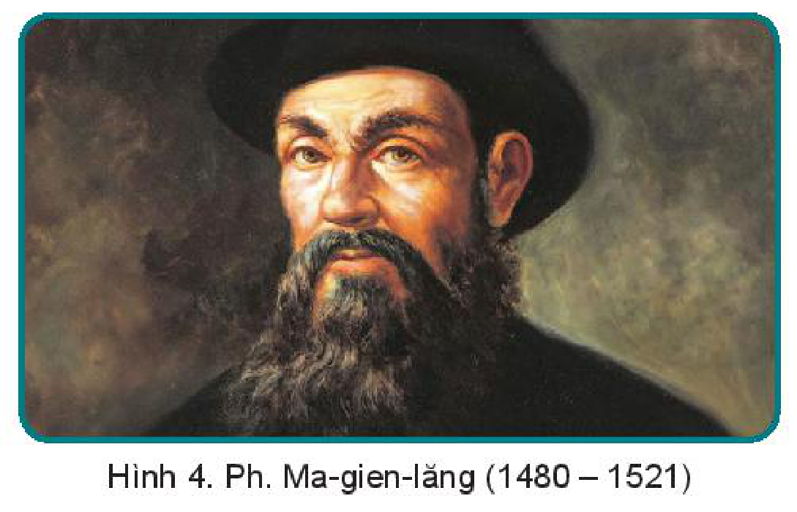
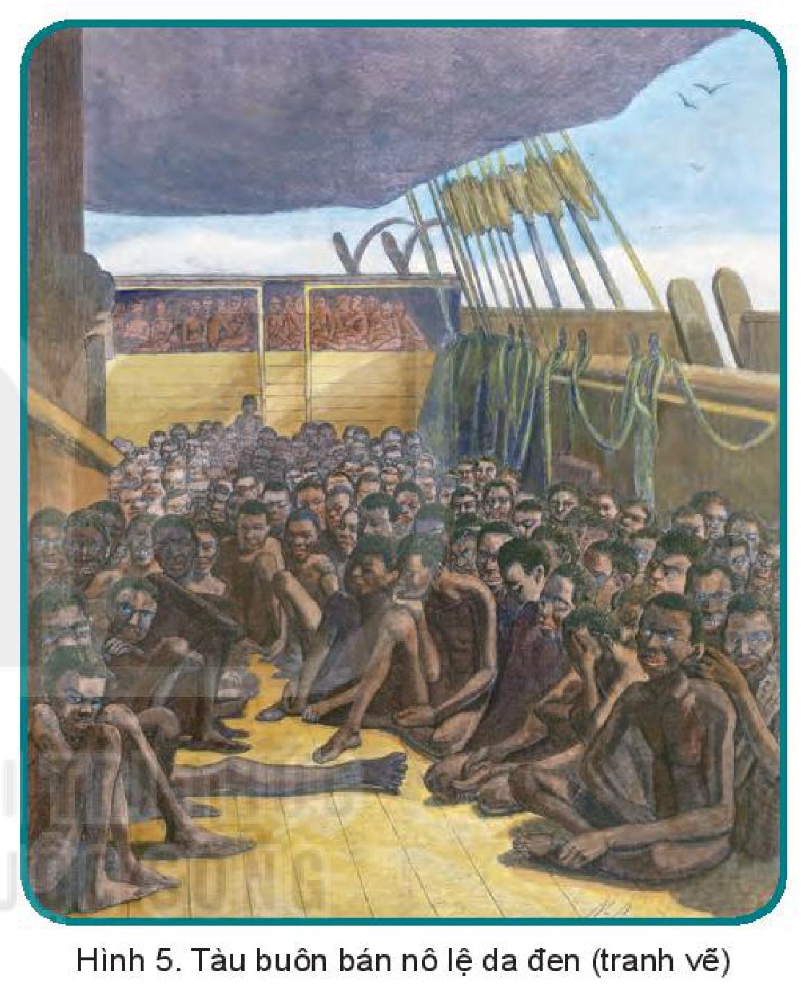

<!-- pdf:167 -->

# CHỦ ĐỀ CHUNG 1: CÁC CUỘC ĐẠI PHÁT KIẾN ĐỊA LÍ

## 🎯 Học xong bài này, em sẽ:

- Giải thích được nguyên nhân và những yếu tố tác động đến các cuộc đại phát kiến địa lí.
- Mô tả được các cuộc đại phát kiến địa lí: C. Cô-lôm-bô tìm ra châu Mỹ (1492 – 1502), cuộc thám hiểm của Ph. Ma-gien-lăng vòng quanh Trái Đất (1519 – 1522).
- Phân tích được tác động của các cuộc đại phát kiến địa lí đối với tiến trình lịch sử.

## 🔴 Mở đầu

Em hãy kể tên sáu châu lục trên Trái Đất. Trong tiến trình lịch sử, để phát triển kinh tế, con người luôn có nhu cầu kết nối và giao lưu rộng mở giữa các châu lục. Trong quá trình đó, từ nửa cuối thế kỉ XV, các nhà thám hiểm phương Tây thông qua các cuộc phát kiến địa lí đã phát hiện ra nhiều vùng đất mới. Hãy chia sẻ những điều em biết về một số cuộc phát kiến địa lí lớn và tác động của nó đối với tiến trình lịch sử.

## 1. Nguyên nhân và điều kiện của các cuộc đại phát kiến địa lí

Từ giữa thế kỉ XV, do sự phát triển của nền sản xuất ở các nước Tây Âu nên nhu cầu về nguyên liệu, vàng bạc và mở rộng thị trường ngày một gia tăng.

> *Trong tưởng tượng của người Tây Âu lúc bấy giờ, phương Đông như một thế giới thần tiên giàu có, "khắp mặt đất đều là vàng, còn các loại hương liệu thì ngoài đồng nội đâu đâu cũng có".*
>
> (Theo Lưu Minh Hàn (Chủ biên), Phong Đảo (dịch), *Lịch sử thế giới, Tập 2: Thời trung cổ*, NXB Thành phố Hồ Chí Minh, tr.513)

Tuy nhiên, thời kì đó, các con đường buôn bán truyền thống từ châu Âu sang phương Đông qua Địa Trung Hải,... bị người Ả Rập và Thổ Nhĩ Kỳ độc chiếm, hàng hoá của thương nhân bị cướp đoạt một cách vô lí. Nhu cầu tìm kiếm một con đường khác để sang phương Đông được đặt ra cấp thiết hơn bao giờ hết.

Lúc đó, từ quan niệm đúng đắn về hình dạng Trái Đất và hiểu biết về các đại dương, người châu Âu đã vẽ được bản đồ, hải đồ có ghi các vùng đất, hòn đảo, bến cảng,...

Các nhà hàng hải cũng bắt đầu nghiên cứu các dòng hải lưu, hướng gió,... Cuối thế kỉ XV, la bàn nam châm được sử dụng một cách phổ biến để đi trên sông, biển khi không có Mặt Trời hay trăng, sao.

<!-- term: Tàu Ca-ra-ven -->
Đặc biệt, kĩ thuật đóng tàu lúc đó có những bước tiến mới, đóng được những con tàu dài có bánh lái và hệ thống buồm lớn để vượt đại dương (như tàu Ca-ra-ven).

<!-- pdf:168 -->

<!-- term: Tàu Ca-ra-ven -->
*Hình 1. Tàu Ca-ra-ven (tranh vẽ)*

Sự bảo trợ của một số nhà nước phong kiến ở châu Âu cũng tạo điều kiện thuận lợi cho các cuộc phát kiến địa lí.

> ❓ 1. Vì sao đến thế kỉ XV việc tìm đường biển sang phương Đông của người Tây Âu được đặt ra cấp thiết?
>
> 2. Phân tích những yếu tố tác động đến các cuộc phát kiến địa lí trong lịch sử.

## 2. Một số cuộc đại phát kiến địa lí

Với vị trí địa lí thuận lợi, Bồ Đào Nha và Tây Ban Nha là những nước tiên phong trong các cuộc thám hiểm, khám phá những vùng đất mới.

*Hình 2. Lược đồ một số cuộc phát kiến địa lí lớn*

<!-- pdf:169 -->

### a) C. Cô-lôm-bô và cuộc thám hiểm tìm ra châu Mỹ (1492 – 1502)

<!-- term: C. Cô-lôm-bô và cuộc thám hiểm tìm ra châu Mỹ -->
> 💡 **Em có biết?**
>
> C. Cô-lôm-bô (1451 – 1506) là người I-ta-li-a. Ông đã sang Tây Ban Nha vận động tài trợ và được nhà vua nước này phê chuẩn kế hoạch thám hiểm theo hướng tây để đến Ấn Độ.

<!-- term: C. Cô-lôm-bô và cuộc thám hiểm tìm ra châu Mỹ -->
Tháng 8 – 1492, trên ba chiếc tàu, C. Cô-lôm-bô cùng đoàn thuỷ thủ Tây Ban Nha rời cảng đi về hướng tây. Sau hơn hai tháng lênh đênh trên biển, ông và đoàn thuỷ thủ dũng cảm đã đến được một số đảo thuộc vùng biển Ca-ri-bê ngày nay. Ông đinh ninh rằng đã tới “Đông Ấn Độ”, nhưng thực ra đó là vùng đất mới – châu Mỹ. C. Cô-lôm-bô được coi là người phát hiện ra châu lục này. Tiếp theo, ông còn tiến hành ba cuộc thám hiểm đến châu Mỹ vào các năm 1493, 1498 và 1502.

*Hình 3. C.Cô-lôm-bô (1451 – 1506)*

### b) Cuộc thám hiểm vòng quanh Trái Đất của Ph. Ma-gien-lăng (1519 – 1522)

> 💡 **Em có biết?**
>
> Ph. Ma-gien-lăng là một nhà thám hiểm hàng hải người Bồ Đào Nha nhưng sau đó đã sang Tây Ban Nha nhằm tìm kiếm sự hỗ trợ cho chuyến đi đến "quần đảo Gia vị".

<!-- term: Thái Bình Dương -->
> 💡 **Em có biết?**
>
> Cuối năm 1520, khi tới quần đảo Phi-líp-pin, Ph. Ma-gien-lăng nhận thấy vùng biển ở đây khá bình yên và lặng gió nên đã đặt tên cho vùng biển này là "Thái Bình Dương" có nghĩa là vùng biển yên bình. Tuy nhiên, Thái Bình Dương không phải lúc nào cũng "thái bình". Đây là đại dương mà sóng thần, động đất đã tàn phá nhiều hòn đảo và làng mạc nhất.

<!-- term: Cuộc thám hiểm vòng quanh Trái Đất của Ph. Ma-gien-lăng -->
<!-- term: Eo biển Ma-gien-lăng -->
<!-- term: Thái Bình Dương -->
Tháng 9 – 1519, đoàn thám hiểm của Ph. Ma-gien-lăng gồm năm chiếc tàu ra khơi từ Tây Ban Nha, cũng nhằm tìm kiếm tuyến đường biển theo hướng tây tới quần đảo Gia vị (thuộc In-đô-nê-xi-a ngày nay). Sau khi khám phá ra eo biển nằm ở cực Nam châu Mỹ (sau này được gọi là eo biển Ma-gien-lăng), đoàn thám hiểm tiến vào một đại dương rộng lớn mà Ph. Ma-gien-lăng gọi là Thái Bình Dương. Trải qua nhiều ngày lênh đênh trên biển, đoàn đã đến được Phi-líp-pin (cuối năm 1520).

*Hình 4. Ph. Ma-gien-lăng (1480 – 1521)*

<!-- pdf:170 -->

<!-- term: Cuộc thám hiểm vòng quanh Trái Đất của Ph. Ma-gien-lăng -->
Tại đây, Ph. Ma-gien-lăng đã thiệt mạng trong cuộc đụng độ với thổ dân. Các thuỷ thủ trong đoàn tiếp tục hành trình trở về Tây Ban Nha (9 – 1522) dưới sự chỉ huy của S. Ê-ca-nô. Chuyến đi này đã chứng minh một cách thuyết phục nhất Trái Đất có dạng hình cầu.

> ❓ 1. Mô tả hành trình các cuộc đại phát kiến địa lí của C. Cô-lôm-bô và Ph. Ma-gien-lăng trên lược đồ.
>
> 2. Nêu ý nghĩa của hai cuộc đại phát kiến địa lí.

## 3. Tác động của các cuộc đại phát kiến địa lí

<!-- term: Tác động của các cuộc đại phát kiến địa lí -->
Về kinh tế, các cuộc đại phát kiến địa lí đã góp phần mở rộng phạm vi buôn bán trên thế giới, thúc đẩy sự phát triển nhanh chóng của thương nghiệp và công nghiệp. Nhờ vậy tầng lớp thương nhân và chủ xưởng sản xuất,... ở Tây Âu trở nên giàu có.

<!-- term: Tác động của các cuộc đại phát kiến địa lí -->
Các cuộc phát kiến địa lí đem lại cho loài người hiểu biết về những con đường mới, vùng đất mới,... Từ đó, sự giao lưu văn hoá giữa các dân tộc được tăng cường và mở rộng.

<!-- term: Tác động của các cuộc đại phát kiến địa lí -->
Tuy nhiên, trong sự phát triển nhanh chóng của nền kinh tế, người lao động (nhất là nông dân) ngày càng bị bần cùng hoá.

<!-- term: Tác động của các cuộc đại phát kiến địa lí -->
Các cuộc phát kiến địa lí cũng đã dẫn đến nạn buôn bán nô lệ và làm nảy sinh quá trình cướp bóc thuộc địa.

*Hình 5. Tàu buôn bán nô lệ da đen (tranh vẽ)*

> ❓ Hãy phân tích những tác động của các cuộc đại phát kiến địa lí đối với tiến trình lịch sử.

## ✏️ Luyện tập – Vận dụng

1. Trong những tác động của các cuộc phát kiến địa lí đối với lịch sử, theo em, tác động nào là quan trọng nhất? Vì sao?

2. Là một người dân châu Á, em có suy nghĩ gì về sự có mặt của người châu Âu ở các nước châu Á sau các cuộc phát kiến địa lí?

3. Sưu tầm tư liệu từ sách, báo và internet về C. Cô-lôm-bô, Ph. Ma-gien-lăng và đánh giá công lao của họ.

## 📷 Danh sách hình trong bài

| Mã hình | Trang PDF | Trang sách | Chú thích |
| --- | --- | --- | --- |
| H7-lich_su_va_dia_ly-cdc-01-01 | 168 | 167 | Hình 1. Tàu Ca-ra-ven (tranh vẽ) |
| H7-lich_su_va_dia_ly-cdc-01-02 | 168 | 167 | Hình 2. Lược đồ một số cuộc phát kiến địa lí lớn |
| H7-lich_su_va_dia_ly-cdc-01-03 | 169 | 168 | Hình 3. C.Cô-lôm-bô (1451 – 1506) |
| H7-lich_su_va_dia_ly-cdc-01-04 | 169 | 168 | Hình 4. Ph. Ma-gien-lăng (1480 – 1521) |
| H7-lich_su_va_dia_ly-cdc-01-05 | 170 | 169 | Hình 5. Tàu buôn bán nô lệ da đen (tranh vẽ) |
