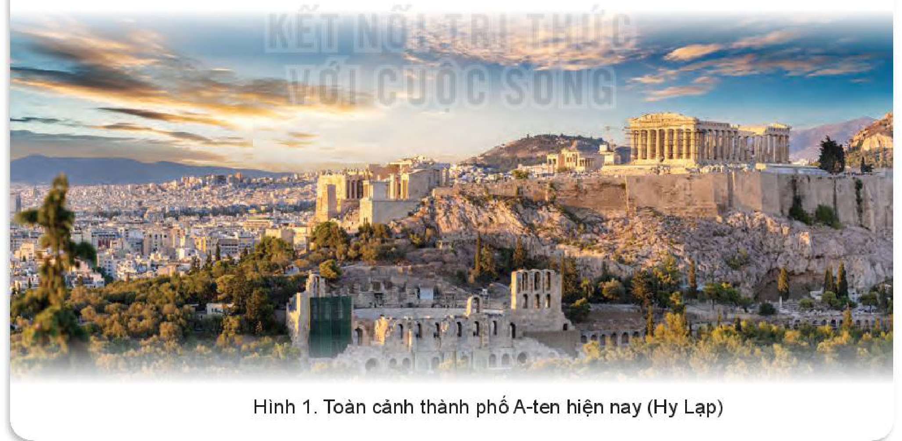
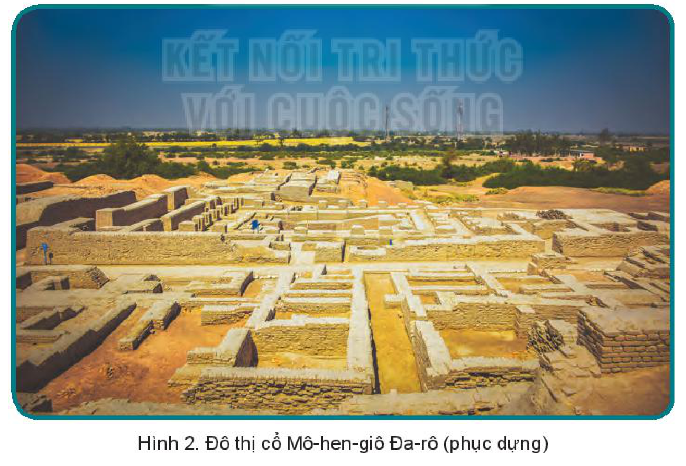
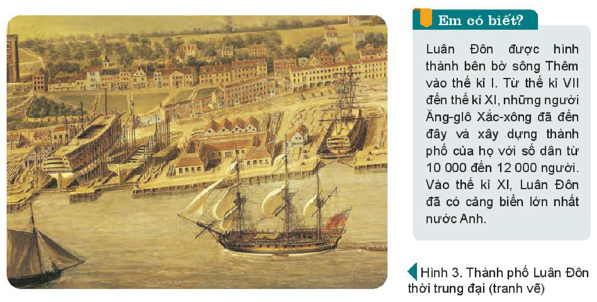
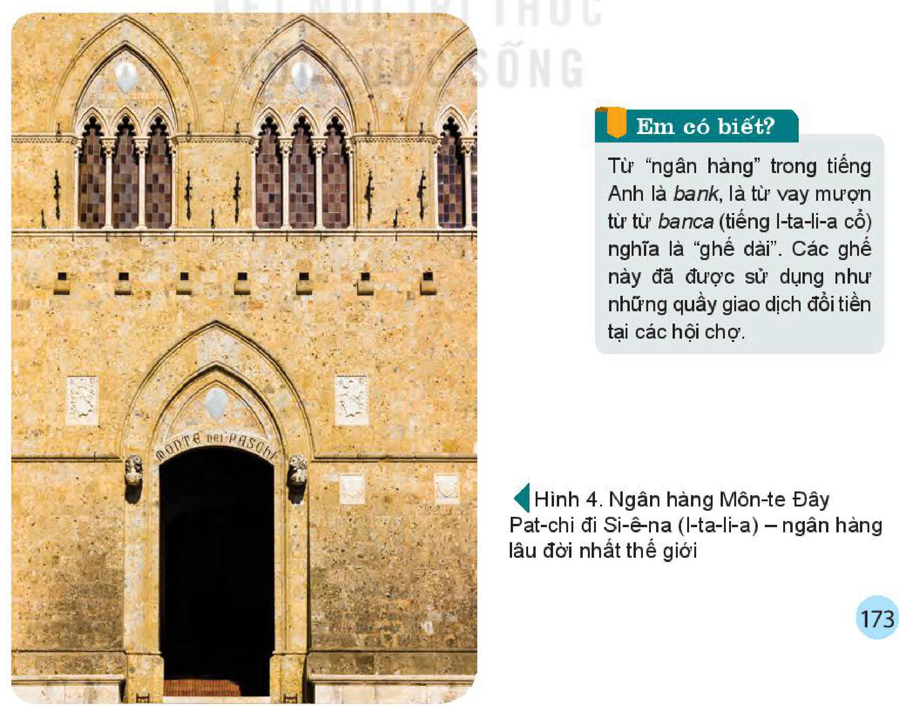
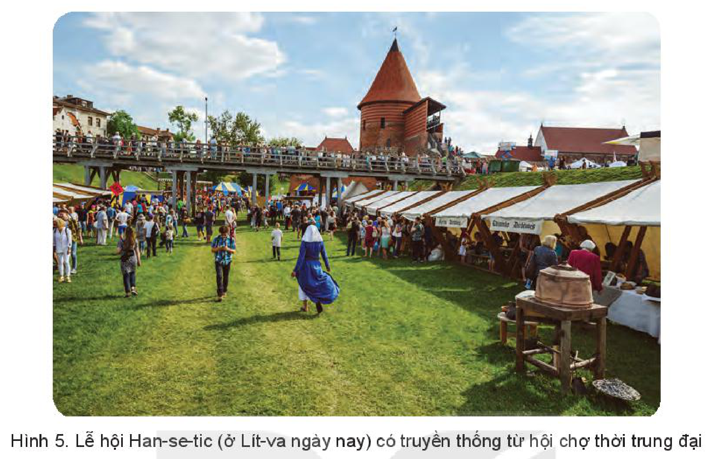

<!-- pdf:171 -->

# CHỦ ĐỀ CHUNG 2: ĐÔ THỊ: LỊCH SỬ VÀ HIỆN TẠI

## 🎯 Học xong bài này, em sẽ:

- Phân tích được các điều kiện địa lí và lịch sử góp phần hình thành và phát triển một đô thị cổ đại và trung đại (qua một số trường hợp cụ thể).
- Trình bày được mối quan hệ giữa đô thị với các nền văn minh cổ đại; vai trò của giới thương nhân với sự phát triển đô thị châu Âu trung đại.

## 🔴 Mở đầu

A-ten (Hy Lạp) là một trong những thành phố lớn và lâu đời nhất của châu Âu và thế giới. Thời cổ đại, A-ten được coi là "cái nôi" của văn minh phương Tây, cũng là nơi sản sinh ra nền dân chủ. Vậy, A-ten và những đô thị phương Tây cổ đại đã hình thành như thế nào, có điều gì khác biệt so với các đô thị cổ đại ở phương Đông? Những đô thị cổ đại có mối quan hệ ra sao đối với các nền văn minh ở các khu vực? Giới thương nhân đã có vai trò như thế nào đối với sự phát triển của đô thị châu Âu thời trung đại?

*Hình 1. Toàn cảnh thành phố A-ten hiện nay (Hy Lạp)*

<!-- pdf:172 -->

## 1. Đô thị và sự hình thành các nền văn minh cổ đại

### a) Đô thị và các nền văn minh cổ đại phương Đông

- *Điều kiện địa lí và lịch sử*

<!-- term: Đô thị cổ đại phương Đông -->
Từ khoảng thiên niên kỉ IV TCN đến thiên niên kỉ III TCN, trên lưu vực các dòng sông lớn ở châu Á, châu Phi như: sông Nin (ở Ai Cập), sông Ti-gơ-rơ và Ơ-phơ-rát (ở Lưỡng Hà), sông Ấn, sông Hằng (ở Ấn Độ),... đã có cư dân tập trung sinh sống. Họ canh tác nông nghiệp trên những đồng bằng màu mỡ, phì nhiêu, chăn nuôi gia súc, dệt vải, làm đồ gốm,...

<!-- term: Đô thị cổ đại -->
<!-- term: Đô thị cổ đại phương Đông -->
Do sản xuất dần phát triển, dân số tăng lên, những khu định cư nhỏ ban đầu đã dần mở rộng thành các khu dân cư đông đúc và có sự phân công lao động. Từ đó, hình thành các đô thị (thành thị) cổ đại như: Ba-bi-lon (ở vùng Lưỡng Hà), Mem-phít (ở Ai Cập), Mô-hen-giô Đa-rô (ở Ấn Độ),...

Khoảng 5 000 – 6 000 năm trước, các ngôi làng của người Xu-me ở phía nam vùng Lưỡng Hà đã phát triển thành thành phố. Trong đó, nổi bật nhất là U-rúc, có đến 40 000 – 50 000 cư dân, sau đó đến những thành phố khác như E-ri-đu, Ba-bi-lon,...

- *Mối quan hệ giữa đô thị cổ và nền văn minh cổ đại phương Đông*

<!-- term: Đô thị cổ đại -->
<!-- term: Đô thị cổ đại phương Đông -->
Là trung tâm hành chính, quân sự, đầu mối kinh tế và giao thông của các quốc gia cổ đại, những đô thị cổ gắn liền với sự hưng thịnh và suy tàn của các nền văn minh đầu tiên ở phương Đông.

<!-- term: Văn minh sông Ấn -->
Nền văn minh sông Ấn (khoảng 2 800 năm đến 1 800 năm TCN) còn được gọi là văn minh Ha-ráp-pa và Mô-hen-giô Đa-rô, theo tên của hai thành thị cổ được xây dựng ở ven bờ sông Ấn. Khi những thành thị này suy tàn cũng đã khép lại thời kì văn minh sông Ấn rực rỡ.

*Hình 2. Đô thị cổ Mô-hen-giô Đa-rô (phục dựng)*

> ❓ 1. Hãy nêu và phân tích những điều kiện địa lí và lịch sử dẫn đến sự hình thành các đô thị ở phương Đông thời cổ đại.
>
> 2. Các đô thị cổ ở phương Đông có vai trò như thế nào trong sự hình thành và phát triển các nền văn minh cổ đại?

<!-- pdf:173 -->

### b) Đô thị và các nền văn minh Hy Lạp, La Mã cổ đại

- *Điều kiện địa lí và lịch sử*

<!-- term: Đô thị Hy Lạp, La Mã cổ đại -->
Ở Hy Lạp, La Mã cổ đại, đất đai khô cằn chỉ thích hợp trồng những cây lâu năm. Bù lại, nơi đây có nhiều vũng, vịnh thuận lợi cho việc hình thành những hải cảng. Chính những hải cảng này đã trở thành trung tâm của các đô thị.

<!-- term: Đô thị Hy Lạp, La Mã cổ đại -->
Do sống gần biển, lại có nhiều mỏ khoáng sản nên cư dân ở đây sớm phát triển mạnh hoạt động buôn bán hàng hải và sản xuất thủ công nghiệp.

<!-- term: Đô thị Hy Lạp, La Mã cổ đại -->
> 1. *Thành thị A-ten có nhiều mỏ sắt, mỏ bạc, có những cảng rộng và sâu, thuận lợi cho sự phát triển của công thương nghiệp và giao thương hàng hải. Cảng Pi-rê ở A-ten là trung tâm thương mại lớn nhất của thế giới cổ đại. Thuyền bè và lái buôn từ khắp các nơi đến cập bến ở đây rất đông. Hàng hoá trao đổi rất phong phú, trong đó quan trọng nhất là nô lệ.*
>
> (Theo Chiêm Tế, *Lịch sử thế giới cổ đại*, Tập 2, NXB Đại học Quốc gia Hà Nội, 2000, tr.34, 68).

- *Mối quan hệ giữa đô thị cổ và nền văn minh Hy Lạp, La Mã*

<!-- term: Đô thị cổ đại -->
<!-- term: Đô thị Hy Lạp, La Mã cổ đại -->
Các đô thị ở Hy Lạp, La Mã cổ đại đều đóng vai trò là trung tâm kinh tế, chính trị của nhà nước, đồng thời cũng đặt nền tảng cho sự hình thành và phát triển của các nền văn minh.

Văn minh Hy Lạp, La Mã dựa trên sự phát triển của nền kinh tế công thương nghiệp. Cùng với đó, không khí dân chủ tại các đô thị đã tạo điều kiện cho những sáng tạo văn học, nghệ thuật, triết học, khoa học – kĩ thuật,... nảy nở. Nhiều thành tựu văn hoá rực rỡ còn được bảo tồn và phát huy giá trị to lớn đến tận ngày nay.

> ❓ 1. Khai thác tư liệu 1 và thông tin trong mục, hãy cho biết điều kiện địa lí và lịch sử có ảnh hưởng như thế nào đến sự hình thành các đô thị ở Hy Lạp và La Mã cổ đại.
>
> 2. Đô thị ở Hy Lạp và La Mã cổ đại có vai trò như thế nào đối với sự phát triển của các nền văn minh cổ đại ở châu Âu?

## 2. Các đô thị châu Âu thời trung đại và vai trò của giới thương nhân

### a) Sự ra đời của các đô thị châu Âu thời trung đại

<!-- term: Đô thị trung đại -->
Từ thế kỉ XI, sản xuất nông nghiệp, thủ công nghiệp và thương nghiệp trong các lãnh địa phong kiến có nhiều biến đổi.

<!-- term: Đô thị trung đại -->
Một số thợ thủ công đã tìm cách trốn khỏi lãnh địa hoặc dùng tiền để chuộc lại tự do. Họ tìm đến những nơi đông dân cư, gần nguồn nguyên liệu, nơi giao nhau của các trục đường chính,... nhóm nhau lại để cùng sản xuất, buôn bán. Từ đó các đô thị hình thành. Bên cạnh đó, còn có những đô thị do lãnh chúa, Giáo hội xây dựng hoặc được phục hồi từ những đô thị cổ đại.

Pa-ri là một thành phố của La Mã từ thế kỉ I, sau đó trở thành thủ đô của Vương quốc Phơ-răng. Hình thành bên bờ sông Xen, là giao điểm của các con đường buôn bán lớn, Pa-ri trở nên giàu có nhờ thương mại. Với dân số khoảng 50 000 người (thế kỉ XII), Pa-ri trở thành trung tâm quan trọng về kinh tế, chính trị, giáo dục, tôn giáo của châu Âu.

<!-- pdf:174 -->

> 💡 **Em có biết?**
>
> Luân Đôn được hình thành bên bờ sông Thêm vào thế kỉ I. Từ thế kỉ VII đến thế kỉ XI, những người Ăng-glô Xắc-xông đã đến đây và xây dựng thành phố của họ với số dân từ 10 000 đến 12 000 người. Vào thế kỉ XI, Luân Đôn đã có cảng biển lớn nhất nước Anh.

*Hình 3. Thành phố Luân Đôn thời trung đại (tranh vẽ)*

### b) Vai trò của thương nhân trong các đô thị châu Âu trung đại

Trong các đô thị ở châu Âu thời trung đại, tầng lớp thương nhân dần đông hơn và có vai trò ngày càng to lớn.

<!-- term: Hội chợ thời trung đại -->
<!-- term: Quầy đổi tiền -->
Các thương nhân đã nhóm họp nhau lại, thành lập các hội buôn (thương hội) để bảo vệ lợi ích buôn bán. Hằng năm, họ còn tổ chức các hội chợ để trao đổi hàng hoá. Tại đây đã xuất hiện một số quầy đổi tiền – chính là tiền thân của các ngân hàng sau này.

Hoạt động của thương nhân và thương hội đã thúc đẩy kinh tế hàng hoá phát triển, làm tan rã dần nền kinh tế tự nhiên, đóng kín trong các lãnh địa trước đây. Việc buôn bán giữa các nước ngày càng sôi động, đặc biệt xung quanh vùng Địa Trung Hải.

<!-- term: Quầy đổi tiền -->
> 💡 **Em có biết?**
>
> Từ “ngân hàng” trong tiếng Anh là *bank*, là từ vay mượn từ từ *banca* (tiếng I-ta-li-a cổ) nghĩa là “ghế dài”. Các ghế này đã được sử dụng như những quầy giao dịch đổi tiền tại các hội chợ.

*Hình 4. Ngân hàng Môn-te Đây Pat-chi đi Si-ê-na (I-ta-li-a) – ngân hàng lâu đời nhất thế giới*

<!-- pdf:175 -->

*Hình 5. Lễ hội Han-se-tic (ở Lít-va ngày nay) có truyền thống từ hội chợ thời trung đại*

<!-- term: Hội chợ thời trung đại -->
> 2. *Các thương nhân I-ta-li-a, Pháp, Tây Ban Nha có thể dễ dàng theo đường sông và đường biển đến vùng Săm-pa-nhơ. Đồ gia vị, hàng hoá xa xỉ phương Đông,... rượu vang và gia súc Pháp là những hàng hoá đặc trưng của các hội chợ Săm-pa-nhơ. Thương nhân toàn châu Âu gặp gỡ nhau đều đặn ở đây nên những phiên hội chợ trở thành chu kì thanh toán tín phiếu.*
>
> (Theo Pô-li-an-xki, *Lịch sử kinh tế các nước ngoài Liên Xô*, (Trương Hữu Quýnh dịch), NXB Khoa học xã hội, 1978, tr.412)

Thương nhân là những người có đầu óc thích khám phá, ham hiểu biết, làm giàu,... nên họ phản đối văn hoá phong kiến lỗi thời, lạc hậu và đòi hỏi xây dựng một nền văn hoá mới. Do đó, phong trào Văn hoá Phục hưng đã nảy nở, mở ra thời kì phát triển xán lạn của văn hoá phương Tây thời trung đại.

> ❓ 1. Phân tích điều kiện dẫn đến sự ra đời các đô thị trung đại ở Tây Âu.
>
> 2. Khai thác tư liệu 2 và thông tin trong mục, cho biết tầng lớp thương nhân có vai trò như thế nào đối với các đô thị trung đại ở châu Âu.

## ✏️ Luyện tập – Vận dụng

1. Những điều kiện địa lí và lịch sử dẫn đến sự hình thành các đô thị phương Đông và phương Tây cổ đại có những điểm gì khác nhau?

2. Dựa vào kiến thức đã học và hiểu biết của bản thân, hãy nêu ví dụ về sự phát triển hay suy tàn của một nền văn minh thời cổ đại gắn liền với sự thịnh vượng hay suy tàn của đô thị.

3. Theo em, sự phát triển của đô thị châu Âu thời trung đại gắn liền với vai trò của tầng lớp thương nhân có ý nghĩa đối với sự phát triển của các quốc gia ngày nay không? Vì sao?

## 📷 Danh sách hình trong bài

| Mã hình | Trang PDF | Trang sách | Chú thích |
| --- | --- | --- | --- |
| H7-lich_su_va_dia_ly-cdc-02-01 | 171 | 170 | Hình 1. Toàn cảnh thành phố A-ten hiện nay (Hy Lạp) |
| H7-lich_su_va_dia_ly-cdc-02-02 | 172 | 171 | Hình 2. Đô thị cổ Mô-hen-giô Đa-rô (phục dựng) |
| H7-lich_su_va_dia_ly-cdc-02-03 | 174 | 173 | Hình 3. Thành phố Luân Đôn thời trung đại (tranh vẽ) |
| H7-lich_su_va_dia_ly-cdc-02-04 | 174 | 173 | Hình 4. Ngân hàng Môn-te Đây Pat-chi đi Si-ê-na (I-ta-li-a) – ngân hàng lâu đời nhất thế giới |
| H7-lich_su_va_dia_ly-cdc-02-05 | 175 | 174 | Hình 5. Lễ hội Han-se-tic (ở Lít-va ngày nay) có truyền thống từ hội chợ thời trung đại |
