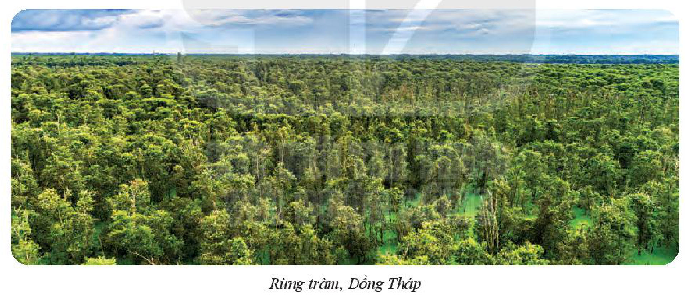
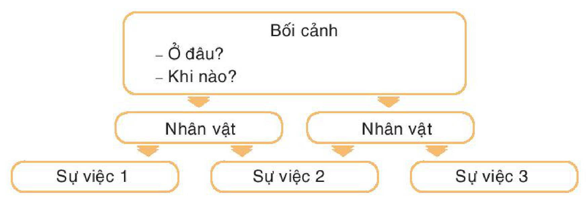

<!-- pdf:10 -->

# BÀI 1: BẦU TRỜI TUỔI THƠ

*Trẻ thơ tìm thấy tất cả ở nơi chẳng có gì...*

Gia-cô-mô Lê-ô-pác-đi (Giacomo Leopardi)

## Giới thiệu bài học

- Nhà văn Ăng-toan đơ Xanh-tơ Ê-xu-pe-ri, tác giả của *Hoàng tử bé*, từng khẳng định rằng chỉ con mắt trẻ em mới có thể cảm nhận một cách thuần khiết vẻ đẹp phong phú và bí ẩn của thế giới. Các em đang “sở hữu” cái nhìn kì diệu ấy của tuổi thơ.
- Đến với các tác phẩm truyện và một bài thơ kết nối về chủ đề trong bài học này, các em sẽ “gặp gỡ” bầu trời tuổi thơ của chính mình. Hãy mở rộng tâm hồn để quan sát, cảm nhận về thiên nhiên, con người, nhịp sống quanh ta và gìn giữ những trải nghiệm đó để tuổi thơ mãi là dòng sông trong mát đồng hành cùng chúng ta trên mọi chặng đường đời.

## 🎯 Yêu cầu cần đạt

<!-- term: văn bản -->
<!-- term: đề tài -->
<!-- term: câu chuyện -->
<!-- term: nhân vật -->
<!-- term: tính cách nhân vật -->
<!-- term: truyện -->
<!-- term: trạng ngữ -->
<!-- term: tóm tắt -->
- Nêu được ấn tượng chung về văn bản và những trải nghiệm giúp bản thân hiểu thêm văn bản.
- Nhận biết được các chi tiết tiêu biểu, đề tài, câu chuyện, nhân vật và tính cách nhân vật trong truyện.
- Hiểu được tác dụng của việc dùng cụm từ để mở rộng thành phần chính và mở rộng trạng ngữ trong câu.
- Biết tóm tắt một văn bản theo những yêu cầu khác nhau về độ dài.
- Trình bày được ý kiến về một vấn đề đời sống, tóm tắt được các ý chính do người khác trình bày.
- Biết yêu quý tuổi thơ và trân trọng giá trị của cuộc sống.

<!-- pdf:11 -->

## Đọc

### TRI THỨC NGỮ VĂN

**Đề tài và chi tiết**
<!-- ocr-ok: đã đối chiếu trực tiếp ảnh trang PDF 11 (OCR đọc lỗi dấu tiếng Việt / tiêu đề in màu, tỉ lệ khớp 0.50) -->

<!-- term: đề tài -->
<!-- term: sự kiện -->
<!-- term: miêu tả -->
<!-- term: nhân vật -->
- **Đề tài** là phạm vi đời sống được thể hiện trong tác phẩm văn học. Để xác định đề tài, có thể dựa vào loại sự kiện được miêu tả (đề tài chiến tranh, đề tài trinh thám, đề tài phiêu lưu,...), không gian được tái hiện (đề tài miền núi, đề tài nông thôn, đề tài thành thị,...), loại nhân vật được đặt ở vị trí trung tâm của tác phẩm (đề tài trẻ em, đề tài người nông dân, đề tài người lính,...),... Một tác phẩm có thể gồm nhiều đề tài, trong đó có một đề tài chính.
- **Chi tiết** là yếu tố nhỏ nhất tạo nên thế giới hình tượng (thiên nhiên, con người, sự kiện,...) nhưng có tầm quan trọng đặc biệt trong việc đem lại sự sinh động, lôi cuốn cho tác phẩm văn học.

**Tính cách nhân vật**

<!-- term: tính cách nhân vật -->
<!-- term: hành động -->
<!-- term: cảm xúc -->
**Tính cách nhân vật** là những đặc điểm riêng tương đối ổn định của nhân vật, được bộc lộ qua mọi hành động, cách ứng xử, cảm xúc, suy nghĩ,... Tính cách nhân vật còn được thể hiện qua các mối quan hệ, qua lời kể và suy nghĩ của nhân vật khác.

**Văn bản tóm tắt**

<!-- term: tóm tắt -->
<!-- term: văn bản -->
**Văn bản tóm tắt** là một dạng rút gọn của văn bản gốc (có thể do tác giả của văn bản gốc hay người đọc thực hiện), tuy có dung lượng nhỏ nhưng vẫn phản ánh trung thành nội dung cơ bản của văn bản gốc.

**Mở rộng thành phần chính và trạng ngữ của câu bằng cụm từ**

<!-- term: thành phần chính của câu -->
<!-- term: trạng ngữ -->
**Mở rộng thành phần chính và trạng ngữ của câu bằng cụm từ** có thể giúp câu cung cấp được nhiều thông tin hơn cho người đọc, người nghe. Các thành phần chính và trạng ngữ của câu thường được mở rộng bằng cụm từ chính phụ như cụm danh từ, cụm động từ, cụm tính từ.

### VĂN BẢN ĐỌC

- **VĂN BẢN 1.** *Bầy chim chìa vôi*, Nguyễn Quang Thiều
- **VĂN BẢN 2.** *Đi lấy mật* (trích *Đất rừng phương Nam*), Đoàn Giỏi
- **VĂN BẢN 3.** *Ngàn sao làm việc*, Võ Quảng

<!-- pdf:12 -->

### VĂN BẢN 1: Bầy chim chìa vôi

**Trước khi đọc**

<!-- term: cảm xúc -->
Hãy chia sẻ một trải nghiệm đẹp của tuổi thơ em. Ghi lại một số từ ngữ diễn tả cảm xúc của em khi nghĩ về trải nghiệm đó.

**Đọc văn bản**

**Bầy chim chìa vôi**(1)

NGUYỄN QUANG THIỀU

(1)

Khoảng hai giờ sáng Mon tỉnh giấc. Nó xoay mình sang phía anh nó, thì thào gọi:

> **Theo dõi:** Nội dung cuộc trò chuyện của hai anh em Mên và Mon lúc nửa đêm.

– Anh Mên ơi, anh Mên!

– Gì đấy? Mày không ngủ à? – Thằng Mên hỏi lại, giọng nó ráo hoảnh như đã thức dậy từ lâu lắm rồi.

– Anh bảo mưa có to không?

– Lại chẳng to. Thế mày không nghe thấy gì à?

– Nhưng anh bảo nước sông lên có to không?

– Bây giờ phải ngập đến cánh bãi dưới rồi.

– Thế anh bảo...

– Bảo cái gì mà bảo lắm thế – Mên gắt em nó.
<!-- ocr-ok: đã đối chiếu trực tiếp ảnh trang PDF 12 (OCR đọc lỗi dấu tiếng Việt / tiêu đề in màu, tỉ lệ khớp 0.30) -->

– Em bảo – Mon ngập ngừng. – Thế cái bãi cát giữa sông đã ngập chưa?

<!-- term: nhân vật -->
> **Theo dõi:** Chi tiết nào được lặp lại trong những lời nói của nhân vật Mon?

– Ừ nhỉ. – Giọng thằng Mên chợt thảng thốt. – Có lẽ sắp ngập mất bãi cát rồi.
<!-- ocr-ok: đã đối chiếu trực tiếp ảnh trang PDF 12 (OCR đọc lỗi dấu tiếng Việt / tiêu đề in màu, tỉ lệ khớp 0.40) -->

– Em sợ những con chim chìa vôi non bị chết đuối mất.

– Tao cũng sợ.

– Thế anh bảo chúng nó có bơi được không?

– Chim thì bơi làm sao được. Mày làm chim chìa vôi cứ như vịt ấy.

> (1) *Chìa vôi*: loài chim nhỏ như chim sẻ, lông đen, đuôi và cánh có vệt trắng, thường sống gần các nguồn nước.

<!-- pdf:13 -->

Hai đứa bé nằm trong chiếc chăn dạ đã rách nhiều chỗ thì thầm nói chuyện. Bên ngoài mưa vẫn to. Trong tiếng mưa hình như có tiếng nước sông dâng cao, xiên xiết chảy.

– Chiều qua em theo bố đi kéo chũm(1) ở gần cống sông ấy.
<!-- ocr-ok: đã đối chiếu trực tiếp ảnh trang PDF 13 (OCR đọc lỗi dấu tiếng Việt / tiêu đề in màu, tỉ lệ khớp 0.46) -->

– Thế thì sao?

– Bố bảo chỉ có ở sông làng mình chim chìa vôi mới làm tổ như thế. Sao nó lại không làm tổ ở trên bờ hả anh?

– Tao không biết.

[...] Hai đứa bé nằm im, nhưng không ngủ.

> **Theo dõi:** Thói quen làm tổ và đẻ trứng của bầy chim chìa vôi ở bãi sông quê của Mên và Mon.

Có lẽ bố chúng nó nói đúng. Chỉ ở khúc sông làng chúng, những con chim chìa vôi mới làm tổ như thế. Hàng năm vào mùa nước cạn, giữa sông làng nổi lên một dải cát. Sau một thời gian, những đám rong sông tốt bời bời héo dần làm thành một lớp đệm trên cát. Vào lúc đó, những con chim chìa vôi mảnh khảnh và ít lời từ hai bờ sông bay ra bãi cát. Chúng tìm những đám rong khô và dày để đẻ trứng. Khi những con chim chìa vôi đã đủ lông cánh cũng là lúc có những đám mây lạ từ dãy núi đá vôi Hoà Bình bay về báo hiệu mùa mưa. Những tiếng sấm sau mỗi đêm lại chuyển dần từ một chân trời xa về bên kia sông. Và bất chợt một đêm nào gần sáng, sấm nổ vang trên nóc nhà và mưa ném xuống. Con sông Đáy cựa mình lớn lên. Chỉ sau dăm đêm, dải cát nổi giữa sông chìm vào trong nước đỏ. Khi vòng vây của nước ập vào phần cuối cùng của bãi cát thì những con chim chìa vôi non lần đầu tiên trong đời đập cánh bay lên. Những con chim bé bỏng bứt khỏi dòng nước khổng lồ bay vào bờ. Và đến mùa khô sang năm chúng lại ra dải cát nổi bắt đầu mùa sinh nở của chúng. [...]

> (1) *Chũm*: một loại lưới vó, thường thả ven sông, hồ,... dùng để bắt cá, tôm.

<!-- pdf:14 -->

(2)

Mùa mưa năm nay như về sớm hơn. Mấy ngày mưa liên miên và nước sông dâng lên rất nhanh.
<!-- ocr-ok: đã đối chiếu trực tiếp ảnh trang PDF 14 (OCR đọc lỗi dấu tiếng Việt / tiêu đề in màu, tỉ lệ khớp 0.63) -->

– Anh ơi! – Thằng Mon lại thì thào gọi.

– Gì?

– Anh đã nhìn thấy chim chìa vôi nó bay từ bãi cát vào bờ bao giờ chưa?

> **Dự đoán:** Bầy chim chìa vôi non có bay được vào bờ không?

– Chưa.

– Tổ chim sẽ bị chìm mất.

Thằng Mên nằm im lặng không trả lời em nó. Lâu sau nó hỏi:

– Thế làm thế nào bây giờ?
<!-- ocr-ok: đã đối chiếu trực tiếp ảnh trang PDF 14 (OCR đọc lỗi dấu tiếng Việt / tiêu đề in màu, tỉ lệ khớp 0.40) -->

– Hay mình mang chúng nó vào bờ.

– Bây giờ nước to lắm, làm sao mà lội ra đấy được.

– Em không biết.

Hai đứa bé lại nằm im lặng. Mưa vẫn đổ xuống mái nhà và gió vẫn thổi vào phên cửa liếp cành cạch.
<!-- ocr-ok: đã đối chiếu trực tiếp ảnh trang PDF 14 (OCR đọc lỗi dấu tiếng Việt / tiêu đề in màu, tỉ lệ khớp 0.50) -->

– Chiều qua bố kéo chũm được một con cá măng.

– Thế mà cũng khoe, ai mà chẳng biết.

– Cả một con cá bống rất to và đẹp. Em lấy trộm con cá bống.

– Thế để đâu rồi? – Thằng Mên quay sang phía em nó hỏi.

– Em thả vào chỗ cống sông rồi. Anh bảo đấy có phải là con bống ở hốc cắm sào đò dưới bến không?
<!-- ocr-ok: đã đối chiếu trực tiếp ảnh trang PDF 14 (OCR đọc lỗi dấu tiếng Việt / tiêu đề in màu, tỉ lệ khớp 0.50) -->

– Mày có nhìn thấy cái chấm đen to ở vây nó không?

– Em không nhìn. Chiều về đổ giỏ cá ra chậu, bố kêu mất con bống. Bố bảo có khi con cá măng ăn con bống rồi. Bố bảo mẹ mổ con măng ra xem có con bống trong bụng nó không.
<!-- ocr-ok: đã đối chiếu trực tiếp ảnh trang PDF 14 (OCR đọc lỗi dấu tiếng Việt / tiêu đề in màu, tỉ lệ khớp 0.47) -->

– Hí hí. – Thằng Mên bật cười khoái chí.

– Cái hốc cắm sào đò ngập bủm(1) rồi anh nhỉ?
<!-- ocr-ok: đã đối chiếu trực tiếp ảnh trang PDF 14 (OCR đọc lỗi dấu tiếng Việt / tiêu đề in màu, tỉ lệ khớp 0.50) -->

– Ngập từ chiều hôm kia rồi. Ngập đến mái nhà con bống cũng chẳng sợ.
<!-- ocr-ok: đã đối chiếu trực tiếp ảnh trang PDF 14 (OCR đọc lỗi dấu tiếng Việt / tiêu đề in màu, tỉ lệ khớp 0.57) -->

– Anh ơi...

> (1) *Ngập bủm*: ngập hết.

<!-- pdf:15 -->

– Gì?

– Tổ chim ngập mất anh ạ. Mình phải mang chúng nó vào bờ, anh ạ.

– Đi bây giờ à? – Thằng Mên hỏi sau một phút im lặng.

– Vâng, cứ lấy đò của ông Hảo mà đi. [...]

(3)

Trôi đến đoạn sông cách bến đò làng chúng chừng gần hai cây số con đò mới tạt được vào bờ.

– Vào bờ rồi anh ơi. – Thằng Mon kêu lên sung sướng.

– Chứ còn sao. – Lúc này giọng thằng Mên tỏ vẻ rất người lớn. – Nào xuống đò được rồi đấy.

<!-- term: nhân vật -->
> **Theo dõi:** Chú ý cử chỉ, lời nói của nhân vật Mên.
<!-- ocr-ok: đã đối chiếu trực tiếp ảnh trang PDF 15 (OCR đọc lỗi dấu tiếng Việt / tiêu đề in màu, tỉ lệ khớp 0.55) -->

Hai anh em thằng Mên lập cập tụt khỏi đò.

– Mình để đò lại đây hả anh?

– Phải kéo về bến chứ, không thì chết. Bây giờ tao kéo còn mày đẩy.

Thằng Mên quấn cái dây buộc đò vào người nó và gò lưng kéo. Phía sau, thằng Mon lội bì bõm đẩy.

– Cái dải cát chưa chìm đâu anh nhỉ?

– Chắc là chưa.

Khi hai đứa bé đưa được con đò trở về chỗ cũ thì trời đã tang tảng sáng. Chúng vội vã tìm cách buộc đò lại. Rồi ngay sau đó, cả hai đứa bé không nói gì và cùng chạy ngược lên đoạn bờ sông đối diện với dải cát.

– Anh có nhìn thấy gì không?
<!-- ocr-ok: đã đối chiếu trực tiếp ảnh trang PDF 15 (OCR đọc lỗi dấu tiếng Việt / tiêu đề in màu, tỉ lệ khớp 0.60) -->

– Tao chưa nhìn thấy, còn tối lắm.
<!-- ocr-ok: đã đối chiếu trực tiếp ảnh trang PDF 15 (OCR đọc lỗi dấu tiếng Việt / tiêu đề in màu, tỉ lệ khớp 0.33) -->

– Thế anh bảo đã ngập hết chưa?

– Để tao nhìn xem. – Thằng Mên nói và ngồi thụp xuống. Nó căng mắt nhìn sát mặt sông.
<!-- ocr-ok: đã đối chiếu trực tiếp ảnh trang PDF 15 (OCR đọc lỗi dấu tiếng Việt / tiêu đề in màu, tỉ lệ khớp 0.35) -->

– Ướt cánh, chim nó có bay được không?

– Mày lội ra đấy mà hỏi.
<!-- ocr-ok: đã đối chiếu trực tiếp ảnh trang PDF 15 (OCR đọc lỗi dấu tiếng Việt / tiêu đề in màu, tỉ lệ khớp 0.60) -->

– Anh ơi, có khi bố dậy rồi đấy.
<!-- ocr-ok: đã đối chiếu trực tiếp ảnh trang PDF 15 (OCR đọc lỗi dấu tiếng Việt / tiêu đề in màu, tỉ lệ khớp 0.57) -->

Sau câu nói của thằng Mon, cả hai đứa trẻ bắt đầu thấy sợ. Từ phía ngôi nhà của chúng ở chân đê vọng lại tiếng người lớn gắt gỏng điều gì đấy. Hai đứa trẻ vẫn căng mắt nhìn ra giữa dòng sông. Trời đã sáng.

<!-- pdf:16 -->

– Anh ơi, kia kìa, bãi cát. – Thằng Mon chợt kêu lên.

– Ừ, đúng rồi. Vẫn chưa ngập hết. Còn bằng cái mũ thôi.

– Anh bảo bầy chim còn ở đó không?

– Không biết. Nhưng bố bảo khi nước vừa ngập hết thì chim mới bay lên.

– Sao chúng lại không bay trước?

– Làm sao mà tao biết được.
<!-- ocr-ok: đã đối chiếu trực tiếp ảnh trang PDF 16 (OCR đọc lỗi dấu tiếng Việt / tiêu đề in màu, tỉ lệ khớp 0.60) -->

> **Hình dung:** Khung cảnh bãi sông trong buổi bình minh.
<!-- ocr-ok: đã đối chiếu trực tiếp ảnh trang PDF 16 (OCR đọc lỗi dấu tiếng Việt / tiêu đề in màu, tỉ lệ khớp 0.56) -->

Khi ánh bình minh đã đủ sáng để soi rõ những hạt mưa trên mặt sông thì cũng là lúc dòng nước khổng lồ nuốt chửng phần còn lại cuối cùng của dải cát. Và trong mắt hai đứa trẻ, một cảnh tượng như huyền thoại hiện ra. Từ mặt nước sông, những cánh chim bé bỏng và ướt át đột ngột bứt khỏi dòng nước khổng lồ bay lên. Hai đứa bé không kêu lên được một tiếng nào. Người chúng như đang ngùn ngụt toả hơi nóng.

Suốt từ chiều hôm qua, nước bắt đầu dâng lên nhanh hơn. Nước dâng lên đến đâu, con chim bố và chim mẹ lại dẫn bầy chim non tránh nước lên theo đến đó. Cứ như thế chúng tiến dần đến phần cao nhất của dải cát. Và cứ thế bầy chim non nhảy lò cò trên những đôi chân mảnh dẻ chưa thật cứng cáp và đập cánh suốt đêm. Chim bố và chim mẹ vừa đập cánh theo đàn con vừa dẫn chúng đi. Hình như chúng biết chính xác khi nào thì đàn con chúng mới đủ sức để nâng mình lên khỏi mặt đất một cách đảm bảo. Nếu bầy chim con cất cánh sớm hơn, chúng sẽ bị rơi xuống dòng nước trên đường từ bãi cát vào bờ. Và nếu chúng cất cánh chậm một giây thôi, chúng sẽ bị dòng nước cuốn chìm.

> **Đối chiếu:** Cuộc “cất cánh” của bầy chim chìa vôi non ở đây có đúng như dự đoán của em không?

Và bây giờ bầy chim đã bay lên. Mặt trời như lên nhanh hơn mọi ngày và mưa đã đột ngột tạnh hẳn. Bỗng một con chim như đuối sức. Đôi cánh của nó chợt như dừng lại, nó rơi xuống như một chiếc lá. Con chim mẹ

<!-- pdf:17 -->

xoè rộng đôi cánh lượn quanh đứa con và kêu lên. Nhưng khi đôi chân mảnh dẻ và run rẩy của con chim non chạm vào mặt sông thì đôi cánh của nó đập một nhịp quyết định. Tấm thân bé bỏng của con chim vụt bứt ra khỏi dòng nước và bay lên cao hơn lần cất cánh đầu tiên ở bãi cát.

<!-- term: cảm xúc -->
> **Theo dõi:** Cảm xúc của hai nhân vật Mên và Mon khi quan sát bầy chim chìa vôi non bay lên.

Quanh hai đứa bé tất cả vụt im lặng, chỉ có tiếng đập cánh quyết liệt của bầy chim non. Hình như chúng nghe thấy trong ngực mình nhịp đập của những trái tim hối hả nhưng đều đặn. Cuối cùng bầy chim non đã thực hiện xong chuyến bay quan trọng, đầu tiên và kì vĩ nhất trong đời chúng. Những đôi cánh mỏng manh run rẩy và đầy tự tin của bầy chim đã hạ xuống bên một lùm dứa dại bờ sông.
<!-- ocr-ok: đã đối chiếu trực tiếp ảnh trang PDF 17 (OCR đọc lỗi dấu tiếng Việt / tiêu đề in màu, tỉ lệ khớp 0.64) -->

Hai anh em thằng Mên vẫn đứng không nhúc nhích.

Trên gương mặt tái nhợt vì nước mưa của chúng hừng lên ánh ngày. Thằng Mên lặng lẽ quay lại nhìn em nó. Và cả hai đứa bé nhận ra chúng đã khóc từ lúc nào.

– Tại sao mày lại khóc? – Thằng Mên hỏi.

– Em không biết, thế anh?
<!-- ocr-ok: đã đối chiếu trực tiếp ảnh trang PDF 17 (OCR đọc lỗi dấu tiếng Việt / tiêu đề in màu, tỉ lệ khớp 0.50) -->

Hai anh em thằng Mên nhìn nhau và cùng bật cười ngượng nghịu. Rồi bỗng cả hai đứa cùng quay người và rướn mình chạy về phía ngôi nhà của chúng. Được một đoạn, thằng Mon đứng lại thở và gọi:

– Anh Mên, anh Mên. Đợi em với. Không em ứ chơi với anh nữa.

(Nguyễn Quang Thiều, *Mùa hoa cải bên sông*, NXB Hội Nhà văn, Hà Nội, 2012, tr. 136 – 146)

**Sau khi đọc**

<!-- term: truyện -->
> **Nguyễn Quang Thiều** sinh năm 1957 tại Hà Nội. Ông sáng tác thơ, viết truyện, vẽ tranh,... trong đó có một số tập truyện dành cho thiếu nhi: *Bí mật hồ cá thần* (1998), *Con quỷ gỗ* (2000), *Ngọn núi bà già mù* (2001),... Viết cho thiếu nhi, truyện của Nguyễn Quang Thiều chân thực, gần gũi với cuộc sống đời thường; thể hiện sự nhạy cảm, trong sáng, tràn đầy niềm yêu thương vạn vật của tâm hồn trẻ thơ.

**Trả lời câu hỏi**

<!-- term: đề tài -->
<!-- term: lời người kể chuyện -->
1. Em hãy xác định đề tài và ngôi kể của truyện *Bầy chim chìa vôi*.
2. Chỉ ra đâu là lời người kể chuyện, đâu là lời nhân vật trong đoạn văn sau:

<!-- pdf:18 -->

   *Khoảng hai giờ sáng Mon tỉnh giấc. Nó xoay mình sang phía anh nó, thì thào gọi:*
   *– Anh Mên ơi, anh Mên!*
   *– Gì đấy? Mày không ngủ à? – Thằng Mên hỏi lại, giọng nó ráo hoảnh như đã thức dậy từ lâu lắm rồi.*

<!-- term: miêu tả -->
<!-- term: truyện -->
3. Điều gì khiến hai anh em Mên, Mon lo lắng khi thấy mưa to và nước đang dâng cao ngoài bãi sông? Chi tiết nào thể hiện rõ nhất điều đó?
4. Trong cuộc trò chuyện ở phần (2), Mon nói với Mên những chuyện gì? Nội dung cuộc trò chuyện ấy giúp em nhận ra được những nét tính cách nào của nhân vật Mon?
5. Nêu một số chi tiết miêu tả nhân vật Mên ở phần (3). Em hãy dựa vào các chi tiết đó để khái quát tính cách của nhân vật Mên.
6. Khi đọc đoạn văn miêu tả khung cảnh bãi sông trong buổi bình minh, em có ấn tượng nhất với chi tiết nào? Vì sao?
7. Trong đoạn kết của truyện, Mên và Mon hình như không hiểu rõ vì sao mình lại khóc. Em hãy giúp các nhân vật lí giải điều đó.

#### Viết kết nối với đọc

Viết đoạn văn (khoảng 5 – 7 câu) kể lại sự việc bầy chim chìa vôi bay lên khỏi bãi sông bằng lời của một trong hai nhân vật Mon hoặc Mên (ngôi kể thứ nhất).

### Thực hành tiếng Việt

*MỞ RỘNG TRẠNG NGỮ CỦA CÂU BẰNG CỤM TỪ*

<!-- term: trạng ngữ -->
1. So sánh các câu trong từng cặp câu dưới đây và nhận xét về tác dụng của việc mở rộng trạng ngữ của câu bằng cụm từ:

   a. – *Hôm qua, nước bắt đầu dâng lên nhanh hơn.*

   – *Suốt từ chiều hôm qua, nước bắt đầu dâng lên nhanh hơn.*

   (Nguyễn Quang Thiều, *Bầy chim chìa vôi*)

   b. – *Trong gian phòng, những bức tranh của thí sinh treo kín bốn bức tường.*

   – *Trong gian phòng lớn tràn ngập ánh sáng, những bức tranh của thí sinh treo kín bốn bức tường.*

   (Tạ Duy Anh, *Bức tranh của em gái tôi*)

> **Nhận biết tác dụng của việc mở rộng trạng ngữ của câu bằng cụm từ**
> - **Trạng ngữ** của câu có thể là một từ hoặc cụm từ. Ví dụ:
>   (1) *Đêm, trời mưa như trút nước.*
>   (2) *Đêm hôm đó, trời mưa như trút nước.*
> - Trạng ngữ trong câu (1) là một từ, trạng ngữ trong câu (2) là cụm từ. Trạng ngữ trong câu (2) được mở rộng hơn so với trạng ngữ trong câu (1). Nhờ được mở rộng, trạng ngữ trong câu (2) cung cấp thông tin cụ thể hơn về thời gian của sự việc *trời mưa như trút nước*.

<!-- pdf:19 -->

   c. – *Thế mà qua một đêm, trời bỗng đổi gió bấc, rồi cái lạnh ở đâu đến làm cho người ta tưởng đang ở giữa mùa đông rét mướt.*

   – *Thế mà qua một đêm mưa rào, trời bỗng đổi gió bấc, rồi cái lạnh ở đâu đến làm cho người ta tưởng đang ở giữa mùa đông rét mướt.*

   (Thạch Lam, *Gió lạnh đầu mùa*)

   d. – *Trên nóc một lô cốt, người phụ nữ trẻ đang phơi thóc.*

   – *Trên nóc một lô cốt cũ kề bên một xóm nhỏ, người phụ nữ trẻ đang phơi thóc.*

   (Trần Hoài Dương, *Miền xanh thẳm*)

<!-- term: trạng ngữ -->
2. Hãy viết một câu có trạng ngữ là một từ. Mở rộng trạng ngữ của câu thành cụm từ và nêu tác dụng của việc dùng cụm từ làm thành phần trạng ngữ của câu.

*TỪ LÁY*

3. Tìm từ láy và nêu tác dụng của việc sử dụng từ láy trong các câu sau:
   a. *Trong tiếng mưa hình như có tiếng nước sông dâng cao, xiên xiết chảy.*
   b. *Tấm thân bé bỏng của con chim vụt bứt ra khỏi dòng nước và bay lên cao hơn lần cất cánh đầu tiên ở bãi cát.*
   c. *Những đôi cánh mỏng manh run rẩy và đầy tự tin của bầy chim đã hạ xuống bên một lùm dứa dại bờ sông.*

### VĂN BẢN 2: Đi lấy mật
<!-- ocr-ok: đã đối chiếu trực tiếp ảnh trang PDF 19 (OCR đọc lỗi dấu tiếng Việt / tiêu đề in màu, tỉ lệ khớp 0.60) -->

**Trước khi đọc**

Hãy kể tên một số miền quê của Việt Nam mà em từng đến thăm hoặc biết tới qua tác phẩm nghệ thuật (tranh ảnh, phim, thơ văn,...). Nơi nào đã để lại cho em ấn tượng sâu sắc nhất?

**Đọc văn bản**

**Đi lấy mật**

Trích *Đất rừng phương Nam*(1), ĐOÀN GIỎI

> **Hình dung:** Khung cảnh thiên nhiên qua cái nhìn của nhân vật An.

Buổi sáng, đất rừng thật là yên tĩnh. Trời không gió, nhưng không khí vẫn mát lạnh. Cái lành lạnh của hơi nước sông ngòi, mương rạch, của đất ẩm và dưỡng khí

> (1) *Đất rừng phương Nam* là cuốn tiểu thuyết nổi tiếng nhất của Đoàn Giỏi. Tác phẩm gồm 20 chương, đã được dựng thành phim *Đất phương Nam* (1997). *Đất rừng phương Nam* kể về cuộc sống của cậu bé An, lấy bối cảnh là miền Tây Nam Bộ những năm 50 của thế kỉ XX. Vì chiến tranh, An bị lạc mất gia đình và trở thành một đứa trẻ lang thang. Cậu được bố mẹ Cò cưu mang và trở thành con nuôi của họ. Sống với gia đình Cò, An được yêu thương như con đẻ và cũng học hỏi được nhiều điều mới lạ, thú vị. Đoạn trích *Đi lấy mật* là tên chương 9, kể lại một lần An theo tía nuôi (cha nuôi) và Cò đi lấy mật ong trong rừng U Minh.

<!-- pdf:20 -->

thảo mộc thở ra từ bình minh. Ánh sáng trong vắt, hơi gợn một chút óng ánh trên những đầu hoa tràm(1) rung rung, khiến ta nhìn cái gì cũng có cảm giác như là nó bao qua một lớp thuỷ tinh.

<!-- term: miêu tả -->
> **Theo dõi:** Chú ý những chi tiết miêu tả ngoại hình và cử chỉ của các nhân vật.
<!-- ocr-ok: đã đối chiếu trực tiếp ảnh trang PDF 20 (OCR đọc lỗi dấu tiếng Việt / tiêu đề in màu, tỉ lệ khớp 0.65) -->

Tía nuôi tôi đi trước, bên hông lủng lẳng chiếc túi da beo, lưng mang cái gùi(2) bằng tre đan đã trát chai(3), tay cầm chà gạc(4). Lâu lâu, ông vung tay lên một cái, đưa con dao rừng rất sắc phạt ngang một nhánh gai và dùng cái mấu cong ở đầu lưỡi dao dài có đến sáu bảy tấc(5) ấy lôi phăng nhánh gai chắn đường vứt ra một bên để lấy lối đi. Thằng Cò đội cái thúng to tướng, trong thúng đựng một vò nước, mấy gói cơm nắm và cái áo ướt mồ hôi nó vừa cởi ra cuộn lại, trên thúng úp chiếc nón lá rách. Tôi đã chen vào giữa, quảy tòn ten một cái gùi bé mà má nuôi tôi đã bơi xuồng(6) đi mượn của nhà ai ngoài xóm bìa rừng từ chiều hôm qua. Con Luốc chạy tung tăng sục sạo trong các bụi cây.

Lần đầu tiên tôi theo tía nuôi tôi và thằng Cò đi “ăn ong”(7) đây! Mấy hôm trước, má nuôi tôi đã kể tỉ mỉ cho tôi nghe cách gác kèo ong thế nào, nhưng tôi vẫn chưa hình dung được “ăn ong” ra sao. Những điều má nuôi tôi kể, trong các sách giáo khoa không thấy nói. Khoa học tự nhiên ở trường chỉ mới cho tôi một khái niệm chung chung về xã hội loài ong, về những lợi ích của con ong, đại khái vậy thôi. Hiển nhiên từ những thời xa xôi thuở con người ăn lông ở lỗ cho đến ngày nay, người ta vẫn đi tìm lấy mật rừng bằng cách theo dấu đường bay của những con ong về tổ. Người ta phải khó nhọc lắm mới đưa được con ong rừng về nuôi thành con ong nhà, vì như thế, việc lấy mật sẽ dễ dàng và bảo đảm hơn.

> (1) *Tràm*: cây thân gỗ, vỏ cây dùng để trám thuyền, lá được sử dụng để làm dược liệu và tinh dầu.
> (2) *Gùi*: đồ vật đan bằng mây, tre; được người dân vùng núi dùng để đựng đồ đạc, thường mang trên lưng.
> (3) *Chai*: một loại nhựa cây, thường được dùng để trám vào các kẽ hở; quét, trát lên các đồ vật bằng tre, gỗ cho bền, không thấm nước.
> (4) *Chà gạc*: dao đi rừng của người dân tộc thiểu số ở một số vùng.
> (5) *Tấc*: đơn vị đo độ dài cũ, bằng một phần mười thước mộc (0,0425 m) hoặc bằng một phần mười thước đo vải (0,0645 m).
> (6) *Xuồng*: thuyền nhỏ không có mái che.
> (7) *Ăn ong*: nuôi và lấy mật ong rừng.

<!-- pdf:21 -->

Trong kho tàng kinh nghiệm của những nhà nuôi ong trên thế giới ghi chép trong các sách vở mà tôi được nghe thầy giáo tôi kể, không thấy có nơi nào nói đến việc lấy mật bằng cách gác kèo như má nuôi tôi đã bảo cho tôi nghe vừa rồi.

– Thôi, dừng lại nghỉ một lát. Bao giờ thằng An đỡ mệt, ăn cơm xong hẵng đi! – Tía nuôi tôi ra lệnh cho chúng tôi như vậy.

> **Theo dõi:** Chú ý những suy nghĩ của nhân vật An về tía nuôi, về Cò.

Quả là tôi đã mệt thật. Tía nuôi tôi chỉ nghe tôi thở đằng sau lưng ông thôi mà biết chứ ông có quay lại nhìn tôi đâu! Chúng tôi đã bơi xuồng đi từ lúc gà vừa gáy rộ canh tư. Thằng Cò thì coi bộ chưa thấm tháp gì. Cặp chân của nó như bộ giò nai, lội suốt ngày trong rừng còn chả mùi gì nữa là!

Tía nuôi tôi ngồi tựa lưng vào một gốc cây ngái, nhồi thuốc lá vào tẩu. Con chó săn trung thành bao giờ cũng ngồi bảo vệ bên chân chủ. Thằng Cò bưng vò nước ra, ngửa cổ kề miệng vào vò uống nước ừng ực. Bỗng nó đặt vò nước xuống, thúc vào lưng tôi:

– Đố mày biết con ong mật là con nào?

Hỏi xong, nó đưa tay trỏ lên phía trước mặt. Tôi đảo mắt nhìn khắp nơi vẫn không thấy gì. Rừng cây im lặng quá. Một tiếng lá rơi lúc này cũng có thể khiến người ta giật mình. Lạ quá, chim chóc chẳng nghe con nào kêu. Hay vẫn có tiếng chim ở một nơi xa lắm, vì không chú ý mà tôi không nghe chăng?

Cao quá đầu tôi một với tay, có những chấm đen không nhúc nhích. Đó là ruồi xanh đang bay đứng. Óng ánh lướt những lá bông súng dưới vũng kia là con chuồn chuồn bay ngang với những cánh mỏng và dài. Bé như hạt khế, cứ lắc lư lắc lư từ đất nhoi lên và đáp vào một cành ngái khô trên đầu tía nuôi tôi là điệu bay của con mối cánh.

– Chịu thua mày đó! Tao không thấy con ong mật đâu cả.

Thằng Cò nghe tôi chịu thua, nó bèn vênh mặt lên cười, quay sang tôi:

> **Theo dõi:** Cò giảng giải cho An những gì?
<!-- ocr-ok: đã đối chiếu trực tiếp ảnh trang PDF 21 (OCR đọc lỗi dấu tiếng Việt / tiêu đề in màu, tỉ lệ khớp 0.62) -->

– Bây giờ mày cứ nhìn kĩ vào khoảng cách giữa hai nhánh tràm cao kia! Ờ! Đúng rồi. Nhìn một chỗ trống ấy thôi nhá. Nó tới liền bây giờ.

Đã lâu lắm mà sao tôi chưa thấy gì cả. Tôi vừa toan đứng dậy thì tía nuôi tôi đã đến cầm tay tôi trỏ lên:

– Đó, con thấy nó chưa?
<!-- ocr-ok: đã đối chiếu trực tiếp ảnh trang PDF 21 (OCR đọc lỗi dấu tiếng Việt / tiêu đề in màu, tỉ lệ khớp 0.50) -->

– Thấy rồi!

Tôi kêu khe khẽ. Ờ, phải rồi! Phải hết sức tinh mắt, thính tai mới tìm được những tay sứ giả của bình minh này. Một con... hai con... ba con... Rồi một đàn mười mấy con bay nối nhau như một xâu chuỗi hạt cườm, trong những tầng xanh cây lá, có một cái

<!-- pdf:22 -->

> **Hình dung:** Vẻ đẹp phong phú, sống động của rừng.
<!-- ocr-ok: đã đối chiếu trực tiếp ảnh trang PDF 22 (OCR đọc lỗi dấu tiếng Việt / tiêu đề in màu, tỉ lệ khớp 0.33) -->

chấm nâu đen cỡ đầu đũa vụt qua rất nhanh. Trên những ngọn tràm cao, đang lướt qua một đàn li ti như nắm trấu bay, phát ra những tiếng kêu eo... eo... eo... eo... Tiếng kêu thật nhỏ, không chú ý theo dõi thì không thể nào nghe được.

Chúng tôi giở những nắm cơm vắt(1) ra. Ăn xong, bấy giờ bóng nắng mới bắt đầu lên. Gió cũng bắt đầu thổi rao rao theo với khối mặt trời tròn đang tuôn ánh sáng vàng rực xuống mặt đất. Một làn hơi đất nhè nhẹ toả lên, phủ mờ những bụi cây cúc áo, rồi nhè nhẹ tan dần theo hơi ấm mặt trời. Phút yên tĩnh của rừng ban mai dần dần biến đi.

Chim hót líu lo. Nắng bốc hương hoa tràm thơm ngây ngất. Gió đưa mùi hương ngọt lan ra, phảng phất khắp rừng. Mấy con kì nhông nằm vươn mình phơi lưng trên gốc cây mục, sắc da lưng luôn luôn biến đổi từ xanh hoá vàng, từ vàng hoá đỏ, từ đỏ hoá tím xanh,... Con Luốc động đậy cánh mũi, rón rén mò tới. Nghe động tiếng chân con chó săn nguy hiểm, những con vật thuộc loại bò sát bốn chân, to hơn ngón chân cái kia, liền quật chiếc đuôi dài chạy tứ tán. Con núp chỗ gốc cây thì biến thành màu xám vỏ cây. Con đeo trên tấm lá ngái thì biến ra màu xanh lá ngái.

*Rừng tràm, Đồng Tháp*

Chúng tôi tiếp tục đi tới một cái trảng(2) rộng. Giữa vùng cỏ tranh khô vàng, gió thổi lao xao, một bầy chim hàng nghìn con vọt cất cánh bay lên. Chim áo già màu nâu, chim manh manh mỏ đỏ bóng như màu thuốc đánh móng tay, lại có bộ lông xám tro điểm những chấm trắng chấm đỏ li ti rất đẹp mắt... Những con chim nhỏ bay vù vù kêu líu ríu lượn vòng trên cao một chốc, lại đáp xuống phía sau lưng chúng tôi.

– Chim đẹp quá, Cò ơi! – Tôi tặc lưỡi, kêu lên.

– Thứ chim cỏ này mà đẹp gì!

– Ở đây chim nhiều quá. [...]

> (1) *Cơm vắt*: cơm nắm.
> (2) *Trảng*: khoảng đất rộng không có cây hoặc ít cây giữa rừng hay giữa hai khu rừng.

<!-- pdf:23 -->

– Thứ đồ bỏ, không ăn thua gì đâu. Mày mà gặp “sân chim” thì mày sẽ biết...
<!-- ocr-ok: đã đối chiếu trực tiếp ảnh trang PDF 23 (OCR đọc lỗi dấu tiếng Việt / tiêu đề in màu, tỉ lệ khớp 0.38) -->

Nó nói một cách lơ là như vậy rồi cứ cắm cúi đội cái thúng đi. Tôi muốn hỏi về cái “sân chim”, nhưng vì tự ái và nghĩ nếu mình gặp cái gì cũng hỏi thì nó sẽ khinh mình dốt, bèn im im đi tới.

[...] Tôi chẳng hỏi gì thêm, cứ lặng thinh. Nó cũng không thèm chú ý đến vẻ mặt khó đăm đăm của tôi, cứ nắm tay tôi lôi đi, lại còn khoát tay ra hiệu bảo tôi đi thật khẽ. Tôi nhìn theo ngón tay nó trỏ lên một kèo ong gác trên cây tràm thấp. Tổ ong kia rồi!

Sự mừng rỡ làm tôi quên phắt cái bực mình vừa qua. Tôi lại hỏi:

– Sao biết nó về cây này mà gác kèo?

– Thằng mau quên hé! Vậy chớ mấy bữa nay, má nói gì cho mày nghe đó? – Nó chành môi ra cười hì hì, trông cái miệng thấy ghét quá.

Tôi ngước nhìn tổ ong như cái thúng, lúc nhúc không biết bao nhiêu ong, dần dần nhớ lại lời má nuôi tôi kể:

<!-- term: tóm tắt -->
<!-- term: câu chuyện -->
> **Tóm tắt:** Nội dung câu chuyện của má nuôi An.

– ... Rừng thì mênh mông, biết bao nhiêu cây! Một cây còn biết bao nhiêu nhánh! Biết con ong sẽ đóng tổ ở cây nào, nhánh nào? Có phải bạ chỗ nào nó cũng gởi mật đâu! Nhưng làm nghề nào rồi khắc phải thạo nghề ấy con ạ! – Má nuôi tôi đưa mắt trông ra những cánh rừng tràm lờ mờ khuất sau những bụi cây bình bát dại mọc quanh hè, ngẫm nghĩ một lúc rồi nói tiếp: – Gió thổi có hướng, cây tốt cũng có vùng. Chọn được vùng rừng tốt, biết rằng đến mùa xuân tràm sẽ kết nhiều hoa, mình mới định chỗ gác kèo. Phải xem hướng gió, tính trước đường bay của ong mật. Đó là những chỗ “ấm”, cây dày, không bị ngọn gió thốc thẳng vào và ít khi có những dấu chân người đi bắt rắn, người đốn củi lội đến...

– Kèo là gì, hở má?

– Ờ, kèo cũng là nhánh tràm thôi. Nó to cỡ cổ tay, mang nhiều nhánh con tua tủa vào quãng giữa. Mình chặt lấy một khúc dài non thước tây, một đầu có cái nhánh con dùng làm cái mấu. Chọn được vùng rồi, còn phải chọn cây nào vừa kín, vừa im, có ít nhiều bóng nắng kia! Con ong không thích đóng chỗ rợp. Ở những nơi đó, bao giờ mật cũng chua, dễ bị ẩm. Gác chiếc kèo chênh chếch lên cây tràm xong, phải “rửa” bớt(1) những nhánh chung quanh để khi lấy mật khỏi vướng. Kèo chặt vào khoảng giữa tháng Mười một. Những cơn mưa muộn sẽ rửa hết mùi sắt ở hai đầu kèo bị dao rựa chặt, và nhánh kèo cũng đủ thời gian khô đi, cũ đi, giống với những nhánh khô khác trên cây. Kèo nào còn mùi sắt của con dao mới chặt thì con ong mật chúa kị, nó không bao giờ đóng tổ đâu...

<!-- term: văn bản -->
> (1) *Rửa bớt*: tỉa, chặt bớt (nghĩa trong văn bản).

<!-- pdf:24 -->

– Coi bộ cũng không khó lắm hở má?

Má nuôi tôi vò đầu tôi, cười rất hiền lành. Tôi cũng cười theo. Bà đằng hắng, nói:
<!-- ocr-ok: đã đối chiếu trực tiếp ảnh trang PDF 24 (OCR đọc lỗi dấu tiếng Việt / tiêu đề in màu, tỉ lệ khớp 0.59) -->

> **Theo dõi:** Ngôn ngữ đối thoại của các nhân vật.

– Chẳng dễ đâu, con ạ! Nhiều người trở thành “dân ăn ong” đã năm mười năm trong nghề, vậy mà gác kèo xong tới mùa mật, mang gùi lên lưng vào rừng, lại mang gùi không trở về.

– Ủa! Tại sao vậy, má?

– Định không đúng chỗ, đoán sai hướng gió chứ sao!

Mắt tôi vẫn không rời tổ ong lúc nhúc trên cây tràm thấp kia.

> **So sánh:** Sự khác biệt trong cách “thuần hoá” ong rừng của người dân vùng U Minh.

[...] Tôi ngồi nhìn lên kèo ong, thấy nó cũng giống như những tổ ong rừng vẽ trong sách vậy thôi. Nhưng có điều khác là không phải ngẫu nhiên mà nó đóng trên một cành cây nào đó. Chính tía nuôi tôi đã định sẵn cho chúng nó một nơi về đóng tổ... Theo như lời thầy giáo của tôi bảo, người La Mã xưa kia nuôi ong trong những cái tổ bằng đồng hình chiếc vại, có đục thủng nhiều hàng lỗ con vòng quanh miệng, quanh đáy. Người Mễ Tây Cơ(1) làm tổ nuôi ong bằng đất nung, như một cái ống có hai cái loa hai đầu, giữa lưng ống đắp một hình đầu người nho nhỏ làm vật trang trí, dùng hai sợi thừng treo lên cành cây. Người Ai Cập nuôi ong trong những tổ bằng sành, hình ống dài, xếp chồng lên nhau, đặt trên bãi cỏ. Ở Phi châu người ta đục ruỗng một khúc thân cây, vít kín hai đầu, chỉ chừa một lỗ khoét nho nhỏ cho ong ra vào, treo lên bằng một đoạn dây nhỏ có mấu. Ở xứ Tây Âu, tổ ong lại lợp, bện bằng rơm đủ kiểu, hình thù khác nhau... Không có nơi nào, xứ nào có kiểu tổ ong hình nhánh kèo như vùng U Minh này cả.

Những con ong vẫn nối cánh nhau bay đi bay về trên tổ, trước mặt chúng tôi kia. Con nào cũng lượn một vòng tròn trước khi đáp xuống. Người ta bảo rằng đó là vũ điệu báo hiệu của loài ong.

[...] Chúng tôi ngồi ăn cơm dưới một bụi cây tràm râm mát. Bóng nắng nghiêng nghiêng rọi chếch xuống chỗ tôi ngồi. Mấy con gầm ghì(2) sắc lông màu xanh đang tranh nhau với bầy vẹt mỏ đỏ, giành mổ những quả chín trên cây bồ đề. Lâu lâu, vài ba trái quả vàng rụng rơi lộp bộp, lăn vào cạnh chân tôi như hòn bi.

(Đoàn Giỏi, *Đất rừng phương Nam*, NXB Văn học, Hà Nội, 2015, tr. 148 – 159)

> (1) *Mễ Tây Cơ*: Mê-xi-cô (Mexico).
> (2) *Gầm ghì*: một loài chim thuộc họ bồ câu.

<!-- pdf:25 -->

**Sau khi đọc**

<!-- term: miêu tả -->
<!-- term: trữ tình -->
> **Đoàn Giỏi** (1925 – 1989) quê ở Tiền Giang. Ông là nhà văn của miền đất phương Nam. Hầu hết sáng tác của Đoàn Giỏi đều viết về thiên nhiên, con người và cuộc sống nơi đây. Nhà văn đã tái hiện thành công vẻ đẹp của vùng đất phương Nam trù phú và những người dân Nam Bộ chất phác, thuần hậu, can đảm, trọng nghĩa tình. Lối miêu tả vừa hiện thực vừa trữ tình và ngôn ngữ đậm màu sắc địa phương cũng góp phần quan trọng làm nên sức cuốn hút cho tác phẩm. Một số tác phẩm tiêu biểu của ông: *Đường về gia hương* (1948), *Cá bống mú* (1956), *Đất rừng phương Nam* (1957),...

**Trả lời câu hỏi**

<!-- term: hành động -->
<!-- term: cảm xúc -->
1. Đoạn trích có những nhân vật nào? Em hãy chỉ ra mối quan hệ giữa các nhân vật đó.
2. Nêu cảm nhận về nhân vật tía nuôi của An. Cảm nhận của em dựa trên những chi tiết tiêu biểu nào?
3. Cảnh sắc thiên nhiên rừng U Minh được nhà văn tái hiện qua cái nhìn của ai? Em hãy nhận xét khả năng quan sát và cảm nhận về thiên nhiên của nhân vật ấy.
4. Theo em, nhân vật Cò là một cậu bé sinh ra và lớn lên ở đâu? Điều gì khiến em khẳng định như vậy?
5. Nhân vật An đã được nhà văn miêu tả qua những chi tiết nào (ngoại hình, lời nói, hành động, suy nghĩ, cảm xúc, mối quan hệ với các nhân vật khác,...)? Em hãy dựa vào một số chi tiết tiêu biểu để khái quát đặc điểm tính cách của nhân vật An.
6. Đọc đoạn trích, em có ấn tượng như thế nào về con người và rừng phương Nam?

#### Viết kết nối với đọc
<!-- ocr-ok: đã đối chiếu trực tiếp ảnh trang PDF 25 (OCR đọc lỗi dấu tiếng Việt / tiêu đề in màu, tỉ lệ khớp 0.50) -->

Viết đoạn văn (khoảng 5 – 7 câu) trình bày cảm nhận của em về một chi tiết thú vị trong đoạn trích *Đi lấy mật*.

### Thực hành tiếng Việt

*MỞ RỘNG THÀNH PHẦN CHÍNH CỦA CÂU BẰNG CỤM TỪ*

<!-- term: thành phần chính của câu -->
1. Trong đoạn văn sau, Đoàn Giỏi đã sử dụng các câu mở rộng thành phần vị ngữ bằng cụm từ để miêu tả cảnh vật ở rừng U Minh. Hãy chỉ ra tác dụng của việc mở rộng thành phần vị ngữ.

<!-- pdf:26 -->

   *Chim **hót líu lo**. Nắng **bốc hương hoa tràm thơm ngây ngất**. Gió **đưa mùi hương ngọt lan ra, phảng phất khắp rừng**. Mấy con kì nhông **nằm vươn mình phơi lưng trên gốc cây mục**, sắc da lưng **luôn luôn biến đổi từ xanh hoá vàng, từ vàng hoá đỏ, từ đỏ hoá tím xanh**,...*

2. Chủ ngữ trong các câu sau là một cụm từ. Hãy thử rút gọn các cụm từ này và nhận xét về sự thay đổi nghĩa của câu sau khi chủ ngữ được rút gọn.
   a. ***Một tiếng lá rơi lúc này** cũng có thể khiến người ta giật mình.*
   b. ***Phút yên tĩnh của rừng ban mai** dần dần biến đi.*
   c. ***Mấy con gầm ghì sắc lông màu xanh** đang tranh nhau với bầy vẹt mỏ đỏ, giành mổ những quả chín trên cây bồ đề.*

3. Vị ngữ trong các câu sau là một cụm từ. Hãy thử rút gọn các cụm từ này và nhận xét về sự thay đổi nghĩa của câu sau khi vị ngữ được rút gọn.
   a. *Mắt tôi **vẫn không rời tổ ong lúc nhúc trên cây tràm thấp kia**.*
   b. *Rừng cây **im lặng quá**.*
   c. *Ở xứ Tây Âu, tổ ong **lại lợp, bện bằng rơm đủ kiểu, hình thù khác nhau**...*

<!-- term: thành phần chính của câu -->
4. Các câu sau có thành phần chính là một từ. Hãy mở rộng thành phần chính của câu thành cụm từ.
   a. *Gió thổi.*
   b. *Không khí trong lành.*
   c. *Ong bay.*

### VĂN BẢN 3: Ngàn sao làm việc

**Đọc văn bản**

**Ngàn sao làm việc**

VÕ QUẢNG

Bóng chiều toả ra nhanh
Trên các bờ bụi rậm
Đồng quê đang xanh thẫm
Bỗng chốc trở tối mò

Trâu tôi đã ăn no
Bước giữa trời yên tĩnh
Trâu tôi đi đủng đỉnh
Như bước giữa ngàn sao

<!-- pdf:27 -->

Sông Ngân Hà(1) nao nao
Chảy giữa trời lồng lộng.
Sao Thần Nông(2) toả rộng
Một chiếc vó(3) bằng vàng,
Đón những sao dọc ngang
Như tôm cua bơi lội.

Phía đông nam rời rợi
Ai đặt một chiếc nơm(4)
Rờ rỡ ngôi sao Hôm(5)
Như đuốc đèn soi cá.
<!-- ocr-ok: đã đối chiếu trực tiếp ảnh trang PDF 27 (OCR đọc lỗi dấu tiếng Việt / tiêu đề in màu, tỉ lệ khớp 0.62) -->

Bên trời thêm rộn rã
Cả nhóm Đại Hùng tinh(6)
Buông gàu bên sông Ngân
Suốt đêm lo tát nước...

Ngàn sao vui làm việc
Mãi đến lúc hừng đông
Phe phẩy chiếc quạt hồng
Báo ngày lên về nghỉ.

(*Tuyển tập Võ Quảng*, tập II, NXB Văn học, Hà Nội, 1998, tr. 170 – 171)

**Sau khi đọc**

<!-- term: truyện -->
<!-- term: hình ảnh -->
> **Võ Quảng** (1920 – 2007) quê ở Quảng Nam. Ông sáng tác thơ, truyện, viết kịch bản phim hoạt hình và dịch một số tác phẩm văn học nổi tiếng của thế giới. Một đời cầm bút, Võ Quảng đã dành trọn tình yêu, tài năng và tâm huyết cho trẻ em. Thơ viết cho thiếu nhi của Võ Quảng giản dị, trong sáng, gợi nhiều liên tưởng bất ngờ, độc đáo; ngôn ngữ, hình ảnh giàu chất tạo hình, giọng điệu hồn nhiên, ngộ nghĩnh, tươi vui. Nhiều tác phẩm của ông được các thế hệ người đọc yêu thích: *Nắng sớm* (1965), *Anh đom đóm* (1970), *Quê nội* (1974),...

> (1) *Ngân Hà*: tên gọi của dải thiên hà, gồm rất nhiều ngôi sao tạo thành, còn gọi là sông Ngân. Vào những đêm trời quang, Ngân Hà hiện lên thành một dải trắng bạc nổi bật trên nền trời.
> (2) *Thần Nông*: chòm sao gồm 10 ngôi gợi liên tưởng đến hình dáng của Thần Nông (một vị thần chuyên trông coi nghề nông theo quan niệm dân gian), trong đó 5 ngôi xếp thành hình cái mũ cánh chuồn, 5 ngôi còn lại tạo nên một đường cong trông giống hình tấm lưng hơi cúi xuống.
> (3) *Vó*: dụng cụ gồm có một mảnh lưới bốn góc mắc vào bốn gọng tre để kéo, dùng để bắt tôm, cá.
> (4) *Nơm*: dụng cụ đan bằng tre, hình chuông, dùng để bắt cá.
> (5) *Sao Hôm*: tên gọi thông thường của sao Kim khi được nhìn thấy vào chiều tối.
> (6) *Đại Hùng tinh*: còn được gọi là chòm sao Gấu Lớn, gồm 7 ngôi sao, có hình dáng như một chiếc gàu múc nước.

<!-- pdf:28 -->

**Trả lời câu hỏi**

<!-- term: hình ảnh -->
<!-- term: so sánh -->
1. Cảnh vật ở hai khổ thơ đầu được miêu tả trong khoảng thời gian, không gian nào?
2. Nhân vật “tôi” trong bài thơ là ai? Nêu cảm nhận của em về tâm trạng của nhân vật “tôi” trong hai khổ thơ đầu.
3. Nêu ấn tượng chung về khung cảnh bầu trời đêm hiện lên qua trí tưởng tượng của nhân vật “tôi”.
4. Đọc bốn khổ thơ cuối và thực hiện các yêu cầu sau:
   a. Chỉ ra những hình ảnh so sánh được nhà thơ sử dụng để miêu tả dải Ngân Hà và các chòm sao Thần Nông, Đại Hùng; sao Hôm.
   b. Tìm nét chung ở những hình ảnh so sánh trên.
   c. Chọn phân tích một vài chi tiết gợi tả đặc sắc.

## Viết

**Tóm tắt văn bản theo những yêu cầu khác nhau về độ dài**

<!-- term: tóm tắt -->
<!-- term: văn bản -->
Để trình bày ngắn gọn nội dung chính của một văn bản, phục vụ cho việc học tập, nghiên cứu,... người ta thường sử dụng thao tác tóm tắt văn bản. Ở bài học này, em sẽ học cách tóm tắt một văn bản theo những yêu cầu khác nhau về độ dài, đảm bảo trung thành với nội dung chính của văn bản gốc.

*Yêu cầu đối với văn bản tóm tắt:*

- Phản ánh đúng nội dung của văn bản gốc.
- Trình bày được những ý chính, những điểm quan trọng của văn bản gốc.
- Sử dụng các từ ngữ quan trọng của văn bản gốc.
- Đáp ứng được những yêu cầu khác nhau về độ dài của văn bản tóm tắt.

**Phân tích bài tóm tắt tham khảo**

**Tóm tắt văn bản *Sơn Tinh, Thuỷ Tinh* trong *Ngữ văn 6*, tập hai**

**Văn bản 1**

Hùng Vương thứ mười tám có một người con gái xinh đẹp tên là Mị Nương. Sơn Tinh – chúa miền non cao và Thuỷ Tinh – chúa miền nước thẳm đều đến cầu hôn Mị Nương. Sơn Tinh mang đầy đủ lễ vật đến trước theo đúng yêu cầu của

<!-- pdf:29 -->

nhà vua và rước được Mị Nương về. Thuỷ Tinh nổi giận, dâng nước đánh Sơn Tinh ròng rã mấy tháng nhưng bị thua, đành rút quân.

*(Nhóm biên soạn)*

**Văn bản 2**

Hùng Vương thứ mười tám có một người con gái xinh đẹp tên là Mị Nương. Nhà vua muốn kén cho con một người chồng thật xứng đáng. Một hôm, có hai chàng trai đến cầu hôn: một người là Sơn Tinh – chúa miền non cao, một người là Thuỷ Tinh – chúa miền nước thẳm. Cả hai tài giỏi ngang nhau nên nhà vua không biết lựa chọn ai. Nhà vua bèn phán rằng hôm sau ai đem lễ vật đến trước sẽ được cưới Mị Nương. Lễ vật gồm: một trăm ván cơm nếp, một trăm nệp bánh chưng và voi chín ngà, gà chín cựa, ngựa chín hồng mao, mỗi thứ một đôi. Hôm sau, Sơn Tinh đem đầy đủ lễ vật đến trước, rước được Mị Nương về. Thuỷ Tinh đến sau, không lấy được vợ, nổi giận đùng đùng đem quân đuổi đánh để cướp Mị Nương. Thuỷ Tinh hô mưa gọi gió, dâng nước sông lên cuồn cuộn đánh Sơn Tinh. Nhưng Sơn Tinh không hề nao núng mà bốc từng quả đồi, dời từng dãy núi chặn dòng nước lũ. Hai bên đánh nhau ròng rã mấy tháng, sức của Thuỷ Tinh đã đuối nên đành chịu thua. Hằng năm, Thuỷ Tinh vẫn dâng nước lũ đánh Sơn Tinh nhưng đều thất bại.

*(Nhóm biên soạn)*

**Thực hành viết theo các bước**

### 1. TRƯỚC KHI TÓM TẮT
<!-- ocr-ok: đã đối chiếu trực tiếp ảnh trang PDF 29 (OCR đọc lỗi dấu tiếng Việt / tiêu đề in màu, tỉ lệ khớp 0.50) -->

**a. Đọc kĩ văn bản gốc**

Muốn tóm tắt một văn bản, cần đọc kĩ để hiểu đúng nội dung của văn bản.

<!-- term: mục đích viết -->
> **Mục đích viết:** Trình bày ngắn gọn nội dung chính của một văn bản để lưu giữ làm tài liệu hoặc chia sẻ với người đọc.
>
> **Người đọc:** Thầy cô, bạn bè và những người quan tâm đến văn bản.

**b. Xác định nội dung chính cần tóm tắt**
<!-- ocr-ok: đã đối chiếu trực tiếp ảnh trang PDF 29 (OCR đọc lỗi dấu tiếng Việt / tiêu đề in màu, tỉ lệ khớp 0.50) -->

– Xác định nội dung cốt lõi của toàn văn bản.

– Tìm ý chính của từng phần hoặc đoạn và xác định quan hệ giữa các phần hoặc các đoạn trong văn bản.

– Tìm các từ ngữ quan trọng của văn bản.

– Ghi ra giấy những ý chính của văn bản.

Ví dụ: Khi tóm tắt văn bản *Bầy chim chìa vôi*, em cần thực hiện các bước sau:

– Xác định đúng nội dung cốt lõi của văn bản: chuyện hai anh em Mên và Mon đi đò ra bãi cát giữa sông để cứu tổ chim sắp bị ngập nước và xúc động khi chứng kiến cảnh đàn chim bé bỏng “bứt khỏi dòng nước khổng lồ bay lên”.

<!-- pdf:30 -->

– Xác định các phần trong văn bản: theo dõi các phần của văn bản trong sách giáo khoa (đã được đánh số thứ tự).

– Tìm ý chính của từng phần: có thể dùng sơ đồ truyện để ghi lại ý chính của văn bản. Khi tóm tắt văn bản tự sự, cần quan tâm đến bối cảnh, nhân vật và sự việc tiêu biểu. Tham khảo sơ đồ sau:

> **Bối cảnh** (– Ở đâu? – Khi nào?)
> - **Nhân vật** / **Nhân vật**
>   - Sự việc 1 | Sự việc 2 | Sự việc 3

**c. Xác định yêu cầu về độ dài của văn bản tóm tắt**

– Xác định ý lớn và ý nhỏ của văn bản gốc.

– Tuỳ theo yêu cầu về độ dài của văn bản tóm tắt mà lựa chọn ý lớn hay ý nhỏ từ văn bản gốc. Chẳng hạn, khi tóm tắt văn bản tự sự, để có văn bản tóm tắt ngắn gọn, cần chú ý lựa chọn các sự việc chính; còn để văn bản tóm tắt có dung lượng lớn hơn, cần mở rộng các sự việc bằng những chi tiết tiêu biểu trong văn bản gốc.

### 2. VIẾT VĂN BẢN TÓM TẮT

– Sắp xếp các ý chính của văn bản gốc theo một trình tự hợp lí.

– Dùng lời văn của em kết hợp với những từ ngữ quan trọng trong văn bản gốc để viết văn bản tóm tắt.

– Chú ý bảo đảm yêu cầu về độ dài của văn bản tóm tắt.

### 3. CHỈNH SỬA

Rà soát, tự chỉnh sửa văn bản tóm tắt của em theo những gợi ý trong bảng sau:

| Yêu cầu | Gợi ý chỉnh sửa |
| --- | --- |
| Nội dung đúng với văn bản gốc. | Lược bỏ các thông tin không có trong văn bản gốc và những ý kiến bình luận của người tóm tắt (nếu có). |
| Trình bày được những ý chính, những điểm quan trọng của văn bản gốc. | Bổ sung những ý chính, những điểm quan trọng của văn bản gốc (nếu thiếu); lược bớt các chi tiết thừa, không quan trọng (nếu có). |

<!-- pdf:31 -->

| Yêu cầu | Gợi ý chỉnh sửa |
| --- | --- |
| Sử dụng những từ ngữ quan trọng của văn bản gốc. | Bổ sung những từ ngữ quan trọng có trong văn bản gốc (nếu thiếu). |
| Đáp ứng được những yêu cầu khác nhau về độ dài. | Rút gọn hoặc phát triển văn bản tóm tắt để bảo đảm yêu cầu về độ dài. |
| Bảo đảm yêu cầu về chính tả và diễn đạt. | Rà soát lỗi chính tả và diễn đạt (dùng từ, đặt câu,...). Chỉnh sửa nếu phát hiện lỗi. |

## Nói và nghe

**Trao đổi về một vấn đề mà em quan tâm**

<!-- term: câu chuyện -->
Câu chuyện của các bạn nhỏ trong hai văn bản *Bầy chim chìa vôi* và *Đi lấy mật* chắc hẳn gợi cho em nhiều suy nghĩ và cảm xúc về thế giới tuổi thơ. Từ thực tế cuộc sống của mình và những điều học hỏi được qua sách báo, phương tiện nghe nhìn, em hãy trao đổi với các bạn về một vấn đề mà em quan tâm.

### 1. TRƯỚC KHI NÓI

**a. Chuẩn bị nội dung nói**

<!-- term: mục đích nói -->
> **Mục đích nói:** Thuyết phục người nghe về ý kiến của em trước một vấn đề mà em cho là quan trọng, có ý nghĩa.
>
> **Người nghe:** Thầy cô, bạn bè và những người quan tâm đến vấn đề được trao đổi.

<!-- term: đề tài -->
– Dựa vào chính thực tế cuộc sống của mình và những điều em biết được từ sách báo, phương tiện nghe nhìn để trao đổi về một vấn đề mà em cho là quan trọng, có ý nghĩa. Tham khảo một số đề tài sau:

+ Trẻ em và việc sử dụng các thiết bị công nghệ (ti vi, điện thoại, máy tính,...).

+ Trẻ em với nguyện vọng được người lớn lắng nghe, thấu hiểu.

+ Trẻ em với việc học tập.

+ Bạo hành trẻ em (trong gia đình, ngoài xã hội).

Ngoài những đề tài gợi ý trên, em cũng có thể tự tìm một đề tài mà mình am hiểu và cảm thấy có ý nghĩa để trình bày.

– Thu thập tư liệu cho nội dung trình bày:

+ Nhớ lại những trải nghiệm của em.

<!-- pdf:32 -->

+ Tìm thêm thông tin liên quan từ sách báo hoặc các phương tiện nghe nhìn để có được cái nhìn toàn diện hơn về đề tài muốn nói.

– Ghi ngắn gọn một số ý quan trọng cần trình bày như: vấn đề trao đổi và các biểu hiện của nó, ý kiến của em, tác động của vấn đề đối với trẻ em và bài học rút ra sau khi bàn luận.

Ví dụ: Trao đổi về vấn đề trẻ em cần được người lớn lắng nghe, thấu hiểu.

Em có thể tìm ý cho nội dung trao đổi bằng cách đặt và trả lời các câu hỏi như:

+ Theo em, người lớn đã thực sự lắng nghe, thấu hiểu những tâm tư, nguyện vọng của trẻ em chưa? Những biểu hiện nào cho thấy nhiều người lớn chưa thực sự lắng nghe và thấu hiểu trẻ?

<!-- term: bằng chứng -->
+ Chuyện gì có thể xảy ra khi người lớn không lắng nghe, thấu hiểu trẻ? Em có thể lấy bằng chứng từ chính trải nghiệm của mình hoặc từ sách báo và các phương tiện nghe nhìn để thuyết phục người nghe.

+ Trẻ em mong muốn được người lớn lắng nghe, thấu hiểu những điều gì?

+ Trẻ em cần phải làm gì khi chưa được người lớn lắng nghe, thấu hiểu?

– Dự kiến các nội dung người nghe có thể trao đổi để chuẩn bị phản hồi.

**b. Tập luyện**

Để trình bày tốt bài nói của mình, trước đó, em cần chú ý tập luyện. Em có thể tập trình bày trước nhóm bạn hoặc người thân và lắng nghe các ý kiến nhận xét, góp ý để hoàn thiện bài nói.

### 2. TRÌNH BÀY BÀI NÓI

Với tư cách người trình bày bài nói, em cần lưu ý:

– Trình bày bài nói theo các nội dung đã được chuẩn bị. Em có thể sử dụng các ghi chú để không bỏ sót những nội dung quan trọng:

<!-- term: câu chuyện -->
+ Nêu vấn đề mà em quan tâm, quan điểm của em về vấn đề, tầm quan trọng của vấn đề đó đối với trẻ em và cả xã hội. Có thể thu hút người nghe bằng cách kể lại một câu chuyện ngắn gắn với trải nghiệm của em để giới thiệu vấn đề.

<!-- term: lí lẽ -->
<!-- term: bằng chứng -->
+ Trình bày các khía cạnh của vấn đề với lí lẽ và bằng chứng thuyết phục; kích thích sự trao đổi, đối thoại của người nghe.

+ Chú ý sử dụng từ ngữ để liên kết các ý trong bài trình bày như: *trước tiên, mặt khác, hơn nữa, không chỉ vậy*,... giúp cho các ý chính được thể hiện rõ ràng, chặt chẽ.

– Điều chỉnh giọng nói, tốc độ nói; sử dụng cử chỉ, điệu bộ phù hợp với nội dung trình bày và thể hiện sự tương tác với người nghe.

– Có thể sử dụng các phương tiện hỗ trợ (tranh ảnh, đoạn phim ngắn, bài thơ, bài hát,...) để bài nói thuyết phục hơn.

<!-- pdf:33 -->

Với tư cách người nghe, em cần lưu ý:

– Tập trung lắng nghe nội dung trình bày của bạn.

– Ghi chép lại các ý quan trọng để nắm được nội dung chính của bài trình bày. Tóm tắt ý chính của bài nói cũng giống như tóm tắt một bài viết. Vì thế, em có thể vận dụng cách tóm tắt văn bản ở hoạt động viết vào việc nghe và tóm tắt ý chính của người nói.

– Chú ý thái độ và cách trình bày vấn đề của người nói.

– Ghi lại một số nội dung sẽ trao đổi với người nói.

### 3. SAU KHI NÓI

<!-- term: lí lẽ -->
<!-- term: bằng chứng -->
Trao đổi về bài nói theo một số gợi ý sau:

| Người nghe | Người nói |
| --- | --- |
| Trao đổi về bài nói với tinh thần xây dựng và tôn trọng. Có thể trao đổi một số nội dung như: - Những nội dung (hoặc những điểm) còn chưa rõ trong bài trình bày. - Ý kiến riêng của người nói về vấn đề được trao đổi. - Lí lẽ và bằng chứng mà người nói sử dụng. | Lắng nghe, phản hồi những ý kiến của người nghe với tinh thần cầu thị: - Giải thích thêm những chỗ người nghe chưa rõ. - Tiếp thu những ý kiến góp ý mà em cho là xác đáng. - Bổ sung lí lẽ, bằng chứng để bảo vệ ý kiến của mình nếu nhận thấy ý kiến đó đúng. |

## Củng cố, mở rộng

1. Hãy kẻ bảng vào vở theo mẫu sau và điền nội dung phù hợp:

| STT | Văn bản | Đề tài | Ấn tượng chung về văn bản |
| --- | --- | --- | --- |
| 1 | *Bầy chim chìa vôi* | | |
| 2 | *Đi lấy mật* | | |
| 3 | *Ngàn sao làm việc* | | |

<!-- term: chủ đề -->
2. Chủ đề chung của ba văn bản đọc là *Bầu trời tuổi thơ*. Em thích chi tiết hoặc nhân vật nào trong ba văn bản đó? Hãy cho biết trải nghiệm nào của bản thân giúp em hiểu thêm về chi tiết hoặc nhân vật.

<!-- pdf:34 -->

<!-- term: cốt truyện -->
3. Hãy chọn một tác phẩm truyện mà em yêu thích và thực hiện các yêu cầu sau:
   a. Xác định đề tài của truyện.
   b. Kể tên các nhân vật và nêu đặc điểm tính cách của nhân vật chính.
   c. Liệt kê các sự việc tiêu biểu của cốt truyện. Dựa vào các sự việc đó để tóm tắt nội dung cốt truyện.

## Thực hành đọc

*Khi đọc văn bản dưới đây, em cần chú ý những vấn đề sau:*

- Đề tài của văn bản.
- Những chi tiết miêu tả suy nghĩ của nhân vật Tốt-tô-chan (Tottochan) về Ya-ma-mô-tô Ya-sư-a-ki (Yamamoto Yasuaki).
- Đặc điểm tính cách của hai nhân vật Tốt-tô-chan và Ya-ma-mô-tô Ya-sư-a-ki.
- Bài học cuộc sống được gợi ra từ câu chuyện.

**Ngôi nhà trên cây**(1)

Trích *Tốt-tô-chan bên cửa sổ*(2), CƯ-RÔ-YA-NA-GI TÊ-SƯ-CÔ(3) (Kuroyanagi Tetsuko)

[...] Khi ấy, một bạn nam ngồi phía sau Tốt-tô-chan đứng dậy đi lên bảng. Trên tay bạn cầm quyển vở. Có vẻ như bạn định đến chỗ cô giáo, cô đang giảng bài cho một bạn khác ở bàn bên cạnh bảng đen. Khi thấy bạn đi qua trước mặt, Tốt-tô-chan bèn thôi không nhìn ngang nhìn ngửa nữa, mà ngồi chống cằm, dán mắt vào nhìn bạn đi. Mỗi lần bạn bước đi, cái chân lại bị kéo lê theo. Người bạn lắc lư rất mạnh. Ban đầu Tốt-tô-chan còn tưởng bạn cố tình làm thế. Nhưng khi nhìn được một lúc, Tốt-tô-chan hiểu ra không phải bạn cố tình mà nó là như thế.

> (1) Nhan đề do người biên soạn đặt.
> (2) *Tốt-tô-chan bên cửa sổ* là tự truyện của Cư-rô-ya-na-gi Tê-sư-cô. Tác phẩm kể về cuộc sống của cô bé Tốt-tô-chan (*chan* là hậu tố trong tiếng Nhật dùng để cấu tạo tên gọi theo cách thân mật) với những trải nghiệm phong phú, thú vị ở trường Tô-mô-e (Tomoe). Thầy hiệu trưởng trường Tô-mô-e đã có ảnh hưởng đặc biệt quan trọng đối với cuộc đời của Tốt-tô-chan và nhiều học trò khác.
> (3) Cư-rô-ya-na-gi Tê-sư-cô sinh năm 1933 ở Tô-ki-ô (Tokyo), là diễn viên, nhà hoạt động xã hội nổi tiếng của Nhật Bản. Bà từng được bổ nhiệm làm Sứ giả thiện chí của UNICEF (Quỹ Nhi đồng Liên hợp quốc).

<!-- pdf:35 -->

Khi bạn nam đó quay về chỗ ngồi, ánh mắt bạn bắt gặp ánh mắt Tốt-tô-chan, cô bé vẫn còn đang chống cằm nhìn. Bạn nhìn Tốt-tô-chan và mỉm cười. Tốt-tô-chan cũng vội mỉm cười đáp lại. Khi bạn ngồi vào ghế, bạn ngồi được vào ghế cũng lâu hơn các bạn khác, Tốt-tô-chan quay hẳn người xuống, hỏi:

– Sao cậu lại đi như thế?

Bạn nam nhẹ nhàng trả lời Tốt-tô-chan bằng giọng hiền lành. Tuy vậy giọng bạn nghe rất lanh lợi:

– Mình bị bại liệt.

– Bại liệt?

Tốt-tô-chan hỏi lại vì chưa nghe thấy từ đó bao giờ. Bạn nam lại hạ thấp giọng hơn:

– Đúng rồi, bại liệt. Không chỉ có chân đâu. Cả tay nữa...

Nói xong, bạn ấy chìa tay ra, bàn tay với những ngón dài co quắp như dính cả vào nhau. Tốt-tô-chan nhìn bàn tay trái đó của bạn, lo lắng hỏi:

– Không chữa được à?

Bạn nam không nói gì. Tốt-tô-chan thấy buồn vì nghĩ mình đã hỏi điều không phải. Nhưng ngay lập tức, bạn ấy đã cất giọng hồ hởi:

– Mình tên là Ya-ma-mô-tô Ya-sư-a-ki. Còn cậu?

Tốt-tô-chan rất vui khi nghe thấy giọng nói khoẻ khoắn đó, liền nói thật to:

– Tốt-tô-chan!

Tình bạn của Ya-ma-mô-tô Ya-sư-a-ki và Tốt-tô-chan đã bắt đầu như thế đó.

[...] Ngày tiếp theo của ngày tiếp theo của buổi “dã ngoại” ở hội trường là ngày Tốt-tô-chan có một cuộc phiêu lưu mạo hiểm. Đó là cuộc hẹn với Ya-sư-a-ki-chan. Một cuộc hẹn hoàn toàn bí mật với bố, mẹ và cả người nhà Ya-sư-a-ki-chan nữa. Hẹn gì mà ghê vậy? À, chả là Tốt-tô-chan hẹn Ya-sư-a-ki-chan đến thăm cây của mình ấy mà. Gọi là cây của Tốt-tô-chan nhưng thật ra đó là một cái cây ở trường Tô-mô-e, mỗi học sinh trường Tô-mô-e được chọn riêng cho mình một cái cây để leo trèo. Cây của Tốt-tô-chan mọc ở góc sân trường, cạnh hàng rào, quay ra con đường nhỏ dẫn đến Cư-hôn-bứt-sư (Kuhonbutsu). Cây đó khá to, lúc trèo tuy hơi trơn nhưng nếu trèo được lên rồi thì chỗ cách mặt đất khoảng hai mét sẽ có một cái chạc đôi, cái chạc này lại hơi trũng xuống trông giống như cái võng. Vào giờ ra chơi hoặc sau khi tan học, Tốt-tô-chan thường leo lên đó, ngồi ngắm nhìn cảnh vật ở xa, ngắm bầu trời hoặc mọi người qua lại. [...]

<!-- pdf:36 -->

Tuy nhiên, Ya-sư-a-ki-chan bị liệt nên chưa bao giờ trèo cây cũng như không có cây riêng. Tốt-tô-chan quyết định sẽ mời Ya-sư-a-ki-chan lên cây của mình nên đã hẹn với Ya-sư-a-ki-chan hôm nay. Tốt-tô-chan phải giữ bí mật vì sợ thế nào mọi người cũng phản đối.

[...] Khi Tốt-tô-chan đến trường với tấm vé tháng xe điện vẫn còn lúc lắc trên cổ thì đã thấy Ya-sư-a-ki-chan đứng cạnh luống hoa trong sân trường không có bóng người. Ya-sư-a-ki-chan chỉ hơn Tốt-tô-chan có một tuổi thôi nhưng lúc nào cũng nói năng như thể lớn hơn nhiều lắm.

Trông thấy Tốt-tô-chan, Ya-sư-a-ki-chan kéo lê đôi chân, tay vươn ra đằng trước, chạy lại phía Tốt-tô-chan. Nghĩ đây là một cuộc phiêu lưu hoàn toàn bí mật, Tốt-tô-chan càng thấy phấn chấn hơn, cứ nhìn mặt Ya-sư-a-ki-chan rồi cười “hi hi”. Ya-sư-a-ki-chan cũng cười theo. Sau đó, Tốt-tô-chan dẫn Ya-sư-a-ki-chan lại cái cây của mình. Như đã tính toán từ tối hôm trước, Tốt-tô-chan chạy đến kho đồ của bác quản trường, khệ nệ kéo ra một cái thang, dựng vào chỗ chạc đôi, nhanh chóng leo lên, giữ chặt đầu thang ở bên trên và nói vọng xuống:

– Được rồi đấy, cậu leo lên đi!
<!-- ocr-ok: đã đối chiếu trực tiếp ảnh trang PDF 36 (OCR đọc lỗi dấu tiếng Việt / tiêu đề in màu, tỉ lệ khớp 0.50) -->

Nhưng cả chân và tay Ya-sư-a-ki-chan đều rất yếu, không tài nào trèo lên được, dù chỉ là bậc đầu tiên. Thấy thế, Tốt-tô-chan lại thoăn thoắt leo xuống, lần này, Tốt-tô-chan đứng bên dưới, đỡ mông của Ya-sư-a-ki-chan và đẩy lên. Nhưng Tốt-tô-chan vừa nhỏ vừa gầy nên chỉ đỡ mông của Ya-sư-a-ki-chan thôi cũng hết sức rồi, chẳng còn sức đâu mà giữ cái thang đang đung đưa đung đưa nữa. Ya-sư-a-ki-chan bỏ chân ra khỏi bậc thang, im lặng, đứng cạnh cái thang, mắt nhìn xuống dưới. Lần đầu tiên Tốt-tô-chan cảm thấy việc này khó hơn mình tưởng. *Làm thế nào bây giờ*...

Nhưng dù thế nào thì Tốt-tô-chan cũng muốn Ya-sư-a-ki-chan trèo lên cây của mình vì Ya-sư-a-ki-chan đang rất háo hức. Tốt-tô-chan đi một vòng rồi dừng lại trước mặt Ya-sư-a-ki-chan, lúc này đang trông có vẻ buồn buồn. Tốt-tô-chan phồng má ra làm trò và dõng dạc tuyên bố:

– Cậu đợi nhé! Tớ vừa nghĩ ra cái này hay cực!

Sau đó, Tốt-tô-chan lại chạy đến kho đồ, lôi hết cái này tới cái khác ra để xem đây có phải *là cái hay cực* không. Cuối cùng, Tốt-tô-chan phát hiện ra một cái thang gấp.

– Cái này thì không sợ rung nên chẳng cần phải giữ.

Tốt-tô-chan kéo cái thang ra chỗ cái cây. Tốt-tô-chan không ngờ là mình lại khoẻ

<!-- pdf:37 -->

đến thế. Lúc dựng cái thang lên thì nó cũng vừa gần đến chỗ chạc đôi. Tốt-tô-chan bảo Ya-sư-a-ki-chan, giọng như chị nói với em trai:

– Được chưa? Đừng sợ! Nó không rung nữa đâu.

Ya-sư-a-ki-chan nhìn cái thang với ánh mắt e dè rồi quay sang nhìn Tốt-tô-chan đang đầm đìa mồ hôi. Ya-sư-a-ki-chan cũng đầm đìa mồ hôi. Ya-sư-a-ki-chan ngước nhìn lên cái cây, sau đó, đặt bàn chân lên bậc thang đầu tiên với vẻ rất quyết tâm.

Cả Tốt-tô-chan và Ya-sư-a-ki-chan đều không rõ phải mất bao lâu để Ya-sư-a-ki-chan leo lên được bậc trên cùng. Dưới cái nắng hè gay gắt, cả hai chẳng nghĩ ngợi gì hết. Giờ chỉ cần Ya-sư-a-ki-chan leo được lên trên thôi. Tốt-tô-chan đứng bên dưới, tay nâng chân Ya-sư-a-ki-chan, còn đầu thì đỡ mông của Ya-sư-a-ki-chan. Ya-sư-a-ki-chan cũng hết sức cố gắng, cuối cùng cũng đã leo được lên bậc trên cùng.

– Hoan hô!

Nhưng giờ mới gọi là giây phút tuyệt vọng. Lúc này, Tốt-tô-chan đã leo lên chỗ chạc đôi. Ya-sư-a-ki-chan ở bậc trên cùng của cái thang, nhưng Tốt-tô-chan có kéo thế nào cũng không thể đưa Ya-sư-a-ki-chan từ trên cái thang sang bên cái cây được. Ya-sư-a-ki-chan vẫn bám vào cái thang, đưa mắt nhìn Tốt-tô-chan. Đột nhiên, Tốt-tô-chan muốn oà lên khóc.

*Không thể thế này được. Mình mời Ya-sư-a-ki-chan lên cây của mình để chỉ cho Ya-sư-a-ki-chan xem rất nhiều thứ cơ mà*...

Nhưng Tốt-tô-chan không khóc. Tốt-tô-chan mà khóc thì thế nào Ya-sư-a-ki-chan cũng sẽ khóc theo.

Tốt-tô-chan cầm bàn tay có các ngón đang dính chặt vào nhau vì bại liệt của Ya-sư-a-ki-chan. Bàn tay có các ngón tay to và dài hơn nhiều ngón tay của Tốt-tô-chan. Tốt-tô-chan cứ nắm bàn tay đó một lúc lâu, rồi nói:

– Cậu hãy nằm xuống đi, giống như lúc ngủ ấy. Mình sẽ thử kéo sang.

Chắc chắn người lớn sẽ hét toáng lên khi trông thấy cảnh tượng lúc này: Ya-sư-a-ki-chan nằm sấp trên cái thang còn Tốt-tô-chan đứng trên chạc đôi, với tay sang. Hai bạn đã ở trong một tư thế nguy hiểm như thế đó.

[...] Bàn tay nhỏ bé của Tốt-tô-chan nắm chặt bàn tay của Ya-sư-a-ki-chan, cố gắng kéo bạn sang bên cái cây với tất cả sức lực của mình.

Thi thoảng, những đám mây lớn kéo tới che cho hai bạn khỏi cái nắng đang thiêu đốt.

<!-- pdf:38 -->

Cuối cùng, hai bạn cũng có thể ngồi đối diện nhau trên cùng một cái cây. Tốt-tô-chan đưa tay vuốt mái tóc rẽ ngôi, cúi chào Ya-sư-a-ki-chan:
<!-- ocr-ok: đã đối chiếu trực tiếp ảnh trang PDF 38 (OCR đọc lỗi dấu tiếng Việt / tiêu đề in màu, tỉ lệ khớp 0.44) -->

– Chào mừng cậu đến nhà tớ!
<!-- ocr-ok: đã đối chiếu trực tiếp ảnh trang PDF 38 (OCR đọc lỗi dấu tiếng Việt / tiêu đề in màu, tỉ lệ khớp 0.20) -->

Ya-sư-a-ki-chan dựa vào thân cây, cười e thẹn:

– Xin phép cậu.

Đây là lần đầu tiên Ya-sư-a-ki-chan được nhìn thấy những cảnh vật như thế trong đời. Ya-sư-a-ki-chan sung sướng nói:

– Trèo lên cây là thế này hả, giờ tớ mới biết.
<!-- ocr-ok: đã đối chiếu trực tiếp ảnh trang PDF 38 (OCR đọc lỗi dấu tiếng Việt / tiêu đề in màu, tỉ lệ khớp 0.60) -->

Sau đó hai bạn ngồi trên cây và nói rất nhiều chuyện.
<!-- ocr-ok: đã đối chiếu trực tiếp ảnh trang PDF 38 (OCR đọc lỗi dấu tiếng Việt / tiêu đề in màu, tỉ lệ khớp 0.36) -->

(Cư-rô-ya-na-gi Tê-sư-cô, *Tốt-tô-chan bên cửa sổ*, Trương Thuỳ Lan *dịch*, NXB Hội Nhà văn, Hà Nội, 2017, tr. 45 – 47, 96 – 102)

## 📷 Danh sách hình trong bài

| Mã hình | Trang PDF | Vị trí trong bài | Chú thích gốc |
| --- | --- | --- | --- |
| H7-ngu_van-b01-01 | 22 | Văn bản 2 – Đi lấy mật (trang 21) | Rừng tràm, Đồng Tháp |
| H7-ngu_van-b01-02 | 30 | Phần Viết – Tóm tắt văn bản theo những yêu cầu khác nhau về độ dài (trang 29) | Sơ đồ tóm tắt văn bản tự sự |
