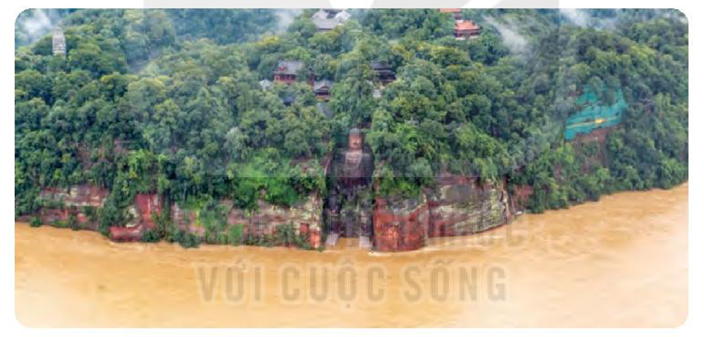
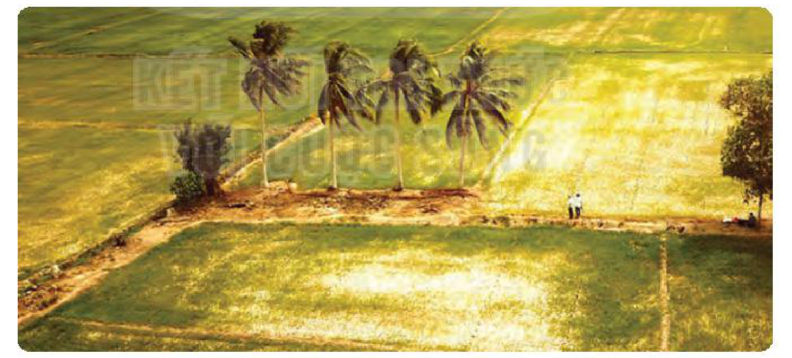
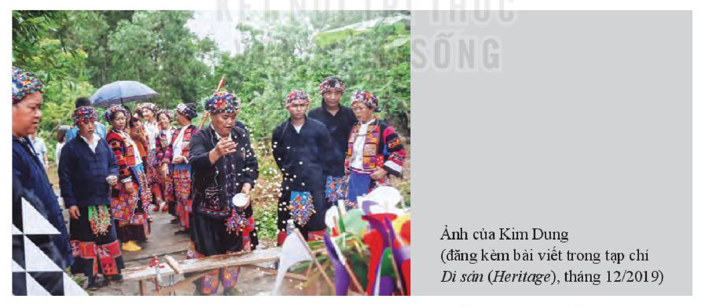
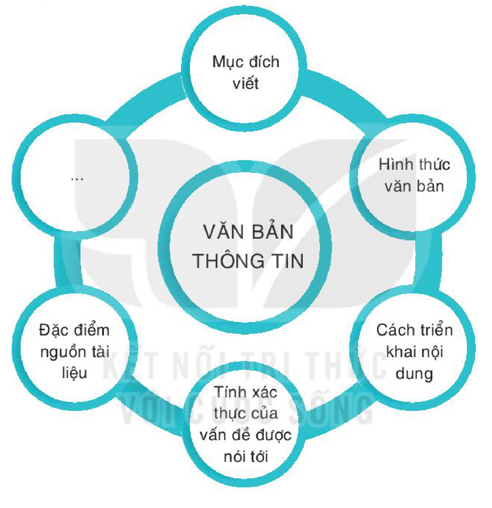

<!-- pdf:77 -->

# BÀI 9: HOÀ ĐIỆU VỚI TỰ NHIÊN

*Trong mỗi bước đi cùng với thiên nhiên, chúng ta nhận được nhiều hơn những gì ta tìm kiếm.*

Giôn Mi-ơ (John Muir)

## Giới thiệu bài học

- Hiểu biết về tự nhiên, biết sống hài hoà với tự nhiên càng ngày càng được nhìn nhận là những giá trị sống cơ bản mà con người cần hướng đến trong xã hội hiện đại. Nhân loại đã từng mắc nhiều sai lầm trong cách ứng xử với tự nhiên để rồi phải trả những giá đắt. Nhưng thực tế cũng cho thấy từ xa xưa, nhiều cộng đồng xã hội đã biết chọn cách sống tôn trọng quy luật của tự nhiên, nương theo nhịp điệu của tự nhiên để có được sự thanh thản, hạnh phúc.

- Qua đọc các văn bản thông tin và một tản văn kết nối về chủ đề trong bài học này, em vừa nghe được những lời cảnh báo của môi trường tự nhiên, vừa tiếp nhận được những tín hiệu ấm áp từ một lễ tục lạ cần duy trì. Tất cả sẽ giúp em hiểu hơn về sự sống, đời sống quanh ta để biết bộc lộ tình yêu đối với sự sống, đời sống đó theo cách đầy trách nhiệm và sáng suốt.

## 🎯 Yêu cầu cần đạt

- Nhận biết được thông tin cơ bản của văn bản thông tin, cách triển khai, vai trò của các chi tiết, tác dụng của phương tiện phi ngôn ngữ; nêu được trải nghiệm giúp bản thân hiểu hơn văn bản.
- Nhận biết được đặc điểm văn bản giới thiệu một quy tắc hoặc luật lệ trong trò chơi hay hoạt động, chỉ ra được mối quan hệ giữa đặc điểm văn bản với mục đích của nó.
- Nhận biết và hiểu được đặc điểm, chức năng của cước chú và tài liệu tham khảo trong văn bản thông tin; hiểu được nghĩa của một số yếu tố Hán Việt thông dụng và nghĩa của những từ có yếu tố Hán Việt đó.
- Bước đầu biết viết bài văn thuyết minh về một quy tắc hoặc luật lệ trong trò chơi hay hoạt động.
- Giải thích được (dưới hình thức nói) quy tắc hoặc luật lệ trong một trò chơi hay hoạt động.
- Biết lựa chọn và trân trọng cách sống hài hoà với tự nhiên.

<!-- pdf:78 -->

## Đọc

### TRI THỨC NGỮ VĂN

**Cách triển khai ý tưởng và thông tin trong văn bản thông tin**

- Có nhiều cách triển khai ý tưởng và thông tin khác nhau cho một **văn bản thông tin**. Bên cạnh cách triển khai theo trật tự thời gian và theo **quan hệ nhân quả** khá quen thuộc, các tác giả cũng thường chọn cách đưa ra liên tiếp nhiều góc nhìn khác nhau về sự vật, hiện tượng để độc giả nhận thấy được tính phức tạp của vấn đề được đề cập. Cũng có khi người viết lần lượt trình bày về từng bộ phận của đối tượng muốn nói đến trước khi đưa ra một thông tin hay quan điểm nhìn nhận thông tin mang tính bao trùm.
- Việc chọn cách triển khai ý tưởng và thông tin luôn phụ thuộc vào đặc điểm của đối tượng được nói tới, vào mục đích viết và hiệu quả tác động đến người đọc.
<!-- term: văn bản thông tin -->
<!-- term: quan hệ nhân quả -->

**Văn bản giới thiệu một quy tắc hoặc luật lệ trong trò chơi hay hoạt động**

Đây là loại văn bản thuyết minh nói về đặc điểm của một trò chơi hay hoạt động, giúp người đọc có thể tham gia, thưởng thức hay đánh giá về trò chơi, hoạt động ấy một cách thuận lợi. Văn bản thường trình bày chi tiết về cách chơi, cách tổ chức hoạt động (thời gian, địa điểm, số lượng người tham gia, các điều kiện phải đảm bảo,...) bằng những câu ngắn gọn, dễ hiểu, có thể kèm theo các hình vẽ hay bức ảnh mang tính minh hoạ.
<!-- term: văn bản giới thiệu quy tắc hoặc luật lệ trong trò chơi hay hoạt động -->

**Cước chú**

- **Cước chú** là loại chú thích đặt ở chân trang hoặc cuối văn bản về một từ ngữ khó hiểu hay một nội dung chưa quen với phần lớn độc giả, vốn xuất hiện trong phần chính của trang hoặc của văn bản. Loại chú thích cho biết văn bản hay một số yếu tố của văn bản được lấy từ nguồn nào cũng được gọi là cước chú.
- Cước chú xuất hiện rất nhiều trong các văn bản thông tin (nhất là văn bản khoa học), văn bản nghị luận và văn bản văn học cổ được đời sau in lại.
- Nhờ cước chú, người đọc có thêm điều kiện để nắm bắt được một cách chính xác những thông tin, **thông điệp**, ý nghĩa của văn bản.
<!-- term: thông điệp -->

**Tài liệu tham khảo**

- **Tài liệu tham khảo** là những tài liệu mà người tạo lập văn bản tìm đọc và khai thác các thông tin cần thiết, có liên quan tới vấn đề được trình bày trong văn bản.
- Tài liệu tham khảo thường được ghi sau phần kết thúc của văn bản, có thể có nhiều đơn vị, được đánh số và sắp xếp theo một quy ước thống nhất.
- Thông qua danh mục tài liệu tham khảo được tác giả ghi lại, người đọc có thể có được những nhận định bước đầu về độ tin cậy của nội dung thông tin trong văn bản hay giá trị chuyên môn, khoa học của văn bản.

<!-- pdf:79 -->

### VĂN BẢN ĐỌC

- **VĂN BẢN 1.** *Thuỷ tiên tháng Một*, Thô-mát L. Phrít-man (Thomas L. Friedman)
- **VĂN BẢN 2.** *Lễ rửa làng của người Lô Lô*, Phạm Thuỳ Dung
- **VĂN BẢN 3.** *Bản tin về hoa anh đào*, Nguyễn Vĩnh Nguyên

### VĂN BẢN 1: THUỶ TIÊN THÁNG MỘT

**Trước khi đọc**

1. *“Thời tiết bây giờ khó lường thật!”* – Đó là lời nhận xét ta vẫn thường nghe. Em có cảm nhận gì về những lo lắng ẩn chứa trong đó?

2. Qua quan sát trực tiếp hoặc qua tìm hiểu các nguồn thông tin, em đã biết được những thay đổi bất thường nào trong nhịp sinh trưởng và tập tính của một số loài sinh vật? Những thay đổi bất thường ấy đã gợi lên trong em cảm nhận, suy nghĩ gì?

**Đọc văn bản**

**Thuỷ tiên tháng Một**

**THÔ-MÁT L. PHRÍT-MAN**

Khi ngày càng có nhiều người phải đối mặt với biến đổi khí hậu thì trong số đó cũng có thêm nhiều người hiểu rằng đó không chỉ là hiện tượng có cái tên nghe khá êm ái là “sự nóng lên của Trái Đất”. “Ồ, mọi thứ chỉ hơi nóng lên một chút thôi, có gì không hay đâu – nhất là nếu bạn cũng là người Min-ne-xô-ta(1) (Minnesota) như tôi?”. Không đơn giản thế đâu, nó còn là “sự bất thường của Trái Đất” nữa.

> **THEO DÕI:** Những cách gọi tên khác nhau đối với hiện tượng biến đổi khí hậu trên Trái Đất.

“Sự bất thường của Trái Đất” là cụm từ do Hân-tơ Lo-vin (Hunter Lovins) đặt ra. Ông muốn giải thích với mọi người rằng nhiệt độ trung bình toàn Trái Đất tăng lên (Trái Đất nóng lên) thực sự sẽ dẫn đến các kiểu hiện tượng thời tiết bất thường khác – từ những đợt nóng và hạn hán ở nơi này đến tuyết rơi dày ở nơi kia, và sẽ có bão lớn hơn, lũ lụt nặng nề hơn, mưa to hơn, cháy rừng dữ dội hơn và các loài sinh vật sẽ biến mất. Thời tiết sẽ ngày càng không bình thường. Và đã có hiện tượng đó rồi. Khi những bông hoa thuỷ tiên vàng trên lối đi từ đường phố vào nhà chúng tôi ở Bơ-the-xđa (Bethesda), bang Me-ri-lân (Maryland), vốn thường nở vào tháng Ba,

> (1) *Min-ne-xô-ta*: một tiểu bang của Hoa Kỳ, có biệt danh là *Vùng đất của vạn hồ*.

<!-- pdf:80 -->

nhưng năm nay lại nở từ đầu tháng Một thì đó chính là sự bất thường, giống như một phép thuật xuất hiện từ trong một tập phim Thoai-lai Dôn(1) (*Twilight Zone*) vậy. Tôi gần như nghĩ rằng khi nhìn ra ngoài cửa sổ, tôi sẽ thấy Rót Xơ-linh (Rod Serling), người dẫn truyện, đang cắt cỏ trong sân nhà tôi.

> **CHÚ Ý:** Hiện tượng được nhắc ở đây chứa đựng lời giải thích về nhan đề của văn bản.

Hãy quen với điều đó. Thời tiết có thể sẽ như trong truyện khoa học viễn tưởng, nhưng bản chất khoa học của nó là hoàn toàn có thật. Nhiệt độ trung bình chỉ cần tăng lên một chút là thời tiết đã thay đổi rất nhiều, vì chính chênh lệch nhiệt độ làm hình thành cũng như tạo ra hướng vận động của gió trên bề mặt Trái Đất. Do đó, khi bạn làm thay đổi nhiệt độ trên bề mặt Trái Đất, bạn cũng làm thay đổi hướng gió – và cả tình hình gió mùa trước khi bạn nhận biết được điều đó nữa. Khi Trái Đất nóng hơn, tốc độ bay hơi nước cũng thay đổi – đó là lí do chủ yếu làm xuất hiện những trận mưa bão rất lớn ở nơi này và những đợt nóng khắc nghiệt hơn, hạn hán kéo dài hơn ở nơi khác.

*Lũ lớn (tháng 8/2020) ở thượng nguồn sông Trường Giang (Trung Quốc) dâng nước đến chân tượng Phật khổng lồ 1 200 tuổi*. Nguồn: *Chai-nơ Niu (China News)* (báo điện tử *Thế giới và Việt Nam* đăng lại ngày 21/8/2020)
<!-- ocr-ok: chú thích ảnh chữ nhỏ in nghiêng bị OCR đọc nhầm nhiều từ ("Tñ lớn", "S2020", "mước", "hương", "Clip", "77iế giới và Hệt Men"), đã đối chiếu trực tiếp ảnh trang PDF 80 -->

Tại sao chúng ta lại đồng thời có thời tiết ở cả hai thái cực(2) – ẩm ướt hơn và khô hạn hơn – cùng một lúc? Nhiệt độ trung bình tăng và cả Trái Đất nóng lên sẽ dẫn tới đất bốc hơi nhiều hơn. Vì thế, những khu vực có khí hậu khô tự nhiên sẽ càng khô hơn. Cùng lúc đó, tốc độ bay hơi của nước tăng – do Trái Đất nóng lên – cũng đưa nhiều hơi nước hơn vào không khí, vì vậy, những khu vực gần diện tích mặt nước rộng, nơi thường có lượng mưa cao sẽ có

> **THEO DÕI:** Giải thích của tác giả về sự xuất hiện đồng thời hai thái cực của thời tiết.

> (1) *Thoai-lai Dôn*: chương trình truyền hình viễn tưởng, kinh dị của Mỹ, do Rót Xơ-linh sản xuất (chú thích trong sách *Nóng, Phẳng, Chật*).
> (2) *Thái cực*: điểm đầu mút của một phía trong sự đối lập với điểm đầu mút của phía kia (nghĩa trong văn bản).

<!-- pdf:81 -->

xu hướng càng ẩm ướt hơn. Chúng ta biết chu kì tuần hoàn của nước có đặc điểm là: hơi ẩm bốc lên sẽ phải rơi xuống, và ở đâu ẩm hơn thì ở đó mưa nhiều hơn. Tổng lượng mưa trên toàn cầu sẽ tăng, và lượng mưa trong mỗi cơn bão được cho rằng cũng sẽ tăng theo – do đó gây ra mưa lớn hơn, lũ lụt nghiêm trọng hơn. Đó là lí do tại sao cụm từ “sự nóng lên của Trái Đất” vẫn là nhẹ nhàng, chưa mô tả đầy đủ mối đe doạ lớn lao tiềm ẩn.

Như Giôn Hô-đơ-rơn (John Holdren) nói: “**Thuật ngữ** quen thuộc “sự nóng lên của Trái Đất” là một sự nhầm lẫn. Nó gợi lên một cái gì đó đồng nhất(1), từ từ xảy ra, chủ yếu muốn nhắc đến nhiệt độ, và hiện tượng đó hoàn toàn có thể không gây ra vấn đề gì. Nhưng thực tế khí hậu Trái Đất đang diễn ra khác hẳn. Nó không giống nhau trên các vùng địa lí. Nó nhanh hơn so với tốc độ biến đổi khí hậu tự nhiên trước kia, đồng thời nhanh hơn khoảng thời gian để hệ sinh thái và xã hội loài người có thể điều chỉnh. Nó đang tác động lên một loạt các hiện tượng khí hậu đặc biệt quan trọng khác, ngoài nhiệt độ còn có lượng mưa, độ ẩm không khí, độ ẩm của đất, sự lưu chuyển không khí, bão, tuyết và diện tích mặt băng, dòng hải lưu(2) và hiện tượng “nước trồi”(3). Và rõ ràng ảnh hưởng của nó lên đời sống con người đang và sẽ mang tính tiêu cực nhiều hơn là tích cực. Có một cái tên khác chính xác hơn, mặc dù nghe nặng nề hơn “sự nóng lên của Trái Đất”, đó là “sự rối loạn khí hậu toàn cầu””.

> **SUY LUẬN:** Tại sao có thể cho rằng người ta đã nhầm lẫn khi dùng thuật ngữ “sự nóng lên của Trái Đất”?

*Hạn mặn khốc liệt ở Đồng bằng sông Cửu Long đầu năm 2020*, ảnh của Quốc Trung, báo điện tử *Đại đoàn kết*, ngày 24/02/2020

Trang CNN.com (ngày 07/8/2007) giới thiệu một báo cáo do Tổ chức Khí tượng thế giới (WMO) của Liên hợp quốc công bố, nội dung về các hiện tượng thời tiết dữ dội trong năm mà trước kia chưa từng xảy ra. Có thể đặt tên báo cáo đó là “Sự bất thường của Trái Đất năm 2007”:

> (1) *Đồng nhất*: cùng một loại.
> (2) *Hải lưu*: dòng chảy tạo nên do sự chuyển dịch các phân tử nước từ nơi này tới nơi khác trên biển và đại dương.
> (3) *Hiện tượng “nước trồi”* (tiếng Anh: *upwelling*): nước ở tầng sâu và đáy, thường lạnh và giàu dinh dưỡng, được đẩy lên bề mặt đại dương (chú thích trong sách *Nóng, Phẳng, Chật*).

<!-- pdf:82 -->

Bốn đợt gió mùa, nhiều gấp đôi mọi năm, đã gây ra lũ lụt nặng nề ở Ấn Độ, Pa-ki-xtan (Pakistan) và Băng-la-đét (Bangladesh),... Anh và xứ U-ên (Wales) cũng trải qua khoảng thời gian từ tháng Năm đến tháng Bảy mưa nhiều chưa từng thấy kể từ mức kỉ lục năm 1766. Đến cuối tháng Bảy, nước sông dâng cao đe doạ tràn lên hai bờ... Cuối tháng trước, ở Xu-đăng (Sudan), lũ và mưa lớn đã làm sập 23 000 ngôi nhà xây bằng gạch đất sét, khiến ít nhất 62 người thiệt mạng. Cơn mưa này to bất thường và diễn ra sớm hơn so với mọi năm... Vào tháng Năm, những đợt sóng lớn, cao đến 4,6 m đã tràn qua 68 hòn đảo của Man-đi-vơ (Maldives), gây ra lũ lụt và thiệt hại nghiêm trọng... Cũng vào tháng Năm, khắp nước Nga phải chịu một đợt nóng kéo dài... Đông nam châu Âu cũng không thoát được thời tiết bất thường, với nhiệt độ nóng kỉ lục vào tháng Sáu và tháng Bảy... Nhiều nơi ở Nam Mỹ lại phải chịu một mùa đông lạnh khác thường đối với vùng phía nam, gây ra gió, bão tuyết và tuyết rơi vốn hiếm xảy ra. Vào tháng Bảy, nhiệt độ xuống tới –22°C ở Ác-hen-ti-na (Argentina), –18°C ở Chi-lê (Chile). Tháng Sáu, Nam Phi trải qua một đợt tuyết lớn nhất kể từ năm 1981, ở một vài vùng tuyết rơi dày đến 25 cm trên mặt đất...

> **THEO DÕI:** Cách trình bày đoạn trích dẫn dài lấy từ một nguồn tài liệu tham khảo có liên quan tới vấn đề đang bàn.

Xu hướng các hiện tượng thời tiết vốn cực đoan(1) ngày càng cực đoan hơn vẫn tiếp tục cho đến tận mùa hè năm 2008. Những cơn mưa lớn chưa từng thấy ở bang Ai-o-oa (Iowa) khiến sông Xi-đa (Cedar) tràn bờ và trung tâm thành phố Xi-đa Ra-pít (Cedar Rapids) bị lụt. Mực nước sông cao hơn mặt nước biển đến 9,1 m, cao chưa từng thấy và không ai có thể nghĩ nước lên đến mức ấy. Báo *Niu Oóc Thai-mơ (New York Times)* (ngày 13/6/2008) có một câu mô tả chính xác tình trạng bất thường của Trái Đất mà người Ai-o-oa hẳn đang cảm thấy: “Giép Doóc (Jeff Zogg), nhà thuỷ văn học đang làm việc cho Trung tâm Thời tiết ở Đa-vin-pót (Davenport), Ai-o-oa nói: “Thường khi phá kỉ lục, bạn chỉ có thể vượt qua mức cũ 2,5 đến 5 cm. Nhưng hơn kỉ lục cũ tận 1,8 m thì quá sức ngạc nhiên””.

> **LIÊN HỆ:** Hiện tượng thời tiết cực đoan đang diễn ra thế nào trong thời điểm hiện nay?

(Thô-mát L. Phrít-man, *Nóng, Phẳng, Chật*, Nguyễn Hằng *dịch*, NXB Trẻ, Thành phố Hồ Chí Minh, 2016, tr. 179 – 181)

> (1) *Cực đoan*: tình trạng lệch hẳn về một phía gây nhiều lo ngại, đối lập với sự hài hoà thông thường (nghĩa trong văn bản).

<!-- pdf:83 -->

**Sau khi đọc**

> - **Thô-mát L. Phrít-man** sinh năm 1953, là nhà báo người Mỹ, phụ trách chuyên mục các vấn đề quốc tế của báo *Niu Oóc Thai-mơ*. Ông đã ba lần được trao giải Pu-lít-dơ (Pulitzer). Các tác phẩm nổi tiếng: *Chiếc Lếch-xớt (Lexus) và cây ô-liu* (1999); *Thế giới phẳng* (2005 – 2007); *Nóng, Phẳng, Chật* (2008);...
> - *Nóng, Phẳng, Chật* nói về những thách thức lớn nhất mà hiện nay nước Mỹ đang đối mặt: khủng hoảng môi trường toàn cầu và việc đánh mất vị thế của một quốc gia dẫn đầu. *Thuỷ tiên tháng Một* là một bài nằm trong mục 5 (*Sự bất thường của Trái Đất*) thuộc phần 2 (*Tại sao chúng ta lại ở đây*) của cuốn sách.

**Trả lời câu hỏi**

1. Hãy chọn trong văn bản một cụm từ có thể khái quát được nội dung chính của vấn đề mà tác giả muốn trao đổi.

2. Nhan đề của văn bản đã gợi cho em những ấn tượng, suy nghĩ gì? Chi tiết hoa thuỷ tiên nở đầu tháng Một có thể được xem là một chi tiết “đắt” hay không? Vì sao?

3. “Sự bất thường của Trái Đất” đã được tác giả làm sáng tỏ qua những bằng chứng nào? Dựa vào trải nghiệm riêng của em, hãy bổ sung bằng chứng cho vấn đề này.

4. Theo em, trong văn bản, đoạn văn nào thể hiện rõ mối **quan hệ nhân quả** giữa các sự kiện thuộc loại “sự biến đổi cực đoan của thời tiết”? Cho biết vì sao em xác định như vậy.

5. Hãy chỉ ra những dấu hiệu chứng tỏ khi viết văn bản này, tác giả đã sử dụng nhiều **tài liệu tham khảo** cần thiết.

6. Tác giả đã đưa vào văn bản rất nhiều **số liệu**. Đó là những số liệu nào? Việc dẫn số liệu như vậy có ý nghĩa gì?
<!-- term: số liệu -->

7. Nêu lên điều có ý nghĩa nhất mà em thu nhận được sau khi đọc văn bản này.

#### Viết kết nối với đọc

Hãy viết đoạn văn (khoảng 5 – 7 câu) trình bày hiểu biết và suy nghĩ của em về tác động của biến đổi khí hậu ở vùng miền em đang sống.

<!-- pdf:84 -->

### Thực hành tiếng Việt

**CƯỚC CHÚ**

> **Cách ghi cước chú**
> - Đánh dấu từ ngữ, nội dung cần cước chú bằng chữ số hoặc dấu hoa thị.
> - Ở chân trang hoặc cuối văn bản, lần lượt chú thích về từng từ ngữ hay nội dung đã được đánh dấu để tạo thành một cước chú hoàn chỉnh gồm các thành phần: kí hiệu đánh dấu đối tượng; tên đối tượng; dấu hai chấm; nội dung giải thích.

1. Kẻ bảng sau vào vở. Ghi những từ ngữ, nội dung có cước chú trong văn bản *Thuỷ tiên tháng Một* vào các cột phù hợp.

| Từ ngữ được giải thích nghĩa | Đối tượng được cung cấp thông tin về xuất xứ | Sự vật, hiện tượng được miêu tả, giải thích |
| --- | --- | --- |
| – Thái cực ... | – Ảnh của Quốc Trung ... | – Min-ne-xô-ta ... |
<!-- ocr-ok: bảng 3 cột nền màu đặt cạnh hộp Cách ghi cước chú bị OCR trộn ngang thứ tự dòng, đã đối chiếu trực tiếp ảnh trang PDF 84 -->

2. Dựa trên quan sát của em về những cước chú trong văn bản *Thuỷ tiên tháng Một*, hãy kẻ bảng sau vào vở và điền nội dung cần thiết vào ô trống.

| Các thành phần của cước chú | Vị trí đặt cước chú | Nội dung cước chú | Ngôn ngữ của cước chú |
| --- | --- | --- | --- |
| – Kí hiệu đánh dấu đối tượng được chú thích ... | – Chân trang ... | – Giải thích nghĩa của từ ngữ ... | – Ngắn gọn ... |

3. Theo em, cần có thêm cước chú cho từ ngữ, nội dung nào có trong văn bản đã đọc ở trên? Vì sao?

4. Hãy trình bày về cách ghi cước chú cho một trong những từ ngữ, nội dung được đề nghị ở bài tập 3.

**TÀI LIỆU THAM KHẢO**

> **Thao tác trích dẫn tài liệu tham khảo**
> - Đặt trong **dấu ngoặc kép** đoạn trích dẫn nguyên văn một ý kiến, nhận định nào đó.
> - Nêu thông tin về họ, tên tác giả của ý kiến, nhận định được trích dẫn (có thể đặt trước hoặc sau đoạn trích dẫn).
> - Ghi đầy đủ tên tài liệu được trích dẫn cùng nơi xuất bản, thời gian xuất bản vào vị trí thích hợp (ghi như một cước chú; ghi ngay sau đoạn trích dẫn; ghi ở phần cuối văn bản trong mục *Tài liệu tham khảo*).
<!-- term: dấu ngoặc kép -->

5. Việc cung cấp thông tin về tài liệu tham khảo đã được Thô-mát L. Phrít-man thực hiện như thế nào trong *Thuỷ tiên tháng Một*?

6. Ngoài cách ghi như trong văn bản *Thuỷ tiên tháng Một* của tác giả Thô-mát L. Phrít-man, nguồn tài liệu tham khảo đó có thể được trình bày theo cách khác: đặt ở một phần riêng cuối văn bản. Cụ thể như sau:

<!-- pdf:85 -->

**Tài liệu tham khảo**

1. Tổ chức khí tượng thế giới (07/8/2007), “Trên toàn cầu, năm 2007 đang trên đà trở thành một năm thời tiết khắc nghiệt”, *https://edition.cnn.com/2007/TECH/science/08/07/weather.extremes/index.html*

2. Cri-xtốp-phơ Ma-gơ (Christopher Maag) (13/6/2008), “Ở phía đông Ai-o-oa, thành phố “sẽ không bao giờ ngập lụt” nằm dưới độ sâu 12 phít(1)”, *https://www.nytimes.com/2008/06/13/us/13flood.html*

Hãy chỉ ra sự khác biệt giữa hai cách ghi nguồn tài liệu tham khảo nêu trên. Theo tìm hiểu của em, trong hai cách ghi đó, cách nào được sử dụng phổ biến hơn trên sách báo hiện nay?

7. Lập bảng theo mẫu sau để đánh giá tác dụng của việc viện dẫn thông tin và sử dụng tài liệu tham khảo trong *Thuỷ tiên tháng Một*:

| STT | Thông tin được viện dẫn và tài liệu tham khảo đã sử dụng | Tác dụng của việc viện dẫn thông tin và sử dụng tài liệu tham khảo |
| --- | --- | --- |
| ... | ... | ... |
| ... | ... | ... |

### VĂN BẢN 2: LỄ RỬA LÀNG CỦA NGƯỜI LÔ LÔ

**Trước khi đọc**

1. Hãy kể ngắn gọn một phong tục thể hiện nếp sống gắn bó với thiên nhiên của người Việt Nam (xưa hoặc nay) mà em được biết.

2. Hẳn em đã từng được nghe giới thiệu về quy tắc hoặc luật lệ của một trò chơi hay hoạt động nào đó. Hãy nêu một vài ấn tượng của em xung quanh việc giới thiệu này.

**Đọc văn bản**

**Lễ rửa làng của người Lô Lô**

**PHẠM THUỲ DUNG**

*Khi xong xuôi mùa vụ, đồi núi thênh thang, người Lô Lô lại nghĩ tới việc tổ chức lễ rửa làng vào một ngày đẹp trời với những ước vọng tốt lành cho cuộc sống ấm no.*

> **LIÊN HỆ:** Thời điểm thường được chọn để tổ chức lễ hội trên mọi miền đất nước.

> (1) *Phít*: đơn vị đo chiều dài, được sử dụng phổ biến ở các nước nói tiếng Anh; 1 phít bằng 30,48 cm.

<!-- pdf:86 -->

Người Lô Lô là một trong những dân tộc thiểu số có dân số ít nhất tại Việt Nam, cư trú chủ yếu ở tỉnh Hà Giang và Cao Bằng. Tuy nhiên, không vì thế mà đồng bào nơi đây thiếu vắng bề dày văn hoá so với những tộc người đông cư dân. Người Lô Lô thường sống tập trung trong các bản làng cố định nên có tính cộng đồng rất rõ nét. Ngoài những lúc làm lụng vất vả, họ lại quây quần bên nhau để cùng thực hiện những nghi thức cổ truyền hướng về nguồn cội và cùng nhau ước vọng về một đời sống ấm no. Bên cạnh những ngày lễ tiêu biểu như lễ nhảy cây, lễ cầu mưa, lễ thờ thần đá, thì người dân Lô Lô còn có lễ rửa làng rất độc đáo, thú vị.

> **CHÚ Ý:** Cách dẫn dắt người đọc vào **thông tin chính của văn bản**.
<!-- term: thông tin chính của văn bản -->

Lễ rửa làng có tên gọi là lễ mừng ngô mới, bắt nguồn từ nhận thức của người dân rằng không gian sinh sống của họ phải được “làm sạch”, “tẩy rửa” theo định kì(1) để không còn những bụi bặm, đen đủi, tà ma quấy phá. Theo thông lệ, cứ ba năm một, vào thời điểm tháng 5 hoặc tháng 6 âm lịch, người Lô Lô ngồi lại cùng nhau chọn ngày tổ chức lễ rửa làng, thống nhất việc mời thầy cúng và phân công mọi người sắm sanh đồ lễ. Một ngày trước khi tổ chức lễ rửa làng, người dân chuẩn bị lễ vật gồm thẻ hương, chén nước, giấy trúc và con gà trống. Vào tối ngày hôm trước, thầy cúng sẽ thắp hương rồi đặt giấy trúc và chén nước xuống góc nhà để khấn xin tổ tiên đồng ý cho tổ chức lễ rửa làng. Khi thầy cúng bọc tờ giấy trúc lên chén nước mà nước trong chén không bị thấm hoặc đổ ra ngoài thì lễ xin rửa làng đã linh nghiệm(2), báo hiệu việc cúng lễ sẽ thành công. Kết thúc lễ xin, ông thầy đốt tờ giấy trúc để hoàn tất thủ tục cúng.

> **THEO DÕI:** Thời điểm diễn ra lễ rửa làng và những việc cần chuẩn bị cho ngày lễ.

Ảnh của Kim Dung (đăng kèm bài viết trong tạp chí *Di sản (Heritage)*, tháng 12/2019)

Đoàn người thực hiện lễ cúng vào ngày hôm sau gồm có một thầy cúng chính, một thầy cúng phụ và một số nam giới trong làng đi theo hỗ trợ. Đoàn người sẽ cùng

> (1) *Định kì*: khoảng thời gian tương đối cố định đánh dấu sự lặp lại đều đặn của một hoạt động hoặc hiện tượng, sự kiện nào đó.
> (2) *Linh nghiệm*: có hiệu quả, có hiệu lực thấy rõ, như nhờ một tác động lạ lùng, bí ẩn nào đó.

<!-- pdf:87 -->

nhau đi khắp các nhà, suốt các hang cùng ngõ hẻm trong làng bản, vừa đi vừa gõ chiêng trống rộn ràng nhằm đánh thức những điều đẹp đẽ ngủ quên và xua đi những rủi ro ám ảnh. Theo tiếng chiêng trống vang động, tà khí sẽ sợ hãi mà bay xa. Đồ lễ mang theo đoàn người còn có hai con dê (được cho là có mùi đặc trưng để xua đuổi tà ma), một con gà trống trắng, rượu ngô, hạt ngô, cỏ, kiếm gỗ, kiếm sắt, ba cành lau, ba cành đào, ba cành mận, miếng vải đỏ, đôi sừng trâu và cây tre to. Cây tre dài trước đó đã được đục miệng ở đoạn giữa và đổ đầy đất vào, sau đó cắm hình nhân(1) bằng giấy màu (được cắt theo kiểu đang giơ tay lên van xin, thể hiện cho sự sợ hãi của hồn ma với người dân) rồi cắm hương theo từng hàng dọc ở giữa cây tre giả làm con ngựa.

> **THEO DÕI:** Sự miêu tả chi tiết các món đồ lễ.
<!-- ocr-ok: hộp Theo dõi nền màu bên lề phải bị OCR bỏ tiêu đề và đọc nhầm ("chỉ Hốt các món gđồ lẽ"), đã đối chiếu trực tiếp ảnh trang PDF 87 -->

Trên hành trình đi quanh làng bản, sẽ có hai người dắt hai con dê. Những người còn lại, người thì vác cây tre giả hình ngựa; người quẩy hạt ngô; người xách gà trống trắng cùng các cành đào, mận, lau, vải đỏ,... theo sau thầy cúng đi vào từng nhà dân. [...] Tới nhà nào, gia chủ nơi đó phải chuẩn bị sẵn hình nhân cùng hai bó củi và hai bó cỏ để ngầm bồi dưỡng công xua đuổi tà ma cho thầy cúng với thái độ cung kính, thành khẩn.

> **THEO DÕI:** Các bên tham dự lễ phải làm những gì khi đoàn hành lễ đi quanh làng bản?
<!-- ocr-ok: hộp Theo dõi bên lề phải bị OCR dính chữ ("bêntham", "lễphải") và trộn dòng với chính văn, đã đối chiếu trực tiếp ảnh trang PDF 87 -->

Xong phần lễ, mọi người thấy nhẹ nhõm hơn và tin tưởng vào một tương lai tươi sáng phía trước, làng bản từ nay sẽ phong quang(2), sạch sẽ và mọi việc sẽ thuận lợi, may mắn. Các cô gái trong bản nhân dịp này diện những bộ váy áo đẹp được thêu thùa cầu kì, trên đầu đội những chiếc khăn điệu đà làm dáng, túm tụm bên nhau vui vẻ nói cười. Các chàng trai phấn khởi lớn giọng chúc tụng nhau chén rượu nồng thơm. Các cụ ông, cụ bà anh ánh nét cười nhìn con cháu vui vầy sum họp. Mọi người hoan hỉ ăn tiệc, uống rượu mừng rồi mới ai về nhà nấy, bắt đầu ba năm yên ổn sinh sống và làm ăn. Sau lễ cúng, phải 9 ngày sau người lạ mới được bước vào làng vì người Lô Lô cho rằng nếu để người lạ đến, tà ma lại sẽ theo vào và như vậy là lễ không thiêng nữa. Nếu chẳng may có người lạ vào làng, người đó phải sửa soạn lễ vật để cúng lại, bù vào lễ cúng đã bị họ làm mất thiêng.

> **THEO DÕI:** Tác động tinh thần tích cực của lễ rửa làng.
<!-- ocr-ok: hộp Theo dõi bên lề phải bị OCR đọc nhầm dấu ("tĩnh thần", "lỗ") và trộn dòng với chính văn, đã đối chiếu trực tiếp ảnh trang PDF 87 -->

> **CHÚ Ý:** Những quy định nghiêm ngặt về hoạt động sau ngày lễ chính.
<!-- ocr-ok: hộp Chú ý bên lề phải bị OCR dính chữ ("Chúý") và đọc nhầm ("gặt"), đã đối chiếu trực tiếp ảnh trang PDF 87 -->

Với những nghi thức độc đáo như trên, lễ rửa làng của đồng bào Lô Lô được coi là tín ngưỡng dân gian và nét đẹp truyền thống góp phần làm giàu có thêm cho bản sắc của cộng đồng dân tộc thiểu số Việt Nam.

(*Theo* Phạm Thuỳ Dung, tạp chí *Di sản*, tháng 12/2019, tr. 22 – 24)
<!-- ocr-ok: dòng xuất xứ chữ nhỏ bị OCR đọc nhầm ("7heo", "Di san"), đã đối chiếu trực tiếp ảnh trang PDF 87 -->

> (1) *Hình nhân*: hình người bằng giấy, dùng để cúng rồi đốt đi, theo tục lệ mê tín.
> (2) *Phong quang*: quang đãng và sáng sủa.

<!-- pdf:88 -->

**Sau khi đọc**

**Trả lời câu hỏi**

1. Nêu những thông tin chính về lễ rửa làng mà em tiếp nhận được từ văn bản (có thể trình bày dưới hình thức một **sơ đồ** với các phần: thời điểm diễn ra hoạt động; sự chuẩn bị và diễn biến của hoạt động; ý nghĩa của hoạt động;...).
<!-- term: sơ đồ -->

2. Theo em, mục đích của tác giả khi viết văn bản này là gì? Tác giả đã thực hiện mục đích đó như thế nào?

3. Văn bản nhắc đến nhiều hoạt động diễn ra trong lễ rửa làng của người Lô Lô. Hoạt động nào trong đó phải được thực hiện theo luật lệ, hoạt động nào nằm ngoài luật lệ?

4. Tính cộng đồng của các hoạt động trong ngày lễ đã được tô đậm qua những thông tin cụ thể nào?

5. Qua đọc văn bản *Lễ rửa làng của người Lô Lô*, em rút ra được kinh nghiệm gì về cách tạo lập loại văn bản giới thiệu về quy tắc hoặc luật lệ của một trò chơi hay hoạt động?

#### Viết kết nối với đọc

Viết đoạn văn (khoảng 5 – 7 câu) nêu cảm nhận của em về những giá trị sống được bộc lộ qua lễ rửa làng của người Lô Lô.

### VĂN BẢN 3: BẢN TIN VỀ HOA ANH ĐÀO

**Đọc văn bản**

**Bản tin về hoa anh đào**

**NGUYỄN VĨNH NGUYÊN(1)**

Anh bạn tôi là kí giả(2) ở Đà Lạt.

Nhiều năm viết báo với trách nhiệm và sự dấn thân, anh đã đóng góp nhiều điều cho những việc lớn của thành phố. Nhưng với riêng tôi, điều đáng nể phục ở anh lại không chỉ nằm ở những loạt phóng sự điều tra gay cấn, những kí sự đường xa đầy phiêu lưu, những tiếng nói phản biện xã hội từ hiện trường đời sống, mà nơi những bản tin nhỏ về hoa anh đào đều đặn xuất hiện hằng năm khi Đà Lạt giao mùa đông – xuân.

> (1) Nguyễn Vĩnh Nguyên sinh năm 1979, quê ở Ninh Thuận, đã xuất bản nhiều cuốn sách viết về Đà Lạt.
> (2) *Kí giả*: người viết báo, nhà báo.

<!-- pdf:89 -->

Bản tin về hoa anh đào thường xuất hiện trên tờ báo T vào đúng cái mùa mà những người yêu Đà Lạt đang phát điên lên vì nhớ núi đồi và cái lạnh tháng Chạp. Có năm, bản tin được viết như một bài thơ, với niềm hứng khởi, hân hoan, loan báo rằng hoa sẽ nở rộ vào tháng tới, trên những con dốc, ngọn đồi A, B, C; có năm, bản tin dự báo hoa sẽ đến muộn và chóng tàn vì thời tiết bất lợi nhưng cũng có năm, bản tin kể lể về một vài gốc anh đào cổ thụ đứng ở góc đường nào đó trong thành phố vừa bị đốn hạ.

Với nhiều người, đó là thứ xa xỉ viễn mơ(1). Bản thân cái bản tin đó cũng có thể tạo cảm giác lạc lõng ngay trên trang báo, giữa cái thời ai cũng mong chờ báo chí đem lại cái thiết thân(2), cái giật gân, cái chạm vào toan tính mưu sinh thường nhật. Những độc giả bị “sốc hoa(3)” này sẽ hỏi ngay, một bản tin hoa nở, hoa tàn thì liệu có giải quyết được điều gì [...]?

*Hoa anh đào Đà Lạt*

[...] Tôi đã hình dung cái khó khăn của thuở ban đầu, khi ý tưởng viết một bản tin về hoa vừa đến trong đầu người viết. Rõ ràng ngay lập tức anh sẽ tự hỏi, đó có phải hoặc có nên là một bản tin? Hẳn anh bạn thiết(4) của tôi đã ngồi hàng giờ ở cái quán cà phê quen thuộc dưới bóng một cây anh đào nào đó và ưu tư nhiều lắm, như thể hoàng tử bé với nỗi băn khoăn vô hạn trước một nàng hoa kiều diễm đơn độc trổ gai giữa tinh cầu bé nhỏ, vì chàng không biết làm sao để ngỏ lời với nàng theo

> (1) *Viễn mơ*: mơ mộng, xa thực tế.
> (2) *Thiết thân*: có quan hệ mật thiết về mặt lợi ích đối với bản thân đối tượng được nói đến.
> (3) *Sốc hoa*: ý nói bị bất ngờ lớn trước bản tin về hoa trong bối cảnh cuộc sống có nhiều điều dường như đáng quan tâm hơn (*sốc*: từ *shock* trong tiếng Anh được Việt hoá).
> (4) *Anh bạn thiết*: anh bạn thân thiết.

<!-- pdf:90 -->

cách thế(1) tự nhiên nhất. Trong đầu anh bạn hẳn sẽ rộn ràng như những trang văn của Ăng-toan đơ Xanh-tơ Ê-xu-pe-ri nhưng rồi lại phải trở về thực tại với một quyết định vô cùng táo bạo: phải làm cho hiện thực về hoa đào được chấp nhận bình đẳng với mọi thông tin khác trên đời.

Cuối cùng, anh đã vượt qua những chướng ngại đầu tiên trong tinh thần để mạnh dạn ngồi vào bàn viết, chuyển tải cái cảm nhận đầy tinh tế về thực tại cỏ hoa nơi thành phố mình yêu trở thành một thông điệp giá trị cần chia sẻ với nhiều người.

Bản tin về tình trạng hoa đào mỗi năm một lần, xuất hiện trên tờ báo T, với riêng tôi, là điều vô cùng ý nghĩa. Ý nghĩa trên bình diện tư duy trong nghề báo thì đã rồi, nhưng lớn lao hơn, đó là nó đã truyền đi một lối nghĩ khác, để hiểu rằng hoa cỏ – những nhân vật chính lặng lẽ làm nên nhan sắc Đà Lạt, cái hiện thực về xã hội thiên nhiên đó – cũng cần được truyền thông, nâng niu theo cách thế tự nhiên nhất, nghệ thuật nhất, chứ không nhất thiết thông qua những cuộc vận động rộn ràng nhất thời [...].

Tôi đã nghĩ đến một ngày nào đó, những bản tin về sự rối rắm hỗn loạn của xã hội loài người được giảm thiểu trên các tờ nhật báo chuyên về chính trị xã hội, thay vào đó là thông tin về tình trạng của những loài hoa, những mùa hoa nơi thành phố tôi yêu. Khi đó, tâm hồn con người sẽ được thanh lọc, tốt lành biết mấy.

(*Theo* Nguyễn Vĩnh Nguyên, *Với Đà Lạt ai cũng là lữ khách*, NXB Trẻ, Thành phố Hồ Chí Minh, 2015, tr. 29 – 31)

**Sau khi đọc**

**Trả lời câu hỏi**

1. Theo em, nhan đề *Bản tin về hoa anh đào* có thể gợi lên ở người đọc những suy đoán gì về nội dung của bài tản văn?

2. Liệt kê những từ ngữ thể hiện trực tiếp ý kiến đánh giá của tác giả đối với các bản tin nhỏ mà người bạn nhà báo đã viết về hoa anh đào. Em nhận xét như thế nào về ý kiến đánh giá đó?

3. Vì sao tác giả lại cho rằng để viết một bản tin về hoa anh đào, người bạn của mình đã phải vượt qua nhiều “khó khăn”, “chướng ngại”? Những “khó khăn”, “chướng ngại” được nêu lên đó cho biết gì về cách sống và thái độ ứng xử với thiên nhiên của con người trong cuộc sống hiện đại?

4. Hãy làm rõ sự đồng điệu về tâm hồn giữa tác giả và nhân vật được nói tới trong bài tản văn.

5. Nêu khái quát thông điệp chính mà tác giả muốn gửi tới người đọc qua tản văn *Bản tin về hoa anh đào*.

6. Nêu suy nghĩ của em về điều mong muốn mà tác giả thể hiện ở đoạn cuối văn bản.

> (1) *Cách thế*: cách.

<!-- pdf:91 -->

### Thực hành tiếng Việt

**NGHĨA CỦA MỘT SỐ YẾU TỐ HÁN VIỆT THÔNG DỤNG VÀ NGHĨA CỦA NHỮNG TỪ CÓ YẾU TỐ HÁN VIỆT ĐÓ**

> **Cách xác định nhanh nghĩa của những từ có yếu tố Hán Việt**
> - Khi gặp một từ có các **yếu tố Hán Việt** thông dụng, trước hết, có thể tách từ đó ra thành các yếu tố riêng biệt để xem xét. Ví dụ: ***thuyết minh*** → ***thuyết*** và ***minh***.
> - Tiếp đó, tập hợp những từ đã biết có một trong các yếu tố của từ được tách ở trên và xếp chúng vào các nhóm khác nhau. Ví dụ: nhóm có yếu tố ***thuyết***: *thuyết phục, thuyết giảng, lí thuyết, diễn thuyết*,...; nhóm có yếu tố ***minh***: *minh bạch, minh mẫn, tường minh, thanh minh*,...
> - Dựa vào nghĩa chung của một vài từ đã biết trong mỗi nhóm để suy ra nghĩa của từng yếu tố, từ đó, bước đầu xác định nghĩa của từ có yếu tố Hán Việt muốn tìm hiểu. Ví dụ: ***thuyết*** → *có liên quan tới hành động nói*; ***minh*** → *có liên quan tới sự rõ ràng, sáng sủa*; ***thuyết minh*** → *nói rõ ràng ra (về một vấn đề nào đó)*.
<!-- term: yếu tố Hán Việt -->

1. Em hiểu như thế nào về nghĩa của các yếu tố Hán Việt tạo nên từ *tín ngưỡng* được dùng trong văn bản *Lễ rửa làng của người Lô Lô*? Theo em, khi chưa có sẵn từ điển trong tay, ta có thể suy đoán nghĩa của các yếu tố đó và nghĩa của từ chứa đựng chúng theo cách nào?

2. *Bản sắc, ưu tư, truyền thông* là các từ có yếu tố Hán Việt. Lập bảng theo mẫu được gợi ý sau đây để xác định nghĩa của chúng:

| Từ cần xác định nghĩa | Những từ khác có yếu tố Hán Việt tương tự | Nghĩa của từng yếu tố | Nghĩa chung của từ |
| --- | --- | --- | --- |
| bản sắc – bản | ***bản*** *chất*, ***bản*** *lĩnh*, ***bản*** *quán*, *nguyên* ***bản***,... | *bản*:... | *bản sắc*:... |
| bản sắc – sắc | ***sắc*** *thái*, ***sắc*** *độ*, ***sắc*** *tố*,... | *sắc*:... | |
| ưu tư – ưu | ... | ... | ... |
| ưu tư – tư | ... | ... | |
| ... | ... | ... | ... |

<!-- pdf:92 -->

## Viết

**Viết bài văn thuyết minh về quy tắc hoặc luật lệ trong trò chơi hay hoạt động**

**Bài văn thuyết minh về quy tắc hoặc luật lệ trong trò chơi hay hoạt động** có mục đích cung cấp thông tin về quy tắc hoặc luật lệ của trò chơi hay hoạt động đó. Văn bản 2 của phần Đọc thuộc loại này. Hẳn em không thể quên nhiều trò chơi hay hoạt động đặc biệt đã theo suốt tuổi thơ của mình hoặc từng biết đến không ít trò chơi hay hoạt động độc đáo mang đậm bản sắc văn hoá từng vùng miền đất nước. Em hãy giới thiệu về một trò chơi hay hoạt động với mọi người bằng một bài văn thuyết minh.

*Yêu cầu đối với bài văn thuyết minh về quy tắc hoặc luật lệ trong trò chơi hay hoạt động:*

- Giới thiệu được những thông tin cần thiết về trò chơi hay hoạt động (hoàn cảnh diễn ra, đối tượng tham gia).
- Miêu tả được quy tắc hoặc luật lệ của trò chơi hay hoạt động.
- Nêu được vai trò, tác dụng của trò chơi hay hoạt động đối với con người.
- Nêu được ý nghĩa của trò chơi hay hoạt động.

#### Phân tích bài viết tham khảo

**Chơi chuyền**

Trong các trò chơi dân gian Việt Nam, trò chơi chuyền được rất nhiều bạn gái yêu thích. Ở đầu ngõ nhỏ, dưới bóng tre hay ở góc sân nhà, người ta thường thấy cảnh các bạn gái túm năm tụm ba, tóc buộc đuôi gà, cùng nhau đánh chuyền thoăn thoắt.

> Giới thiệu trò chơi.

Tham gia trò chơi này thường có từ 2 đến 6 người, chơi theo cặp, cũng có khi chơi luân phiên từng người trong nhóm, hoặc chia các đội. Đồ chơi gồm có 10 que nhỏ gọi là que chuyền và một quả tròn nặng (Trước kia, quả chuyền thường là một thứ quả cây như quả bưởi nhỏ rụng lúc còn non, quả xà cừ, quả cà,... Ngày nay thường là quả bóng ten-nít.). Người chơi tay cầm quả tung lên không trung, đồng thời nhặt que chuyền đã được rải sẵn dưới đất, kịp để bắt quả khi quả rơi xuống. Chơi từ bàn 1 đến bàn 10, người chơi vừa tung quả, nhặt que chuyền vừa đọc những câu đồng dao phù hợp với từng bàn.

> Miêu tả cách chơi (quy tắc).

<!-- pdf:93 -->

Bàn 1 (mỗi lần tung quả lấy 1 que):

*Cái mốt*
*Cái mai*
*Con trai*
*Con hến*
*Con nhện*
*Chăng tơ*
*Quả mơ*
*Quả mận*
*Con rận*
*Lên đôi.*

Bàn 2 (thường gọi là bàn đôi, mỗi lần tung quả lấy 2 que):

*Đôi bánh trôi*
*Đôi bánh chay*
*Đôi bánh dày*
*Đôi bánh đa*
*Lên bàn ba.*
<!-- ocr-ok: câu đồng dao Bàn 2 in nghiêng bị OCR đọc nhầm chữ "Đôi" thành "/ôi" và "tôi", đã đối chiếu trực tiếp ảnh trang PDF 93 -->

Bàn 3 (mỗi lần tung quả lấy 3 que, lần cuối lấy 1 que dư):

*Ba lá đa*
*Ba lá đề*
*Ba thằng hề*
*Lên bàn tư.*

Bàn 4 (thường gọi là bàn tư, mỗi lần tung quả lấy 4 que, lần cuối lấy 2 que dư):

*Tư củ từ*
*Tư củ khoai*
*Hai lên năm.*

Bàn 5 (mỗi lần tung quả lấy 5 que):

*Năm em nằm*
*Năm lên sáu.*
<!-- ocr-ok: câu đồng dao Bàn 5 in nghiêng bị OCR đọc nhầm "nằm" thành "năm" và "Năm" thành "NVăm", đã đối chiếu trực tiếp ảnh trang PDF 93 -->

Bàn 6 (lần đầu tung quả lấy 6 que, lần thứ hai tung quả lấy 4 que còn lại):

*Sáu lẻ bốn*
*Bốn lên bảy.*
<!-- ocr-ok: câu đồng dao Bàn 6 in nghiêng bị OCR đọc nhầm "lẻ" thành "lẽ" và "Bốn" thành "Bồn", đã đối chiếu trực tiếp ảnh trang PDF 93 -->

<!-- pdf:94 -->

Các bàn 7, 8, 9 tương tự như bàn 6. Bàn 10 tung quả lấy cả 10 que. Hết bàn 10 thì tung quả và quay que chuyền bằng hai tay, chuyền một vòng, hai vòng hoặc ba vòng,... vừa chuyền vừa đọc: “Đầu quạ, quá giang, sang sông, trồng cây, ăn quả, nhả hột,...” khoảng 10 lần là hết một bàn chuyền vòng. Hết 10 bàn và chuyền vòng tính là một ván.

Khi đến lượt chuyền, nếu bạn nào không bắt được quả hay bắt que chuyền không đúng sẽ mất lượt. Đối phương sẽ được chơi. Có bạn chơi giỏi có thể chơi một lúc nhiều ván. Tính thắng thua bằng tỉ số hoàn thành các ván.

> Miêu tả luật chơi.

Chơi chuyền luyện sự khéo léo, nhanh tay, nhanh mắt, luyện cả khả năng tính toán trong phạm vi 10. Chơi chuyền còn gắn kết người chơi, củng cố tinh thần đồng đội. Trò chơi này đem đến cho các bạn sự vui vẻ, hoà đồng.

> Nêu tác dụng của trò chơi.

Hiện nay, chơi chuyền không còn phổ biến như trước. Các bạn nhỏ có thêm nhiều trò chơi khác, nhất là trò chơi công nghệ. Song, với tư cách là trò chơi thể hiện đậm nét một vẻ đẹp của văn hoá dân gian người Việt, chơi chuyền vẫn là “trò” thường có mặt trong các lễ hội và trong các hoạt động phát triển thể chất hoặc hướng tới mục đích lưu giữ bản sắc truyền thống.

> Nêu ý nghĩa của trò chơi.

*(Nhóm biên soạn)*

#### Thực hành viết theo các bước

### 1. TRƯỚC KHI VIẾT

> *Mục đích viết*
> Cung cấp thông tin về quy tắc hoặc luật lệ của trò chơi hay hoạt động.
>
> *Người đọc*
> Thầy cô, bạn bè, người thân và những người quan tâm đến trò chơi hay hoạt động được nói đến.

**a. Lựa chọn đề tài**

Em hãy nhớ lại những trò chơi hay hoạt động mà em biết hoặc từng tham gia. Ngày nay, có khá nhiều trò chơi hay hoạt động được tổ chức trong các sự kiện như đi dã ngoại, cắm trại,... Em có thể thuyết minh về những trò chơi hay hoạt động đó. Em cũng có thể chọn những trò chơi dân gian mình đã tham gia hoặc thấy thích thú và muốn tìm hiểu.

Hãy tham khảo một vài trò chơi hay hoạt động sau:

- Trò chơi bịt mắt bắt dê
- Trò chơi nhảy bao bố

<!-- pdf:95 -->

- Trò chơi ô ăn quan
- Trò chơi pháo đất
- Trò chơi cướp cờ
- Thi thả diều
- Thi thổi cơm
- Hát đối đáp.

**b. Tìm ý**

Em hãy tìm ý cho bài viết bằng cách trả lời những câu hỏi dưới đây:

- Trò chơi hay hoạt động đó thường diễn ra ở đâu?
- Trò chơi hay hoạt động đó dành cho lứa tuổi nào?
- Hiện nay người ta có còn chơi trò chơi đó hay duy trì hoạt động đó nữa không?
- Quy tắc, luật lệ của trò chơi hay hoạt động đó là gì?
- Trò chơi hay hoạt động đó có tác dụng như thế nào đối với con người?
- Ý nghĩa của trò chơi hay hoạt động đó là gì?

**c. Lập dàn ý**

Em hãy sắp xếp các ý tìm được thành một dàn ý.

**Dàn ý**

- *Mở bài:* Giới thiệu về trò chơi hay hoạt động (tên gọi, hoàn cảnh diễn ra, đối tượng tham gia).
- *Thân bài:*
  + Miêu tả quy tắc hoặc luật lệ của trò chơi hay hoạt động.
  + Nêu tác dụng của trò chơi hay hoạt động.
- *Kết bài:* Ý nghĩa của trò chơi hay hoạt động đối với cuộc sống con người.

### 2. VIẾT BÀI

Khi viết bài, em cần lưu ý:

- Kết hợp các thông tin em tham khảo được về trò chơi hay hoạt động và những trải nghiệm của riêng em (nếu có).
- Miêu tả quy tắc hoặc luật lệ của trò chơi hay hoạt động một cách chi tiết, rõ ràng.
- Mỗi ý thuyết minh về trò chơi hay hoạt động trình bày thành một đoạn văn.

<!-- pdf:96 -->

### 3. CHỈNH SỬA BÀI VIẾT

Hãy rà soát bài viết của em theo những yêu cầu ở cột trái và gợi ý chỉnh sửa ở cột phải.

| Yêu cầu | Gợi ý chỉnh sửa |
| --- | --- |
| Giới thiệu được những thông tin cần thiết về trò chơi hay hoạt động. | Nếu bài viết chưa giới thiệu cụ thể tên trò chơi hay hoạt động, hoàn cảnh diễn ra trò chơi hay hoạt động, đối tượng tham gia,... thì cần bổ sung. |
| Miêu tả chi tiết, rõ ràng quy tắc, luật lệ của trò chơi hay hoạt động. | Bổ sung thông tin (nếu cần) hoặc điều chỉnh các câu, đoạn cho bài viết mạch lạc. |
| Nêu được tác dụng và ý nghĩa của trò chơi hay hoạt động. | Nếu việc nêu tác dụng, ý nghĩa của trò chơi hay hoạt động còn sơ sài hoặc chưa chính xác thì cần bổ sung hoặc điều chỉnh. |
| Đảm bảo yêu cầu về chính tả và diễn đạt. | Rà soát lỗi chính tả, dùng từ, đặt câu,... trong bài viết và chỉnh sửa (nếu có). |

## Nói và nghe

**Giải thích quy tắc hoặc luật lệ trong một trò chơi hay hoạt động**

Để các đối tượng tham gia trò chơi hay hoạt động thống nhất trong cách thức hành động, cần có những quy tắc hoặc luật lệ chung mà tất cả đều hiểu và tuân thủ. Trong phạm vi phần Nói và nghe này, em hãy tập trung giải thích quy tắc hoặc luật lệ của một trò chơi hay hoạt động mà em yêu thích.

### 1. TRƯỚC KHI NÓI

> *Mục đích nói*
> Làm rõ quy tắc hoặc luật lệ của trò chơi hay hoạt động với những người tham gia hoặc những người quan tâm.
>
> *Người nghe*
> Thầy cô, bạn bè, người thân và những ai tham gia hoặc quan tâm đến trò chơi hay hoạt động.

**a. Chuẩn bị nội dung nói**

Trong phần Viết, em đã thuyết minh về quy tắc hoặc luật lệ của một trò chơi hay hoạt động. Dựa trên bài viết, em hãy chọn nội dung cho hoạt động nói theo những gợi ý sau:

- Đánh dấu đoạn giải thích quy tắc hoặc luật lệ của trò chơi hay hoạt động trong bài viết.
- Tóm lược những ý chính của đoạn văn đó.
- Chuẩn bị tranh ảnh, hình vẽ dạng sơ đồ, dụng cụ (nếu có) liên quan đến trò chơi hay hoạt động.

<!-- pdf:97 -->

*Chú ý:* Em có thể chuẩn bị thuyết trình bằng hình thức trình chiếu để người nghe hiểu rõ hơn về trò chơi hay hoạt động.

**b. Tập luyện**

Em có thể tập luyện theo một số hình thức sau:

- Tập nói thành tiếng một mình; vừa nói vừa giới thiệu tranh ảnh, hình vẽ, dụng cụ (nếu có).
- Nếu em chuẩn bị thuyết trình thì nói theo bản trình chiếu đã chuẩn bị.

### 2. TRÌNH BÀY BÀI NÓI

**a. Mở đầu**

Hãy thu hút người nghe bằng thái độ hào hứng của em đối với trò chơi hay hoạt động. Em có thể đặt câu hỏi cho người nghe như: *Các bạn đã bao giờ chơi trò... (tham gia hoạt động...) chưa?* hoặc miêu tả một chi tiết trong trò chơi hay hoạt động và hỏi: *Các bạn có biết trò chơi (hoạt động) này không? Các bạn có muốn chơi (tham gia) không?*...

**b. Triển khai**

- Trình bày theo dàn ý đã chuẩn bị (hoặc nói kết hợp với việc sử dụng bản trình chiếu).
- Trong khi nói, em có thể dùng cử chỉ, điệu bộ để mô phỏng động tác của trò chơi hay hoạt động.

**c. Kết luận**

Khẳng định sự thú vị của trò chơi hay hoạt động; hẹn các bạn cùng tham gia trò chơi hay hoạt động vào một dịp phù hợp.

### 3. SAU KHI NÓI

Trao đổi về bài nói theo một số gợi ý sau:

| Người nghe | Người nói |
| --- | --- |
| - Chú ý theo dõi quy tắc hoặc luật lệ của trò chơi hay hoạt động trong bài nói để cảm nhận được sự thú vị của trò chơi hay hoạt động; bày tỏ cảm nhận của mình. - Nếu em có ý định chơi trò chơi (hoặc tham gia hoạt động) đó với các bạn thì ghi nhớ những quy tắc hoặc luật lệ của trò chơi hay hoạt động; nêu thắc mắc của mình (nếu có) để hiểu thấu đáo quy tắc hoặc luật lệ của trò chơi hay hoạt động. - Nhận xét về cách trình bày bài nói của bạn (giọng nói, tính mạch lạc của bài nói,...). | - Lắng nghe chia sẻ của người nghe về bài nói. - Giải đáp thắc mắc của người nghe (nếu có). - Cảm ơn nhận xét của người nghe. |

<!-- pdf:98 -->

## Củng cố, mở rộng

1. Theo em, những điều gì đang gây ảnh hưởng tiêu cực đến môi trường sống trên Trái Đất hiện nay? Nêu một số việc mà em cho rằng con người cần phải làm để cải thiện tình hình.

2. Nêu những điều em nắm được về đặc điểm văn bản thông tin qua bài học này bằng một sơ đồ phù hợp. Gợi ý:

> **VĂN BẢN THÔNG TIN**
> - Mục đích viết
> - Hình thức văn bản
> - Cách triển khai nội dung
> - Tính xác thực của vấn đề được nói tới
> - Đặc điểm nguồn tài liệu
> - ...

3. Hãy hoàn thành đoạn văn (khoảng 5 – 7 câu) theo chủ đề sau: *Em mong sự sống và môi trường trên Trái Đất khôi phục được nhịp điệu hài hoà và vẻ đẹp vốn có.*

4. Đóng vai người chủ trì một trò chơi trong lễ hội để giới thiệu về trò chơi đó cho những ai tham gia (thực hiện theo nhóm học tập).

5. Tìm đọc các sách, báo, tài liệu viết về chủ đề *Sống thuận theo tự nhiên, hài hoà với thiên nhiên*; chia sẻ, trao đổi với các bạn và ghi lại những thông tin hữu ích để sử dụng trong những trường hợp cần thiết.

<!-- pdf:99 -->

## Thực hành đọc

*Khi đọc văn bản dưới đây, em cần chú ý những vấn đề sau:*

- Đặc điểm của loại văn bản.
- Vấn đề chính được nói tới trong văn bản.
- Ý nghĩa của việc dẫn các số liệu cụ thể trong văn bản.
- Suy ngẫm của em trước những thông tin do văn bản đưa lại.

**“Thân thiện với môi trường”(1)**

**NGUYỄN HỮU QUỲNH HƯƠNG(2)**

Vật liệu thân thiện môi trường, sản phẩm thân thiện môi trường, dịch vụ thân thiện môi trường, địa điểm thân thiện môi trường. Chào mừng các bạn đến với kỉ nguyên nơi người ta dán mác(3) “thân thiện với môi trường” lên mọi thứ nhằm mang lại những trải nghiệm tiêu dùng dễ chịu cho khách hàng.

Những năm gần đây, thị trường Việt Nam xuất hiện nhiều sản phẩm được cộp(4) mác “thân thiện với môi trường”, cách làm này có vẻ tạo thiện cảm cho người dùng, tuy nhiên, khái niệm này còn khá chung chung, và chưa thể xem là dấu hiệu chứng minh cho nguồn gốc, chất lượng sản phẩm, hay sứ mệnh, tầm nhìn của nhà sản xuất. Nhưng liệu “thân thiện với môi trường” có đơn giản chỉ là sự so sánh: ống hút tre thân thiện với môi trường hơn ống hút nhựa; dùng túi vải thân thiện với môi trường hơn túi ni lông...?

Một vật liệu, sản phẩm, dịch vụ, địa điểm được xem là thân thiện hơn với môi trường có thể được xác định một cách rất rõ ràng qua những tiêu chí sau:

**\* Đối với vật liệu:**

Quy trình khai thác: Không gây tổn hại đến môi sinh; không tiêu hao nhiều tài nguyên và năng lượng trong quá trình khai thác.

Tính chất vật liệu: Có phân huỷ được không? Thời gian phân huỷ? Khả năng tái sinh, tái chế?

Giá trị sử dụng của vật liệu: Thời gian sử dụng kéo dài bao lâu?

> (1) Tác giả dùng dấu ngoặc kép ở nhan đề nhằm lưu ý: vấn đề sẽ bàn trong văn bản liên quan đến cụm từ *thân thiện với môi trường* – một cụm từ thông dụng trong đời sống hiện nay nhưng có lúc được dùng chỉ như một cách quảng cáo thuần tuý và không phản ánh chính xác bản chất của đối tượng được nói tới.
> (2) Nguyễn Hữu Quỳnh Hương sinh năm 1997 ở Bà Rịa – Vũng Tàu, là tác giả của nhiều bài báo, cuốn sách cổ vũ nhiệt thành cho “lối sống xanh”, dùng bút danh *Mình là Hũ* khi viết cuốn *Sống xanh rồi mới sống nhanh*.
> (3) *Mác*: nhãn của sản phẩm, hàng hoá, dịch vụ (phiên âm tiếng Việt của từ *mark* trong tiếng Anh).
> (4) *Cộp*: đóng dấu (khẩu ngữ).

<!-- pdf:100 -->

Ví dụ: Người ta thường nói sử dụng túi vải thì thân thiện với môi trường hơn túi ni lông. Tuy nhiên, để sản xuất ra một cái túi vải thì số năng lượng tiêu hao gấp 131 lần việc sản xuất ra một cái túi ni lông. Theo Liên minh Túi tiến bộ(1), để cân đối dấu chân carbon(2) và nước của một chiếc túi vải, trung bình chúng ta cần dùng nó 131 lần. Như vậy, túi vải chỉ thân thiện hơn với môi trường khi bạn sử dụng nó nhiều và thật nhiều lần.

**\* Đối với sản phẩm:**

Quy trình khai thác, sản xuất, phân phối, sử dụng và thải loại có theo hình tròn không hay chỉ là một đường thẳng?

Ví dụ: So sánh hai sản phẩm túi ni lông và túi bột sắn 0% nhựa có khả năng phân huỷ hoàn toàn. Bạn sẽ khẳng định chắc chắn túi bột sắn thân thiện hơn với môi trường vì nó phân huỷ được. Nhưng liệu sự thật có phải như vậy?

Hãy tiếp tục trả lời câu hỏi: Sản phẩm này sau khi sử dụng có để lại tác hại gì cho môi trường không?

Năm 2018, nhà sản xuất Guây-vơ (Wave) tại In-đô-nê-xi-a (Indonesia) tung ra thị trường sản phẩm túi bột sắn 0% nhựa, có khả năng tan trong nước, con người và sinh vật không gặp phải ảnh hưởng gì xấu khi uống vào.

Để tạo ra túi bột sắn 0% nhựa, trước hết người ta cần dùng diện tích đất trồng rừng để trồng sắn hoặc ngô. “Năm 2014, gần 1/4 sản lượng các loại hạt của nước Mỹ được dùng cho mục đích sản xuất nhiên liệu sinh học và nhựa PHSH(3). Nếu tiếp tục gia tăng, điều này có thể gây khan hiếm và tăng giá thực phẩm”(4).

Thứ hai, việc sản xuất túi bột sắn tốn rất nhiều nước. Điều này đồng nghĩa với việc một lượng lớn tài nguyên thiên nhiên sẽ bị tiêu hao. Chính vì vậy, sản phẩm này không hề thân thiện như chúng ta nghĩ.

Thứ ba, túi bột sắn có thời gian sử dụng khá thấp. Theo nhà sản xuất thì túi bột sắn sẽ giữ được trong 2 năm nếu bảo quản kín trong một chiếc túi ni lông, nếu mở túi ni lông ra thì việc bảo quản chỉ kéo dài 6 tháng. Như vậy, nếu lượng sản xuất quá nhiều, chưa tiếp cận được người tiêu dùng thì số sản phẩm đó sẽ mất đi công năng. Về cơ bản người tiêu dùng khó chấp nhận sản phẩm này vì giá thành của nó rất cao.

> (1) *Liên minh Túi tiến bộ*: một liên minh hoạt động ở Mỹ (về sau được đổi tên là *Liên minh Túi nhựa tái chế Hoa Kỳ*), ủng hộ và tiếp thị cho hoạt động sản xuất túi nhựa trong bối cảnh nhận thức của người tiêu dùng về việc bảo vệ môi trường đã được nâng cao.
> (2) *Dấu chân carbon*: lượng khí nhà kính (chủ yếu là carbon dioxide) thải vào khí quyển do một hoạt động cụ thể nào đó của con người.
> (3) *PHSH*: viết tắt của cụm từ *phân huỷ sinh học*.
> (4) Nguồn: *https://www.ecoamenities.vn/nhung-dieu-can-biet-ve-nhua-phan-huy-sinh-hoc.html*.

<!-- pdf:101 -->

Sau khi được nhập từ In-đô-nê-xi-a về Việt Nam thì giá bán lẻ của chiếc túi bột sắn xấp xỉ 5 000 đồng một chiếc.

**\* Đối với dịch vụ hay không gian thân thiện:**

Ví dụ 1: Nếu một quán cà phê có không gian cực kì thân thiện với môi trường đưa ra cam kết 100% nói không với đồ nhựa dùng một lần, nhưng:

- Quán vẫn mặc sức dùng điều hoà nhiệt độ bất kể đêm ngày.
- Không có cam kết về vấn đề phân loại và xử lí rác thải từ quá trình chế biến mỗi ngày.
- Quán sử dụng vô tư các sản phẩm dùng một lần từ giấy, bã mía.

Đó chưa phải là một dịch vụ thân thiện với môi trường thực sự.

Ví dụ 2: Khi nói đến du lịch sinh thái, người ta thường cho rằng đây là mô hình giúp con người có được sự kết nối với thiên nhiên, giúp con người tìm được sự bình yên, thư thái, tăng cường sức khoẻ khi về với thiên nhiên trong lành, xanh mát. Nhưng dường như đó chỉ là cách nói một chiều, bởi không phải mô hình “du lịch sinh thái” nào cũng đem lại cho môi trường những “quyền lợi” tương xứng. Trái lại, nhiều mô hình du lịch sinh thái chỉ là sự chiếm dụng tài nguyên và thải ra môi trường hàng tấn rác thải nhựa.

Bạn có cảm thấy yên tâm khi mua một sản phẩm chỉ vì bao bì của nó ghi chữ “có thể tái chế”, bạn có cảm tình với một nhãn hàng chỉ vì họ cam kết “không thử nghiệm trên động vật”, và có bao giờ bạn vì tin rằng ống hút cỏ bàng có khả năng phân huỷ nên mặc sức sử dụng? Thân thiện hơn chất liệu nhựa không có nghĩa là thân thiện với môi trường. Không có điều gì thật sự thân thiện với môi trường nếu nó không phải là một vòng tuần hoàn do thiên nhiên tạo ra. Nhưng ít nhất chúng ta vẫn đang nỗ lực nhằm giảm bớt những tác động xấu lên môi trường. Là một người tiêu dùng, hãy nhận thức rõ về mỗi hành động của mình và luôn nhắc nhở, chúng ta cần nỗ lực để sống giảm rác từng chút một.

(Mình là Hũ, *Sống xanh rồi mới sống nhanh*, NXB Kim Đồng, Hà Nội, 2020, tr. 22 – 25)

## Đọc mở rộng

1. Tìm đọc một số văn bản nghị luận và văn bản thông tin có nội dung gần gũi với những văn bản mà em đã học ở các bài *Trải nghiệm để trưởng thành* và *Hoà điệu với tự nhiên*. Ghi vào nhật kí đọc sách những ý tưởng và thông tin quan trọng từ các văn bản đã đọc.

2. Trao đổi với các bạn về:

- Nội dung chính của mỗi văn bản.
- Ý kiến, lí lẽ, bằng chứng được nêu trong văn bản nghị luận.
- Cách triển khai nội dung trong văn bản thông tin.

## 📷 Danh sách hình trong bài

| Mã hình | Trang PDF | Vị trí trong bài | Chú thích gốc |
| --- | --- | --- | --- |
| H7-ngu_van-b09-01 | 80 | Văn bản 1: *Thuỷ tiên tháng Một* (trang 79) | *Lũ lớn (tháng 8/2020) ở thượng nguồn sông Trường Giang (Trung Quốc) dâng nước đến chân tượng Phật khổng lồ 1 200 tuổi*. Nguồn: *Chai-nơ Niu (China News)* (báo điện tử *Thế giới và Việt Nam* đăng lại ngày 21/8/2020) |
| H7-ngu_van-b09-02 | 81 | Văn bản 1: *Thuỷ tiên tháng Một* (trang 80) | *Hạn mặn khốc liệt ở Đồng bằng sông Cửu Long đầu năm 2020*, ảnh của Quốc Trung, báo điện tử *Đại đoàn kết*, ngày 24/02/2020 |
| H7-ngu_van-b09-03 | 86 | Văn bản 2: *Lễ rửa làng của người Lô Lô* (trang 85) | Ảnh của Kim Dung (đăng kèm bài viết trong tạp chí *Di sản (Heritage)*, tháng 12/2019) |
| H7-ngu_van-b09-04 | 98 | Củng cố, mở rộng – Câu 2 (trang 97) | Sơ đồ gợi ý đặc điểm văn bản thông tin |
