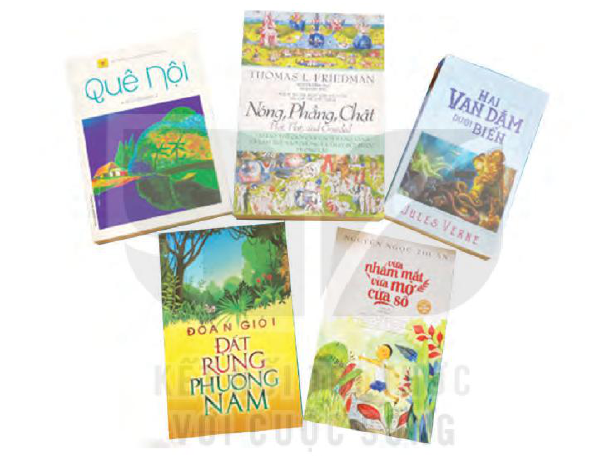
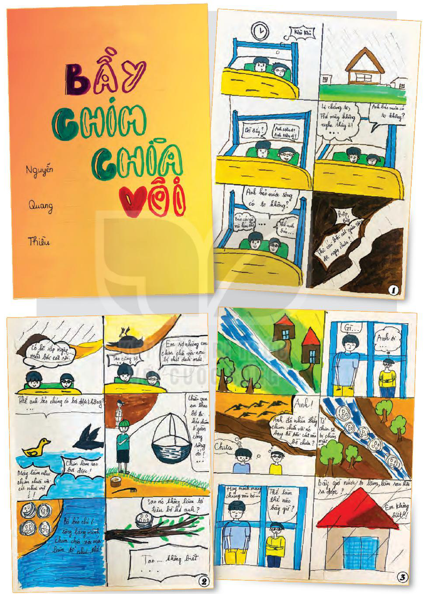
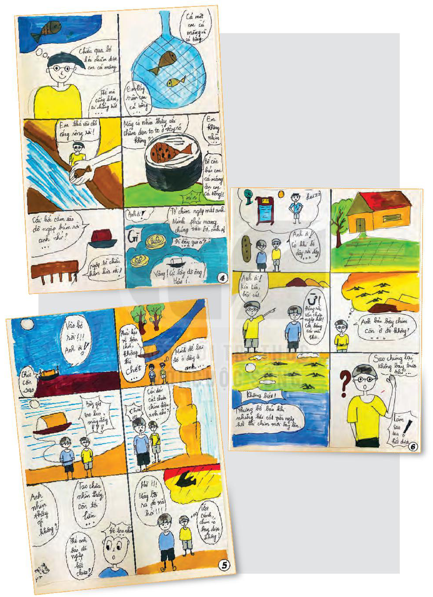
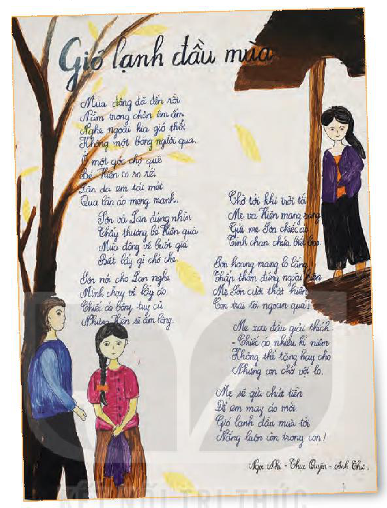

<!-- pdf:102 -->

# BÀI 10: TRANG SÁCH VÀ CUỘC SỐNG

*Học đi đôi với hành.*

Hồ Chí Minh

## Giới thiệu bài học

- Trong các bài học trước, em đã đọc những sáng tác thuộc nhiều thể loại: truyện (ngụ ngôn, khoa học viễn tưởng), thơ, tuỳ bút, tản văn, tục ngữ để cảm nhận bầu trời tuổi thơ, tiếng nói yêu thương nuôi dưỡng tâm hồn con người, tình yêu đối với đất nước, vẻ đẹp muôn màu ở các vùng miền; suy nghĩ về những bài học cuộc sống và thắp sáng khát vọng biến ước mơ thành hiện thực. *Ngữ văn 7* còn đưa em đến với những văn bản nghị luận và văn bản thông tin, kết nối bài học với những gì em cần suy nghĩ, lựa chọn, giải quyết trong cuộc sống.

- Với bài học này, khi đọc những cuốn sách mới, những tác phẩm yêu thích, em hãy cảm nhận, suy ngẫm, bàn luận để tiếp tục chia sẻ và sáng tạo. Như vậy, trang sách đã trở thành một phần cuộc sống. Những gì đã học, đã đọc không chỉ tồn tại trong sách mà sẽ cùng em đi suốt cuộc đời. Đó là một phần hành trang tri thức để em có thể tự tin bước vào thế giới rộng lớn.

## 🎯 Yêu cầu cần đạt

- Phát triển kĩ năng tự đọc sách: đọc mở rộng văn bản văn học, văn bản nghị luận, văn bản thông tin theo các chủ đề đã học.
- Nhận biết được đặc điểm của văn bản nghị luận phân tích một tác phẩm văn học, chỉ ra được mối quan hệ giữa đặc điểm và nội dung chính của văn bản với mục đích của nó.
- Phát triển kĩ năng viết: viết về một nhân vật yêu thích.
- Phát triển kĩ năng nói và nghe: trình bày, trao đổi về sách, nhân vật yêu thích và các đề tài có liên quan.
- Yêu thích đọc sách và biết vận dụng những điều đã đọc vào thực tế.

<!-- pdf:103 -->

## Đọc

### TRI THỨC NGỮ VĂN

**Văn bản nghị luận phân tích một tác phẩm văn học**

- **Văn bản nghị luận phân tích một tác phẩm văn học** là loại văn bản nghị luận, trong đó người viết làm rõ và bàn luận về đặc điểm của một tác phẩm trên các phương diện nội dung, hình thức trong mối quan hệ với tác giả, hoàn cảnh sáng tác, thời đại,... và khái quát giá trị chung của tác phẩm.
- **Lí lẽ** trong văn bản nghị luận phân tích một tác phẩm văn học chính là những ý kiến của người viết về đặc điểm nội dung, hình thức của tác phẩm. **Bằng chứng** trong văn bản nghị luận phân tích một tác phẩm văn học là những phần (câu, đoạn), những chi tiết được dẫn từ văn bản theo hình thức trích dẫn nguyên văn hoặc lược thuật, tóm tắt lại.

**Từ con người có thực ngoài đời đến nhân vật văn học**

- Những con người có thực ngoài đời luôn gợi niềm cảm hứng bất tận cho hoạt động sáng tác của nhà văn. Những ấn tượng, **cảm xúc**, suy ngẫm của nhà văn về cuộc đời được đánh thức từ chính thế giới nhân sinh phong phú đó. Con người trong cuộc đời thực chính là những chất liệu sống động để nhà văn sáng tạo hình tượng nghệ thuật.
- Tác phẩm văn học thường đưa đến cho người đọc cảm giác được gặp những con người có thực. Tuy nhiên, **nhân vật văn học** vẫn là sản phẩm của sự sáng tạo, hư cấu, chứa đựng trong đó nhiều gợi ý của nhà văn về một cách nhìn nhận, đánh giá đầy tính thẩm mĩ đối với cuộc sống.
- Nhân vật văn học, vì thế, không đồng nhất với con người thực ngoài đời. Cùng với việc nắm được đặc điểm của nhân vật (ngoại hình, ngôn ngữ, hành động, nội tâm,...), người đọc cần phải hiểu định hướng giá trị mà nhà văn muốn thể hiện – tức là điều thực sự có ý nghĩa, chi phối cách nhà văn hư cấu, xây dựng hình tượng trong tác phẩm.
<!-- term: nhân vật văn học -->
<!-- term: cảm xúc -->

**Phương tiện phi ngôn ngữ trong văn bản và văn bản đa phương thức**

- Con người sử dụng rất nhiều loại văn bản để trao đổi thông tin: các văn bản thông dụng thường chỉ sử dụng phương tiện ngôn ngữ; một số văn bản sử dụng kết hợp cả phương tiện ngôn ngữ và **phương tiện phi ngôn ngữ**, nhằm tăng lượng thông tin và hiệu quả tiếp nhận thông tin.
- Đặc biệt, cần kể đến loại **văn bản đa phương thức** mà phần trọng tâm là các kiểu hình ảnh được sắp xếp, kết hợp để truyền đạt thông tin quan trọng (hình vẽ, **sơ đồ**, các mảng màu sắc, hình khối,...). Ngôn ngữ chỉ là phương tiện hỗ trợ thêm trong việc truyền đạt thông tin: ghi chú, dẫn giải,...
<!-- term: phương tiện phi ngôn ngữ -->

<!-- pdf:104 -->

### THÁCH THỨC ĐẦU TIÊN: CHINH PHỤC NHỮNG CUỐN SÁCH MỚI
<!-- ocr-ok: tiêu đề chặng màu cam "THÁCH THỨC ĐẦU TIÊN" bị OCR bỏ sót và đọc nhầm dấu dòng phụ đề, đã đối chiếu trực tiếp ảnh trang PDF 104 -->

**Trước khi đọc**

1. Hãy bổ sung những cuốn sách mới cho góc đọc sách, thư viện mở của lớp học. Tự làm mới góc đọc sách theo cách mà em và các bạn cảm thấy hứng khởi và thú vị nhất.

2. Cùng thảo luận để xây dựng mục tiêu đọc sách của cá nhân và của nhóm. Trình bày mục tiêu đó và trao đổi để tìm hiểu cách đọc sách hiệu quả trong dự án đọc mới của em và các bạn.

*Một số cuốn sách phù hợp với các thể loại và chủ đề em đã học ở lớp 7*

**CÙNG ĐỌC VÀ TRẢI NGHIỆM**

**Cuốn sách mới – chân trời mới**

1. Từ mục tiêu đọc sách đã xác định, hãy chọn một số cuốn sách văn học, sách khoa học hoặc sách bàn luận về những vấn đề của cuộc sống để tìm hiểu, khám phá những điều bổ ích, thú vị. Việc đọc sách sẽ hiệu quả hơn nếu các em tập trung vào một số chủ đề của các bài đã học để chọn sách: *Bầu trời tuổi thơ, Khúc nhạc tâm hồn, Cội nguồn yêu thương, Giai điệu đất nước, Màu sắc trăm miền, Bài học cuộc sống, Thế giới viễn tưởng, Trải nghiệm để trưởng thành, Hoà điệu với tự nhiên*. Có thể đọc trọn vẹn một số cuốn sách có đoạn trích đã học như: *Đất rừng phương Nam* (Đoàn Giỏi); *Tốt-tô-chan bên cửa sổ* (Cư-rô-ya-na-gi Tê-sư-cô); *Vừa nhắm mắt vừa mở cửa sổ* (Nguyễn Ngọc Thuần); *Người thầy đầu tiên* (Trin-ghi-dơ Ai-tơ-ma-tốp) hoặc *Những bức thư gửi cháu Sam* (Đa-ni-en Gốt-li-ép); *Nóng, Phẳng, Chật* (Thô-mát L. Phrít-man).

<!-- pdf:105 -->

2. Tập trung vào một hoặc hai cuốn sách mà em thấy hữu ích và thú vị nhất, đọc và ghi chép những thông tin cần thiết để có thể trao đổi với các bạn sau khi đọc. Cùng với những thông tin về tên sách, tác giả, nhà xuất bản, năm xuất bản hoặc tái bản, em cần chú ý xác định những vấn đề sau:

a. Đề tài: Cuốn sách đề cập phạm vi nào của đời sống?

b. Bố cục và nội dung chính: Cuốn sách có mấy chương, phần? Nội dung chính của từng chương, phần là gì?

c. Nhân vật, sự kiện, bối cảnh nổi bật nào được thể hiện trong cuốn sách?

d. Có những chi tiết nào quan trọng? Những đoạn văn, câu văn nào có thể gợi lên ý nghĩa, vấn đề chính trong cuốn sách?

e. Chủ đề, ý nghĩa, bài học mà em có thể rút ra sau khi đọc cuốn sách là gì?

**Đọc cùng nhà phê bình**

Sau khi đã đọc những cuốn sách thú vị, em hãy thử hình dung mình trong vai một nhà phê bình để tìm hiểu, bàn luận: đặc điểm nội dung và hình thức của tác phẩm trong mối quan hệ với tác giả, với hoàn cảnh sáng tác, thời đại,... Từ đó, khái quát được giá trị chung của tác phẩm và giới thiệu tác phẩm với bạn đọc khác.

Trong bài 1. *Bầu trời tuổi thơ*, em đã được gặp gỡ tác giả Võ Quảng qua bài thơ *Ngàn sao làm việc*. Võ Quảng còn là một nhà văn được yêu mến, để lại ấn tượng sâu sắc qua những tác phẩm truyện hấp dẫn và cảm động về tuổi thơ, quê hương và cách mạng như *Quê nội* (bao gồm hai phần: phần 1. *Quê nội*; phần 2. *Tảng sáng*). Sau khi tìm đọc tác phẩm này, em hãy đọc văn bản sau của tác giả Trần Thanh Địch(1) để có thể hiểu sâu hơn về giá trị nội dung và nghệ thuật của bộ truyện *Quê nội*.

**Đọc văn bản**

**Vẻ đẹp giản dị và chân thật của *Quê nội* (Võ Quảng)(2)**

Trích *Võ Quảng*, TRẦN THANH ĐỊCH

Mỗi tác giả có một lối, một ngón nghề riêng trong cách nhìn, cách nghĩ, cách viết. *Tảng sáng* cũng như *Quê nội* là những tập truyện dài gần như không có cốt truyện với nhiều tuyến và nhiều khóm nhân vật hoạt động. Thế mà truyện âm thầm như một mùi hương gây mê, có sức hấp dẫn và quyến rũ lạ lùng.

> **THEO DÕI:** Vấn đề được nêu ra để bàn luận.

> (1) Trần Thanh Địch (1912 – 2007) quê ở Thừa Thiên – Huế, là nhà văn, nhà báo và nhà phê bình. Ông có nhiều tác phẩm viết cho thiếu nhi được yêu mến và đánh giá cao như: *Đôi tai mèo* (1973), *Một cần câu* (1993),...
> (2) Nhan đề do người biên soạn đặt.

<!-- pdf:106 -->

Nội dung câu chuyện xảy ra trong những khung cảnh quê hương. Một nông thôn miền Trung, tại thôn Hoà Phước, bên con sông Thu Bồn vào những ngày rất mới mẻ – như một buổi tảng sáng – sau Cách mạng tháng Tám thành công. Các nhân vật là những người nông dân bình thường, mấy cô bác kèm luôn theo bên chân mấy chú nhóc hiếu động trong thôn, trong làng, trong xóm, vừa tự xây dựng chính quyền cách mạng địa phương vừa chuẩn bị chống giặc giữ làng. Đây là một sự chuyển mình toàn bộ, thay đổi toàn diện của chế độ xã hội mới, ngấm dần vào từng gia đình vào từng con người, từ già đến trẻ. Nó làm thay đổi hẳn những nếp sống thường ngày từ trước. Thay đổi nếp sống là hết sức phức tạp cho nên trong từng con người thường có những đột biến không thường. Họ thường làm việc hơi quá sức mình một chút. Suốt ngày họ lo đến công việc xã hội hơn là công việc nhà mình. Nông thôn sôi động như một gia đình vừa thức giấc. Tiếng nói, tiếng cười, tiếng gọi nhau í ới đi luyện tập quân sự. Trong *Tảng sáng*, những Cục, Cù Lao, bà Kiến, ông Hai Dĩ, thầy Lê Tảo,... là những con người thật đáng yêu. Mỗi người đều mang một cá tính riêng nhưng lại giống nhau ở sự tích cực làm việc xã hội. Trong đó có một nhân vật xuất hiện tuy không nhiều nhưng thật nổi đình nổi đám. Đó là bà Kiến. Cục và Cù Lao được phân công đến dạy chữ cho bà thì... hoá ra đấy lại là một kẻ tiếng Tây, tiếng Tàu, ca dao tục ngữ, hò vè thơ ca Việt Nam thảy đều thông thạo, bà ta thuộc nhớ và đọc chơi vanh vách. Một tuyến nhân vật thứ hai nữa có mặt ít hơn, nhưng vẫn xuất sắc và lí thú không kém các nhân vật trên: chị Ba, anh Bốn Linh, chú Năm Mùi, anh Bảy Hoành, ông Tư Đàm, cô Tuyết Hạnh. Rồi một tuyến nhân vật thứ ba nữa, cũng rất quan trọng và bề thế; đó là anh Trâu Bĩnh và những chú chó từng nhà mà những sinh hoạt của chúng luôn luôn khăng khít ở bên con người. Trâu Bĩnh là một nhân vật thân thuộc, lung linh, trở đi trở lại qua nhiều tập truyện của tác giả từ *Cái thăng*. Còn những chú chó thì vô cùng đa dạng, mỗi con một tính, mỗi đứa một nét, mỗi Vằn, Vện một thái độ. Chúng càng nổi rõ tính tình hoặc phong cách ra trong những lúc giận dữ, sợ sệt, hay an phận thủ thường.

> **THEO DÕI:** Ý kiến của người viết về hoàn cảnh đời sống trong tác phẩm.

> **THEO DÕI:** Ý kiến của người viết về thế giới nhân vật trong tác phẩm.

> **THEO DÕI:** Cách nêu bằng chứng để làm rõ ý kiến của người viết.

*Quê nội* và *Tảng sáng* được viết theo lối tự sự qua vai “tôi”. Vai “tôi” trong tiểu thuyết thường có những thế mạnh, tưởng như bộc tuệch gửi gắm trong cả “tấm lòng” tác giả. Vai “tôi” dễ có điều kiện thủ thỉ dẫn dắt bạn đọc đi vào những suy nghĩ thầm kín của nhân vật – và từ đó, đẩy ống kính vào cận cảnh các “nhân vật vệ tinh” khác của mình. Tuy nhiên vai “tôi” cũng bị khá nhiều

> **THEO DÕI:** Ý kiến của người viết về người kể chuyện trong tác phẩm.

<!-- pdf:107 -->

nhược điểm, mà nhược điểm lớn nhất là không nhìn được xa, không nói được nội tâm, suy nghĩ của các nhân vật trực diện khác [...].

Tâm hồn chúng ta – bạn đọc người lớn cũng như trẻ em – có là cục đá thì mới không xúc động xao xuyến với những trang tả cảnh đồng bào ta gọi nhau đi học ban đêm qua những ngọn đèn bồng bềnh từ nhà này trôi sang nhà khác, những trang đặc tả một đốm lửa xoẹt lên từ mẩu que diêm lúc ban đầu đang còn ốm yếu và do dự, những trang tả về bà Kiến học đánh vần mà cứ để thêm vào từng câu ca dao ứng khẩu tài tình, những trang viết về bọn chó nổi xung rượt đuổi ông Hai Dĩ, những trang nói đến bọn lính Tàu Tưởng ăn bún xáo không biết nhai mà chỉ nuốt tuột, những trang chấm phá hình dáng những thân sung nhìn qua buổi chiều vàng, những trang tả cảnh sông nước bập bềnh thúc hích xuồng con bên bụng thuyền lớn như đang đòi bú tí, và bao nhiêu chi tiết ngắn dài rải rác hay tập trung qua từng chương sách...

> **THEO DÕI:** Nhận xét chung về sức hấp dẫn của tác phẩm.

(Trần Thanh Địch, *Bàn về văn học thiếu nhi*, NXB Kim Đồng, Hà Nội, 1983, tr. 147 – 151)

**Sau khi đọc**

**Trả lời câu hỏi**

1. Người viết tập trung bàn luận về vấn đề gì trong tác phẩm *Quê nội* của Võ Quảng?

2. Để bàn về vấn đề, người viết đã nêu những ý kiến gì về đặc điểm nội dung, nghệ thuật của tác phẩm? Em căn cứ vào đâu để xác định như vậy?

3. Hãy tìm những lí lẽ, bằng chứng được người viết sử dụng nhằm làm sáng tỏ ý kiến về các đặc điểm của tác phẩm *Quê nội*. Cách trình bày bằng chứng của người viết có điều gì đáng chú ý?

4. Mối quan hệ giữa mục đích viết và đặc điểm, nội dung chính của văn bản nghị luận phân tích một tác phẩm văn học được thể hiện như thế nào trong bài viết này?

#### Viết kết nối với đọc

Tưởng tượng em là một nhà phê bình, hãy viết đoạn văn (khoảng 6 – 8 câu) nêu ý kiến của em về một tác phẩm văn học về đề tài tuổi thơ hoặc quê hương, đất nước mà em đã đọc.

**Đọc và trải nghiệm cùng nhân vật**

Em có thể tìm thấy trong cuốn sách đã đọc những nhân vật mà em yêu thích. Đó là nhân vật văn học được xây dựng theo sự tưởng tượng của tác giả, nhưng vẫn có mối liên hệ với những mẫu người trong đời thực. Để tìm hiểu về nhân vật, em có thể tưởng tượng cảnh mình đang đối thoại với nhân vật yêu thích trong một cuộc gặp gỡ.

<!-- pdf:108 -->

Bằng cách đặt ra những câu hỏi phỏng vấn nhân vật như trong một cuộc trò chuyện, em có thể tìm được câu trả lời về nhân vật trong và sau khi đọc. Chọn cách xưng hô, gọi nhân vật bằng tên hoặc dùng các đại từ nhân xưng, danh từ thay thế đại từ phù hợp với đặc điểm, tuổi tác của nhân vật: *bạn, ông, bà, cô, chú, cậu*,...

Tham khảo những câu hỏi sau:

- Bạn từ đâu đến?
- Vì sao bạn lại trở thành nhân vật trong tác phẩm này?
- Sở thích của bạn là gì?
- Bạn thấy mình có gì nổi bật (về sở thích, tính cách)?
- Bạn muốn nói điều gì nhất nếu được kể về cuộc đời của chính mình?
- Bạn quan tâm đến ai hay điều gì hơn cả?
- Điều bạn muốn làm tiếp là gì nếu bước ra ngoài trang sách?

Em có thể đặt thêm một số câu hỏi mà cuộc đời nhân vật gợi ra cho em và tìm kiếm câu trả lời từ cuốn sách hoặc liên hệ với thực tế cuộc sống để cùng nhân vật có một cuộc trò chuyện thật bổ ích, thú vị.

**Đọc và trò chuyện cùng tác giả**

Qua những cuốn sách đã đọc trong dự án của năm học này, em không chỉ gặp gỡ các nhân vật đáng nhớ mà còn được làm quen với tác giả – người đã sáng tạo ra nhân vật văn học. Chắc hẳn em cũng muốn biết tác giả đã sáng tạo, xây dựng nhân vật như thế nào. Xây dựng một nhân vật cũng có thể ví như đã tạo nên được một cuộc đời mới. Điều đó quả là tuyệt diệu phải không?

1. Đọc bài thuật lại cuộc “phỏng vấn” rất thú vị của một độc giả nhỏ tuổi với nhà văn Nguyễn Quang Thiều – tác giả truyện ngắn *Bầy chim chìa vôi* – để có thể hiểu thêm về sự ra đời và cuộc sống của nhân vật do nhà văn sáng tạo trong tác phẩm.

**Mon và Mên đang ở đâu?**

Một buổi sớm mùa hè, sau cơn mưa, tôi đã gặp một cậu bé trên triền đê sông Đáy. Chúng tôi đã trò chuyện cùng nhau về *Bầy chim chìa vôi*. Cậu bé đã “phỏng vấn” tôi:

– Chú Thiều ơi, chú đã gặp Mon và Mên bao giờ và ở đâu?

– Chú đã gặp hai cậu bé này trong chính tuổi thơ của mình. Bởi anh em họ là bạn cùng lứa tuổi với chú. Bọn chú là những đứa trẻ sinh ra và lớn lên ở một ngôi làng ven bờ sông Đáy. Suốt tuổi thơ, sông Đáy trở thành người bạn thân thiết của bọn chú. Trong những lùm dứa dại, bụi tầm xuân, những đám cỏ đuôi chó,... là một thế giới kì thú của chim chóc và côn trùng. Chính thế mà bọn chú chứng kiến

<!-- pdf:109 -->

và hiểu được đời sống của bầy chim chìa vôi. Khi viết câu chuyện này chú đặt tên họ là Mon và Mên, chứ tên thật của họ không phải thế. Chú sáng tác mà. Ngoài giờ học, bọn trẻ làng chú lúc nào cũng bên nhau lang thang dọc triền sông. Cháu có những đứa bạn như vậy không?

– À, có chứ. Cháu có những đứa bạn như vậy. Thỉnh thoảng tụi cháu cũng cãi lộn hoặc đấm nhau vài cái. Nhưng rồi lại chơi với nhau thôi. Thế vì sao mà chú lại nghe được câu chuyện riêng của Mon và Mên trong chiếc chăn dạ rách giữa đêm mưa?

– Cãi lộn hả? Cũng không sao. Nhưng không nên đấm nhau đâu nhé! Chú nghe được câu chuyện của hai anh em Mon và Mên không phải vì chú có đôi tai thần hay chú là một gã phù thuỷ tinh ranh mà vì trong một buổi chiều mưa, lũ trẻ làng chú đã nói về bầy chim chìa vôi non ở ngoài bãi sông. Lũ chim non là điều bọn trẻ quan tâm nhất lúc đó. Và trong đêm mưa lớn ấy, chú nghĩ, tất cả lũ trẻ làng chú đều thức để lắng nghe tiếng mưa, cùng nghĩ về bãi sông và lo cho bầy chim chìa vôi non.

– Vậy sao? Lúc ấy chú ở cùng Mon và Mên à? Nhưng sao cháu chẳng thấy chú nói gì, làm gì cả. Thế là thế nào nhỉ? Sao chú không cùng các cậu ấy đi cứu bầy chim chìa vôi? Lỡ có gì nguy hiểm xảy ra với Mon và Mên thì sao? Trẻ em không nên bơi thuyền ra bãi sông như vậy. Cần có người lớn. Chú hiểu không?

– Có lẽ... cháu nói đúng. Chú đã làm gì lúc ấy nhỉ? Để chú nhớ lại xem nào... Chú hơi già rồi và bắt đầu quên vài điều. À, sau đó, Mon và Mên đã kể cho lũ trẻ trong làng việc đi cứu bầy chim non. Tất cả lũ trẻ đều vô cùng khâm phục anh em Mon, Mên. Sau này trở thành nhà văn, chú đã viết lại câu chuyện đó.

– Chú nhớ nhé! Cần giúp bạn mình khi gặp nguy hiểm. Thế bây giờ Mon và Mên bao nhiêu tuổi rồi? Và họ đang ở đâu?

– À, câu hỏi này của cháu làm chú hơi bối rối đấy. Nhưng cháu có thể đoán xem Mon và Mên giờ đang ở đâu. Và bầy chim chìa vôi của các cậu ấy nữa... Cháu có thể kể tiếp câu chuyện mà chú đã kể phải không? Nhưng điều làm chú buồn là ven sông Đáy bây giờ không còn thấy chim chìa vôi nữa. Con người đang tàn phá thiên nhiên và chắc bầy chìa vôi đã bỏ đi rất xa.

– Vậy khi nào bầy chìa vôi sẽ trở về ạ?

– Khi nào các cháu yêu thiên nhiên, bảo vệ thiên nhiên thì lúc đó bầy chìa vôi sẽ trở về.

(*Theo* Nguyễn Quang Thiều, *Mon và Mên đang ở đâu?*, tạp chí *Văn học và Tuổi trẻ*, số 9 (482 + 483)/2021)

<!-- pdf:110 -->

2. Trả lời câu hỏi

a. Mon và Mên là ai trong mối quan hệ với nhà văn – tác giả truyện ngắn *Bầy chim chìa vôi*?

b. Vì sao nhà văn khẳng định rằng “tất cả lũ trẻ làng chú đều thức để lắng nghe tiếng mưa, cùng nghĩ về bãi sông và lo cho bầy chim chìa vôi non”?

c. Cậu bé – người “phỏng vấn” tác giả – ngạc nhiên vì điều gì?

d. Ngoài Mon và Mên, ai là người có trải nghiệm và kỉ niệm sâu sắc về đêm mưa, bãi sông và bầy chim chìa vôi?

e. Theo em, Mon và Mên đang ở đâu? Bầy chim chìa vôi đã bay đi đâu?

3. Chọn đọc một cuốn sách đang gây sự tò mò, chú ý đối với em (có thể đọc một truyện, một bài thơ, một chương, phần,... nếu cuốn sách có nhiều nội dung). Trong quá trình đọc, thử hình dung em có thể đặt ra những câu hỏi nào để làm rõ hơn điều em muốn biết: cách tác giả tạo nên nhân vật hoặc những chi tiết tiêu biểu, hoàn cảnh ra đời của tác phẩm, thông điệp mà tác giả muốn gửi gắm trong cuốn sách.

## Viết

### THÁCH THỨC THỨ HAI: TỪ Ý TƯỞNG ĐẾN SẢN PHẨM
<!-- ocr-ok: tiêu đề chặng màu cam "THÁCH THỨC THỨ HAI" bị OCR bỏ sót và đọc nhầm "Từ ý tưởng đến" thành "Từ ũ tưởng đên", đã đối chiếu trực tiếp ảnh trang PDF 110 -->

Từ những điều đã đọc, trải nghiệm cùng nhân vật, trò chuyện cùng tác giả, tưởng tượng, hình dung về thế giới đời sống trong trang sách, hẳn em đã có những ý tưởng sáng tạo thú vị. Hãy lựa chọn một trong những hoạt động sau để thể hiện ý tưởng của mình cùng các bạn:

1. Thể hiện nội dung tóm tắt của một câu chuyện theo hình thức truyện tranh. Cố gắng sử dụng các phương tiện phi ngôn ngữ (hình vẽ hoặc các kí hiệu chỉ dẫn) để có thể hỗ trợ cho việc thể hiện nội dung một cách sinh động và hiệu quả.

2. Kể lại một câu chuyện em đã đọc theo hình thức thơ bốn chữ hoặc năm chữ.

3. Viết bài văn phân tích một nhân vật văn học mà em yêu thích (trong cuốn sách đã đọc), có thể vẽ minh hoạ các chi tiết, sự việc để bài phân tích được sinh động, hấp dẫn hơn.

**Tham khảo một số sản phẩm sáng tạo của các bạn học sinh**

- Thể hiện nội dung của một câu chuyện theo hình thức truyện tranh.

<!-- pdf:111 -->

<!-- pdf:112 -->

<!-- pdf:113 -->

- Kể lại một câu chuyện theo hình thức thơ năm chữ.

**Viết bài văn phân tích một nhân vật văn học yêu thích trong cuốn sách đã đọc**

*Yêu cầu đối với bài văn phân tích một nhân vật văn học trong cuốn sách đã đọc:*
<!-- term: bài văn phân tích một nhân vật văn học -->

<!-- term: bài văn phân tích một nhân vật văn học -->
- Giới thiệu được nhân vật trong tác phẩm văn học: lai lịch, hoàn cảnh, tình huống xuất hiện và những ấn tượng đặc biệt ban đầu (nếu có).
<!-- term: bài văn phân tích một nhân vật văn học -->
- Chỉ ra được đặc điểm, tính cách nhân vật qua bằng chứng cụ thể về ngoại hình, hành động, ngôn ngữ, tâm trạng của nhân vật được miêu tả trong tác phẩm.
<!-- term: bài văn phân tích một nhân vật văn học -->
- Nhận xét, đánh giá nghệ thuật xây dựng nhân vật của nhà văn: biện pháp nghệ thuật, cách sử dụng hoặc nhấn mạnh những chi tiết làm rõ đặc điểm nhân vật.
<!-- term: bài văn phân tích một nhân vật văn học -->
- Nêu được ý nghĩa của hình tượng nhân vật trong việc thể hiện chủ đề tác phẩm hoặc quan niệm đời sống của tác giả.

<!-- pdf:114 -->

#### Phân tích bài viết tham khảo
<!-- ocr-ok: tiêu đề mục màu đỏ bị OCR đọc nhầm dấu ("Phôn tích bồi viết tham khỏo"), đã đối chiếu trực tiếp ảnh trang PDF 114 -->

**Hoàng tử bé: trò chuyện để thấu hiểu và yêu thương**

Hoàng tử bé – nhân vật của nhà văn Ăng-toan đơ Xanh-tơ Ê-xu-pe-ri đã trở thành người bạn của biết bao bạn nhỏ trên hành tinh này. Nhân vật người phi công đã gặp cậu bé trên hành trình bay đêm của mình và kể lại: “Vào đêm đầu tiên tôi phải ngủ trên cát, cách xa nơi con người ở hàng ngàn dặm. Lúc đó tôi còn cô độc hơn cả một kẻ đắm tàu đang lênh đênh trên một cái bè ở giữa biển khơi...”. Chính vào khoảnh khắc đó, giọng nói của hoàng tử bé đã vang lên và cuộc trò chuyện kì lạ bắt đầu: “Xin vui lòng... vẽ hộ tôi một con cừu”.

> Giới thiệu nhân vật.

Hoàng tử bé được nhà văn miêu tả như là “một cậu bé thật khác thường”. Nhưng không phải bằng lời mà bằng một bức vẽ minh hoạ trong tác phẩm: “Nhưng dĩ nhiên bức vẽ của tôi không bằng một nửa sự quyến rũ của người mẫu”. Sự xuất hiện bất ngờ mà rất tự nhiên của hoàng tử bé trong sa mạc bắt đầu bằng giọng nói “nhỏ nhẹ kì lạ”. Vì sao? Vì cậu bé ấy luôn cố gắng để trò chuyện với tất cả: người phi công, những bông hồng trên hành tinh nhỏ bé của cậu, những con người kì lạ hay thậm chí kì cục trên các tiểu hành tinh khác nữa,... Những cuộc trò chuyện tưởng như đứt quãng, nhiều khi rời rạc hoặc đi vào bế tắc: cuộc trò chuyện với ông vua trên hành tinh thứ nhất, cuộc trò chuyện với gã kiêu căng trên hành tinh thứ hai, cuộc trò chuyện với bợm nhậu ở một hành tinh tiếp theo,... Mặc dù nhiều lúc hoàng tử bé bắt đầu cảm thấy chán vì sự kì quặc và vô nghĩa của những con người này, cậu vẫn không ngừng hành trình kiếm tìm những cuộc trò chuyện để có thể lắng nghe, thì thầm, chia sẻ,...

> Nhận xét về nghệ thuật miêu tả nhân vật.

> Nêu rõ đặc điểm nhân vật dựa trên bằng chứng trong tác phẩm.

Rồi cuối cùng, hành tinh thứ bảy mà cậu đặt chân đến là Trái Đất. Cậu bé dường như chẳng vướng phải một “rào cản ngôn ngữ” nào. Đến từ một tiểu hành tinh xa lạ, viễn du qua bảy hành tinh khác nhau – hoàng tử bé là một cậu bé bình thường hay chính là thiên sứ từ vũ trụ? Trong bất kì hoàn cảnh nào, hoàng tử bé dường như không hề biết mệt mỏi, không đói, không khát, không sợ sa mạc hay bóng tối. Chẳng có thứ gì đáng kể trong tay, điều duy nhất cậu có thể làm được là trò chuyện để hiểu về người khác, về thế giới, để học cách chia sẻ và yêu thương. Không chút sợ hãi và hồ nghi, cậu trò chuyện với rắn – con vật đầu tiên cậu gặp trên Trái Đất và để cho con vật đáng sợ ấy quấn quanh mắt cá chân của mình “như một chiếc vòng vàng”. Trong sa mạc, hoàng tử bé còn tiếp tục trò chuyện với bông hoa rất ít cánh, với ngọn núi, vườn hồng, con cáo,... Trong bất kì cuộc trò chuyện nào, dù ngắn ngủi, giản đơn hay khó hiểu,

<!-- pdf:115 -->

phức tạp nhất, hoàng tử bé cũng không quên nói những lời tốt lành, lời chúc, lời tạm biệt đầy âu yếm, tự nhiên: “Bạn thật xinh đẹp!”, “Chúc một ngày tốt lành!”, “Mình rất xin lỗi!”,... Cậu không ngừng cố gắng để trò chuyện, ghi nhớ, hiểu về người khác và tìm cách kết bạn...

Hoàng tử bé không thể chống lại nọc độc của con rắn – con vật không thể cảm hoá – nhưng cậu vẫn dành cho nó những lời bào chữa bao dung nhất: “Những con rắn là loài vật hoang dã. Chúng có thể cắn chỉ để vui thôi...”. Trong khoảnh khắc đau đớn ấy, cậu vẫn dành những lời an ủi cho những người bạn của mình: người phi công và đoá hoa hồng đang ở xa... Hoàng tử bé đã rời xa Trái Đất và trở về với hành tinh của mình. Nhưng giọng nói của cậu dường như vẫn ngân lên trong tâm trí người đọc, thì thầm với chúng ta về tình yêu thương, lòng vị tha và niềm khao khát được sẻ chia, thấu hiểu.

> Nêu ý nghĩa của hình tượng nhân vật trong việc thể hiện chủ đề của tác phẩm.

*(Nhóm biên soạn)*

#### Thực hành viết theo các bước

### 1. TRƯỚC KHI VIẾT

> *Mục đích viết*
> Phân tích nhân vật yêu thích để làm rõ những đặc điểm đáng chú ý, cuốn hút của nhân vật.
>
> *Người đọc*
> Thầy cô, bạn bè và những người quan tâm đến cuốn sách và nhân vật.

**a. Lựa chọn đề tài**

Hãy quan tâm đến những đặc điểm nổi bật, sự độc đáo hoặc những phẩm chất tích cực của nhân vật vì cách chọn nhân vật để phân tích phản ánh quan niệm, suy nghĩ của người viết.

**b. Tìm ý**

Em có thể tìm ý bằng cách đặt ra và trả lời các câu hỏi như:

- Nhân vật xuất hiện trong cuốn sách, tác phẩm nào?
- Vì sao em yêu thích nhân vật? Điều gì khiến em quyết định lựa chọn phân tích nhân vật này?
- Nhân vật có những đặc điểm nào nổi bật (ngoại hình, hành động, ngôn ngữ, suy nghĩ,...)? Những đặc điểm đó cho thấy điều gì về phẩm chất, giá trị của nhân vật?
- Nghệ thuật xây dựng nhân vật của nhà văn có gì đặc sắc?
- Nhân vật gợi cho em liên tưởng, suy nghĩ và rút ra bài học gì?

**c. Lập dàn ý**

Sắp xếp các ý đã tìm được theo bố cục của bài viết.

<!-- pdf:116 -->

**Dàn ý**

- *Mở bài:* Giới thiệu nhân vật và nêu ngắn gọn ấn tượng ban đầu của em về nhân vật.
- *Thân bài:*
  + Bối cảnh và những mối quan hệ làm nổi bật đặc điểm nhân vật.
  + Những đặc điểm nổi bật của nhân vật thể hiện qua các bằng chứng trong tác phẩm (chi tiết về ngoại hình, ngôn ngữ, hành động, suy nghĩ,... của nhân vật).
  + Nghệ thuật xây dựng nhân vật: cách sử dụng chi tiết, ngôn ngữ, biện pháp nghệ thuật,...
  + Ý nghĩa của hình tượng nhân vật.
- *Kết bài:* Nêu những bài học, suy nghĩ, ấn tượng sâu sắc mà nhân vật để lại trong tâm trí em.

### 2. VIẾT BÀI

Khi thực hành viết bài văn phân tích nhân vật yêu thích, em cần chú ý vai trò của các phần: Mở bài, Thân bài và Kết bài. Có thể tách phần Thân bài thành các đoạn theo các ý chính đã dự kiến. Sử dụng các chi tiết, bằng chứng làm rõ đặc điểm nhân vật theo hai cách: tóm tắt hoặc trích nguyên văn.

### 3. CHỈNH SỬA BÀI VIẾT

Đọc lại bài viết để tự kiểm tra dựa trên những gợi ý sau:

- Tên nhân vật, tên sách, tác giả và các chi tiết liên quan có chính xác không?
- Bằng chứng cho các đặc điểm của nhân vật và nghệ thuật xây dựng nhân vật trong truyện đã đủ và phù hợp chưa?
- Có lỗi chính tả, dùng từ, đặt câu, tổ chức đoạn văn hay không?

## Nói và nghe

### VỀ ĐÍCH: NGÀY HỘI VỚI SÁCH
<!-- ocr-ok: tiêu đề chặng màu cam "VỀ ĐÍCH" bị OCR bỏ sót và đọc nhầm "Ngày" thành "Ngâu", đã đối chiếu trực tiếp ảnh trang PDF 116 -->

Sau khi chinh phục những cuốn sách mới, đọc cùng nhà phê bình, trò chuyện cùng nhân vật và tác giả, kể lại câu chuyện theo hình thức thơ bốn chữ, thơ năm chữ hoặc hình thức truyện tranh, viết bài văn phân tích nhân vật, em đã có những thu hoạch bổ ích, những sản phẩm có thể mang ra trưng bày và sử dụng để thuyết trình, giới thiệu cùng các bạn. Hãy cố gắng đóng góp cho *Ngày hội với sách* những điều thú vị, hữu ích nhất theo cách của em.

<!-- pdf:117 -->

Chọn một trong hai hoạt động sau để cùng tham gia trình bày với các bạn:

**Giới thiệu sản phẩm sáng tạo từ sách**

Tham gia giới thiệu các sản phẩm sáng tạo từ sách của cá nhân và tập thể: truyện tranh, **pô-xtơ** giới thiệu nhân vật, các hình thức tóm tắt tác phẩm,... Có thể sử dụng phương tiện phi ngôn ngữ kết hợp lời giới thiệu, thuyết trình ngắn để giải thích về sản phẩm sao cho sinh động, hấp dẫn với người nghe.
<!-- term: pô-xtơ -->

**Trình bày ý kiến về tác dụng, ý nghĩa của việc đọc sách**

Sách vừa là người bạn, vừa là người thầy suốt đời của mỗi chúng ta. Sau chuỗi hoạt động của dự án đọc trong bài 10, em hãy cùng các bạn trao đổi ý kiến, thảo luận về tác dụng, ý nghĩa của việc đọc sách giúp mọi người cùng nhận ra tầm quan trọng của việc đọc sách với quá trình học tập và phát triển bản thân.

### 1. TRƯỚC KHI NÓI

> *Mục đích nói*
> Chọn một trong hai mục đích nói sau đây để chuẩn bị và trình bày bài nói:
> - Giới thiệu để làm rõ ý nghĩa những sản phẩm sáng tạo từ sách.
> - Trình bày ý kiến về tác dụng, ý nghĩa của việc đọc sách.
>
> *Người nghe*
> Thầy cô, bạn bè và những người quan tâm đến kết quả dự án đọc sách và quan điểm của em về tác dụng, ý nghĩa của việc đọc sách.

**a. Chuẩn bị nội dung và phương tiện để trình bày**

- Lựa chọn và xác định nội dung cần trình bày:
  + Xem lại sản phẩm sáng tạo từ sách và chọn sản phẩm độc đáo, thú vị mà em muốn giới thiệu.
  + Lập dàn ý bài nói trước khi trình bày ý kiến về tác dụng, ý nghĩa của việc đọc sách, đánh dấu những nội dung cần nhấn mạnh, cần làm rõ và thuyết phục người nghe.
- Xác định các phương tiện phi ngôn ngữ phù hợp cần sử dụng để hỗ trợ cho bài nói về sản phẩm sáng tạo từ sách hoặc trình bày ý kiến về tác dụng, ý nghĩa của việc đọc sách: hình ảnh, sơ đồ, tranh vẽ hoặc bản nhạc không lời (nếu cần).

**b. Tập luyện**

Em có thể chọn hình thức tập luyện:

- Tập luyện một mình để ghi nhớ nội dung và chọn cách diễn đạt phù hợp.
- Trình bày trước các bạn trong nhóm học tập, cùng các bạn trao đổi để có thể lắng nghe góp ý nhằm điều chỉnh nội dung trình bày và diễn đạt sao cho rõ ràng, mạch lạc, có sức thu hút.

Hãy cố gắng để việc giới thiệu sản phẩm sáng tạo từ sách hoặc trình bày quan điểm của em về việc đọc sách trở nên thú vị, hấp dẫn, cuốn hút và để lại ấn tượng sâu sắc với người nghe.

<!-- Phần 2. Trình bày bài nói và 3. Sau khi nói của Bài 10 in ở nửa trên trang PDF 118 (trang in 117) -->

### 2. TRÌNH BÀY BÀI NÓI
<!-- ocr-ok: tiêu đề mục 2. Trình bày bài nói của Bài 10 in ở nửa trên trang PDF 118 (trang in 117), đã đối chiếu trực tiếp ảnh trang PDF 118 -->

- Trình bày một cách rõ ràng các nội dung đã chuẩn bị.
- Nhấn mạnh những đặc điểm nổi bật của sản phẩm sáng tạo từ sách hoặc làm rõ quan điểm của em về việc đọc sách qua lí lẽ xác đáng và bằng chứng cụ thể.
- Sử dụng các phương tiện phi ngôn ngữ phù hợp để phần trình bày hấp dẫn hơn.
<!-- ocr-ok: phần 2. Trình bày bài nói của Bài 10 in ở nửa trên trang PDF 118 (trang in 117), đã đối chiếu trực tiếp ảnh trang PDF 118 -->

### 3. SAU KHI NÓI

Trao đổi về bài nói theo một số gợi ý sau:
<!-- ocr-ok: câu dẫn mục 3. Sau khi nói của Bài 10 in ở nửa trên trang PDF 118 (trang in 117), đã đối chiếu trực tiếp ảnh trang PDF 118 -->

| Người nghe | Người nói |
| --- | --- |
| - Nghe và ghi vắn tắt những đặc điểm nổi bật của sản phẩm sáng tạo từ sách hoặc quan điểm về việc đọc sách để có thể trao đổi, nêu câu hỏi sau khi người nói trình bày. - Nêu ý kiến về nội dung bài nói và cách trình bày. | - Nghe góp ý và phản hồi những ý kiến của người nghe về nội dung bài nói một cách phù hợp, rõ ràng, có thể bổ sung những điểm cần làm rõ thêm. - Trao đổi lại với người nghe về cách trình bày để có thể rút kinh nghiệm và điều chỉnh một cách hiệu quả. |
<!-- ocr-ok: bảng 3. Sau khi nói của Bài 10 in ở nửa trên trang PDF 118 (trang in 117), đã đối chiếu trực tiếp ảnh trang PDF 118 -->

## 📷 Danh sách hình trong bài

| Mã hình | Trang PDF | Vị trí trong bài | Chú thích gốc |
| --- | --- | --- | --- |
| H7-ngu_van-b10-01 | 104 | Đọc – Thách thức đầu tiên: Chinh phục những cuốn sách mới (trang 103) | *Một số cuốn sách phù hợp với các thể loại và chủ đề em đã học ở lớp 7* |
| H7-ngu_van-b10-02 | 111 | Viết – Thách thức thứ hai: Từ ý tưởng đến sản phẩm (trang 110) | Sản phẩm sáng tạo truyện tranh *Bầy chim chìa vôi* (Nguyễn Quang Thiều) – bìa và trang 1, 2, 3 |
| H7-ngu_van-b10-03 | 112 | Viết – Thách thức thứ hai: Từ ý tưởng đến sản phẩm (trang 111) | Sản phẩm sáng tạo truyện tranh *Bầy chim chìa vôi* (tiếp theo) – trang 4, 5, 6 |
| H7-ngu_van-b10-04 | 113 | Viết – Thách thức thứ hai: Từ ý tưởng đến sản phẩm (trang 112) | Sản phẩm kể lại câu chuyện theo hình thức thơ năm chữ *Gió lạnh đầu mùa* (Nga Mi – Thu Quyên – Anh Thư) |
