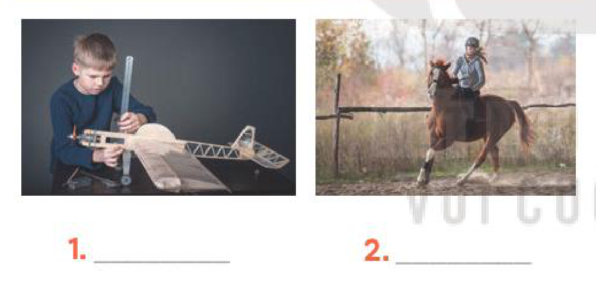
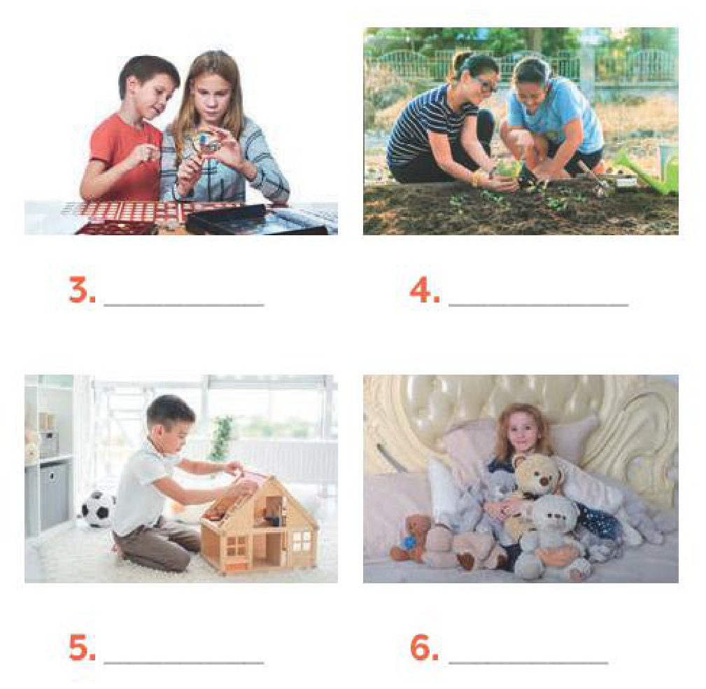
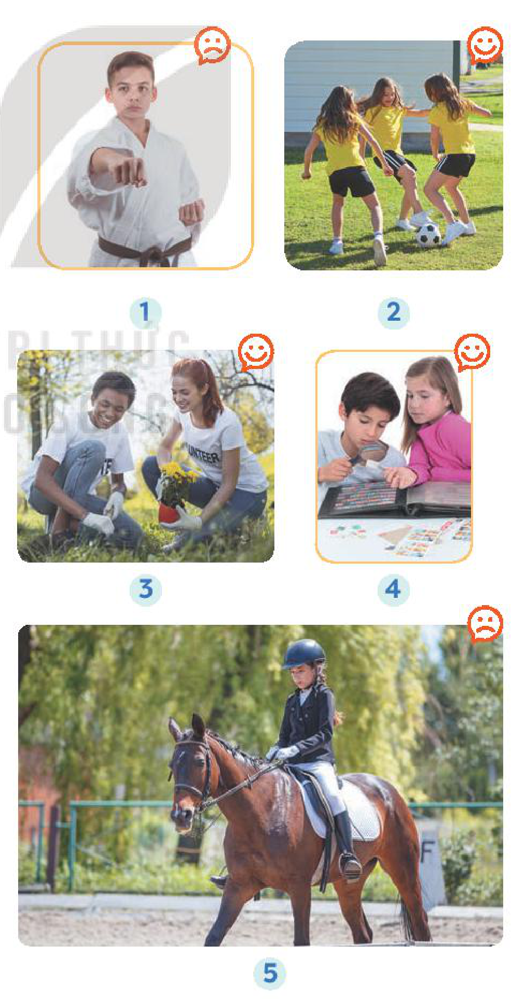
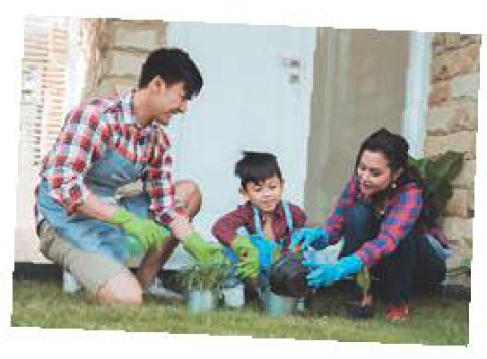
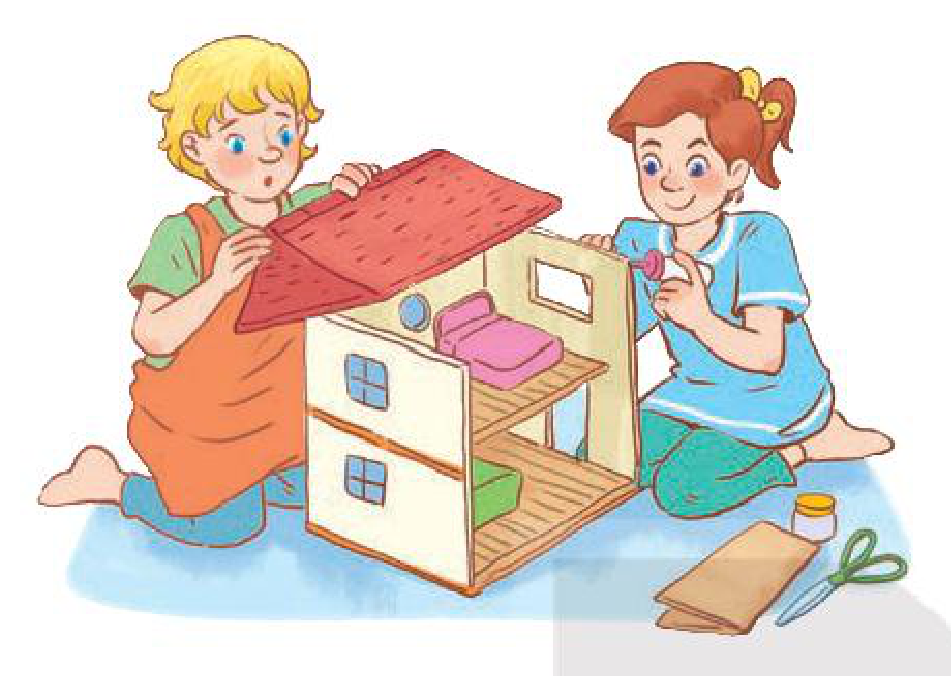

<!-- pdf:9 -->

# UNIT 1: HOBBIES

> **THIS UNIT INCLUDES:**
> - **Vocabulary:**
>   - Hobbies
>   - Verbs of liking and disliking
> - **Pronunciation:**
>   - Sounds: /ə/ and /ɜː/
> - **Grammar:**
>   - Present simple
> - **Skills:**
>   - Reading about a hobby
>   - Talking about the **benefits** of hobbies
>   - Listening about one's hobby
>   - Writing a paragraph about one's hobby
> - **Everyday English:**
>   - Talking about likes and dislikes

## GETTING STARTED

**My favourite hobby**

**1. Listen and read.**

**Ann:** Your house is very nice, Trang.

**Trang:** Thanks! Let's go upstairs. I'll show you my room.

**Ann:** I love your **dollhouse**. It's amazing. Did you make it yourself?

**Trang:** Yes. I like building dollhouses very much.
<!-- term: building dollhouses -->

**Ann:** Really? Is it hard to build one?

**Trang:** Not really. All you need is some **cardboard** and **glue**. Then just use a bit of creativity. What do you do in your free time?
<!-- term: creativity -->

**Ann:** I like **horse riding**.
<!-- ocr-ok: đã đối chiếu ảnh trang gốc, OCR đọc nhầm chữ I thành kí tự | -->

**Trang:** That's rather **unusual**. Not many people do that.

**Ann:** Actually, it's more common than you think. There are some **horse riding** clubs in Ha Noi now. I go to the Riders' Club every Sunday.

**Trang:** I'd love to go to your club this Sunday. I want to learn how to ride.

**Ann:** Sure. My lesson starts at 8 a.m.

<!-- pdf:10 -->

**2. Read the conversation again and write T (True) or F (False).**

1. Trang needs help with building dollhouses. \_\_\_\_\_\_\_
2. Trang uses **glue** and **cardboard** to build her **dollhouse**. \_\_\_\_\_\_\_
3. To build a **dollhouse**, you need to use your creativity. \_\_\_\_\_\_\_
4. Ann goes to a **horse riding** club every Sunday. \_\_\_\_\_\_\_
5. Ann's lesson starts at 8 p.m. \_\_\_\_\_\_\_
<!-- term: building dollhouses -->

**3. Write the words and phrases from the box under the correct pictures. Then listen, check, and repeat.**

| | |
| --- | --- |
| building dollhouses | riding a horse |
| collecting teddy bears | collecting coins |
| **making models** | **gardening** |
<!-- term: collecting teddy bears -->
<!-- term: collecting coins -->

1. \_\_\_\_\_\_\_
2. \_\_\_\_\_\_\_
3. \_\_\_\_\_\_\_
4. \_\_\_\_\_\_\_
5. \_\_\_\_\_\_\_
6. \_\_\_\_\_\_\_
<!-- ocr-ok: đã đối chiếu ảnh trang gốc, các chỗ trống đánh số 1-6 nằm dưới từng tranh minh hoạ -->

**4. Work in pairs. Write the hobbies from 3 in the suitable columns.**

| doing things | making things | collecting things |
| --- | --- | --- |
| | | |
<!-- ocr-ok: đã đối chiếu ảnh trang gốc, bảng 3 cột phân nhóm sở thích -->

**Add some other hobbies to each column.**

**5. GAME: Find someone who ...**
<!-- ocr-ok: đã đối chiếu ảnh trang gốc, chữ GAME in màu cách điệu nên OCR đọc nhầm -->

**Work in groups. Ask your classmates which hobbies they like. Use the question 'Do you like ...?'.**

**Write the students' names in the table below. Which hobby is the most popular?**
<!-- term: hobby -->

*Find someone who likes ...*

| Hobby | Student's name |
| --- | --- |
| riding a horse | |
| building dollhouses | |
| collecting teddy bears | |
| collecting coins | |
| **gardening** | |
| **making models** | |

<!-- pdf:11 -->

## A CLOSER LOOK 1

### Vocabulary

**1. Complete the word webs below with the words from the box.**

| dolls | **jogging** | coins |
| --- | --- | --- |
| judo | swimming | **yoga** |

- **go:** \_\_\_\_\_\_\_, \_\_\_\_\_\_\_
- **do:** \_\_\_\_\_\_\_, \_\_\_\_\_\_\_
- **collect:** \_\_\_\_\_\_\_, \_\_\_\_\_\_\_
<!-- ocr-ok: đã đối chiếu ảnh trang gốc, sơ đồ mạng từ gồm 3 động từ go, do, collect nối với các ô trống -->

**Can you add more words?**

**Remember!**

Common verbs of liking and disliking are *like*, *love*, *enjoy*, and *hate* (not like). We often use the *-ing* form after these verbs.
<!-- term: Verbs of liking and disliking -->

*Example:*
- I like **gardening**.
- She hates *watching* TV.

**2. Complete the sentences, using the -ing form of the verbs from the box.**

| go | play | collect | do | make |
| --- | --- | --- | --- | --- |

1. My dad has a big bookshelf because he loves \_\_\_\_\_\_\_ old books.
2. My sister likes \_\_\_\_\_\_\_ camping at the weekend.
3. My best friend hates \_\_\_\_\_\_\_ computer games.
4. Does your brother like \_\_\_\_\_\_\_ models?
5. My mum enjoys \_\_\_\_\_\_\_ **yoga** every day to keep fit.

**3. Look at the pictures and say the sentences. Use suitable verbs of liking or disliking and the -ing form.**

**Example:** They like **making models**.
<!-- ocr-ok: đã đối chiếu ảnh trang gốc, OCR bỏ sót dòng Example dưới ảnh mẫu -->

1. \_\_\_\_\_\_\_
2. \_\_\_\_\_\_\_
3. \_\_\_\_\_\_\_
4. \_\_\_\_\_\_\_
5. \_\_\_\_\_\_\_
<!-- ocr-ok: đã đối chiếu ảnh trang gốc, 5 tranh đánh số 1-5 kèm biểu tượng mặt cười/mặt buồn -->

<!-- pdf:12 -->

### Pronunciation

**/ə/ and /ɜː/**
<!-- ocr-ok: đã đối chiếu ảnh trang gốc, OCR không nhận diện đúng kí hiệu phiên âm /ə/ và /ɜː/ -->

**4. Listen and repeat. Pay attention to the sounds /ə/ and /ɜː/.**
<!-- ocr-ok: đã đối chiếu ảnh trang gốc, OCR đọc nhầm kí hiệu phiên âm /ə/ và /ɜː/ -->

| /ə/ | /ɜː/ |
| --- | --- |
| amazing | learn |
| **yoga** | surf |
| collect | work |
| column | thirteen |

**5. Listen to the sentences and pay attention to the underlined parts. Tick (✓) the appropriate sounds. Practise the sentences.**

| | /ə/ | /ɜː/ |
| --- | --- | --- |
| 1. My hobby is c*o*llecting dolls. | | |
| 2. I go **jogging** every Th*ur*sday. | | |
| 3. My cousin likes getting up *ear*ly. | | |
| 4. My best friend has th*ir*ty pens. | | |
| 5. Nam enjoys playing the vi*o*lin. | | |
<!-- ocr-ok: đã đối chiếu ảnh trang gốc, phần gạch chân phát âm trong các từ được biểu diễn bằng in nghiêng -->

## A CLOSER LOOK 2

### Grammar

**The present simple**

**Remember!**

We use the present simple for:
- something that is a general truth.
  *Example:* The sun *rises* every morning.
- something that happens regularly in the present.
  *Example:* She *goes* swimming three times a week.
- timetables or programmes.
  *Example:* The cooking lesson *starts* at 9 a.m.
<!-- term: Present simple -->

**1. Match the sentences (1 – 5) to the correct uses (a – c).**

| Sentences | Uses |
| --- | --- |
| 1. My sister usually cooks dinner. | a. a timetable / programme |
| 2. The train leaves at 10 a.m. | b. a regular action |
| 3. The Red River flows through Ha Noi. | c. a general truth |
| 4. My **yoga** class starts at 6 a.m. every Tuesday. | |
| 5. We sometimes watch TV on Sundays. | |

<!-- pdf:13 -->

**2. Complete the sentences. Use the present simple form of the verbs.**

1. My brother and I (make) \_\_\_\_\_\_\_ a new model every month.
2. What \_\_\_\_\_\_\_ Lan (do) \_\_\_\_\_\_\_ in her free time?
3. I (have) \_\_\_\_\_\_\_ a drawing lesson every Tuesday.
4. Mark (not like) \_\_\_\_\_\_\_ doing judo.
5. \_\_\_\_\_\_\_ your English lesson (start) \_\_\_\_\_\_\_ at 6 p.m.?

**3. Fill in each blank with the correct form of the verb in brackets.**

My family members have different hobbies. My dad (1. enjoy) \_\_\_\_\_\_\_ **gardening**. He (2. spend) \_\_\_\_\_\_\_ two hours in our garden every day. My mum and sister (3. not like) \_\_\_\_\_\_\_ **gardening**, but they love cooking. They (4. go) \_\_\_\_\_\_\_ to a cooking class every Sunday. Their lesson (5. begin) \_\_\_\_\_\_\_ at 9 a.m. I (6. not enjoy) \_\_\_\_\_\_\_ cooking, and I cannot cook very well.

**4. Write complete sentences, using the given words and phrases. You may have to change the words or add some.**

1. sun / **set** / in / west / every evening.
2. Trang and Minh / play / basketball / every day / after school?
3. flight / from / Ho Chi Minh City / not arrive / 10:30.
4. our science teacher / start / our lessons / 1 p.m. / on Fridays.
5. you / make / model / at / weekend?

**5. GAME: Sentence race**

**Work in groups.**

1. Read the verb the teacher writes on the board.
2. Take turns to make a sentence with the verb, using the present simple.
3. Get one point for each correct sentence. The group with the most points wins.

<!-- pdf:14 -->

## COMMUNICATION

### Everyday English

**Talking about likes and dislikes**

**1. Listen and read the dialogue below. Pay attention to the questions and answers.**

**Mi:** *Do you like reading books?*

**Ann:** *Yes, very much, especially books about science.*

**Mi:** *What about painting? Do you like it?*

**Ann:** *No, I don't. I'm not interested in art.*

**2. Work in pairs. Ask and answer questions about what you like and don't like doing.**

**All about your hobbies**

**3. Answer the questions. Fill in column A with your answers.**

- How much free time do you have a day?
- What do you like doing every day?
- What do you not like doing?
- What do you love doing in the summer / winter?

| A (Me) | B (My friend) |
| --- | --- |
| Amount of free time per day: \_\_\_\_\_\_\_ | Amount of free time per day: \_\_\_\_\_\_\_ |
| Thing(s) I like doing every day: \_\_\_\_\_\_\_ | Thing(s) he / she likes doing every day: \_\_\_\_\_\_\_ |
| Thing(s) I don't like doing: \_\_\_\_\_\_\_ | Thing(s) he / she doesn't like doing: \_\_\_\_\_\_\_ |
| Thing(s) I love doing in the summer: \_\_\_\_\_\_\_ | Thing(s) he / she loves doing in the summer: \_\_\_\_\_\_\_ |
| Thing(s) I love doing in the winter: \_\_\_\_\_\_\_ | Thing(s) he / she loves doing in the winter: \_\_\_\_\_\_\_ |

**4. Now interview your friend, using the questions in 3. Write his / her answers in column B.**

**5. Compare your answers with your friend's. Then present them to the class.**

**Example:**

I have one hour of free time a day, but my friend Lan has only about 30 minutes. I like listening to music every day, and Lan likes it too. I don't like exercising, but Lan does.

<!-- pdf:15 -->

## SKILLS 1

### Reading

**1. Work in pairs. Look at the picture and discuss the questions below.**

1. What can you see in the picture?
2. In your opinion, what is good about **gardening**?

**2. Read the text about gardening. Match each word in column A with its definition in column B.**

People divide hobbies into four big groups: doing things, making things, collecting things, and learning things. **Gardening** **belongs to** the most **popular** group – doing things.

**Gardening** is one of the oldest outdoor activities. It has something for everyone, even for children. **Gardening** teaches children about flowers, fruits, and vegetables. They can also learn about **insects** and **bugs**. When **gardening**, children learn to be **patient** and **take on** **responsibility**. They learn to wait for the plants to grow to **maturity**. And if they don't water their plants, their plants will die. This teaches them **valuable** lessons about **responsibility**.

**Gardening** is also good because everyone in the family can join in and do something together. My mum and I love **gardening**. We usually spend an hour a day in our garden. It really makes us happy, and we love spending time together.

| A | B |
| --- | --- |
| 1. outdoor | a. a very developed form |
| 2. **patient** | b. happening outside |
| 3. **responsibility** | c. the duty of taking care of something |
| 4. **maturity** | d. very helpful |
| 5. **valuable** | e. able to wait for a long time |

**3. Read the text again. Complete each sentence with no more than THREE words.**

1. **Gardening** **belongs to** the group of \_\_\_\_\_\_\_.
2. **Gardening** teaches children about flowers, fruits, vegetables, \_\_\_\_\_\_\_.
3. **Gardening** makes children become \_\_\_\_\_\_\_ and responsible.
4. It is an activity that everyone in the family can \_\_\_\_\_\_\_.
5. The author and her mother usually garden for \_\_\_\_\_\_\_ a day.

### Speaking

**4. Work in pairs. Match each hobby with its benefit(s). One hobby may have more than one benefit.**

| Hobby | Benefit(s) |
| --- | --- |
| 1. collecting stamps | a. develops your creativity |
| 2. riding a horse | b. makes you strong |
| 3. **making models** | c. reduces **stress** |
| | d. helps you be more **patient** |
| | e. helps your hands and eyes work well together |
<!-- ocr-ok: đã đối chiếu ảnh trang gốc, OCR bỏ sót dòng c. reduces stress trong bảng nối lợi ích -->

**5. Work in groups. Ask one another the following questions. Then present your partners' answers to the class.**

1. What is your favourite hobby?
2. What are its **benefits**?
<!-- term: hobby -->

**Example:**

My friend Mi's favourite hobby is collecting stamps. It helps her be more **patient**.

<!-- pdf:16 -->

## SKILLS 2

### Listening

**1. Look at the picture. What hobby is it? Do you think it is a good hobby? Why or why not?**

**2. Listen to an interview about Trang's hobby. Fill in each blank in the mind map with ONE word or number.**

**Trang's hobby**
1. Her hobby is: building \_\_\_\_\_\_\_
2. She started her hobby: \_\_\_\_\_\_\_ years ago
3. She shares her hobby with: her \_\_\_\_\_\_\_
4. To do her hobby Trang needs:
   - a) **cardboard** and **glue** to build the \_\_\_\_\_\_\_ and furniture
   - b) \_\_\_\_\_\_\_ to make some dolls
5. **Benefits:** She becomes more **patient** and \_\_\_\_\_\_\_

### Writing

> **Writing tip:**
> You can use a mind map to organise ideas for your writing.
<!-- ocr-ok: đã đối chiếu ảnh trang gốc, OCR bỏ sót tiêu đề Writing tip và đọc dính chữ Youcanuseamind -->

**3. What is your hobby? Fill in the blanks below.**

**My hobby**
1. My hobby: \_\_\_\_\_\_\_
2. Started: \_\_\_\_\_\_\_ ago
3. I share my hobby with: \_\_\_\_\_\_\_
4. To do my hobby I need: \_\_\_\_\_\_\_
5. **Benefits:** \_\_\_\_\_\_\_

**4. Now write a paragraph of about 70 words about your hobby. Use the notes in 3. Start your paragraph as shown below.**

*My hobby is* \_\_\_\_\_\_\_\_\_\_\_\_\_\_\_\_\_\_\_\_\_\_\_\_\_\_\_\_\_\_\_\_\_\_\_\_\_\_\_\_\_\_\_

<!-- pdf:17 -->

## LOOKING BACK

### Vocabulary

**1. Complete the sentences with appropriate hobbies.**

1. I have a lot of coins from different countries. My hobby is \_\_\_\_\_\_\_.
2. She loves judo and goes to the judo club every weekend. Her hobby is \_\_\_\_\_\_\_.
3. He loves **making models** of small cars and planes. His hobby is \_\_\_\_\_\_\_.
4. My sister spends one hour in the garden every day. Her hobby is \_\_\_\_\_\_\_.
5. Minh is a good footballer. He plays football with his friends every day. His hobby is \_\_\_\_\_\_\_.

**2. Write true sentences about you and your family members.**

1. I like \_\_\_\_\_\_\_.
2. My dad enjoys \_\_\_\_\_\_\_.
3. My mum doesn't like \_\_\_\_\_\_\_.
4. My grandmother loves \_\_\_\_\_\_\_.
5. My grandfather hates \_\_\_\_\_\_\_.
<!-- ocr-ok: đã đối chiếu ảnh trang gốc, các chỗ trống điền từ câu 1-5 bài tập 2 -->

### Grammar

**3. Use the present simple form of each verb to complete the passage.**

Each of my best friends has his or her own hobby. Mi (1. love) \_\_\_\_\_\_\_ drawing. She can spend hours drawing pictures every day. Mark (2. have) \_\_\_\_\_\_\_ a different hobby. He (3. enjoy) \_\_\_\_\_\_\_ playing sport. I (4. not like) \_\_\_\_\_\_\_ playing sport. I like reading books because I can learn many things from them. However, there (5. be) \_\_\_\_\_\_\_ one hobby we share. It (6. be) \_\_\_\_\_\_\_ cooking. We all (7. go) \_\_\_\_\_\_\_ to the same cooking class. Our class (8. begin) \_\_\_\_\_\_\_ at 9 a.m. on Sundays.

**4. Change the following sentences into questions and negative ones.**

1. This river runs through my home town.
   \_\_\_\_\_\_\_\_\_\_\_\_\_\_\_\_\_\_\_\_\_\_\_\_\_\_\_\_\_\_\_?
   \_\_\_\_\_\_\_\_\_\_\_\_\_\_\_\_\_\_\_\_\_\_\_\_\_\_\_\_\_\_\_.
2. My drawing class starts at 8 a.m. every Sunday.
   \_\_\_\_\_\_\_\_\_\_\_\_\_\_\_\_\_\_\_\_\_\_\_\_\_\_\_\_\_\_\_?
   \_\_\_\_\_\_\_\_\_\_\_\_\_\_\_\_\_\_\_\_\_\_\_\_\_\_\_\_\_\_\_.
3. They enjoy collecting stamps.
   \_\_\_\_\_\_\_\_\_\_\_\_\_\_\_\_\_\_\_\_\_\_\_\_\_\_\_\_\_\_\_?
   \_\_\_\_\_\_\_\_\_\_\_\_\_\_\_\_\_\_\_\_\_\_\_\_\_\_\_\_\_\_\_.
4. I do judo every Tuesday.
   \_\_\_\_\_\_\_\_\_\_\_\_\_\_\_\_\_\_\_\_\_\_\_\_\_\_\_\_\_\_\_?
   \_\_\_\_\_\_\_\_\_\_\_\_\_\_\_\_\_\_\_\_\_\_\_\_\_\_\_\_\_\_\_.
5. My brother loves making model cars.
   \_\_\_\_\_\_\_\_\_\_\_\_\_\_\_\_\_\_\_\_\_\_\_\_\_\_\_\_\_\_\_?
   \_\_\_\_\_\_\_\_\_\_\_\_\_\_\_\_\_\_\_\_\_\_\_\_\_\_\_\_\_\_\_.
<!-- ocr-ok: đã đối chiếu ảnh trang gốc, OCR bỏ sót câu 5 ở góc dưới phải trang 16 -->

<!-- pdf:18 -->

## PROJECT

**HOBBY POSTER**
<!-- ocr-ok: đã đối chiếu ảnh trang gốc, tiêu đề chữ in hoa nhiều màu -->

**Work in groups.**

1. Brainstorm some interesting and easy-to-do hobbies.
2. Choose a **popular** one among teens and discuss its **benefits**.
3. Create a poster about this hobby. Find suitable photos for it or draw your own pictures.
4. Present the hobby to the class. Try to persuade your classmates to take it up.

### Now I can ...

- use the words related to hobbies and verbs of liking / disliking to talk about different hobbies.
- pronounce the sounds /ə/ and /ɜː/ correctly.
- use the present simple tense.
- talk about likes and dislikes.
- read about a hobby.
- talk about the **benefits** of hobbies.
- listen about one's hobby.
- write a paragraph about my hobby.

## 📷 Danh sách hình trong bài

| Mã hình | Trang PDF | Trang sách | Chú thích / Mô tả |
| --- | --- | --- | --- |
| H7-tieng_anh-u01-01 | 10 | 9 | Hai bức tranh 1–2 thuộc bài tập 3 phần Getting Started: (1) làm mô hình máy bay, (2) cưỡi ngựa |
| H7-tieng_anh-u01-02 | 10 | 9 | Bốn bức tranh 3–6 thuộc bài tập 3 phần Getting Started: (3) sưu tầm tiền xu, (4) làm vườn, (5) làm nhà búp bê, (6) sưu tầm gấu bông |
| H7-tieng_anh-u01-03 | 11 | 10 | Năm bức tranh 1–5 kèm biểu tượng mặt cười / mặt buồn thuộc bài tập 3 phần A Closer Look 1: (1) tập võ judo, (2) đá bóng, (3) làm vườn, (4) sưu tầm tem, (5) cưỡi ngựa |
| H7-tieng_anh-u01-04 | 15 | 14 | Ảnh gia đình ba người cùng chăm sóc cây cảnh thuộc bài tập 1 phần Skills 1 – Reading |
| H7-tieng_anh-u01-05 | 16 | 15 | Tranh minh hoạ hai bạn nữ đang cắt dán bìa các tông làm nhà búp bê thuộc bài tập 1 phần Skills 2 – Listening |
