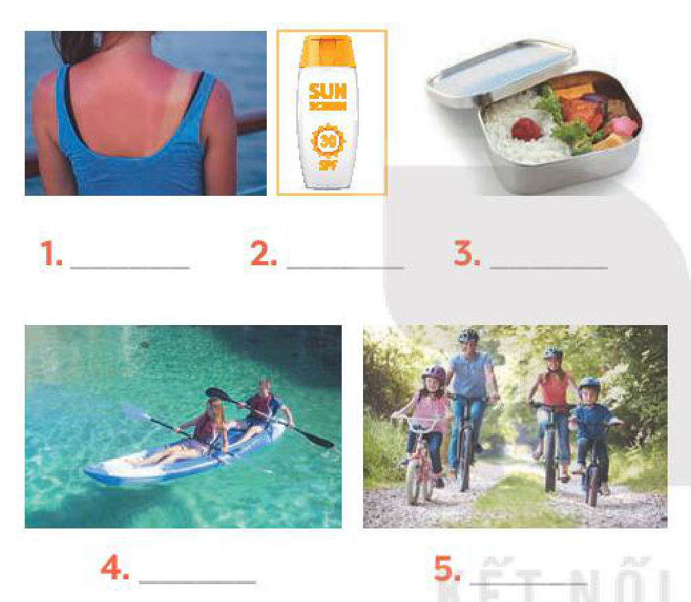
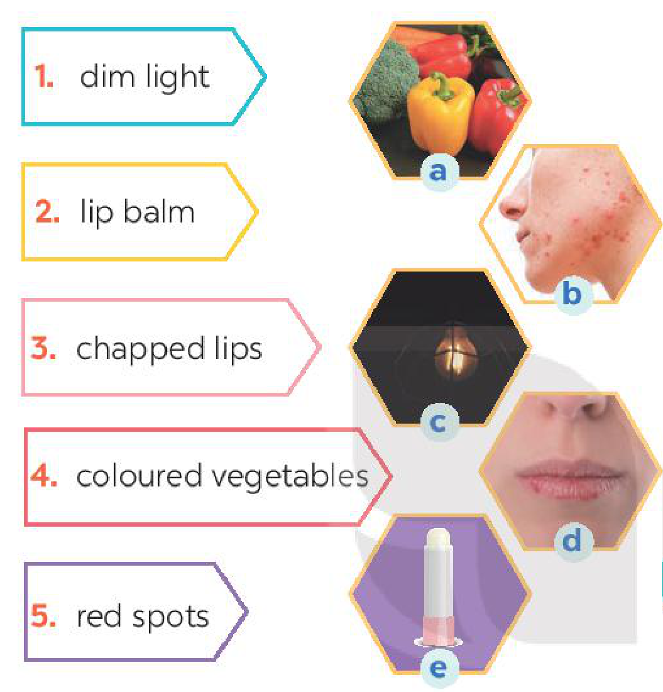
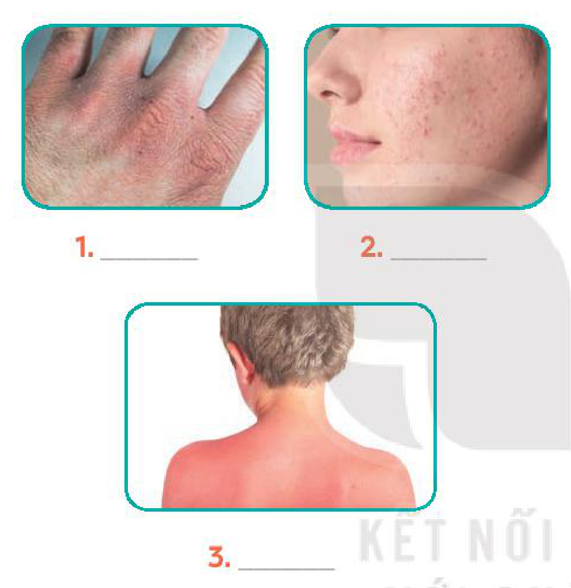
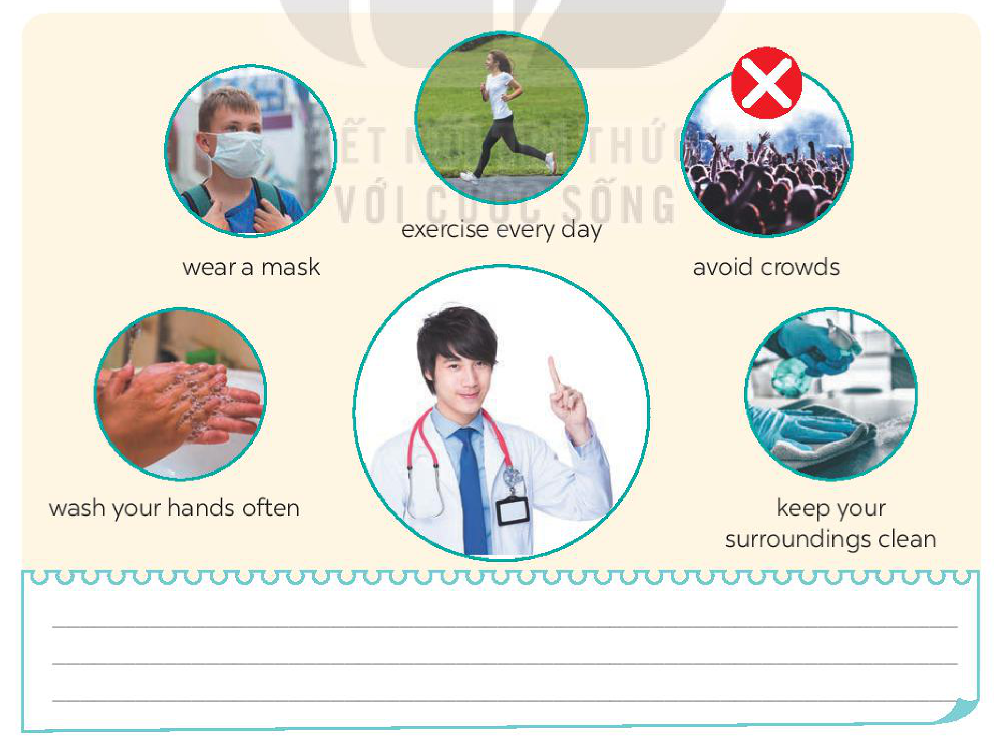

<!-- pdf:19 -->

# UNIT 2: HEALTHY LIVING

> **THIS UNIT INCLUDES:**
> - **Vocabulary:**
>   - **Healthy** activities
>   - **Health** problems
> - **Pronunciation:**
>   - Sounds: /f/ and /v/
> - **Grammar:**
>   - Simple sentences
> - **Skills:**
>   - Reading about **acne**
>   - Talking about how to deal with some **health** problems
>   - Listening to some advice about **healthy** habits
>   - Writing a paragraph of some advice to **avoid** **viruses**
> - **Everyday English:**
>   - Asking for and giving **health** tips

## GETTING STARTED

**Let's go out!**

**1. Listen and read.**

**Mi:** This is a nice picture, Mark.

**Mark:** That's my dad and I boating at Yen So Park.
<!-- term: boating -->

**Mi:** I also see a lot of people exercising there.

**Mark:** Yes, it's a popular place for people in my neighbourhood.

**Mi:** Outdoor activities are good for our **health**. My family often goes cycling in the countryside. It's quiet, and there's a lot of fresh air.
<!-- term: cycling -->

**Mark:** It sounds interesting.

**Mi:** Yes, it's lots of fun. We also bring fruit, water, and a lunch box with us.
<!-- term: lunch box -->

**Mark:** I'd love to join you next time.

**Mi:** Sure. Bring along a hat and suncream.
<!-- term: suncream -->

**Mark:** Why suncream?

**Mi:** It's really hot and sunny at noon, so you might get **sunburn**.

**Mark:** I see.

<!-- pdf:20 -->

**2. What are Mark and Mi talking about?**

- A. **Health** problems
- B. **Healthy** activities
- C. Sports and games

**3. Write a word or phrase from the box under its picture.**

| boating | suncream | lunch box |
| --- | --- | --- |
| **sunburn** | cycling | |
<!-- ocr-ok: đã đối chiếu ảnh trang gốc, khung từ vựng gồm 5 từ/cụm từ -->

1. \_\_\_\_\_\_\_
2. \_\_\_\_\_\_\_
3. \_\_\_\_\_\_\_
4. \_\_\_\_\_\_\_
5. \_\_\_\_\_\_\_
<!-- ocr-ok: đã đối chiếu ảnh trang gốc, các chỗ trống đánh số 1-5 dưới từng tranh minh hoạ -->

**4. Complete each sentence with a word from the conversation.**

1. In the picture, Mark and his father are \_\_\_\_\_\_\_.
2. The people in Mark's neighbourhood love to go to the \_\_\_\_\_\_\_.
3. Mi's family often goes cycling in the \_\_\_\_\_\_\_.
4. – I don't want to get **sunburn**.
   – Wear a hat and use \_\_\_\_\_\_\_.
5. Activities like running and cycling are good for our \_\_\_\_\_\_\_.

**5. GAME: Good / bad for health?**
<!-- ocr-ok: đã đối chiếu ảnh trang gốc, chữ GAME in màu cách điệu nên OCR không nhận diện được -->

**Work in groups. Each student names two daily activities. The class decides whether each activity is good / bad for health. Give a reason if possible.**

**Example:**
- **A:** I walk to school.
- **B:** I think it's good for your **health**.
- **A:** I rarely eat breakfast.
- **C:** It's not good. Breakfast is very important. It gives us energy for the day.

<!-- pdf:21 -->

## A CLOSER LOOK 1

### Vocabulary

**1. Match the phrases on the left with the correct pictures on the right.**
<!-- ocr-ok: đã đối chiếu ảnh trang gốc, OCR đọc lỗi dòng lệnh bài tập 1 -->

1. **dim** light
2. **lip balm**
3. **chapped** lips
4. coloured vegetables
5. red spots
<!-- term: coloured vegetables -->

**2. Complete the sentences with the correct words and phrases below.**

| **skin condition** | soft drinks | |
| --- | --- | --- |
| coloured vegetables | **sunburn** | **fit** |

1. – Please name some \_\_\_\_\_\_\_.
   – Carrots and tomatoes.
2. \_\_\_\_\_\_\_ are not good for your **health**.
3. My parents go cycling every Sunday. It keeps them \_\_\_\_\_\_\_.
4. The weather may **affect** our \_\_\_\_\_\_\_.
5. – How do we get \_\_\_\_\_\_\_?
   – When we spend a long time in the sun without a hat or suncream.

**3. Work in pairs. Discuss and tick (✓) each activity in the table as H (Healthy) or U (Unhealthy).**

| | H | U |
| --- | --- | --- |
| 1. washing your hands often | | |
| 2. reading in **dim** light | | |
| 3. eating **tofu** and coloured vegetables | | |
| 4. brushing your teeth twice a day | | |
| 5. touching your face with dirty hands | | |
<!-- term: coloured vegetables -->

### Pronunciation

**/f/ and /v/**

**4. Listen and repeat. Pay attention to the sounds /f/ and /v/.**

| | |
| --- | --- |
| acti*v*ity | acti*v*e |
| *v*itamin | break*f*ast |
| a*v*oid | a*ff*ect |
| *f*ood | *f*it |
<!-- ocr-ok: đã đối chiếu ảnh trang gốc, các chữ cái mang âm /f/ và /v/ in màu nổi bật được biểu diễn bằng in nghiêng -->

**5. Listen and repeat, paying attention to the underlined words.**

1. Coloured *vegetables* are good *food*.
<!-- term: coloured vegetables -->
2. My *favourite* outdoor *activity* is cycling.
3. We need **vitamin** A *for* our eyes.
4. Being *active* helps keep you **fit**.
5. Jack *never* eats *fish*.

<!-- pdf:22 -->

## A CLOSER LOOK 2

### Grammar

*Simple sentences*

**Remember!**

- Some simple sentences have a subject and a verb.
  *Example:* I read.
- Some simple sentences also have an object.
  *Example:* I read science books.
- Some simple sentences also have an adverb.
  *Example:* I read science books every weekend.
<!-- term: Simple sentences -->

**1. Tick (✓) the simple sentences.**

- [ ] 1. The Japanese eat a lot of **tofu**.
- [ ] 2. She drinks lemonade every morning.
- [ ] 3. I don't eat fast food, and I don't drink soft drinks.
- [ ] 4. I am **fit**.
- [ ] 5. I like fish, but my sister likes meat.
<!-- term: soft drinks -->

**2. Underline and write S for the subject and V for the verb in each simple sentence below.**

1. Vegetarians eat a lot of vegetables and fruit.
2. **Acne** causes black and white **pimples** on the face.
3. On Saturdays, my brother often spends two hours exercising at the sports centre.
4. My mother didn't buy my favourite cheesecake.
5. We are not cleaning up our community library.

**3. Rearrange the words and phrases to make simple sentences.**

1. soft drinks / never / my sister / drinks / .
2. **affects** / **acne** / 80% of young people / .
3. has / he / for breakfast / bread and eggs / .
4. don't eat / we / much fast food / .
5. a lot of **vitamins** / fruit and vegetables / have / .

**4. Write complete sentences from the prompts. You may have to change the words or add some.**

1. **tofu** / be / **healthy**.
2. many Vietnamese / drink / green tea.
3. she / not / use / suncream.
4. father / not / exercise / every morning.
5. most children / have / **chapped** lips and skin / winter.

<!-- pdf:23 -->

**5. Work in pairs. Discuss and write a simple sentence from the two given sentences.**

**Example:**
Many people are running.
Many people are exercising.
→ Many people are running and exercising.

1. We **avoid** sweetened food. We **avoid** soft drinks.
   → We **avoid** \_\_\_\_\_\_\_.
2. My dad loves outdoor activities. I love outdoor activities.
   → My \_\_\_\_\_\_\_ love outdoor activities.
3. You should wear a hat. You should wear suncream.
   → You should wear \_\_\_\_\_\_\_.
4. My mother read the **health** tips. My mother downloaded the **health** tips.
   → My mother \_\_\_\_\_\_\_.

## COMMUNICATION

### Everyday English

**Giving tips for health problems**

**1. Listen and read the conversation. Pay attention to the highlighted parts.**

- My eyes are tired.
- *You can use* **eye drops**.
- Yes.
- And *you shouldn't* read in **dim** light.
- Thank you.
<!-- ocr-ok: đã đối chiếu ảnh trang gốc, lời thoại nằm trong các bóng thoại giữa hai nhân vật -->

**2. Make similar conversations for the health problems below.**

1. I'm tired.
2. I have **acne**.
3. My hands are **chapped**.

**Tips for a healthy life**

**3. Read the passage and choose the correct title for it.**

- A. How to live long
- B. What food to eat

The Japanese live long lives. The main reason is their diet. They eat a lot of fish and vegetables. They cook fish with little cooking oil. They also eat a lot of **tofu**, a product from **soybeans**. **Tofu** has vegetable **protein** and **vitamin** B. It doesn't have any **fat**. The Japanese work hard and do a lot of outdoor activities too. This helps them keep **fit**.

**4. Work in pairs. Discuss and make a list of the tips which help the Japanese live long lives. Present it to the class.**

**5. Work in groups. Discuss and make a list of tips that the Vietnamese can do to live longer. Present it to the class. Does the class agree with you?**

<!-- pdf:24 -->

## SKILLS 1

### Reading

**1. Work in pairs. Discuss and write each word or phrase under the correct picture. Which skin condition is the most common among teenagers?**

| **sunburn** | **chapped** skin | **acne** |
| --- | --- | --- |

1. \_\_\_\_\_\_\_
2. \_\_\_\_\_\_\_
3. \_\_\_\_\_\_\_
<!-- ocr-ok: đã đối chiếu ảnh trang gốc, 3 chỗ trống đánh số 1-3 dưới từng bức ảnh tình trạng da -->

**2. Read the passage and match the beginnings in A with the endings in B.**

**Acne** is a **skin condition**. It causes small, red spots on the face and the back. It **affects** 70-80% of young people between 12 and 30. More girls have **acne** than boys. It's not a serious **disease** but young people want to **avoid** it.

Here are some tips for taking care of skin with **acne**.
- Go to bed early and get enough sleep.
- Eat more fruit and vegetables, and less fast food.
- Wash your face with special soap for **acne**, but no more than twice a day.
- Don't touch or **pop** spots, especially when your hands are dirty.
- If *it* gets serious, see a doctor.

| A | B |
| --- | --- |
| 1. **Acne** is | a. young people the most. |
| 2. **Acne** causes | b. a **skin condition**. |
| 3. **Acne** **affects** | c. a serious **disease**. |
| 4. **Acne** is not | d. small, red spots. |

**3. Read the passage again and choose the correct answer A, B, or C.**

1. The first paragraph is mainly about \_\_\_\_\_\_\_.
   - A. what **acne** is
   - B. how to **avoid** **acne**
   - C. why people have **acne**
2. Which statement is NOT correct about **acne**?
   - A. **Acne** is a **skin condition**.
   - B. **Acne** may get serious.
   - C. **Acne** **affects** more boys than girls.
3. What age group does **acne** **affect** the most?
   - A. 12 – 20
   - B. 12 – 30
   - C. 70 – 80
4. How should you wash your face?
   - A. 3 – 4 times a day.
   - B. With soap for **acne**.
   - C. With cold water.
5. What does the word "*it*" in the last sentence refer to?
   - A. **acne**
   - B. **disease**
   - C. spot

<!-- pdf:25 -->

### Speaking

**4. Work in pairs. Read the passage again. Pick the tips which you can easily follow. Share your ideas with your partner.**

**5. Work in groups. Read about the health problems below. Discuss and make notes of some tips you can give each person. Then share your ideas with the class.**

1. I have **chapped** lips.
   → \_\_\_\_\_\_\_\_\_\_\_\_\_\_\_\_\_\_\_\_\_\_\_
   → \_\_\_\_\_\_\_\_\_\_\_\_\_\_\_\_\_\_\_\_\_\_\_
2. I'm putting on weight.
   → \_\_\_\_\_\_\_\_\_\_\_\_\_\_\_\_\_\_\_\_\_\_\_
   → \_\_\_\_\_\_\_\_\_\_\_\_\_\_\_\_\_\_\_\_\_\_\_
3. I often feel sleepy during the day.
   → \_\_\_\_\_\_\_\_\_\_\_\_\_\_\_\_\_\_\_\_\_\_\_
   → \_\_\_\_\_\_\_\_\_\_\_\_\_\_\_\_\_\_\_\_\_\_\_
4. I have the flu.
   → \_\_\_\_\_\_\_\_\_\_\_\_\_\_\_\_\_\_\_\_\_\_\_
   → \_\_\_\_\_\_\_\_\_\_\_\_\_\_\_\_\_\_\_\_\_\_\_
5. My hair is dry.
   → \_\_\_\_\_\_\_\_\_\_\_\_\_\_\_\_\_\_\_\_\_\_\_
   → \_\_\_\_\_\_\_\_\_\_\_\_\_\_\_\_\_\_\_\_\_\_\_

## SKILLS 2

### Listening

**HEALTHY HABITS**
<!-- ocr-ok: đã đối chiếu ảnh trang gốc, dòng chữ cong màu xanh lá và hồng phía trên giỏ rau củ -->

**1. Work in pairs. Discuss and tick (✓) the habits you think are good for your health.**

- [ ] 1. Eat a lot of meat and cheese.
- [ ] 2. Get eight hours of sleep daily.
- [ ] 3. Be active and exercise every day.

**2. Listen and tick (✓) the habits mentioned.**

- [ ] 1. eating
- [ ] 2. travelling
- [ ] 3. exercising
- [ ] 4. sleeping
- [ ] 5. cooking
- [ ] 6. cleaning

<!-- pdf:26 -->

**3. Listen again and answer the questions with no more than THREE words.**

1. What do **healthy** habits help you **avoid**? \_\_\_\_\_\_\_\_\_\_\_\_\_\_\_\_\_\_\_\_\_\_\_
2. What do fruit and vegetables provide you with? \_\_\_\_\_\_\_\_\_\_\_\_\_\_\_\_\_\_\_\_\_\_\_
3. How many hours do you need to sleep a day? \_\_\_\_\_\_\_\_\_\_\_\_\_\_\_\_\_\_\_\_\_\_\_
4. How should you keep your room? \_\_\_\_\_\_\_\_\_\_\_\_\_\_\_\_\_\_\_\_\_\_\_

### Writing

**4. Work in groups. Discuss and make notes of the tips from the listening. Then share them with the class.**

> **TIPS:**
> \_\_\_\_\_\_\_\_\_\_\_\_\_\_\_\_\_\_\_\_\_\_\_\_\_\_\_\_\_\_\_\_\_\_\_\_\_\_\_\_\_\_\_

**5. Write a passage of about 70 words to give advice on how to avoid viruses.**

- wear a mask
- exercise every day
- **avoid** crowds
- wash your hands often
- keep your surroundings clean
<!-- ocr-ok: đã đối chiếu ảnh trang gốc, 5 cụm từ gợi ý nằm dưới 5 hình tròn minh hoạ cách phòng tránh vi rút -->

<!-- pdf:27 -->

## LOOKING BACK

### Vocabulary

**1. Complete the sentences with the verbs below.**

| are | exercise | **avoid** |
| --- | --- | --- |
| **affects** | keep | |
<!-- ocr-ok: đã đối chiếu ảnh trang gốc, khung từ vựng gồm 5 động từ -->

1. **Healthy** food and exercise help people \_\_\_\_\_\_\_ **fit**.
2. Weather that is too cold or too hot \_\_\_\_\_\_\_ your **skin condition**.
3. Children should \_\_\_\_\_\_\_ fast food and soft drinks.
4. Bad habits like eating too much sweetened food and going to bed late \_\_\_\_\_\_\_ harmful to our **health**.
5. We can \_\_\_\_\_\_\_ **indoors** and outdoors.

**2. Write the words below next to their definitions.**

| tidy | active | **fit** | dirty | **healthy** |
| --- | --- | --- | --- | --- |

1. always busy doing things, especially physical activities \_\_\_\_\_\_\_
2. good for your **health** \_\_\_\_\_\_\_
3. everything in order \_\_\_\_\_\_\_
4. in good shape \_\_\_\_\_\_\_
5. not clean \_\_\_\_\_\_\_
<!-- ocr-ok: đã đối chiếu ảnh trang gốc, 5 dòng định nghĩa kèm chỗ trống điền từ -->

### Grammar

**3. Tick (✓) the simple sentences.**
<!-- ocr-ok: đã đối chiếu ảnh trang gốc, OCR bỏ sót số thứ tự 3 của bài tập -->

- [ ] 1. Asians eat a lot of rice, but Europeans don't.
- [ ] 2. Most children love fast food and soft drinks.
- [ ] 3. There is a lot of fresh air in the countryside.
- [ ] 4. Eat less sweetened food, and you won't put on weight.
- [ ] 5. Hard-working people often stay **fit**.
<!-- term: put on weight -->

**4. Change the following sentences into simple ones.**

1. You are active, and your brother is active too.
   → Both you and \_\_\_\_\_\_\_\_\_\_\_\_\_\_\_\_\_\_\_\_\_\_\_.
2. Your room looks dark, and it looks untidy too.
   → Your room \_\_\_\_\_\_\_\_\_\_\_\_\_\_\_\_\_\_\_\_\_\_\_.
3. The Japanese work hard, and they exercise regularly.
   → The Japanese \_\_\_\_\_\_\_\_\_\_\_\_\_\_\_\_\_\_\_\_\_\_\_.
4. My mother eats a lot of fruit, and she eats a lot of vegetables too.
   → My mother eats \_\_\_\_\_\_\_\_\_\_\_\_\_\_\_\_\_\_\_\_\_\_\_.

<!-- pdf:28 -->

## PROJECT

**BUILD HEALTHY HABITS**
<!-- ocr-ok: đã đối chiếu ảnh trang gốc, ba tấm biển tiêu đề màu xanh lá, cam và hồng -->

Your class is starting a campaign to make your school a healthier place.

In groups, make a poster about a bad habit that the students in your school often do and give some tips to change that habit.

1. Discuss and find a bad habit and some tips to change it.
2. Find or draw a picture to illustrate your idea.
3. Present your poster to the class.

### Now I can ...

- use the words about **healthy** activities and **health** problems.
- pronounce the sounds /f/ and /v/ correctly.
- recognise and write simple sentences.
- ask for and give **health** tips.
- read about **acne**.
- talk about how to deal with some **health** problems.
- listen to some advice about **healthy** habits.
- write a paragraph of some advice to **avoid** **viruses**.

## 📷 Danh sách hình trong bài

| Mã hình | Trang PDF | Trang sách | Chú thích / Mô tả |
| --- | --- | --- | --- |
| H7-tieng_anh-u02-01 | 20 | 19 | Năm bức ảnh 1–5 thuộc bài tập 3 phần Getting Started: (1) lưng bị cháy nắng, (2) lọ kem chống nắng, (3) hộp cơm trưa, (4) chèo thuyền, (5) đạp xe |
| H7-tieng_anh-u02-02 | 21 | 20 | Sơ đồ nối 5 cụm từ vựng (1. dim light, 2. lip balm, 3. chapped lips, 4. coloured vegetables, 5. red spots) với 5 hình lục giác minh hoạ a–e thuộc bài tập 1 phần A Closer Look 1 |
| H7-tieng_anh-u02-03 | 24 | 23 | Ba bức ảnh tình trạng da đánh số 1–3 thuộc bài tập 1 phần Skills 1 – Reading: (1) da bàn tay nứt nẻ, (2) da mặt nổi mụn trứng cá, (3) vùng da lưng bị cháy nắng |
| H7-tieng_anh-u02-04 | 26 | 25 | Sơ đồ gợi ý 5 biện pháp phòng tránh vi rút quanh hình bác sĩ (wear a mask, exercise every day, avoid crowds, wash your hands often, keep your surroundings clean) thuộc bài tập 5 phần Skills 2 – Writing |
