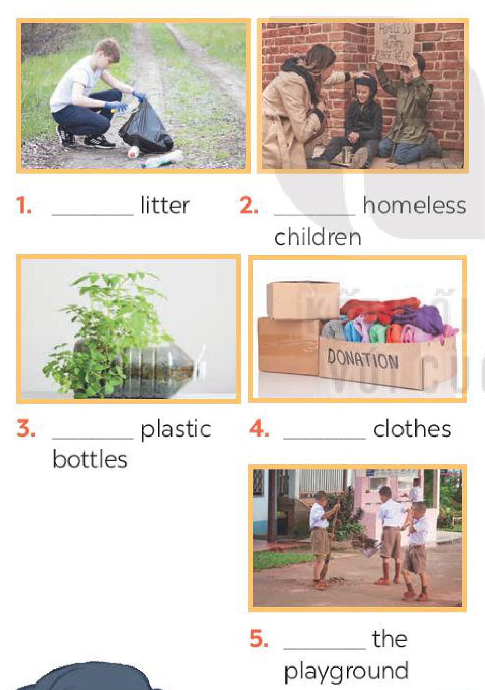
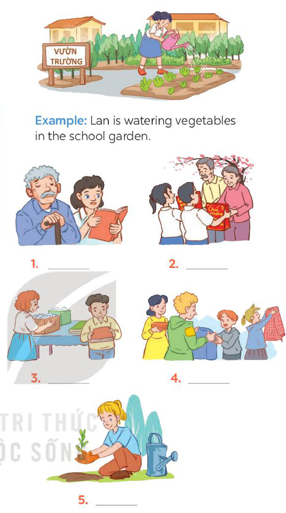
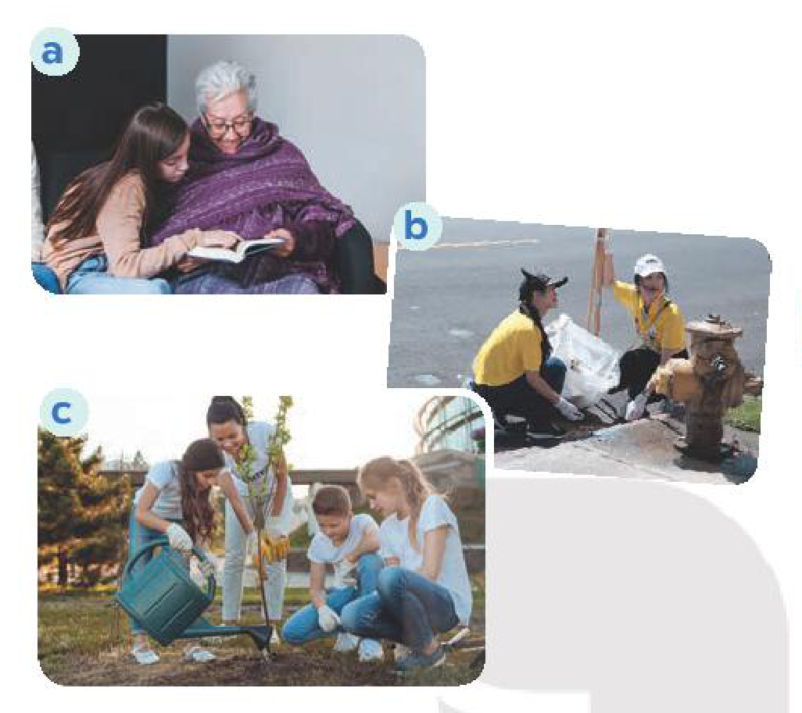

<!-- pdf:29 -->

# UNIT 3: COMMUNITY SERVICE

> **THIS UNIT INCLUDES:**
> - **Vocabulary:**
>   - **Community** activities
> - **Pronunciation:**
>   - Sounds: /t/, /d/, and /ɪd/
> - **Grammar:**
>   - Past simple
> - **Skills:**
>   - Reading about **community** activities at a school
>   - Talking about the reasons why students join different **community** activities
>   - Listening to a talk about some **community** activities and their benefits
>   - Writing an email about **community** activities one did last summer
> - **Everyday English:**
>   - Giving compliments

## GETTING STARTED

**Sounds like great work!**

**1. Listen and read.**

**Minh:** Hi, Tom. Are you back in Ha Noi?

**Tom:** Yes. I came back yesterday. Can we meet up this Sunday morning? I bought you a **board game**.

**Minh:** Sure, I can't wait! But our Green School Club will have some **community** activities on that morning.

**Tom:** What activities does your club do?

**Minh:** Well, we pick up litter around our school and **plant** vegetables in our school garden.
<!-- term: pick up litter -->

**Tom:** School gardening? That's fantastic!

**Minh:** Yes. We **donate** the vegetables to a **nursing home**. Does your school have any activities like these?

**Tom:** Yes. We **donate** books to **homeless** children. We also have English classes. Last summer, we taught English to 30 kids in the area.

**Minh:** Sounds like great work!

**Tom:** Thanks.

**Minh:** ... So, let's meet in the afternoon then.
<!-- ocr-ok: đã đối chiếu ảnh trang gốc, OCR bỏ dấu lược trong let's -->

<!-- pdf:30 -->

**2. Read the conversation again and tick (✓) the appropriate box.**

| Community activity | Minh's club | Tom's club |
| --- | --- | --- |
| 1. picking up litter | | |
| 2. planting vegetables | | |
| 3. donating books | | |
| 4. donating vegetables | | |
| 5. teaching English | | |
<!-- ocr-ok: đã đối chiếu ảnh trang gốc, bảng tích chọn hoạt động của câu lạc bộ Minh và Tom -->

**3. Complete the phrases under the pictures with the verbs below.**

| pick up | clean | **donate** |
| --- | --- | --- |
| recycle | help | |

1. \_\_\_\_\_\_\_ litter
2. \_\_\_\_\_\_\_ **homeless** children
3. \_\_\_\_\_\_\_ plastic bottles
4. \_\_\_\_\_\_\_ clothes
5. \_\_\_\_\_\_\_ the playground
<!-- ocr-ok: đã đối chiếu ảnh trang gốc, OCR bỏ sót một phần chữ ở câu 4 và câu 5 dưới hình -->

**4. Complete the sentences with the correct words or phrases below.**

| old people | **homeless** children | |
| --- | --- | --- |
| **planted** | litter | taught |

1. We **collected** clothes and gave them to \_\_\_\_\_\_\_.
2. Those students picked up all the \_\_\_\_\_\_\_ on the street.
3. We helped \_\_\_\_\_\_\_ in the **nursing home** last Sunday.
4. The club members \_\_\_\_\_\_\_ maths to primary students during school holidays.
5. We \_\_\_\_\_\_\_ a lot of trees in the park last summer.

**5. GAME: Vocabulary Ping-pong**
<!-- ocr-ok: đã đối chiếu ảnh trang gốc, chữ GAME in màu cách điệu -->

**Work in two teams. Team A provides a cue word. Team B makes up a sentence with it. Then switch roles.**

**Example:**
- **Team A:** Litter
- **Team B:** We often pick up litter in the park. Trees
- **Team A:** We **plant** trees in our school every year. Book
- ...

<!-- pdf:31 -->

## A CLOSER LOOK 1

### Vocabulary

**1. Match a verb in A with a word or phrase in B.**

| A | B |
| --- | --- |
| 1. **donate** | a. used paper for notebooks |
| 2. **exchange** | b. primary students |
| 3. water | c. litter |
| 4. pick up | d. plants |
| 5. **tutor** | e. books |

**2. Complete each of the sentences with a suitable word or phrase from the box.**

| **tutor** | litter | water |
| --- | --- | --- |
| **donate** | used paper for notebooks | |

1. We pick up \_\_\_\_\_\_\_ at the local park every Sunday.
2. Children in our village **exchange** \_\_\_\_\_\_\_ every school year.
3. Tom and his friends \_\_\_\_\_\_\_ the plants in their neighbourhood every weekend.
4. We \_\_\_\_\_\_\_ old textbooks to children in **rural areas**.
5. Minh and his friends often \_\_\_\_\_\_\_ small children in their village.

**3. Use the phrases from the box to write full sentences under the correct pictures.**

- watering vegetables in the school garden
- giving gifts to old people
- exchanging used paper for notebooks
- planting trees in the park
- reading books to the **elderly**
- donating clothes to poor children
<!-- ocr-ok: đã đối chiếu ảnh trang gốc, OCR đọc nhầm dòng exchanging used paper for notebooks thành ng on Pant nos -->

**Example:** Lan is watering vegetables in the school garden.

1. \_\_\_\_\_\_\_
2. \_\_\_\_\_\_\_
3. \_\_\_\_\_\_\_
4. \_\_\_\_\_\_\_
5. \_\_\_\_\_\_\_
<!-- ocr-ok: đã đối chiếu ảnh trang gốc, các chỗ trống đánh số 1-5 dưới từng tranh minh hoạ -->

### Pronunciation

**/t/, /d/, and /ɪd/**
<!-- ocr-ok: đã đối chiếu ảnh trang gốc, OCR đọc nhầm kí hiệu phiên âm /ɪd/ thành /1d/ -->

**4. Listen and repeat. Pay attention to the sounds /t/, /d/, and /ɪd/.**

| /t/ | /d/ | /ɪd/ |
| --- | --- | --- |
| cook*ed* | water*ed* | **collect***ed* |
| pass*ed* | clean*ed* | **donat***ed* |
| help*ed* | **volunteer***ed* | **provid***ed* |
<!-- ocr-ok: đã đối chiếu ảnh trang gốc, OCR đọc lỗi dòng passed / cleaned / donated thành ga gioi Haris -->

<!-- pdf:32 -->

**5. Listen to the sentences and pay attention to the underlined parts. Tick (✓) the appropriate sounds. Practise the sentences.**

| | /t/ | /d/ | /ɪd/ |
| --- | --- | --- | --- |
| 1. Our club cook*ed* soup for old patients. | | | |
| 2. Students water*ed* the trees in the school. | | | |
| 3. We *provid*ed food for **homeless** children last Tet holiday. | | | |
| 4. Our school *donat*ed clothes to poor people. | | | |
| 5. **Teenagers** *volunteer*ed to clean streets. | | | |
<!-- ocr-ok: đã đối chiếu ảnh trang gốc, phần đuôi -ed gạch chân trong bảng phát âm được biểu diễn bằng in nghiêng -->

## A CLOSER LOOK 2

### Grammar

**The past simple**

**1. Circle the correct answer A, B, or C to complete each sentence.**

1. *Green School* \_\_\_\_\_\_\_ vegetables for an **orphanage** last spring.
   - A. is growing
   - B. grew
   - C. grows
2. Children \_\_\_\_\_\_\_ plastic bottles for recycling a month ago.
   - A. are collecting
   - B. **collect**
   - C. **collected**
3. We \_\_\_\_\_\_\_ English to children in a primary school last summer.
   - A. are teaching
   - B. taught
   - C. teach
4. Our school club \_\_\_\_\_\_\_ gloves for old people in **nursing homes** last winter.
   - A. made
   - B. is making
   - C. make
5. We \_\_\_\_\_\_\_ bottles to help the environment last month.
   - A. are reusing
   - B. reuse
   - C. reused

**Remember!**

We use the past simple to talk about completed actions in the past.
We often use specific time expressions, such as *yesterday*, *last month*, *three weeks ago*, or *in 1999* with the past simple.
<!-- term: Past simple -->

**2. Complete the sentences with the past simple form of the given verbs.**

1. *Care for Animals* (take) \_\_\_\_\_\_\_ care of thousands of **homeless** dogs and cats last year.
2. \_\_\_\_\_\_\_ **teenagers** (join) \_\_\_\_\_\_\_ *Lending Hand* in 2015?
3. We (help) \_\_\_\_\_\_\_ the **elderly** in a village last summer.
4. Last year, we (send) \_\_\_\_\_\_\_ textbooks to help children in a **rural** village.
5. Tom (**volunteer**) \_\_\_\_\_\_\_ to teach English in our village last winter.

**3. Complete the sentences with the correct forms of the verbs from the box.**

| **plant** | read | cook |
| --- | --- | --- |
| recycle | pick up | |

1. The club members \_\_\_\_\_\_\_ food for patients every Sunday.
2. \_\_\_\_\_\_\_ you \_\_\_\_\_\_\_ those trees in the playground last month?
3. Nick and his friends \_\_\_\_\_\_\_ rubbish on the beach now.
4. Tom \_\_\_\_\_\_\_ the plastic bottles, and now he has some nice vases.
5. We often \_\_\_\_\_\_\_ books to old people in a **nursing home**.

<!-- pdf:33 -->

**4. Write complete sentences from the prompts.**

1. Last year / our club / **donate** / books / children in **rural areas**.
2. children / send / you thank-you cards / a week ago?
3. I / teach / two children in grade 2 / last summer.
4. Last spring / we / help / the **elderly** / **nursing home**.
5. How / you / help / people / in **flooded** areas / last year?

**5. Work in pairs. Tom is from the Red Cross. Look at the fact sheet and ask Tom about his projects in 2016 and 2020.**

| Projects / Year | Activities |
| --- | --- |
| *Help Lonely People* / 2016 | - help 200 lonely people - answer calls from lonely people - visit museums with them |
| *Support Ill People* / 2020 | - help ill people at their home - read books to ill people |
<!-- ocr-ok: đã đối chiếu ảnh trang gốc, OCR đọc nhầm Support Ill People thành Support Lil People -->

**Example:**
- **Tom:** I'm from the Red Cross. I worked on the *Help Lonely People* project in 2016.
- **Lan:** What did you do?
- **Tom:** We helped 200 lonely people ...

## COMMUNICATION

### Everyday English

*Giving compliments*

**1. Listen and read the dialogue between Lan and Mark. Pay attention to the highlighted parts.**

**Lan:** What did you do to help your **community** last summer, Mark?

**Mark:** We **planted** some trees in the schoolyard and picked up a lot of rubbish along the nearby roads.

**Lan:** *Sounds like great work!* We **collected** books and warm clothes for our friends in the **mountainous** areas.
<!-- term: Giving compliments -->

**Mark:** *Wonderful!*
<!-- term: Giving compliments -->

**2. Work in pairs. Make similar conversations.**

1. Mi helped lonely **elderly** people.
2. Tom and his friends cleaned and decorated parts of their neighbourhood.

<!-- pdf:34 -->

**Changing our neighbourhood**

**3. Work in pairs. Read the poster about the volunteer activities for teenagers at Lending Hand. Write the project number (1 – 3) next to its benefit (A – E).**

> **WELCOME TO LENDING HAND**
>
> Here are some activities you can do when you join our projects:
>
> **1. Protect the environment:**
> - You can **plant** trees in your area.
> - You can join **clean-up activities**.
>
> **2. Help street children:**
> - You can **donate** food and clothes.
> - You can teach street children to read and write.
> <!-- term: street children -->
>
> **3. Help old people:**
> You can sing and dance with the **elderly** in a **nursing home**.

**Benefits**

- \_\_\_\_\_\_\_ A. making the **elderly** less lonely
- \_\_\_\_\_\_\_ B. making the neighbourhood greener
- \_\_\_\_\_\_\_ C. helping feed children
- \_\_\_\_\_\_\_ D. helping children have a better future
- \_\_\_\_\_\_\_ E. making the neighbourhood cleaner

**4. Work in pairs. Ask and answer which activities in 3 you want to join. Give reasons.**

**Example:**
- **Minh:** Which activity do you want to join?
- **Lan:** I want to join some **clean-up activities**.
- **Minh:** Why do you want to join these activities?
- **Lan:** Because they make the neighbourhood cleaner.

**5. Work in groups. Discuss which activity each member of your group chooses and the benefit(s) of the activity. Present your group's answers to the class.**

**Example:**

Mai wants to **donate** food to street children because this helps feed them. Lan wants to join **clean-up activities** because these activities make our neighbourhood cleaner ...

<!-- pdf:35 -->

## SKILLS 1

### Reading

**1. Work in pairs. Circle the activities you would like to do at your school.**

- A. growing vegetables in the school garden
- B. tutoring other students
- C. collecting books for the school library

**2. Read the passage and match the highlighted words with their meanings.**

| | |
| --- | --- |
| 1. give | 2. give and receive |
| 3. every month | 4. pleased |
| 5. teach | |

Bright Future School has many **community** activities for students. The school believes that a good way for students to **develop** themselves is through **community service**. All students can join any of these different projects:

- *Tutoring*: Upper grade students **tutor** lower grade students.
- *Postcard-to-Help*: Students make and sell postcards to raise money for local children.
<!-- term: raise money -->
- *Visit-to-Read*: Students visit a **nursing home** *monthly* and read books to the **elderly**.
<!-- term: monthly -->
- *Garden-to-Give*: Students grow vegetables and **donate** them to local schools.
- *Paper-Plant-Exchange*: Students **collect** paper and **exchange** it for plants. They then look after the plants in their school garden.

Students learn that they can help people and the world around them when they do **community service**. They feel useful and **proud** because they do good things.

**3. Read the passage again and tick (✓) T (True) or F (False).**

| | T | F |
| --- | --- | --- |
| 1. **Community service** allows students to **develop** themselves. | | |
| 2. Each student can join only one project. | | |
| 3. They **tutor** younger students. | | |
| 4. Local children receive postcards from the *Postcard-to-Help* project. | | |
| 5. Students receive plants when they give paper. | | |

### Speaking

**4. Work in pairs. Read about these students. Write the names of the projects you think they should join in the Projects column.**

- A. *Tutoring*
- B. *Postcard-to-Help*
- C. *Visit-to-Read*
- D. *Garden-to-Give*
- E. *Paper-Plant-Exchange*

| Students | Projects |
| --- | --- |
| 1. Nick likes reading books. He has a very nice voice, and he is also patient. | |
| 2. Ann is very good at maths and literature. She also loves children. | |
| 3. Minh loves collecting and making postcards. | |
| 4. Mark loves nature. He likes watching programmes about plants. He also likes being outdoors. | |
| 5. Tom likes collecting newspapers. | |

**5. Work in groups. Discuss which project in 4 you would like to join, and why. Report your group's answers to the class.**

**Example:**

Lan will join the *Tutoring* project because she is good at maths and English. She also loves children.

<!-- pdf:36 -->

## SKILLS 2

### Listening

**1. What community activities are the children doing in the pictures?**

**2. Listen to Tom and Linda talking about their community activities last summer. Circle the correct answers.**

1. Linda and her friends taught \_\_\_\_\_\_\_.
   - A. English and literature
   - B. maths and history
   - C. English and maths
2. Linda and her friends \_\_\_\_\_\_\_ the **elderly**.
   - A. talked to
   - B. cooked for
   - C. read books to
3. Tom and his friends picked up \_\_\_\_\_\_\_.
   - A. books and paper
   - B. bottles and books
   - C. paper and bottles
4. Tom and his friends \_\_\_\_\_\_\_.
   - A. grew some trees
   - B. **tutored** maths
   - C. cleaned schools
<!-- ocr-ok: đã đối chiếu ảnh trang gốc, OCR đọc nhầm đáp án 2C read books to thành Se fon bust và 4B tutored maths thành woreda tpeths -->

**3. Listen again and fill in each blank with no more than TWO words.**

| **The benefits of volunteer activities** | |
| --- | --- |
| For Linda and her friends | - having a lot of (1) \_\_\_\_\_\_\_ - feeling useful |
| For Tom and his friends | - having a (2) \_\_\_\_\_\_\_ - working and playing together - learning some (3) \_\_\_\_\_\_\_ |

### Writing

**4. Read Tom's email to Nam about his school activities last summer.**

> **New Message**
>
> **To:** nam@webmail.com
>
> **Subject:** School activities last summer
>
> Dear Nam,
>
> How are things? Did your school have any **community** activities last summer?
>
> We did some very interesting activities. We **collected** rubbish in a nearby park. We also **planted** trees. Then we watered them every day, and it was enjoyable to watch them grow up. We also had a lot of fun and learnt some **skills**.
>
> Please write to me and tell me about your school activities.
>
> Best,
>
> Tom

**5. You are Nam. Now write an email of about 70 words to Tom about your school activities last summer. Start your email as shown below.**

> **New Message**
>
> **To:** tom@webmail.com
>
> **Subject:** School activities last summer
>
> Dear Tom,
>
> Things are good. We also did some interesting activities last summer. \_\_\_\_\_\_\_\_\_\_\_\_\_\_\_\_\_\_\_\_\_\_\_
>
> See you soon,
>
> Nam

<!-- pdf:37 -->

## LOOKING BACK

### Vocabulary

**1. Complete the table with the words and phrases from the box.**

| **homeless** children | food | litter |
| --- | --- | --- |
| the **elderly** | bottles | books |

| help | pick up | donate |
| --- | --- | --- |
| | | |
<!-- ocr-ok: đã đối chiếu ảnh trang gốc, OCR bỏ sót tiêu đề bảng 3 cột help / pick up / donate -->

**2. Complete each sentence with one phrase from 1. Remember to use the correct form of the verbs.**

1. The club \_\_\_\_\_\_\_ to some poor farmers last week.
2. Yesterday, we \_\_\_\_\_\_\_ around our area and recycled them.
3. We \_\_\_\_\_\_\_ do the cleaning last summer.
4. Last month, our club \_\_\_\_\_\_\_ to the **community** library.
5. In our recent project, we \_\_\_\_\_\_\_ learn to read and write.
<!-- term: recycle -->
<!-- ocr-ok: đã đối chiếu ảnh trang gốc, các chỗ trống điền cụm động từ câu 1-5 -->

### Grammar

**3. Use the correct form of the verbs from the box to complete the passage.**

| **donate** | **collect** | have | sell | go |
| --- | --- | --- | --- | --- |

*Warm Clothes* is a famous **volunteer** group in Viet Nam. Its members are both parents and their children. Last year, they (1) \_\_\_\_\_\_\_ many activities to help their **community**. The group (2) \_\_\_\_\_\_\_ clothes and sent them to poor people in **rural areas**. The parents taught their children to make things from bamboo and bottles. They then (3) \_\_\_\_\_\_\_ these to buy books, and (4) \_\_\_\_\_\_\_ them to village children. They also (5) \_\_\_\_\_\_\_ to the villages and **tutored** small kids there. They really brought love to those small villages.

**4. Write full sentences about the activities the students did to help their community last year.**

1. **Mi:** singing and dancing for the **elderly** at a **nursing home**
2. **Mark and his friends:** collecting books and setting up a **community** library
3. **Lan and Mai:** growing and donating vegetables to a primary school
4. **Minh and his friends:** giving food to young patients in a hospital
5. **Tom:** making and sending postcards to the **elderly** at Christmas

<!-- pdf:38 -->

## PROJECT

**OUR GREEN NEIGHBOURHOOD**

**Problems — Solutions**
<!-- ocr-ok: đã đối chiếu ảnh trang gốc, tiêu đề chữ in hoa màu xanh dương trên đầu trang và hai nhãn Problems / Solutions dưới ảnh -->

**Work in groups.**

1. Think about some environmental problems in your neighbourhood.
2. Discuss and find the answers to the questions.
   - What problems can you find?
   - What do you want to do to solve the problems?
   - How are you going to do them?
3. Present them to your class.

### Now I can ...

- use the words related to **community** activities.
- pronounce the sounds /t/, /d/, and /ɪd/ correctly.
- use the past simple.
- give compliments.
- read about **community** activities at a school.
- talk about the reasons why students join different **community** activities.
- listen to a talk about some **community** activities and their benefits.
- write an email about **community** activities I did last summer.

## 📷 Danh sách hình trong bài

| Mã hình | Trang PDF | Trang sách | Chú thích / Mô tả |
| --- | --- | --- | --- |
| H7-tieng_anh-u03-01 | 30 | 29 | Năm bức ảnh 1–5 thuộc bài tập 3 phần Getting Started: (1) nhặt rác, (2) giúp đỡ trẻ em vô gia cư, (3) tái chế chai nhựa, (4) quyên góp quần áo, (5) dọn dẹp sân chơi |
| H7-tieng_anh-u03-02 | 31 | 30 | Sáu tranh vẽ minh hoạ (câu mẫu tưới rau vườn trường và 5 câu 1–5: đọc sách cho người cao tuổi, tặng quà người già, đổi giấy cũ lấy vở, quyên góp quần áo cho trẻ em nghèo, trồng cây trong công viên) thuộc bài tập 3 phần A Closer Look 1 |
| H7-tieng_anh-u03-03 | 36 | 35 | Ba bức ảnh a, b, c minh hoạ các hoạt động cộng đồng của học sinh (đọc sách cùng cụ già, nhặt rác, trồng và tưới cây) thuộc bài tập 1 phần Skills 2 – Listening |
