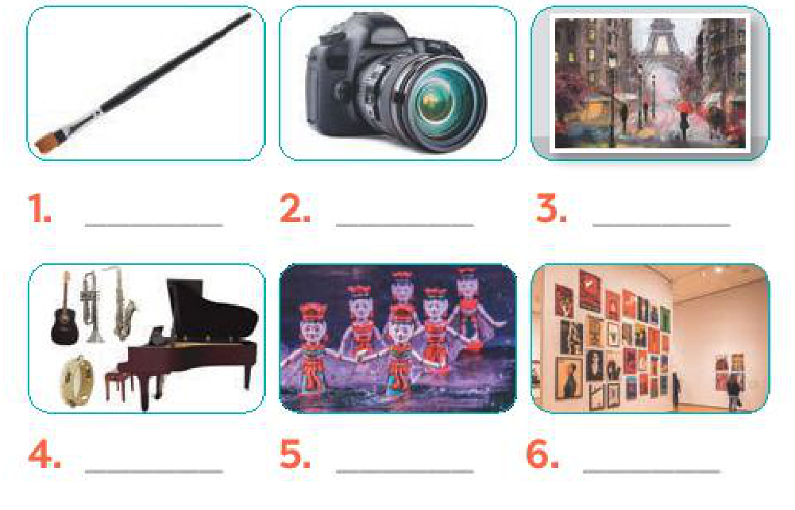
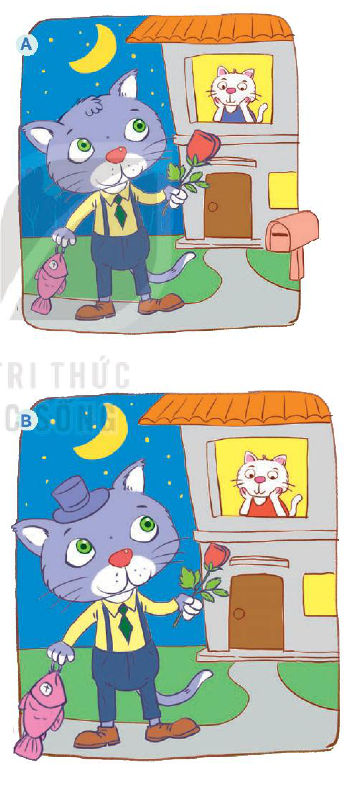

<!-- pdf:41 -->

# UNIT 4: MUSIC AND ARTS

> **THIS UNIT INCLUDES:**
> - **Vocabulary:**
>   - Music and arts
> - **Pronunciation:**
>   - Sounds: /ʃ/ and /ʒ/
> - **Grammar:**
>   - Comparisons: *like*, *different from*, *(not) as ... as*
> - **Skills:**
>   - Reading about a traditional art form
>   - Talking about a musical **performance** at one's school
>   - Listening to a talk about street painting
>   - Writing an informal letter of invitation
> - **Everyday English:**
>   - Expressing preferences
<!-- ocr-ok: đã đối chiếu ảnh trang gốc, khung THIS UNIT INCLUDES hai cột và kí hiệu IPA /ʃ/, /ʒ/ -->

## GETTING STARTED

**A talk at the school gate**

**1. Listen and read.**

**Trang:** Hi, Nick. What are you listening to?

**Nick:** I'm listening to music. I like classical music, and I often play the piano in my spare time.
<!-- term: classical music -->

**Trang:** Wow. I can't play any instruments.

**Nick:** And what about you? What's your hobby?

**Trang:** I like painting and taking photos.

**Nick:** Taking photos? I've never tried it. Is it fun?

**Trang:** Yeah, it is, but not as fun as painting.

**Nick:** Right. They seem quite different from each other. What do you normally paint?

**Trang:** Landscapes and animals, just for pleasure, you know. I sometimes share them with my friends.

**Nick:** Really? Um, maybe we should go to an art **gallery** next weekend?

**Trang:** Sounds good, but I'd **prefer** to go to the music festival at my school.

**Nick:** Well ... OK. That's fine.

<!-- pdf:42 -->

**2. What are Trang and Nick talking about?**

- A. Playing the piano
- B. Drawing and painting
- C. Music and arts
<!-- ocr-ok: đã đối chiếu ảnh trang gốc, OCR đọc lỗi dòng C. Music and arts -->

**3. Complete each of the sentences with a suitable word or phrase from the box.**

| photos | like | different from | art gallery | musical instruments |
| --- | --- | --- | --- | --- |

1. Nick wants to go to a(n) \_\_\_\_\_\_\_ next weekend.
2. You can use your smartphone to take \_\_\_\_\_\_\_.
3. This photo is very bright. It is \_\_\_\_\_\_\_ that dark one.
4. Nick and Trang agree that taking photos is not \_\_\_\_\_\_\_ painting.
5. My friend David is very talented. He plays three \_\_\_\_\_\_\_.

**4. Write the correct word or phrase under each picture. Then listen and repeat.**

- camera
- water **puppet** show
- art **gallery**
- painting
- **musical instruments**
- paintbrush
<!-- term: paintbrush -->

1. \_\_\_\_\_\_\_  2. \_\_\_\_\_\_\_  3. \_\_\_\_\_\_\_
4. \_\_\_\_\_\_\_  5. \_\_\_\_\_\_\_  6. \_\_\_\_\_\_\_
<!-- ocr-ok: đã đối chiếu ảnh trang gốc, các chỗ trống đánh số 1-6 dưới mỗi hình -->

**5. QUIZ: How artistic are you?**
<!-- ocr-ok: đã đối chiếu ảnh trang gốc, chữ QUIZ nằm trong bốn ô màu trang trí khiến OCR đọc lỗi -->

**Take the quiz to find out.**

1. Your hobby is \_\_\_\_\_\_\_.
   - A. playing an instrument
   - B. playing computer games
2. Do you like listening to music or playing sports?
   - A. Listening to music.
   - B. Playing sports.
3. Which of these do you **prefer** doing?
   - A. Going to an art **gallery**.
   - B. Going to a book fair.
4. You describe yourself as \_\_\_\_\_\_\_.
   - A. creative
   - B. hard-working
5. What do you want to be when you grow up?
   - A. A musician.
   - B. An engineer.
<!-- term: musician -->

**For each question, you get two points if your answer is A, zero if your answer is B. Add up your five answers and decide how artistic you are on a scale from 1 – 10.**

- Not very (0 – 4)
- Somewhat (6)
- Very (8 – 10)

<!-- pdf:43 -->

## A CLOSER LOOK 1

### Vocabulary

**1. Listen and repeat these words and phrases.**

- art **gallery**
- **composer**
- concert hall
- musician
- actress
- painter
- artist
- **puppet** theatre
<!-- term: concert hall -->
<!-- term: musician -->

**Write them in the correct columns.**

| People | Places |
| --- | --- |
| | |

**2. Match a word in A with a word or phrase in B. A word in A may go with more than a word or phrase in B.**

| A | B |
| --- | --- |
| 1. **compose** | a. a show |
| 2. paint | b. a photo |
| 3. **perform** | c. the guitar |
| 4. play | d. a **portrait** |
| 5. take | e. music |

**3. Underline the correct word or phrase to complete each sentence.**

1. The little girl's *drawing* / **photography** of her kitten shows a lot of talent.
2. Van Cao was a great Vietnamese *scientist* / **composer**. He was also a painter and poet.
3. The Louvre in Paris is the world's largest *museum* / *puppet theater*.
4. The orchestra will **perform** its final **portrait** / **concert** of the season tomorrow.
5. Did you see the film *Amazon Jungle* on TV last night? The **photography** / *drawing* was excellent.

### Pronunciation

**/ʃ/ and /ʒ/**

**4. Listen and repeat. Pay attention to the sounds /ʃ/ and /ʒ/.**
<!-- ocr-ok: đã đối chiếu ảnh trang gốc, OCR đọc nhầm kí hiệu phiên âm /ʃ/ và /ʒ/ -->

| /ʃ/ | /ʒ/ |
| --- | --- |
| musician | television |
| show | visual |
| share | unusual |
| nation | decision |

**5. Listen and repeat. Listen again and single-underline the words with the sound /ʃ/ and double-underline the words with the sound /ʒ/.**
<!-- ocr-ok: đã đối chiếu ảnh trang gốc, OCR đọc nhầm kí hiệu phiên âm /ʃ/ và /ʒ/ -->

1. We finally came to a decision.
2. Did you watch the talent show on TV last night?
3. Let's share the pictures we took last week.
4. She often paints in her leisure time.
5. It was a pleasure to listen to the musicians **performing** yesterday.
<!-- term: musician -->

<!-- pdf:44 -->

## A CLOSER LOOK 2

### Grammar

**Comparisons: *like*, *different from*, *(not) as ... as***

**Remember!**

We use:
- *like* to show that something is similar to something else.
  *Example:* This picture is *like* the one I saw at the art museum.
- *different from* to show that two or more things are not similar.
  *Example:* Painting **portraits** is *different from* painting landscapes.
- *as + adjective + as* to show that two things are similar.
  *not as + adjective + as* to show that something is "more" or "less" than something else.
  *Example:* Classical music is *not as exciting as* rock.
<!-- term: Comparisons: like, different from, (not) as ... as -->
<!-- term: classical music -->

**1. Write *like*, *as*, or *different* in the blanks.**

1. This camera is not as expensive \_\_\_\_\_\_\_ I thought at first.
2. Her room is lovely. It is \_\_\_\_\_\_\_ a princess's room.
3. You like folk songs; I like pop music. Your taste is \_\_\_\_\_\_\_ from mine.
4. My dad is not always as busy \_\_\_\_\_\_\_ my mum.
5. Some of us think that *Spiderman 2* is not too \_\_\_\_\_\_\_ from *Spiderman 1*.

**2. Finish the second sentence in each pair, using *like*, *as ... as*, or *different from*.**

1. Rock is very exciting. It is not like **country music**.
   → Rock is very \_\_\_\_\_\_\_ **country music**.
2. **Composer** Hoang Long wrote many good songs for children. **Composer** Pham Tuyen also wrote many good songs for children.
   → **Composer** Hoang Long, \_\_\_\_\_\_\_ Pham Tuyen, wrote many good songs for children.
3. The Vatican Museum has excellent works of art. The Louvre Museum has excellent works of art too.
   → The Vatican Museum's works of art are \_\_\_\_\_\_\_ excellent \_\_\_\_\_\_\_ the Louvre Museum's works of art.
4. A vacation on the beach is relaxing, while a vacation in a big city may not be.
   → A vacation on the beach is \_\_\_\_\_\_\_ a vacation in a big city.
5. City life is busy, but country life is peaceful.
   → City life is not \_\_\_\_\_\_\_ peaceful \_\_\_\_\_\_\_ country life.

<!-- pdf:45 -->

**3. Work in pairs. Compare the two museums: *History* and *Science*, using *like*, *as ... as*, or *different from*.**

| | History | Science |
| --- | --- | --- |
| 1. modern | \*\* | \*\*\* |
| 2. friendly | \*\*\* | \*\*\* |
| 3. interesting | \*\*\* | \*\* |
| 4. expensive | \*\* | \*\* |
<!-- ocr-ok: đã đối chiếu ảnh trang gốc, các dấu sao đánh giá mức độ trong bảng so sánh hai bảo tàng -->

**Example:**

1. *History* is not as modern as *Science*.

**4. Rewrite the sentences, using the words given at the beginning.**

**Example:**

A play is usually longer than a film.
→ A film is usually *not as long as a play*.

1. I think action films are more interesting than comedies.
   → I think comedies are not \_\_\_\_\_\_\_.
2. Our maths homework is more difficult than our history homework.
   → Our history homework is not \_\_\_\_\_\_\_.
3. This year's music contest is different from last year's.
   → This year's music contest is not \_\_\_\_\_\_\_.
4. The **characters** in the film are not the same as the ones in the play.
   → The **characters** in the film are \_\_\_\_\_\_\_.
5. This picture is brighter than that picture.
   → That picture is not \_\_\_\_\_\_\_.

**5. Work in groups. Look at the two pictures below. Compare them, using *like*, *as ... as*, or *different from*.**

**Example:**

- Picture A is *not like* / *different from* picture B.
- Picture A is not *as big as* picture B.

<!-- pdf:46 -->

## COMMUNICATION

### Everyday English

**Expressing preferences**

**1. Listen and read the dialogue, paying attention to the highlighted parts.**

**Nick:** Which do you **prefer**, pop or **folk music**?

**Nam:** I **prefer** **folk music**. It has a better beat.

**Nick:** And which do you *like better*, modern art or folk art?

**Nam:** I *like* modern art *better*.
<!-- ocr-ok: đã đối chiếu ảnh trang gốc, OCR đọc nhầm đại từ I thành kí tự | -->

**2. Work in pairs. Ask and answer questions about your preferences for:**

- painting and taking photos
- singing and dancing

**Music and arts in school**

**3. QUIZ: What do you know? Work in groups and choose the correct answer to each question.**

1. Who is the **composer** of Viet Nam's national **anthem** "Tien Quan Ca"?
   - A. Pham Tuyen.
   - B. Van Cao.
   - C. An Thuyen.
2. Where in Viet Nam did **water puppetry** **originate**?
   - A. In the North.
   - B. In the central region.
   - C. In the South.
3. What is Bac Ninh famous for?
   - A. *Quan Ho* singing.
   - B. *Vi Dam* singing.
   - C. *Cai Luong* opera.
4. Mozart is one of the world's greatest \_\_\_\_\_\_\_.
   - A. singers
   - B. **composers**
   - C. poets

**4. Read the following paragraph. Underline the words related to the topic of arts and music.**

Hi. My name is Susie. I'm from Australia. I'm in grade 7. My school teaches arts and music to all the students. Some forms of art such as painting or drama are optional: you can choose to learn them if you like. Music and dancing are compulsory: all of us must study them every week. The school even has a choir, and they **perform** every month. There are also different art clubs, and you can join any of them.
<!-- term: compulsory -->

**5. Work in groups. Talk about how you learn music and arts. Compare Susie's school with your school. You can use *like*, *as ... as*, or *different from*.**

<!-- pdf:47 -->

## SKILLS 1

### Reading

**1. Look at the pictures. Discuss the questions below with a partner.**

What does each photo show?
Do you like it?

**2. Read the email and match the highlighted words with their meanings.**

1. showed or presented
2. following tradition
3. nice, interesting
4. event or celebration

> **New Message**
>
> **To:** sue@fastmail.com
>
> **Subject:** A water **puppet** show
>
> *Dear Sue,*
>
> How are things with you? I arrived in Viet Nam three days ago, and everything is perfect.
>
> Yesterday I went to see a **puppet** show at a theatre in the centre of Ha Noi. The show was *fantastic*! The artists **performed** the show in a pool. They stood behind a screen. They used strings under the water to **control** the **puppets** and make them move on the water! The show was about rice farming and a *festival* in a village. People say that these shows are normally about everyday life in the countryside of Viet Nam. **Water puppetry** is a special *traditional* art form. People love it, and most tourists coming to Viet Nam love to see it.
>
> I wish you were here with me.
>
> See you next week.
>
> *Love,*
> *Mary*

**3. Read the email again and answer the questions.**

1. Who went to see a water **puppet** show yesterday?
2. Where did the artists **perform** the show?
3. Who **controlled** the **puppets**?
4. What are water **puppet** shows normally about?
5. Is **water puppetry** a traditional Vietnamese art form?

### Speaking

**4. Work in pairs. Ask and answer about Mark's school musical performance last year.**

- *Mark's school **performance***
  - *Time:* Sat. night
  - *Duration:* 3 hours
  - *Place:* schoolyard
  - *Items **performed**:* plays, dances, songs, magic, ...

**Example:**
- **A:** When was the **performance**?
- **B:** On Saturday night.
- **A:** How long did it last?
- **B:** It lasted three hours.
- ...

**5. Your school is going to have a musical performance to celebrate Teachers' Day.**

**Work in groups. Make a plan for the performance and talk about the items you will contribute.**

- *Your school **performance***
  - *Time:* \_\_\_\_\_\_\_
  - *Duration:* \_\_\_\_\_\_\_
  - *Place:* \_\_\_\_\_\_\_
  - *Items contributed:* \_\_\_\_\_\_\_

<!-- pdf:48 -->

## SKILLS 2

### Listening

**1. Discuss the question below with a partner.**

What do you know about street painting?
<!-- term: street painting -->

**2. Listen to a man talking about street painting and tick (✓) the words you hear.**

1. artists `[ ]`
2. music `[ ]`
3. painting `[ ]`
4. enjoy `[ ]`
5. museum `[ ]`
<!-- ocr-ok: đã đối chiếu ảnh trang gốc, các ô vuông đánh dấu từ nghe được câu 1-5 -->

**3. Listen to the passage again and choose the correct answers.**

1. Street painting began \_\_\_\_\_\_\_.
   - A. in the 16th century
   - B. in the 6th century
   - C. in 1994
<!-- ocr-ok: đã đối chiếu ảnh trang gốc, OCR đọc lỗi chữ số thứ tự 16th và 6th -->
2. At a street painting event, you can \_\_\_\_\_\_\_.
   - A. buy a painting
   - B. talk to artists
   - C. become an artist
<!-- term: street painting -->
3. The Lake Worth Street Painting Festival happens \_\_\_\_\_\_\_.
   - A. only sometimes
   - B. every month
   - C. every year
4. About \_\_\_\_\_\_\_ artists take part in the Lake Worth Street Painting Festival.
   - A. 100,000
   - B. 600
   - C. 60

### Writing

**4. Read the following letter and choose the correct answers.**

> 28 Pham Van Dong Rd. Ha Noi
> Nov 15, 20...
>
> Hey Jack,
>
> Let's go to see the water **puppet** show this Saturday night at 8 p.m. At the show, you can see how artists **control** the **puppets** on water. I'm sure you'll like it. It's at 57B Dinh Tien Hoang St., Hoan Kiem Dist. How about meeting at 7:45 outside the theatre? Let me know if you can make it. Looking forward to seeing you there.
>
> Best,
> Chau

1. This letter is from Chau to \_\_\_\_\_\_\_.
   - A. a friend
   - B. a teacher
   - C. an old man
2. Chau writes this letter to \_\_\_\_\_\_\_.
   - A. order Jack to **perform** a show
   - B. invite Jack to see a show
   - C. make a complaint

> **Writing tip**
>
> In an informal letter of invitation, you can use:
> - Let's ...
> - How about + V-ing?
<!-- ocr-ok: đã đối chiếu ảnh trang gốc, OCR đọc dính chữ Inaninformal trong khung viền chấm -->

**5. Write a letter to invite someone to a street painting festival, using the following cues.**

- *Event:* Street Painting Festival
- *Start time:* 9 o'clock, Sunday morning
- *Place:* Central Rd.
- *Activities:* meeting street artists, drawing pictures on the street
- *Time to meet:* 8:45

> \_\_\_\_\_\_\_
> Nov 12, 20\_\_\_\_\_\_\_
>
> Hi \_\_\_\_\_\_\_,
>
> Let's \_\_\_\_\_\_\_
>
> Looking forward to seeing you there.
>
> Best,
> \_\_\_\_\_\_\_
<!-- ocr-ok: đã đối chiếu ảnh trang gốc, khung mẫu thư mời có các dòng kẻ trống để học sinh điền -->

<!-- pdf:49 -->

## LOOKING BACK

### Vocabulary

**1. Write a word or phrase in each blank to go with the given verb.**

**Example:**

play: *the piano, the violin, the cello*

1. draw: \_\_\_\_\_\_\_, \_\_\_\_\_\_\_, \_\_\_\_\_\_\_
2. **perform**: \_\_\_\_\_\_\_, \_\_\_\_\_\_\_, \_\_\_\_\_\_\_
3. write: \_\_\_\_\_\_\_, \_\_\_\_\_\_\_, \_\_\_\_\_\_\_
4. watch: \_\_\_\_\_\_\_, \_\_\_\_\_\_\_, \_\_\_\_\_\_\_
<!-- ocr-ok: đã đối chiếu ảnh trang gốc, các chỗ trống điền từ theo động từ câu 1-4 -->

**2. Fill in each blank with a word or phrase from the box to complete the passage.**

- **exhibition**
- art collections
- paintings
- works of art
- visitors

The Louvre Museum is the world's largest art museum. It is in Paris, France. It has one of the most impressive (1) \_\_\_\_\_\_\_ in history. The museum opened on 10 August 1793 with a(n) (2) \_\_\_\_\_\_\_ of 537 paintings. The Louvre Museum now contains more than 380,000 objects, and displays 35,000 (3) \_\_\_\_\_\_\_. It exhibits **sculptures**, objects of art, (4) \_\_\_\_\_\_\_, drawings, and other valuable works. It is the world's most visited museum. About 25,000 (5) \_\_\_\_\_\_\_ come to see it per day. Most of them are foreign tourists.

### Grammar

**3. Complete the sentences, using the words in brackets. Add the necessary words.**

1. I think the Temple of Literature is as \_\_\_\_\_\_\_ Quan Thanh Temple. (old)
2. I don't like this film very much. It is \_\_\_\_\_\_\_ the original book. (different)
3. Some students say maths is \_\_\_\_\_\_\_ than music, but I don't think so. (important)
4. My grandma thinks modern life is \_\_\_\_\_\_\_ as life in the past. (not / good)
5. Learning to play the guitar is \_\_\_\_\_\_\_ I thought. (not / easy)

**4. Rewrite the sentences, using the given words.**

1. Playing video games is not as good as exercising. (better)
   \_\_\_\_\_\_\_
2. Duong's father draws animals better than Duong. (well)
   \_\_\_\_\_\_\_
3. This painting is not as valuable as the Mona Lisa. (more)
   \_\_\_\_\_\_\_
4. David is more artistic than Nick. (not as)
   \_\_\_\_\_\_\_
5. The second version of the play is not different from the first. (like)
   \_\_\_\_\_\_\_

<!-- pdf:50 -->

## PROJECT

**ORGANISING MUSIC SHOWS**
<!-- ocr-ok: đã đối chiếu ảnh trang gốc, tiêu đề chữ trắng trên băng rôn hồng phần Project -->

**1. Work in pairs. Look at the invitation below. Talk about the event (the time, place, show ...).**

> *Welcome to*
>
> **TRADITIONAL MUSIC NIGHT**
>
> *Time:* 8 p.m. Saturday Nov. 10th
> *Place:* 2nd floor, Town Hall
>
> **FOLK MUSIC**, FOLK DANCE, DRAMA, and MORE!
> All money will go to charity to help poor children.
>
> www.ddfolkshow.com

**2. Work in groups. Imagine that you are going to organise a music show. Decide on the following:**

- Name of the show
- Time and place
- Activities
- ...

**3. Make a similar invitation and present it to the class.**

### Now I can ...

- use the words related to music and arts.
- pronounce the sounds /ʃ/ and /ʒ/ correctly.
- use *like*, *different from*, *(not) as ... as*.
- express preferences.
- read about a traditional art form.
- talk about a musical **performance** at my school.
- listen to a talk about street painting.
- write an informal letter of invitation.

## 📷 Danh sách hình trong bài

| Mã hình | Trang PDF | Trang sách | Chú thích / Mô tả |
| --- | --- | --- | --- |
| H7-tieng_anh-u04-01 | 42 | 41 | Sáu hình ảnh chủ đề âm nhạc và nghệ thuật đánh số 1–6: (1) cọ vẽ, (2) máy ảnh, (3) bức tranh, (4) các nhạc cụ, (5) buổi biểu diễn múa rối nước, (6) phòng triển lãm tranh (bài tập 4 phần Getting Started) |
| H7-tieng_anh-u04-02 | 45 | 44 | Cặp tranh minh hoạ A và B vẽ chú mèo cầm hoa hồng và cá đứng trước ngôi nhà hai tầng để so sánh điểm giống và khác nhau (bài tập 5 phần A Closer Look 2) |
