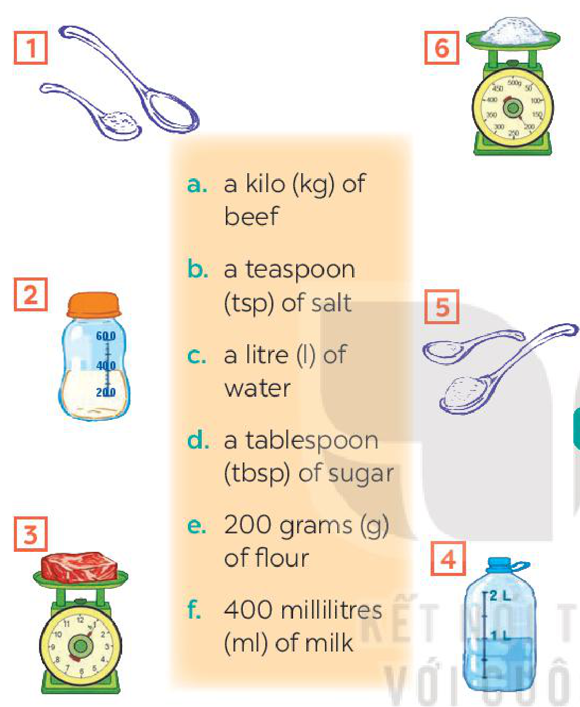
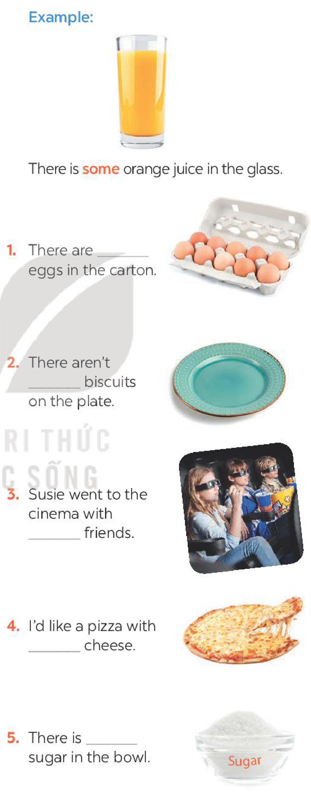
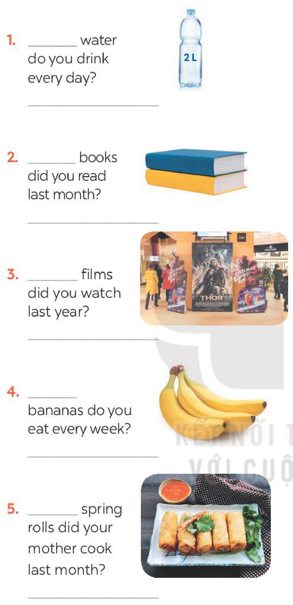

<!-- pdf:51 -->

# UNIT 5: FOOD AND DRINK

> **THIS UNIT INCLUDES:**
> - **Vocabulary:**
>   - Food and drink
> - **Pronunciation:**
>   - Sounds: /ɒ/ and /ɔː/
> - **Grammar:**
>   - *some*, *a lot of*, *lots of*
> - **Skills:**
>   - Reading about a typical traditional food
>   - Talking about a popular food or drink
>   - Listening about eating habits
>   - Writing a paragraph describing eating habits
> - **Everyday English:**
>   - Asking and answering about prices
<!-- ocr-ok: đã đối chiếu ảnh trang gốc, khung THIS UNIT INCLUDES chia hai cột và kí hiệu IPA /ɒ/, /ɔː/ -->

## GETTING STARTED

**At a Vietnamese restaurant**

**1. Listen and read.**

**Waiter:** Good evening. What can I get you today?

**Mark's mum:** We'd like rice with some **pork** cooked in fish **sauce**. Oh, could we also have an order of **roast** chicken and **fried** vegetables?

**Mark:** And I'd like some **fried** tofu and **spring rolls** too.

**Waiter:** OK. Would you like *canh chua*? It's a kind of Vietnamese **soup**. We often have it with rice.

**Mark's dad:** Let me see ... I think we'll try some *canh chua*.

**Waiter:** With **shrimp** or fish?

**Mark's dad:** With **shrimp**, please.

**Waiter:** Would you like anything to drink? We have a lot of drinks: **juice**, **lemonade**, **green tea**, **mineral water**, ...

**Mark's mum:** **Mineral water** for me, **green tea** for my husband, and **juice** for my children.

**Waiter:** What kind of **juice** would you like?

**Mark's sister:** Do you have winter melon **juice**?

**Waiter:** Let me see. Er, yes. How many cans would you like?

**Mark's sister:** One ... No, wait, two please. By the way, how much is a can of winter melon **juice**?

**Mark:** The menu says it's 10,000 dong.

**Waiter:** That's right. I'll be right back with your order.

<!-- pdf:52 -->

**2. What is Mark's family doing?**

- A. Ordering food for dinner.
- B. Preparing for their dinner.
- C. Talking about their favourite food.

**3. Find the words and phrases about food and drink in the conversation and write them in the correct columns.**

| Food | Drink |
| --- | --- |
| *pork* | *juice* |
| | |

**4. Read the conversation again and tick (✓) T (True) or F (False).**

| | T | F |
| --- | --- | --- |
| 1. Mark's family is at a Vietnamese restaurant. | | |
| 2. Mark wants **fried** tofu and **beef** for dinner. | | |
| 3. They don't order *canh chua*. | | |
| 4. Mark's mum wants **mineral water**. | | |
| 5. His mum doesn't allow her children to drink **juice** during dinner. | | |

**5. Work in pairs. Ask your partner about his or her favourite food and drink.**

**Example:**
- **A:** What's your favourite food?
- **B:** It's *pho bo* – **beef** noodle **soup**.
- **A:** When do you usually have it?
- **B:** In the morning.

<!-- pdf:53 -->

## A CLOSER LOOK 1

### Vocabulary

**1. Match the phrases with the pictures. Then listen, check, and repeat the phrases.**

- a. a kilo (kg) of **beef**
- b. a **teaspoon** (tsp) of **salt**
- c. a litre (l) of water
- d. a **tablespoon** (tbsp) of sugar
- e. 200 grams (g) of **flour**
- f. 400 millilitres (ml) of milk
<!-- ocr-ok: đã đối chiếu ảnh trang gốc, OCR bỏ sót chữ water ở mục c trong khung bài tập nối -->

**2. Write the following words and phrases in the correct columns. Add any other dishes and ingredients you know.**

- **spring rolls**
- **omelette**
- **butter**
- **onions**
- **pancakes**
- **pepper**

| Dishes | Ingredients |
| --- | --- |
| | |

**3. Work in pairs. Ask and answer about the ingredients for Linh's apple pie, using the quantities in the recipe.**

> **LINH'S APPLE PIE**
>
> **Ingredients:**
> - apples – 12
> - **salt** – 1 tsp
> - sugar – 300 g
> - milk – 300 ml
> - water – 120 ml
> - **flour** – 500 g
<!-- ocr-ok: đã đối chiếu ảnh trang gốc, khung công thức LINH'S APPLE PIE kèm ảnh minh hoạ -->

**Example:**
- **A:** How many apples do we need?
- **B:** We need 12.

### Pronunciation

**/ɒ/ and /ɔː/**

**4. Listen and repeat the words. Pay attention to the sounds /ɒ/ and /ɔː/.**
<!-- ocr-ok: đã đối chiếu ảnh trang gốc, OCR đọc nhầm kí hiệu phiên âm /ɒ/ và /ɔː/ -->

| fond | short | call | water |
| --- | --- | --- | --- |
| pork | sauce | lot | not |

**Now, in pairs write the words in the correct columns.**

| /ɒ/ | /ɔː/ |
| --- | --- |
| | |

**5. Listen and repeat, paying attention to the underlined words. Tick (✓) the sentences with the /ɒ/ sound.**
<!-- ocr-ok: đã đối chiếu ảnh trang gốc, OCR đọc nhầm kí hiệu phiên âm /ɒ/ thành /p/ -->

1. I hate <u>hot</u> <u>dogs</u>. `[ ]`
2. It's a very big <u>pot</u>. `[ ]`
3. Put the <u>forks</u> here. `[ ]`
4. This **soup** is very <u>hot</u>. `[ ]`
5. I like <u>**pork**</u> cooked with vegetables. `[ ]`
<!-- ocr-ok: đã đối chiếu ảnh trang gốc, đánh dấu gạch chân các từ bằng thẻ u làm thay đổi token so với OCR -->

<!-- pdf:54 -->

## A CLOSER LOOK 2

### Grammar

***some*, *a lot of* / *lots of***

**Remember!**

We use *some*, *a lot of*, *lots of* with both countable nouns and uncountable nouns to describe quantities.
<!-- term: some, a lot of / lots of -->

**Example:**
- I need *some* apples for this **recipe**.
- There's *some* water in the bottle.
- There are *a lot of* / *lots of* people in the room.
- She likes coffee with *a lot of* / *lots of* sugar.

**1. Circle the correct words or phrases to complete the following sentences.**

1. Minh is very popular. He has *some* / *a lot of* friends.
2. Linh is very busy. She has *some* / *lots of* homework.
3. Put *some* / *a lot of* sugar in my tea. But not too much.
4. There are *some* / *a lot of* cars in our city. Too many. I don't like it.
5. There is *some* / *lots of* rice left. Not much but just enough for our breakfast.

**2. Look at the picture and complete each sentence. Write *some*, *any* or *a lot of* / *lots of* in the blanks.**

**Example:** There is *some* orange **juice** in the glass.

1. There are \_\_\_\_\_\_\_ eggs in the carton.
2. There aren't \_\_\_\_\_\_\_ biscuits on the plate.
3. Susie went to the cinema with \_\_\_\_\_\_\_ friends.
4. I'd like a pizza with \_\_\_\_\_\_\_ cheese.
5. There is \_\_\_\_\_\_\_ sugar in the bowl.
<!-- ocr-ok: đã đối chiếu ảnh trang gốc, OCR đọc nhầm câu 3 Susie went to the cinema with friends -->

<!-- pdf:55 -->

**3. Fill in each blank with *How many* or *How much*. Answer the questions, using the pictures.**
<!-- term: How many / How much -->

1. \_\_\_\_\_\_\_ water do you drink every day? — \_\_\_\_\_\_\_
2. \_\_\_\_\_\_\_ books did you read last month? — \_\_\_\_\_\_\_
3. \_\_\_\_\_\_\_ films did you watch last year? — \_\_\_\_\_\_\_
4. \_\_\_\_\_\_\_ bananas do you eat every week? — \_\_\_\_\_\_\_
5. \_\_\_\_\_\_\_ **spring rolls** did your mother cook last month? — \_\_\_\_\_\_\_

**4. Work in pairs. Ask and answer, using the questions in 3.**

**Example:**
- **A:** How much water do you drink every day?
- **B:** Two litres.

**5. Work in groups. Take turns to ask and answer about the recipes.**

| **Pancakes** — *Ingredients:* | |
| --- | --- |
| eggs – 2 | sugar – 1 tbsp |
| **flour** – 5 tbsp | milk – 100 ml |
| **butter** – 15 g | |
<!-- ocr-ok: đã đối chiếu ảnh trang gốc, OCR bỏ sót eggs - 2 và flour - 5 tbsp trong khung nguyên liệu Pancakes -->

| **An omelette** — *Ingredients:* | |
| --- | --- |
| eggs – 3 | water – 1 tbsp |
| **butter** – 30 g | **salt** – 1 tsp |
| **pepper** – 1 tsp | |
<!-- ocr-ok: đã đối chiếu ảnh trang gốc, OCR đọc nhầm số lượng eggs - 3 thành 5 trong khung nguyên liệu An omelette -->

**Example:**
- **A:** What do we need to make **pancakes**?
- **B:** We need eggs, sugar, **flour**, milk, and **butter**.
- **A:** How many eggs do we need?
- **B:** Two.
- ...

<!-- pdf:56 -->

## COMMUNICATION

### Everyday English

**Asking and answering about prices**
<!-- ocr-ok: đã đối chiếu ảnh trang gốc, OCR đọc lỗi dòng tiêu đề Asking and answering about prices -->

**1. Listen and read the conversation. Pay attention to the questions and answers.**
<!-- term: How many / How much -->

**Mark:** How much is a bottle of **mineral water**?

**Mi:** It's 5,000 dong.

**Mark:** And how much are two kilos of apples?

**Mi:** They're 50,000 dong.

**2. Work in pairs. Take turns to ask and answer about the prices of the food and drink on the menu.**

> **LY'S RESTAURANT**
> *Breakfast Menu*
<!-- ocr-ok: đã đối chiếu ảnh trang gốc, OCR đọc nhầm tiêu đề LY'S RESTAURANT thành L's RESTAURANT -->

| Food | Price |
| --- | --- |
| bowl of **beef** noodle **soup** | 30,000 dong |
| bowl of **eel** **soup** | 35,000 dong |
| **toast** | 20,000 dong |

| Drink | Price |
| --- | --- |
| glass of milk | 9,000 dong |
| bottle of **mineral water** | 8,000 dong |
| cup of **green tea** | 5,000 dong |
<!-- ocr-ok: đã đối chiếu ảnh trang gốc, OCR bỏ sót dòng toast 20,000 dong trong thực đơn -->

**Example:**
- **A:** How much is a glass of milk?
- **B:** It's 9,000 dong.

**Your favourite food and drink**

**3. Listen to the conversation and answer the following questions.**

1. What's Nam's favourite food?
2. What's his favourite drink?
3. What foreign food does he like?
4. What food does he want to try?
5. What food can he cook?

**4. Work in groups. Interview two of your friends about their favourite food and drink. Write their answers in the table below.**

| Questions | Student 1 | Student 2 |
| --- | --- | --- |
| 1. What's your favourite food? | | |
| 2. What's your favourite drink? | | |
| 3. What food or drink do you want to try? | | |
| 4. What foreign food or drink do you like? | | |
| 5. What can you cook? | | |
<!-- ocr-ok: đã đối chiếu ảnh trang gốc, OCR đọc lỗi câu hỏi số 3 trong bảng phỏng vấn -->

**Now report your results to the class.**

**Example:** I interviewed A and B about their favourite food and drink. A's favourite food is ...

<!-- pdf:57 -->

## SKILLS 1

### Reading

**1. Work in pairs. Discuss the following questions.**

1. Is *pho* popular in your neighbourhood?
2. When can we have *pho*?
3. What are the main **ingredients** of *pho*?

**2. Read Phong's blog. Match the underlined words in the text with their meanings.**

| | |
| --- | --- |
| 1. snack | a. cooking something slowly, often in water |
| 2. taste | b. the flavour of something |
| 3. broth | c. soup made by boiling bones, meat, etc. and vegetables in water |
| 4. stewing | d. a small meal, usually eaten in a hurry |
| 5. boneless | e. without bones |
<!-- term: broth -->

> *Pho* is a special kind of traditional Vietnamese **dish**. Its main **ingredients** are rice **noodles** and slices of **beef** or chicken. It is one of the most common **dishes** you will find in Viet Nam. People enjoy *pho* at all times of the day, even for a late night <u>snack</u>. *Pho* has a very special <u>taste</u>. The rice **noodles** are made from the best kind of rice. There are two main kinds of *pho*: *pho bo* (**beef** noodle **soup**) and *pho ga* (chicken noodle **soup**). The <u>broth</u> for *pho* is made by <u>stewing</u> **beef** or chicken bones for a long time in a big pot. The meat (**beef** and chicken) served with *pho* is <u>boneless</u> and cut into thin slices ... It's really delicious!
>
> Tell me about a popular **dish** in your area!
> *Posted by Phong on Feb 22 at 5:30 p.m.*
<!-- term: snack -->
<!-- term: broth -->
<!-- term: stewing -->
<!-- term: boneless -->

**3. Read Phong's blog again and circle the correct answer A, B, or C.**

1. The text is mainly about \_\_\_\_\_\_\_.
   - A. *pho*, a popular **dish** in Viet Nam
   - B. popular **dishes** in Viet Nam
   - C. different ways to cook *pho*
2. *Pho* is made mainly with \_\_\_\_\_\_\_.
   - A. rice **noodles** and **beef** or chicken
   - B. rice, **pork**, and vegetables
   - C. fish, **shrimp**, and **noodles**
3. We enjoy *pho* \_\_\_\_\_\_\_.
   - A. only for breakfast
   - B. for lunch and dinner
   - C. at any time of the day
4. To make **noodles** for *pho*, we use \_\_\_\_\_\_\_.
   - A. a variety of sticky rice
   - B. the best kind of rice
   - C. eggs and rice **flour**
5. The broth for *pho* is made by \_\_\_\_\_\_\_.
   - A. slowly cooking **beef** or chicken bones
   - B. cooking **beef** or chicken with fish **sauce**
   - C. boiling potatoes and chicken bones for a long time

### Speaking

**4. Make notes about a popular food or drink in your area. Think about its main ingredients, how often and when you have it.**

| Food or drink | Ingredients | How often and when |
| --- | --- | --- |
| | | |

**5. Work in groups of 3 or 4. Take turns to talk about a popular food or drink in your area.**

<!-- pdf:58 -->

## SKILLS 2

### Listening

**1. Work in groups. Discuss the following questions.**

1. What time do people in your area often have breakfast, lunch, and dinner?
2. What do they often have for breakfast, lunch, and dinner?

**2. Listen to Minh talking about the eating habits in his area. Circle the food and drink you hear.**
<!-- term: eating habits -->

- **eel** **soup**
- cakes
- **green tea**
- coffee
- **toast**

**3. Listen again and tick (✓) T (True) or F (False).**

| | T | F |
| --- | --- | --- |
| 1. People in Minh's area often have four meals a day. | | |
| 2. Most of them have lunch at home. | | |
| 3. Lunch is the main meal of the day in his area. | | |
| 4. People in his neighbourhood often have rice, fresh vegetables, and seafood or meat for dinner. | | |
| 5. After dinner, they often have some fruit and **green tea**. | | |

### Writing

**4. Make notes about the eating habits in your area.**
<!-- term: eating habits -->

| | Time | Food and drink |
| --- | --- | --- |
| Breakfast | | |
| Lunch | | |
| Dinner | | |

**5. Write a paragraph of about 70 words about the eating habits in your area. Use the information in 4 to help you.**
<!-- term: eating habits -->

<!-- pdf:59 -->

## LOOKING BACK

### Vocabulary

**1. Add the words and phrases you have learnt in the correct columns.**

| Dishes | Ingredients | Units of measurement |
| --- | --- | --- |
| *pancakes* | *flour* | *gram (g)* |
| | | |
<!-- ocr-ok: đã đối chiếu ảnh trang gốc, OCR đọc lỗi tiêu đề cột Units of measurement -->

**Compare with your partner's. Who has more words and phrases? Add any that you did not write.**

**2. Read the recipe and write sentences as in the example.**

> **PETER'S OMELETTE**
>
> **Ingredients:**
> - eggs: 5
> - tomatoes: 2
> - cold water: 2 tbsp
> - **butter**: 40 g
> - **onion**: 5 g
> - **salt**: 1 tsp
> - **pepper**: 1 tsp
<!-- ocr-ok: đã đối chiếu ảnh trang gốc, khung công thức PETER'S OMELETTE kèm ảnh minh hoạ -->

**Example:**

We need two **tablespoons** of cold water.

### Grammar

**3. Complete the sentences. Write *some*, *any*, *much*, or *a lot of* / *lots of*.**

1. I have to go to the market now. There isn't \_\_\_\_\_\_\_ food for our dinner.
2. Would you like \_\_\_\_\_\_\_ sugar for your coffee?
3. There are \_\_\_\_\_\_\_ trees in our village, so the air here is very fresh.
4. I'm very busy, I have \_\_\_\_\_\_\_ things to do today.
5. We didn't have \_\_\_\_\_\_\_ **beef** left, so we had \_\_\_\_\_\_\_ fish for lunch.

**4. Make questions with *How many* / *How much* for the underlined words in the following sentences.**
<!-- term: How many / How much -->

**Example:**

Minh has <u>three</u> apples.
→ *How many apples does Minh have?*
<!-- ocr-ok: đã đối chiếu ảnh trang gốc, thẻ u đánh dấu từ gạch chân three trong ví dụ -->

1. There are <u>six</u> bottles of **juice** in the fridge.
   → \_\_\_\_\_\_\_?
2. I need <u>some</u> **butter** for my **pancakes**.
   → \_\_\_\_\_\_\_?
3. We have only <u>one</u> bottle of fish **sauce**.
   → \_\_\_\_\_\_\_?
4. We need <u>ten</u> chairs for the party.
   → \_\_\_\_\_\_\_?
5. She put <u>a lot of</u> sugar in her **lemonade**.
   → \_\_\_\_\_\_\_?
<!-- ocr-ok: đã đối chiếu ảnh trang gốc, đánh dấu gạch chân từ khóa bằng thẻ u làm thay đổi token so với OCR -->

<!-- pdf:60 -->

## PROJECT

**EATING HABITS AROUND THE WORLD**

**1. Work in groups. Design a poster about eating habits in an area or a foreign country you know, including:**
<!-- term: eating habits -->

- names of main meals and mealtimes
- names of common food / drink for each meal
- pictures or photos to illustrate the meals

**2. Then organise an exhibition of all the posters in your class. Present your poster to the class.**

### Now I can ...

- use the words related to food and drink.
- pronounce the sounds /ɒ/ and /ɔː/ correctly.
- use *some*, *a lot of*, *lots of*.
- ask and answer about prices.
- read about a typical traditional food.
- talk about a popular food or drink.
- listen about eating habits.
- write a paragraph describing eating habits.

## 📷 Danh sách hình trong bài

| Mã hình | Trang PDF | Trang sách | Chú thích / Mô tả |
| --- | --- | --- | --- |
| H7-tieng_anh-u05-01 | 53 | 52 | Khung bài tập nối 6 cụm từ chỉ định lượng nguyên liệu (*a–f*) với 6 hình minh hoạ đánh số 1–6: thìa cà phê muối, bình sữa đong ml, cân thịt bò theo kg, bình nước theo lít, thìa canh đường và cân bột mì theo gam (bài tập 1 phần A Closer Look 1) |
| H7-tieng_anh-u05-02 | 54 | 53 | Tranh minh hoạ ví dụ cốc nước cam và 5 câu bài tập điền *some*, *any*, *a lot of / lots of*: (1) vỉ trứng đầy, (2) chiếc đĩa trống không có bánh quy, (3) Susie xem phim cùng bạn bè, (4) bánh pizza nhiều phô mai, (5) bát đường (bài tập 2 phần A Closer Look 2) |
| H7-tieng_anh-u05-03 | 55 | 54 | Năm câu hỏi *How many / How much* kèm tranh gợi ý câu trả lời: (1) chai nước 2 lít, (2) hai quyển sách, (3) rạp chiếu phim với ba áp phích phim, (4) nải ba quả chuối, (5) đĩa năm chiếc nem rán (bài tập 3 phần A Closer Look 2) |
