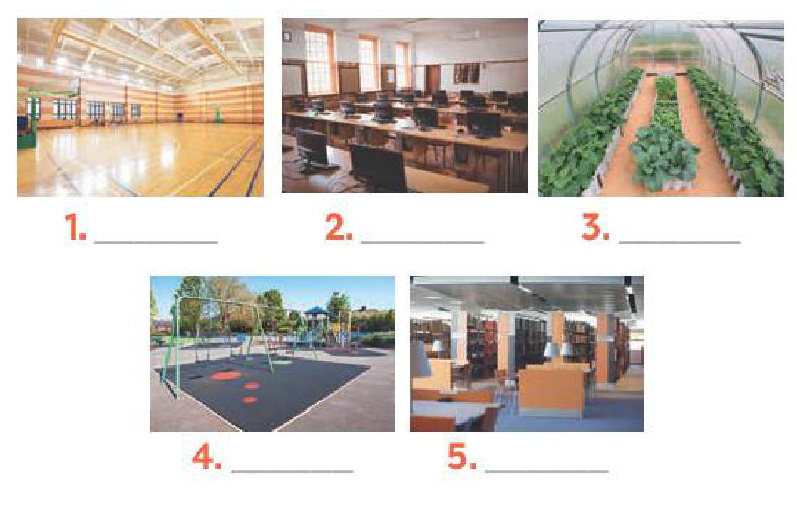
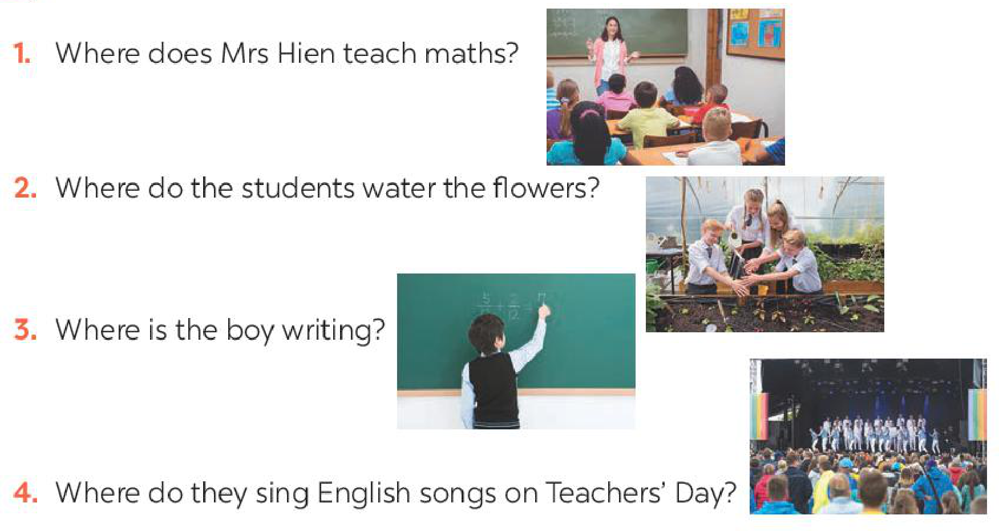
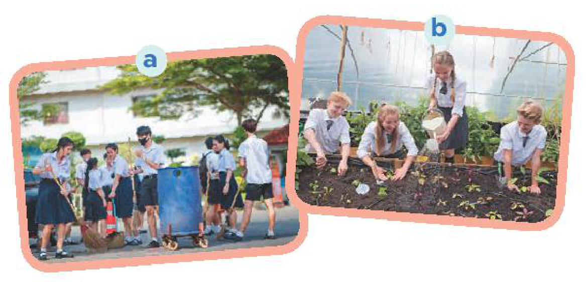

<!-- pdf:61 -->

# UNIT 6: A VISIT TO A SCHOOL

> **THIS UNIT INCLUDES:**
> - **Vocabulary:**
>   - Schools, school **facilities**, and school activities
> - **Pronunciation:**
>   - Sounds: /tʃ/ and /dʒ/
> - **Grammar:**
>   - Prepositions of time and place
> - **Skills:**
>   - Reading about a famous school
>   - Talking about one's school
>   - Listening to an interview about school activities
>   - Writing a paragraph about an **outdoor** activity at one's school
> - **Everyday English:**
>   - Asking for details
<!-- ocr-ok: đã đối chiếu ảnh trang gốc, khung THIS UNIT INCLUDES hai cột và kí hiệu IPA /tʃ/, /dʒ/ -->

## GETTING STARTED

**A visit to Binh Minh Lower Secondary School**

**1. Listen and read.**

**Phong:** What are you doing, Mi?

**Mi:** I'm preparing to visit Binh Minh **Lower Secondary School**.

**Phong:** Sounds great! I think that's one of the best schools in my neighbourhood. Who is going with you and when?

**Mi:** My teacher and my classmates. We're going in the afternoon.

**Phong:** I see. What will you do there?

**Mi:** Well, I think we'll visit the school library, the computer room, and the gym. We'll meet the students and **share** ideas for a project in our English class.
<!-- term: school library -->
<!-- term: computer room -->
<!-- term: gym -->

**Phong:** That's interesting. What else will you do there?

**Mi:** We'll meet the members of their *Go Green Club* and take photos of the school.

**Phong:** Fantastic! So don't forget to take your camera.

**Mi:** I almost forgot. Thanks for reminding me.

<!-- pdf:62 -->

**2. Read the conversation again and answer the questions by circling A, B, or C.**

1. What are they talking about?
   - A. A visit to a computer room.
   - B. A visit to a school.
   - C. A visit to a school library.
2. Who is going to visit the school?
   - A. Mi and her teacher.
   - B. Mi and her classmates.
   - C. Mi, her teacher and her classmates.
3. Where is the school?
   - A. In the city.
   - B. In the countryside.
   - C. In Phong's neighbourhood.
4. When are they going?
   - A. In the morning.
   - B. In the afternoon.
   - C. At noon.

**3. Name these places, using the words and phrases from the box.**

| computer room | school library | school garden | playground | gym |
| --- | --- | --- | --- | --- |

1. \_\_\_\_\_\_\_  2. \_\_\_\_\_\_\_  3. \_\_\_\_\_\_\_
4. \_\_\_\_\_\_\_  5. \_\_\_\_\_\_\_
<!-- ocr-ok: đã đối chiếu ảnh trang gốc, các chỗ trống đánh số 1-5 dưới 5 bức ảnh cơ sở vật chất trường học -->

**4. Complete the sentences with the words and phrases in 3.**

1. The school \_\_\_\_\_\_\_ is very small, so not many children can play in it.
2. We learn how to use the Internet in the \_\_\_\_\_\_\_ twice a week.
<!-- term: computer room -->
3. They have school meetings in the \_\_\_\_\_\_\_ when it rains.
4. There are a lot of books, magazines, and newspapers in the \_\_\_\_\_\_\_.
5. Our class usually waters the vegetables in the \_\_\_\_\_\_\_ on Friday afternoons.

**5. Work in pairs. Ask and answer questions about Nick's timetable, using *when* and *where*.**

| Subject | Time | Place |
| --- | --- | --- |
| Maths | 8 a.m. Monday, Tuesday, Friday | Classroom (room 302) |
| Biology | 9 a.m. Thursday | Science lab |
| Information Technology | 2 p.m. Wednesday | Computer room |
| Physical Education | 3 p.m. Monday, Thursday | School gym |
| History | 3:30 p.m. Tuesday | School library |
<!-- ocr-ok: đã đối chiếu ảnh trang gốc, OCR đọc nhầm room 302 thành 502 và 3 p.m. thành 5 p.m. trong thời khoá biểu -->

**Example:**
- **A:** When does Nick have maths?
- **B:** At 8 a.m. on Monday, Tuesday, and Friday.
- **A:** And where does he have it?
- **B:** In his classroom, room 302.

<!-- pdf:63 -->

## A CLOSER LOOK 1

### Vocabulary

**1. Match the words in columns A and B to form phrases. Then say them aloud.**

| A | B |
| --- | --- |
| 1. entrance | a. students |
| 2. school | b. activities |
| 3. **outdoor** | c. **facilities** |
| 4. **midterm** | d. examination |
| 5. **gifted** | e. test |

**2. Complete the sentences with the phrases in 1.**
<!-- ocr-ok: đã đối chiếu ảnh trang gốc, OCR đọc dính chữ phrasesin và ghép cột phải -->

1. Binh Minh **Lower Secondary School** is for \_\_\_\_\_\_\_ in the city.
2. Our \_\_\_\_\_\_\_ usually covers the first three units.
3. Students in my school take part in many \_\_\_\_\_\_\_ during the school year.
4. Our school has a lot of modern \_\_\_\_\_\_\_.
5. In order to study at Quoc Hoc - Hue, you have to pass a(n) \_\_\_\_\_\_\_.

**3. Work in pairs. Answer the questions about your school.**

1. Can you name some **gifted** students in your school?
2. When does the first-term test take place?
3. Do you have to take an **entrance examination** to study at your school?
4. What kind of **facilities** does your school have?
5. What types of **outdoor** activities do you like to take part in?

### Pronunciation

**/tʃ/ and /dʒ/**

**4. Listen and repeat the words. What letters can we use to make the /dʒ/ sound?**

| /tʃ/ | /dʒ/ |
| --- | --- |
| cherry | jam |
| cheaper | gym |
| children | juice |
| lunch | large |
| teacher | project |
| | intelligent |
<!-- ocr-ok: đã đối chiếu ảnh trang gốc, OCR đọc nhầm từ lunch thành hint và lỗi tiêu đề bảng /tʃ/, /dʒ/ -->

**5. Listen and repeat the chant. Pay attention to the sounds /tʃ/ and /dʒ/.**
<!-- ocr-ok: đã đối chiếu ảnh trang gốc, OCR đọc nhầm kí hiệu phiên âm /tʃ/ và /dʒ/ -->

Orange juice, orange juice,
Who likes orange juice?
Children do, children do.
Children like orange juice.

Chicken chop, chicken chop,
Who likes chicken chop?
John does, John does.
John likes chicken chop.

<!-- pdf:64 -->

## A CLOSER LOOK 2

### Grammar

**Prepositions of time: *at*, *in*, *on***
<!-- term: Prepositions of time: at, in, on -->

| at | in | on |
| --- | --- | --- |
| at six o'clock | in the morning / afternoon / evening | on Monday |
| at noon | in December | on January 18th |
| at break time | in 2020 | on Christmas Day |
<!-- term: Prepositions of time: at, in, on -->

**1. Complete the sentences, using suitable prepositions of time.**

1. In England, schools usually start \_\_\_\_\_\_\_ 9 a.m. and finish \_\_\_\_\_\_\_ 4 p.m.
2. They built our school a long time ago, maybe \_\_\_\_\_\_\_ 1990.
3. We are going to visit Thang Long **Lower Secondary School** \_\_\_\_\_\_\_ January.
4. The school year usually begins \_\_\_\_\_\_\_ September 5th every year.
5. The children like playing badminton and football \_\_\_\_\_\_\_ their break time.

**2. Work in pairs. Ask and answer the questions about your school.**

1. When does your school year start?
2. When do you have English lessons?
3. When do you usually **celebrate** Teachers' Day?
4. When are you going to finish the school year?

**Prepositions of place: *at*, *in*, *on***
<!-- term: Prepositions of place: at, in, on -->

| at | in | on |
| --- | --- | --- |
| at home | in the classroom | on the board |
| at school | in the school garden | on the wall |
| at work | in the playground | on the second floor |
<!-- term: Prepositions of place: at, in, on -->
<!-- term: school garden -->

**3. Complete the sentences with *at*, *in*, or *on*.**

1. Her classroom is \_\_\_\_\_\_\_ the third floor of that building.
2. When I'm at school, my parents are \_\_\_\_\_\_\_ work.
3. Look! The students are playing football \_\_\_\_\_\_\_ the classroom.
4. My little sister usually has lunch \_\_\_\_\_\_\_ school.
5. The most beautiful posters are \_\_\_\_\_\_\_ the wall \_\_\_\_\_\_\_ the staffroom.

<!-- pdf:65 -->

**4. Work in pairs. Look at the pictures and answer the questions.**

1. Where does Mrs Hien teach maths?
2. Where do the students water the flowers?
3. Where is the boy writing?
4. Where do they sing English songs on Teachers' Day?

**5. Complete the passage with *at*, *on*, or *in*. Then discuss in groups which prepositions express time and which ones express place.**

Tom's mother is at home, but she is not (1) \_\_\_\_\_\_\_ the kitchen. She usually waters the vegetables in the garden (2) \_\_\_\_\_\_\_ the morning.

Tom's father is (3) \_\_\_\_\_\_\_ work, but he isn't in his office at the moment. It is his lunch break and he is (4) \_\_\_\_\_\_\_ a travel agent's, looking at holiday brochures.

Tom is usually at school at this time, but he has a bad cold today. He has nothing to do but lying (5) \_\_\_\_\_\_\_ the sofa and looking at the posters (6) \_\_\_\_\_\_\_ the wall.

## COMMUNICATION

### Everyday English

**Asking for details**

**1. Listen and read the conversation. Pay attention to the highlighted sentence.**

**Mi:** Are you doing anything this Sunday?

**Tom:** Not really.

**Mi:** Would you like to go with us to Binh Minh **Lower Secondary School**?

**Tom:** Sounds great! *Can you tell me more?*
<!-- term: Can you tell me more? -->

**Mi:** We'll leave at 7 a.m. My friends David and Nick are coming too.

**2. Work in pairs. Ask and answer questions about your visit to a famous school. Use *"Can you tell me more?"* or *"Can you tell me why?"*, *"Can you tell me how?"*.**
<!-- term: Can you tell me more? -->

<!-- pdf:66 -->

**Welcome to our school!**

**3. Imagine that some overseas friends are planning to visit your school. Make a list of what you want to show them, then fill in the note.**

> *the school library*
> \_\_\_\_\_\_\_

**Work in pairs. Ask and answer questions about your plan.**

**Example:**
- **A:** I'm going to show them the school library.
- **B:** Sounds good. Can you tell me why?
- **A:** I want them to see our learning **resources**. I think they're very modern.
<!-- term: school library -->

**4. Work in groups. Read the passage and complete the table about a high school in the UK. Then discuss and fill in the information about your school.**

Wilson High School is for students aged 11 – 16 in London. It has about 1,000 students and 100 teachers. The school has some modern science **laboratories**, computer rooms, a large library, a sports hall, and an activity studio.
<!-- term: computer room -->

The students study many different subjects such as English, literature, maths, science, etc. They also study **extra** subjects and get involved in projects, use school **resources** and take part in a number of **outdoor** activities and school trips.

| | Wilson High School | Your school |
| --- | --- | --- |
| Number of students & teachers | | |
| Subjects | | |
| School **facilities** | | |

**Example:**

There are about 1,000 students in Wilson High School. They are between 11 and 16 years old.

Our school has about 900 students. We are between 11 and 14 years old.

<!-- pdf:67 -->

## SKILLS 1

### Reading

**1. Look at the pictures and answer the questions.**

1. What can you see in the pictures?
2. What do you know about them?

**2. Read the passage and answer the questions.**

Quoc Hoc - Hue is one of the oldest schools in Viet Nam. It is on the bank of the Huong River, in Hue. It was founded in 1896. It used to be a school for children from rich and **royal** families. **Well-known** people such as Ho Chi Minh, Vo Nguyen Giap, Xuan Dieu studied there.

Nowadays, the school is for **gifted** students. They are intelligent and study hard. They have to pass an **entrance exam** to enter the school. The school has over 50 classrooms with TVs, **projectors**, and computers. It also has a swimming pool, a library, two English labs, four computer rooms, and many other modern **facilities**. The school is one of the largest and most beautiful schools in Viet Nam.

1. Where is Quoc Hoc - Hue?
2. Who were some of the **well-known** students of the school?
3. What are the students like?
4. How many English labs does it have?

**3. Read the passage again and complete the table. Then report it to the class.**

| Name | *Quoc Hoc - Hue* |
| --- | --- |
| Location | |
| Students | |
| School **facilities** | |

**Example:**

The name of the school is Quoc Hoc - Hue.

### Speaking

**4. Work in pairs. Answer the questions with the information in the table.**

1. What's the full name of the school?
2. Where is it?
3. What are the students like?
4. What **facilities** does the school have?

| | |
| --- | --- |
| Name | Hung Vuong **Lower Secondary School** |
| Location | 120, Hung Vuong Street |
| Students | hard-working and intelligent |
| School **facilities** | 20 classrooms, one library, two computer rooms, one gym, one garden |

**5. Work in groups. Tell about your school. You can use the suggestions in 4 (full name, location, students, and school facilities).**

**Example:**

I'd like to talk about my school ...

<!-- pdf:68 -->

## SKILLS 2

### Listening

**1. Work in pairs. Look at the pictures and discuss the following questions.**

1. What **outdoor** activities do they take part in?
2. Why do they do these activities?

**2. Listen to an interview between a reporter and two students. Circle the appropriate option (A, B, or C) to complete each sentence.**

1. Trang and Phong are talking about \_\_\_\_\_\_\_.
   - A. school subjects
   - B. school timetables
   - C. **outdoor** activities
2. They are members of \_\_\_\_\_\_\_ club(s).
   - A. one
   - B. two
   - C. three
3. The *Go Green Club* cleans streets on \_\_\_\_\_\_\_.
   - A. Saturday afternoons
   - B. Saturday mornings
   - C. Sunday afternoons
4. They grow \_\_\_\_\_\_\_ in the school garden.
   - A. vegetables
   - B. flowers
   - C. trees
<!-- term: school garden -->

**3. Listen to the interview again and answer the questions.**

1. What do Trang's club members encourage their classmates to do?
2. What does the reporter think about the activities of Trang's club members?
3. When and where do Phong's club members grow vegetables?

### Writing

**4. Work in pairs. Ask and answer questions about your school's outdoor activities.**

1. What **outdoor** activities do you take part in at school?
2. Which **outdoor** activity do you like the best?
3. Why do you like doing it?

**5. Write a paragraph of about 70 words about an outdoor activity at your school. You can use the information in 4.**

<!-- pdf:69 -->

## LOOKING BACK

### Vocabulary

**1. Find the words and phrases from this unit that match these definitions.**

1. known by many people — \_\_\_\_\_\_\_
2. buildings, **services**, **equipment**, etc. at a school — \_\_\_\_\_\_\_
3. an exam taken to enter a school — \_\_\_\_\_\_\_
4. intelligent and / or **talented** students — \_\_\_\_\_\_\_
5. **extra** activities that students do at school — \_\_\_\_\_\_\_

**2. Complete the sentences with the words and phrases in 1.**

1. The school is free for \_\_\_\_\_\_\_ who pass some exams.
2. The students in the school find \_\_\_\_\_\_\_ useful and enjoyable.
3. Chu Van An **Lower Secondary School** is famous for its intelligent students and modern \_\_\_\_\_\_\_.
4. Students have to pass \_\_\_\_\_\_\_ to attend that school.
5. The most \_\_\_\_\_\_\_ teacher of Van Mieu – Quoc Tu Giam was Chu Van An.

### Grammar

**3. Complete the sentences with appropriate prepositions of place or time.**

1. The members of the club clean the school playground \_\_\_\_\_\_\_ Saturday mornings.
<!-- term: playground -->
2. The students have to sit for the final exam \_\_\_\_\_\_\_ June.
3. Chu Van An **Lower Secondary School** is one of the most famous schools \_\_\_\_\_\_\_ Ha Noi.
4. The school canteen is \_\_\_\_\_\_\_ the second floor.
5. Which subjects do you like to study \_\_\_\_\_\_\_ school?

**4. Read the passage and fill in the gaps with prepositions of time or place.**

Tom is a student (1) \_\_\_\_\_\_\_ a **private** school in the suburbs of Manchester. He lives with his parents (2) \_\_\_\_\_\_\_ a small house near his school. He usually studies at school (3) \_\_\_\_\_\_\_ the mornings. (4) \_\_\_\_\_\_\_ Monday and Thursday afternoons, he joins different **outdoor** activities with his schoolmates. He sings (5) \_\_\_\_\_\_\_ the *Little Bees' Club* on Tuesdays and Fridays. He goes to the cinema with his friends (6) \_\_\_\_\_\_\_ the weekend. He finds his studies and **outdoor** activities enjoyable.

<!-- pdf:70 -->

## PROJECT

**MY FAVOURITE SCHOOL**
<!-- ocr-ok: đã đối chiếu ảnh trang gốc, tiêu đề chữ cách điệu màu cam trên nền xanh phần Project -->

**1. Search for a school you would like to study at. Then find information about that school to complete the table.**

| | |
| --- | --- |
| Name of the school | |
| Location | |
| Subjects at school | |
| School **facilities** | |
| **Outdoor** activities | |

**2. Look at the table and tell the class about that school.**

### Now I can ...

- use the words related to schools, school **facilities**, and school activities.
- pronounce the sounds /tʃ/ and /dʒ/ correctly.
- use prepositions of time and place.
- ask for details.
- read about a famous school.
- talk about my school.
- listen to an interview about school activities.
- write a paragraph about an **outdoor** activity at my school.

## 📷 Danh sách hình trong bài

| Mã hình | Trang PDF | Trang sách | Chú thích / Mô tả |
| --- | --- | --- | --- |
| H7-tieng_anh-u06-01 | 62 | 61 | Năm bức ảnh cơ sở vật chất trường học đánh số 1–5: (1) phòng tập thể chất, (2) phòng máy tính, (3) vườn trường, (4) sân chơi, (5) thư viện trường (bài tập 3 phần Getting Started) |
| H7-tieng_anh-u06-02 | 65 | 64 | Bốn câu hỏi về địa điểm kèm 4 bức ảnh minh hoạ: (1) cô Hiền dạy Toán trong lớp học, (2) học sinh tưới hoa ở vườn trường, (3) bạn nam viết bài trên bảng, (4) học sinh hát trên sân khấu ngày Nhà giáo (bài tập 4 phần A Closer Look 2) |
| H7-tieng_anh-u06-03 | 68 | 67 | Hai bức ảnh hoạt động ngoài trời đánh dấu *a* (học sinh quét dọn vệ sinh đường phố) và *b* (học sinh chăm sóc vườn rau của trường) (bài tập 1 phần Skills 2 – Listening) |
