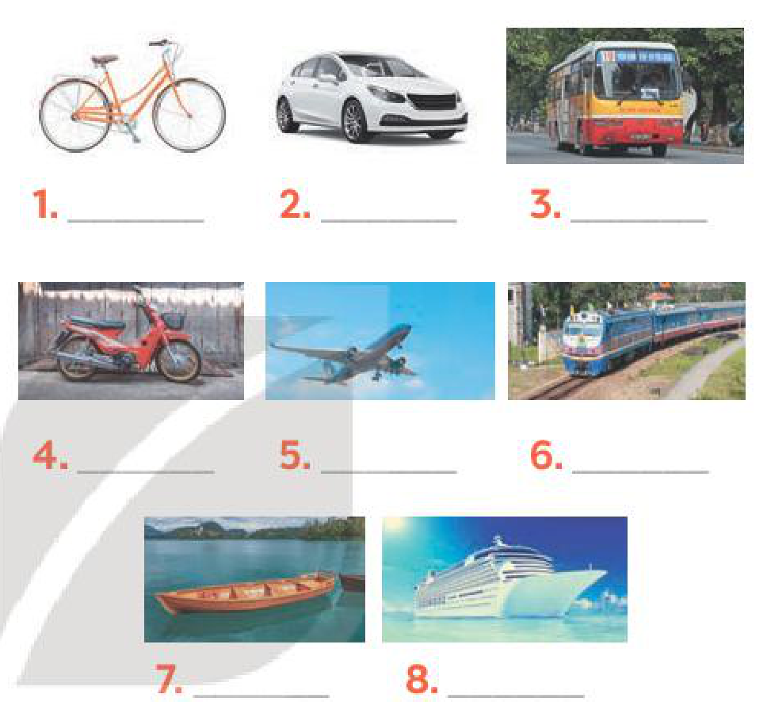
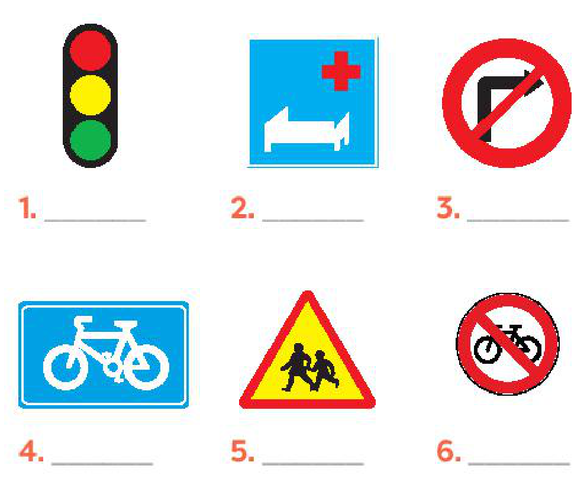
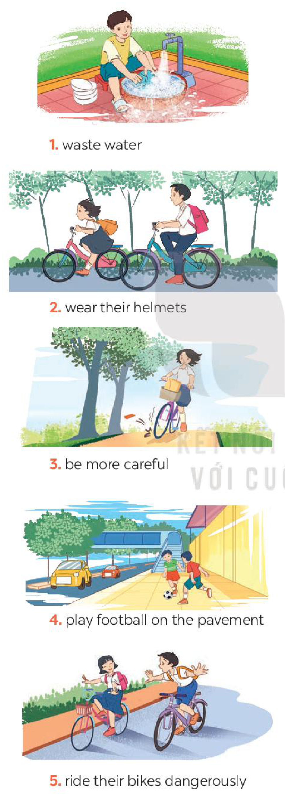
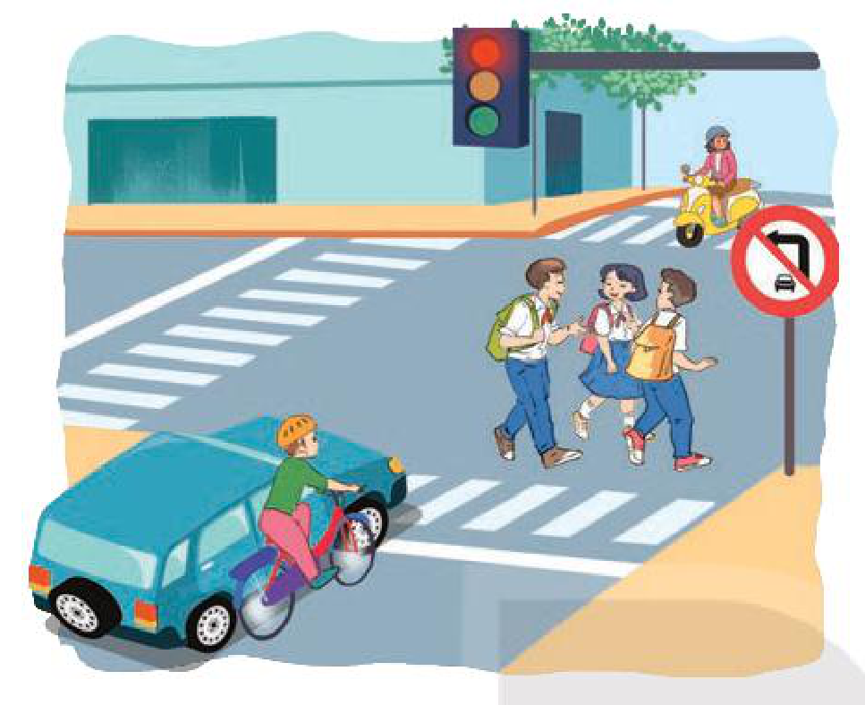
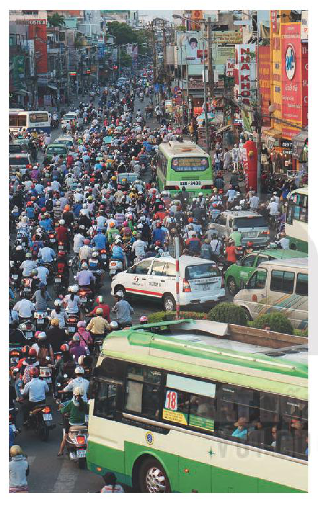
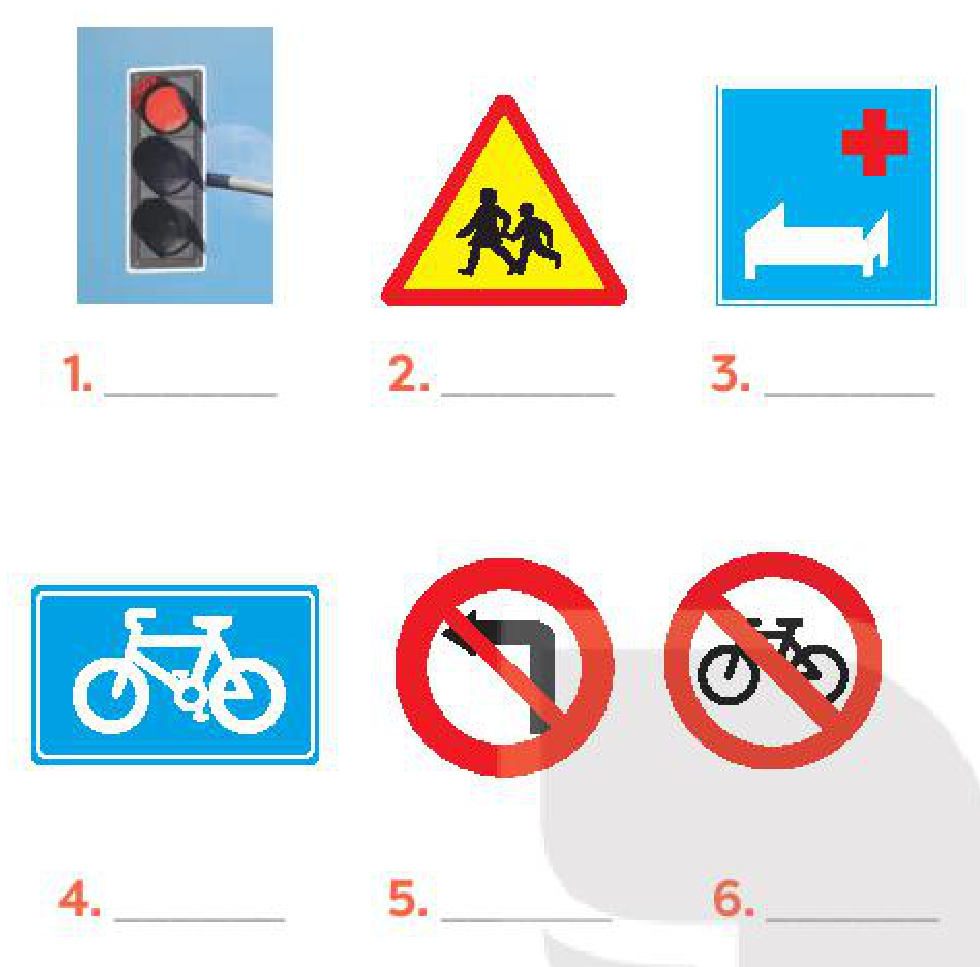

<!-- pdf:73 -->

# UNIT 7: TRAFFIC

> **THIS UNIT INCLUDES:**
> - **Vocabulary:**
>   - Means of transport
>   - Road signs
> - **Pronunciation:**
>   - Sounds: /aɪ/ and /eɪ/
> - **Grammar:**
>   - *It* indicating **distance**
>   - *Should / shouldn't*
> - **Skills:**
>   - Reading about traffic rules
>   - Talking about obeying traffic rules
>   - Listening about traffic problems in Mumbai
>   - Writing a paragraph about traffic problems
> - **Everyday English:**
>   - Asking and answering questions about means of transport
<!-- ocr-ok: đã đối chiếu ảnh trang gốc, khung giới thiệu bài hai cột bị OCR trộn dòng và đọc lỗi kí hiệu phiên âm -->

## GETTING STARTED

**Meeting in the schoolyard**

**1. Listen and read.**

**Lan:** Hi, Mark. How are you?

**Mark:** Good, thanks. And you? What did you do last Sunday?

**Lan:** I'm fine. Last Sunday afternoon, I cycled round the lake near my home.

**Mark:** That sounds really healthy. By the way, do you often cycle to school too?

**Lan:** Yes, but sometimes my mum takes me on her motorbike.

**Mark:** How far is it from your home to school?

**Lan:** It's about two kilometres.

**Mark:** How long does it take you to cycle there?

**Lan:** About 10 minutes. Sometimes, when there are traffic jams, it takes longer.

**Mark:** You should be careful, especially when you cross the road.

**Lan:** Right. The roads get really crowded.

**Mark:** Hey, how about going cycling round the lake this Sunday?

**Lan:** Great! Can you come to my house at 3 p.m.?
<!-- ocr-ok: đã đối chiếu ảnh trang gốc, OCR đọc dính chữ at3p.m.? -->

**Mark:** OK, Lan. See you then.

<!-- pdf:74 -->

**2. Read the conversation again and choose the correct answer.**

1. How does Lan often go to school?
   A. By bicycle. | B. By motorbike. | C. On foot.
2. It normally takes Lan \_\_\_\_\_\_\_ to get to school.
   A. two minutes | B. ten minutes | C. twenty minutes
3. Lan and Mark agree to go cycling \_\_\_\_\_\_\_.
   A. tomorrow | B. every day | C. at the weekend

**3. Write one word from the conversation to complete each sentence.**

1. Last Sunday afternoon, Lan \_\_\_\_\_\_\_ round the lake near her home.
2. Mark says to Lan: "You \_\_\_\_\_\_\_ be careful, especially when you cross the road."
3. Traffic \_\_\_\_\_\_\_ are a problem in big cities.
4. – \_\_\_\_\_\_\_ does your mum go shopping?
   – She often walks.
5. This road is very \_\_\_\_\_\_\_ during the rush hours.
<!-- term: rush hours -->

**4. Look at the pictures and write a word under each.**

1. \_\_\_\_\_\_\_
2. \_\_\_\_\_\_\_
3. \_\_\_\_\_\_\_
4. \_\_\_\_\_\_\_
5. \_\_\_\_\_\_\_
6. \_\_\_\_\_\_\_
7. \_\_\_\_\_\_\_
8. \_\_\_\_\_\_\_
<!-- ocr-ok: đã đối chiếu ảnh trang gốc, các chỗ trống đánh số 1–8 dưới 8 hình phương tiện giao thông -->

**5. GAME: Find someone who ...**
<!-- ocr-ok: đã đối chiếu ảnh trang gốc, chữ GAME nằm trong các ô vuông màu -->

**Write your friends' names in the blanks. Then report to the class.**

*Find someone in your class who ...*

| | |
| --- | --- |
| usually walks to school | \_\_\_\_\_\_\_ |
| never goes to school by bus | \_\_\_\_\_\_\_ |
| cycles for exercise every day | \_\_\_\_\_\_\_ |
| never travels by **plane** | \_\_\_\_\_\_\_ |
| sometimes goes to school in a car | \_\_\_\_\_\_\_ |

**Example:**
- **A:** Do you usually walk to school?
- **B:** Yes, I do. / No, I don't.

<!-- pdf:75 -->

## A CLOSER LOOK 1

### Vocabulary

**1. Match the words in A with the phrases in B.**

| A | B |
| --- | --- |
| 1. ride | a. a car |
| 2. drive | b. a boat |
| 3. sail | c. a bike |
| 4. go | d. by air |
| 5. travel | e. on foot |
<!-- ocr-ok: đã đối chiếu ảnh trang gốc, OCR đọc lỗi dòng 4 (go / d. by air) trong bảng nối A–B -->

**Make your own sentences with these phrases. Then tell your partner.**

**Example:** 1. c (ride a bike)
My father taught me how to ride a bike.

**2. Look at these road signs. Then write the correct phrases under the signs.**

| | |
| --- | --- |
| No right turn | Traffic lights |
| Cycle **lane** | No cycling |
| School ahead | Hospital ahead |

1. \_\_\_\_\_\_\_
2. \_\_\_\_\_\_\_
3. \_\_\_\_\_\_\_
4. \_\_\_\_\_\_\_
5. \_\_\_\_\_\_\_
6. \_\_\_\_\_\_\_
<!-- ocr-ok: đã đối chiếu ảnh trang gốc, các chỗ trống đánh số 1–6 dưới 6 biển báo giao thông -->

**3. Work in pairs. Take turns to say which of the signs in 2 you see on the way to school.**

**Example:**

**A:** On the way to school, there are crossroads, so I see several traffic lights.
<!-- term: crossroads -->
<!-- term: traffic lights -->

**B:** On my way to school, there is a hospital, so I see a 'hospital ahead' sign.

### Pronunciation

**/aɪ/ and /eɪ/**

**4. Listen and repeat. Pay attention to the sounds /aɪ/ and /eɪ/.**
<!-- ocr-ok: đã đối chiếu ảnh trang gốc, OCR đọc nhầm kí hiệu phiên âm /aɪ/ và /eɪ/ -->

| /aɪ/ | /eɪ/ |
| --- | --- |
| cycle | sail |
| **fly** | train |
| **fine** | **plane** |
| sign | station |
| motorbike | **pavement** |
<!-- ocr-ok: đã đối chiếu ảnh trang gốc, OCR đọc lỗi dòng sign trong bảng phát âm /aɪ/ và /eɪ/ -->

**5. Underline the words with the sound /aɪ/ and circle the words with the sound /eɪ/. Then listen, check and repeat.**

1. The bus station is far from my house.
2. Remember to ride your bike carefully.
3. We must **obey traffic rules** for our **safety**.
4. You have to get there in time for the train.
5. Don't ride on the **pavement**.

<!-- pdf:76 -->

## A CLOSER LOOK 2

### Grammar

*It indicating distance*

We can use *It* in the position of the subject to indicate **distance**.
<!-- term: It indicating distance -->

**Example:**
*It* is about 300 metres from my house to the bus stop.

**1. Write sentences with It. Use these cues.**

**Example:**
500 metres / my house / nearest shop.
→ It is about 500 metres from my house to the nearest shop.

1. 700 metres / my flat / Youth Club.
2. 5 kilometres (km) / my village / nearest town.
3. about 120 km / Ho Chi Minh City / Vung Tau.
4. 384,400 km / the Earth / the Moon.
5. not very far / Ha Noi centre / Noi Bai Airport.

**2. Work in pairs. Ask and answer questions about distances in your neighbourhood.**

**Example:**
- **A:** How far is it from your home to the gym?
- **B:** It's about 3 kilometres.

**You can use these cues:**
- your home – open market / supermarket
- your home – playground
- your home – hospital
- your home – train station
- ...

*Should / shouldn't*

**3. Choose the correct option in brackets.**

1. That's an interesting book. You (should / shouldn't) read it.
2. You nearly fell off your bike! You really (should / shouldn't) be more careful.
3. We (should / shouldn't) go swimming right after eating.
4. I think that he (should / shouldn't) eat less. He's becoming overweight.
5. There are a lot of cars out today. He (should / shouldn't) drive so fast.

**Remember!**

We use *should* (negative: *shouldn't*):
- to give advice.
  **Example:** You *shouldn't* go out late at night.
- to say what is the correct or best thing to do.
  **Example:** We *should* go now, or we might get stuck in a **traffic jam**.
<!-- term: should / shouldn't -->

**4. Complete each sentence, using should / shouldn't.**

1. We \_\_\_\_\_\_\_ ride our motorbikes very fast in the rain.
2. You \_\_\_\_\_\_\_ study instead of watching YouTube.
3. My little sister \_\_\_\_\_\_\_ play outside late at night.
4. You \_\_\_\_\_\_\_ help your mum wash the dishes after dinner.
5. You look tired. You \_\_\_\_\_\_\_ probably get some sleep.
6. The children \_\_\_\_\_\_\_ eat so much ice cream.

<!-- pdf:77 -->

**5. Look at the pictures. Make sentences, using should / shouldn't and the cues.**

1. waste water
2. wear their helmets
3. be more careful
4. play football on the **pavement**
5. ride their bikes dangerously
<!-- ocr-ok: đã đối chiếu ảnh trang gốc, OCR bỏ sót các gợi ý 1–4 dưới từng tranh minh hoạ -->

## COMMUNICATION

### Everyday English

**Asking and answering about means of transport**

**1. Listen and read the conversation, paying attention to the highlighted parts.**

**Nick:** *How* does your mum get to work?

**Minh:** She goes *by motorbike*. What about your mum?

**Nick:** She usually goes *by bus*. Sometimes she *cycles*.

**2. Work in pairs. Take turns to ask and answer about the means of transport your family members use every day.**
<!-- term: means of transport -->

**Strange traffic rules!**

**3. When you go on the road, which side do you keep, to the right or to the left?**

**Which countries below keep to the left? Tick (✓) the correct answers.**

- [ ] 1. The United Kingdom
- [ ] 2. The United States of America
- [ ] 3. Australia
- [ ] 4. Thailand
- [ ] 5. China

<!-- pdf:78 -->

**4. Listen and check your answers in 3. Then listen again and complete the sentence with no more than THREE words.**

One explanation is that some countries use \_\_\_\_\_\_\_ as the UK.
<!-- ocr-ok: đã đối chiếu ảnh trang gốc, OCR đọc dính chữ use__astheUK -->

**5. Read the strange driving rules below.**

1. In Alaska, you are not allowed to drive with a dog on the **roof** of your car.
2. In Moscow, police will **fine** you if you drive a dirty car.
3. A man has to wear a shirt or T-shirt while driving in Thailand.
4. In South Africa, you have to let animals go first.
5. In Switzerland, you can't wash your car on Sunday.
6. In Wisconsin, USA, you must always ride your bike with both hands on the **handlebars**.

**Work in groups. Which one do you think is the strangest?**

**Do you know any other strange traffic rules?**

<!-- pdf:79 -->

## SKILLS 1

### Reading

**1. Look at the picture. Can you see anything that is dangerous?**

**2. Read the following text and choose the correct answer.**

This text is about \_\_\_\_\_\_\_.
- A. rules for pedestrians
- B. traffic lights
- C. traffic rules

These are some rules about road **safety**. It is important to obey these rules when you are a road user.

**Pedestrians**
1. Always look carefully when you cross the street.
2. Use the **pavement** or footpath.
3. Walk across the street at the **zebra crossing**.
4. Don't cross the road on a red light.

**Cyclists**
1. Always keep both hands on the **handlebars**.
2. Wear helmets, and always use the cycle **lane**.
<!-- term: cycle lane -->
3. Give a **signal** before you turn.
4. Don't carry more than one **passenger**.

**Passengers**
1. Fasten your **seatbelt** when you are in a car.
2. Wait for buses to fully stop before getting on or off.
3. Don't talk to the driver when he / she is driving.
4. Don't stick any body parts out of the window of a moving **vehicle**.

**3. Read the text again and answer the questions.**

1. Where should pedestrians cross the street?
2. Which **lane** should you use when riding a bike?
3. What should you do before you turn while riding a bike?
4. What must you do when you get on or off a bus?
5. What mustn't you do when you are in a moving **vehicle**?

### Speaking

**4. Work in groups. Ask and answer the following question.**

When you are a road user, what should you NOT do?

**Make a list in groups. Compare your list with other groups'.**

**5. Read the following sentences about these people. Then work in groups. Discuss who is being safe, and who isn't.**

1. Hoang is riding a bike, and he is wearing a helmet.
2. It is raining hard, but Mr Long is driving quickly.
3. The students are standing in a line to get on the school bus.
4. Mr Binh is taking his daughter to school on his motorbike. She is sitting in front of him.
5. Michelle is cycling to school and she is waving and shouting to her friends.
<!-- ocr-ok: đã đối chiếu ảnh trang gốc, câu 1 in rõ he is wearing a helmet (OCR đọc nhầm thành hes) -->
<!-- term: helmet -->

<!-- pdf:80 -->

## SKILLS 2

### Listening

**1. What can you see in this picture? What is special about it?**
<!-- ocr-ok: đã đối chiếu ảnh trang gốc, OCR đọc dính chữ canyou seein -->

**2. Listen to the recording and choose the correct answer A, B, or C.**

The talk is about \_\_\_\_\_\_\_.
- A. traffic in big cities
- B. the population increase in Mumbai
- C. the traffic problems in Mumbai

**3. Listen again and write ONE word or number in each gap.**

1. Traffic \_\_\_\_\_\_\_ happen nearly every day in Mumbai.
2. One reason for the traffic \_\_\_\_\_\_\_ is the increase of the population.
3. Mumbai has nearly \_\_\_\_\_\_\_ million people.
4. The \_\_\_\_\_\_\_ in Mumbai are narrow.
5. Many road users do not \_\_\_\_\_\_\_ the traffic rules.

### Writing

**4. Tick (✓) the traffic problems in big cities in Viet Nam.**

- [ ] too many vehicles on the road
- [ ] narrow and **bumpy** roads
- [ ] some people not obeying traffic rules
- [ ] young children riding their bikes dangerously
- [ ] wild animals running across the road

**5. Write a paragraph of about 70 words about the traffic problems in your town / city. Use the cues above, and the following outline:**

- Introduction
- Problem 1:
- Problem 2:
- ...
- Conclusion: reason or suggestion

<!-- pdf:81 -->

## LOOKING BACK

### Vocabulary

**1. Label each sign.**

1. \_\_\_\_\_\_\_
2. \_\_\_\_\_\_\_
3. \_\_\_\_\_\_\_
4. \_\_\_\_\_\_\_
5. \_\_\_\_\_\_\_
6. \_\_\_\_\_\_\_
<!-- ocr-ok: đã đối chiếu ảnh trang gốc, các chỗ trống đánh số 1–6 dưới 6 biển báo giao thông -->

**Work in pairs. What does each sign tell us to do?**

**Example:**
1. A "red light" sign means you have to stop.

**2. Fill in each gap with one word to complete the sentences.**

1. A road \_\_\_\_\_\_\_ is anyone who uses a road, such as a **pedestrian**, cyclist or motorist.
2. Does your dad \_\_\_\_\_\_\_ his motorbike carefully?
3. A \_\_\_\_\_\_\_ is a person travelling in a car, bus, train, ... but not driving.
4. My cousin wants to become a pilot. He is learning to \_\_\_\_\_\_\_ planes.
5. We should be careful when the \_\_\_\_\_\_\_ light turns yellow.

### Grammar

**3. Write complete sentences, using these cues.**

1. over 100 km / my home town / Ho Chi Minh City.
2. about 25 km / here / my grandparents' house.
3. not very far / our school / the city museum.
4. how far / your house / the gym?
5. it / a long **distance** / Ha Noi / Ban Gioc Waterfall?

**4. Choose A, B, or C to complete the sentences.**

1. You \_\_\_\_\_\_\_ put the rubbish in the waste bins over there.
   A. should | B. would | C. shouldn't
2. You \_\_\_\_\_\_\_ be over eighteen to ride a motorbike.
   A. would | B. must | C. could
3. Children \_\_\_\_\_\_\_ ride their bikes too fast.
   A. mightn't | B. wouldn't | C. shouldn't
4. I am a bit lost. \_\_\_\_\_\_\_ you help me, please?
   A. Could | B. Should | C. Might
5. You \_\_\_\_\_\_\_ eat so many cookies. Too much sugar is bad for you.
   A. couldn't | B. wouldn't | C. shouldn't
6. This is a big park. You \_\_\_\_\_\_\_ run or cycle here.
   A. should | B. can | C. could

<!-- pdf:82 -->

## PROJECT

**TRAFFIC SIGNS**

**Work in groups.**

**1. Find four traffic signs in your neighbourhood. Take pictures of them, or draw them.**

**2. Make one of these traffic signs out of cardboard or other materials.**

**3. Show it to the class and say:**

- where you saw it.
- what it is.
- what it tells people to do / not to do, warns people about, or gives information about.

### Now I can ...

- use the words related to the topic *Traffic*.
- pronounce the sounds /aɪ/ and /eɪ/ correctly.
- use *it* to indicate **distance**.
- use *should / shouldn't*.
- ask and answer questions about means of transport.
- read about traffic rules.
- talk about obeying traffic rules.
- listen about traffic problems in a city.
- write a paragraph about traffic problems.

## 📷 Danh sách hình trong bài

| Mã hình | Trang PDF | Trang sách | Chú thích / Mô tả |
| --- | --- | --- | --- |
| H7-tieng_anh-u07-01 | 74 | 73 | Bộ 8 hình ảnh phương tiện giao thông đánh số 1–8 ở bài tập 4 phần Getting Started: xe đạp, ô tô, xe buýt, xe máy, máy bay, tàu hoả, thuyền chèo, tàu thuỷ |
| H7-tieng_anh-u07-02 | 75 | 74 | Bộ 6 biển báo giao thông đánh số 1–6 ở bài tập 2 phần A Closer Look 1 – Vocabulary: đèn tín hiệu giao thông, bệnh viện phía trước, cấm rẽ phải, làn đường dành cho xe đạp, trường học phía trước, cấm đi xe đạp |
| H7-tieng_anh-u07-03 | 77 | 76 | Bộ 5 tranh tình huống kèm gợi ý 1–5 ở bài tập 5 phần A Closer Look 2 – Grammar để đặt câu với *should / shouldn't*: lãng phí nước, đội mũ bảo hiểm, cẩn thận hơn, đá bóng trên vỉa hè, đạp xe nguy hiểm |
| H7-tieng_anh-u07-04 | 79 | 78 | Tranh minh hoạ ngã tư giao thông với các tình huống nguy hiểm ở bài tập 1 phần Skills 1 – Reading |
| H7-tieng_anh-u07-05 | 80 | 79 | Ảnh chụp cảnh ùn tắc giao thông đông đúc trên đường phố ở bài tập 1 phần Skills 2 – Listening |
| H7-tieng_anh-u07-06 | 81 | 80 | Bộ 6 biển báo giao thông đánh số 1–6 ở bài tập 1 phần Looking Back – Vocabulary: đèn đỏ, trường học phía trước, bệnh viện phía trước, làn đường dành cho xe đạp, cấm rẽ trái, cấm đi xe đạp |
