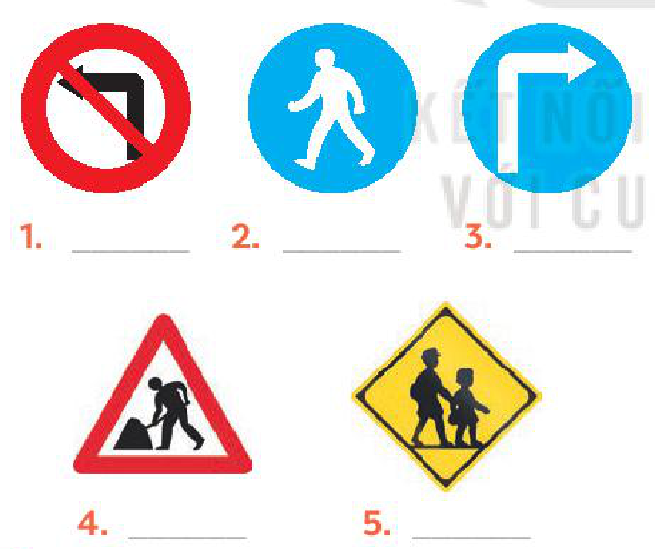

<!-- pdf:103 -->

# REVIEW 3

**(UNITS 7 – 8 – 9)**

## LANGUAGE

### Pronunciation

**1. a. Choose the word in which the underlined part is pronounced differently.**

1. A. c*a*reful | B. p*a*tient | C. par*a*de
2. A. ton*i*ght | B. t*i*me | C. favour*i*te
3. A. f*ea*ture | B. cl*ea*r | C. app*ea*r
<!-- ocr-ok: đã đối chiếu ảnh trang gốc, phần gạch chân các âm trong bài tập phát âm được biểu diễn bằng in nghiêng -->

**b. Choose the word which has a different stress pattern from that of the others.**

4. A. helmet | B. transport | C. believe
5. A. enjoy | B. boring | C. arrive

### Vocabulary

**2. Write the phrases from the box under the road signs.**

| Walking only | Road work |
| --- | --- |
| School ahead | No left turn |
| Turn right ahead | |

1. \_\_\_\_\_\_\_
2. \_\_\_\_\_\_\_
3. \_\_\_\_\_\_\_
4. \_\_\_\_\_\_\_
5. \_\_\_\_\_\_\_
<!-- ocr-ok: đã đối chiếu ảnh trang gốc, các chỗ trống đánh số 1–5 dưới 5 biển báo giao thông -->

**3. Fill in each blank with a suitable word from the box.**

| shocking | **feast** | **Easter** | fantasy | violent |
| --- | --- | --- | --- | --- |

1. A \_\_\_\_\_\_\_ is a special meal with very good food.
2. This documentary has some \_\_\_\_\_\_\_ facts about a poor country. I was sad when I watched it last night.
3. Many children like \_\_\_\_\_\_\_ because they can paint and search for chocolate eggs.
4. In a \_\_\_\_\_\_\_, you can see fairies, dragons, ghosts, and other unreal characters.
5. You shouldn't watch this film because it's \_\_\_\_\_\_\_. There are many fighting scenes.

### Grammar

**4. Which of the underlined parts in each question is incorrect? Find and correct it.**

1. Did you *walk* (A) to *the* (B) supermarket? Yes, I *do* (C).
2. Though he *rode* (A) a motorcycle, *but* (B) he didn't wear a *helmet* (C).
3. There *is* (A) a red light, so you *should* (B) cross the road. *It's* (C) dangerous.
4. *Will* (A) Lan *to* (B) attend the music festival *this* (C) Sunday?
5. *The* (A) film *was* (B) boring. *However* (C) she watched it to the end.
<!-- ocr-ok: đã đối chiếu ảnh trang gốc, phần gạch chân A, B, C trong bài tập tìm lỗi sai được gắn nhãn ngay sau từ gạch chân -->

**5. Rewrite the sentences so that they have the same meanings as the original ones. Use the words given in brackets.**

1. The distance from my house to my school is about five kilometres. (IT)
   → \_\_\_\_\_\_\_
2. What is the distance between Ha Noi and Hai Phong? (HOW)
   → \_\_\_\_\_\_\_
3. He was tired, but he still performed the lion dance. (ALTHOUGH)
   → \_\_\_\_\_\_\_
4. Walking here is dangerous because this lane is for cycling only. (SHOULDN'T)
   → \_\_\_\_\_\_\_
5. My sister lives far away, but she comes back home every Tet. (THOUGH)
   → \_\_\_\_\_\_\_

<!-- pdf:104 -->

## SKILLS

### Reading

**1. Read the passage. Match the headings in the box with the paragraphs.**

- A. Food after the festival
- B. General information about the festival
- C. Activities at the festival

1. \_\_\_\_\_\_\_

La Tomatina is an unusual festival. It's a fun fight with tomatoes. People hold it in Buñol, Spain on the last Wednesday of every August.

2. \_\_\_\_\_\_\_

In the town square, there is a high pole with a ham on top of it. People climb the pole and get the ham. At 11 a.m., a jet of water shoots from the water cannons, and people start throwing tomatoes. People throw bags of tomatoes at the crowd. They then throw tomatoes at one another. After one hour, there is another jet of water, and people stop throwing. The whole square now is red with rivers of tomato juice.

3. \_\_\_\_\_\_\_

After the fight, many people go to restaurants to try paella. It is a traditional Spanish rice dish. It has rice, chicken, seafood, and herbs.

**2. Read the passage again and answer the questions.**

1. When and where do people hold La Tomatina?
2. What is on the top of the pole?
3. What signals the start and end of the festival?
4. How long is the fight?
5. What is paella?

### Speaking

**3. Work in groups. Interview your group members. Take notes of their answers and report to the class.**

1. How far is it from your house to your school?
2. How do you go to school?
3. What is good about walking?
4. What is good about public transport?

### Listening

**4. Listen to Trang talking about watching films with her family. Fill in each blank with ONE word.**

1. Trang's family mostly watches films at \_\_\_\_\_\_\_.
2. Watching films together improves their \_\_\_\_\_\_\_.
3. They can spend quality \_\_\_\_\_\_\_ together.
4. After watching a film, they talk about its \_\_\_\_\_\_\_ and what they like about the film.
5. Watching films in English is good for her \_\_\_\_\_\_\_ skills.

### Writing

**5. Write a paragraph of about 70 words about your favourite means of transport. You may use the following questions as cues.**

1. What is your favourite means of transport?
2. Why is it your favourite means of transport?

> *My favourite means of transport is* \_\_\_\_\_\_\_

## 📷 Danh sách hình trong bài

| Mã hình | Trang PDF | Trang sách | Chú thích / Mô tả |
| --- | --- | --- | --- |
| H7-tieng_anh-r03-01 | 103 | 102 | Bộ 5 biển báo giao thông đánh số 1–5 thuộc bài tập 2 phần Language – Vocabulary (Review 3): cấm rẽ trái, đường dành riêng cho người đi bộ, hướng phải đi vòng sang phải / rẽ phải phía trước, công trường đang thi công, trường học ở phía trước |
