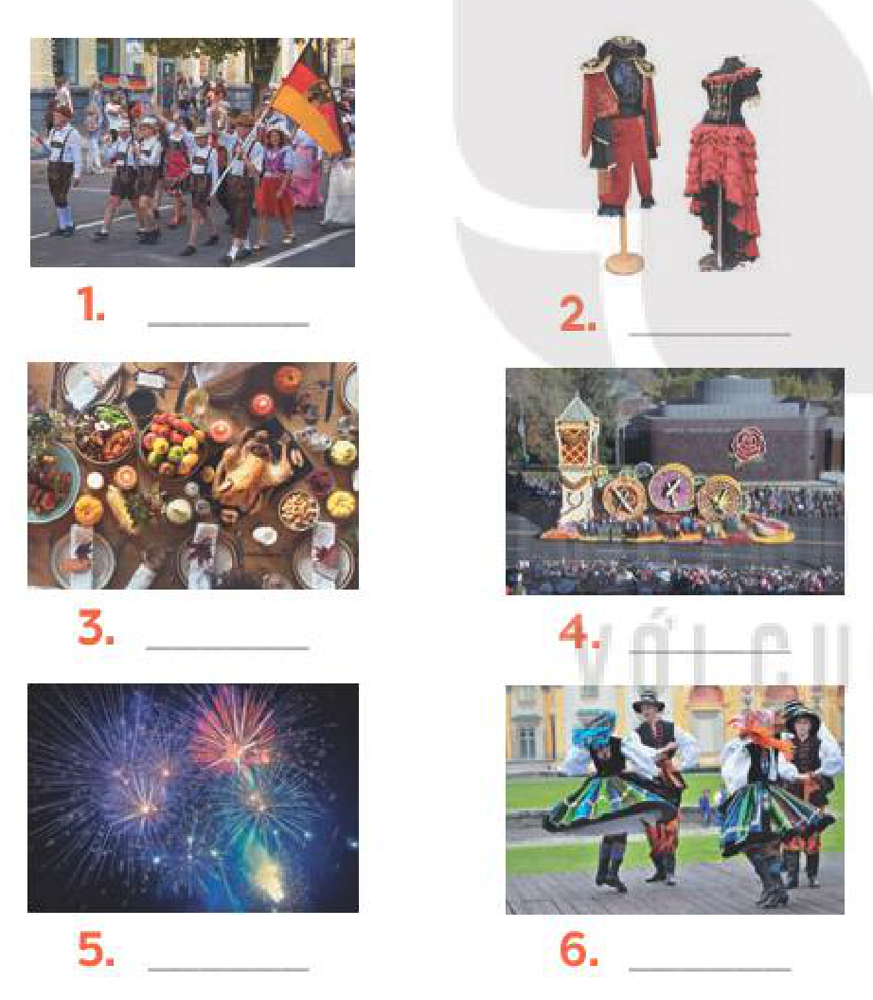
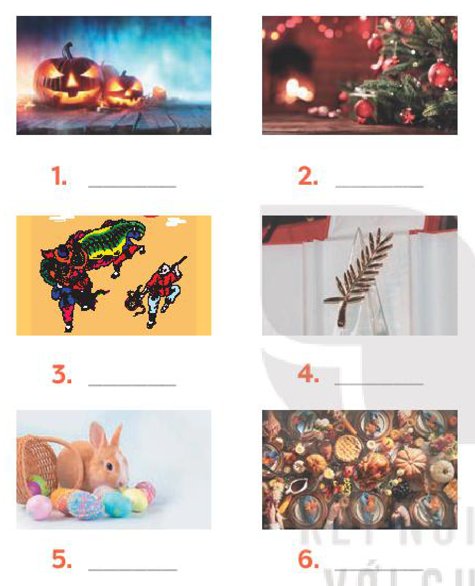
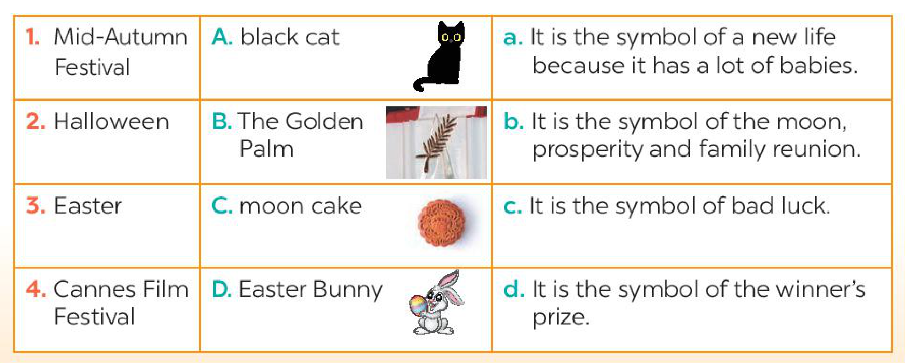
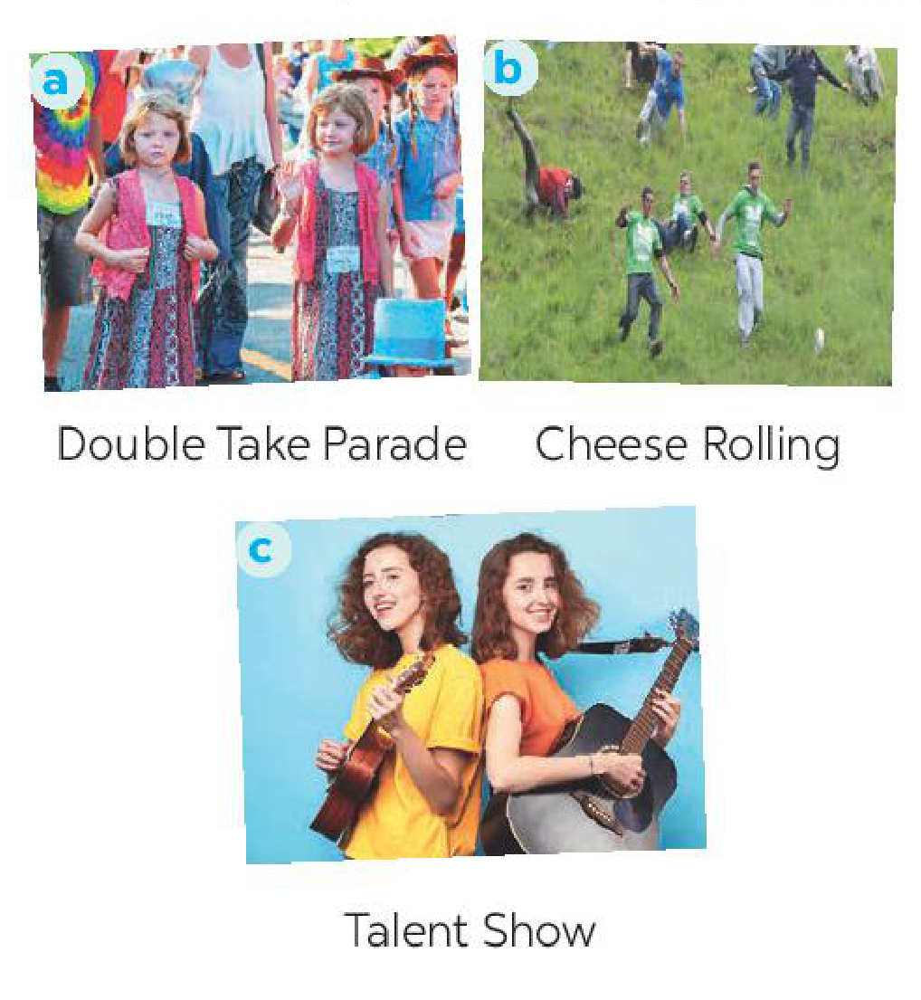
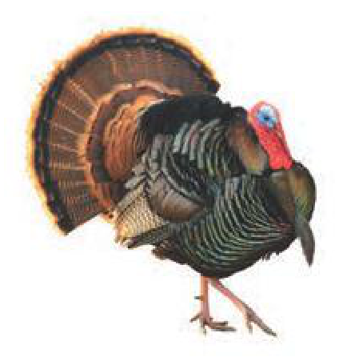

<!-- pdf:93 -->

# UNIT 9: FESTIVALS AROUND THE WORLD

> **THIS UNIT INCLUDES:**
> - **Vocabulary:**
>   - Types of festivals
>   - Festival activities
> - **Pronunciation:**
>   - Stress in two-syllable words
> - **Grammar:**
>   - *Yes / No* questions
> - **Skills:**
>   - Reading about an unusual festival
>   - Talking about a festival that someone joined
>   - Listening about a festival
>   - Writing an email to describe a festival
> - **Everyday English:**
>   - Expressing **disappointment**

## GETTING STARTED

**A Tulip Festival**

**1. Listen and read.**

**Mark and Trang:** Good afternoon, Ms Hoa.

**Ms Hoa:** Oh, hi. Come in.

**Trang:** Wow! This is a nice cozy room, Ms Hoa. I like the photos on the wall. I can see you among all those tulips. Where did you take the photos?

**Ms Hoa:** I took them at the Tulip Festival in Australia last September.

**Mark:** Really? I went to a tulip festival two years ago but it was in **the Netherlands**. It was the **Dutch** Tulip Festival.

**Trang:** What did you do at the festival, Ms Hoa?

**Ms Hoa:** I watched **Dutch** **folk dances**. The dancers wore traditional **costumes**. I also got a chance to try some delicious **Dutch** food and drinks. What about you, Mark?

**Mark:** I watched **folk dances** too, but there wasn't any food or drinks. I also saw beautiful tulip **floats** at a **parade**.

**Trang:** Do they hold the festival every year in Australia?

**Ms Hoa:** Yes, they do.

<!-- pdf:94 -->

**2. Read the conversation again. Who did the following activities? Tick (✓) the correct column. Sometimes you need to tick both.**

| | Ms Hoa | Mark |
| --- | --- | --- |
| 1. went to the Tulip Festival in Australia | | |
| 2. went to the Tulip Festival in **the Netherlands** | | |
| 3. tried **Dutch** food and drinks | | |
| 4. watched traditional **Dutch** dancing | | |
| 5. saw tulip **floats** | | |

**3. Write a word or phrase from the box under each picture.**

| | |
| --- | --- |
| **costumes** | **fireworks display** |
| **feast** | **parade** |
| **float** | **folk dance** |
<!-- ocr-ok: đã đối chiếu ảnh trang gốc, OCR đọc nhầm folk dance thành Tolle dance -->

1. \_\_\_\_\_\_\_
2. \_\_\_\_\_\_\_
3. \_\_\_\_\_\_\_
4. \_\_\_\_\_\_\_
5. \_\_\_\_\_\_\_
6. \_\_\_\_\_\_\_
<!-- ocr-ok: đã đối chiếu ảnh trang gốc, các chỗ trống đánh số 1–6 dưới 6 hình ảnh lễ hội -->

**4. Fill in each blank with a word or phrase from 3. You may have to change the form of the word or phrase.**

1. The dancers performed \_\_\_\_\_\_\_ at the Tulip Festival.
2. On New Year's Eve, we went to Hoan Kiem Lake to watch the \_\_\_\_\_\_\_.
3. For Tet, we usually prepare a \_\_\_\_\_\_\_ with special food.
4. People hold flower \_\_\_\_\_\_\_ in several countries to welcome the new season.
5. The \_\_\_\_\_\_\_ carried the dancers in special \_\_\_\_\_\_\_.

**5. QUIZ: What festival is it?**
<!-- ocr-ok: đã đối chiếu ảnh trang gốc, chữ QUIZ nằm trong các ô vuông màu -->

**Match each description with a festival.**

| | |
| --- | --- |
| 1. At this festival, people eat moon cakes. | a. La Tomatina |
| 2. At this festival, people throw tomatoes. | b. Cheese rolling |
| 3. People eat *banh chung* at this festival. | c. Christmas |
| 4. People **decorate** pine trees and give each other gifts. | d. Tet |
| 5. People chase after a wheel of cheese. | e. **Mid-Autumn Festival** |

<!-- pdf:95 -->

## A CLOSER LOOK 1

### Vocabulary

**1. Write under each picture a festival name from the box.**

| | |
| --- | --- |
| **Cannes Film Festival** | Christmas |
| **Mid-Autumn Festival** | Halloween |
| **Thanksgiving** | **Easter** |

1. \_\_\_\_\_\_\_
2. \_\_\_\_\_\_\_
3. \_\_\_\_\_\_\_
4. \_\_\_\_\_\_\_
5. \_\_\_\_\_\_\_
6. \_\_\_\_\_\_\_
<!-- ocr-ok: đã đối chiếu ảnh trang gốc, các chỗ trống đánh số 1–6 dưới 6 hình ảnh lễ hội -->

**2. Complete the table below with the phrases from the box.**

| | |
| --- | --- |
| having a **feast** | chocolate eggs |
| turkey | **carving** pumpkins |
| moon cakes | **candy** apples |
| painting eggs | performing a lion dance |

| Festival | Food | Activity |
| --- | --- | --- |
| **Easter** | | |
| Halloween | | |
| **Mid-Autumn Festival** | | |
| **Thanksgiving** | | |
<!-- ocr-ok: đã đối chiếu ảnh trang gốc, OCR bỏ sót tiêu đề cột Festival / Food / Activity -->

**3. Fill in each blank with a word or phrase from the box.**

| | |
| --- | --- |
| painting eggs | Christmas |
| **Mid-Autumn Festival** | **candy** apples |
| **Cannes Film Festival** | turkey |

1. At \_\_\_\_\_\_\_, people give gifts to each other.
2. My children love \_\_\_\_\_\_\_ at **Easter**.
3. How many \_\_\_\_\_\_\_ do you need for the Halloween party?
4. At the \_\_\_\_\_\_\_, there are many interesting films.
5. Performing lion dances is one of the activities at the \_\_\_\_\_\_\_.
<!-- term: lion dance -->
6. Bill's mum is cooking a \_\_\_\_\_\_\_ for **Thanksgiving**.

### Pronunciation

**Stress in two-syllable words**

**4. Listen and repeat. Then underline the stressed syllable in each word.**

| Nouns and Adjectives | Verbs |
| --- | --- |
| **costume** | enjoy |
| fireworks | decide |
| turkey | discuss |
| happy | prepare |
<!-- ocr-ok: đã đối chiếu ảnh trang gốc, OCR bỏ sót dòng tiêu đề bảng và từ costume -->

**5. Listen and repeat the sentences. Underline the stressed syllables in the bold words.**

1. We're going to **attend** an Easter **party** at Nick's house.
2. The **dancers** will **perform** traditional dances at the festival.
3. At **Christmas**, people usually buy **presents** for their family.
4. Did you go to the Da Lat **Flower** Festival with your **parents**?
5. My aunt is **clever** and **patient**.

<!-- pdf:96 -->

## A CLOSER LOOK 2

### Grammar

*Yes / No questions*

- These questions need either a *Yes* or *No* answer.
- We form a *Yes / No* question with an auxiliary verb (*be*, *do* or *have*) or with a modal verb. We put the auxiliary verb or modal verb before the subject.
<!-- term: Yes / No questions -->

**Example:**
- *Are* you eating moon cakes?
  Yes, I am.
- *Did* they eat moon cakes at the festival last year?
  No, they didn't.
- *Can* he eat all these moon cakes?
  Yes, he can.
- We don't use an auxiliary verb when we use *be* as a main verb.

**Example:**
*Is* that your Christmas present?
Yes, it is.

**1. Fill in each blank with a correct auxiliary verb or modal verb.**

1. \_\_\_\_\_\_\_ they hold the festival in Ha Noi every year?
2. \_\_\_\_\_\_\_ he visit Hoi An last year?
3. \_\_\_\_\_\_\_ they performing **folk dances**?
4. **A:** \_\_\_\_\_\_\_ you make *banh chung*?
   **B:** Yes, I can.
5. \_\_\_\_\_\_\_ your brother usually come back home at Tet?

**2. Change the sentences into Yes / No questions.**

1. My mother can make a **costume** for me.
2. She will bake a birthday cake for him.
3. The dragon dances are interesting.
4. The Rio Carnival takes place every year in Brazil.
5. They saw a **fireworks display** on New Year's Eve.

**3. Match the questions in column A with their answers in column B.**

| A | B |
| --- | --- |
| 1. Will you help me take a photo? | a. Yes, he is. |
| 2. Is he painting **Easter** eggs? | b. No, I'm not. |
| 3. Do they eat **candy** apples on Halloween? | c. Yes, I will. |
| 4. Are you excited about your holiday? | d. No, she can't. |
| 5. Can she perform **Dutch** **folk dances**? | e. Yes, they do. |

**4. Mark is talking to Trang about the Mid-Autumn Festival. Fill in the blanks with Trang's answers below.**

- a. Yes, we do. We watch lion dances, too.
- b. No, we celebrate it in the middle of the eighth lunar month.
- c. Yes, I do. It's one of my favourite festivals.
- d. Yes. Just come over to my house on the night of the festival.
- e. Yes, we do. We also have some autumn fruits.

<!-- pdf:97 -->

**Mark:** Do you celebrate the **Mid-Autumn Festival** in December?

**Trang:** (1) \_\_\_\_\_\_\_.

**Mark:** Do you eat moon cakes at the festival?
<!-- term: moon cakes -->

**Trang:** (2) \_\_\_\_\_\_\_.

**Mark:** Do you make lanterns at the festival?

**Trang:** (3) \_\_\_\_\_\_\_.

**Mark:** Do you like the festival?

**Trang:** (4) \_\_\_\_\_\_\_.

**Mark:** Can I join the festival with you next month?

**Trang:** (5) \_\_\_\_\_\_\_.

**5. GAME: Festival mystery**

**Work in groups. One student thinks of a festival he / she likes. Other students ask Yes / No questions to find out what the festival is.**

**Example:**
- **A:** Do many countries celebrate the festival?
- **B:** Yes, they do.
- **C:** Do children like the festival?
- **B:** Yes, they do.
- **A:** Do they paint eggs?
- **B:** Yes, they do.
- **C:** Is it **Easter**?
- **B:** Yes, it is.
<!-- ocr-ok: đã đối chiếu ảnh trang gốc, OCR đọc lỗi toàn bộ kí hiệu người nói A, B, C ở phần Example -->

## COMMUNICATION

### Everyday English

**Expressing disappointment**

**1. Listen and read the conversation. Pay attention to the highlighted sentences.**

**Mi:** How was the music festival last Sunday?

**Mark:** *It was **disappointing**!*

**Mi:** Why?

**Mark:** The band was late.

**Trang:** And the singers weren't very good either. *It was a big **disappointment**.*

**2. Work in groups. Make a similar conversation for each situation below.**

1. Your friend went to a film festival for teenagers, but there were not many films he / she liked.
2. Your friend went to the market to buy **decorations** for the **Mid-Autumn Festival**. But there were not many **decorations** to choose from.

**Festival symbols**

**3. Listen to Mark talking about festival symbols. Fill in each blank with ONE word.**

1. A **symbol** is an image we use or \_\_\_\_\_\_\_ of when celebrating a festival.
2. A **symbol** usually has a special \_\_\_\_\_\_\_.
3. The Christmas tree is the **symbol** of a long \_\_\_\_\_\_\_.
4. Santa Claus is the **symbol** of joy and \_\_\_\_\_\_\_.

<!-- pdf:98 -->

**4. Work in pairs. Match each festival with its symbol and meaning.**

| | | |
| --- | --- | --- |
| 1. **Mid-Autumn Festival** | A. black cat | a. It is the **symbol** of a new life because it has a lot of babies. |
| 2. Halloween | B. The Golden Palm | b. It is the **symbol** of the moon, **prosperity** and family reunion. |
| 3. **Easter** | C. moon cake | c. It is the **symbol** of bad luck. |
| 4. **Cannes Film Festival** | D. Easter Bunny | d. It is the **symbol** of the winner's prize. |
<!-- term: Easter Bunny -->
<!-- ocr-ok: đã đối chiếu ảnh trang gốc, OCR đọc lệch dòng B. The Golden Palm và b. It is the symbol of the moon... trong bảng nối biểu tượng -->

**5. Work in groups. Choose a festival and talk about its symbol(s) and meaning.**

**Example:** When we talk about Christmas, we think of the Christmas tree. It is the **symbol** of a long life.

## SKILLS 1

### Reading

**1. Work in pairs. Look at the pictures. Which events do you think happen at the Twins Day Festival?**

- a. Double Take Parade
- b. Cheese Rolling
- c. Talent Show
<!-- ocr-ok: đã đối chiếu ảnh trang gốc, chú thích 3 bức ảnh sự kiện a, b, c -->

**Now quickly read the email below and check your answers.**

> **From:** mark@usmail.com
>
> **To:** nick@ukmail.com
>
> **Subject:** Amazing Twins Day Festival!
>
> Hi Nick,
>
> My family and I arrived in Twinsburg, Ohio two days ago. People here hold the Twins Day Festival every year. It happens on the first weekend in August. It's the largest gathering for twins in the world. Thousands of twins come from different countries.
> <!-- term: gathering -->
>
> Yesterday morning my twin sister and I joined the Double Take Parade, a **parade** of twins. We wore uniforms and walked together. Then we saw a Talent Show. It **featured** singing, dancing, comedy, and other things. I loved the performance by the twins from Korea the most.
>
> This morning we ran in the Fun Run. We didn't win but had a lot of fun. This afternoon we took photos with twins from other countries.
>
> This is one of the most exciting festivals I've been to.
>
> I'm getting sleepy, so bye for now.
>
> Best,
>
> Mark

<!-- pdf:99 -->

**2. Match each word from the email in 1 with its meaning.**

| | |
| --- | --- |
| 1. gathering | a. two children born to the same mother at the same time |
| 2. **featured** | b. meeting |
| 3. twins | c. the act of entertaining other people by singing, dancing, and playing music, etc. |
| 4. performance | d. showed something as the most important part |

**3. Read the email again. Complete each sentence with no more than TWO words.**

1. People hold the festival in Twinsburg on the \_\_\_\_\_\_\_ every August.
2. There are twins from many \_\_\_\_\_\_\_.
3. In the Double Take Parade, twins in uniforms \_\_\_\_\_\_\_.
4. Mark enjoyed the \_\_\_\_\_\_\_ by the Korean twins the most.
5. Mark and his twin sister ran in the \_\_\_\_\_\_\_.
6. In his opinion, the festival was very \_\_\_\_\_\_\_.
<!-- ocr-ok: đã đối chiếu ảnh trang gốc, OCR bỏ sót câu 6 ở cuối cột trái -->

### Speaking

**4. Match the questions and answers about a festival someone joined.**

1. What festival did you join?
2. Where and when did you join it?
3. Why do people celebrate it?
4. What did you do there?
5. Did you like the festival? Why or why not?

- a. Yes, very much because there was a lot to do.
- b. I joined the festival in Phu Yen last March.
- c. I watched people play drums, sing traditional songs, and dance. I also played traditional games with the children there.
- d. I joined the Hoi Mua Festival.
- e. They celebrate it to thank the Rice God and pray for a better new crop.

**5. Work in pairs. Ask and answer about a festival you and your friend joined, using the questions in 4 as cues. Tell the class about the festival your partner joined.**

<!-- pdf:100 -->

## SKILLS 2

### Listening

**1. Look at the animal below. Discuss the following questions with a partner.**

1. What is it?
2. What festival is it a part of?

**2. Now listen to Mark talking about how his family celebrates a festival. Check your answers.**

**3. Listen again and decide if the statements are true (T) or false (F).**

| | T | F |
| --- | --- | --- |
| 1. Only people from the USA celebrate **Thanksgiving**. | | |
| 2. People celebrate it on the third Thursday of November. | | |
| 3. Family members and friends usually gather to have a **feast**. | | |
| 4. In his family, only adults prepare the **feast**. | | |
| 5. Cornbread is one of the traditional dishes. | | |
| 6. After the **feast**, they play board games. | | |

### Writing

**4. Think about a festival that your family usually celebrates. Fill in the blanks with your answers.**

- What festival is it? \_\_\_\_\_\_\_
- When do you celebrate it? \_\_\_\_\_\_\_
- What food does your family eat? \_\_\_\_\_\_\_
- What activities does your family do? \_\_\_\_\_\_\_
- Do you like the festival? Why or why not? \_\_\_\_\_\_\_

**5. Now write an email of about 70 words to tell Mark about the festival. Use the notes in 4.**

> **From:** \_\_\_\_\_\_\_
>
> **To:** \_\_\_\_\_\_\_
>
> **Subject:** \_\_\_\_\_\_\_
>
> Dear Mark,
>
> How are you? I'm going to tell you about \_\_\_\_\_\_\_
>
> I hope one day you can join the festival with us.
>
> Cheers,

<!-- pdf:101 -->

## LOOKING BACK

### Vocabulary

**1. Circle the correct words or phrases in brackets.**

1. There wasn't a (light / fireworks) display on New Year's Eve last year.
2. She was the best actress at the (**Cannes Film Festival** / music festival) last year.
3. At **Easter**, children enjoy (painting / buying) **Easter** eggs.
4. People prepare (moon cakes / candy apples) for Halloween.
<!-- term: candy apples -->
5. For (**Thanksgiving** / Tet), people have a **feast** with turkey, cornbread, and sweet potatoes.
<!-- term: turkey -->

**2. Complete each sentence by filling in the blank with a word or phrase in the box.**

| | |
| --- | --- |
| **floats** | **costumes** |
| Bunny | gathering |
| lion dances | |
<!-- ocr-ok: đã đối chiếu ảnh trang gốc, khung từ vựng 2 cột bài tập 2 -->

1. The best part of the **Mid-Autumn Festival** is the performance of \_\_\_\_\_\_\_.
2. There are flower \_\_\_\_\_\_\_ in the Tulip Festival.
3. We like to wear traditional \_\_\_\_\_\_\_ at Tet.
4. One of the symbols of **Easter** is the **Easter** \_\_\_\_\_\_\_.
5. The Twins Day Festival is the largest \_\_\_\_\_\_\_ for twins in the world.
<!-- ocr-ok: đã đối chiếu ảnh trang gốc, OCR đọc hỏng hoàn toàn câu 4 (One of the symbols of Easter is the Easter _______.) -->

### Grammar

**3. Choose the correct question A or B.**
<!-- ocr-ok: đã đối chiếu ảnh trang gốc, OCR đọc dính chữ AorB -->

1. A. Did you go to the Lim Festival yesterday?
   B. Are you go to the Lim Festival yesterday?
2. A. Are they always celebrate the festival in May?
   B. Do they always celebrate the festival in May?
3. A. Will you wear a **costume** for Halloween?
   B. Will do you wear a **costume** for Halloween?
4. A. Does he interest in joining the festival?
   B. Is he interested in joining the festival?
5. A. Do people listen to traditional songs at the Hoi Mua Festival last year?
   B. Did people listen to traditional songs at the Hoi Mua Festival last year?

**4. Answer the following questions about yourself.**
<!-- ocr-ok: đã đối chiếu ảnh trang gốc, OCR đọc dính chữ aboutyourself -->

1. Are you interested in festivals?
2. Do you eat *banh chung* at Tet?
3. Can you cook any traditional food?
4. Did you see a **fireworks display** last year?
5. Does your family gather together at Tet?
<!-- ocr-ok: đã đối chiếu ảnh trang gốc, OCR đọc nhầm Did you see a thành CA 506 8 ở câu 4 -->

<!-- pdf:102 -->

## PROJECT

**A NEW FESTIVAL**

**Work in groups.**

**1. Think of a new festival that you would like to celebrate. Discuss the following points:**

- Name of the festival
- Time and place of the festival
- Festival activities

**2. Draw pictures of the new festival or cut out pictures from magazines.**

**3. Present your festival to the class.**

**4. Vote for the best festival.**

### Now I can ...

- use the words related to types of festivals and festival activities.
- pronounce two-syllable words with correct stress.
- use *Yes / No* questions.
- express **disappointment**.
- read about an unusual festival.
- talk about a festival that I joined.
- listen about a festival.
- write an email to describe a festival.

## 📷 Danh sách hình trong bài

| Mã hình | Trang PDF | Trang sách | Chú thích / Mô tả |
| --- | --- | --- | --- |
| H7-tieng_anh-u09-01 | 94 | 93 | Bộ 6 hình ảnh hoạt động và sự vật lễ hội đánh số 1–6 ở bài tập 3 phần Getting Started: cuộc diễu hành, trang phục truyền thống, bữa tiệc thịnh soạn, xe hoa diễu hành, màn bắn pháo hoa, điệu múa dân gian |
| H7-tieng_anh-u09-02 | 95 | 94 | Bộ 6 hình ảnh đại diện các lễ hội đánh số 1–6 ở bài tập 1 phần A Closer Look 1 – Vocabulary: Halloween, Lễ Giáng sinh, Tết Trung thu, Liên hoan phim Cannes, Lễ Phục sinh, Lễ Tạ ơn |
| H7-tieng_anh-u09-03 | 98 | 97 | Bảng nối 4 lễ hội với hình ảnh biểu tượng (mèo đen, Cành cọ vàng, bánh trung thu, thỏ Phục sinh) và ý nghĩa biểu trưng ở bài tập 4 phần Communication |
| H7-tieng_anh-u09-04 | 98 | 97 | Bộ 3 ảnh chụp sự kiện đánh nhãn a (*Double Take Parade*), b (*Cheese Rolling*), c (*Talent Show*) ở bài tập 1 phần Skills 1 – Reading |
| H7-tieng_anh-u09-05 | 100 | 99 | Hình ảnh con gà tây (*turkey*) gắn với Lễ Tạ ơn ở bài tập 1 phần Skills 2 – Listening |
