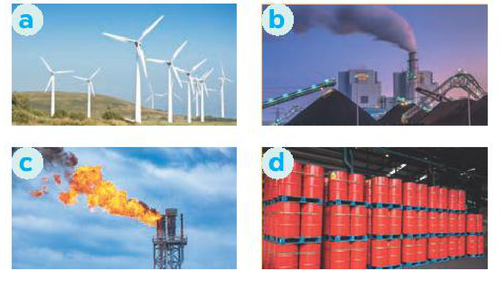
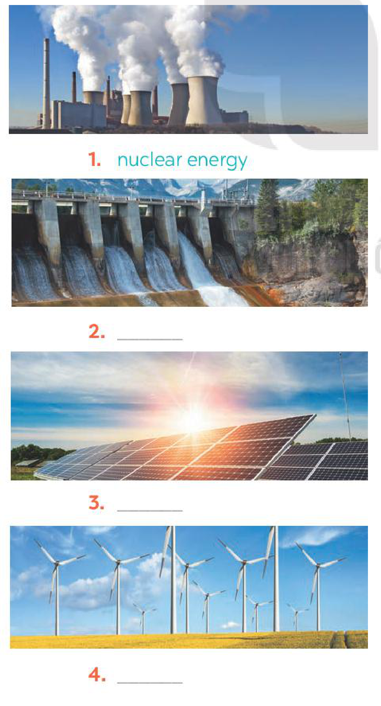
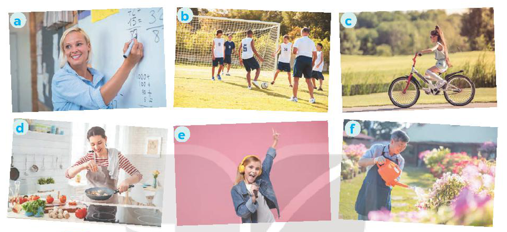

<!-- pdf:105 -->

# UNIT 10: ENERGY SOURCES

> **THIS UNIT INCLUDES:**
> - **Vocabulary:**
>   - Types of energy sources
> - **Pronunciation:**
>   - Stress in three-syllable words
> - **Grammar:**
>   - Present continuous
> - **Skills:**
>   - Reading about types of energy sources
>   - Talking about the advantages and disadvantages of different energy sources
>   - Listening about how to save energy at home
>   - Writing a paragraph about how to save energy at home
> - **Everyday English:**
>   - Asking for explanations

## GETTING STARTED

**Types of energy sources**

**1. Listen and read.**

**Lan:** Hi, Dad.

**Mr Tan:** Lan, what are you doing? It's pretty late now.

**Lan:** I'm doing a project on energy sources. But I don't quite understand what energy is.

**Mr Tan:** Well, it's power that we use to provide us with light, heat or electricity.

**Lan:** Oh. Where does it come from?

**Mr Tan:** It comes from many different sources like coal, oil, natural gas, ... We call them non-renewable sources.
<!-- term: coal -->
<!-- term: oil -->
<!-- term: natural gas -->

**Lan:** Can it come from the sun, wind or water too?

**Mr Tan:** Yes, it can. We call those types of energy renewable sources because we cannot run out of them. Renewable means we can easily replace them.

**Lan:** I get it now.

**Mr Tan:** You know, some types of energy are cheap and easy to use, but others are more expensive and harder to find ...

<!-- pdf:106 -->

**2. What are Lan and her father talking about?**

A. Energy
B. Sources
C. Energy sources

**3. Read the conversation again and answer the following questions.**

1. What is Lan doing?
2. What does energy mean?
3. Where does energy come from?
4. What are renewable sources?

**4. Match the words / phrases in the box with the correct pictures.**

| 1. oil | 2. wind energy |
| --- | --- |
| 3. coal | 4. natural gas |

**5. Complete each of the sentences with the correct word from the conversation.**

1. Energy is \_\_\_\_\_\_\_ that we use to provide us with light, heat or electricity.
2. When energy comes from the \_\_\_\_\_\_\_, wind and water, we call it renewable energy.
3. When energy comes from wind, we call it \_\_\_\_\_\_\_ energy.
4. We cannot \_\_\_\_\_\_\_ out of renewable energy.
5. Some types of energy are \_\_\_\_\_\_\_ and easy to use.

<!-- pdf:107 -->

## A CLOSER LOOK 1

### Vocabulary

**1. Match the types of energy in A with the energy sources in B.**

| A | B |
| --- | --- |
| 1. solar energy | a. water |
| 2. wind energy | b. nuclear |
| 3. hydro energy | c. wind |
| 4. nuclear energy | d. the sun |

**2. Write the phrases to label the pictures.**

1. nuclear energy
2. \_\_\_\_\_\_\_
3. \_\_\_\_\_\_\_
4. \_\_\_\_\_\_\_
<!-- term: nuclear energy -->
<!-- ocr-ok: đã đối chiếu ảnh trang gốc, OCR bỏ sót các dòng đánh số chỗ trống 1-4 dưới tranh -->

**3. Complete the sentences with the words and phrases from 1 or 2.**

1. A good place to change \_\_\_\_\_\_\_ to energy is near the sea because of the sea breezes.
2. They are putting solar panels on the roof of our building to produce \_\_\_\_\_\_\_.
3. When energy comes from \_\_\_\_\_\_\_, we call it hydro energy.
4. They are reducing the use of \_\_\_\_\_\_\_ because it is not safe to produce.
<!-- term: hydro energy -->
<!-- term: nuclear energy -->

### Pronunciation

**Stress in three-syllable words**

**4. Listen and repeat. Pay attention to the stressed syllables in the words.**

| | |
| --- | --- |
| 'energy | re'cycle |
| 'dangerous | ex'pensive |
| 'easily | po'lluting |
| 'government | re'sources |
<!-- ocr-ok: đã đối chiếu ảnh trang gốc, OCR bỏ sót dấu trọng âm ở một số từ ba âm tiết -->

**5. Listen and repeat, paying attention to the stressed syllables in the underlined words.**

1. Nuclear *'energy* is *'dangerous* and *ex'pensive*.
2. We should ride a bike when *'travelling* short *'distances*.
3. The word *"re'cycle"* has three *'syllables*.
4. Burning coal is *po'lluting* our environment.
5. Our *'government* is looking for new sources of *'energy* to replace gas.

<!-- pdf:108 -->

## A CLOSER LOOK 2

### Grammar

**The present continuous**

**1. Work in pairs. Tell your partner what the people in the pictures are doing.**

**Remember!**

We use the present continuous to express:
- an action happening now or at the moment of speaking.
  *Example:*
  The students *are doing* a project in the classroom now.
- an action around now but not necessarily at the moment of speaking.
  *Example:*
  Scientists *are looking* for a new energy source to replace coal.
<!-- term: Present continuous -->

We can use the words or phrases: *now*, *right now*, *at the moment*, *today*, *nowadays*, *this week / month*, etc. with the present continuous.
<!-- term: Present continuous -->

**2. Complete the sentences, using the present continuous form of the verbs in brackets.**

1. Mai (talk) \_\_\_\_\_\_\_ about types of energy sources now.
2. We (use) \_\_\_\_\_\_\_ solar energy to replace energy from coal today.
3. Keep quiet! The students of Class 7C (take) \_\_\_\_\_\_\_ a test.
4. Scientists (develop) \_\_\_\_\_\_\_ new energy sources to protect the environment.
5. We (reduce) \_\_\_\_\_\_\_ the use of nuclear energy nowadays.

<!-- pdf:109 -->

**3. Circle the correct form of the verb in each sentence.**

1. Are you still *work* / *working* on your project now?
2. Nam and Lan *do* / *are doing* quite well at school this year.
3. *Does she study* / *Is she studying* at the school library at the moment?
4. Hoa *studies* / *is studying* for her exam, so she can't come to the party right now.
5. We *have* / *are having* English three times a week.
<!-- ocr-ok: đã đối chiếu ảnh trang gốc, OCR bỏ sót nội dung câu 5 nằm trên hình thời khoá biểu -->

**4. Write sentences about what the people are doing or not doing, using the suggestions.**
<!-- ocr-ok: đã đối chiếu ảnh trang gốc, OCR bỏ số 4 và đọc dính chữ ornot -->

1. The students / do the project / now.
2. Mrs Lien / teach us about solar energy / at the moment.
3. They / learn about energy / this month.
4. She / not swim / in the swimming pool / right now.
5. Nowadays, people in Iceland / not use energy from coal.

**5. Work in pairs. Ask and answer the following questions.**

1. What book are you reading now?
2. What sport are you playing these days?
3. What courses are you taking this term?
4. What are you doing to save energy?

<!-- pdf:110 -->

## COMMUNICATION

### Everyday English

**Asking for explanations**

**1. Listen and read the conversation. Pay attention to the highlighted questions.**

**Lan:** *What does "solar energy" mean?*
<!-- term: solar energy -->

**Mr Tan:** Well, it's energy that comes from the sun.

**Lan:** *And what does "wind energy" mean?*
<!-- term: wind energy -->

**Mr Tan:** It's another type of energy, and it comes from wind.

**2. Work in pairs. Make similar conversations to ask for explanations of the phrases: *hydro energy, energy from coal ...***

**Saving energy**

**3. Work in pairs. Ask your partner the following questions and tick (✓) his or her answers in the boxes.**

| | Yes | No |
| --- | --- | --- |
| 1. Do you go to school on foot? | | |
| 2. Do you use public transport? | | |
| 3. Do you use low energy light bulbs at home? | | |
| 4. Do you use solar energy to warm water? | | |
| 5. Do you turn off the lights when going to bed? | | |
| 6. Do you turn off the TV when not watching it? | | |

**4. Work in groups. Tell the group how well your partner saves energy.**

*Example:*

Mai saves a lot of energy. She often goes to school on foot and uses public transport. She always turns off the lights when going to bed.

**5. Answer the questions in 3 on your own. Then tell the class how well you save energy.**

*Example:*

I don't save much energy. I go to school on foot, but I don't turn off the TV when not watching it.

<!-- pdf:111 -->

## SKILLS 1

### Reading

**1. Work in pairs. Discuss the following questions.**

1. What are the main energy sources in Viet Nam?
2. What type(s) of energy sources will we use in the future?

**2. Mr Lam is giving a lecture on energy sources. Read the text and choose the best option (A, B, or C) to complete the sentences.**

Hello, class. Today I'd like to tell you about two energy sources. They are non-renewable sources and renewable sources.

Non-renewable sources are coal, oil and natural gas. We can use these sources to produce energy. They are cheap and easy to use. People use them a lot. But they are very limited and will run out soon.
<!-- term: coal -->
<!-- term: oil -->
<!-- term: natural gas -->

Renewable sources come from the sun, wind or water. When energy comes from the sun, we call it solar energy. Wind energy comes from the wind, and hydro energy comes from water. Renewable sources are available, clean and safe to use. But they are expensive to produce.
<!-- term: solar energy -->
<!-- term: wind energy -->
<!-- term: hydro energy -->

In the future we will rely more on renewable energy sources. They are better for the environment and they will not run out.

1. Non-renewable sources are cheap and \_\_\_\_\_\_\_.
   A. available
   B. easy to use
   C. expensive
2. \_\_\_\_\_\_\_ come from the sun, wind or water.
   A. Renewable sources
   B. All energy sources
   C. Non-renewable sources
3. When energy comes from water, we call it \_\_\_\_\_\_\_.
   A. wind energy
   B. solar energy
   C. hydro energy
4. Renewable energy sources are better for \_\_\_\_\_\_\_.
   A. the environment
   B. our cars
   C. hydro energy

**3. Read the text again and answer the questions.**

1. How many energy sources are there? What are they?
2. What do non-renewable sources include?
3. What are the advantages of renewable energy?
4. What will we rely more on in the future?

### Speaking

**4. Work in groups. Discuss and put the following words and phrases in the appropriate columns.**

| | |
| --- | --- |
| run out | limited |
| easy to use | cheap |
| expensive | available |
| safe to use | |
| good for the environment | |

| Advantages | Disadvantages |
| --- | --- |
| | |
<!-- ocr-ok: đã đối chiếu ảnh trang gốc, OCR bỏ sót dòng tiêu đề bảng hai cột Advantages / Disadvantages -->

**5. Work in pairs. Ask and answer questions about the advantages and disadvantages of different energy sources.**

*Example:*
- **A:** What are the advantages of hydro energy?
- **B:** It's available, clean and safe to use.
- **A:** What are its disadvantages?
- **B:** It's expensive to produce.

<!-- pdf:112 -->

## SKILLS 2

### Listening

**1. Work in pairs. Answer the questions.**

1. What type of energy do you use at home?
2. What do you usually do to save energy?

**2. Mr Lam is discussing with his students about how to save energy at home. Listen and circle the phrases you hear.**

1. save energy
2. turn off the lights
3. save money
4. use low energy light bulbs
5. produce electricity
6. use solar panels
<!-- ocr-ok: đã đối chiếu ảnh trang gốc, OCR đọc nhầm các số thứ tự 1-6 trong khung màu vàng -->

**3. Listen again and tick (✓) T (True) or F (False) for each sentence.**

| | T | F |
| --- | --- | --- |
| 1. Mr Lam says we use energy for cooking, heating and lighting. | | |
| 2. Linh always turns off the lights when going out. | | |
| 3. Linh turns off electrical appliances when not using them. | | |
| 4. Minh uses low energy light bulbs at his house. | | |
| 5. Minh uses solar energy to cook meals. | | |
<!-- term: electrical appliances -->

### Writing

**4. Work in pairs. Read some ways to save energy at home. Choose three ways and write them in your notebook.**

- Use low energy light bulbs
- Use solar panels to warm water
- Turn off the lights when leaving the room
- Turn off electrical appliances when not using them
<!-- term: electrical appliances -->

**5. Write a paragraph of about 70 words about how you save energy at home.**

We use a lot of energy at home and it costs us a lot. To save energy, we should \_\_\_\_\_\_\_\_\_\_\_\_\_\_\_\_\_\_\_\_\_\_\_\_\_\_\_\_\_\_\_\_\_\_\_\_\_\_\_\_\_\_\_

<!-- pdf:113 -->

## LOOKING BACK

### Vocabulary

**1. Match the adjectives in A with the nouns in B to make phrases.**

| A | B |
| --- | --- |
| 1. solar | a. water |
| 2. hot | b. energy sources |
| 3. electrical | c. energy light bulbs |
| 4. renewable | d. appliances |
| 5. low | e. energy |
<!-- ocr-ok: đã đối chiếu ảnh trang gốc, OCR bỏ sót dòng 2. hot và hai mục a. water, b. energy sources trong bảng -->

**2. Complete the sentences, using the phrases in 1.**

1. We should use \_\_\_\_\_\_\_ in our homes to save energy.
2. Do they always turn off the \_\_\_\_\_\_\_ before leaving the room?
3. We can protect the environment by using \_\_\_\_\_\_\_.
4. When energy comes from the sun, we call it \_\_\_\_\_\_\_.
5. She has \_\_\_\_\_\_\_ day and night because she has solar panels on the roof of her house.

### Grammar

**3. Complete the sentences by using the correct form of the present continuous or present simple of the verbs in brackets.**

1. Look! It (rain) \_\_\_\_\_\_\_ heavily.
2. Normally they (start) \_\_\_\_\_\_\_ school at eight o'clock in the morning.
3. He hasn't got a bike at the moment, so he (walk) \_\_\_\_\_\_\_ to school this week.
4. He always (do) \_\_\_\_\_\_\_ his homework in the evening.
5. I'm afraid I have no time to help just now. I (write) \_\_\_\_\_\_\_ an essay.

**4. Find ONE mistake in each sentence and correct it.**

1. The students do the project in Unit 10 now.
2. At the moment, the teacher is explain how solar energy works.
3. Nowadays, people in Africa is not using energy from natural gas.
4. They are use wind energy instead of coal.
5. We look for a cheap, clean and effective source of energy now.

<!-- pdf:114 -->

## PROJECT

**SAVING ENERGY AT SCHOOL**

**1. Below are some tips about how students can save energy at school. In groups, discuss which ones can be applied in your school.**

Some tips to save energy at school:
- Turn the lights off when you leave the classroom.
- Turn off electrical appliances when they are not in use.
- Don't overheat or overcool the classrooms.
- Check that none of your taps around the school are dripping.
<!-- term: electrical appliances -->

**2. Work in groups. Discuss some tips about how to save energy in your school. Then make a poster and present it to your class.**

### Now I can ...

- use the words related to types of energy sources.
- pronounce three-syllable words with correct stress.
- use the present continuous.
- ask for explanations.
- read about types of energy sources.
- talk about the advantages and disadvantages of different energy sources.
- listen to get information about how to save energy at home.
- write a paragraph about how to save energy at home.

## 📷 Danh sách hình trong bài

| Mã hình | Trang PDF | Trang sách | Chú thích / Mô tả |
| --- | --- | --- | --- |
| H7-tieng_anh-u10-01 | 106 | 105 | Bốn bức ảnh kí hiệu a, b, c, d minh hoạ các nguồn năng lượng (*wind energy*, *coal*, *natural gas*, *oil*) thuộc bài tập 4 phần Getting Started |
| H7-tieng_anh-u10-02 | 107 | 106 | Bốn bức ảnh đánh số 1–4 dùng để điền cụm từ chỉ loại năng lượng (*nuclear energy*, *hydro energy*, *solar energy*, *wind energy*) thuộc bài tập 2 phần A Closer Look 1 – Vocabulary |
| H7-tieng_anh-u10-03 | 108 | 107 | Sáu bức ảnh kí hiệu a–f minh hoạ các hoạt động đang diễn ra dùng để thực hành nói thì hiện tại tiếp diễn thuộc bài tập 1 phần A Closer Look 2 – Grammar |
