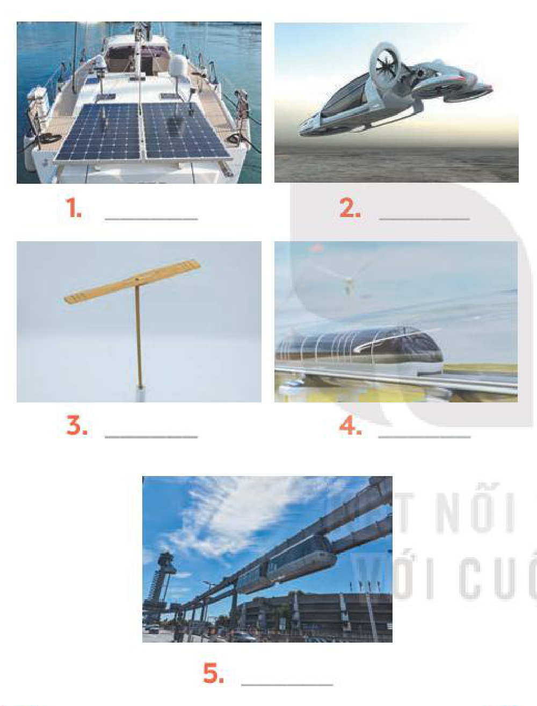
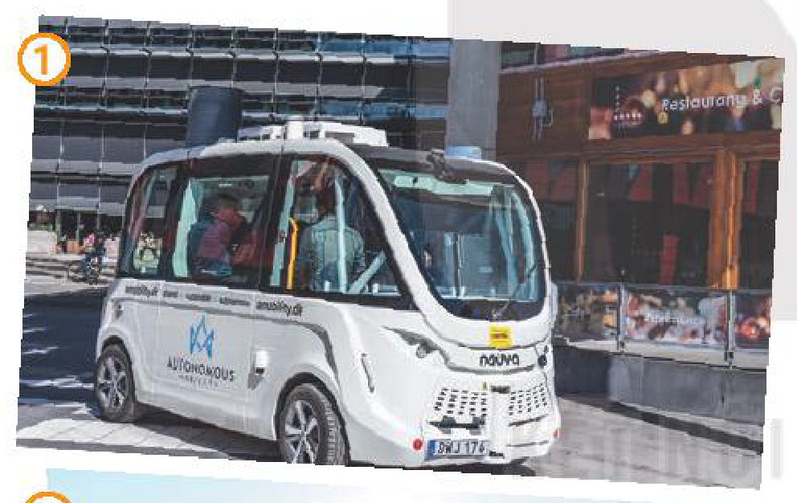
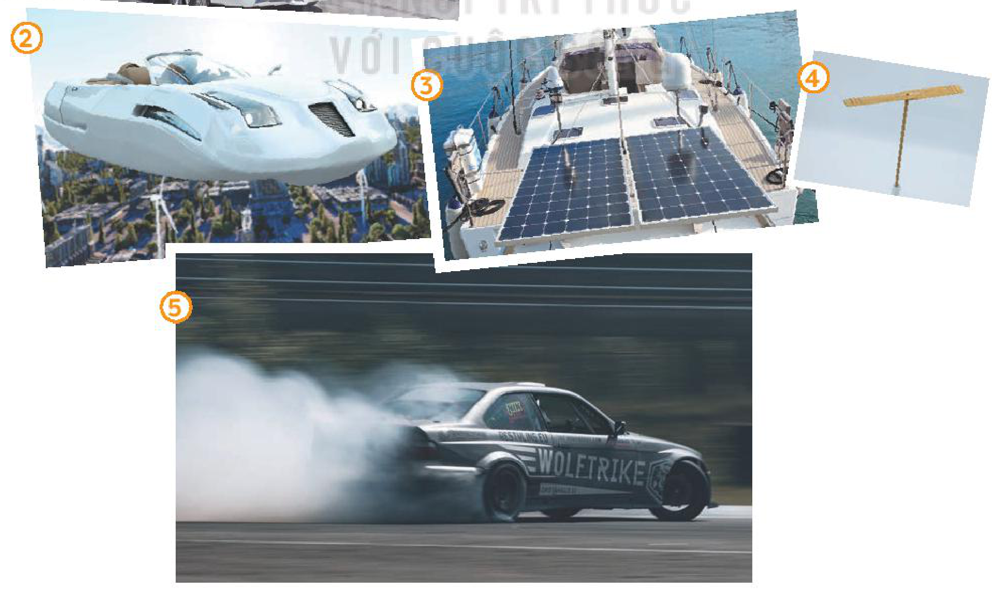
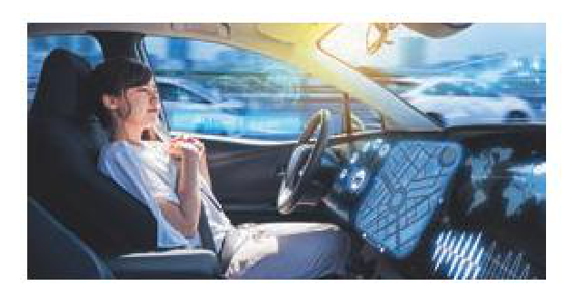
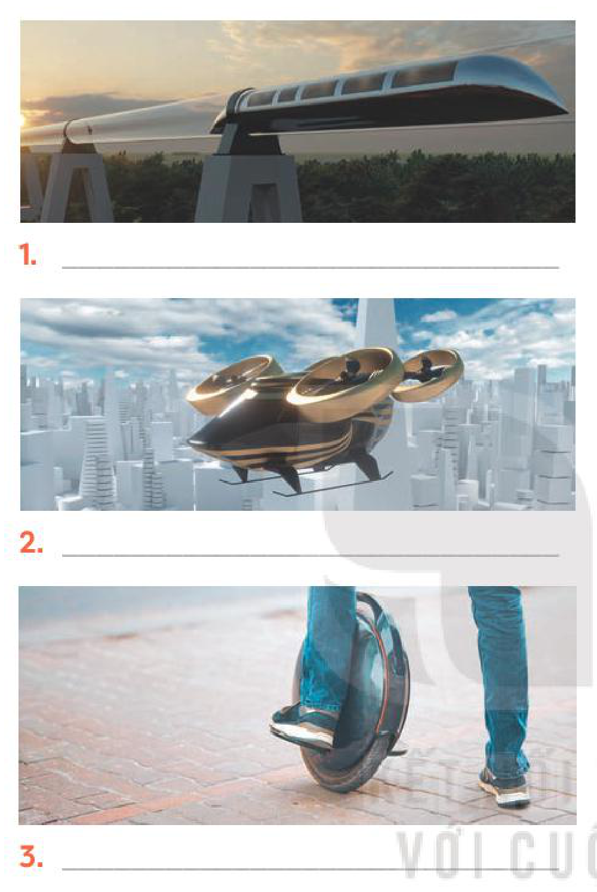

<!-- pdf:115 -->

# UNIT 11: TRAVELLING IN THE FUTURE

> **THIS UNIT INCLUDES:**
> - **Vocabulary:**
>   - Future means of transport
> - **Pronunciation:**
>   - Sentence stress
> - **Grammar:**
>   - Future simple
>   - Possessive pronouns
> - **Skills:**
>   - Reading about cars
>   - Talking about why a means of transport will / won't be popular
>   - Listening to a talk about some future means of transport
>   - Writing a paragraph about the advantages of a future means of transport
> - **Everyday English:**
>   - Making predictions

## GETTING STARTED

**I hope we will have a hyperloop soon!**

**1. Listen and read.**

**Minh:** Oh, another traffic jam.

**Ann:** How will we get to the campsite on time now?

**Minh:** I don't know. It's a pity that we don't have a hyperloop now!

**Ann:** What's a hyperloop?

**Minh:** It's a system of tubes. You can go from one place to another in just minutes.

**Ann:** Amazing! Even faster than a flying car!
<!-- term: flying car -->

**Minh:** Yes, and there are no traffic jams.

**Ann:** Will it pollute the environment?

**Minh:** No. There will be no fumes, and it's totally safe.

**Ann:** Like a teleporter?

**Minh:** A teleporter is also fast, safe and eco-friendly. But it's a different mode of travel.

**Ann:** So when we travel in hyperloops, we won't have to worry about bad weather, right?

**Minh:** Right.

**Ann:** Sounds great! I hope we'll have them soon.

<!-- pdf:116 -->

**2. What are Ann and Minh talking about?**

A. Travelling by teleporter
B. Future modes of travel
C. Being in a traffic jam

**3. Read the conversation again and tick (✓) T (True) or F (False).**

| | T | F |
| --- | --- | --- |
| 1. Ann and Minh are in a traffic jam now. | | |
| 2. Ann and Minh are going to school. | | |
| 3. Ann knows a lot about hyperloops. | | |
| 4. Minh seems to know about different modes of travel. | | |
| 5. They hope there will be hyperloops soon. | | |

**4. Find the words and phrases that describe the means of transport in the conversation and write them in the correct columns.**

| hyperloop | teleporter |
| --- | --- |
| | |

**5. QUIZ What vehicle is this?**
<!-- ocr-ok: đã đối chiếu ảnh trang gốc, chữ QUIZ trong các ô vuông màu bị OCR đọc nhầm -->

**Work in pairs. Discuss to find out the vehicles in these sentences.**

1. It has two wheels and you pedal it.
2. It has four wheels. It runs on petrol or electricity, and can carry up to eight passengers.
3. It carries many passengers and runs on tracks.
4. It sails on the sea. It needs wind to sail.
5. It travels in space. It can even carry people to the moon.

**What do you think these vehicles will be like in 50 years?**

<!-- pdf:117 -->

## A CLOSER LOOK 1

### Vocabulary

**1. Write the words and phrases under the correct pictures. Then listen, check and repeat.**

| | |
| --- | --- |
| flying car | bamboo-copter |
| hyperloop | skyTran |
| solar-powered ship | |

1. \_\_\_\_\_\_\_
2. \_\_\_\_\_\_\_
3. \_\_\_\_\_\_\_
4. \_\_\_\_\_\_\_
5. \_\_\_\_\_\_\_
<!-- ocr-ok: đã đối chiếu ảnh trang gốc, các chỗ trống đánh số 1-5 dưới tranh bị OCR bỏ sót -->

**2. Write words and phrases from 1 in the correct columns.**

| ride | fly | sail |
| --- | --- | --- |
| | | |

**3. Complete the sentences, using the words from the box.**

| eco-friendly | fly | ride | bamboo-copter | hyperloop |
| --- | --- | --- | --- | --- |

1. Travelling by \_\_\_\_\_\_\_ is simple. You just put it on and fly away.
2. People will soon \_\_\_\_\_\_\_ in flying cars instead of driving normal cars.
3. It will be fun to \_\_\_\_\_\_\_ a skyTran to work.
4. Travelling by \_\_\_\_\_\_\_ will be faster than by airplane.
5. Solar-powered ships are \_\_\_\_\_\_\_. They will not cause pollution.
<!-- term: flying car -->
<!-- ocr-ok: đã đối chiếu ảnh trang gốc, OCR đọc dính chữ ở các câu 1-4 và đảo câu 5 lên đầu -->

### Pronunciation

**Sentence stress**

**Remember!**

In a sentence there are stressed words and unstressed words.
- We usually stress the words that are nouns, main verbs, adjectives, adverbs, and negative auxiliaries.
  *Example:*
  We **don't** **like** **tra**velling.
- We don't usually stress the words that are prepositions, pronouns, articles, and auxiliary verbs.
  *Example:*
  I will **go** by **car**.

**4. Listen to the sentences and repeat. Pay attention to the bold syllables.**

1. We'll **have** **dri**verless **cars**.
2. We'll **have** **dri**verless **cars** in the **fu**ture.
3. I **think** **dri**verless **cars** will **run** **fas**ter.
4. I **don't** **think** we'll **have** **dri**verless **cars**.
5. I **think** **dri**verless **cars** will be **sa**fer and **gree**ner.
<!-- ocr-ok: đã đối chiếu ảnh trang gốc, tách in đậm đúng các âm tiết mang trọng âm câu trên sách -->

<!-- pdf:118 -->

**5. Listen to the sentences and repeat. How many stresses are there in each sentence?**

1. That is a solar-powered ship.
2. They will travel by flying car.
3. They introduced a new autopilot model.
4. Will bullet trains pollute the environment?
5. I don't think those trains will be popular here.

## A CLOSER LOOK 2

### Grammar

**The future simple**

**Remember!**

We use the future simple
- to talk about future activities.
  *Example:*
  We *will buy* an electric scooter soon.
  In the future we *won't drive* normal cars any more.
- to make predictions.
  *Example:*
  We *will* probably *use* electric cars because normal cars cause too much pollution.
  *Will* many children *go* to school by solowheel?
<!-- term: Future simple -->
<!-- term: electric car -->

**1. Complete the sentences with will or won't.**

1. Petrol-powered cars are not eco-friendly, so they \_\_\_\_\_\_\_ be popular.
2. We \_\_\_\_\_\_\_ travel by teleporter soon because it is faster.
3. Rich people \_\_\_\_\_\_\_ choose to travel to other planets for their holidays.
4. People \_\_\_\_\_\_\_ take holidays in crowded places as in the past.
5. Bullet trains \_\_\_\_\_\_\_ soon become a popular means of transport in Viet Nam because they are green and safe.
<!-- term: bullet train -->

**2. Rearrange the words and phrases to make sentences.**

1. driverless cars / we / will have / in 2030 /.
2. cars / cities / won't allow / in 2050 /.
3. electric cars / will / popular / be /?
4. we / use / will / buses / soon / solar-powered /.
5. have / enough parking places / we / will / in ten years /?

**3. Use the correct form of the verbs in brackets to complete the conversation.**

**Alice:** Do you think travelling by teleporter will become possible soon?

**Tom:** Yes. I hear that it (1. take) \_\_\_\_\_\_\_ very little time to travel from one country to another.

**Alice:** Right. And we (2. not have) \_\_\_\_\_\_\_ to wait at the airport.

**Tom:** \_\_\_\_\_\_\_ we (3. have) \_\_\_\_\_\_\_ to learn to drive it?

**Alice:** No. We (4. not drive) \_\_\_\_\_\_\_ it. It makes us disappear then appear in another place in just seconds.

**Tom:** How wonderful! There (5. not be) \_\_\_\_\_\_\_ traffic jams any more, right?

...

<!-- pdf:119 -->

**4. Work in pairs. Look at the pictures and tell your partner if you will / won't travel by these means of transport. Give reason(s).**

*Example:*
- **A:** I will travel by flying car because it is very fast.
- **B:** I won't travel by car in another 20 years because it pollutes the air.

*Possessive pronouns*

**5. Replace the underlined phrases with possessive pronouns.**
<!-- term: Possessive pronouns -->

*Example:*
This is your bicycle. That bicycle is *her bicycle*. → hers
<!-- term: Possessive pronouns -->

1. My motorbike runs on electricity. How about *their motorbikes*? \_\_\_\_\_\_\_
2. Your bicycle is blue and *my bicycle* is red. \_\_\_\_\_\_\_
3. My dream is to travel to the moon. *His dream* is different. \_\_\_\_\_\_\_
4. My bus was late. *Your bus* was on time. \_\_\_\_\_\_\_
5. His car is a flying car. *Our car* is an electric one. \_\_\_\_\_\_\_
<!-- term: Possessive pronouns -->

<!-- pdf:120 -->

## COMMUNICATION

### Everyday English

**Making predictions**

**1. Listen and read the conversation. Pay attention to the highlighted sentences.**

**Ann:** Do you think we will travel by flying car in the future?

**Tom:** *We certainly will.*

**Ann:** Will it be able to fly across oceans?

**Tom:** *It probably won't.*

**2. Work in pairs. Make similar conversations about future travelling.**

1. travelling long distances by hyperloop.
2. travelling to other planets for holidays.

**How will children go to school?**

**3. Complete the conversation between Mark and Lan with the questions and answers from the box.**

| |
| --- |
| A. How many wheels will a walkcar have? |
| B. I think they will go by walkcar. |
| C. It is self-balancing. |
| D. What will it run on? |
<!-- term: self-balancing -->

**Mark:** So what means of transport will students use to go to school?

**Lan:** (1) \_\_\_\_\_\_\_

**Mark:** Walkcar? (2) \_\_\_\_\_\_\_

**Lan:** Four.

**Mark:** How will it work?

**Lan:** You stand on it then turn on the switch and drive away.

**Mark:** (3) \_\_\_\_\_\_\_

**Lan:** Electricity.

**Mark:** Won't riders fall off it? It sounds dangerous.

**Lan:** No, they won't. (4) \_\_\_\_\_\_\_

**Mark:** I can't wait to get one.

**4. Work in pairs. Choose one means of transport below and make a similar conversation as in 3.**

**1. Bamboo-copter**
- 2 wings
- Put it on and turn on the switch
- Self-balancing
- Electricity
- Fun and safe to use
<!-- term: self-balancing -->

**2. Solowheel**
- 1 wheel
- Stand on it and turn on the switch
- Small
- Electricity
- Fun and green to use

**5. Work in groups. Choose one means of transport that you would like to use to travel to school. Give reasons.**

*Example:*

I would like to use the walkcar because it runs on electricity. It is eco-friendly and convenient. It is also very fun to use.

<!-- pdf:121 -->

## SKILLS 1

### Reading

**1. Work in pairs. Look at the picture and find the words or phrases to describe it.**

**2. Read the passage and answer the question.**

**ROADRUNNER**
<!-- ocr-ok: đã đối chiếu ảnh trang gốc, tiêu đề chữ in hoa cách điệu của bài đọc -->

Roadrunner is a car company that makes electric cars. The company introduced the first model in 2015 and they named it *Speed*. *Speed* soon became a success. *Speed* is safe, fast, comfortable, and not very expensive. It has four seats. The car can travel over 350 kilometres per hour. You only have to charge the battery every 700 kilometres. It even has a gaming screen inside.
<!-- term: electric car -->

The company will introduce a new model next year called *Safety*. This model will become the largest and safest electric car you can buy. It will be able to carry seven passengers. The new model will also be more economical.

Both models have an autopilot function, so they are driverless. Passengers can read, play games, or even sleep while they travel.

**What is its main idea?**

A. Roadrunner is a success.
B. Roadrunner is a car company.
C. Roadrunner's cars have an autopilot function.

**3. Read the passage again and complete the fact file with no more than TWO words or a number.**

| Fact File | |
| --- | --- |
| Name of the company | Roadrunner |
| *Speed* was introduced in | (1) \_\_\_\_\_\_\_ |
| *Safety* will be the | (2) \_\_\_\_\_\_\_ and (3) \_\_\_\_\_\_\_ electric car |
| Both models have | a gaming screen and an (4) \_\_\_\_\_\_\_ |
| Both models run on | (5) \_\_\_\_\_\_\_ |
| Passengers can | read, sleep, play games |
<!-- ocr-ok: đã đối chiếu ảnh trang gốc, OCR đọc lệch cột và nhầm kí tự trong bảng Fact File -->

### Speaking

**4. Work in pairs. Look at the fact file in 3 then ask and answer questions about it.**

*Example:*
- **A:** What is the name of the company?
- **B:** Roadrunner.
- **A:** When did the company introduce its first model?
- **B:** In 2015.
- ...

**5. Work in groups. Discuss why Roadrunner's cars will or won't become popular in the near future. Report your reasons to the class.**

*Example:*
- We think Roadrunner's cars will become popular in the near future because they are fast ...
- We think Roadrunner's cars won't become popular in the near future because they might be dangerous / expensive ...

<!-- pdf:122 -->

## SKILLS 2

### Listening

**1. Circle the words or phrases that you think are used to describe the future means of transport.**

A. comfortable
B. eco-friendly
C. having an autopilot function
D. running on petrol
<!-- ocr-ok: đã đối chiếu ảnh trang gốc, OCR bỏ sót các nhãn đáp án A, B, C, D -->

**2. Listen to a talk between Mr Ha and his students. How many means of transport are they talking about? Circle the correct answer.**

A. 2   B. 3   C. 4
<!-- ocr-ok: đã đối chiếu ảnh trang gốc, OCR bỏ sót nhãn A. và đọc nhầm C. thành Cc. -->

**3. Listen to the talk again and complete each sentence with ONE word.**

1. Bullet trains will be faster, safer, and riders can avoid traffic \_\_\_\_\_\_\_.
2. SkyTrans will use less space and run on \_\_\_\_\_\_\_.
3. SkyTrans may be too \_\_\_\_\_\_\_ for students.
4. \_\_\_\_\_\_\_ will be cheaper and easier to use.
5. Solar-powered ships will be \_\_\_\_\_\_\_ and comfortable.
<!-- term: bullet train -->
<!-- ocr-ok: đã đối chiếu ảnh trang gốc, các gạch ngang chỗ trống điền từ câu 1-5 -->

### Writing

**4. Work in pairs. Choose one future means of transport in 3 and tick (✓) the words and phrases that describe its advantages. Can you add more words and phrases?**

| Advantages | Tick (✓) |
| --- | --- |
| green | |
| polluting the environment | |
| expensive | |
| safe | |
| comfortable | |
| convenient | |
| causing noise | |
| fast | |

**5. Now write a paragraph of about 70 words about the advantages of the means of transport you've chosen. Start your writing as shown below.**

I think people will like travelling by \_\_\_\_\_\_\_ in the future because it has many advantages. First, \_\_\_\_\_\_\_

<!-- pdf:123 -->

## LOOKING BACK

### Vocabulary

**1. Write three adjectives or phrases to describe each picture.**

1. \_\_\_\_\_\_\_\_\_\_\_\_\_\_\_\_\_\_\_\_\_\_\_
2. \_\_\_\_\_\_\_\_\_\_\_\_\_\_\_\_\_\_\_\_\_\_\_
3. \_\_\_\_\_\_\_\_\_\_\_\_\_\_\_\_\_\_\_\_\_\_\_

**2. Complete the sentences with the words and phrases from the box.**

| driverless | bullet trains | runs on | bamboo-copter | eco-friendly |
| --- | --- | --- | --- | --- |

1. A teleporter is \_\_\_\_\_\_\_, so it does not cause pollution.
2. A solowheel \_\_\_\_\_\_\_ electricity, so it is safe for the environment.
3. A convenient way to go to school is by \_\_\_\_\_\_\_. Just put it on and fly away.
4. You can sleep when you travel by \_\_\_\_\_\_\_ car.
5. \_\_\_\_\_\_\_ are faster and greener than normal trains.
<!-- ocr-ok: đã đối chiếu ảnh trang gốc, OCR đọc dính chữ và nhầm chỗ trống đầu câu 5 -->

### Grammar

**3. Find ONE mistake in each sentence and correct it.**

1. My motorbike is an electric one. Her is not. \_\_\_\_\_\_\_
2. Her car can carry four passengers. Our can carry seven passengers. \_\_\_\_\_\_\_
3. Their car runs on petrol. My runs on solar energy. \_\_\_\_\_\_\_
4. We go to school together. I ride my bike, and he rides its. \_\_\_\_\_\_\_
5. My city has a skyTran system. Does yours city have one? \_\_\_\_\_\_\_

**4. Read the passage and put the verbs in brackets in the correct future form. Use the negative form where necessary.**

In the future, we will travel much further than we do now. We will also visit new places for our holidays. Some scientists think we (1. travel) \_\_\_\_\_\_\_ to new planets. We (2. go) \_\_\_\_\_\_\_ there by spaceship, but we (3. need) \_\_\_\_\_\_\_ new special means of transport. These new means of transport (4. carry) \_\_\_\_\_\_\_ one or two passengers, but many. \_\_\_\_\_\_\_ our dream (5. come) \_\_\_\_\_\_\_ true soon? Let's wait and see.
<!-- term: spaceship -->

<!-- pdf:124 -->

## PROJECT

**OUR FUTURE MEANS OF TRANSPORT**
<!-- ocr-ok: đã đối chiếu ảnh trang gốc, tiêu đề chữ in hoa màu xanh lá trên nền tranh tàu siêu tốc -->

**Work in groups.**

**1. Imagine a future means of transport you would like to see in the future. Use these questions to think about it:**

- What is the name of the means of transport?
- What road system does it run on?
- What kind of energy does it use?
- How many passengers can it carry?
- What are some of its advantages?

**2. Draw your means of transport.**

**3. Present it to the class.**

### Now I can ...

- use the words related to future means of transport.
- say sentences with correct stress.
- use the future simple.
- use possessive pronouns correctly.
- make predictions.
- read about cars.
- talk about why a means of transport will / won't be popular.
- listen to a talk about some future means of transport.
- write about the advantages of a future means of transport.

## 📷 Danh sách hình trong bài

| Mã hình | Trang PDF | Trang sách | Chú thích / Mô tả |
| --- | --- | --- | --- |
| H7-tieng_anh-u11-01 | 117 | 116 | Năm bức ảnh đánh số 1–5 dùng để điền từ vựng chỉ phương tiện giao thông tương lai (*solar-powered ship*, *flying car*, *bamboo-copter*, *hyperloop*, *skyTran*) thuộc bài tập 1 phần A Closer Look 1 – Vocabulary |
| H7-tieng_anh-u11-02 | 119 | 118 | Ảnh số 1 (xe buýt điện tự hành) trong bài tập nói dự đoán phương tiện đi lại tương lai thuộc bài tập 4 phần A Closer Look 2 – Grammar |
| H7-tieng_anh-u11-03 | 119 | 118 | Cụm bốn bức ảnh đánh số 2–5 (ô tô bay, tàu thuỷ chạy bằng năng lượng mặt trời, chong chóng tre, ô tô chạy xăng nhả khói) thuộc bài tập 4 phần A Closer Look 2 – Grammar |
| H7-tieng_anh-u11-04 | 121 | 120 | Tranh minh hoạ hành khách ngồi đọc sách thư giãn trong khoang xe ô tô tự lái thuộc bài tập 1 phần Skills 1 – Reading |
| H7-tieng_anh-u11-05 | 123 | 122 | Ba bức ảnh đánh số 1–3 minh hoạ *hyperloop*, *flying car* và *solowheel* dùng để viết các tính từ hoặc cụm từ miêu tả thuộc bài tập 1 phần Looking Back – Vocabulary |
