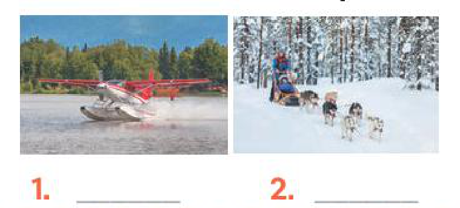
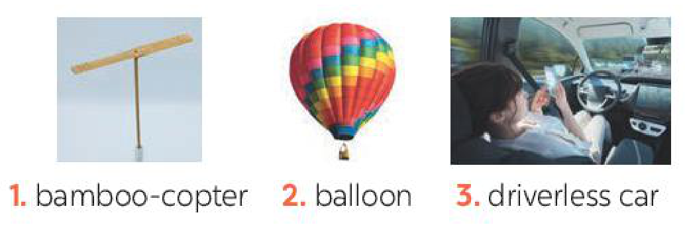

<!-- pdf:135 -->

# REVIEW 4

**(UNITS 10 - 11 - 12)**

## LANGUAGE

### Pronunciation

**1. Mark (') the stressed syllables in the underlined words. Then listen, check and repeat.**

1. *Driverless* trains will be *popular*.
2. Niagara Falls is Canada's most famous *natural* *attraction*.
3. We can save *energy* by *recycling*.
4. All plants and *animals* need *energy*.
5. He's reading *Guidance for* *Visitors* *to Scotland*.

### Vocabulary

**2. Write the words in the box next to their definitions.**

| source | symbol | coal | attraction | bamboo-copter |
| --- | --- | --- | --- | --- |

| Definition | Word |
| --- | --- |
| 1. It is a place or thing that you get something from. | \_\_\_\_\_\_\_ |
| 2. This means of transport is eco-friendly. | \_\_\_\_\_\_\_ |
| 3. It is a person or an object that represents a place. | \_\_\_\_\_\_\_ |
| 4. It is a non-renewable source of energy. | \_\_\_\_\_\_\_ |
| 5. An object or a place many visitors want to see. | \_\_\_\_\_\_\_ |
<!-- term: attraction -->

**3. Complete the sentences with the words below.**

| national | native | renewable | electrical | public | natural |
| --- | --- | --- | --- | --- | --- |
<!-- ocr-ok: đã đối chiếu ảnh trang gốc, khung từ gợi ý gồm 2 hàng ngang bị OCR đọc dọc theo cột -->

1. SkyTrans and driverless buses will be popular \_\_\_\_\_\_\_ means of transport.
2. Niagara Falls is a \_\_\_\_\_\_\_ wonder of both the USA and Canada.
3. The colours of the UK's \_\_\_\_\_\_\_ flag are red, white, and blue.
4. Solar energy and hydro energy are \_\_\_\_\_\_\_ sources.
5. Kangaroos are \_\_\_\_\_\_\_ to Australia.
6. We can save electricity by using fewer \_\_\_\_\_\_\_ appliances.

### Grammar

**4. Use the correct tense and form of each verb in brackets to complete the sentence.**

1. At present, our class (do) \_\_\_\_\_\_\_ a big project on how to save energy in our school.
2. My biggest dream is that I (visit) \_\_\_\_\_\_\_ Edinburgh one day.
3. At present, my city (build) \_\_\_\_\_\_\_ stations for skyTrans.
4. In the future, we (use) \_\_\_\_\_\_\_ more renewable energy in our daily life.
5. I hope that we (have) \_\_\_\_\_\_\_ flying cars for faster travel soon.

**5. Find and cross (—) ONE incorrect article in each sentence and write the correct one.**

| | Correct |
| --- | --- |
| 1. A Roadster is the automatic electric car. | |
| 2. What is the meaning of a word 'eco-friendly'? | |
| 3. A Statue of Liberty is in the USA. | |
| 4. The Maori are a native people of New Zealand. | |
| 5. Can you give me a example of an electrical appliance? | |
| 6. The teacher is talking about means of transport in a future. | |

<!-- pdf:136 -->

## SKILLS

### Reading

**1. a. Read the passage. Find a word and a phrase from the passage and write them under their correct pictures.**

1. \_\_\_\_\_\_\_
2. \_\_\_\_\_\_\_

**ALASKA**

Alaska is perhaps the most amazing state in the USA. It has coastlines facing both the Arctic Ocean and the Pacific Ocean. This state has three million lakes. That's four lakes per person living there.

We cannot reach many cities in Alaska by road, sea, or river. The only way to get there is by air, dogsled, or on foot. That's why Alaska has the busiest sea airport in the world, the Lake Hood Seaplane Base. Nearly two hundred float planes take off and land on the water of this airport every day. It's really a fun scene to watch.
<!-- term: dogsled -->

In summer, the sun does not set for nearly three months in Alaska. But in winter we rarely see the sun. It is dark.

All Alaskans take special pride in their beautiful and unique state.

**b. Choose the correct answer A, B, or C to complete each sentence.**

1. Alaska \_\_\_\_\_\_\_.
   A. is another name for the USA
   B. is an island in the Pacific Ocean
   C. is part of the USA
2. Alaska has \_\_\_\_\_\_\_.
   A. more lakes than people
   B. more people than lakes
   C. only a few lakes
3. The sea airport in Alaska is \_\_\_\_\_\_\_.
   A. interesting
   B. busy
   C. small
4. In Alaska we can see the sun \_\_\_\_\_\_\_.
   A. 24 hours a day for three months
   B. all year round
   C. every day in winter

### Speaking

**2. Work in groups. Read the list of activities and discuss which ones are energy-saving and which ones are not. Explain your answer.**

1. Opening doors and windows during the day to get sunlight.
2. Spending more time indoors than outdoors.
3. Closing doors and windows tightly when the air conditioner is on.
4. Reusing bottles, paper, and clothes.
5. Taking a bus to school instead of taking a car.
6. Using plastic bags for shopping.

### Listening

**3. Listen and complete each sentence with ONE word.**

1. At the meeting they introduce the \_\_\_\_\_\_\_ bike.
2. The product aims at school children and their \_\_\_\_\_\_\_.
3. Question 1 is about special \_\_\_\_\_\_\_ in the air.
4. Question 2 is about air \_\_\_\_\_\_\_ laws.
5. Question 3 is about how the flying bike finds a place to \_\_\_\_\_\_\_.

### Writing

**4. Choose one of the future means of transport below. Write a paragraph of about 70 words about it.**

1. bamboo-copter
2. balloon
3. driverless car

**You can mention:**
- its name
- its speed (fast / slow)
- its use of energy (little / much / none)
- the number of people it can carry
- its safety (safe / dangerous)

## 📷 Danh sách hình trong bài

| Mã hình | Trang PDF | Trang sách | Chú thích / Mô tả |
| --- | --- | --- | --- |
| H7-tieng_anh-r04-01 | 136 | 135 | Hai bức ảnh đánh số 1–2 dùng để tìm từ và cụm từ tương ứng trong bài đọc *Alaska* (thủy phi cơ cất cánh trên mặt nước và xe trượt tuyết chó kéo) thuộc bài tập 1a phần Skills – Reading |
| H7-tieng_anh-r04-02 | 136 | 135 | Ba phương tiện giao thông tương lai gợi ý cho bài viết đoạn văn bài tập 4 phần Skills – Writing: 1. *bamboo-copter* (chong chóng tre), 2. *balloon* (khinh khí cầu), 3. *driverless car* (ô tô không người lái) |
