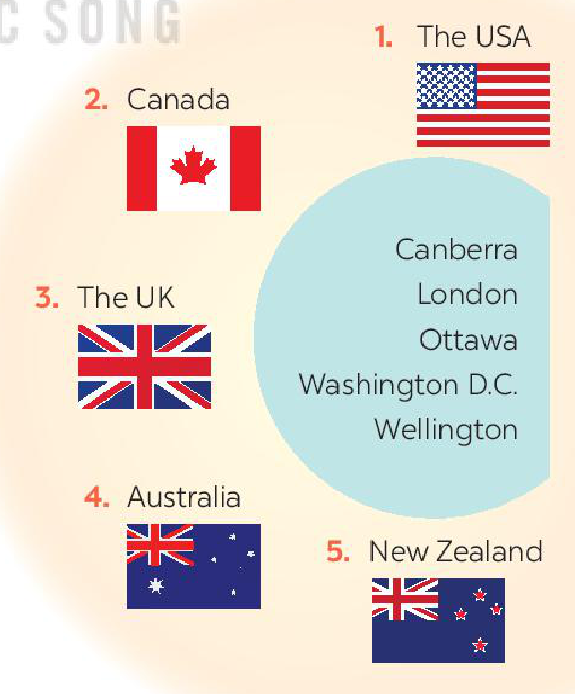
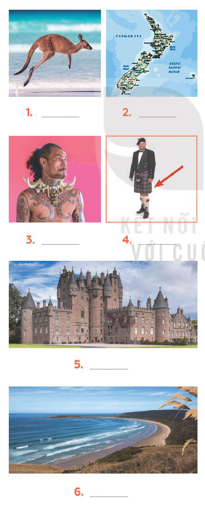
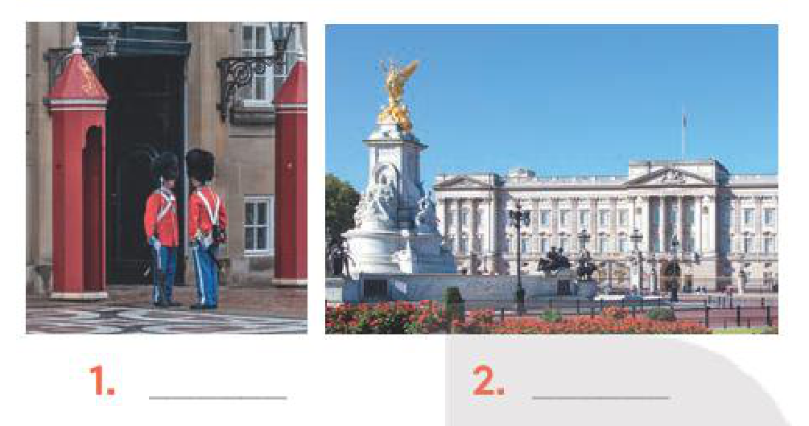
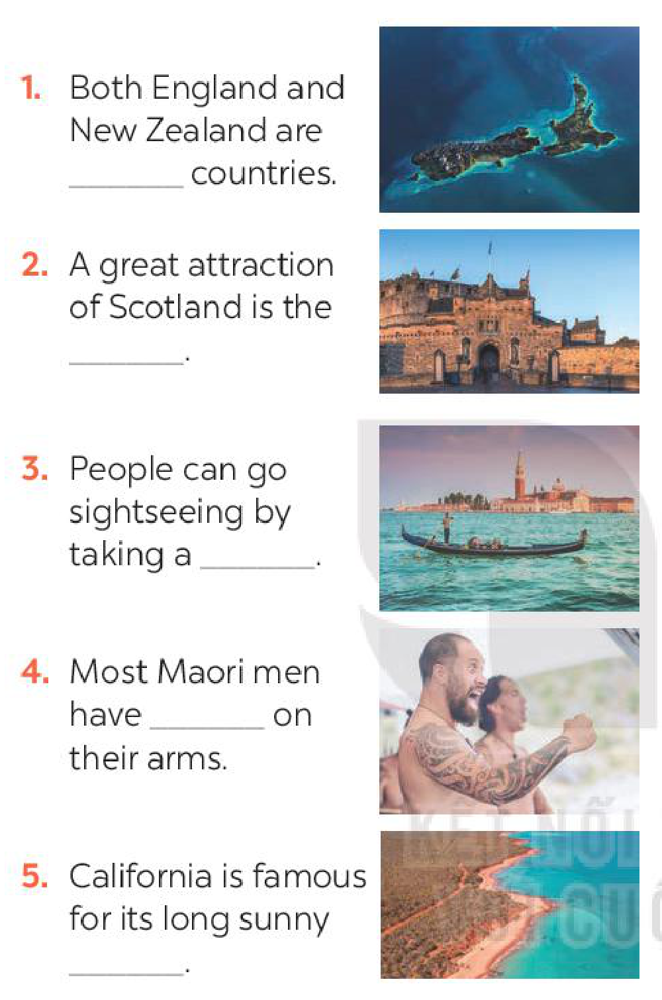

<!-- pdf:125 -->

# UNIT 12: ENGLISH-SPEAKING COUNTRIES

> **THIS UNIT INCLUDES:**
> - **Vocabulary:**
>   - People and places in English-speaking countries
> - **Pronunciation:**
>   - Rising and falling intonation for questions
> - **Grammar:**
>   - Articles: *a*, *an*, *the*
> - **Skills:**
>   - Reading about New Zealand
>   - Talking about Scotland
>   - Listening to a guide about a tour of a city
>   - Writing a diary entry about a tour of a city
> - **Everyday English:**
>   - Expressing amazement

## GETTING STARTED

**A holiday in Australia**

**1. Listen and read.**

**Mark:** How was your holiday in Australia, Phong?

**Phong:** It was fantastic! I got to use my English in real life: asking for directions, reading maps, talking to local people, ...

**Mark:** Oh ... Your English is much better.

**Phong:** Thanks.

**Mark:** Did you travel a lot?

**Phong:** Just around Melbourne, the city with four seasons in a day.

**Mark:** Wow ... I didn't know that. How was it?

**Phong:** It was great! We took a tour to Phillip Island.
<!-- term: penguin watching -->

**Mark:** What did you see?

**Phong:** We went penguin watching.
<!-- term: penguin watching -->

**Mark:** It sounds pretty exciting.

**Phong:** It was. Australia has amazing landscapes.

**Mark:** Yes, and Australians love outdoor activities.

**Phong:** Right. There were plenty of people enjoying the parks and beaches.

**Mark:** I'm glad that you had a wonderful time there.

**Phong:** Thanks, Mark.

<!-- pdf:126 -->

**2. What are Phong and Mark talking about?**

A. Phong's holiday in Australia
B. English-speaking countries
C. The tour to Phillip Island

**3. Read again and tick (✓) the information you can find in the conversation.**

- [ ] 1. In Australia, Phong used English in real life.
- [ ] 2. Phong visited some museums.
- [ ] 3. Phillip Island is far from Melbourne.
- [ ] 4. Australia is beautiful.
- [ ] 5. Australians love outdoor activities.

**4. Complete the sentences with the words and phrases from the box.**

| island | sunset | landscape | Australians | penguin watching |
| --- | --- | --- | --- | --- |

1. This is a picture of the \_\_\_\_\_\_\_ in my village.
2. – Where did you go \_\_\_\_\_\_\_?
   – On the beach.
3. – Is Phu Quoc a(n) \_\_\_\_\_\_\_?
   – Yes, it is.
4. We had dinner on the beach after \_\_\_\_\_\_\_.
5. Most \_\_\_\_\_\_\_ like outdoor sports and games.
<!-- term: penguin watching -->
<!-- ocr-ok: đã đối chiếu ảnh trang gốc, OCR đọc dính chữ ở câu 2, 3 và các chỗ trống điền từ -->

**5. GAME What's its capital?**
<!-- ocr-ok: đã đối chiếu ảnh trang gốc, chữ GAME trong các ô màu bị OCR đọc nhầm -->

**Work in groups. Match the countries with their capitals. The first group to find all the correct answers wins.**

| Countries | Capitals |
| --- | --- |
| 1. The USA | Canberra |
| 2. Canada | London |
| 3. The UK | Ottawa |
| 4. Australia | Washington D.C. |
| 5. New Zealand | Wellington |
<!-- ocr-ok: đã đối chiếu ảnh trang gốc, tên 5 nước xếp quanh vòng tròn tên 5 thủ đô -->

<!-- pdf:127 -->

## A CLOSER LOOK 1

### Vocabulary

**1. Write the words or phrases under the correct pictures.**

| | |
| --- | --- |
| island country | Scottish kilt |
| tattoo | castle |
| kangaroo | coastline |

1. \_\_\_\_\_\_\_
2. \_\_\_\_\_\_\_
3. \_\_\_\_\_\_\_
4. \_\_\_\_\_\_\_
5. \_\_\_\_\_\_\_
6. \_\_\_\_\_\_\_
<!-- ocr-ok: đã đối chiếu ảnh trang gốc, các chỗ trống đánh số 1-6 dưới tranh bị OCR bỏ sót -->

**2. Use the words in the box to complete the sentences.**

| native | amazing | unique | local | ancient |
| --- | --- | --- | --- | --- |

1. From the top of the mountain, we had a(n) \_\_\_\_\_\_\_ view of the valley below.
2. Scotland is famous for its long history and \_\_\_\_\_\_\_ castles.
3. The long fences around the sheep farms in Australia are \_\_\_\_\_\_\_. You can't find them anywhere else in the world.
4. When you visit a new place, talk to the \_\_\_\_\_\_\_ people.
5. Kangaroos are \_\_\_\_\_\_\_ to Australia. It is their home.
<!-- term: unique -->
<!-- term: kangaroo -->

**3. Work in pairs. Discuss and write the word or phrase in the box next to its explanation.**

| symbol | boat ride | capital | tower |
| --- | --- | --- | --- |

| Explanation | Word / Phrase |
| --- | --- |
| 1. a tall narrow building with a small top | |
| 2. an object representing a place | |
| 3. the most important city of a country | |
| 4. a tour on a river | |
<!-- term: boat ride -->

### Pronunciation

**Rising and falling intonation for questions**

**Remember!**

We use rising intonation for *yes / no questions*.

We use falling intonation for *wh-questions*.

<!-- pdf:128 -->

**4. Listen and repeat, paying attention to the intonation of the following questions.**

1. Can you speak English? ↗
2. Is Australia an island? ↗
3. Will you visit Washington next year? ↗
4. What is the capital of Scotland? ↘
5. How big is Canada? ↘

**5. Circle the correct intonation. Then listen and repeat.**

1. Where is Canada? ↗ / ↘
2. Could you show me Singapore on this map? ↗ / ↘
3. How many states are there in the USA? ↗ / ↘
4. Is English an official language in Malaysia? ↗ / ↘
5. Do you know much about New Zealand? ↗ / ↘

## A CLOSER LOOK 2

### Grammar

*Articles*

**1. Complete the sentences with a / an or the.**

1. Is Washington D.C. \_\_\_\_\_\_\_ capital of the USA?
2. Can you give me \_\_\_\_\_\_\_ example of an English-speaking country?
3. The London Eye is \_\_\_\_\_\_\_ great attraction in London.
4. Canada is \_\_\_\_\_\_\_ very cold country.
5. I love \_\_\_\_\_\_\_ New Zealand's countryside.
<!-- term: attraction -->
<!-- ocr-ok: đã đối chiếu ảnh trang gốc, OCR đọc dính chữ và bỏ các gạch ngang chỗ trống câu 1-5 -->

**Remember!**

We use *the*
- with superlatives.
  *Example:* *The largest* city in Australia is Sydney.
- with the names of some places.
  *Example:* My son is studying in *the USA*.
- if one of the words in the place name is a common noun (island, bridge, river, tower, ...).
  *Example:* *The Tower Bridge* in London is over one hundred years old.
<!-- term: Articles -->

**2. Put in the where necessary.**

1. \_\_\_\_\_\_\_ Statue of Liberty is in \_\_\_\_\_\_\_ New York.
2. \_\_\_\_\_\_\_ Scotland is a part of \_\_\_\_\_\_\_ UK.
3. New Zealand consists of \_\_\_\_\_\_\_ North Island and \_\_\_\_\_\_\_ South Island.
4. Disneyland in \_\_\_\_\_\_\_ California is one of \_\_\_\_\_\_\_ biggest entertainment centres in the world.
5. Bangkok is \_\_\_\_\_\_\_ most popular city for tourists in \_\_\_\_\_\_\_ Kingdom of Thailand.

**3. Put in a / an or the.**

| Country | People (singular) | People (plural) |
| --- | --- | --- |
| Canada | (1) \_\_\_\_\_\_\_ Canadian | Canadians |
| The USA | (2) \_\_\_\_\_\_\_ American | Americans |
| England | (3) \_\_\_\_\_\_\_ Englishman | (4) \_\_\_\_\_\_\_ English |
| New Zealand | (5) \_\_\_\_\_\_\_ New Zealander | New Zealanders |
<!-- ocr-ok: đã đối chiếu ảnh trang gốc, OCR bỏ dòng tiêu đề bảng và đọc lệch các ô điền mạo từ -->

<!-- pdf:129 -->

**4. Complete the sentences with a / an, or the.**

1. The man sitting next to her is \_\_\_\_\_\_\_ Englishman.
2. \_\_\_\_\_\_\_ River Thames runs through London.
3. Here is \_\_\_\_\_\_\_ map of the city of Edinburgh.
4. What is \_\_\_\_\_\_\_ most popular sport in Canada?
5. We want to visit \_\_\_\_\_\_\_ attraction in Sydney.
6. \_\_\_\_\_\_\_ Statue of Liberty was a present from France.
<!-- ocr-ok: đã đối chiếu ảnh trang gốc, OCR đọc dính chữ câu 4, 5 và bỏ các gạch ngang chỗ trống -->

**5. Tick (✓) if the underlined articles are correct. If they aren't, write the correct ones in the space provided.**

1. "What do you call a person from England?" – "*The* Englishman." \_\_\_\_\_\_\_
2. Edinburgh is *a* capital city of Scotland. \_\_\_\_\_\_\_
3. Queenstown is *a* amazingly beautiful town. \_\_\_\_\_\_\_
4. Are ancient castles *an* attraction of Scotland? \_\_\_\_\_\_\_
5. Where can you see *a* red telephone box? \_\_\_\_\_\_\_

## COMMUNICATION

### Everyday English

**Expressing amazement**

**1. Listen and read the conversations, paying attention to the highlighted parts.**

**Mark:** Scottish men wear kilts, short skirts at their traditional festivals.
<!-- term: Scottish kilt -->

**Lan:** *Wow ... I didn't know that!*

---

**Lan:** In 2019, Walt Disney World in California attracted nearly 21 million visitors.

**Tom:** *Amazing!*

**2. Work in pairs. Make similar conversations with the following situations, using expressions of amazement.**

1. New Zealand has the cleanest and safest air on the planet.
2. There are no snakes in New Zealand.
3. More than half of all the lakes in the world are in Canada.

<!-- pdf:130 -->

**Interesting facts about English-speaking countries**

**3. Work in groups. Discuss and write the name of the country next to the fact.**

| Canada | the USA | the UK | Australia | New Zealand |
| --- | --- | --- | --- | --- |

| Fact | Country |
| --- | --- |
| 1. This country is famous for its kangaroos. | |
| 2. This country has a large population, only smaller than that of China and India. | |
| 3. This country lies close to the North Pole and is very cold in winter. | |
| 4. This country is famous for its royal family. | |
| 5. This is a small island country in the Pacific Ocean. | |

**4. Work in pairs. Read some facts about English-speaking countries and tick (✓) the column true for you. Then role-play by one person saying one statement aloud and the other responding to it.**

*Example:*
- **A:** New York is the biggest city but not the capital of the USA.
- **B:** I know this.
- **A:** The state of Alaska in the USA has over 2,600 islands.
- **B:** This is new to me.

| | This is new to me. | I know this. |
| --- | --- | --- |
| 1. There are more sheep than people in New Zealand, around 6 sheep per person. | | |
| 2. The Statue of Liberty is in New York. | | |
| 3. Canada has the longest coastline in the world. | | |
| 4. About 90% of Australians live on the coast. | | |
| 5. Football is the most popular sport in England. | | |

**5. Work in groups. Share with your group some interesting facts you know about English-speaking countries. The group takes notes and presents its findings to the class.**

<!-- pdf:131 -->

## SKILLS 1

### Reading

**1. Work in pairs. Discuss and choose the correct answer A, B, or C.**

1. New Zealand is near \_\_\_\_\_\_\_.
   A. Australia
   B. the USA
   C. the UK
2. New Zealand is famous for its \_\_\_\_\_\_\_.
   A. film industry
   B. beautiful nature
   C. modern cities

**2. Read the passage and match the words in bold from the passage (1–4) with their meanings (a–d).**

**NEW ZEALAND**

New Zealand is an island country in the Pacific Ocean. It is one of the most interesting countries in the world.

Everywhere you go, you can see amazing natural landscapes: green mountains, **shining** beaches, high waterfalls, and **ancient** forests. You can visit the beautiful place where they filmed *The Lord of the Rings*, or **historic** Queenstown. This is also a great country for lovers of outdoor activities. You can always find something to do here: skiing, boating, bushwalking.

New Zealand is **rich** in culture. Most visitors to New Zealand love its unique Maori culture. The Maori are the native people of this country. They are famous for their unique tattoos and haka dance.
<!-- term: unique -->

A visit to this beautiful country will be an experience you will never forget.

| | |
| --- | --- |
| 1. shining | a. connected with the past |
| 2. ancient | b. having a lot |
| 3. historic | c. bright and sunny |
| 4. rich | d. very, very old |
<!-- ocr-ok: đã đối chiếu ảnh trang gốc, OCR đọc sót dòng a. connected with the past và 4. rich trong bảng nối nghĩa -->

**3. Read the passage again and choose the correct answer A, B, or C.**

1. New Zealand is a \_\_\_\_\_\_\_ country.
   A. strange
   B. rich
   C. beautiful
2. A natural attraction of New Zealand is its \_\_\_\_\_\_\_.
   A. Maori culture
   B. shining beaches
   C. outdoor activities
3. New Zealanders love \_\_\_\_\_\_\_.
   A. haka dancing
   B. sports and games
   C. indoor activities
4. The haka dance is an example of \_\_\_\_\_\_\_.
   A. the Maori culture
   B. New Zealand's history
   C. outdoor activities
5. The writer mentioned \_\_\_\_\_\_\_ as one of New Zealand's attractions.
   A. traditional food
   B. hard-working people
   C. rich culture

### Speaking

**4. Work in pairs. Note two things you like about New Zealand. Share them with your partner.**

**You can start with:**

There are two things I like about New Zealand. They are ...

**5. Work in groups. Prepare a short introduction of Scotland and present it to the class.**

**Some facts about Scotland**
- Location: in the north of Great Britain
- Famous for: rich culture, beautiful nature, ancient castles
- To-do list:
  + see unique Scottish activities like drumming, dancing ...
  + visit: the Edinburgh Castle, the Royal Mile, Loch Ness ...
- People: friendly, creative
<!-- ocr-ok: đã đối chiếu ảnh trang gốc, OCR đọc nhầm cụm drumming, dancing thành ung Fancing -->

<!-- pdf:132 -->

## SKILLS 2

### Listening

**A tour around London**

**1. Work in groups. Match the phrases to the pictures.**

| |
| --- |
| Buckingham Palace |
| Changing of the Guard |

1. \_\_\_\_\_\_\_
2. \_\_\_\_\_\_\_

**2. A tour guide is talking about the schedule for a day trip in London. Listen and fill in the times.**

- Go to Buckingham Palace: 9:30 a.m.
- Watch the Changing of the Guard: (1) \_\_\_\_\_\_\_
- Lunch: (2) \_\_\_\_\_\_\_
- The boat ride: (3) \_\_\_\_\_\_\_
- Back to the hotel: (4) \_\_\_\_\_\_\_
<!-- term: boat ride -->

**3. Listen again and complete each sentence with ONE word.**

1. The \_\_\_\_\_\_\_ and her family live in Buckingham Palace.
2. At the Palace, you can see the Queen's beautiful \_\_\_\_\_\_\_.
3. Another name for Big Ben is the \_\_\_\_\_\_\_ Tower.
4. After lunch, you can go around and take \_\_\_\_\_\_\_.
5. On the boat ride, you can see historic \_\_\_\_\_\_\_ along the river.

### Writing

**4. Work in pairs. Fill in the table with information about the London tour.**

| Time | Place | Activity |
| --- | --- | --- |
| 9:30 a.m. | Buckingham Palace | - visiting the Queen's garden - .... |
| | | |
| | | |
| | | |
<!-- ocr-ok: đã đối chiếu ảnh trang gốc, OCR đọc thiếu dấu hai chấm trong 9:30 a.m. -->

**5. Imagine that you took the tour of London. Write a diary entry of about 70 words about your tour, based on the table in 4 or use your imagination.**

**You can start with:**

First, I went to \_\_\_\_\_\_\_\_\_\_\_\_\_\_\_\_\_\_\_\_\_\_\_\_\_\_\_\_\_\_\_\_\_\_\_\_\_\_\_\_\_\_\_

<!-- pdf:133 -->

## LOOKING BACK

### Vocabulary

**1. Look at the pictures and write the correct words or phrases to complete the sentences.**

1. Both England and New Zealand are \_\_\_\_\_\_\_ countries.
2. A great attraction of Scotland is the \_\_\_\_\_\_\_.
3. People can go sightseeing by taking a \_\_\_\_\_\_\_.
4. Most Maori men have \_\_\_\_\_\_\_ on their arms.
5. California is famous for its long sunny \_\_\_\_\_\_\_.

**2. Choose the best answer A, B, or C to complete each sentence.**

1. – What do you call the people from Canada?
   – \_\_\_\_\_\_\_.
   A. Canadians
   B. Canadian
   C. Canada people
2. Scotland, with its \_\_\_\_\_\_\_ landscapes, attracts millions of visitors every year.
   A. warm
   B. amazing
   C. local
3. – What is a \_\_\_\_\_\_\_ of London?
   – The red telephone box.
   A. capital
   B. symbol
   C. landscape
4. Niagara Falls is a great \_\_\_\_\_\_\_ on the border of the USA and Canada.
   A. forest
   B. river
   C. attraction
5. Aborigines are the \_\_\_\_\_\_\_ people of Australia.
   A. native
   B. historical
   C. foreign

### Grammar

**3. Complete the sentences with a / an or the.**
<!-- ocr-ok: đã đối chiếu ảnh trang gốc, OCR bỏ số 3 và đọc dính cụm an or thành anor -->

1. Auckland is \_\_\_\_\_\_\_ biggest city on \_\_\_\_\_\_\_ North Island of New Zealand.
2. \_\_\_\_\_\_\_ castle is \_\_\_\_\_\_\_ strong building with thick and high walls.
3. Surrounding \_\_\_\_\_\_\_ UK is \_\_\_\_\_\_\_ Atlantic Ocean.
4. Hawaii is \_\_\_\_\_\_\_ state of \_\_\_\_\_\_\_ USA.
5. \_\_\_\_\_\_\_ attraction is \_\_\_\_\_\_\_ interesting place for visitors.
<!-- ocr-ok: đã đối chiếu ảnh trang gốc, OCR đọc dính chữ và bỏ các chỗ trống điền mạo từ câu 1-5 -->

**4. Underline and correct the article mistakes in the sentences below.**

1. Ottawa is a capital of Canada.
2. He's the Englishman. He lives in Oxford.
3. When people travel, they use an map to find their way round.
4. Can you see a Big Ben from where you are standing?
5. Canadians love ice hockey, the winter sport.

<!-- pdf:134 -->

## PROJECT

**EXPLORE ENGLISH-SPEAKING COUNTRIES!**
<!-- ocr-ok: đã đối chiếu ảnh trang gốc, tiêu đề dự án nhiều màu nằm trên nền ảnh đường phố Luân Đôn bị OCR bỏ sót -->

**Work in groups.**

**1. Discuss and choose a place in an English-speaking country.**

**2. Find information about it, including:**
- its name
- its location
- its attractions

**3. Design a poster to introduce the place and present it to the class.**

**4. Your class votes for the most appealing poster.**

### Now I can ...

- use the words related to people and places in English-speaking countries.
- use rising and falling intonation for questions correctly.
- use the articles (*a* / *an* and *the*) correctly.
- express amazement.
- read about New Zealand.
- talk about Scotland.
- listen to a guide about a tour of a city.
- write a diary entry about a tour of a city.

## 📷 Danh sách hình trong bài

| Mã hình | Trang PDF | Trang sách | Chú thích / Mô tả |
| --- | --- | --- | --- |
| H7-tieng_anh-u12-01 | 126 | 125 | Sơ đồ trò chơi *What's its capital?* gồm quốc kì của 5 quốc gia nói tiếng Anh đánh số 1–5 (*The USA*, *Canada*, *The UK*, *Australia*, *New Zealand*) và vòng tròn tên 5 thủ đô thuộc bài tập 5 phần Getting Started |
| H7-tieng_anh-u12-02 | 127 | 126 | Sáu bức ảnh đánh số 1–6 dùng để điền từ vựng chủ đề các quốc gia nói tiếng Anh (*kangaroo*, *island country*, *tattoo*, *Scottish kilt*, *castle*, *coastline*) thuộc bài tập 1 phần A Closer Look 1 – Vocabulary |
| H7-tieng_anh-u12-03 | 130 | 129 | Quốc kì kèm nhãn tên 5 quốc gia (*Canada*, *the USA*, *the UK*, *Australia*, *New Zealand*) thuộc bài tập 3 phần Communication |
| H7-tieng_anh-u12-04 | 132 | 131 | Hai bức ảnh đánh số 1–2 minh hoạ *Changing of the Guard* và *Buckingham Palace* thuộc bài tập 1 phần Skills 2 – Listening |
| H7-tieng_anh-u12-05 | 133 | 132 | Khung 5 câu điền từ kèm 5 bức ảnh minh hoạ (*island*, *castle*, *boat ride*, *tattoos*, *coastline*) thuộc bài tập 1 phần Looking Back – Vocabulary |
